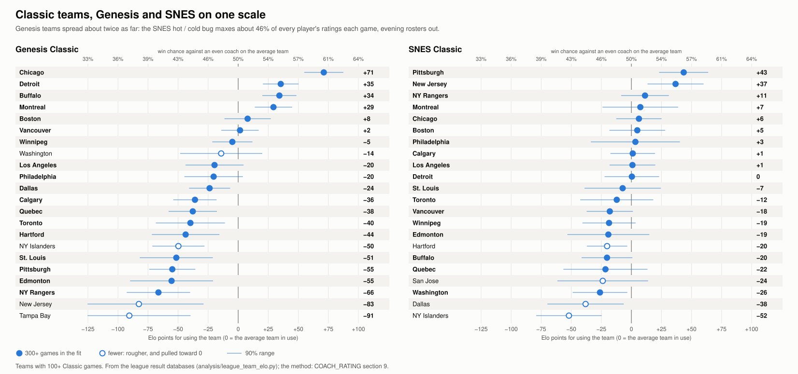

# Classic team strengths: a quick reference

What each NHL '94 Classic team is worth in league play, Genesis and SNES, from every Classic league game (about
23,000 Genesis and 15,000 SNES games since 2013; refitted 2026-11-19). The full method is in
[COACH_RATING](COACH_RATING.md) section 9; the numbers behind "why" are in [LEAGUE_RESULTS](LEAGUE_RESULTS.md).

## The one-sentence version

On the Genesis the team you draft matters a lot: Chicago is worth about **+70 Elo**, the Rangers about **−65**. On the
SNES the teams sit **about half as far apart**, with Pittsburgh and New Jersey alone at the top, because a bug in the
SNES game hands every player maximum ratings much of the time.

## How the numbers are made (say it in two breaths)

- **Same people, different teams.** A team isn't judged by its record; that mostly reflects who drafted it. It's
  judged by **how the same coaches do with it against how they do with their other teams**. If coach after coach does
  better with Chicago than with anything else, that's Chicago.
- **The unit is Elo points**, added to a coach's rating for using the team, on the league's own Elo (K 20, the
  coasting bonus). +50 is about a **57% win chance** against an equal coach on an average team; 0 is the average team
  as used in the leagues.
- Rarely used teams are pulled toward average, so their values read milder than their results (hollow dots in the
  charts).

## Genesis: the tiers

| Tier | Teams (Elo points) | Against an equal coach on an average team |
| --- | --- | --- |
| **The one to have** | **Chicago +71** | wins about 60% |
| Contenders | Detroit +35, Buffalo +34, Montreal +29 | about 54-55% |
| The middle | Boston +8, Vancouver +2, Winnipeg −5 | about 50% |
| A step down | Los Angeles −20, Philadelphia −20, Dallas −24 (Washington −14, rough) | about 47% |
| Weak | Calgary −36, Quebec −38, Toronto −40, Hartford −44 | about 45% |
| The ones to avoid | St. Louis −51, Pittsburgh −55, Edmonton −55, **NY Rangers −66** (NY Islanders −50, New Jersey −83, Tampa Bay −91: rough) | about 41-43% |

- **Chicago against the Rangers** is a 137-point gap: an equal coach wins about **69%** of the time, worth about **1.6
  goals a game**.
- **Pittsburgh, the best team on paper, is one of the worst to use.**
- **Why, in the game's own terms:** strength goes with the **starting goalie's Agility** (his reach: the biggest single
  factor, correlation +0.60) and **light skaters** (−0.43: lighter men accelerate faster on the Genesis), then Agility,
  Overall, Speed and Checking. Shot Power, Speed and goalie Agility together explain about half the spread.
- **Solid numbers:** two random halves of the leagues, fitted apart, agree at 0.77; using the team values predicts
  Genesis games measurably better.

## SNES: the tiers

| Tier | Teams (Elo points) | Against an equal coach on an average team |
| --- | --- | --- |
| **The top two** | **Pittsburgh +43, New Jersey +37** | wins about 55-56% |
| The pack | NY Rangers +11, Montreal +7, Chicago +6, Boston +5, Philadelphia +3, Calgary +1, Los Angeles +1, Detroit 0 | about 50-52% |
| A step down | St. Louis −7, Toronto −12, Vancouver −18, Winnipeg −19, Edmonton −19, Buffalo −20, Quebec −22, Washington −26 (Hartford −20, San Jose −24: rough) | about 46-49% |
| The bottom (rarely used) | Dallas −38, NY Islanders −52 | about 43-45% |

- Even **Pittsburgh against Washington** (69 points) is only about a **60%** game for an equal coach; best to worst
  well-used team is worth about **1 goal a game**, against the Genesis's 1.6.
- **Why so flat: the hot / cold bug.** Before every game the SNES rolls a "hot or cold" value for each player's
  ratings; a bug makes a *cold* roll **max the rating instead of lowering it**. About **46% of every player's ratings
  are at maximum in every game**, whatever the roster says, so a weak team's skaters are often great on the night.
- **Why New Jersey: weight.** SNES strength goes with **heavy skaters (+0.71)** and Checking (+0.32), not Speed or the
  goalie's Agility (every SNES goalie covers the same net). **Weight is copied straight from the roster with no hot /
  cold**, so it's the one edge a roster keeps in full every game, and New Jersey is heavy. (Weight also costs less
  acceleration on the SNES than on the Genesis. Why heavy is *good* isn't fully pinned down; why it *shows through*
  is the bug.)
- **Rougher numbers:** the two halves agree at only 0.38, and the team values add almost nothing to predicting SNES
  games once you know the coaches. Talk about the SNES in groups: the top two, the pack, the rest.

## Lines for the show

- "On the Genesis, the draft is half the battle: Chicago over the Rangers is like spotting a coach 137 rating points."
- "On the SNES the game itself evens it out: nearly half of everyone's ratings are maxed every game by a bug, so the
  roster matters less, except weight, which the bug never touches. That's why New Jersey, of all teams, is near the
  top."
- "Pittsburgh is the best team on paper on the Genesis and one of the worst to actually use; on the SNES it's the best."
- "We don't judge a team by its record. We judge it by how the same coaches do with it and without it."

## Caveats worth a sentence

- A hollow dot (fewer than 300 games in the fit) is rough, and pulled toward average; Tampa Bay, New Jersey and the
  Islanders on the Genesis, Dallas and the Islanders on the SNES are the big ones.
- One roster per abbreviation: a league that changed a team's roster blurs it.
- Leagues occasionally leave the top teams out of the draft for fun; that isn't allowed for.

## The charts

- `docs/img/elo_teams_both.svg` / `.png`: both systems side by side, same scale (the spread difference at a glance).
- `docs/img/elo_teams_genesis.svg`, `elo_teams_snes.svg`: one system each, the same scale; `elo_teams_snes_zoom.svg`:
  the SNES on a narrower scale. Each team's dot, its 90% range, and the win chance on the top axis.
- Redraw after a refit: `python analysis/league_team_elo.py`, then `python analysis/make_elo_line.py`.
