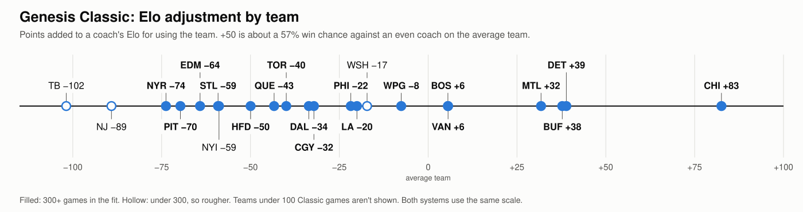
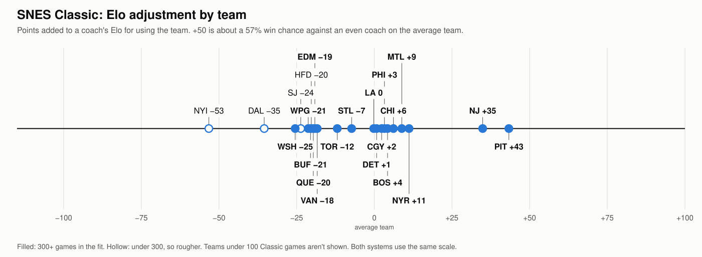

# How the coach ratings are calculated

This document explains how the league coach ratings are made, how they were tested and what they can't tell you. The code is
`analysis/coach_rating.py`. The tables with players' names stay in the private league data folder, so this document has
aggregates only. Results use league games through 2026-11-03. Every Classic team has its own entry in [TEAM_GUIDE_GENESIS.md](TEAM_GUIDE_GENESIS.md) and
[TEAM_GUIDE_SNES.md](TEAM_GUIDE_SNES.md).

## The short version

A rating is a coach's estimated chance of beating an average coach, with neutral teams and no home edge. To get it:

1. Every game gets a score: the win or loss, plus a bonus for how early the win was safe.
2. Every game becomes one equation that links the two coaches, their teams and the home edge.
3. All the equations are solved together, so a result counts for more or less depending on who it came against.
4. Recent games count more, and small samples are pulled toward the middle.
5. The answer is converted to a win chance using how well ratings predicted later games, with 50 set to the mean coach who has 100+
   games in that table.

## 1. The games

The source is the league result databases: every league game since 2013 on both systems.

A game is used if it has a home and away score, two different named players and a valid date. Games marked as simulated are
skipped. Regular-season and playoff games count the same. Names are compared in lower case.

- **Classic leagues.** A Classic league's name starts with `Classic_Spring`, `Classic_Summer` or `Classic_Fall`. These play the retail rosters.
- **Repeated results.** About 0.3% of rows repeat another row's league, players, score, shots and goal list. These stay in. They're
  usually a real second game, played when no save state was taken after the first, so an earlier save state with the right winner was used again.
- **Period lengths.** Nearly all leagues play 5-minute periods. A league's length is read from its longest regulation goal, and goal times in the
  few others are converted to a share of the period: two Genesis leagues with 7-minute periods and three with 3-minute periods, 890 games in all. No
  SNES league or league group is affected. Short overtimes need nothing, because overtime wins get no coasting bonus.

There are six tables, each fitted entirely on its own games:

| Table | Which leagues | Games | Coaches | With 100+ games |
| --- | --- | --- | --- | --- |
| Genesis, all leagues | all but five outlier leagues | 86,804 | 326 | 172 |
| SNES, all leagues | all but five outlier leagues | 35,811 | 223 | 95 |
| Genesis Classic | Classic leagues | 22,757 | 281 | 120 |
| SNES Classic | Classic leagues | 15,017 | 182 | 75 |
| Genesis Chaos | name starts with "Chaos" | 11,711 | 106 | 62 |
| SNES Draft | name starts with "SNES_Draft" | 7,918 | 65 | 37 |

## 2. The score for each game

The winner gets a positive score and the loser the same score as a negative. A tie is 0.

`score = 1 + coasting bonus`, where the bonus can't go above 1.

**The coasting bonus** (this rating's own measure; the league's Elo in section 9 has a different one) is the final unbroken stretch of regulation in which the eventual winner was safe, as a share of a third
period's length. "Safe" means a lead of 2 or more goals and a 90%+ chance of winning given only that lead and the time left. That
chance is taken from how such positions turned out in the same table's games. The check runs every 10 seconds of game time.

| Result | Score |
| --- | --- |
| Tie | 0 |
| Overtime win, or any 1-goal win | 1 |
| Win by 2+ goals, never safe for long | at least 1.1 |
| Safe for the last half of a third period's length | 1.5 |
| Safe for a third period's length or longer | 2 (the maximum) |

A very few games have no usable goal times. They get a bonus of 0.1 if the margin was 2 or more, otherwise none.

Shots, xG and other game stats aren't used. Goals matter only through the win and the coasting bonus.

All scores are then divided by their spread (standard deviation, about 1.5), so that the settings in section 5 mean the same thing
across the tables. The examples below use round numbers before that step, for simplicity.

## 3. One equation per game

`game score = home coach − away coach + home team − away team + home edge`

The score is from the home side's view. The coaches and teams are unknown numbers (their strengths), and the home edge is one more
unknown shared by the whole table. Genesis Classic has 22,757 equations and 304 unknowns: 281 coaches, 22 teams and the home edge.

**Team terms apply only to Classic leagues,** where the same abbreviation means the same roster. Elsewhere rosters differ, so no team term is fitted
and a coach's drafting and roster become part of their rating. A team needs 100+ appearances to get a term. A game involving a team below that, or two
sides on the same team, has no team terms at all.

## 4. Solving them together

No set of strengths can fit every game, because upsets happen. For any candidate set of strengths, each game has a **miss**:
the actual score minus the expected one. The method is weighted ridge regression: choose the strengths that make this total as
small as possible.

`total = sum of (game weight × miss²) + pull setting × sum of (strength²)`

Three small examples show what this does.

**Same record, different opponents.** P goes 5-5 against Strong, Q goes 5-5 against Weak, and Strong beats Weak in all 10 of their
games with a score of 1 each. Without the pull, P comes out equal to Strong and Q equal to Weak, so P rates 1 above Q. They have
identical records and never played each other.

**A circle of results.** A beats B, B beats C and C beats A, each with a score of 1. All three come out equal.

**A narrow win can lower a rating.** If a coach is expected to score 1.5 against a much weaker player and scores 1, the miss is
negative and pulls them down slightly. A narrow loss to someone much stronger can raise them. Only the difference from what was
expected moves a rating.

## 5. The pull toward the middle

A small sample mixes skill with luck. An even coach wins 70%+ of 10 games by luck alone 17% of the time, but 70%+ of 100 games only 0.004% of the time.
So the second part of the total charges a cost for every strength away from zero. A rating has to reduce the misses by more than it
costs, so large ratings need evidence.

**The easiest way to picture it is as imaginary tied games.** A pull setting of 2 is roughly like giving every coach 2 extra tied
games against a player at the middle. A setting of 10 is like giving them 10. For a coach whose opponents' strengths are already
known, what's left after the pull is:

`share kept = weighted games ÷ (weighted games + pull setting)`

| Weighted games | Kept at setting 2 | Kept at setting 10 |
| --- | --- | --- |
| 1 | 33% | 9% |
| 5 | 71% | 33% |
| 20 | 91% | 67% |
| 100 | 98% | 91% |

**Where the middle is.** Zero is the plain mean of all coaches in the table, including low-game ones, who are mostly weaker than
regulars. So the middle isn't 50. Its place on the final scale is:

| Genesis, all | SNES, all | Genesis Classic | SNES Classic | Genesis Chaos | SNES Draft |
| --- | --- | --- | --- | --- | --- |
| about 45 | about 36 | about 41 | about 39 | about 39 | about 46 |

A brand-new coach therefore starts well below 50. Coaches with 1-9 games bear this out: their median rating is about 40 in Genesis Classic and
36 in SNES Classic.

**How far it reaches.**
- **Against a hot start:** the pull is fairly light. In Genesis Classic (setting 2), a coach who goes 8-1 against average opponents keeps
  about 80% of their result and would rate about 65. That's short of the top, but it isn't proof either, so use the 100+ game filter when
  ranking.
- **For retired coaches:** age reduces weighted games, so the pull grows after someone stops playing. With a half-life of 1.5 years
  and setting 2, 200 games from 8 years ago count as about 5 weighted games and keep 71%. From 12 years ago they count as less than 1 and
  keep 28%. So retired players drift toward the middle in the main column but not in `career`. This is slow in SNES Classic, where the
  half-life is 3 years: a coach who stopped in 2016 still ranks 4th among coaches with 100+ games.

The home edge has no pull. Team terms have a stronger pull than coaches, a setting of 50, the same as the team Elo adjustments in section 9, so a rarely used team can't come out extreme on a few seasons. Section 11 has the test.

## 6. Recent games count more

Each game's weight halves with every half-life of age: at a half-life of 1.5 years, a game counts 1/2 after 1.5 years, 1/4 after 3
and 1/16 after 6. Age is measured from the last game in that table, so Chaos, which last played in April 2026, is measured from then.

The half-life and pull setting were chosen by testing (section 11), not by judgment:

| Table | Half-life | Pull setting |
| --- | --- | --- |
| Genesis, all leagues | 1.5 years | 10 |
| SNES, all leagues | 1.5 years | 2 |
| Genesis Classic | 1.5 years | 2 |
| SNES Classic | 3 years | 2 |
| Genesis Chaos | 1.5 years | 2 |
| SNES Draft | 1.5 years | 2 |

## 7. From strength to a win chance

Strengths are on an arbitrary scale, so one factor converts them to a chance:

`win chance = 1 / (1 + exp(−factor × strength gap))`

**The factor comes from later games.** Every half year in the last 3 years of the table, the fit uses only earlier games to
predict the next half year's decided games between coaches with 30+ earlier games. The factor is whatever best matches how those games
really came out. A factor fitted on the same games as the strengths would be too large and would overstate chances. Those later games look like this:

| Predicted, about | Genesis, all | SNES, all | Genesis Classic | SNES Classic | Genesis Chaos | SNES Draft |
| --- | --- | --- | --- | --- | --- | --- |
| 55% | 55% | 54% | 57% | 55% | 55% | 58% |
| 65% | 64% | 64% | 64% | 63% | 66% | 63% |
| 75% | 74% | 74% | 74% | 78% | 74% | 72% |
| 85% | 87% | 87% | 82% | 83% | 79% | 88% |

The factor was set on these games, so the overall level is bound to match. The agreement across the bands is the real check. The top band is small in
the league groups (112-231 games), so those are rough. The factors in use are:

| Genesis, all | SNES, all | Genesis Classic | SNES Classic | Genesis Chaos | SNES Draft |
| --- | --- | --- | --- | --- | --- |
| 2.071 | 1.976 | 1.783 | 1.612 | 1.678 | 1.626 |

The factor affects percentages only. It can't change the order of coaches in a table.

**Setting the average.** Only differences between coaches appear in the equation. Adding 10 to everyone changes nothing, so the zero
point has to be chosen. Everyone is shifted so that the mean coach with 100+ games in that table is at exactly 50. Low-game
coaches still count in the fit and are listed in the table, but they don't set this average. This is one reason numbers can't be compared across tables.

**Comparing two coaches in a table.** Turn each rating into `ln(rating ÷ (100 − rating))`, subtract, and put the gap back through
`1 / (1 + exp(−gap))`. For example, an 80 against a 60 is `1.386 − 0.405 = 0.981`, or about 73%. Teams and home edge would shift this further.

## 8. The columns in the private tables

| Column | Meaning |
| --- | --- |
| `win_chance_vs_average` | The main rating, which fades old games, so it's closest to current strength |
| `low`, `high` | One standard error of the coach's gap from the average, either side of the rating, from the fit alone. For retired coaches it's wide, because little weight is left on their games |
| `career` | The same fit with every game weighted equally, on the same factor and shifted so the mean 100+ coach is 50. It's a career average, not a peak. Sharing the factor makes the two columns comparable, but `career` isn't a measured historical win rate |
| `games`, `games_last_2_years`, `last_played` | Simple counts and dates, which don't affect the rating. "Last 2 years" runs back from the table's last game |
| `group` | Which connected group of opponents the coach is in. All six tables have a single group |

The top-player lists use these filters: 100+ games to be listed, and 30+ games in the last 2 years to count as active.

## 9. Classic team strengths

Team strengths don't come from ROM ratings or roster data. They're fitted from the results in the same equations.
The calculation separates coach from team because the same people play on different teams. If many coaches do better with a team than
they do elsewhere, that goes to the team. If one coach does well on everything, that goes to the coach.

The values below are points of win chance above or below 50 for a team against the average team as used in these leagues, weighted by appearances, with
even coaches and no home edge. "Strength now" fades old games like the coach ratings, and "Strength, all years" counts every game the same. "Sides" counts each time a team appeared in a game.

| Genesis Classic | Strength now | Strength, all years | Sides | | SNES Classic | Strength now | Strength, all years | Sides |
| --- | --- | --- | --- | --- | --- | --- | --- | --- |
| CHI | +7.6 | +8.9 | 3,955 | | NJ | +4.6 | +4.0 | 734 |
| DET | +5.8 | +6.8 | 4,124 | | PIT | +3.6 | +4.1 | 2,522 |
| BUF | +3.7 | +4.1 | 3,962 | | NYR | +2.5 | +2.4 | 2,533 |
| MTL | +2.1 | +2.9 | 3,859 | | VAN | +0.8 | +0.2 | 2,105 |
| BOS | +1.4 | +1.0 | 3,812 | | CHI | +0.5 | +1.0 | 2,433 |
| VAN | −0.8 | −0.8 | 3,879 | | LA | +0.4 | +1.3 | 2,239 |
| DAL | −1.1 | −1.3 | 2,675 | | CGY | +0.3 | −0.3 | 1,976 |
| WPG | −1.3 | +0.1 | 3,541 | | WSH | +0.3 | +0.3 | 1,128 |
| HFD | −1.8 | −6.2 | 452 | | MTL | −0.4 | +0.4 | 1,700 |
| CGY | −2.1 | −5.0 | 3,025 | | TOR | −0.5 | −1.4 | 771 |
| TOR | −2.6 | −2.7 | 1,574 | | EDM | −0.9 | −1.8 | 497 |
| NJ | −3.8 | −5.1 | 310 | | STL | −0.9 | −0.1 | 553 |
| LA | −4.0 | −2.3 | 2,379 | | BOS | −0.9 | +1.4 | 2,513 |
| PHI | −4.2 | −4.9 | 1,045 | | WPG | −1.3 | −3.5 | 1,279 |
| NYI | −4.3 | −9.4 | 210 | | DET | −1.5 | −1.5 | 2,327 |
| EDM | −4.6 | −6.6 | 651 | | PHI | −2.1 | −1.1 | 643 |
| QUE | −4.7 | −4.7 | 2,050 | | HFD | −2.2 | −2.3 | 228 |
| WSH | −5.0 | −6.9 | 357 | | QUE | −2.7 | −5.8 | 895 |
| TB | −5.7 | −11.3 | 206 | | BUF | −3.4 | −4.0 | 2,103 |
| PIT | −6.3 | −9.8 | 1,137 | | SJ | −3.8 | −8.3 | 153 |
| STL | −8.2 | −7.4 | 984 | | NYI | −4.6 | −8.1 | 295 |
| NYR | −10.4 | −10.9 | 1,307 | | DAL | −5.8 | −4.3 | 182 |

**How far to trust them.**
- **Genesis values are steadier than SNES ones.** Two random halves of the leagues, fitted apart, agree at 0.77 on the Genesis and 0.38 on the SNES. Read the SNES columns for broad groups only.
- **Some labels get no term.** Genesis Classic has one label under 100 sides (ANH, 20), and SNES Classic has four (OTW 40, ANH 46, TB 65, FLA 74).
- **The assumption is one roster per abbreviation.** If a Classic league used a changed roster, its team value would blur the two.

**Elo adjustments** (`analysis/league_team_elo.py`) say how many points to add to a coach's Elo for using a team. They're fitted on the league's own Elo: every game on the system in date order, a 1500 start,
K 20, +7 for the home side and each team's own adjustment in the expected score, and the winner's gain and loser's loss multiplied by a coasting multiplier. That's 1 for a win by 0 or 1 goals. For a win by 2 or more it's the larger of 1.1 and `1 + coasting seconds / 600`, so ×1.5 from the second-period buzzer. Coasting is the final unbroken stretch in which the winner's lead stays above a line that falls with time: 5 goals before 5:00, 4 to 10:00, 3 to 12:30, then 2. This Elo leaves out a few outlier leagues, and it uses team adjustments in leagues starting `Classic`, `New_Players`, `GENS_Summer_League_Tournament`, `LFG` or `SNES_Summer_League_26`; the fit itself uses only the Classic leagues. Using each coach's Elo at the start of the league (30+ earlier
games), the fit is `P(home wins) = 1 / (1 + 10^(-(home Elo - away Elo + 7 + home team - away team) / 400))`, so a value can be added to a rating as it stands. As the table is part of that Elo, the fit and the Elo are run in turn until they settle, which takes a few passes. Zero is the average team in use. Values
from one fixed strength per coach are shown beside them. An asterisk marks under 300 games in the Elo fit, which leaves out games where either coach had under 30 earlier games when the league began.

Rarely used teams are pulled toward the average team, as in section 5, with a pull setting of 50 on both systems. That was the best setting on the Genesis. On the SNES, settings from 50 to 400 predicted later years about equally (0.6268-0.6270), and more than 50 flattens rarely used teams without evidence. Each ± comes from resampling whole leagues around that pulled value, so it understates the uncertainty of a rarely used team.

| Genesis Classic | Elo adjustment | Fixed strength | | SNES Classic | Elo adjustment | Fixed strength |
| --- | --- | --- | --- | --- | --- | --- |
| CHI | +72 ± 10 | +67 | | PIT | +43 ± 12 | +35 |
| DET | +35 ± 9 | +50 | | NJ | +35 ± 14 | +31 |
| BUF | +33 ± 9 | +26 | | NYR | +11 ± 11 | +23 |
| MTL | +29 ± 9 | +26 | | MTL | +9 ± 18 | +2 |
| BOS | +7 ± 12 | +5 | | CHI | +6 ± 12 | +3 |
| VAN | +1 ± 9 | −6 | | BOS | +4 ± 15 | +14 |
| WPG | −6 ± 10 | −0 | | PHI | +3 ± 21 | −19 |
| WSH* | −14 ± 21 | −48 | | CGY | +2 ± 12 | −8 |
| LA | −19 ± 15 | −21 | | DET | +1 ± 12 | −8 |
| PHI | −20 ± 15 | −33 | | LA | −0 ± 11 | +5 |
| DAL | −24 ± 10 | −10 | | STL | −7 ± 18 | +1 |
| CGY | −34 ± 11 | −40 | | TOR | −12 ± 17 | −13 |
| QUE | −36 ± 12 | −33 | | VAN | −18 ± 14 | −1 |
| TOR | −39 ± 18 | −23 | | EDM | −19 ± 22 | −19 |
| HFD | −44 ± 17 | −41 | | QUE | −20 ± 20 | −43 |
| NYI* | −50 ± 13 | −50 | | HFD* | −20 ± 9 | −15 |
| STL | −53 ± 19 | −47 | | BUF | −21 ± 12 | −28 |
| PIT | −53 ± 11 | −73 | | WPG | −21 ± 13 | −30 |
| EDM | −55 ± 21 | −49 | | SJ* | −24 ± 21 | −28 |
| NYR | −67 ± 16 | −80 | | WSH | −25 ± 14 | +4 |
| NJ* | −83 ± 33 | −30 | | DAL* | −35 ± 17 | −25 |
| TB* | −91 ± 31 | −58 | | NYI* | −53 ± 17 | −41 |





**Whether they help.** Each year's adjustments were fitted on earlier years only, then used inside the running Elo to predict that year's Classic games (log loss, lower is better; 13,728 Genesis and 9,416 SNES games):

| Share of the adjustment used | None | 25% | 50% | 75% | 100% |
| --- | --- | --- | --- | --- | --- |
| Genesis | 0.6434 | 0.6418 | 0.6407 | 0.6399 | 0.6396 |
| SNES | 0.6273 | 0.6270 | 0.6269 | 0.6269 | 0.6270 |

On the Genesis they clearly help, most at full size (by 0.0038 ± 0.0007). On the SNES they make no clear difference (0.0003 ± 0.0005 at full size), so they describe past results more than they improve ratings. The pull setting was chosen on these same years, which flatters these results slightly.

Two more things show up. Rating gaps are worth about 0.7 of their face value at the start of a league on both systems, so this Elo overstates gaps between coaches in Classic games. And a home edge remains after the +7: +4 points on the Genesis and +15 on the SNES.

**K and the coasting bonus** (`analysis/league_elo_k.py`). The league Elo with each setting predicting the next game, on decided games from 2020 between coaches with 30+ earlier games, with the team table in the expected score (log loss):

| Setting | Genesis, all games | Genesis, rating gap worth | SNES, all games | SNES, rating gap worth |
| --- | --- | --- | --- | --- |
| K 20, the league's bonus | 0.6022 | 0.85 | 0.5904 | 0.89 |
| K 16, the league's bonus | 0.6008 | 0.89 | 0.5898 | 0.94 |
| K 12, the league's bonus | 0.6002 | 0.93 | 0.5904 | 0.99 |
| K 20, half the bonus | 0.6016 | 0.89 | 0.5904 | 0.94 |
| K 20, no bonus | 0.6016 | 0.93 | 0.5913 | 0.99 |

The league's settings are close to the best. K 12 is ahead by 0.0021 ± 0.0003 on the Genesis and K 16 by 0.0006 ± 0.0002 on the SNES. The bonus helps on the SNES and makes little difference on the Genesis. The league keeps K 20 because people like larger changes in their ratings, which costs very little. Rating gaps are worth more here, measured game by game, than at the start of a league, because a rating can go out of date during a league.

**Glicko** (`analysis/league_glicko.py`). Glicko adds an uncertainty to each rating, so a new coach's rating moves fast and a settled one's moves little. Played over the same games, with its settings chosen on 2016-2019 and tested from 2020, it predicts better than the league's Elo: on Classic games between established coaches 0.6330 against 0.6377 on the Genesis and 0.6211 against 0.6251 on the SNES, and most of all for coaches with under 30 earlier games (0.5783 against 0.5925, 0.5079 against 0.5439). It would change how the ratings feel, though: a veteran's rating moves about 5-7 points a game instead of 9, a new coach's can move several hundred in one game, and the middle of the scale sinks. The league keeps its Elo.

**A team's Elo value and its fixed-strength value can differ on the same games.** On the 228 Genesis Washington games in the Elo fit, Elo gives −14 and fixed strengths −42, so the yardstick accounts for most of the gap and the left-out games for little (−48 with them). Separate coach strengths by era don't close it: they lower Washington's strength a little.

**Coaches change, and team values barely care** (`analysis/team_strength_checks.py`). The team fit uses one strength per coach over all years, though coaches with 100+ games in two straight eras typically moved about 9-10 points of win chance between them. Refitting with a separate strength for each coach in each era moves the team values very little:

| Coach strength | Genesis: against one strength | Genesis: typical move | Genesis: halves of the leagues agree | SNES: against one strength | SNES: typical move | SNES: halves of the leagues agree |
| --- | --- | --- | --- | --- | --- | --- |
| One for all years | | | 0.77 | | | 0.38 |
| 3 eras | 0.990 | 0.6 points | 0.78 | 0.945 | 0.7 points | 0.31 |
| 4 eras | 0.986 | 0.7 points | 0.77 | 0.940 | 0.7 points | 0.36 |
| 6 eras | 0.981 | 0.9 points | 0.75 | 0.823 | 1.0 points | 0.17 |

Team values are about as repeatable with one strength as with three or four eras, and more repeatable than with six, where each coach has fewer games. So one strength per coach stays. The largest moves with 3 or 4 eras were New Jersey on the Genesis (-5.1 to about -7.6) and Philadelphia on the SNES (-1.1 to about -3.7). SNES team values repeat far less well than Genesis ones under any setting.

**A stronger pull on the team terms alone**, predicting later games from 2020 (log loss; the rest of the fit unchanged):

| Pull on teams | 2 | 5 | 10 | 25 | 50 | 100 | 200 | 400 |
| --- | --- | --- | --- | --- | --- | --- | --- | --- |
| Genesis | 0.6640 | 0.6639 | 0.6639 | 0.6637 | 0.6637 | 0.6639 | 0.6645 | 0.6653 |
| SNES | 0.6697 | 0.6694 | 0.6691 | 0.6683 | 0.6675 | 0.6667 | 0.6659 | 0.6655 |

On the Genesis the choice hardly matters until the pull is very strong, with 25-50 best. On the SNES each step up predicts a little better all the way to 400, so team terms add little to predicting SNES games once coaches are known. Team strengths use 50 on both systems, like the Elo adjustments. A pull that strong also makes a rarely used team's value milder than its results, which is why such a team's strength and Elo adjustment read as rough.

**Simulated seasons with known answers.** On the real schedule and team use, with made-up coach strengths and team values:
- **The methods recover the truth.** Team values correlate with the true ones at 0.92-0.97, whichever method is used.
- **Much of the gap's shortfall comes from the Elo itself.** At the start of a league, rating gaps came out worth 0.6-0.7 of face value even though simulated coaches never change, so it's mostly K 20 noise rather than something about these leagues.
- **The pull shrinks values.** With teams truly spread by about 60 Elo points, a pull setting of 50 recovered about 0.7-0.9 of that spread on the Genesis schedule and about 0.8 on the SNES schedule, in a smaller test. A setting of 200 kept only about 0.55 on the SNES, which is one reason it isn't used.
- **Noise sets a floor.** With no true difference between teams, values still typically came out 7-11 points from zero.
- **Teams used by favorites** tended to come out a little low, but the effect was usually small (often 0.2 of an Elo point per point of gap) and varied a lot between simulations.
- **Levels.** With teams truly the same at every level, gaps between high and low levels typically came out at about 2.5 points, and up to about 6.

## 10. Classic teams by level of player

This asks which teams suit high-level players, which suit low-level players, and which suit both (`analysis/coach_team_levels.py`).

**Measuring level.** League letters aren't comparable across seasons, so level is measured three ways:
- **By coach:** each coach's career strength in that system's Classic leagues, cut into three levels with about a third of the team appearances each.
- **By league strength:** each league's mean coach strength, cut the same way, so a coach's level can change between leagues.
- **By name:** each season's top league against the same season's other leagues. The top league has the most As: `-AAA` beats `-AA` beats `-A`, and
  `-A1`, `-A-E` and `-AB` count as A. Leagues with no level in their name are fitted but not compared.

**The fit.** It's the rating's equation with one team term per team and level, using all Classic games with equal weights, so these values reflect all
years. Each level's values are centred on its average team, so a value says how much better that level does with this
team than with its other teams, after the coach terms have taken out who was using it. Spreads come from resampling whole leagues.

**How repeatable it is.** Half the leagues were fitted against the other half, 40 times:

| Correlation between the halves | Genesis: coach / strength / name | SNES: coach / strength / name |
| --- | --- | --- |
| Team values at the high level | +0.70 / +0.51 / +0.51 | +0.04 / +0.23 / +0.26 |
| Team values at the low level | +0.44 / +0.58 / +0.63 | −0.07 / +0.25 / +0.39 |
| High-minus-low gaps | +0.34 / +0.00 / −0.22 | −0.16 / +0.15 / +0.33 |
| High against low, all games | +0.53 / +0.74 / +0.81 | +0.48 / +0.25 / +0.09 |

**So most apparent differences between levels aren't repeatable.** On the Genesis, high and low levels mostly agree on which teams are good. On the SNES, levels agree less,
but the team order within a level is itself weak. The tables below are a guide to test against, not settled fact.

**How each team is labelled.**
- **Overall** goes by strength now (section 9): Good is +1.5 or better, Poor is −1.5 or worse, and Average is in between.
- **Best for** is High-level or Low-level when one of the confidence rules below is met, Both alike when no gap is over 5 points, and Unclear otherwise.
- **Confidence:** Likely means the gap has the same sign all three ways, and is at least 1.5 spreads in two of them. Leaning means the same, at 1 spread. Weak means the same sign,
  at least 3 points each way, and the team is good (+1.5 or better in both values) for only that level. Few games means at least two values have under 150 sides.

With 44 teams tested, a few of these will be luck. A team can be Poor overall and still best for one level: that level just loses less with it. Values in parentheses have under 150 sides at that level.

**Genesis Classic**

| Team | High coaches | Low coaches | Top league | Other leagues | Overall | Best for | Confidence |
| --- | --- | --- | --- | --- | --- | --- | --- |
| CHI | +8.8 | +8.6 | +8.4 | +8.8 | Good | Both alike | — |
| DET | +7.1 | +6.6 | +7.2 | +6.3 | Good | Both alike | — |
| BUF | +3.5 | +3.5 | +3.9 | +3.9 | Good | Both alike | — |
| MTL | +4.4 | +1.3 | +2.7 | +2.8 | Good | Both alike | — |
| BOS | +4.4 | −2.6 | +3.1 | 0.0 | Average | High-level | Likely |
| VAN | +1.0 | −2.5 | −0.6 | −1.0 | Average | High-level | Leaning |
| DAL | +0.9 | −1.8 | +0.6 | −2.3 | Average | Both alike | — |
| WPG | +1.1 | +1.4 | +0.3 | −0.1 | Average | Both alike | — |
| HFD | −10.8 | none | −10.5 | −1.7 | Poor | Unclear | — |
| CGY | −6.8 | −5.3 | −5.5 | −4.6 | Poor | Both alike | — |
| TOR | −3.5 | −7.3 | −3.5 | −2.1 | Poor | Both alike | — |
| NJ | −5.2 | (−1.2) | −4.6 | −4.7 | Poor | Both alike | — |
| LA | +0.3 | −3.1 | −1.3 | −2.8 | Poor | Unclear | — |
| PHI | −3.6 | −5.5 | −2.9 | −5.9 | Poor | Both alike | — |
| NYI | (−12.0) | (−1.1) | (−3.4) | (−11.8) | Poor | Unclear | Few games |
| EDM | −8.0 | +0.4 | −8.9 | −4.1 | Poor | Low-level | Leaning |
| QUE | −4.2 | −8.7 | −2.7 | −5.3 | Poor | High-level | Leaning |
| WSH | (−8.0) | (−2.4) | (−8.0) | −4.7 | Poor | Unclear | Few games |
| TB | (−13.9) | (0.0) | (−11.4) | −8.9 | Poor | Unclear | Few games |
| PIT | −5.4 | −9.8 | −9.2 | −9.2 | Poor | Both alike | — |
| STL | −2.5 | −8.1 | −4.7 | −8.4 | Poor | Unclear | — |
| NYR | −11.4 | −7.4 | −10.2 | −10.6 | Poor | Both alike | — |

**SNES Classic**

| Team | High coaches | Low coaches | Top league | Other leagues | Overall | Best for | Confidence |
| --- | --- | --- | --- | --- | --- | --- | --- |
| NJ | +2.7 | +7.3 | −0.6 | +6.7 | Good | Low-level | Leaning |
| PIT | +3.4 | +1.8 | +5.2 | +3.0 | Good | Both alike | — |
| NYR | +1.6 | +1.3 | +2.2 | +2.3 | Good | Both alike | — |
| VAN | +2.0 | −0.9 | +0.5 | +0.2 | Average | Both alike | — |
| CHI | +1.4 | +0.5 | +1.7 | −0.4 | Average | Both alike | — |
| LA | +1.5 | +1.2 | +1.2 | +1.7 | Average | Both alike | — |
| CGY | +0.6 | +1.4 | −1.6 | −0.7 | Average | Both alike | — |
| WSH | −0.1 | +2.1 | −2.4 | +4.3 | Average | Low-level | Likely |
| MTL | −0.6 | +0.7 | −1.1 | +2.3 | Average | Low-level | Leaning |
| TOR | −1.3 | −3.2 | −5.6 | +1.1 | Average | Unclear | — |
| EDM | −1.2 | (+3.7) | −1.9 | (+2.9) | Average | Low-level | Leaning, few games |
| STL | −0.3 | +0.7 | (−3.7) | +1.9 | Average | Unclear | — |
| BOS | +3.7 | +0.7 | +4.0 | −1.1 | Average | High-level | Likely |
| WPG | −3.5 | −1.8 | −2.9 | −3.4 | Average | Both alike | — |
| DET | −1.1 | −3.0 | −1.6 | −0.7 | Average | Both alike | — |
| PHI | −4.3 | +3.2 | −3.3 | +1.5 | Poor | Low-level | Leaning |
| HFD | −1.2 | (+0.8) | −0.3 | (−1.3) | Poor | Both alike | Few games |
| QUE | −3.1 | (−7.6) | +1.1 | −13.5 | Poor | High-level | Likely |
| BUF | −1.1 | −5.2 | −3.2 | −4.5 | Poor | Both alike | — |
| SJ | (−7.5) | none | none | −7.5 | Poor | Unclear | Few games |
| NYI | −7.2 | none | (−7.0) | (−4.3) | Poor | Unclear | Few games |
| DAL | (−3.1) | (−6.7) | (−2.4) | −4.0 | Poor | Unclear | Few games |

**What stands out.** The Genesis has a clear group of teams that work for everyone, led by Chicago and Detroit. On the SNES, Quebec has the largest
gap: about even in top leagues, far below average in lower ones. Most of these values only show results, not why. A team's use also isn't random, since players choose
teams and league play can leave out some of them.

## 11. How it was tested

Settings and versions were judged by predicting the future:

- **The test.** Starting in 2020, fit on all games before a date, then predict later decided games between coaches who
  each had 30+ earlier games in that table. The chance comes from a factor set on earlier test games, so nothing from a test game goes into its own
  prediction.
- **The measure.** Log loss, where lower is better and a coin flip is 0.6931.
- **Choosing settings.** Half-lives of none, 3 and 1.5 years and pull settings of 2, 10 and 40 were tried on half-yearly refits. In SNES Classic the
  difference between pull settings 2 and 10 was very small, so that choice is close to a coin flip.
- **The versions compared.** Win or loss only; goal difference capped at ±5; win plus coasting capped at 100% or 200%; and a blend of
  capped goal difference with coasting at 100%.
- **Elo for comparison.** Everyone starts at 1500, K is 16 on the Genesis and 20 on the SNES, with no home or team terms. It was run both ways: updated
  after every game, and frozen monthly to match how often the rating was refitted. The best other value of K improved Elo's scores by
  about 0.001 at most, which changes none of the conclusions.

Results with monthly refits, in each league group alone, with all versions on the same settings as that table:

| Table | Test games | Elo, every game | Elo, frozen monthly | Win only | Capped goal diff | Win + coasting (used) | Blend |
| --- | --- | --- | --- | --- | --- | --- | --- |
| Genesis Classic | 12,695 | 0.6517 | 0.6666 | 0.6494 | 0.6483 | 0.6480 | 0.6479 |
| SNES Classic | 8,718 | 0.6409 | 0.6580 | 0.6479 | 0.6437 | 0.6457 | 0.6444 |
| Genesis Chaos | 9,258 | 0.6458 | 0.6647 | 0.6457 | 0.6440 | 0.6445 | 0.6441 |
| SNES Draft | 6,325 | 0.6342 | 0.6534 | 0.6434 | 0.6387 | 0.6411 | 0.6398 |

And in the all-leagues tables:

| Table | Test games | Elo, every game | Elo, frozen monthly | Win only | Capped goal diff | Win + coasting (used) | Blend |
| --- | --- | --- | --- | --- | --- | --- | --- |
| Genesis, all | 63,459 | 0.6030 | 0.6146 | 0.6063 | 0.6057 | 0.6057 | 0.6056 |
| SNES, all | 26,355 | 0.5929 | 0.6062 | 0.5970 | 0.5932 | 0.5949 | 0.5938 |

What this shows:

- **Against Elo updated every game:** the rating is better in Genesis Classic (by 0.0037 ± 0.0018), level in Genesis Chaos, and
  behind in SNES Classic (0.0047 ± 0.0025), SNES Draft (0.0069 ± 0.0028) and both all-leagues tables (0.0027 and 0.0020).
- **Against Elo frozen monthly,** the like-for-like comparison, the rating is better in every table.
- **Coasting against win-only:** coasting is better in every table, by small amounts that clear the test's noise.
- **Coasting against capped goal difference:** tied on the Genesis, in all three tables. Goal difference is ahead on the SNES (0.0020 ± 0.0005 in SNES
  Classic, 0.0024 ± 0.0005 in SNES Draft, 0.0017 ± 0.0003 in all leagues). The tables use coasting because it's the rule
  that was asked for, not because it won. The blend is about as good as either.

**Other checks**

| Check | Genesis, all | SNES, all | Genesis Classic | SNES Classic | Genesis Chaos | SNES Draft |
| --- | --- | --- | --- | --- | --- | --- |
| Two random halves of the games, fitted apart: correlation over coaches with 100+ games | 0.98 | 0.98 | 0.93 | 0.96 | 0.96 | 0.97 |
| A coach one standard deviation above another (among 100+ coaches) wins | 69% | 70% | 65% | 65% | 67% | 68% |
| Home wins between even coaches on neutral teams | 50.5% | 52.5% | 50.9% | 52.5% | 48.8% | 51.8% |

Dropping low-game coaches' games was also tested. Removing coaches under 100 games made predictions worse
(Genesis 0.6210 to 0.6251, SNES 0.6242 to 0.6267) and left the top 20 unchanged, so every game stays in the fit.

**The width of `low` and `high`.** Each table was split at 18 months ago, for coaches with 50+ games on both sides (21-56 coaches a table). The
ranges fit luck but not change:

| Check: how far ratings differ, against what the ranges expect | Genesis, all | SNES, all | Genesis Classic | SNES Classic | Genesis Chaos | SNES Draft |
| --- | --- | --- | --- | --- | --- | --- |
| Random halves of the later games | 0.92 | 0.66 | 0.96 | 0.79 | 0.81 | 0.83 |
| Earlier games against later games | 1.77 | 1.20 | 1.07 | 2.03 | 1.25 | 1.36 |

So a range describes how sure the rating is about a coach's recent level, slightly generously. It's up to twice too narrow as a guide to where a coach
will be later, because people really do change. These small groups make the figures rough.

**How much one day moves the ratings.** Twelve real days from the past year in each table, fitted with and without the day's games, for active regulars:

| | Genesis, all | SNES, all | Genesis Classic | SNES Classic | Genesis Chaos | SNES Draft |
| --- | --- | --- | --- | --- | --- | --- |
| Games on a typical playing day | 32 | 11 | 20 | 10 | 15 | 8 |
| Typical move for someone who played, in rating points | 0.10 | 0.11 | 0.45 | 0.26 | 0.23 | 0.36 |
| Largest move seen | 0.99 | 0.87 | 1.81 | 1.48 | 1.19 | 1.00 |
| Typical move for someone who didn't play | 0.01 | 0.01 | 0.04 | 0.03 | 0.01 | 0.04 |
| Days the top 10 stayed in the same order | 12 | 12 | 9 | 11 | 12 | 10 |

## 12. What the ratings can't tell you

- **The main column isn't an all-time ranking.** It leans toward recent form. Use `career` for all-time, and note that it's an average, not a peak.
- **Eras are hard to compare.** Players from different years are linked only through shared opponents. If the whole league improved,
  the model can't see it, so old players with few games can rate high against an old, possibly weaker field. The highest `career` rating in SNES Classic
  belongs to a coach with 142 games who stopped in 2015.
- **Numbers can't be compared across tables.** Each has its own games and average. Compare ranks instead.
- **Chaos and SNES Draft ratings include the roster.** They measure drafting plus playing, and one rating can't separate the two.
- **The ranges leave out change.** `low` and `high` fit game-to-game luck but not changes in form (section 11). Don't treat gaps of 1-2 points as real.
- **Small samples can run hot.** Among many coaches with about 100 games, those who reach a top list are more likely to have been lucky, so
  low-game ratings at the top are a little inflated.
- **The test isn't completely independent.** Settings were chosen on the same years used for the test, Elo's K was also tuned earlier on
  these games, and the coasting bonus's chance-by-lead table is built from all years. That flatters both sides slightly, so small gaps between versions shouldn't be overread.
- **One strength per coach.** The model can't see someone who matches up unusually well against a particular opponent or style. Those results count as misses.
- **The 50 is not a typical active player.** It's the mean of 100+ game coaches, including retired ones, and active regulars mostly play each
  other. So a record near .500 among active regulars can earn a rating well above 50.

## 13. Running it

```
python analysis/update_all.py              all of the below, in order, then the checks
python analysis/coach_rating.py            the all-leagues test and tables
python analysis/coach_rating.py groups     each league group fitted alone
python analysis/coach_team_levels.py       Classic teams by level of player (needs the groups run first)
python analysis/league_team_elo.py         team Elo adjustments on the league's Elo
python analysis/classic_team_guide.py      the two team guides (needs all the runs above)
python analysis/classic_player_guide.py    the two player guides
python analysis/classic_draft_guide.py     the Classic draft guide (needs the team and player guides)
python analysis/coach_guide.py             a private page per coach (needs the ratings), never in the repository
python analysis/coach_history.py           each coach's Rating on past dates, private, never in the repository
python analysis/league_ratings.py          docs/LEAGUE_RATINGS.md, how strong each league-season's coaches were (needs the history)
python analysis/coach_reports.py           a detailed private report per coach (needs the league ratings), never in the repository
python analysis/league_elo_k.py            K and the coasting bonus tested
python analysis/team_strength_checks.py    coach eras and the pull on teams tested
```

Results go to `%USERPROFILE%\NHL94_League_Data`: `coach_ratings_<system>.csv`, `coach_ratings_<system>_<group>.csv`,
`coach_rating_test.md` and `coach_rating_groups.md`. The team study writes `reports/classic_team_levels.md`, and the guides are `docs/TEAM_GUIDE_GENESIS.md`, `docs/TEAM_GUIDE_SNES.md`, `docs/PLAYER_GUIDE_GENESIS.md`, `docs/PLAYER_GUIDE_SNES.md` and `docs/DRAFT_GUIDE_CLASSIC.md`. The coach pages go to `%USERPROFILE%\NHL94_League_Data\coach_guides`.
Findings in aggregate are in `docs/LEAGUE_RESULTS.md`.
