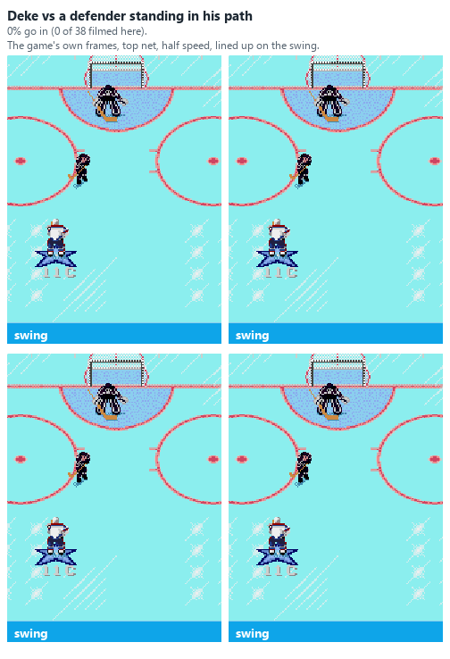
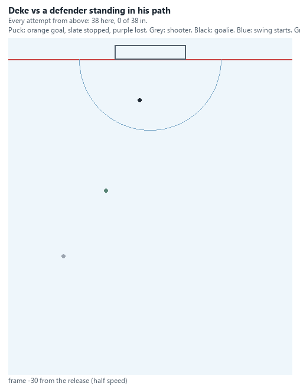
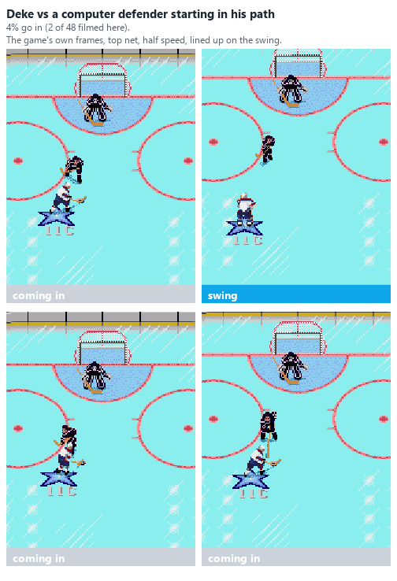
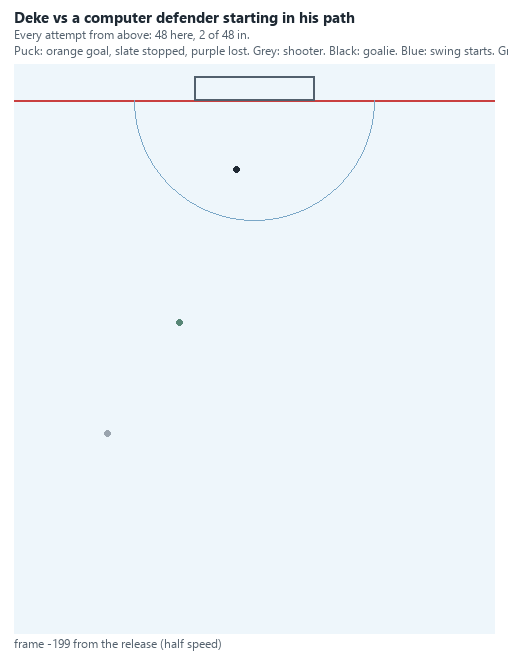
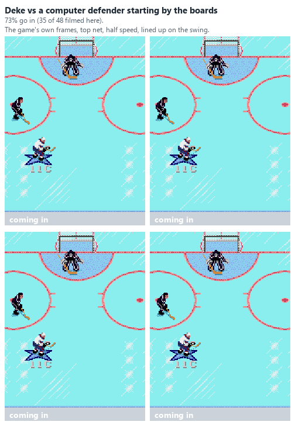
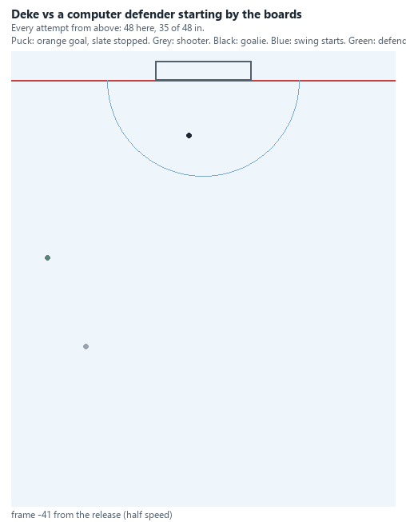

# Defence: what the studies have found

The results of the defence studies planned in [DEFENCE_PLAN](DEFENCE_PLAN.md), as they come in. The question behind
them is the user's: how do you win at NHL '94? The shooting side is in [SCORING_MAP](SCORING_MAP.md) and
[SHOOTING_STUDY](SHOOTING_STUDY.md).

## From the recorded games (2026-10-25)

`analysis/defence_games.py` (the report: `reports/defence_games.md`, not in git). The 17 Genesis league games
recorded so far: 579 shot attempts, 141 goals (late throws in a period's last 5 game-clock seconds with xG under 0.10
left out). **Few games: treat every number here as a first look, and the correlations in study 2 as hints, not
proof.**

### Study 1: where the chances against come from

Each shot attempt traced back to how the attacking team got the puck.

| How the attack began | Attempts | Share of goals | xG per attempt | Seconds from the start to the shot |
| --- | --- | --- | --- | --- |
| **The defending team lost it at the other end (a counter-attack)** | 197 | **41%** (58 goals) | 0.25 | 6.3 |
| A neutral-zone faceoff | 89 | 12% | 0.17 | 5.5 |
| The defending team lost it in its own end | 84 | 13% | 0.24 | 4.1 |
| The defending team's own shot, held or cleared | 69 | 9% | 0.14 | 5.9 |
| The defending team lost it in the neutral zone | 79 | 10% | 0.13 | 4.3 |
| The defending goalie's clearance | 22 | 7% | 0.26 | 3.4 |
| A faceoff in the attacking zone | 20 | 5% | 0.32 | 2.1 |
| Other (a dump-in, a defensive-zone faceoff, a loose puck) | 19 | 3% | | |

("Lost it" is a takeaway or a giveaway: the two kinds score about the same and are added together here.)

By the shot: **one-timers are 25% of the attempts and 38% of the goals** (0.36 xG each); wrist shots on the rush 22%
of the goals; rebounds 11%; slapshots on the rush 10%. Wrist shots and slapshots after sustained pressure (a team
settled in the attacking end, not on the rush) are 6% of the goals (one-timers and rebounds aren't split that way).

- **NHL '94 is a transition game.** Attempts come on average 2-7 seconds after a team gets the puck, and the
  biggest source of goals is the counter-attack: the other team losing the puck while it was attacking. The settled defensive
  zone, where "defence" usually means positioning, is a small part of it.
- **So defence starts at the other end.** What a team does just after it loses the puck while attacking (study 3,
  and "back in position" in study 2) matters more than how it defends a team set up in its zone.
- **The one-timer is the biggest single threat,** in line with the shooting studies (63% from a pass across inside 18
  feet against the computer goalie).

### Study 3: what a lost puck costs

Every turnover (dump-ins left out), by where the team that lost it was, and the other team's shots in the next 5
seconds with no whistle.

| Lost in | Turnovers | A shot against within 5 s | xG against per turnover | Goals within 5 s |
| --- | --- | --- | --- | --- |
| Its own end | 194 | 42% | 0.121 | 28 |
| The neutral zone | 165 | 35% | 0.043 | 10 |
| The other team's end | 455 | 22% | 0.053 | 29 |

- **A turnover in your own end costs most per turnover** (about 0.12 xG, a goal against about 1 time in 7), more than
  twice one anywhere else. A poke check that loses it there is worst (0.15); "lost the puck" (no one forced it) 0.25,
  though from only 18.
- **Turnovers at the other end cost less each but there are far more of them,** so they add up to as many goals (29
  against 28). In the neutral zone a picked-off pass hardly costs anything (0.008 xG), a hit or a poke that loses it
  more (0.05-0.09).
- The 5-second window misses slower counter-attacks (study 1's average is 6.3 seconds), so these are lower bounds.

### Study 2: the habits that go with conceding less

Per person per game (27 person-games: the games with a person on each side), each habit against the xG and goals his
team conceded that game. The habits include the three the user named: accurate checks, cutting off the pass across,
staying in the slot. A negative correlation: more of the habit, less conceded. With 27 person-games a correlation
under about 0.38 could easily be chance, and the opponent's strength is in every number.

| Habit | Average | With xG against | With goals against |
| --- | --- | --- | --- |
| **The other side's passes across the slot (per game)** | 5.5 | **+0.53** | **+0.56** |
| **His skater in the slot (share of time defending in his end)** | 34% | **-0.46** | -0.21 |
| **Their passes across completed (share)** | 50% | +0.35 | **+0.46** |
| His skater caught up ice (share of time defending) | 38% | +0.37 | +0.21 |
| Checks landed (share of check attempts) | 27% | -0.27 | -0.35 |
| Check attempts (per game) | 23 | +0.31 | +0.26 |
| His skater in position (goal-side, on the puck-net line) | 22% | -0.29 | -0.16 |
| Recovery bursts that got him goal-side | 52% | -0.27 | -0.30 |
| Steal pokes that won the puck | 16% | -0.28 | -0.23 |
| Back in position within 2 s of a turnover | 81% | -0.15 | -0.17 |
| His skater in the lane of their pass across, when it was made | 23% | -0.04 | -0.07 |
| Switches that took him out of position (share) | 13% | +0.18 | +0.03 |
| Missed checks as the last man back (per game) | 2.8 | +0.10 | +0.08 |
| Wasted pokes (per game) | 6.3 | +0.05 | +0.04 |

What fits what good players say (the user, 2026-10-25):

- **Cutting off the pass across.** The clearest result: the more passes across the slot a person allowed, the more
  his team conceded (+0.53 / +0.56), and the more of them were completed, the more goals (+0.46). Being in the lane
  *when the pass was made* barely matters (-0.04): by then it is too late. What counts is that the pass isn't made,
  as the user said: anticipation, not interception.
- **Staying in the slot** goes with less xG against (-0.46). On the passivity worry: people who stayed in the slot
  more faced fewer attempts (-0.31) and fewer passes across (-0.28), and much weaker chances per attempt (-0.52),
  but a larger share of their attempts against came from within 20 feet (+0.43). So the slot defender gives up
  close-in looks but takes away the dangerous ones (the pass across, the slot shot); fewer attempts and less xG
  overall. Whether it fails against a particular player can't be seen in 27 person-games.
- **Accurate checks.** Landing a larger share of checks goes with fewer goals against (-0.35), and checking more often
  with more (+0.31): consistent with the user's point that missed checks pull a skater out of position. The direct
  count of missed checks as the last man back shows little (+0.10), so the cost may be in where the checker ends up
  rather than in the last-man misses alone; the harness study of checks (DEFENCE_PLAN 7) can price a miss exactly.
- **Not being caught up ice** (+0.37) and getting goal-side on recovery (-0.27 / -0.30) fit study 1's counter-attack
  result.

These are correlations from a few games. Two cautions: a strong opponent makes a person's numbers look worse on
several habits at once, and some of the measures overlap with what they are compared against (more passes across
allowed is partly the same thing as more chances against). The harness studies (DEFENCE_PLAN phases 2-3) test the
same habits one at a time, and more games will firm these up.

## One defender against the deke and the floater (the harness, a pilot; 2026-10-25)

DEFENCE_PLAN study 4, first pass. `analysis/scoring_map/def_run.py`: the 20 best deke and floater set-ups of the
scoring map (SCORING_MAP "Dekes": each move's best for each hand, both nets; the shooter at Shot Power / Accuracy 4,
the computer goalie the test goalie, Hrudey), each played with one defending skater added: the away team's left
defenceman (working Weight 88, Agility 20, Speed 20, Checking 15). He is put at one of 45 spots: across from the lane
the shooter comes in on, 0 to 13 ft either way, and 13 to 34 ft out from the goal line. Two ways:

- **Standing:** held still at his spot for the whole play. Does his body alone stop it?
- **Left to the computer:** let go as the shooter starts in, so the game's own defensive play takes over (chasing,
  poking, checking).

12 moments x 4 seeds per set-up and spot, 1,820 set-ups. Without a defender the dekes score 88% and the floaters 54%.

**The attacker is a bot with fixed inputs, blind to the defender:** it skates into a defender in its way where a
person would go round him. So "standing" maps where a body breaks the move, not what a person would do about it.
"Left to the computer" is the realistic case, and the numbers are for the computer defender, not a person (the
person-controlled defender is study 9).

### The deke: stand where he is going, not where he is

The deke carriers come in about 15 ft to one side and drift toward the middle as they swing. Columns: how far the
defender starts across from the carrier's lane, toward the middle (+) or toward the boards (-); rows: out from the
goal line. The share of plays that ended in a goal (no defender: 88%).

| Out \ across | 13 ft boards | 10 | 7 | 3 | 0 | 3 ft middle | 7 | 10 | 13 ft middle |
| --- | --- | --- | --- | --- | --- | --- | --- | --- | --- |
| **Standing** | | | | | | | | | |
| 13 ft | 88 | 88 | 88 | 88 | 86 | 80 | **3** | **10** | 64 |
| 19 ft | 89 | 88 | 88 | 88 | 88 | 30 | **0** | 28 | 77 |
| 24 ft | 88 | 88 | 88 | 88 | 68 | **3** | **0** | 18 | 83 |
| 29 ft | 88 | 88 | 88 | 88 | **12** | **1** | **3** | 77 | 88 |
| 34 ft | 88 | 88 | 88 | 82 | 30 | **0** | 43 | 86 | 88 |
| **Left to the computer** | | | | | | | | | |
| 13 ft | 87 | 75 | 66 | 60 | 38 | 47 | 35 | 28 | 34 |
| 19 ft | 88 | 86 | 77 | 63 | 28 | 25 | 23 | 27 | 35 |
| 24 ft | 88 | 88 | 87 | 74 | 30 | **6** | **6** | 25 | 51 |
| 29 ft | 88 | 88 | 88 | 88 | 17 | **7** | **7** | 47 | 45 |
| 34 ft | 89 | 88 | 88 | 66 | **6** | 16 | 31 | 57 | 61 |

- **The deke is stopped by a body on the carrier's path:** a band 3-7 ft from his lane toward the middle of the
  slot, from 13 to 34 ft out. Over that band a standing defender takes the deke from 88% to 16% (at its best spots
  0-3%), and one left to the computer to 20% (6-7% at its best, 24-29 ft out).
- **Toward the boards he does little.** A standing defender anywhere on the boards side of the carrier's lane never
  touches the play (88%); one left to the computer starting there gets 81%: the carrier is going the other way.
- **How the deke fails against the computer defender in the band:** the puck lost before a shot 15% of the time (3%
  with no defender), no shot at all 16%, and of the shots still taken 71% are saved (9% with no defender): rushed
  off the planned timing, from the wrong place. Over all 45 spots the computer defender takes the deke from 88% to
  52%.
- **For a person defending:** don't chase the carrier toward the boards; get to the slot between him and the middle,
  about 20-30 ft out, and let him come to you. (Whether a person carrying the puck simply goes round that defender is
  the next question: this bot can't.)

### The floater

- **No standing defender on this grid changed the floater** (54% everywhere but one spot): the floater carrier
  crosses 25-26 ft from the lane he starts in before he shoots (from 22-26 ft out), beyond the grid's reach across,
  so only the farthest spot toward the middle (34 ft out, 13 ft across) was on his path; he skated into it (0%). A
  grid for the floater must follow his line across.
- **Left to the computer,** a defender toward the middle cuts it to 30-48%, and from the farthest spots toward the
  middle (34 ft out, 10-13 ft across) to 8-13%: he meets the carrier as he crosses. From the boards side, nothing.

### Animated

`deke_animate.py`, the DEFENDER cases: the refined left-hander's deke from 15 ft to his left (no defender: SCORING_MAP
"Dekes"), with the defender 7 ft toward the middle from the carrier's lane, 24 ft out, standing or left to the
computer, and left to the computer from 7 ft toward the boards. The defender is green in the paths view.

Filmed (attempts where he never got a shot off are left out of the standing case's count):

**A defender standing in his path: 0 of 38 go in.**

**A computer defender starting in his path: 2 of 48 go in.**

**A computer defender starting toward the boards: 35 of 48 go in** (no defender: 94% for this set-up).

