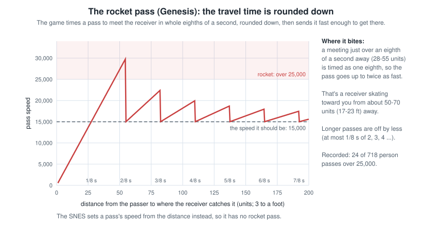
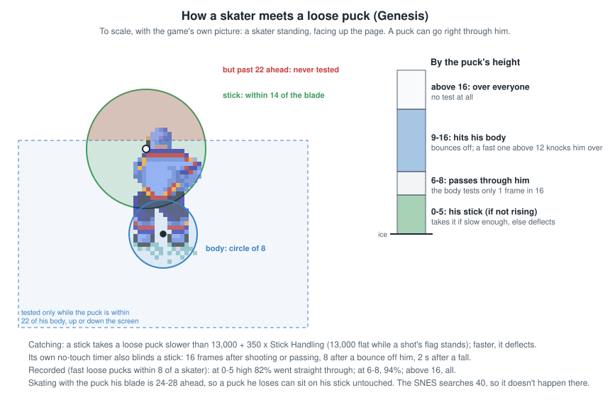
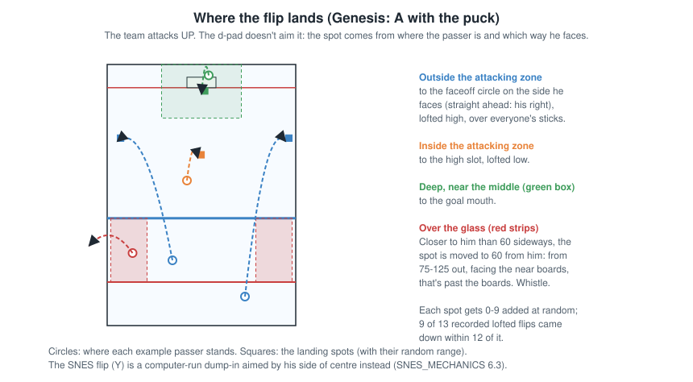
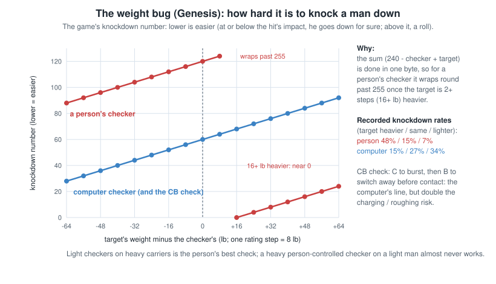
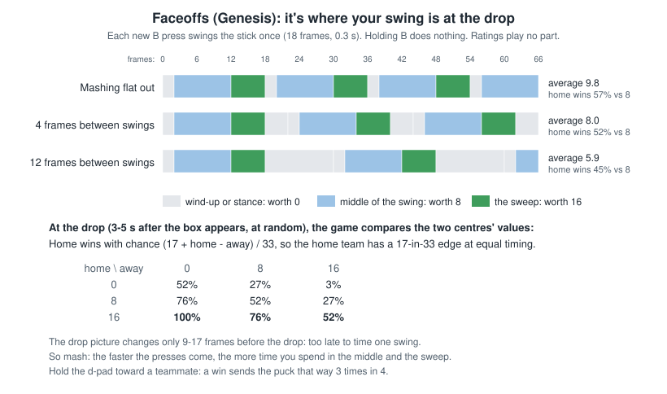
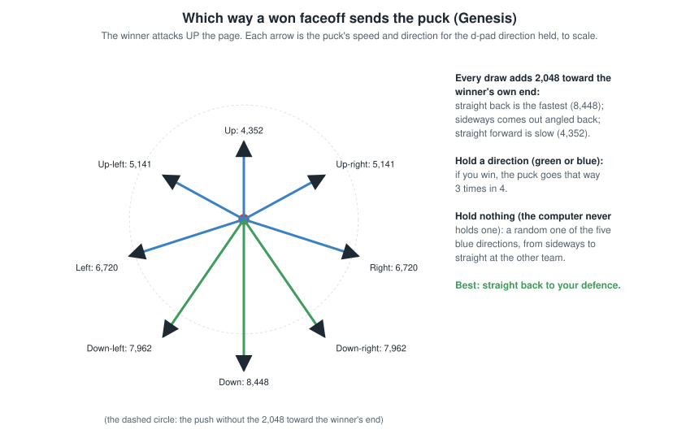
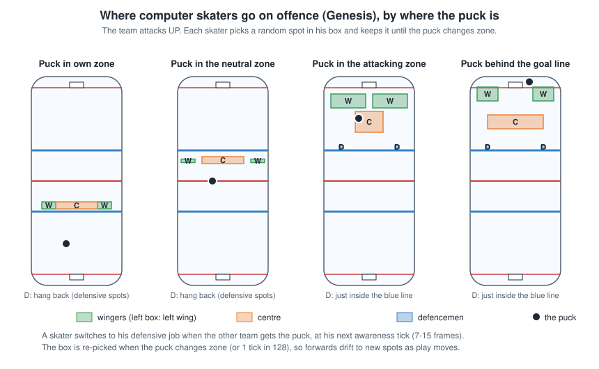
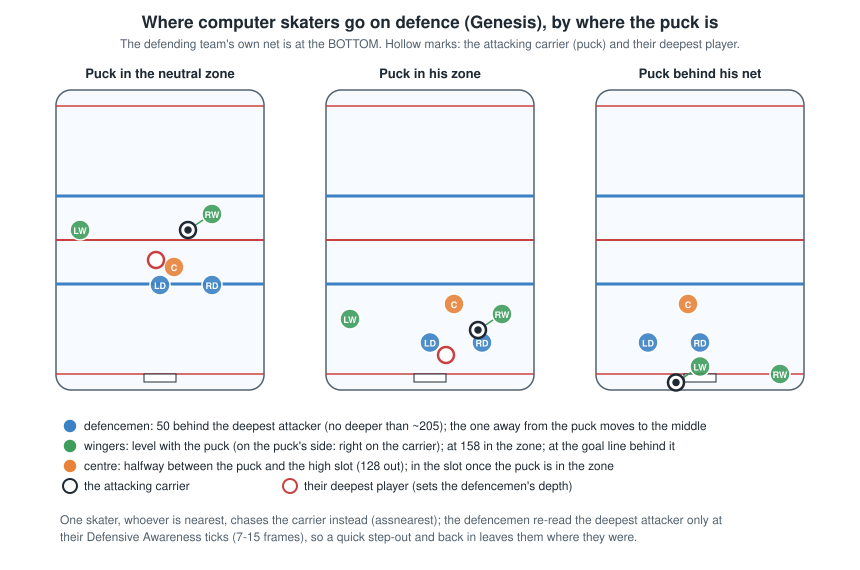

# NHL '94 Game Mechanics: Sega Genesis

What NHL '94 on the Sega Genesis / Mega Drive actually does under the hood: how ratings work, how saves and checks are
decided, how penalties are called, what the computer players think, and the bugs that shape online play. It covers
the original `nhl94.bin` and the league ROMs built on it. Every finding comes from reading the game's own code and is
marked with what supports it:

- **Confirmed**: the code says so *and* recorded games show it, with the numbers given.
- **Code**: read from the code, not (yet) seen in a recording, usually because the situation hasn't come up.

The SNES game is different in many ways that matter: see [SNES_MECHANICS.md](SNES_MECHANICS.md). For what all this
means when you play, without the code, see the [Genesis player's guide](GENESIS_GUIDE.md).

Distances are game units, **about 3 to a foot** (divide by 3 for feet); the rink's landmarks, common distances and
speeds in feet and mph are in [Units](#units) in the appendix.

Buttons are the Genesis pad's: **A** (hook / hold, the flip with the puck), **B** (pass, poke, switch player),
**C** (shoot, speed burst / check).

## In brief

One line per chapter: the main finding, then the section with the evidence.

1. **Ratings**: play uses rating x 5 + one hot / cold value (byte 0 of the player's 16, a bug), plus hidden power-play, home / away and third-period bonuses (the third-period test is backwards). ([2](#2-ratings-what-the-game-really-uses))
2. **Skating**: Speed sets top speed; Agility is acceleration, and each Weight point costs as much as 2 Agility. ([3](#3-skating))
3. **Shooting**: nine aim points chosen by the stick's screen direction; within 200 a shot is perfect (Shot Accuracy + 1) / (Shot Accuracy + 16) of the time, otherwise it scatters, upward only; one-timers are auto-aimed; uncounted saves are mostly the goalie's stick knocking hard low shots away. ([4](#4-shooting))
4. **Goaltending**: saves are geometry (a 12-15 body circle, 15 for a person, 18 in a pad stack, 12 against one-timers); save moves add no reach; the ring around his stick where nothing touches a low puck lets flat pucks through a butterfly; the top net's shoulder save can drag the puck into the net. ([5](#5-goaltending))
5. **Passing**: Passing sets speed, not accuracy; the meeting time rounds down (the rocket pass); lift comes from the flight time, or is random for pass shots; a stick can't play the puck while its no-touch timer runs or its body is more than 22 away up or down. ([6](#6-passing-the-flip-and-stickhandling))
6. **Checking**: only a speed burst checks; the weight bug is a one-byte overflow for a person's checker; the CB check uses the computer's formula; the same pair can't knock down twice running. ([7](#7-checking-hooking-poking-and-collisions))
7. **Penalties**: Aggression wraps (rating 4 plays like 1); a person's range is doubled; the other team is immune during a delayed penalty; the penalty-shot table is off by one. ([8](#8-penalties))
8. **Faceoffs**: pure timing (Home wins 17 in 33 at equal timing); the faceoff stat counts first possession, not the draw. ([9](#9-faceoffs))
9. **Breakaways and penalty shots**: a breakaway is decided as the carrier crosses the blue line ahead of everyone; several penalty-shot bugs. ([10](#10-breakaways-and-penalty-shots))
10. **Offsides**: off in the leagues; when on, an offside one-timer isn't whistled. ([11](#11-offsides))
11. **The computer players**: Offensive and Defensive Awareness are only reaction timers; positions are set by the puck's zone. ([12](#12-the-computer-players))
12. **Puck physics**: friction, boards, the net (a 1-unit post band, crossbar at 13), and what differs up and down the screen. ([13](#13-puck-physics))
13. **Energy and the crowd**: with line changes off nothing drains energy; the crowd meter's "broken" bonus is always on. ([14](#14-line-changes-energy-and-the-crowd))
14. **League ROMs**: which gameplay settings the league ROMs change. ([15](#15-league-roms-settings-that-change-the-game))

---

## Contents

1. [How this was found](#1-how-this-was-found)
2. [Ratings: what the game really uses](#2-ratings-what-the-game-really-uses)
3. [Skating](#3-skating)
4. [Shooting](#4-shooting)
5. [Goaltending](#5-goaltending)
6. [Passing, the flip and stickhandling](#6-passing-the-flip-and-stickhandling)
7. [Checking, hooking, poking and collisions](#7-checking-hooking-poking-and-collisions)
8. [Penalties](#8-penalties)
9. [Faceoffs](#9-faceoffs)
10. [Breakaways and penalty shots](#10-breakaways-and-penalty-shots)
11. [Offsides](#11-offsides)
12. [The computer players](#12-the-computer-players)
13. [Puck physics](#13-puck-physics)
14. [Line changes, energy and the crowd](#14-line-changes-energy-and-the-crowd)
15. [League ROMs: settings that change the game](#15-league-roms-settings-that-change-the-game)
16. [Quick reference: bugs and exploits](#16-quick-reference-bugs-and-exploits)
17. [Open questions](#17-open-questions)
18. [Appendix: units, addresses and sources](#18-appendix-units-addresses-and-sources)

---

## 1. How this was found

The game has been disassembled by the community into source code that rebuilds the original cartridge byte for byte:
[abdulahmad/NHL94Genesis](https://github.com/abdulahmad/NHL94Genesis), with comments explaining most routines.

The NHL '94 Viewer's helper records the game's memory about 60 times a second while you play in RetroArch (the Genesis
Plus GX core). That gives every player's position, speed, animation and *working* ratings, frame by frame, so the
code's rules can be checked against real games. The checks here used eight recorded Genesis games and parts of games
(online and single-player, the original ROM and a 30-team league ROM). Numbers like "48 of 102" are counts from those
games.

Routine names in `code style` are the disassembly's names, for anyone who wants to read the code.

---

## 2. Ratings: what the game really uses

### 2.1 Working ratings

The ratings you see in the editor (0 to 6 on most ROMs; the game's own screens show them as numbers from 25 to 99,
see 2.5) are not what the game plays with. Each time a player comes on the ice (faceoffs, line changes), `setplayer`
turns each rating into a **working rating** from 0 to 30: **rating x 5 + hot / cold + bonuses**.

Because ratings are only worked out when a player is put on the ice, bonuses that depend on the clock or the score
(below) follow **the situation at the last faceoff or change**, not the live situation.

### 2.2 Hot and cold: one value for everything

Before each game the game rolls random "hot / cold" values for every player. **Confirmed**:

- Each player gets 16 random values from -9 to +8, fixed for the whole game.
- **Bug:** the routine that applies them (`AttributeCalc`) loads the number of the rating it is working on, then
  immediately clears it. So **every rating a player has gets the same single value** (his first one), divided by 3:
  from -3 to +2 on the 0-30 scale (about -0.6 to +0.4 of an editor rating point).
- **On the original ROM, the hot and cold players the game shows you are fake.** The scouting report's hot / cold
  players and the matchup screen's flame and snowflake icons are worked out from values 4 to 16, and the ratings
  screens add each rating's own value (2.5). None of those are what plays. Many league ROMs change this (section 15):
  most show the bonus as it plays in Edit Lines, some fix the bug so each rating has its own value, and some turn hot /
  cold off.
- The pre-game Matchups screen (the scouting report) rolls the values again, so anything seen before it isn't this
  game's.
- Checked over 4,000+ moments in four games (including a 30-team league ROM) where the two readings differ: the
  working ratings matched the single value every time.

**Bottom line:** hot / cold is small (less than one rating step either way) and, on the original ROM, invisible.

The NHL '94 Viewer shows each player's hot / cold **as played** on his player card ("Hot / cold (as played)"), read
from the game's memory during the recorded game: the single value, or the per-rating values on ROMs that fixed the
bug.

### 2.3 Hidden bonuses

Added to working ratings when a player comes on the ice.

| Bonus | Who | Ratings | Notes |
|---|---|---|---|
| Home / away | per team, set in the ROM | Offensive and Defensive Awareness, Stickhandling, Shot Accuracy, Passing | Home team adds its home value, away team subtracts its away value. Boston: +2 at home, -1 away; Calgary 0 at home. **Confirmed** |
| Power play | team on the power play, per-team ROM value | Offensive Awareness, Stickhandling, Shot Accuracy, Passing | **Confirmed** |
| Penalty kill | team killing a penalty, per-team ROM value | minus to Offensive Awareness, Stickhandling, Shot Accuracy | **Confirmed** |
| Comeback | team tied or trailing in the third period, both teams in overtime | +2 Offensive Awareness, +2 Checking, +4 pass/shoot bias | **Bugged**, see below |

**The comeback bonus is backwards** (**Confirmed**). The test that should switch it on for the last half of the third
period is the wrong way round, so it is **on while more than half of the third period is left** (with 5-minute
periods, before 2:30) **and off for the last half**. In overtime both teams have it throughout.

### 2.4 What each rating does

Working values 0-30. Every place the code reads each rating:

| Rating | What it does |
|---|---|
| **Weight** | Acceleration (each Weight point costs as much acceleration as 2 working Agility points); check knockdowns (with the weight bug, section 7.2); momentum in collisions |
| **Agility** | Acceleration, and so how quickly a player changes direction; a goalie's reach; resisting a poke trip when penalties are off |
| **Speed** | Top speed; the computer chaser's +6 when the opposing carrier is in the slot |
| **Offensive Awareness** | Reaction time of computer players in some jobs (section 12.1) |
| **Defensive Awareness** | Reaction time of computer players in other jobs; how often the computer goalie re-aims |
| **Shot Power** | Shot speed; **below a working 20 (rating 3 or less, and a "cold" 4) the wind-up is cut short, so weak shooters can't take a full slapshot**. Goalies: this slot holds Puck Control (how often they hold shots) |
| **Shot Accuracy** | The chance a shot goes exactly where aimed, and how far it scatters if not |
| **Passing** | **Pass speed only**: passes are always aimed perfectly |
| **Stickhandling** | Stealing and protecting the puck; catching hard passes; wobbling instead of falling when hit |
| **Checking** | Knockdown odds; upending players (20+); **how often computer skaters try to check, and how aggressively the computer chaser attacks the carrier** |
| **Endurance** | How fast energy drains, which only matters with line changes on |
| **"Rgh" (pass/shoot bias)** | Whether a **computer** puck carrier shoots or passes. The disassembly calls it the pass/shoot bias |
| **Aggression** | Penalty odds (with a wrap-around bug, section 8.2). Goalies: this slot is Glove Left, and 11+ allows the reaching glove save move |
| **H/F (Fighting)** | How long players *you* injure are out (period or game) |
| **Goalie glove / stick save ratings** | **Nothing.** They are looked up and never used |

### 2.5 The 0-99 numbers on the ratings screens

The game's own screens (Edit Lines, Team Roster, player cards) show each rating as a number from 25 to 99 (`CalcAttrib`,
`AttribAdjust`): n = 18 x the stored rating (0-6) + that rating's own hot / cold value (-9 to +8), at least 0; 100 or
more shows as 99; **under 50 it is squashed to n / 2 + 25**. So each stored rating is a **band** of numbers:

| Stored rating | 0 | 1 | 2 | 3 | 4 | 5 | 6 |
|---|---|---|---|---|---|---|---|
| Numbers shown | 25-29 | 29-38 | 38-47 | 47-62 | 63-80 | 81-98 | 99 |
| Band's middle (no hot / cold) | 25 | 34 | 43 | 54 | 72 | 90 | |
| Working value | 0 | 5 | 10 | 15 | 20 | 25 | 30 |

What the position inside a band means depends on the ROM (**Code**; the bands agree with the NOSE editor's table):

- **The original code** (`nhl94.bin`, and ROMs whose Edit Lines shows each rating's own value): **nothing about how he
  plays.** Each number uses that rating's own hot / cold value, but play uses one value for all of a player's ratings
  (2.2), and that one is never shown. The played variation is real and about as wide as the band (-3 to +2 working
  points, -0.6 to +0.4 of a step: a 4 plays as 3.4 to 4.4), but it can't be read from the screen: an 81 may play
  better or worse than a 98.
- **League ROMs that show hot / cold as played** (CDL, IDL, DPWM, RGDL ...; section 15): the routine is changed to add
  the player's played value to every rating (`adda.l #$10,a4` and the per-rating read replaced), so **all of a player's
  numbers sit the same distance from their band's middle**, and that distance is his real hot / cold: 3 or more above is
  +1 working point, 6 or more +2; 3 or more below is -1, 6 or more -2, 9 below -3.
- **ROMs with the per-rating fix** (WJ2025): each number is that rating's real value, as shown.

**Overall** (`CalcAttrib` with `OvrPlayerWgtList`): skaters count Speed, Offensive Awareness and Stickhandling three
times, Agility, Defensive Awareness, Checking and Shot Accuracy twice, Shot Power, Endurance and Passing once, and leave
out Weight, Aggression, Fighting and the pass / shoot bias. Goalies: Agility, Defensive Awareness and Puck Control 4.5
each, the four glove / stick ratings 1 each. So Overall leans on ratings that don't touch the skater you control
(Offensive Awareness) or do nothing with line changes off (Endurance), and goalies' on four unused ratings.

---

## 3. Skating

### 3.1 Top speed

Each skater has a speed cap set by his working Speed. Pushing the d-pad adds speed only below the cap; speed bursts
can take him past it and friction brings him back.

- Cap = (20 + (Speed + 2) / 2) x 275 in the game's speed units, Speed + 2 capped at 30. **Confirmed**: each skater's
  normal cruising speed sat just under his cap, from 6,628 at working Speed 7 (cap 6,737) to 9,162 at 26 (cap 9,350),
  61 skaters in three games. That is roughly **23 mph for the slowest to 32 mph for the fastest**.
- The "+2 Speed" in the formula comes from a crowd feature that is hard-wired on (its switch-off line is skipped), so it
  applies to everyone, always.

### 3.2 Acceleration

- Each frame you push, speed grows by (64 - 2 x Weight rating + working Agility + 2) / 2, scaled by the direction (full
  straight, about 70% diagonally). **Confirmed**: measured frame by frame over about 19,500 samples, within 1-5% of the
  formula at every level. The quickest accelerators gain speed about 40% faster than the slowest.
- **A person's puck carrier accelerates at half rate** (the computer's carriers don't). **Code**
- Goalies add their Agility again, plus 16. A goalie carrying the puck has half his top speed. **Code**

### 3.3 Friction

- On the ice a gliding skater loses 1/64 of his speed per frame (about 61% a second); the puck far less (section 13).
- Speed bursts (C without the puck) add speed in the direction faced (32 x the direction's push for a fresh player);
  with line changes on they cost energy.

### 3.4 Runaway speed: "deceleration off" left on (a bug)

(The match viewer counts runaways, through-the-legs goals (5.5), shoulder-save bobble goals (5.3) and rocket passes (6.1)
in the team stats' "Quirky Events". The SNES has the same switch but clears it reliably: SNES_MECHANICS 3.3.)

Now and then a person's skater bursts and shoots off far past top speed, sliding out of control for a second or two
(the user: usually racing back on defence; switching to another skater is the usual way out).

- **The flag:** each skater has a "deceleration off" bit (`pfdoff`, `pflags` bit 0). With it set, friction takes 1/512
  of his speed a frame instead of 1/64 (`updateplayers`: the puck's friction), so he keeps 0.97 of his speed a second
  instead of 0.39. A speed burst normally fades back to cruising speed in about half a second; with the flag on it barely
  fades, so **each burst stacks on the last** (about +6,300 each): two bursts take a skater from 8,000 to 20,000, more
  than twice top speed (normal skating never exceeds about 9,500). Nothing caps speed above the top: skating input only
  limits how fast he can accelerate.
- **What sets it:** a computer skater about to receive a pass (`asspassrec`, so he glides onto the puck), and any fall
  into the boards or the bench (`FallDown`). **What should clear it:** the end of the pass-receiving job, his stick touching
  the puck (`puckstick`), or a new chasing job (`assnearest`). **The leaks:** if a person takes control of that skater
  while the pass is coming, the job ends through `assexit`, which doesn't clear the flag; and a fall into the boards
  never clears it when he gets up. Either way a person's skater keeps puck-like friction until he touches the puck or the
  computer gives him a job (which it does once you switch away from him).
- **Confirmed** (the BOS-DAL and BOS-WPG games): the two runaways, 2026-10-18_2158 BOS-WPG P3 about 1:24 (knocked into
  the boards 3.6 s before; bursts at 8,300 -> 14,600, then 13,700 -> 20,079; he slid about 160 units, 53 feet, before
  stopping) and 2026-10-18_2149 BOS-WPG P2 about 0:22 (taken over while a pass was coming; three bursts, 19,413). The flag
  was set 765 times in all (690 pass receptions, 65 boards or bench falls, 10 others); a person skated with it on for over
  half a second 44 times, and it ran away only when he also burst twice or more.

---

## 4. Shooting

### 4.1 The nine aim points


Every shot is aimed at one of nine points in the net, picked by **the direction the d-pad is held as the shot is
taken**, in **screen** directions:

| Held | Aim |
|---|---|
| Up-left / Up / Up-right | High: the screen's left / middle / right |
| Left / nothing / Right | Middle height: left / middle / right |
| Down-left / Down / Down-right | Along the ice: left / middle / right |

Because it is screen direction, when you attack down the screen the d-pad's left is the shooter's right. The aim points
are 16 units either side of the middle (the posts are at about 20) and at heights 12 (high), 6 and 0. **Confirmed**:
goals' aim points and where they crossed the line agree closely.

### 4.2 Perfect shot or scatter


- **Within 200 units of the aim point** (about 65 feet), a roll decides whether the shot goes **exactly** where aimed.
  Chance = (Shot Accuracy + 1) / (Shot Accuracy + 16) on the working scale: about 55-67% for typical shooters.
- **Beyond 200, never perfect.**
- Otherwise random scatter is added: bigger for harder shots, longer distance and poorer accuracy ((shot speed / 16 -
  Shot Accuracy / 2 + 16) x distance / 64, halved within 250, capped at 136). Across: either way. Along the ice
  (which changes the angle): either way, at most 60, **halved when the aim point is below the puck on the screen**, i.e.
  every shot at the bottom net from in front of it (and a shot at the top net from behind it). Height: **only ever
  upward**, up to half of that (at most 30). "Shot speed" here is the internal value before the final x 68
  (`passspeed`). Compared with chaos's forum post "How Shooting Works" (2025-03-25), which reads the same routine:
  `doshot` halves for distances of 250 **or less** (`cmp.w #$FA,d3; bhi` skips the halving above 250), and a shot from
  the goal line itself (distance 0 along the ice) isn't halved (`bpl`); `randomd0(n)` returns 0 to n - 1 and the test is
  "greater than 14", so the perfect chance at working 30 is 31 / 46 = 67.4%, not 69.6%.
- **Confirmed**: within 200, 82 of 123 shots left the stick within 2 units of the aim point, more often for better
  shooters, roughly as the formula predicts; none of those from beyond 200.


**Shooting at an open net** (the goalie pulled, or far out of his crease). For a shot you aim yourself, nothing in the
game makes shots at an open net less accurate (the "goalie pulled" test in the shot code only ever looks at the
*shooting* team's own goalie). **One-timers are different: see 4.4, the open-net one-timer.** Three things from the
rules above make aimed shots miss: such shots are often taken from far out, where a shot is never
exact and the scatter is wide; the scatter only ever pushes the puck *up*, so a high aim has no room under the
crossbar; and the d-pad direction is the aim, so attacking *up* the screen, pushing toward the net aims high. Worked out
from the game's own scatter rule for an average shooter (working Shot Accuracy 15, a 15,000 shot) at an empty net, the chance it goes in by aim and distance:

| Aim (d-pad at the release) | 60 units | 120 | 180 | 220 | 300 |
|---|---|---|---|---|---|
| Nothing held (middle) | 100% | 82% | 65% | 20% | 2% |
| Left or right | 86% | 70% | 64% | 20% | 3% |
| Up (high) | 59% | 56% | 53% | 3% | 0% |
| Up-left / up-right | 57% | 54% | 53% | 3% | 0% |
| Down (along the ice) | 100% | 100% | 78% | 37% | 5% |
| Down-left / down-right | 86% | 81% | 74% | 37% | 5% |


**With the goalie pulled (no goalie on the ice), close in, Up is different:** from within 48 units of the goal line a
high aim gets the top-shelf lift (4.5), which replaces the shot's height speed and so its upward scatter. The puck
reaches the line about 10-13 high from 30-48 out, just under the crossbar, and over it from closer than about 25. A
goalie who has only wandered out doesn't count as pulled. Not in the table, which is for 60 and farther.

**At an open net: get within about 180 units (60 feet) if you can, and hold Down or nothing as you shoot, never Up.**
Not yet checked on recorded shots (only five recorded shots had the goalie far out or pulled; they hint at more going
wide: 24% wide with him 35-70 units out, 16% in his crease).

### 4.3 Shot power and the wind-up

Shot speed grows with working Shot Power and with how long the wind-up runs; backhands lose a quarter of their power;
fatigue scales it (only with line changes on). **Shooters with working Shot Power below 20 have the wind-up cut short
(step 8 instead of 16), so they can't take a full slapshot.** **Confirmed**: those shooters topped out at 20,746
(median 13,706, 67 shots); stronger ones reached 29,216 (83 shots). In mph, the hardest slapshots are around 95-100 mph.

### 4.4 Auto-aim: one-timers and computer shooters

**One-timers ignore the d-pad.** The game aims them itself (`shotdiradj`), and computer shooters the same way. It
draws **a sightline from the puck through the goalie** and carries it on past him toward the goal line. More exactly,
it uses where he's about to be: his position plus half the high byte of his speed. Then it measures how far the middle
of the net (`o` below) is from that line, straight across:

```
 Goalie in position: the sightline           Goalie wandered: the sightline
 runs into the net                           misses the net
                                                                 /
                                                                /  <- carries on past him...
      |   NET   |                              |   NET   |     /
      |____o____|                              |____o____|    /    <- ...and misses the net
          /                                                  /
         G   <- goalie                                      G   <- goalie, out to the side
        /                                                  /
       /                                                  /
      P   <- puck                                        P   <- puck
```

| Opposing goalie | Where the one-timer is aimed |
|---|---|
| None on the ice (pulled) | Middle, mid-height (direction 8) |
| Sightline within 22 units of the net's middle: he's between the puck and the net | Just inside a post at mid-height, on the side away from him (2 or 6) |
| Sightline more than 22 units off: he isn't between the puck and the net | **High middle** (0): the open-net trap below |

The posts are 20 from the middle, so the test is roughly "does the sightline through the goalie hit the net?". It
looks only at where he is (and a little at where he's skating), not at whether he could get back in time: a goalie far
out but still between the puck and the net gets the post aim, and one only a little way out but off to the side of the
puck's line gets high middle. **Code**: `CalcAngleOffset` measures it by triangles. For each post (at +/-18, on the
goal line at 264) it takes twice the area of the triangle puck-goalie-post and divides it by the puck-to-goalie
distance (found with Pythagoras). That is the post's distance from the sightline. The two posts' signed distances are
added and compared with $2C = 44, so the net's middle must be within 22. The recorded aim agreed with this rule on 69
of 88 such shots. (chaos's forum post describes the same calculation as triangulating from the puck to the goalie.)

**The open-net one-timer** (the user's league noticed "suspicious misses on great opportunities" when the goalie had
wandered, a person having dived or skated him out, and that they were one-timers, on the Genesis only). When the
sightline above misses the net (**more than 22 units off its middle**), the one-timer is **aimed high in the middle**
(direction 0).
That's the worst aim at an open net: the target is 12 units up, the crossbar is at 13 and the scatter only goes up, so
an exact one-timer goes in just under the bar but almost any scattered one goes over it or off the bar (the top-shelf
lift of 4.5 is never given to one-timers). Worked out from the scatter rule (an
average shooter, Shot Accuracy 15, a 20,000 one-timer) at an empty net:

| One-timer aim | 40 units | 60 | 90 | 120 | 160 |
|---|---|---|---|---|---|
| High middle (goalie on the ice, sightline misses the net) | 61% | 58% | 57% | 55% | 53% |
| Side, mid-height (the usual auto-aim) | 89% | 84% | 73% | 67% | 63% |
| Middle, mid-height (goalie pulled) | 100% | 100% | 86% | 73% | 64% |

**A pulled goalie doesn't cause this**: with no goalie on the ice there's no sightline, and the one-timer is aimed at
the middle, mid-height, which leaves room under the bar for the upward scatter.

So close in on an open net a one-timer misses about 4 times in 10, where a shot aimed at the middle would hardly ever
miss. **In the recordings** 10 one-timers got the high-middle aim: 7 went in at heights of 10 to 13 (just under the bar),
one went over at 16 (BOS-DAL 2257, P1 0:57), 2 were saved. Computer shooters are aimed the same way. **The SNES doesn't
do this**: it auto-aims only computer shooters, so SNES one-timers follow the stick.


### 4.5 "In-close top shelf"

A high shot (up, up-left or up-right) from close in (the puck within 48 units of the goal line: 216 or more from
centre), **at a goalie in a pad stack or with no goalie on the ice** (pulled), gets its own lift (`prepshot` sets the
flag, `puckvzadj` applies it; never for one-timers). It **replaces** the shot's height speed with one worked out from the
time to the goal line, so the upward scatter is gone: from 30-48 out the puck reaches the line about 10-13 high, over a
pad stack and just under the crossbar (13); from closer than about 25 it carries over the bar (15-24). **Code**. (Until
2026-10-18 this section said "a goalie who is *not* in a pad stack", a misreading that chaos's forum post "How Shooting
Works" has right: the branch after the two pad-stack compares falls into the top-shelf test on a match.)

### 4.6 Delayed-penalty sniping

While the other team has a delayed penalty pending (referee's arm up, play continuing), the game pulls your goalie for
an extra attacker, and **every shot your team takes from within 200 units goes exactly where it's aimed**: the shot
code treats "goalie pulled" as "always perfect". **Confirmed** on the two aimed shots in the recordings taken during a
delayed penalty (0.7 and 0.3 units off the aim point).

### 4.7 What counts as a shot on goal

- A shot counts when the puck touches the goalie's body, or he catches it with his stick, while the "shot taken" flag
  set at the release still stands. Posts and the crossbar also count (section 13.3).
- **Any touch on the way** (a stick, a body), **the boards**, or a hard puck deflecting off the goalie's stick clears the
  flag without counting. Pass shots (a B pass used as a shot) never set it, so they only count if they score.
- **Nothing counts while the clock is stopped**, which is why penalty shots are never shots on goal.
- **Code**, partly confirmed (the penalty shot).
- **Shots along the ice are the ones that go uncounted.** The goalie's stick only plays a puck that is low (height 5
  or under) and not rising, and within 8 units of his blade it catches a puck slower than 13,000 (counted) and
  deflects a faster one (not counted). A shot aimed along the ice (Down held) gets no lift, so it stays low all the way
  in; middle and high shots are lifted past the stick and hit his body (counted). **Confirmed** in 13 Genesis games:
  of the shots that reached the goalie, aimed along the ice 9 of 22 went uncounted, middle 21 of 189, high 2 of 61.
- **So the direction you attack changes your shots on goal.** People hold the d-pad toward the net: attacking down
  the screen they aimed along the ice twice as often (25% of their shots against 12% going up) and high half as often
  (16% against 35%). With the rates above that costs a team going down about 6% of its shots on goal on shots
  reaching the goalie, which may explain much of the community's finding that the up direction has about 10% more
  recorded shots on goal. (In these 13 games the middle-height shots went the other way, 16% uncounted going up
  against 7% going down, unexplained, so the recordings alone don't show the 10%.)
- **By direction, in the recordings:** of shots and one-timers that reached the goalie, 126 of 148 were counted going
  up (85%) and 143 of 157 going down (91%), the opposite of the leagues' 10% more going up, and with only 17 stick
  knock-aways (9 up, 8 down) too few to show the aim effect above. About 100 whole games would be needed.
- **Every uncounted save, one by one** (`analysis/uncounted_study.py`, 34 in the Genesis recordings, pass shots
  left out). How each one ended, against the counted ones:

  | How the save ended | Counted | Not counted |
  |---|---|---|
  | Goalie held it at once | 61 | 4 |
  | Bounced straight out from his centre (his body) | 100 | 4 |
  | Knocked away slowly in a random direction (a stick) | 15 | 17 |
  | Went behind the net or to the boards first | 1 | 6 |
  | The clock stopped before it arrived | 2 | 3 |

  - **Most are the goalie's stick:** a low puck (height 5 or under, usually 0-5.6 just before) 16-33 units from his
    centre, beyond his body's reach, leaving at most 4,096 each way in a random direction: exactly `deflect`'s
    random velocity. The stick's deflection touches the puck (a2touchpuck) and clears the flag.
  - **The clock:** two came in the last second of a period (the clock reached 0:00 while the shot was on its way)
    and one was a penalty shot.
  - **Not really saves:** six went wide and came back to the goalie off the end boards or from behind the net (the
    boards clear the flag).
  - **A screen:** about four bounced off a skater's body in front first (height 8-12, within about 9 of him; a puck
    above 8 always hits a skater it passes within 8 of).
  - About 15 counted saves also looked like stick deflections, so the samples (60 a second) can't tell every case,
    but the split is clear: a save the goalie makes by holding it or with his body is counted almost every time (165
    of 173); one his stick knocks away usually isn't.

### 4.8 One-timers


**Triggering:**

- Pass (B) to a teammate, then **press C while the pass is on its way**. You still control the passer then, and C
  hands control to the receiver for the shot.
- Or, controlling the receiver, press C while the puck is loose and coming to him.
- **Only in your attacking half.** In your own half, C is a normal speed burst. The receiver can't be a goalie.

**The game times the swing for you.** The receiver starts his wind-up; the game keeps working out how many frames
until the puck reaches him and **starts the downswing itself** so the blade meets the puck (forehand or backhand by the
angle to the net). If the puck is slow he holds the top of the wind-up for up to 0.8 s more. The strike happens when
the puck comes within 10 units of the blade, and gets a strong minimum shot speed, auto-aim (4.4), and **the goalie's
reach cut to its minimum** (5.1).

**It fails** when the puck doesn't reach the blade before the swing ends (a slow pass, a receiver drifting off the
pass's line, a deflection), when anyone else touches the puck first, or when the puck goes away from him.

**Confirmed timing:** successful one-timers struck 0-0.87 s after the C press (median about 0.2 s); failed ones ended
0.3-1 s after it. **Press C no more than about 0.9 s before the pass arrives.** Pressing late is fine, even as the puck
reaches him: the swing snaps forward when the puck is already at the blade.

The computer one-times on its own in the attacking zone (and now and then outside it), but only for teams no person
controls.

### 4.9 Expected goals from the game's own rules

Because shots and saves are decided by fixed rules plus a few random rolls, the chance a shot goes in can be worked
out by **playing it out the way the game would**, many times. The NHL '94 Viewer does this for every shot and one-timer
in a recorded game (`tools/xg.py`, 400 times each):

1. **The aim** is the recorded d-pad direction (4.1), or for one-timers and computer shooters the game's own auto-aim
   (4.4), worked out from where the goalie is heading.
2. **The shot** goes exactly at the aim point with the perfect-shot chance (4.2; always during a delayed penalty, 4.6),
   otherwise with the game's random scatter, at the recorded speed and the shooter's working Shot Accuracy.
3. **The flight**: the puck travels in a straight line, its lift cancelling gravity (13.1).
4. **The goalie** moves the way the computer goalie does (5.3), from where he stood at the release, with his own
   ratings; a person in net is moved the same way. His reach comes from his Agility, a person controlling him, a
   one-timer or a pad stack (5.1).
5. **The result**: a goal when the puck's centre crosses within 20 of the middle under the crossbar (13.3), a save when
   it passes within his reach at height 15 or less, else a post, over or wide.

The only number fitted to the recordings is how far the emulated goalie may be off (4 units of random spread, the size
of its measured error). **Checked** on 191 unblocked shots in seven recordings: 39.4 expected goals against 34 scored;
computer goalies 28.6 / 23, people in net 10.8 / 11; the predicted mix of saves, wides and posts matches what happened.
Shot by shot it ranks chances well: its log loss is 0.30, against 0.46 for giving every shot the same chance.

What it leaves out: the goalie's stick (low pucks near the blade, 5.1), skaters in the way (blocked shots are left out of
team totals), the in-close top-shelf lift (4.5), and anything a person does with the goalie beyond what the computer
would. Pass shots and deflections have no xG.

The viewer shows each shot's xG, a skater's xG, a goalie's xG against and goals saved above expected, and the teams'
xG; the season page adds them up.

**The goalie's position matters more than the shooter's.** **Confirmed** over the 178 recorded shots with a goalie in
net, by how far he was from his set spot (5.3) at the release:

| Goalie off his set spot | Shots | Mean xG | Goals |
|---|---|---|---|
| 0-3 units | 31 | 0.04 | 1 |
| 3-6 units | 52 | 0.07 | 1 |
| 6-10 units | 36 | 0.23 | 7 |
| 10 or more | 59 | 0.39 | 22 |

A set goalie is very hard to beat from anywhere: against one, the best wrist shots come out at about 0.04, the best
slapshots (from about the tops of the circles) 0.12, a one-timer from the slot 0.22. Shots go in when he is still
moving or out of position, which is what passes across, rebounds and quick shots off the rush produce.

**The xG map** (the viewer's Map menu) shows the chance from every spot in the attacking zones, for a wrist shot,
slapshot or one-timer, a shooter's Shot Accuracy, and a goalie either set in his spot or "as in games": each simulated
shot faces a goalie placed and moving as goalies really were at one of the recorded shots (their offsets and speeds,
`xg.goalie_states`). With goalies as in games, wrist shots from the slot come out at about 0.2, slapshots up to about
0.28, one-timers 0.37-0.5, and shots from the points under 0.07.

---

## 5. Goaltending

### 5.1 Saves are geometry, not a dice roll


The goalie stops a puck only if it physically reaches him:

- **Body:** a puck at height 15 or lower within his **reach** of his centre is stopped.

  | Situation | Reach (game units) |
  |---|---|
  | Computer goalie, by Agility | 12 to 15 |
  | **A person controls him** | **always 15** |
  | In a pad stack | 18 |
  | **Against a one-timer** | **12, whatever his Agility** |
  | Shootout | 2 less |

- **Stick:** a puck at height 5 or lower near his stick blade. Within 8 units he plays it: slower than 13,000 he
  catches it, faster it deflects off in a random direction. **Between 8 and 14 units nothing happens that frame and the
  body test is skipped**: a small gap beside the stick.
- After a body touch the puck is held or rebounds (5.2).
- **The glove and stick save ratings are never used.**

**Confirmed:**

- As the puck reached the goalie's line, saves passed a median 13 units from his centre (49 of 71 within 15); goals a
  median 24 (31 of 40 at 15 or more). 111 goals and saves.
- 5 of the 9 goals that went in close to the goalie were one-timers (reach cut to 12).
- The other 4 all had the computer in net, with Agility rated 3-4 (reach 13-14). **With a person in net, no goal other
  than a one-timer passed within 20 units.** Taking the goalie yourself really does make him bigger.

### 5.2 Rebounds

- After the puck touches his body, he **holds it** if both of its speed components are under a random threshold set
  by his Puck Control; otherwise it **rebounds**.
- **In close with the goalie standing still** (puck within 44 of the middle, 210-270 from centre ice, goalie not in a
  save move) the threshold is quartered, so point-blank shots mostly rebound. A **diving** goalie never holds it.
- **The rebound goes straight out from the goalie's centre through the spot the puck touched**, at a speed set by how
  far from his centre that was. A shot clipping his left pad comes off to his left.
- **Confirmed** on 135 saves: in close with the goalie standing, 28 rebounds in 47 (60%); in close mid-save, 19 of 72
  (26%); farther out, 2 of 8. Rebounds left a median 6 degrees off the centre-to-contact line (3 in 4 within 19).

### 5.3 The computer goalie

**Positioning** (`checkanim`, `findpc`). He re-aims every 1-3 frames depending on his Defensive Awareness (12.1), and
each time picks a spot to skate toward:

- **Normally: where the puck is about to be.** He takes the puck's position plus a slice of its velocity (a look-ahead
  that varies with the game clock), and stands on an ellipse around the middle of his net, **26 units across and 18
  out**, on the line toward that point.
- **When a shot is coming:** once the puck will cross his goal line within 24 of the middle **in under 34 frames**
  (about 0.6 s), he **skates sideways to the point where it will cross**.
- **12 frames (0.2 s) before it arrives he commits to a save move** (below), and **his speed is cut to a quarter**: he
  stops sliding and can't adjust any more.
- He skates like a player: acceleration from his Weight and Agility (**goalies count Agility twice**), top speed from
  his Speed.

**Confirmed:** emulating this frame by frame and driving it with the recorded puck, the goalie lands a median 1.1 units
from where the recorded goalie actually was when the puck arrived (120 shots at computer goalies; 95 within 3 units),
against 3.7 for a goalie assumed to stand still.

**Save moves** (`goaliesave`), chosen when he commits:

| Puck | Where it will cross | Move |
|---|---|---|
| High (above 8, or rising fast) | near him (within 16) | shoulder save |
| High | farther out | glove or blocker (reaching glove save with Glove Left 11+) |
| Low, arriving within 8 frames | near him | kick / butterfly |
| Low, arriving within 8 frames | farther out | stick save |
| Low, further off, **someone still carrying it** | | **pad stack** (slides across toward that side) |

**Dives:** the computer goalie **only dives to smother a slow loose puck right in front of him** (within 20 across and
30 out), never at a shot. **Confirmed**: all 7 computer dives in the recordings were at loose pucks within 45 units.

The save-move mix in the recordings (115 saves) fits: stick 62, high 14, pad stack 12, dive 5, glove 2, none 20.

**The shoulder-save bobble at the top net** (the user's observation: a high shot at the top net's goalie, a shoulder
save, the puck in his possession, then loose for a frame and either back to him or in). A held puck is pulled a quarter
of the way each frame toward the holder's hold point (`pucknorm`: "bungie the puck towards the hot spot"), and the hold
point comes from the sprite frame (`HotList`), measured on the screen, where up on the screen is up the rink. The
shoulder saves hold the puck high, near the shoulder: **14-15 units up the rink**. For the bottom net's goalie, facing up,
that's out in front of him; for the **top net's goalie, facing down, it's 14-15 units behind him, back toward his own goal
line** (his ready stance holds it 4-6 units in front). Standing about 242-250 from centre, he drags the puck to the net's
front (261), and a carried puck entering the net is taken off its carrier, who can't touch it for 8 frames, and
bounced away (`checkgoal`). Loose on the next frame, it is a goal if it then crosses the line inside the mouth;
otherwise he takes it back. It can't happen at the bottom net. **Code** (the hold points read from the ROM: shoulder
saves facing down (-10, +15) and (+10, +14), facing up (+9, +14) and (-9, +14)). **Confirmed** (2026-10-19_0818_ANA-ATL,
the user's 2v2 test game, P3 4:00, which the user took for a bump): Rucchin's flat pass shot at the standing top goalie
was knocked up by his stick (no-touch 8), he caught it in a high save (ghighl, frame 667, hold point 14 behind him), the
puck was pulled back to y 260, the net's front took it off him (no-touch 8 again) and it slid in. No skater came within
17 of it after the pass. The puck isn't sent anywhere new when it's stripped: it keeps the velocity the hold-point pull
gave it, which points into the net. **Why it isn't bounced back out** (frame by frame from the recording, then the
code): on the strip frame (1671) the puck, carried to y 260.7, entered the net's box; `checkgoal` cleared the carrier
(his no-touch 8), marked the puck `pfgoal` ("in its own team's net") and set the collision flag, which put the puck back
to its previous position (y 260.0). It then sends the puck to `wallcoll` to bounce off the net's front. But `wallcoll`
first asks whether the puck is moving into the surface, and with the normal `checkgoal` sets up there, a puck moving
into the goal mouth reads as moving away from it, so the bounce is skipped and the velocity (1,798 / 1,155) is kept. The
loose puck slid on, was in the box again at frame 1675 (the mark cleared) and crossed the line at frame 1676. The same
sign holds at the bottom net: **the net never bounces a puck moving into the mouth**, only one entering from behind. So
a puck its own team carries into its net is only held back one frame and goes in if it keeps moving (5.9, 13.3). In the
7 earlier top-net shoulder-save losses in the recordings, the puck never reached the net.


### 5.4 Goalie whistles

- Holding the puck: about 2.3 s (140 frames) after he takes it; 5 frames if he took it in a dive.
- A goalie a person controls who comes nearer centre ice than 170 units (past the tops of the faceoff circles) is
  whistled; without the puck he can't skate out that far anyway (a person's goalie is kept within 36 of the middle and
  231 from centre). League ROMs can change all three numbers (section 15).

### 5.5 Pressing C as the goalie (a person in net)

**What C does** (`doinput_cbut`, for a goalie): he turns to face the puck and starts **the same save move the computer
would pick** (`goaliesave`, the table in 5.3), chosen from where the puck is predicted to cross his goal line. His speed
is cut to a quarter and **he is locked in the move until it ends**: no skating, no other button. The moves last about
0.57 s (glove, stick, shoulder) and 0.72 s (pad stack). **Code**; the lengths measured over 300+ recorded moves.

**What it doesn't do: make him bigger.** His reach is 15 whatever he does (5.1). Glove, shoulder and stick saves don't
change it, and the glove and stick save ratings are never used. **Being in the way is what saves shots.**

What a save move does change:

- **The pad stack.** If you press C while the puck is still on the shooter's stick (and it's low, and the goalie isn't
  facing straight sideways), the move is a pad stack. His reach becomes 18, the biggest it gets. He also jumps 6 units
  and slides **toward the middle and past it, away from the side he was standing on**, which opens that side.
- **Fewer rebounds in close.** The rule that makes a standing goalie hold far fewer pucks in close (5.2) doesn't apply
  in a save move. Recordings: computer goalies in a save move held 62 of their 100 saves; standing, 32 of 89.
- **His stick moves.** The save frames put the blade 5-10 units out to one side. A low puck within 8 of the blade is
  the stick's: caught if slower than 13,000, deflected if faster. That's a little extra cover along the ice.

**The cost:** over half a second frozen at a quarter speed. Press too early, or while you're sliding across, and a
pass across, a deke or a shooter who keeps moving beats you.

**Why hard shots and passes seem to slip right under a goalie in a save move** (2026-10-19; the user's league knows
it, Genesis only, and has learned to take the goalie and let the puck hit him instead of pressing C):

- **The game picks a save move because the puck is going to miss his body.** The stick save (`gstick2`) is chosen when
  the puck is predicted to cross more than 16 units to his side, and the glove and shoulder saves by the same kind of
  test. The picture then stretches the pad, glove or stick toward the puck, but **his body is still the same 12-15
  circle around his centre**. A puck passing 15-20 out goes straight past the outstretched pad and in.
- **The stick doesn't help with shots.** It only plays a puck that is low (5 or under) and **not rising**, and a shot is
  lifted on its way, so the stick in a save pose almost never touches one; flat passes and pass shots it can catch or
  knock away.
- **Recordings** (Genesis shots and passes at a goalie, the puck below 15 as it passed him, by how close it came to his
  centre): 12-16 units out, a goalie standing let in 11 of 82 (13%), one in a save move 28 of 74 (38%); 16-20 out, 7 of
  12 against 18 of 24. Stick saves were the worst: 27 goals in 47 from 12-20 out. Two traced examples (2026-10-16_1314
  BOS-PIT P1 2:06 and P2 4:34, 19,000 shots, the goalie in a kick save): the puck passed 15 from his centre, rising,
  never touched.
- **For a person in net:** C freezes him for over half a second at a quarter speed with the controls ignored, so he
  can't skate into the line. Steering him so the puck meets his body (reach 15 for a person) is what stops it: the
  league's habit is right.
- **The pad stack is the exception:** reach 18, shifted 6 units: a real extension.
- **Why never on the SNES:** there, the save frames add hit areas 12-28 units out to the side (5.1), so a SNES save
  move really does make the goalie bigger.

**Through his legs: a fast, flat puck straight at the middle of a goalie in the butterfly** (the user's clarification,
2026-10-19: the puck heads up or down the ice right at the goalie's middle, he goes into a save move, most often the
butterfly, and it goes through, sometimes slowing or seeming to be held for a moment). For a puck at ice level (height 5
or under) and not rising, `.ccx` tests the goalie's stick before his body, and a puck 8-14 units from the blade gets
neither test that frame (5.1). The butterfly frames (gstickl) and some kick-save frames (gstickr) put the blade 10-13
units out to the side, so **the middle of his body falls in that blind band.** Along a straight line through his centre
(stick S, body B, nothing ., one unit each, the puck coming from the right):


| Pose | Through the middle (x = 0) |
|---|---|
| Ready, bottom net (frame 407) | `BBBBBBB......SSSSSSSSSSSSSSSS` (the stick, in front, plays it first) |
| Butterfly, bottom net (472) | `BBBBBBBB...................BB` |
| Butterfly, top net (480, the puck from the left) | `BB.....................BBBBBB` |
| Kick save, top net (479, from the left) | `....................BBBBBBBBB` |

So the puck crosses his front half untouched and first meets his body **behind his centre**, toward his goal line. A body
hit sends the puck straight out from his centre through the contact point, at the offset x 256 (slow): from behind his
centre that's backward, into his own net, and slowly (or, slow enough, he holds it for a moment). Standing, his stick
sits in front of his middle and plays the puck first. A puck in the air skips the stick test and meets his body in
front. That fits what players see: flat pucks only (pass shots, errant passes, slapshots aimed along the ice), straight
at him, in a butterfly or kick save. **Confirmed** on the user's 2v2 test game (2026-10-19_0818_ANA-ATL, three goals at
the top net: P1 2:48, P1 2:11, P3 2:24; `analysis/goal_trace.py` prints any goal this way): Rucchin's flat pass shots at
about 22,700 went straight up at the goalie in the butterfly (frame 480, blade 9-13 to the side), passed 1-4 units from
his centre entirely in the blind band, met his body 8-13 behind his centre and bounced backward at 2,200-3,500 (his
no-touch going to 10), into the net. Of the eight flat pass shots through the middle of the butterfly in that period,
six were saved: the puck came within 8 of the blade at some frame (2 units toward his stick side), or a frame landed on
the thin strip of body at the front edge. So it's partly the line (dead centre, or away from his stick side) and partly
where the frames fall. Pucks in the air met his body in front and were saved (the user: "all of my attempts that hit
the goalie with the puck above the ice were saved and held"). The bottom net's butterfly (frame 472) has the same band;
the user's period 2 pass shots at it all came off the stick lifted (heights 8-16, see 6.1: a pass shot's lift is random),
which is why that period gave none.

**Speed helps.** The game checks the puck's position once a frame, so a fast puck takes big steps (its speed / 4096
units a frame) and more often jumps the thin strip of body (about 2 units) at the front edge of the blind band: a puck at
13,000 (3 a frame) lands on it about 2 times in 3, one at 22,700 (5.5) about 1 in 3, a full slapshot at 28,000 (7)
about 1 in 4. A slow puck that comes within 8 of the blade is also simply caught (under 13,000) rather than knocked
away. Once through, the bounce off the back of him is slow whatever the puck's speed.

**To try for it:** a flat puck is the key, and a pass shot's lift is random. A slapshot with Down held aims at the middle
at ice level with no lift, and within about 200 units goes exactly there (Shot Accuracy + 1) / (Shot Accuracy + 16) of
the time, otherwise scattering only upward: probably the more reliable flat puck (not yet tested). Hard (full wind-up;
a pass shot taken while skating at the net gets the skater's speed added), straight up or down the ice at the goalie's
middle, dead centre or away from the side his stick goes to in the butterfly, after he has set (a goalie committing while
the puck is still carried pad-stacks instead, with no band). Expect odds, not a sure thing: 2 in 8 in the test.

Also from the code: **a goalie you control who goes out of view** (more than $74 across or $64 up or down from the
camera's centre) is moved by the computer's routine, save moves included, until he's back on screen
(`assgoaliectrl`).

**Recordings** (64 Genesis shots at a goalie a person controlled): C pressed between 0.6 s before the release and the
result, 19 shots, 7 goals; not pressed, 45 shots, 18 goals. The C shots were easier ones (xG 0.21 a shot against 0.37),
so if anything pressing did worse than expected, but there are too few shots to tell.

### 5.6 Save moves that start before the shot: the wind-up rule

**The rule** (`checkanim`): **while a shot is being wound up** (shot mode: a person holding C with the puck), with the
puck **within about 60 units (20 feet) of the goal line** and the computer goalie **within 20 units of the middle**,
he starts his save move straight away, at his next rethink. He doesn't wait for the shot.

- **The move:** the puck is still carried and low, so it's almost always a **pad stack**. That slides him toward the
  middle and past it, **away from the side he stood on**, and **locks him for 0.72 s at a quarter speed**.
- **A clock quirk:** the rule only works while bit 1 of the seconds left on the period clock is clear. That means 2 game
  seconds on, 2 off (about 0.8 s of real time each), so **it happens about half the time.**
- **His positioning spot also widens during a wind-up** (34 across and 26 out, instead of 26 by 18). **Code**; at the
  release, recorded goalies stood close to their normal spot.

**Confirmed** (shots from within 60 of the goal line at computer goalies, Genesis recordings):

| Computer goalie | Shots | Goals |
|---|---|---|
| Save move started before the release (a median 92 ms before) | 35 | 13 (37%) |
| Waited for the shot | 65 | 8 (12%) |


- 33 of the 35 early moves came while the clock rule was on; by chance it would be about half.
- 27 were pad stacks, and 22 of 23 pad stacks slid him toward the middle, away from his side.
- **All 11 early-save goals whose crossing point is known went in on the shooter's side of the net**: the side the pad
  stack slid away from.
- Farther out than 60, no computer goalie moved before a shot.

The other early trigger is **a carried puck heading straight for the goal mouth**. `findpc` treats the carried puck like a
shot, so a carrier driving at the net makes him commit 12 frames out. This was seen once in the recordings.

### 5.7 Cross-crease goals

A cross-crease goal: **the carrier skates straight across the front of the goal, just outside the crease, and shoots
while the goalie is still catching up.** Why it works on the Genesis:

- **He chases a point, not the puck.** He re-aims every 1-3 frames (Defensive Awareness) for a spot on an ellipse 26
  across and 18 out from the middle of his net. The spot is on the line toward a point halfway between the carrier and
  the puck, plus a look-ahead of its motion (5.3). Close in front, that spot swings from one side of the ellipse to the
  other in a moment, and he has to accelerate to follow it, Weight and Agility permitting.
- **Measured:** how far he trails the line from the puck to the middle of the net (at his depth), while an attacker
  carries the puck in front:

  | Carrier's distance from the goal line | Moving across under 30 units/s | 30-70 | 70-110 | 110+ |
  |---|---|---|---|---|
  | Within 30 | 3.0 | 0.9 | 10.1 | **18.0** |
  | 30-60 | 0.1 | 5.1 | 5.8 | 6.5 |
  | 60-100 | 2.0 | 2.6 | 3.9 | 3.2 |

  Within 30 units at full speed he trails by 18, more than his whole reach (12-15). That's the open side. Farther out,
  the same speed across leaves him only 3-7 behind.
- **A slapshot makes it worse:** winding up within 60 of the goal line usually freezes him in a pad stack (5.6). The
  carrier glides on during the wind-up, and the shot goes in on his own side.
- **Why it doesn't always work:** the clock rule (half the time there's no early save move), his rethink rate (high
  Defensive Awareness re-aims every frame), how close in the carrier comes, and a person in net (who isn't moved by any
  of this).
- **Recordings:** 12 carries that crossed the middle within 90 of the goal line in under 2 s; 9 shots, 3 goals.

### 5.8 Long slapshots

What decides a slapshot from 100-200 units out (about 33-67 feet):

- **Exact or scattered.** From within 200 of the aim point a shot goes exactly where aimed with chance
  (ShA + 1) / (ShA + 16): 65% at working Shot Accuracy 27, 50% at 15. From farther, it's never exact (4.2).
- **Time.** The goalie starts sliding to the crossing point once the puck will cross within 34 frames. He only learns
  that every 5 frames (`findpc`) and acts at his next rethink, and he freezes 12 frames out (5.3). **A harder shot
  leaves him less of that window**, so Shot Power matters most, and the forehand: a backhand loses a quarter of its
  power (4.3).
- **Worked out with the xG model's rules** (computer goalie, started where recorded computer goalies stood at long
  shots; working Shot Accuracy 27; aimed just inside a post at mid-height, or the middle). Percent that go in:

  | Spot | 16,500 (backhand) | 20,000 | 24,000 | 28,000 |
  |---|---|---|---|---|
  | 120 out, 25 to the side: far / near / middle | 0.6 / 3.5 / 1.9 | 5.2 / 8.6 / 3.9 | **16.1** / 14.8 / 4.8 | **23.5** / 21.5 / 6.0 |
  | 120 out, 60 to the side | 0.4 / 3.3 / 1.6 | 1.5 / 4.3 / 3.2 | 7.8 / 10.5 / 3.5 | 14.4 / 16.8 / 4.2 |
  | 160 out, 25 to the side | 0 / 0.9 / 0.2 | 0.1 / 2.4 / 0.8 | 1.4 / 4.4 / 2.0 | 9.1 / 9.2 / 2.9 |
  | 200 out, 25 to the side | 0 / 0 / 0 | 0 / 0.6 / 0 | 0.2 / 1.9 / 0.5 | 0.5 / 3.4 / 0.8 |

  - **Shot Power is what scores from distance.** Below 20,000 a long slapshot hardly ever goes in. The hardest shots
    (24,000-29,000, from Shot Power 20+) go in 15-23% of the time from about 40 feet near the middle.
  - **The far post** catches the near post only with that power, and from near the middle. With less power, the near
    post is better.
  - **Shot Accuracy** about doubles the chance at 40 feet (a 26,000 shot: 10% at working 5, 20% at 27), and matters
    less farther out.
  - Beyond 200, almost nothing.
- **Recordings:** 15 Genesis goals came from 90+ units. Most went in at mid-height (about 6) just inside a post. The goalie
  had usually picked a stick save: he chooses a low move for a puck under height 8, and it doesn't change his reach.
  The four slapshot goals from 100+ were all by a Shot Accuracy 27 shooter; far post and near post were mixed. The
  model doesn't show the far-post advantage players report; recorded examples would settle it
  (NEEDS_FROM_YOU). Over all the Genesis recordings, slapshots from 100-200 units out scored 5 times in 39 (13%), where
  the model's xG for them adds up to 4.5. On the SNES it's far harder: SNES_MECHANICS 5.8.

### 5.9 Pushing the goalie into the net with the puck

**Code** (`checkgoal`, `puckgoalie`, `checkgoalp`); not seen in the recordings.

1. A carried puck that enters the goal area is **taken off its carrier**. He can't touch it for 8 frames, and the puck is
   loose. If he was defending that net, the puck bounces off the net like the boards: its speed into the net is
   quartered and reversed. **This includes a goalie holding the puck.**
2. Goalies hold the puck at a hold point that in many frames is **behind his centre**, toward his goal line, up to
   13-15 units in the recordings. A goalie can be shoved back until his centre is about 11 units in front of the goal
   line (the net's shape for players).
3. So a goalie pushed back against his net while holding the puck can have it stripped right at the goal line.
4. Loose there, and out of his reach for 8 frames, **any nudge puts it in, and it counts**: the pushing attacker's stick
   or body, or the goalie's own body once he can touch it again. A puck touching the goalie bounces away from his
   centre, so with the puck behind him it goes back toward the net.

**The SNES can't do this:** its `checkgoal` ignores the net entirely while a goalie holds the puck (SNES_MECHANICS
5.7). In the recordings, a goalie-held puck reached the goal line inside the posts in only 3 samples.

---

## 6. Passing, the flip and stickhandling

### 6.1 Passing

- **The Passing rating sets pass speed** (160 + 2 x working Passing), **not accuracy.**
- **Every targeted pass is aimed perfectly** at where the receiver will be if he keeps skating the same way, and lifted
  slightly according to how long it will travel.
- **The super-fast pass (a bug).** A targeted pass's speed isn't simply its pass speed: `passtoa0` solves for the time t
  when the puck can meet the receiver's stick if he keeps skating, in whole eighths of a second (1-24), then sets the
  puck's velocity to cover that distance in t. The division truncates, so a meeting due in 1.9 eighths becomes 1, and
  the puck is sent to cover the whole distance in an eighth of a second: nearly twice as fast. It happens when **the
  receiver is skating toward the passer** (they meet sooner) and they're about 50-70 units (17-23 feet) apart: the puck leaves at
  27,000-32,000 instead of about 15,000 (each direction is capped at 32,767; a bigger answer would wrap and leave the
  puck almost still). **Confirmed** by replaying the game's own arithmetic on every targeted pass in the BOS-DAL and
  BOS-WPG games (`analysis/fast_pass_study.py`): 750 of 816 within 10% of the puck's real speed; every pass over 27,000
  came out of t = 1. Persons' passes: 24 of 718 over 25,000 (one or two a game); goalies' 5 of 98. Examples: 2219
  BOS-DAL P1 3:40, 2257 BOS-DAL P1 3:18, 2149 BOS-WPG P1 3:32, P2 3:42 and P3 4:38. The computer hardly ever passes
  when a person has the carrier, which is why it looks like a person's pass. **The SNES sets pass speed from the
  distance instead**, so it never happens there.
- **Why some passes lift off the ice** (`dopass`, `passtoa0`): a pass to a teammate is lifted by how long it will take
  to reach him: its vertical speed is 256 x the flight time in eighths of a second (capped at 12), so its peak height is
  about (eighths)^2 / 12: a quick pass stays on the ice, one of about a second rises to 5 (over sticks), long passes to 12.
  A pass with nobody to take it (a pass shot, a pass into space) gets a **random** lift, 0 to 4,095: a peak anywhere from 0
  to about 21, fresh each time. **Confirmed** (the BOS-DAL, BOS-WPG and ANA-ATL games): 675 of 691 passes to a teammate left
  with 256 x t (median 256 at one eighth, about 2,000 at a second, 3,000 at the cap); 113 passes to nobody spread 0 to about
  4,000 (quartiles 900, 2,000, 3,100). While rising faster than $200 a pass can't be played by any stick (6.2), so a lifted
  pass sails over sticks until it comes down.
- **Who it goes to:** the nearest teammate within 45 degrees of the direction held. A teammate straight ahead gets no
  penalty; one 45 degrees off counts as if he were 256 units farther away. With nobody in that cone, the puck just goes
  that way: that's how **pass shots** happen.




### 6.2 Catching and bobbles




- A skater can take a pass only if it's at stick height (5 or lower) and **slower than 13,000 + 350 x his working
  Stickhandling**. A faster puck deflects off his stick in a random direction: a **bobble**.
- **Confirmed** in part: 300 of 302 catches were within the receiver's limit; of 32 reviewed bobbles, 13 were over it
  and 4 arrived in the air. The other 15 are not explained yet.

**Where the stick is, and passes going past sticks** (2026-10-18; `analysis/stick_spot.py`, `analysis/passing_study.py`):

- **The blade:** each sprite frame has a blade spot in a ROM table (HotList at $A44C8: a sideways and an up-down offset
  from the skater's centre), flipped sideways for a mirrored (right-handed) skater. Any stick plays a puck within 14
  units of it. **Confirmed:** a carried puck (which the game pulls toward the blade every frame) sat a median 3.6 units
  from the computed blade; at the moment of a catch the puck was right at the edge of that 14-unit circle, in every
  direction (it's taken the moment it comes within reach).
- **Who it applies to:** every skater, either team, every frame the puck moves (`checkpuckcoll`, called each frame).
  There's no special treatment of the pass's intended receiver in the code.
- **Lifted passes are safe while rising:** a puck rising (more than about 2 units of height a frame) or above 5 can't
  be played by any stick. Long passes are lifted, so they clear sticks for the first part of the flight. **Confirmed:**
  rising pucks that passed within reach of a blade were left alone 98% of the time (82 cases), pucks above 5 about 85%.
- **Too fast to keep:** a puck faster than a skater's catch limit is never kept (1 take in 65 such pucks reaching a
  blade): it bounces off or slips by. So **fast passes are harder to pick off**: of low passes that came within reach
  of an opponent's blade, he took 66% of the slow ones (under 9,000), a third of those at 9,000-14,000, 29% of those
  over 14,000.
- **Pass speed follows Passing:** median pass speed 13,500 for passers rated 0-2, 15,000 at 3-4, 16,600 at 5-6.
  Interceptions didn't fall for the better passers in these games (22%, 24%, 27%), nor bobbles follow the receiver's
  Stick Handling: who passes, where and to whom varies too much in a dozen games.
- **Mostly explained now: the no-touch timer.** Every player has a timer (record +$5E, in frames) during which his
  stick and body ignore the puck completely; `.ccx` skips him before any other test. It is set when he:

  | Event | Frames (60 a second) |
  |---|---|
  | shoots or passes (`doshot`, `dopass`) | 16 |
  | carries the puck into the goalie (`puckgoalie`; the goalie gets 10) | 20 |
  | loses it to a steal, and the stealer too (`puckstick`) | 20 + Stick Handling / 2 (about 0.4-0.6 s) |
  | knocks a too-fast puck off his stick, or it bounces off his body | 8 |
  | has it taken off his stick by the net (`checkgoal`) | 8 |
  | falls (`FallDown`) | 120 |
  | lines up for a faceoff (`assfaceoffpl`) | 20 |
  | dives, as a goalie | 8 |

  The puck has a timer of its own (puck record +$5E), and while it runs every stick's reach shrinks from 14 to 7.
  **Confirmed** on every moment a blade came within reach of a loose puck in the five BOS-DAL games
  (`analysis/pickup_study.py`, read straight from the recordings, all flags included):

  | What the code says | Skater contacts | Took it | Deflected | Went through |
  |---|---|---|---|---|
  | His no-touch timer is running | 1,078 | 27 (3%) | 166 | 885 |
  | Puck rising | 261 | 56 | 22 | 183 |
  | Puck above 5 | 153 | 24 | 20 | 109 |
  | Puck's own timer (reach 7), outside 7 | 73 | 35 | 5 | 33 |
  | Catch | 210 | 121 (58%) | 9 | 80 |
  | Too fast: deflects | 5 | 0 | 1 | 4 |

  Over half of the predicted catches that went through first came within 11-14 units, the edge of reach, where the
  recordings (a frame behind and sometimes a frame apart) can't tell in from out; the "took it" cases among the
  blocked rows are mostly the same timing (the timer runs out, or the puck comes down, between two samples).
  **So the puck going through a stick is almost always the no-touch timer:** the player just shot, passed, lost a
  steal, fell or had a puck bounce off him. Goalies: 134 contacts with their timer running, 15 taken.
- **The second filter: only players whose body is near the puck up or down the screen are tested at all.**
  `checkpuckcoll` doesn't look at every player: it walks the game's list of objects sorted by their up-down position
  (Ylist $B84A, OOlistpos $B86A, OOlist $B88A) outward from the puck and stops at the first one more than 22 units
  (`cbody + cstick`) above or below the puck's own position. The test is on the player's BODY, but a stick held out in
  front reaches up to about 20 units, so a skater facing up or down the ice can have his blade right on the puck and
  never be tested; he takes it only once his body comes within 22. Example (2026-10-17_2219_BOS-DAL, sample 9170): a
  standing skater's blade 7.8 units from a slow puck, his body 26 below it; not tested for five samples, then taken the
  sample his body came within 21. A stick held out sideways is never affected.
- **Checked:** every moment in seven Genesis games where a slow, low puck sat well inside a blade's reach (11 units),
  the player's timer was out, he wasn't shooting, passing or in a faceoff, and the walk reached him: **117 of 137 he
  took, 7 times another player's stick took it first (the walk tests them in list order), and the other 13 came after a
  whistle** (the clock stopped and the puck in no-collision mode, `pflags` bit 2, until the faceoff). So within what 60
  samples a second can show, the rule is complete.
- **The "magnet":** once a stick takes the puck, `pucknorm` pulls it a quarter of the way to the blade spot every frame.
  With a reach of 14 (several puck widths) the puck visibly slides onto the stick from well away from it.

### 6.3 The flip (A with the puck)




**A lob to a fixed spot, not aimed by the d-pad.** **Confirmed.** The spot comes from where your skater is and which
way he's facing:

| From | Lands at | Loft |
|---|---|---|
| Outside the attacking zone | **the attacking-zone faceoff circle on the side he's facing** (facing straight ahead: his right) | high (up to height 57) |
| Inside the attacking zone | the high slot | low |
| Deep and near the middle (behind or beside the net) | the goal mouth | low |
| A goalie | about the middle of the ice, to his facing side | |

- A random 0-9 units is added. **If the spot is less than 60 units to his side, it's moved to 60 units out from him.**
- To place a flip, **steer your skater's facing**, not the d-pad at the press.
- Nobody one-times a flip, despite the disassembly calling it a "one-timer pass" (a name left over from the earlier
  game).
- **Checked:** 9 of 13 high flips came down within 12 units of the predicted spot, most within 1-6; a flip from behind
  the net dropped at the goal mouth.

**Flipping it over the glass on purpose.** The 60-unit rule can push the target past the boards:

1. Be outside the attacking zone (high lob).
2. Be on one side, about 75-115 units from the middle (the outer half of that side, not hugging the boards).
3. Face toward those boards.
4. Press A: the target is pushed 60 units past you, beyond the boards, and the lob is still high there. Out of play,
   whistle.

Too close to the middle and it lands at the boards; right on the boards and the target is pulled back inside. The
random 0-9 decides the edge cases, which is why it doesn't always work. **Confirmed** on the two flips in the
recordings that went over the glass (heights 44 and 42 at the boards).

### 6.4 Steals

- **Any opposing stick touching a carried puck gets a steal roll**: about 3 in (36 + carrier Stickhandling / 2 -
  stealer Stickhandling / 2) per frame of contact, better with the carrier in the slot, both scaled by energy. A steal
  knocks the puck loose in a random direction.
- The poke check (7.5) is just the quickest way to get a stick there.

---

## 7. Checking, hooking, poking and collisions

### 7.1 How a check lands

- Only a **speed burst** (C without the puck) can knock someone down.
- **Impact** = how fast the two players are closing along the line between them. Each frame of contact adds at least
  5, and it fades by 2 a frame, so repeated contacts build up. A check needs impact 20+.
- The knockdown value is (base - checker weight + target weight) / 2 - impact (weight = Weight rating x 8; base 120,
  or 240 for a checker a person controls). At 0 or below, or with the target against the boards, **he goes down**.
  Otherwise a roll against half the checker's working Checking decides.
- **Goalies can't be knocked down.**

### 7.2 The weight bug and the CB check




The community knows the **weight bug**: a person-controlled skater checks better when light, a computer one better
when heavy. The cause:

- A person's checker uses base **240** (the computer's: 120), and the sum is done in **a single byte**.
- When the target is **2 or more Weight points heavier** than the checker, 240 - checker + target passes 255 and
  **wraps around to nearly 0**. At exactly 2 points heavier the knockdown is automatic.
- Against a target the same weight or lighter there's no wrap, and the value is 76-124: far harder than the computer's
  16-92.
- So a light skater controlled by a person gets the wrap against almost everyone; a heavy one almost never does.

**The CB check** (C to burst, then B to switch control away before contact) works because **what counts is who
controls the checker at the moment of contact**. Handing him to the computer puts him on the 120 formula, where his
weight helps. The price: computer checkers draw **twice the penalties** of person checkers (8.1).

**Confirmed** in eight games (lunges that made contact, share knocking the man down):

| Checker at contact | Target 2+ heavier | Within 1 point | Target 2+ lighter |
|---|---|---|---|
| A person | **48%** | 15% | **7%** |
| The computer | 15% | 27% | 34% |
| CB checks | 10 of 18 overall | | |

**ROMs:** the editors' hacks (smozROM, carried on by NOSE4Web) offer changes to both, but **their weight "fix" rests
on a misreading** of this code. The editor's note says the original game takes the checker's weight from the target's,
"so that light players check well and heavy ones fall over". In fact the original formula is the physical one
(checker's weight subtracted, so a heavier checker does better, as the computer's numbers above show); the only bug is
the byte overflow for a person's checker. The two versions found in ROMs:

- **"Simple"** (`sub.b` and `add.b` swapped: base - target + checker): computer checkers now do *better the lighter
  they are*, and a person's checker overflows when he is 2 or more points *heavier* than the target, an automatic
  knockdown.
- **The full fix** (base - target + 3/4 x checker + 2 x Checking - 14, still in one byte): computer checkers again do
  better the lighter they are, and for a person's checker the sum overflows once his weight and Checking are high
  enough (at equal weights of 60, working Checking 23 or more), turning a hard check into an automatic one.

Worked through for a check at impact 30 by a skater with working Checking 16 (light 40, heavy 80):

| Version | Person: light into heavy | Person: equal | Person: heavy into light | Computer: light into heavy | Computer: heavy into light |
|---|---|---|---|---|---|
| Original | 100% | 10% | 13% | 18% | 90% |
| Simple | 13% | 10% | 100% | 90% | 18% |
| Full fix | 12% | 10% | 100% | 64% | 18% |
| Everyone 120 (below) | 18% | 30% | 90% | 18% | 90% |

**The C-then-B fix makes it worse.** The code at $13D6C is:

```
moveq  #$78,d0           ; base 120
btst   #3,pflags(a3)     ; checker controlled by a person?
beq.w  +4                ; no: skip the next line
asl.w  #1,d0             ; yes: double it to 240
sub.b  weight(a3),d0     ; - checker's weight   (one byte)
add.b  weight(a2),d0     ; + target's weight
```

The editor's `checkFix` replaces the `beq.w` with two NOPs, so **every checker uses 240**. CB then gains nothing, but
every checker now has the weight bug, computer ones included: an automatic knockdown against anyone 2+ points heavier,
a poor chance against lighter players. In a CB check a computer checker still doubles the penalty risk (8.1).

**The right fix is the other way round: 120 for everyone** (a ROM hacker's correction; replace the `asl.w #1,d0`,
`E340` at $13D70, with a NOP, `4E71`). Weights run 0-120, so 120 - checker + target stays within 0-240 and never
overflows. That one change fixes **both** the weight bug and the CB check: everyone checks with the computer's
formula, where the heavier checker does better, so switching away before contact gains nothing. One balance change
comes with it: the designers' doubling made a person's checks harder (about 10% at equal weight in the example), and
with 120 a person checks as well as the computer (about 30%). The viewer's settings reader recognises this version.

In a survey of 65 Genesis ROMs, all the NHL '94-based league ROMs and `nhl94.bin` have the original code; only one ROM
(WJ2025_v01) has `checkFix` (everyone 240), and none has either weight change or the 120 fix.

### 7.3 Repeated checks are ignored

`FallDown` (the knockdown routine) ignores a call for **the same checker and the same target as the last time it ran
anywhere on the ice**.

- It records the pair on every **knockdown and every wobble**. After you knock a player down, or make him wobble, **your
  later checks on him do nothing** until a knockdown or wobble happens for any other pair anywhere: usually a
  different defender hitting him.
- A check that simply fails its roll (no wobble) never reaches `FallDown` and blocks nothing.
- **Confirmed:** 11 lunges made contact while their pair was blocked, and **none** knocked the man down, against 22%
  (74 of 333) otherwise.

### 7.4 Wobbles, upends and injuries

- **Wobble (stumble):** instead of falling, a hit player only wobbles if his working **Stickhandling is 24+**, the
  impact is under a random 16-31, and he hasn't wobbled in the last second. The wobble lets go of the puck for an
  instant; he usually picks it straight back up.
- **Upend (flip fall):** a checker with working Checking 20+ can upend a player facing a certain way. **Code**
- **Injuries:** on a knockdown, a 1-in-4 chance of an injury roll, which succeeds more often the harder the hit (impact
  out of 160). **An injury always gives the hitter a roughing minor** (with penalties on). **Whether the injured player
  is out for the period or the game depends on the checker's H/F (fighting) rating.** **Code**, with one confirmed case
  (an injury that came with a roughing call).

### 7.5 Hooks, holds and pokes

**B without the puck: poke or switch?** (`doinput`, `chgplayer`, `Sweepcheck`; 2026-10-19, the user asked.) One rule
decides both:

- **When:** on the **release** of B, if it came within 17 frames (0.28 s) of the press. Held longer, nothing happens on
  release (holding about 0.3 s is the goalie switch, depending on the goalie-control setting).
- **The choice:** the game finds, among your team's skaters on the ice, **the one nearest the spot the puck will reach in
  about 16 frames** (its position plus its velocity / 256). Goalies, players unavailable, players locked in an
  animation (falling, checking, shooting) and the other controller's skater are left out; **your own skater is
  included**. If that nearest skater is **the one you already control, he poke checks** (`Sweepcheck`, 16 frames).
  Otherwise **control switches** to that skater.
- **Locked in an animation** (mid-check, a burst, a fall, a shot): B acts on the **press** instead
  (`doinput_islocked`), and since your locked skater can't be chosen, it always **switches** to the nearest other skater.
  This is the CB check (7.2): C bursts, which locks him, and B switches away at once. The new skater is marked so the
  coming release doesn't act again.
- **A release that does nothing:** when B and C were pressed on the same frame (then B is ignored altogether), when the
  press already switched (above), or after a goalie's pass to your skater.

**Confirmed** (analysis/b_button_study.py, controller 1's B taps on defence in 16 Genesis games): of 1,536 releases
that reach the choice, 1,510 did what the rule predicts (576 pokes, 934 switches; the 26 others are timing between
samples); 815 of 844 presses with the skater locked switched at once; 837 releases were already used (B with C, or after
a locked switch) and 808 of them did nothing.

**In practice:** to poke, your skater must be the nearest of your team to where the puck is going, not just close to
the carrier; if a teammate is nearer the puck's path, B hands control to him instead. Tap B (don't hold it) and press it
on its own, not with C.

**Hook / hold (A without the puck):**

- The reach lasts 0.5 s. A hold instead of a hook happens right after contact with the opponent ahead of you.
- If it catches an opponent in front of the hooker: **both are set to their average speed** (a fast carrier is dragged
  to the hooker's pace), **the victim is frozen for two-thirds of a second** (no pass, shot or check), then the
  hooking / holding penalty roll, the likeliest of any foul.
- **Confirmed:** 86 of 107 successful hooks/holds caught a player **without** the puck (mostly the computer hooking
  whoever is in front of it): penalty risk with no reward. On the **carrier** (22 times) he **kept the puck only 4
  times**; the hooker's team took it 6 times, his own team 4, and it stayed loose (or the whistle went) 8 times.

**Poke check (B without the puck):**

- Lasts 0.27 s. It puts a stick on the puck for a steal roll (6.4), and **trips the carrier if your body touches him
  while you're facing him** (with penalties on, always; with penalties off, a rating roll).
- **Confirmed:** two-thirds of pokes in the recordings were from more than 30 units away and did nothing. Within 30
  units (74 pokes): tripped him 28%, knocked the puck loose 30%, took it 12%, loose then his team got it back 11%,
  nothing 19%.
- **The computer almost never pokes**; it body-checks and hooks.

### 7.6 Skaters and goalies colliding

- **A goalie is never knocked down.** Only the skater can go down.
- **Skater with the puck:** **any touch** sends him to the knockdown routine: he falls and loses the puck, unless he can
  wobble (7.4). **Confirmed:** every carrier with working Stickhandling under 24 fell (22 falls).
- **Skater without the puck:** he goes down once the built-up impact passes 25: skating into the goalie fast, or
  pushing into him for about 8 frames. **Confirmed:** 28 skaters went down skating into a goalie at speed.
- The same-pair rule (7.3) means bumping the same goalie again usually does nothing.
- **Boards:** when a hit knocks a player into the boards (he must be near them, with the hitter on the inside), the
  **hitter is given the skater's cross-check animation and stops dead**. Nothing excludes goalies, so **a goalie who
  rams a skater into the boards briefly turns into a cross-checking skater sprite**. **Confirmed** once in the
  recordings.

### 7.7 Knocking the net off

**Code** (`checkgoalp`, `CheckBump`). A skater running into a net knocks it off its spot when, on a frame he's touching
it, a **1-in-32** test passes (the video counter's low bits), **the puck is within 40 units** of the net up or down the
ice, and he's moving faster than **8,192** across or along the ice (no burst needed). The net takes a quarter of his
speed, he stops, and play is whistled. The SNES does it four times as readily (SNES_MECHANICS 7.7). Recorded: once in
191 minutes of Genesis play (2026-10-21_1054_BOS-NYI, a skater going into the net as a goal went in).

---

## 8. Penalties


### 8.1 How a penalty is decided

Most penalties come from one roll (`checkagr`):

- Range = ((40 - Aggression) / 2) x 13, using the working Aggression (0-15, see 8.2).
- **Doubled when a person controls the fouling player** (half as many penalties for people).
- **Halved within about 40 units of the puck** (twice as many near the play).
- A penalty when the roll is at or below the move's threshold.

| What you did | Penalty | Threshold |
|---|---|---|
| **C check, opponent stays up** | **charging or slashing, 50/50** | 4 |
| **C check, opponent knocked down** | **roughing or cross-checking, 50/50** | 3 |
| C check that injures him | roughing, automatically | (no roll) |
| B poke that bumps into him | he falls, then **tripping** | 4 |
| A after bumping into a man ahead | **holding** | 6 |
| A otherwise | **hooking** | 6 |
| Crashing a goalie in his crease | interference (8.3) | (own roll) |

**Confirmed** (the penalties whose foul moment was recorded): both slashing calls came from body checks that left the
man standing; roughing came after a knockdown; one roughing came with an injury. **In NHL '94, "slashing" really means
a body check that didn't knock him over.**

**Fighting, instigating and delay of game are never called** (the fighting routine is empty).

### 8.2 Aggression wraps around

The working Aggression is cut to 0-15 after the 0-30 calculation, so high values wrap around. **Confirmed** (1,111
samples):

| Editor Aggression (shown as) | Working value | Penalty chance vs Aggression 0 |
|---|---|---|
| 0 (25-29) | 0-2 | x 1.0 |
| 1 (29-38) | 2-7 | x 1.2 |
| 2 (38-47) | 7-12 | x 1.35 |
| **3 (47-62)** | **12-15** (or 0-1) | **x 1.4** |
| **4 (63-80)** | **1-6** | **x 1.1** |
| 5 (81-98) | 6-11 | x 1.3 |
| **6 (99)** | **11-14** | **x 1.5** |

The ranges come from the hot / cold value (-3 to +2); 1-5 were checked against the recordings (rating 5 read 10
there), 0 and 6 follow from the same formula. The last column is the average penalty chance against a working 0, for
any fouling move. **A rating-4 player plays like a rating-1. Ratings 6 and 3 are the most penalty-prone**, though the
whole spread is only about 1.5 to 1.

### 8.3 Goalie interference

- **Who can be called:** on a team a person plays, **only the skater he controls**; on a computer team, anyone.
- The goalie must be in his crease: within 20 of the middle, 239-266 from centre.
- Once the hit is hard enough (the goalie's impact over 30): called 5 times in (40 - Aggression), about 12-20%; not
  doubled for people.
- The skater who hits the goalie falls whether or not a penalty is called.
- **Code**; no interference call has been recorded yet.

### 8.4 Delayed penalties

- Once one team has a penalty pending (referee's arm up), **the other team can't be called** for checks, holds, hooks
  or trips until the whistle. The team that already fouled can keep taking penalties (any player except one already
  called). **Goalie interference and the roughing on an injury skip this rule**, so they can still put the other team
  in the box at that whistle. **Code**
- A player who already has a penalty pending can't get a second one.

### 8.5 Fouls on a breakaway

- If the fouled player is on a breakaway (10.1), the ratings are ignored: the closer he is to the net, the likelier the
  call, up to certain close in. **Code**
- It becomes a **penalty shot**, through a table that is **off by one**: charging is awarded as "slashing", slashing as
  "roughing", roughing as "cross-checking", cross-checking as "hooking", hooking as "tripping", tripping as
  "interference". **Holding and interference give no penalty shot** (just a minor). **Code**

### 8.6 Other whistles

Forced stoppages that aren't penalties: a goalie holding the puck, a person's goalie skating too far out, the puck out
of play, goals, the end of a period.

---

## 9. Faceoffs

### 9.1 What decides the draw




**Ratings play no part. It's timing.**

- Each B press starts one swing of the centre's stick: **2 frames wind-up (worth 0), 10 frames mid-swing (worth 8),
  6 frames full sweep (worth 16)**, then he drops back into his stance (worth 0) until you press again. Holding B does
  nothing after the first press.
- At the drop, the home centre wins when a roll of 0-32 is at least 16 - home + away. Equal timing gives the home
  centre 17 in 33 (52%); a full sweep against a centre in his wind-up wins every time.
- **The drop comes at a random moment 3-5 seconds** after the faceoff box appears. The referee's drop animation changes
  only 17 frames (0.28 s) before the drop, too late to react to for a full sweep.

**Confirmed:** home won 42 rolls where the timing model predicted 44.4; people mash B 7-11 times in the last 1.5 s and
were on the full sweep 23% of the time, mid-swing 47%, standing 26%, as the swing and mashing gaps predict.

### 9.2 Where the puck goes




- **The roll winner's held direction, 3 times in 4.** Otherwise one of the five directions from sideways to straight
  at the other end, at random. The computer never holds a direction, so its wins always go the random way.
- **Plus a push back toward the winner's own end.** Sideways directions come out angled slightly back.
- **Confirmed:** the puck's launch velocity matched exactly one team's "direction plus push" in all 102 faceoffs; a
  person who won the roll got his held direction 37 times in 49 (76%).

### 9.3 The faceoff "win" stat

The game's faceoff-won count (and the stats screen) credits **whichever team first takes possession after the drop**,
not the draw winner. **Confirmed:** it agreed with the roll winner only 52 times in 102.

### 9.4 How to win faceoffs

1. **Mash B as fast as you can** from the moment the faceoff box appears until the drop. Fast mashing keeps you
   swinging with almost no gaps standing still, which is all you can control.
2. **Hold the d-pad toward the teammate you want the puck to reach** (screen direction, 8 ways), the whole time.
   **Never leave it neutral**, or the puck goes forward or sideways toward the other team.
3. Straight back toward your defence is the strongest and most reliable target (the push adds to it). For a winger,
   aim a little forward of him: the push bends a sideways draw slightly back.

---

## 10. Breakaways and penalty shots


### 10.1 What counts as a breakaway

- Decided **at one instant**: as the carrier crosses the attacking blue line, **every other skater on the ice,
  teammates included, must be behind him**. Goalies don't count. A teammate already ahead of you costs you the
  breakaway.
- After the "ding", **it lasts as long as he keeps the puck and keeps skating toward the net**. Stopping, turning back,
  passing or losing the puck ends it; **a defender catching up does not**. So fouls on him use the breakaway rules
  (8.5) all the way in.
- **Confirmed:** every counted breakaway goal came 1.3-2.1 s after its breakaway.

### 10.2 How a penalty shot ends

- the goalie gets the puck;
- **once the shooter has shot or passed:** anyone touching the loose puck ends it; otherwise it ends about 1.7 s after
  the shot;
- the penalty-shot clock runs out;
- the goalie's hold timer runs out;
- a goal.

**Losing the puck without shooting ends nothing**, unless the goalie gets it.

### 10.3 Penalty-shot bugs

**A penalty shot stopped by an "outside" whistle is retaken** (**Code**). The "penalty shot pending" flag is only
cleared when the shot ends through its own routine or by a goal, so a net knocked off or the puck over the glass during
a penalty shot would lead to another penalty shot from centre ice.

**Goal after the award whistle (explains an observed bug).** Normally a puck reaching the net while the clock is
stopped is ignored. During a penalty shot that test is skipped (the penalty-shot clock replaces the game clock), and
the game switches to "penalty shot mode" **as it starts setting up the shot, a moment before** it blanks the screen and
moves the puck to centre. If the puck is still moving in the net the shooter will attack at that instant, it's a goal,
which cancels the penalty shot. It's rare because the puck has to be still moving inside that particular net at that
moment (the game only checks collisions for objects that moved).

**Ghost puck (explains an observed bug).** When the puck goes over the boards it's put in "no collision" mode;
normally the out-of-play whistle and a faceoff follow, and **only the faceoff puck-drop turns that mode off**. If the
puck is flipped out after the award whistle, the clock is already stopped (no out-of-play call), and **a penalty shot
never goes through a puck drop**, so the puck enters the shot still in no-collision mode. Picking it up and shooting
work normally (a separate player-and-puck check), but **the net and boards are skipped**: the shot floats out of the
rink, and the shot ends about 1.7 s later. The goalie's own check doesn't look at that mode, so he could still block
it if it reached him.

**Penalty shot that ends at once.** Not explained yet: every "end" flag is cleared when the shot is set up, and the
one path found that could start the shot with its clock at zero can't be taken while the clock is stopped. The helper
now records the penalty-shot flags, so the next recorded occurrence will show which ending fires (17).

---

## 11. Offsides

Only when offsides are turned on (most online leagues play with them off). **Code** throughout: no recorded game had
offsides on.

### 11.1 The rule

- **The moment the puck crosses a blue line into a zone**, if any player of the team attacking that zone is **more
  than 10 units past the line**, the team is flagged offside.
- **Delayed offside with tag-up:** the flag clears once none of them is past the line. Meanwhile the computer's
  attackers retreat on their own.
- While flagged, **one of that team touching the puck more than 20 units inside the zone** is whistled offside.

### 11.2 Quirks

- **One-timers dodge offside.** The offside call lives in the game's "player touched the puck" routine, which runs for
  carrying, receiving, stick deflections, body bounces and the goalie, but **not for the one-timer strike**. An offside
  player can one-time a pass from outside the zone with no whistle, **and the goal counts**.
- **A free band:** in the first 20 units inside the line, an offside team can play the puck without a whistle.
- **Defenders can put attackers offside:** the attacking team is checked whenever the puck enters their zone, even if a
  defender carried it back into his own end. Attackers standing in the zone then become offside, and their next touch
  there is whistled.
- **Backwards entries:** a carrier whose body leads the puck in by more than 10 units (skating backwards) could put
  himself offside.

---

## 12. The computer players

### 12.1 Offensive and Defensive Awareness: reaction times

**Awareness is how quickly a computer-controlled player reacts.** Each computer player has a countdown; when it runs
out he makes his decisions again, and in between he keeps doing what he last decided. **It never affects the player
you're controlling.**

**Frames between decisions:**

| Rating | 0 | 1 | 2 | 3 | 4 | 5 | 6 |
|---|---|---|---|---|---|---|---|
| Frames | 15-14 | 14-13 | 13-12 | 12-11 | 11-9 | 9-8 | 8-7 |

About 0.25 s at the bottom and 0.12 s at the top; the range within a rating is hot / cold.

**Which rating counts when:**

| Job | Rating | What the decision covers |
|---|---|---|
| Defenceman, opponents have the puck | Defensive | **Gap control:** re-reads the deepest attacker and sets himself 50 units behind him (never deeper than about the top of the crease area), and picks his side |
| Defenceman, his team has the puck | Offensive | Notices the puck leaving the zone or a turnover (late = caught pinching) |
| Winger or centre, opponents have it | Defensive | Notices a turnover (they follow the puck every frame anyway) |
| **Winger or centre, his team has it** | **Defensive** (a coding slip) | Picks his spot by the puck's zone; notices a turnover |
| **The chaser** (loose puck, or pressuring the opposing carrier) | Offensive | Re-predicts the target, **hands the chase to whichever teammate is now closest**; twice as fast when the carrier is in the slot |
| Computer puck carrier | Offensive | Considers shooting or passing |
| Computer goalie | Defensive | Re-aims his position every 1-3 frames (5.3); goes after loose pucks |

**Every job uses its tick to check whether possession has changed**, so awareness is above all the computer's
**reaction to turnovers**.

**Confirmed:**

- Each player's countdown reloaded with his awareness value 98% of the time (two games).
- After 606 turnovers, computer players who weren't busy switched to defence in **about 125-130 ms** on average, at
  every position, in line with their countdown. Defencemen on offence with Offensive Awareness values 9 / 10 / 11 / 12
  switched after 96 / 132 / 147 / 223 ms on average.
- **Slow reactions came from being busy:** a player locked in an animation (falling, checking, shooting, passing)
  makes no decisions until it ends (620-1,022 ms), and the player sent to chase the puck first only drops back later
  (814-1,372 ms). Forwards are in those situations far more often, usually because they just lost the puck.

**Easy summary:**

- **Higher Defensive Awareness:** defencemen keep better gaps on rushes; everyone switches to defence faster; wingers
  and the centre position themselves faster on offence too; goalies re-aim and chase loose pucks quicker.
- **Higher Offensive Awareness:** faster to loose pucks; sharper forechecking and backchecking on the carrier; quicker
  hand-offs of the chase; defencemen on offence get back sooner; a computer carrier shoots or passes sooner.
- **Low values** mean the opposite: defencemen beaten on rushes, late retreats, odd-man rushes against.
- Bonuses (2.3) and a loud crowd (14.3) speed reactions up slightly.

### 12.2 Where computer skaters position themselves






Coordinates: x across (right wing +, left wing -), y toward the net the team attacks; boxes are centre +/- range.

**Their team has the puck:**

| Player | Puck in own zone | Neutral zone | Attacking zone | Behind the goal line |
|---|---|---|---|---|
| Wingers | (80 +/- 20, -70 +/- 10) | (100 +/- 20, 58 +/- 5) | (60 +/- 50, 230 +/- 20) | (80 +/- 30, 250 +/- 20) |
| Centre | (0 +/- 60, -70 +/- 10) | (0 +/- 60, 60 +/- 10) | **(0 +/- 40, 170 +/- 30): the slot** | (0 +/- 80, 170 +/- 20) |

Forwards pick a random spot in the box for the puck's zone and keep it until the puck changes zone (or a small random
re-pick). Defencemen hold just inside the blue line (98 from centre), 80 to their side, sliding toward the puck when
it's on their side, **but only while the puck is in the attacking zone**: anywhere else they play their defensive job
(below), even with their own team carrying it. Their zone test reads the puck's position plus a little of its speed.

**The other team has the puck:**

- **Defencemen:** 50 units behind the deepest attacker (allowing for his speed), no deeper than about 190-220 from
  centre; 65 to their side, or the middle when the puck is on the other side. Updated only at their awareness ticks.
- **Wingers:** wide on their side (100), or the puck's x when it's on their side. Their depth:
  - while the puck is more than 78 from centre toward the other end, the puck's depth, out of their zone if need be;
  - with it in their zone, 158 from centre (about 106 from the goal line, between the circles and the blue line);
  - with it behind their goal line, the goal line.

  Every frame. (Corrected 2026-10-18: this said they followed the puck down to the goal line.)
- **Centre:** the high slot when the puck is in his zone, otherwise halfway between it and the puck.
- **The chaser:** "attack" (straight at the carrier, for 4 seconds) or "contain" (halfway between the carrier and a spot
  just in front of his own net), see 12.3.

The middle of the ice between the blue line and the high slot is often left open when the computer centre is the one
chasing.

### 12.3 How the computer checks and chases

- **Decision to check:** each frame a computer skater rolls in a range of 40 - Checking; **with penalties turned on,
  the range doubles, so computer skaters check half as often.** On a hit, if an opponent is within 30 units exactly in
  the direction he faces, he goes for **a body check (3 in 4) or a hook/hold**, always a hook/hold when the carrier is
  in the slot. **Code**
- **Recorded** (analysis/cpu_check_study.py; the penalty option read from each recording): a computer skater with an
  opponent squarely in front within 30 units tried a check at 12% of such openings with penalties off (2,746 openings,
  4 games) and 9% with them on (10,520, 14 games), after a median 45 ms against 60 ms. The direction the code says, but
  milder than "half as often": only the chasing and defending jobs look for a check at all, and when they do the roll
  comes up within a few frames either way.
- **The chaser's mode:** a roll on (40 - Checking) switches him into **attack** for 4 seconds; high-Checking players
  attack the carrier far more often. More often on his team's power play, much less on the penalty kill, never for a
  defenceman already within 20 of the puck. With the opposing carrier in the slot he gets **+6 Speed** and his Checking
  counts double for the check decision. **Code**

### 12.4 How the computer carrier decides

Using the "Rgh" pass/shoot bias rating (2.4):

- **Shoot:** a roll in a range of (32 - bias / 2) x 16, **cut to 1/16 within 100 units of the net and doubled for each
  defender in the shooting lane**. Higher bias = more shooting.
- **Pass:** considered on a roll of 12 or less in a range of 16 + bias. Higher bias = fewer passes.
- The bias gets a **double comeback bonus**, so computer teams shoot more when trailing (with the comeback timing bug,
  2.3).
- **Clears:** on the penalty kill, or when nobody pressures its carrier, the computer shoots the puck down the ice from
  its own half and **flips** it from the neutral zone.
- The computer's own one-timers are described in 4.8.

### 12.5 How computer players change with the puck's zone

Nothing in the code reacts to a blue line as such. Each computer player has a job (12.2) that reads **who has the
puck** and **which zone it's in**, and picks a spot from those. The behaviour changes the moment one of those readings
changes. **Code** (`asswingo`, `asscentero`, `assdefo`, `assdefd`, `asswingd`, `asscenterd`, `assnearest`, `asspuckc`,
`checkanim`).

Zones are measured along the ice from centre, in each team's own direction: blue lines at 88, goal lines at 264.

**When it notices:**

- **Forwards with the puck and defencemen:** only at their awareness ticks, every 7-15 frames (0.12-0.25 s).
- **Forwards defending:** every frame.
- Some tests use the puck's position **plus a little of its speed**, so a puck flying toward a line counts as across
  slightly early.

**His team has the puck:**

| Player | Puck in own zone | Neutral zone | Attacking zone | Behind the attacked goal line |
|---|---|---|---|---|
| Wingers (zone from the puck plus its speed) | Wide (80) just inside own blue line (-70) | Wide (100), 30 outside the attacking blue line (58) | **Low: 60 out from the middle, 230 (34 off the goal line)** | 80 out, 250 |
| Centre (zone from the puck's position) | Middle, -70 | Middle, 60 | **The slot: 170 (94 off the goal line)** | 170, more spread |
| Defencemen | **Their defensive job** (as when defending, below) | **Their defensive job** | **The blue line: 80 to their side, 98, sliding toward the puck** | The blue line |
| The carrier | May shoot it down the ice (on the penalty kill, or when nobody pressures him) | May flip it out; between centre and the blue line, a tired line changes (line changes on) | Shoots or passes by his pass / shoot bias; shooting gets far likelier within 100 of the net | |

- **Forwards** pick a random spot in the box when the zone changes, and stay on it, with a rare random re-pick.
- **Defencemen join the attack only once the puck is in the attacking zone.** Anywhere else, even with their own team
  carrying it, they keep 50 units behind the deepest opponent.

**The other team has the puck:**

| Player | Rule | Changes with the zone? |
|---|---|---|
| Wingers | Wide (100), or on the puck's line when it's on their side. Depth: **the puck's**, while it's more than 78 from centre toward the other end; **158 from centre (106 off the goal line)** once it's closer than that; **the goal line** once it's behind the net | **Yes**: they come out of their zone with the puck and drop to 158 as it comes in |
| Centre | Half the puck's distance across; **his high slot (128 from centre)** with the puck in his zone, else **halfway between the puck and the high slot** | **Yes** |
| Defencemen | **50 behind the deepest attacker** (allowing for his speed toward the net), never deeper than 190 from centre (they jump to 220 past it); 65 to their side, or the middle with the puck on the other side | **No**: only the attackers' positions move them |
| The chaser | Attack the carrier or contain (12.3); with the carrier in the slot he reacts twice as fast, checks harder and skates faster | Only the slot |

**The goalie:**

- With the puck **in the other half**, he parks in the middle of his crease (244 from centre).
- In his half, he tracks it (5.3).

**So, at each crossing:**

- **The puck carried into the attacking zone.** The attacking forwards drop from outside the line to low spots in the
  zone, and the centre to the slot, at their next ticks. The defencemen come up to the blue line. The defending wingers
  fall back to 106 off the goal line and the centre to the high slot at once. The defending defencemen move only as
  the attackers come in.
- **The puck carried out of it.** All of that reverses. The attacking forwards go back out to about 30 past the line,
  and the attacking defencemen drop to their defensive spots. The defending wingers and centre come out with the puck.
  The defending defencemen stay with the deepest attacker, usually a forward still in the zone until he leaves.
- **Possession changing hands** swaps every player between the two tables at his next tick on the Genesis, at once on
  the SNES (SNES_MECHANICS 12.1).
- **The puck crossing centre** moves only the goalies.

**The "step out and come back in" move** (offsides off; the user's league uses it to draw the defence out):

- **A quick step-out doesn't move the defencemen.** Your computer forwards are still deep, and the defencemen keep
  marking them. It does pull the defending wingers and centre up with the puck.
- **Held long enough for your forwards to leave** (about a second or more), the defencemen follow your forwards up. Turn
  back in at speed and you meet two defencemen who are high, re-reading only every few frames, with your teammates still
  behind you: **a set defence turned into a rush.**
- **Recordings:** 17 Genesis carries went out of the attacking zone and back in within 4 s, the other team never
  touching the puck. In 16 the puck was out under 1.2 s; your deepest teammate stayed in the zone; and the nearest
  defender stayed where he was (a median 63 units from his goal line, against 149 at ordinary carried entries). In
  the longest (BOS-DAL 2219, P1 3:59, 1.8 s, 58 units outside the line), your forwards went out to 212 and the
  defencemen came up from 42 and 103 to 100 and 162. After coming back in, 8 of the 17 led to a shot attempt within 4 s
  (ordinary carried entries: 53%), and 3 to a goal. Too few long ones to measure the payoff.

**Offsides on or off.**

- **Off** (the leagues' setting): the offside check never runs, so no team is ever flagged. Positioning is only zone
  and possession, exactly as above.
- **On:**
  - The moment the puck enters a zone, the attacking team is flagged offside if any of its players is more than 10
    past the line (11.1).
  - While flagged, until everyone has tagged up, the team's computer forwards treat the puck as in the neutral zone
    and head for their spots 30 outside the line (they go and tag up). Its defencemen play their defensive job. If the
    flagged team loses the puck, its defending wingers hold 78 out.
  - **Any touch of the puck more than 104 in is whistled**, the carrier's own included (the check runs every frame for
    him).
  - So **coming back in before your forwards have got out** is offside 16 units inside the line. The move only works
    if they've already left, which, as above, is also when it draws the defencemen.

The SNES works the same way, with its own numbers (SNES_MECHANICS 12.4): defencemen 40 behind the deepest attacker,
and its own defencemen drop to just outside their own blue line whenever the puck is in the neutral zone.

---

## 13. Puck physics

All **Confirmed** where numbers are given.

### 13.1 Sliding and flying

- **On the ice the puck keeps 89% of its speed per second** (it loses 1/512 a frame). Measured: 89.3% (314 clean
  stretches).
- **In the air there's no friction at all.** Measured: 100.0% (306 stretches). Flips and lifted clears carry until they
  land.
- Gravity pulls it down a fixed amount each frame; **on landing it bounces back up at half its landing speed**. A
  lifted shot's lift is worked out to cancel gravity, so it crosses the goal line at about the height it was aimed at.

### 13.2 Boards

- The puck keeps about **98% of its speed along the boards** but only **a quarter of its speed off them**. Rim shots
  ride the boards; pucks fired straight in die. A hard hit adds a little random hop.
- **A shot that touches the boards can never count as a shot on goal.**

### 13.3 The net

- **The crossbar is at height 13.** Anything higher goes over.
- A puck whose centre crosses the goal line within 20 of the middle (the net's half-width 16 plus the puck's radius 5,
  less 1) is a goal.
- **Exactly at the post, or exactly at crossbar height:** a deflection away from the net in a random direction, slowly,
  and **it counts as a shot on goal** (with the "oooh").
- **How a post is decided** (`checkgoal`): the net is a box 21 either side of the middle (its half-width 16 plus the
  puck's collision radius 5, read from the puck's record +$4A) and 7 deep around the goal line. A puck entering it
  through the front is placed on its front edge along its path: within 20 of the middle it's a goal, between 20 and 21
  a post, so **the post is a 1-unit band on each side**. The integer height exactly 13 (13.0 up to 14) is the crossbar.
  A puck entering the box from the side bounces off like the boards. **The SNES post is five times as wide:**

| | Goal if it crosses within | Post band, each side | Crossbar | Goal mouth |
|---|---|---|---|---|
| Genesis | 20 of the middle | **1 unit** (20-21) | a 1-unit band at height 13 | 41 wide |
| SNES | 17 of the middle | **5 units** (18-22) | none (anything at 13 or higher passes over) | 35 wide |

  **Confirmed:** over the recordings 7 of the 316 Genesis shots that reached the net hit a post (2.2%), against 19 of
  234 on the SNES (8.1%). With the shot aim points at 16 from the middle, a Genesis shot that drifts outward has 4 units
  of goal left and then only 1 of post before it's wide.
- The back and sides of the net bounce the puck like the boards.
- **A puck carried into your own net is stripped, not bounced.** The net takes it off the carrier and undoes that frame's movement, but the bounce it means to give never fires for a puck moving into the mouth (5.3), so it slides on in: the shoulder-save bobble goal and Neely's own goal (2026-10-17_2246 DAL-BOS) both went in this way. **Confirmed**

### 13.4 A puck still moving after a whistle

Collisions are only checked for objects that moved, and goals are ignored while the clock is stopped (except during a
penalty shot, 10.3).

---

### 13.5 The puck meeting a skater

What happens when a loose puck (a shot, a pass, a clearance) reaches a skater, from `checkpuckcoll`, `puckstick` and
`puckbody`. **Code**; the height rules **Confirmed** (below).

- **Higher than 16: it goes over everyone.** No skater or goalie touches it.
- **Low (height 5 or under, not rising) and within 14 units of his stick blade** (the blade's spot comes from his
  current sprite frame, so it moves as he skates and swings): **the stick plays it.** A shot (the "shot taken" flag
  still on) slower than 13,000 **he takes**; a faster one **deflects off in a random direction** and he can't touch
  it again for 8 frames. Passes and loose pucks: he takes anything slower than 13,000 + 350 x his Stick Handling. Just
  after a deflection the stick's reach is halved (7 units), so pucks don't ping-pong.
- **Otherwise his body, a circle 8 units around his centre:**
  - **Low pucks (8 or under) almost always go straight through him.** The game only lets a low puck hit his body when
    the squared distance happens to be a multiple of 16, about one frame in 16. That's why low shots so often pass
    "through" a defender standing in the lane: only his stick can stop them.
  - **Mid-height pucks (9-16) always hit him.** They bounce straight out from his centre, slowly (the bounce speed is
    set from how far off-centre it hit, not from the shot). A fast one (over about 12,300) above height 12 **knocks
    him over**; a slower one makes him play the **glove-catch animation** (the "knocked it down" look), but the puck
    still bounces off: he doesn't get it.
  - A skater swinging at a one-timer is never hit by the body rule.
- Any touch clears the "shot taken" flag, so a blocked or deflected shot is never a shot on goal.
- **Confirmed** (13 Genesis games, a loose puck at speed passing within 8 of a skater's centre): height 0-5, 470 times:
  passed through 82%, changed course 8%, taken 10% (all of it the stick); 6-8, 35 times: passed through 94%; above 16,
  21 times: passed over every time. Too few mid-height ones (7) to check.

### 13.6 Home and away, up and down the screen: what differs

**Home and away** (the community's data: Home wins about 51%):

- **The hidden home / away bonus** (2.3): each team's ROM byte gives its home value to five working ratings at
  home (Offensive and Defensive Awareness, Stick Handling, Shot Accuracy, Passing) and takes its away value off them on
  the road. In nhl94.bin: home +2 for BOS, BUF, CHI, MTL, PHI, PIT, STL; +1 for most others; 0 for CGY, DAL, DET, HFD,
  NYI, QUE, TB; away -3 for ANH, FLA, OTW, -2 for EDM, NJ, PHI, SJ, -1 for most, 0 for the seven with no home bonus.
  Average: home +1, away -1.1, on the 0-30 working scale (a rating point is 5), so about a 2-point swing: small.
  **Code, confirmed** (Boston's +2 / -1 in the recordings).
- **Faceoffs**: at equal timing the home centre wins the roll 17 times in 33 (51.5%) on the Genesis (32 on the SNES:
  53%). **Code**
- **Home attacks up the screen in two of the three regulation periods** (1 and 3), so anything that favours going
  up (below) favours Home in regulation; Away goes up in period 2 and overtime.
- **Online:** RetroArch's netplay host is player 1, and player 1 is Home on the Genesis; if the host plays with less
  input delay or fewer rollback corrections, that favours Home. Not measured.

**Up and down the screen:**

- **Aim follows the screen**: Up is high, Down along the ice. People push toward the net, so going up they shoot high
  far more (4.7): high shots score far better (aimed high 10 goals in 35 against 2 in 33 along the ice in five games),
  get the extra-steep "top shelf" lift from in close (Up held), and are counted as shots on goal more often.
- **The camera leads more going up**: with the puck carried, the screen's centre sat a median 43 units ahead of the
  puck going up, 36 going down (means 34 and 24; 19,000 samples), so a carrier going up sees 2-3 feet more ice ahead.
  **Confirmed** (measured from the game's camera, $BD18).
- **The top net's shoulder-save bobble** (5.3) can only happen at the top net, so only to shots going up. **Code**
- **Shot scatter**: doshot halves the depth part of the scatter when shooting down the screen. **Code** (its effect on
  where shots end up across the net is small and not measured).
- **The goalie's stick spot** comes from his sprite frame and is mirrored top to bottom between the two goalies; the
  frames themselves differ facing up and down, so the stick covers different ground at each end (on the SNES one stick
  save covers much more at the top net). **Code**, effect not measured on the Genesis.

## 14. Line changes, energy and the crowd

### 14.1 Energy and fatigue

- **With line changes Off, energy never drains**: skating and speed bursts cost nothing. **Fatigue doesn't exist and
  Endurance does nothing.** **Confirmed:** every skater stayed at full energy all game in every line-changes-off game
  recorded (three); with line changes on, energy fell to about a third.
- With line changes On, energy drains while skating and with each burst, recovers on the bench, and lowers shot power
  and stickhandling.
- Amounts (energy runs 0-4096): on the ice a skater loses 33 at a time, every 2-3 seconds (the code tests the video
  chip's beam position, about 1 frame in 128); **while he is above 3/4 his Endurance gives back half its working
  value** (up to 15), so Endurance only slows the first quarter of the drain. Each speed burst costs 204. On the bench
  he gains 9 a second. **Confirmed** in a game with line changes on: steps of -33 and -20 to -26 on the ice, -204 at
  bursts, +9 on the bench.
- "Auto" line changes: energy drains, but every use of it reads full energy.

### 14.2 How the computer changes lines (line changes On)

Only while **its puck carrier is in the attacking half before the blue line**, on a 1-in-4 roll at his decision ticks,
**once the line's average energy is down to 75%**. It then sends the new line and **dumps the puck in** to make the
change. **Code**

### 14.3 The crowd

- Shots (+10), big hits (+20) and goals (+30, less for the visitors) raise the crowd's excitement; it fades a little
  every tick. The meter in decibels is the square root of (excitement x 4) + 65.
- **While the meter is at or above the home arena's record** (or 80 dB without one), every computer player on both
  teams reacts a frame faster: each awareness timer (`temp1`, reloaded from Offensive or Defensive Awareness) restarts
  one frame shorter (sflags7 bit 6, set or cleared every frame in `updateplayers`). A person's poke check with penalties
  off also trips a little more often with it on (Bcheck: 2 off the roll), but that part is on always (sflags8 bit 1).
- **Recorded** (analysis/crowd_study.py, the 17 games since the flags were recorded, 141 minutes): no arena had a
  saved record, so the bar was always 80 dB; the meter sat at a median 81-93 dB and **the flag was on 73% of live play**
  (371 spells), off mostly in quiet stretches after faceoffs. In practice the computer's quicker reactions are the
  normal state, and a quiet building slows them slightly. Both teams alike, so it favours neither.
- The "+2 Agility, +2 Speed" crowd bonus in the skating code is hard-wired on for everyone, always; a loud building
  does **not** add speed.

---

## 15. League ROMs: settings that change the game

League ROMs are edited with tools such as the NOSE4Web editor
([nhl94dotcom/NOSE4Web](https://github.com/nhl94dotcom/NOSE4Web)), which carries smozoma's smozROM hacks and other
changes found by the NHL94 community (wboy, Tony H, clockwise, smozoma, Brodeur30, kingraph, AverageRangersFan).
Several of them change how the game plays, so **some findings in this document depend on the ROM**. The editor
recognises each change by the code it leaves in the ROM; the NHL '94 Viewer reads the same places
(`tools/systems/genesis_settings.py`) and lists a game's ROM settings in its Help ("This game's ROM").

| Setting | Original game | What league ROMs can do |
|---|---|---|
| Rating scale | 0-6 (x5 on the ice) | 0-15 (x2), with their own overall formulas |
| Hot / cold in play | one value per player (the bug, 2.2) | **one value per rating** (the bug fixed), or **off** |
| Hot / cold in Edit Lines | each rating's own value (not what plays) | **as played**, or not shown |
| Weight bug (7.2) | present | "fixed" (two versions, both of which reverse the computer's checking; see 7.2) |
| C-then-B check (7.2) | works | removed: the editor's version gives everyone 240 (weight bug for all); 120 for everyone fixes it and the weight bug |
| Goalie hold whistle | 140 frames (2.33 s) | longer, shorter, or never |
| A person's goalie, without the puck | kept within 36 to each side and 231 from centre | wider |
| A person's goalie whistle line | 170 from centre (reachable only with the puck) | moved |
| Energy (line changes on) | on the ice -33 every 2-3 s (Endurance gives back up to 15 while above 3/4), -204 a burst; +9 a second on the bench | other amounts, or unlimited stamina |
| Speed burst | 32 when fresh, less when tired | one fixed push for everyone |
| Stopping and reversing | sheds 150 speed a frame | faster or slower |
| Clock | 2.5x real time | real time |
| Base weight | 140 lb + 8 per Weight point | 102-152 lb |
| Checks per player | not kept (penalty minutes there) | kept |
| Second assist | missed when two players pass back and forth | fixed |
| Plus-minus | not kept | kept |
| Three stars | the original choice | fuller formulas |

**What the ROMs in one large collection of league ROMs use** (65 Genesis ROMs, 51 of them NHL '94-based):

| ROMs | Hot / cold | Other changes |
|---|---|---|
| `nhl94.bin` and its playoff / 1-on-1 versions | original (bug) | none |
| CDL, IDL, DPWM, RGDL league ROMs (40+) | original in play, **shown as played** in Edit Lines | goalie range 40 / 224 (wider), checks per player, second assist, plus-minus, fuller three stars |
| WJ2025 | **fixed: one value per rating** | **everyone checks with base 240** (no C-then-B check; weight bug for all), goalie range 40 / 224 |
| Plablegs04, 2on2 | **off** | 2on2: goalie hold 3 s, fixed speed burst 24 |
| QDL Season 1 | original | second assist, plus-minus |

**None of them fixes the weight bug, all use the 0-6 rating scale, and all use the original clock.** So the weight
bug and the C-then-B check work on all of these ROMs, except that on WJ2025 everyone checks with base 240: no
C-then-B check, and the weight bug for computer checkers too.

---

## 16. Quick reference: bugs and exploits

| | |
|---|---|
| Hot / cold | One value for all ratings; the shown hot / cold players are fake (league ROMs: often shown as played, fixed or off) |
| Ratings screen | Seven bands; on the original ROM, where a number sits in its band doesn't show the player's real hot / cold (which does vary him by up to about half a step) |
| Comeback bonus | On in the first half of the 3rd, off in the second |
| Weight bug | Person checkers do best when lighter than the target |
| CB check | Works (computer formula at contact); twice the penalty risk |
| Repeated checks | Same checker on same target ignored until another knockdown |
| Aggression | Wraps: rating 4 plays like 1, ratings 6 and 3 most penalised |
| Penalty-shot table | Off by one; holding and interference give no penalty shot |
| Delayed penalties | Other team immune (except interference, injury roughing) |
| Delayed-penalty sniping | Every shot within 200 perfect |
| One-timers | Auto-aimed; goalie reach 12; dodge offside |
| Person in net | Full reach (15) always |
| The computer goalie | Slides to the crossing point from 0.6 s out, freezes 0.2 s before |
| Wind-up freeze | Within 60 of the goal line he pad-stacks the moment a shot is wound up (when the clock's seconds left mod 4 is 0 or 1), sliding away from the shooter's side, frozen 0.7 s |
| C in goal | A save move, not a bigger goalie: fewer rebounds in close, a pad stack before the shot (reach 18), frozen 0.6-0.7 s |
| Goalie pushed in | The net strips a held puck at the goal line; a nudge then counts |
| Shoulder-save bobble | Top net only: the shoulder save's hold point is behind him, the puck is dragged to the net's front, stripped, can go in |
| Through the legs | Butterfly / kick save move the stick aside: a flat puck through his middle touches nothing, hits him from behind, goes in |
| Stick blind ring | A low puck 8-14 from a goalie's blade gets no stick and no body test that frame |
| Save moves | Add no reach (pad stack aside): the puck slips past the outstretched pad |
| Runaway speed | After a boards fall, or taking over a teammate as a pass comes to him, friction stays off: bursts stack past 20,000 until he touches the puck or you switch |
| Rocket pass | A receiver skating toward the passer 50-70 units (17-23 ft) away: the meeting time rounds down, the pass goes up to twice as fast |
| Pickups | Only players whose body is within 22 up / down of the puck are tested; a stick held out ahead can sit on it untouched |
| Pass lift | Passes to a teammate rise with their flight time; pass shots get a random lift (flat to about 21) |
| Flip | Fixed spot by facing; can be flipped over the glass |
| Weak shooters | No full slapshot (Shot Power < 20) |
| Awareness slip | Offensive wingers / centre use Defensive Awareness |
| Faceoffs | Pure timing; held direction 3 in 4; stat counts first possession |
| Penalty shots | Goal after the award whistle; ghost puck after a flip out; retake after outside whistles |
| Glove / stick save ratings | Unused |
| Line changes off | No fatigue, Endurance unused |

---

## 17. Open questions

- **Saved shots the game didn't count:** explained for most (4.7: the goalie's stick, the clock, wide shots, screens);
  about 15 counted saves look like stick deflections in the samples too, which the samples can't settle.
- **15 bobbles** with no explanation yet: maybe the puck reaching the body before the stick.
- **The penalty shot that ends immediately after the transition:** unexplained. The helper now records the
  penalty-shot flags ($C2EA-$C3E8, $D406-$D454; checked on a recorded penalty shot), so the next recorded occurrence
  will show which ending fires.
- **Code-only items worth confirming** when the situations come up: offsides; goalie interference; penalty odds by
  situation; own goals off a carried puck; penalty-shot retakes.

---

## 18. Appendix: units, addresses and sources

### Units


- **Position:** game units. The rink runs about -130 to +130 across and -300 to +300 along; goal lines at +/-268,
  blue lines at about +/-88. About 3 units per foot.
- **Speed:** the game's velocity words; a position moves by speed / 4096 units a frame. A puck speed of 23,000 is about
  78 mph; skaters top out around 9,000.

Distances are in the game's own units: **about 3 units to a foot**, so divide by 3 for feet. Speeds are the game's
speed numbers; a puck moves its speed / 4,096 units a frame, 60 frames a second.

**The rink:**

| Landmark | Units | Feet |
|---|---|---|
| Rink length / width | about 600 / 260 | about 200 / 87 |
| Centre of the rink to each goal line | 268 | about 89 |
| Centre to each blue line | 88 | about 29 |
| Blue line to goal line (the attacking zone) | 180 | 60 |
| Goal line to where the goalie stands | about 20-25 | 7-8 |
| End-zone faceoff dots: out from the goal line / across from the middle | 62 / 70 | 21 / 23 |
| Goal mouth (scoring part) | 20 either side of the middle | about 7 either side |

**Distances that come up a lot:**

| Distance | Units | Feet | Where it comes up |
|---|---|---|---|
| A goalie's body reach | 12-15 (18 in a pad stack) | 4-5 (6) | what a shot must miss to score |
| A stick's reach for a loose puck | 14 | about 5 | catching passes, the goalie's stick |
| A player's body to the puck, up or down, for his stick to be checked | 22 | about 7 | pucks going through a stick |
| A pass that can come out "rocket" fast (Genesis) | 50-70 | 17-23 | about a third of the zone's length |
| High-danger shot (the slot) | within 60 of the net | within 20 | shot maps |
| Shots that can go exactly where aimed | within 200 of the aim point | within about 67 | roughly from the blue line in |

**Speeds:**

| Speed number | Units a frame | About | Example |
|---|---|---|---|
| 9,000 | 2.2 | 30 mph | a skater flat out |
| 15,000 | 3.7 | 50 mph | a typical pass |
| 23,000 | 5.6 | 78 mph | a hard pass shot or slapshot |
| 29,000 | 7.1 | 98 mph | the hardest slapshots |

- **Time:** frames at 60 a second. The game clock runs at 2.5x real time (24 frames per game second).
- **Ratings:** editor values 0-6 (0-15 on some ROMs); working values 0-30.

### Useful RAM addresses (work RAM, $FFxxxx)

| Address | What |
|---|---|
| $B04A + $80 x n | Player records 0-11 (Home 0-5, Away 6-11); +$28/+$2A speed, +$36/+$38 current job, +$40 decision countdown, +$58 animation, +$67-$75 working ratings |
| $C6CE / $CA32 | Team blocks (Home / Away); +$1A2 hot / cold table (16 bytes per roster place) |
| $C2EA, $C2FA | Game mode flags (bit 0: clock stopped; bit 5: offsides on) |
| $C2F2 | Penalty-shot flags (bit 2: under way, bit 3: pending, bit 5: shot taken) |
| $B8A2 | Crowd excitement |
| $BDA8 | Faceoff swing states |

### Sources

- Genesis disassembly: [github.com/abdulahmad/NHL94Genesis](https://github.com/abdulahmad/NHL94Genesis)
  (`src/collide94.asm`, `checks94.asm`, `input94.asm`, `crowd94.asm`, `assign94.asm`, `penalty94.asm`,
  `onetimer94.asm`, `replay94.asm`, `stats94.asm`, `cards94.asm`)
- League ROM settings: the NOSE4Web editor, [github.com/nhl94dotcom/NOSE4Web](https://github.com/nhl94dotcom/NOSE4Web)
  (`src/core/hacks.ts`), after smozoma's smozROM and the NHL94 forums.
- Recordings made with this project's helper; the project's `docs/PROJECT_NOTES.md` holds the detailed notes, addresses and test
  methods behind each finding.
