# NHL '94 Game Mechanics: Sega Genesis shooting and goaltending

Sections 4 and 5 of [GENESIS_MECHANICS.md](GENESIS_MECHANICS.md), which has the rest (ratings, skating, passing, checking, penalties, the computer players, puck physics ...) and explains how the findings are marked (**Confirmed**, **Code**). The section numbers are shared, so a reference such as 7.2 is there.

## Contents

- [ 4.1 The nine aim points](#41-the-nine-aim-points)
- [ 4.2 Perfect shot or scatter](#42-perfect-shot-or-scatter)
- [ 4.3 Shot power and the wind-up](#43-shot-power-and-the-wind-up)
- [ 4.4 Auto-aim: one-timers and computer shooters](#44-auto-aim-one-timers-and-computer-shooters)
- [ 4.5 "In-close top shelf"](#45-in-close-top-shelf)
- [ 4.6 Delayed-penalty sniping](#46-delayed-penalty-sniping)
- [ 4.7 What counts as a shot on goal](#47-what-counts-as-a-shot-on-goal)
- [ 4.8 One-timers](#48-one-timers)
- [ 4.9 Expected goals from the game's own rules](#49-expected-goals-from-the-games-own-rules)
- [ 4.10 The scoring map: shots played in the real game](#410-the-scoring-map-shots-played-in-the-real-game)
- [ 4.11 Other shots played in the real game](#411-other-shots-played-in-the-real-game)
- [ 5.1 Saves are geometry, not a dice roll](#51-saves-are-geometry-not-a-dice-roll)
- [ 5.2 Rebounds](#52-rebounds)
- [ 5.3 The computer goalie](#53-the-computer-goalie)
- [ 5.4 Goalie whistles](#54-goalie-whistles)
- [ 5.5 Pressing C as the goalie (a person in net)](#55-pressing-c-as-the-goalie-a-person-in-net)
- [ 5.6 Save moves that start before the shot: the wind-up rule](#56-save-moves-that-start-before-the-shot-the-wind-up-rule)
- [ 5.7 Cross-crease goals](#57-cross-crease-goals)
- [ 5.8 Long slapshots](#58-long-slapshots)
- [ 5.9 Pushing the goalie into the net with the puck](#59-pushing-the-goalie-into-the-net-with-the-puck)

## 4. Shooting

### 4.1 The nine aim points

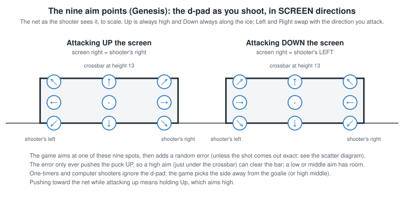

Every shot is aimed at one of nine points in the net, picked by **the direction the d-pad is held as the shot is
taken**, in **screen** directions:

| Held | Aim |
|---|---|
| Up-left / Up / Up-right | High: the screen's left / middle / right |
| Left / nothing / Right | Middle height: left / middle / right |
| Down-left / Down / Down-right | Along the ice: left / middle / right |

Because it is screen direction, when you attack down the screen the d-pad's left is the shooter's right. The aim points
are 16 units either side of the middle (the posts are at about 20) and at heights 12 (high), 6 and 0. **Confirmed**:
goals' aim points and where they crossed the line agree closely.

### 4.2 Perfect shot or scatter

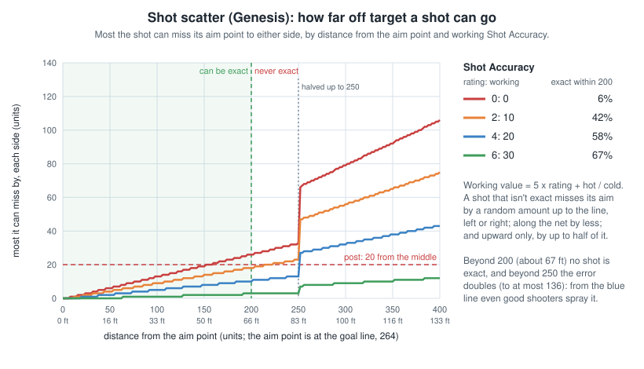

- **Within 200 units of the aim point** (about 65 feet), a roll decides whether the shot goes **exactly** where aimed.
  Chance = (Shot Accuracy + 1) / (Shot Accuracy + 16) on the working scale: about 55-67% for typical shooters.
- **Beyond 200, never perfect.**
- Otherwise random scatter is added: bigger for harder shots, longer distance and poorer accuracy ((shot speed / 16 -
  Shot Accuracy / 2 + 16) x distance / 64, halved within 250, capped at 136). Across: either way. Along the ice
  (which changes the angle): either way, at most 60, **halved when the aim point is below the puck on the screen**, i.e.
  every shot at the bottom net from in front of it (and a shot at the top net from behind it). Height: **only ever
  upward**, up to half of that (at most 30). "Shot speed" here is the internal value before the final x 68
  (`passspeed`). Compared with chaos's forum post "How Shooting Works" (2025-03-25), which reads the same routine:
  `doshot` halves for distances of 250 **or less** (`cmp.w #$FA,d3; bhi` skips the halving above 250), and a shot from
  the goal line itself (distance 0 along the ice) isn't halved (`bpl`); `randomd0(n)` returns 0 to n - 1 and the test is
  "greater than 14", so the perfect chance at working 30 is 31 / 46 = 67.4%, not 69.6%.
- **Confirmed**: within 200, 82 of 123 shots left the stick within 2 units of the aim point, more often for better
  shooters, roughly as the formula predicts; none of those from beyond 200.

**Shooting at an open net** (the goalie pulled, or far out of his crease). For a shot you aim yourself, nothing in the
game makes shots at an open net less accurate (the "goalie pulled" test in the shot code only ever looks at the
*shooting* team's own goalie). **One-timers are different: see 4.4, the open-net one-timer.** Three things from the
rules above make aimed shots miss: such shots are often taken from far out, where a shot is never
exact and the scatter is wide; the scatter only ever pushes the puck *up*, so a high aim has no room under the
crossbar; and the d-pad direction is the aim, so attacking *up* the screen, pushing toward the net aims high. Worked out
from the game's own scatter rule for an average shooter (working Shot Accuracy 15, a 15,000 shot) at an empty net, the chance it goes in by aim and distance:

| Aim (d-pad at the release) | 60 units | 120 | 180 | 220 | 300 |
|---|---|---|---|---|---|
| Nothing held (middle) | 100% | 82% | 65% | 20% | 2% |
| Left or right | 86% | 70% | 64% | 20% | 3% |
| Up (high) | 59% | 56% | 53% | 3% | 0% |
| Up-left / up-right | 57% | 54% | 53% | 3% | 0% |
| Down (along the ice) | 100% | 100% | 78% | 37% | 5% |
| Down-left / down-right | 86% | 81% | 74% | 37% | 5% |

**With the goalie pulled (no goalie on the ice), close in, Up is different:** from within 48 units of the goal line a
high aim gets the top-shelf lift (4.5), which replaces the shot's height speed and so its upward scatter. The puck
reaches the line about 10-13 high from 30-48 out, just under the crossbar, and over it from closer than about 25. A
goalie who has only wandered out doesn't count as pulled. Not in the table, which is for 60 and farther.

**At an open net: get within about 180 units (60 feet) if you can, and hold Down or nothing as you shoot, never Up.**
Not yet checked on recorded shots (only five recorded shots had the goalie far out or pulled; they hint at more going
wide: 24% wide with him 35-70 units out, 16% in his crease).

### 4.3 Shot power and the wind-up

**Facing only picks forehand or backhand** (`SetShotMode`, `Findhittype`; the same on the SNES, 4.3 there). When the
shot starts, the game takes the direction from the shooter to the net (the 8-way direction to the end boards behind
it) against the way he faces: straight ahead or toward his forehand side, a forehand; the net 45 to 180 degrees round
to his backhand side (which side that is follows his handedness), a backhand, a quarter weaker. Nothing else in the
shot reads his facing: the aim point, the perfect-shot roll and the scatter depend on the d-pad, the puck's spot, its
speed and Shot Accuracy. The swing's animation does decide where the puck sits as it leaves the stick. **Code**

Shot speed grows with working Shot Power and with how long the wind-up runs; backhands lose a quarter of their power;
fatigue scales it (only with line changes on). **Shooters with working Shot Power below 20 have the wind-up cut short
(step 8 instead of 16), so they can't take a full slapshot.** **Confirmed**: those shooters topped out at 20,746
(median 13,706, 67 shots); stronger ones reached 29,216 (83 shots). In mph, the hardest slapshots are around 95-100 mph.

### 4.4 Auto-aim: one-timers and computer shooters

**One-timers ignore the d-pad.** The game aims them itself (`shotdiradj`), and computer shooters the same way. It
draws **a sightline from the puck through the goalie** and carries it on past him toward the goal line. More exactly,
it uses where he's about to be: his position plus half the high byte of his speed. Then it measures how far the middle
of the net is from that line, straight across:

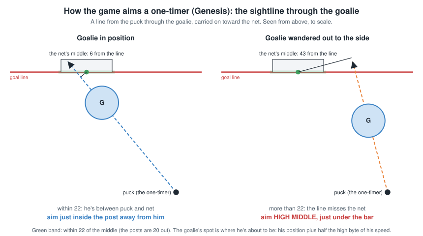

| Opposing goalie | Where the one-timer is aimed |
|---|---|
| None on the ice (pulled) | Middle, mid-height (direction 8) |
| Sightline within 22 units of the net's middle: he's between the puck and the net | Just inside a post at mid-height, on the side away from him (2 or 6) |
| Sightline more than 22 units off: he isn't between the puck and the net | **High middle** (0): the open-net trap below |

The posts are 20 from the middle, so the test is roughly "does the sightline through the goalie hit the net?". It
looks only at where he is (and a little at where he's skating), not at whether he could get back in time: a goalie far
out but still between the puck and the net gets the post aim, and one only a little way out but off to the side of the
puck's line gets high middle. **Code**: `CalcAngleOffset` measures it by triangles. For each post (at +/-18, on the
goal line at 264) it takes twice the area of the triangle puck-goalie-post and divides it by the puck-to-goalie
distance (found with Pythagoras). That is the post's distance from the sightline. The two posts' signed distances are
added and compared with $2C = 44, so the net's middle must be within 22. The recorded aim agreed with this rule on 69
of 88 such shots. (chaos's forum post describes the same calculation as triangulating from the puck to the goalie.)

**The open-net one-timer** (the user's league noticed "suspicious misses on great opportunities" when the goalie had
wandered, a person having dived or skated him out, and that they were one-timers, on the Genesis only). When the
sightline above misses the net (**more than 22 units off its middle**), the one-timer is **aimed high in the middle**
(direction 0).
That's the worst aim at an open net: the target is 12 units up, the crossbar is at 13 and the scatter only goes up, so
an exact one-timer goes in just under the bar but almost any scattered one goes over it or off the bar (the top-shelf
lift of 4.5 is never given to one-timers). Worked out from the scatter rule (an
average shooter, Shot Accuracy 15, a 20,000 one-timer) at an empty net:

| One-timer aim | 40 units | 60 | 90 | 120 | 160 |
|---|---|---|---|---|---|
| High middle (goalie on the ice, sightline misses the net) | 61% | 58% | 57% | 55% | 53% |
| Side, mid-height (the usual auto-aim) | 89% | 84% | 73% | 67% | 63% |
| Middle, mid-height (goalie pulled) | 100% | 100% | 86% | 73% | 64% |

**A pulled goalie doesn't cause this**: with no goalie on the ice there's no sightline, and the one-timer is aimed at
the middle, mid-height, which leaves room under the bar for the upward scatter.

So close in on an open net a one-timer misses about 4 times in 10, where a shot aimed at the middle would hardly ever
miss. **In the recordings** 10 one-timers got the high-middle aim: 7 went in at heights of 10 to 13 (just under the bar),
one went over at 16 (BOS-DAL 2257, P1 0:57), 2 were saved. Computer shooters are aimed the same way. **The SNES doesn't
do this**: it auto-aims only computer shooters, so SNES one-timers follow the stick.

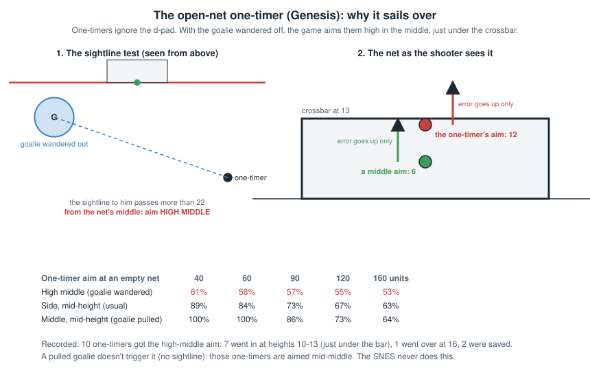

### 4.5 "In-close top shelf"

A high shot (up, up-left or up-right) from close in (the puck within 48 units of the goal line: 216 or more from
centre), **at a goalie in a pad stack or with no goalie on the ice** (pulled), gets its own lift (`prepshot` sets the
flag, `puckvzadj` applies it; never for one-timers). It **replaces** the shot's height speed with one worked out from the
time to the goal line, so the upward scatter is gone: from 30-48 out the puck reaches the line about 10-13 high, over a
pad stack and just under the crossbar (13); from closer than about 25 it carries over the bar (15-24). **Code** (the
branch after the two pad-stack compares falls into the top-shelf test on a match; chaos's forum post "How Shooting
Works" has it the same way).

### 4.6 Delayed-penalty sniping

While the other team has a delayed penalty pending (referee's arm up, play continuing), the game pulls your goalie for
an extra attacker, and **every shot your team takes from within 200 units goes exactly where it's aimed**: the shot
code treats "goalie pulled" as "always perfect". **Confirmed** on the two aimed shots in the recordings taken during a
delayed penalty (0.7 and 0.3 units off the aim point).

### 4.7 What counts as a shot on goal

- A shot counts when the puck touches the goalie's body, or he catches it with his stick, while the "shot taken" flag
  set at the release still stands. Posts and the crossbar also count (section 13.3).
- **Any touch on the way** (a stick, a body), **the boards**, or a hard puck deflecting off the goalie's stick clears the
  flag without counting. Pass shots (a B pass used as a shot) never set it, so they only count if they score.
- **Nothing counts while the clock is stopped**, which is why penalty shots are never shots on goal.
- **Code**, partly confirmed (the penalty shot).
- **Shots along the ice are the ones that go uncounted.** The goalie's stick only plays a puck that is low (height 5
  or under) and not rising, and within 8 units of his blade it catches a puck slower than 13,000 (counted) and
  deflects a faster one (not counted). A shot aimed along the ice (Down held) gets no lift, so it stays low all the way
  in; middle and high shots are lifted past the stick and hit his body (counted). **Confirmed** in 13 Genesis games:
  of the shots that reached the goalie, aimed along the ice 9 of 22 went uncounted, middle 21 of 189, high 2 of 61.
- **So the direction you attack changes your shots on goal.** People hold the d-pad toward the net: attacking down
  the screen they aimed along the ice twice as often (25% of their shots against 12% going up) and high half as often
  (16% against 35%). With the rates above that costs a team going down about 6% of its shots on goal on shots
  reaching the goalie, which may explain much of the community's finding that the up direction has about 10% more
  recorded shots on goal. (In these 13 games the middle-height shots went the other way, 16% uncounted going up
  against 7% going down, unexplained, so the recordings alone don't show the 10%.)
- **By direction, in the recordings:** of shots and one-timers that reached the goalie, 126 of 148 were counted going
  up (85%) and 143 of 157 going down (91%), the opposite of the leagues' 10% more going up, and with only 17 stick
  knock-aways (9 up, 8 down) too few to show the aim effect above. About 100 whole games would be needed.
- **Every uncounted save, one by one** (`analysis/uncounted_study.py`, 34 in the Genesis recordings, pass shots
  left out). How each one ended, against the counted ones:

  | How the save ended | Counted | Not counted |
  |---|---|---|
  | Goalie held it at once | 61 | 4 |
  | Bounced straight out from his centre (his body) | 100 | 4 |
  | Knocked away slowly in a random direction (a stick) | 15 | 17 |
  | Went behind the net or to the boards first | 1 | 6 |
  | The clock stopped before it arrived | 2 | 3 |

  - **Most are the goalie's stick:** a low puck (height 5 or under, usually 0-5.6 just before) 16-33 units from his
    centre, beyond his body's reach, leaving at most 4,096 each way in a random direction: exactly `deflect`'s
    random velocity. The stick's deflection touches the puck (a2touchpuck) and clears the flag.
  - **The clock:** two came in the last second of a period (the clock reached 0:00 while the shot was on its way)
    and one was a penalty shot.
  - **Not really saves:** six went wide and came back to the goalie off the end boards or from behind the net (the
    boards clear the flag).
  - **A screen:** about four bounced off a skater's body in front first (height 8-12, within about 9 of him; a puck
    above 8 always hits a skater it passes within 8 of).
  - About 15 counted saves also looked like stick deflections, so the samples (60 a second) can't tell every case,
    but the split is clear: a save the goalie makes by holding it or with his body is counted almost every time (165
    of 173); one his stick knocks away usually isn't.

### 4.8 One-timers

**Triggering:**

- Pass (B) to a teammate, then **press C while the pass is on its way**. You still control the passer then, and C
  hands control to the receiver for the shot.
- Or, controlling the receiver, press C while the puck is loose and coming to him.
- **Only in your attacking half.** In your own half, C is a normal speed burst. The receiver can't be a goalie.

**The game times the swing for you.** The receiver starts his wind-up; the game keeps working out how many frames
until the puck reaches him and **starts the downswing itself** so the blade meets the puck (forehand or backhand by the
angle to the net). If the puck is slow he holds the top of the wind-up for up to 0.8 s more. The strike happens when
the puck comes within 10 units of the blade, and gets a strong minimum shot speed, auto-aim (4.4), and **the goalie's
reach cut to its minimum** (5.1).

**It fails** when the puck doesn't reach the blade before the swing ends (a slow pass, a receiver drifting off the
pass's line, a deflection), when anyone else touches the puck first, or when the puck goes away from him.

**Confirmed timing:** successful one-timers struck 0-0.87 s after the C press (median about 0.2 s); failed ones ended
0.3-1 s after it. **Press C no more than about 0.9 s before the pass arrives.** Pressing late is fine, even as the puck
reaches him: the swing snaps forward when the puck is already at the blade.

The computer one-times on its own in the attacking zone (and now and then outside it), but only for teams no person
controls.

**A computer one-timer can look like a fumbled pass** (the user, 2026-10-27: a pass that the receiver seemed to bobble,
then the puck shot off him with no one-timer animation; `2026-10-27_0744_HFD-EDM`, P3 1:30, Hartford's only goal).
Traced from the recording: the puck was never carried. The pass left at rocket speed, then 0.1 s later was lifted (up
to 8-9 high) and slowed toward a point in front of the receiver, changed course once more in the air with nobody near
it, and was struck 0.5 s later, 6 high, at 20,400 (a one-timer's speed), auto-aimed at mid-height inside the right post, past the goalie's glove save. The
lift is the one-timer pass (`OneTimerPass`: the puck flipped up and sent to a target in front of the receiver,
`OneTimerTarget`), which reads on screen as a bobble. The receiver had gone into the **backhand** shooting animation
(`shotb`, $092E) 0.2 s before the strike: the game picks forehand or backhand by the angle to the net
(`setonetimeranim`), and a backhand one-timer has none of the forehand's familiar wind-up. What changed the puck's
course in the air the second time isn't settled.

### 4.9 Expected goals from the game's own rules

Because shots and saves are decided by fixed rules plus a few random rolls, the chance a shot goes in can be worked
out by **playing it out the way the game would**, many times. The NHL '94 Viewer does this for every shot and one-timer
in a recorded game (`tools/xg.py`, 400 times each):

1. **The aim** is the recorded d-pad direction (4.1), or for one-timers and computer shooters the game's own auto-aim
   (4.4), worked out from where the goalie is heading.
2. **The shot** goes exactly at the aim point with the perfect-shot chance (4.2; always during a delayed penalty, 4.6),
   otherwise with the game's random scatter, at the recorded speed and the shooter's working Shot Accuracy.
3. **The flight**: the puck travels in a straight line, its lift cancelling gravity (13.1).
4. **The goalie** moves the way the computer goalie does (5.3), from where he stood at the release, with his own
   ratings; a person in net is moved the same way. His reach comes from his Agility, a person controlling him, a
   one-timer or a pad stack (5.1).
5. **The result**: a goal when the puck's centre crosses within 20 of the middle under the crossbar (13.3), a save when
   it passes within his reach at height 15 or less, or reaches his stick's blade low (since 2026-10-29: the blade from
   his sprite frame, and the blind ring beside it, 5.1, 5.5), else a post, over or wide.

The only number fitted to the recordings is how far the emulated goalie may be off (4 units of random spread, the size
of its measured error). **Checked** on 191 unblocked shots in seven recordings: 39.4 expected goals against 34 scored;
computer goalies 28.6 / 23, people in net 10.8 / 11; the predicted mix of saves, wides and posts matches what happened.
Shot by shot it ranks chances well: its log loss is 0.30, against 0.46 for giving every shot the same chance.

What it leaves out: skaters in the way (blocked shots are left out of team totals), the in-close top-shelf lift (4.5),
and anything a person does with the goalie beyond what the computer would. **Pass shots** (2026-10-30) are played
from the puck's recorded start over the next 50 ms (no aim, no scatter) with the pass's random lift (0-4,095, 6.1
of the mechanics): on the 19 recorded Genesis pass shots whose ROM is at hand, 2.3 expected goals against 2 scored
(log loss 0.42, against 0.34 for one rate: one empty-net pass shot off the post was a certain goal to the model).
Without the ROM the goalie has no stick, so flat pass shots through its blind ring come out at 0 (3 of
2026-10-19_0818_ANA-ATL's 4 pass-shot goals; the fourth 0.06). **Deflections** have no xG: played the same way from
their recorded start, five of the six recorded Genesis goals off one came out at 0, the puck already at the goalie.

**Checked against the game itself** (2026-10-29, `analysis/scoring_map/xg_calib.py`): 33,808 shots the studies play
(standing shots from all over the zone, shots on the move, dekes, EA Specials), the model asked from the exact state at
each release. It gets dekes (game 19.7%, model 18.7%) and EA first shots right, runs a little high when the goalie is
set (6.7% against 10.3%), and far too low when the goalie is **already in a save move** at the shot (24% against 15%):
it lets him rethink and skate, where the game holds him in his move. Adding his stick improved both these shots and the
recorded ones (the 671 recorded shots, one-timers apart: log loss 0.2657 to 0.2630), so recorded shots have it. And a goalie **locked in his save move**
(or pad stack) at the shot is now held in it for as long as the recording shows the lock (the game's pflags bit 5,
kept in every match file), his speed taken from where he slides next: on the game's own shots at such a goalie log
loss 0.42 to 0.30, on the 671 recorded shots 0.2630 to 0.2612 (with the 215 one-timers, 886 in all, about 0.30). Both are in every recorded shot's xG.

Using the model in your own work (its inputs, units and an example): [XG_MODELS](XG_MODELS.md).

The viewer shows each shot's xG, a skater's xG, a goalie's xG against and goals saved above expected, and the teams'
xG; the season page adds them up.

**The goalie's position matters more than the shooter's.** **Confirmed** over the 178 recorded shots with a goalie in
net, by how far he was from his set spot (5.3) at the release:

| Goalie off his set spot | Shots | Mean xG | Goals |
|---|---|---|---|
| 0-3 units | 31 | 0.04 | 1 |
| 3-6 units | 52 | 0.07 | 1 |
| 6-10 units | 36 | 0.23 | 7 |
| 10 or more | 59 | 0.39 | 22 |

A set goalie is very hard to beat from anywhere: against one, the best wrist shots come out at about 0.04, the best
slapshots (from about the tops of the circles) 0.12, a one-timer from the slot 0.22. Shots go in when he is still
moving or out of position, which is what passes across, rebounds and quick shots off the rush produce.

**The xG map** (the viewer's Map menu) shows the chance from every spot in the attacking zones, for a wrist shot,
slapshot or one-timer, a shooter's Shot Accuracy, and a goalie either set in his spot or "as in games": each simulated
shot faces a goalie placed and moving as goalies really were at one of the recorded shots (their offsets and speeds,
`xg.goalie_states`). With goalies as in games, wrist shots from the slot come out at about 0.2, slapshots up to about
0.28, one-timers 0.37-0.5, and shots from the points under 0.07.

### 4.10 The scoring map: shots played in the real game

**Real game** (2026-10-22; `analysis/scoring_map/`, PROJECT_NOTES "Scoring map"; the whole method, with pictures of each kind of goal: [SCORING_MAP](SCORING_MAP.md)). Instead of a model, the game itself:
the ROM rebuilt from the disassembly with a small hook in `doshot`, run headless, every shot set up and played to the
end. The shot's random draws (the perfect-shot roll and the three scatter draws) are sampled from their exact
distribution through an exact port of `doshot` (it matches the game on 129 of 129 shots), and the moment of the shot
from 120 phases of the game clock and the goalie's cycles. **Checked** against the game's own draws: 3,000 natural
shots at each of four spots agree within about one standard error (for example 44.4% natural, 43.0% mapped).

**The situation it covers:** an average shooter (working Shot Power 20, Shot Accuracy 15) standing still with the
puck; every other skater away; the computer goalie (Los Angeles's Kelly Hrudey, working Agility 13, Speed 13, Puck
Control 18 and `aidef` 10, which is Defensive Awareness about 18-20: his roster 3 / 3 / 4 / 4 with a cold -2) set in his
spot for that puck; a wrist shot (C tapped) or a full slapshot, each of the nine aims. Spots where the puck would start
within 24 units of his centre (in the middle closer than about 40-60 out, and along the goal line) are left out: holding
a shooter there isn't something a game allows.

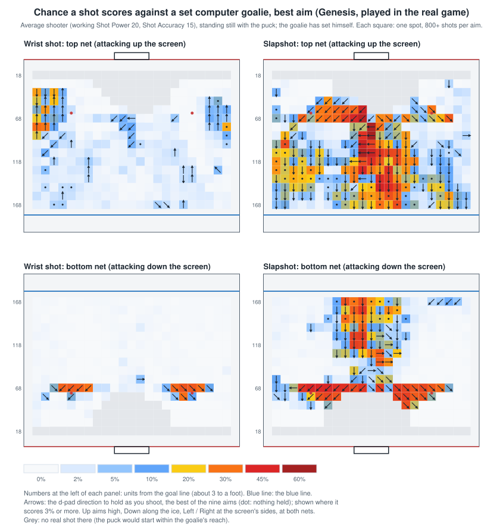

**What a set goalie gives up:**

- **Wrist shots: almost nothing.** Averaged over the nine aims under 1% from every distance; the best aim reaches 4-5%
  only in patches. A set goalie is beaten by a wrist shot only through the two quirks below.
- **A slapshot with Down held, straight at him from the middle: 20% on average, up to 47%.** It's the flat puck through
  the butterfly (5.5): he picks the butterfly for a low puck arriving at his middle, the puck crosses the blind ring
  around his stick untouched, meets his body behind his centre and bounces into the net. From within 30 of the middle,
  88-168 units out: 20.7% at the top net, 13.6% at the bottom (best spots 47% / 42%); from the sides (60+ across) only
  5.5% / 0.8%. Nothing held does the same from about 150-170 out (the perfect shot peaks at height 5: flat enough).
- **Within about 60 of the goal line, the early pad stack** (5.6): a slapshot wound up there finds him already stacking
  at about half of the moments (46-48%), and a down-diagonal aim to the side he slides away from scores 30-50%; the
  best aim averages 18% (top) and 24% (bottom) along that row. Wrist shots trigger it too (34%) but score less.
- **Top net only: the shoulder-save bobble** (5.3). A high wrist shot from the far left boards, about 78 out, scored
  31%: every one of those goals was a puck the goalie had caught in a high save and dragged back over his own line.
- **Top against bottom:** the best slapshot from 88-168 out scores 14-16% at the top net, 6-8% at the bottom.

| Best aim, by distance from the goal line | Wrist, top / bottom | Slapshot, top / bottom |
|---|---|---|
| 128-168 units | 1.4% / 0.2% | 14.2% / 7.6% |
| 88-128 | 1.8% / 0.1% | 16.4% / 5.7% |
| 58-88 | 4.3% / 4.7% | 13.4% / 11.2% |
| 18-58 (valid spots only) | 3.5% / 1.2% | 5.6% / 6.7% |

**The moment matters.** The same perfect slapshot just inside the post at mid-height from 108 out went in at 13 of 16
moments: he committed to a stick save at once and stayed put (reach 13, the puck at 16, 5.5), unless his rethink fell
first and he slid over. Whether it does depends on where the shot falls in `findpc`'s 5-frame cycle and his rethink
countdown, which no player can see.

**Against the xG model (4.9):** averaged over the nine aims the two agree (slapshots 88-128 out at the top net: 3.1%
in the game, 3.8% in the model), but the model can't see the Down slapshot: it leaves out the goalie's stick, and with
it the blind ring. So it puts the best aims in the wrong places and underrates a set goalie's worst cases (best aim
88-168 out: 14-16% in the game, 1-7% in the model).

**The model's stick and rebound** (2026-10-23, `tools/xg.py`: the goalie's stick before his body for a low puck, with
the blind ring; a body touch held or bounced off, by `puckgoalie`'s rule). With them, and the goalie placed exactly
(no position blur), the model matches the map's averages: slapshots 88-168 out averaged over five aims, 7.2% in the
game and 7.2% in the model at the top net, 4.9% and 5.1% at the bottom (without them: 0.5%). Spot by spot it can't
match: the ring is a few units wide and the puck moves about 5.6 units a frame, so a unit's difference in where the
puck starts or where he stands decides whether it clips his body first. On recorded games it gained nothing at first (log loss
0.3314 either way with the usual blur, worse with less): a recording doesn't place the goalie within a few units. The
xG map's set goalie used the stick and the rebound from then; recorded shots have had the stick since 2026-10-29,
with the save-move lock (4.9).

**Recorded shots replayed in the game** (135 aimed shots at computer goalies; the recorded spot, aim, speed and
shooter, the goalie's position, speed and ratings): the expected total matches (20.5-22.5, with the goalie's recorded
position blurred by 2-4 units, against 22 scored), but shot by
shot the xG model predicts recorded games better (log loss 0.23 against 0.25 at goalies standing ready). A recording
doesn't pin the moment down finely enough (60 samples a second, not locked to the game's frames; no goalie AI state),
and the game's outcome turns on a few units and a frame. **So the viewer keeps its xG model for recorded games; the
map shows what the rules do.**

### 4.11 Other shots played in the real game

The same harness, with a pass, a moving shooter or a follow-up; each study in full in [SCORING_MAP](SCORING_MAP.md).

**One-timers in the real game** (2026-10-23, `ot_run.py`, the whole study in [SCORING_MAP](SCORING_MAP.md),
"One-timers", Genesis): a pass to a standing receiver, C pressed during the pass, the strike (`puckstick` ->
`onetimershot`, auto-aimed) played out at a set computer goalie; 824 set-ups over both nets. **Real game:** the swing
struck the puck in 83-91% of presses the pass reached; goals per strike by the receiver's spot: the doorstep middle
62%, 18 feet out within 10 of the middle about 50%, 27 feet 31-44%, 35 feet 2-14%, beyond that 1-2%. With the receiver
inside 18 feet a pass across at the same depth scores 63%, from his own side 20-30%. Pressing early or late in the
pass makes no difference on average. The nets agree on average but individual set-ups differ by up to 60 points (the
same sensitivity to a unit of position as the Down slapshot), so a set-up's rate holds for one net, not both.
**Why the pass across works:** at the strike the goalie is a median 12 units off the puck-to-net line after a pass
across (moving 50 units a second), 3.7 after one from the same side (29 a second); 10 or more off the line, 86% went in,
within 5 of it 25%. **The xG model (4.9) already gets this right:** at 748 strikes, the game 20.7% and the model 22.1%,
correlation 0.83, across 69% / 67%, same side 24% / 24%; the stick, rebound or an exact goalie position don't improve
it, so it is unchanged.

**Slapshots by the shooter's ratings** (2026-10-24, SCORING_GENESIS "Slapshots and the shooter's ratings"): the slapshot
from 18 spots 104-144 out, every roster step 2-6 of Shot Power and Shot Accuracy. **A threshold between Shot Power 3
and 4:** the best aim's chance over the spots 4-7% at power 2-3, 14-21% at 4, up to 35% at 6 / 6; Accuracy adds 7-11
points once the power is there (power 4-6), 1-2 below it. From the middle (a 27 / 27 shooter): at the top net the far
post from 28-41 ft (31-69%), Down from farther; at the bottom net Down (31-60% from 35-55 ft). Over both, Down 28%,
the far post 21%.

**Moving shooters** (2026-10-24, SCORING_GENESIS "Moving shooters"; `mv_run.py`): a wrist shot skating across the crease
scores 51-53% about 11 feet out aimed the way he skates, 0-1% aimed back. **The far-post slapshot is a skating shot:**
a strong shooter (27 / 27) crossing toward his stick side, released just before the middle 28-35 feet out, 50-62%,
falling fast once past the middle; standing in the middle at those distances the best aim scores 65-69% at the top
net but 21-45% at the bottom, so skating across pays most at the bottom net. By rating (plan "slapxr") the same
threshold between Shot Power 3 and 4 (15% to 44% at Accuracy 4), and from farther out each step of power counts.

**Dekes and floaters** (2026-10-24 / 25, SCORING_GENESIS_DEKES "Dekes and floaters"; `deke_run.py`): close in, a two-step swing
of the d-pad moves the puck across in front of him in about 15 frames; a wrist shot with the swing's side held then
scores 82-96% at the best set-ups (the backhand deke too, shot once the puck is across), the same shot with no swing
0-1%. It baits the computer goalie's pad stack, which ignores the puck's side and slides toward the middle of the ice
(`goaliesave`). Floaters (up and across, the puck swung back, C held 6-9 frames) 50-65% on the forehand, 41-51% on the
backhand. The timing is tuned to the skater: a slow one (working Agility / Speed 10) scores 31-53%, a fast one (30)
reaches the goalie before shooting and carries the puck in or loses it.

**EA Specials** (2026-10-24 to 28, SCORING_GENESIS_EA; `ea_run.py`, a bot playing the rebound): a first wrist shot
aimed across, at the far side, is bobbled 60-80% of the time (aimed along the ice he holds it), the hardest shots are
held more and the goalie dives at the loose puck less as Shot Power rises. Skating in a little below full speed
(1.5-1.9 a frame; at 2.0 and over it fails): the top net's EA Special scores 65-75% for the bot from 23-24 ft out and
25-29 ft to the side, either hand, the first shot at the far side at middle height and the follow-up at the near post
(the right-hander's against every league starter); the bottom net's best is 16-17 ft out and 29 ft to the side (about
60-70%, but which hand works depends on the goalie's Agility). Shot Power 3-5, and Shot Accuracy doubles it. Backhand
EA Specials barely work (0-9% over all aims). Against people's real attempts the simulation is far too optimistic
(the bot meets no defender).

**The computer goalie's ratings** (2026-10-25, SCORING_GENESIS "The computer goalie's ratings"): the scoring map's test
goalie is Hrudey with a cold -2 (working Agility 13, Speed 13, Puck Control 18, `aidef` 10). Setting Agility, Speed
and Puck Control to 20 (and `aidef` to 20, which doesn't matter for these shots), the standing slapshot's best
chance falls from about 20% to 5% (the far post from the middle 57% to 3%) and the skating far-post slapshot from 41%
to 15% (7% at 30); one-timers are unchanged (58-62%), dekes fall a little (71% to 63% at 30), floaters not at all.
**One rating at a time, Agility does it** (his reach, 5.1): Agility 13 to 20 alone takes the standing slapshot's best
chance from 18.9% to 8.9% and the far post from the middle from 58% to 3%; Puck Control helps a little (20 to 30:
8.4% to 6.3%); Speed and Defensive Awareness (`aidef`, his reaction) change nothing. **Real goalie profiles**
(SCORING_GENESIS "Real goalie profiles"): against Roy and Belfour (roster Agility 6) a 4 / 4 shooter's standing slapshot
scores 3-4% (19% against Hrudey), the skating far-post slapshot 9% (37%), floaters 16-20% (51%); one-timers 48-51%
(58%) and dekes 72-76% (85%) hold up. A retail starter (Agility 4) halves the slapshots; the CDL edit adds a little.

---

## 5. Goaltending

### 5.1 Saves are geometry, not a dice roll

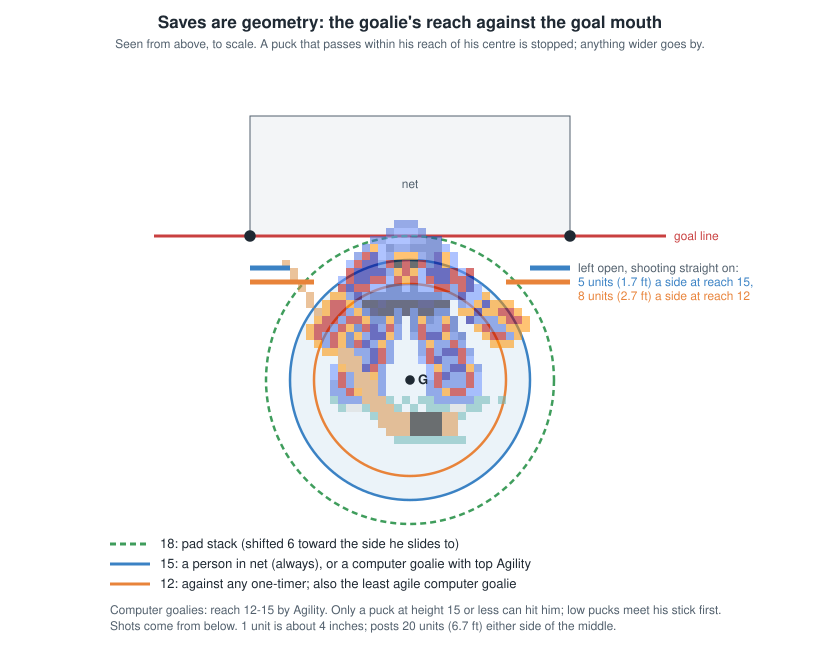

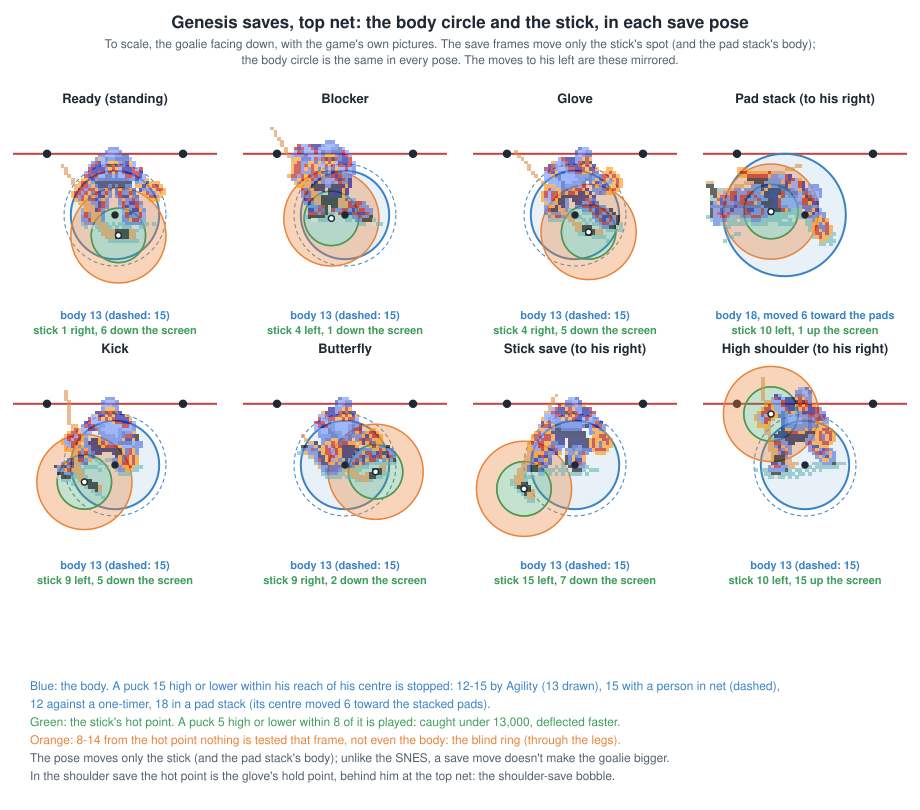

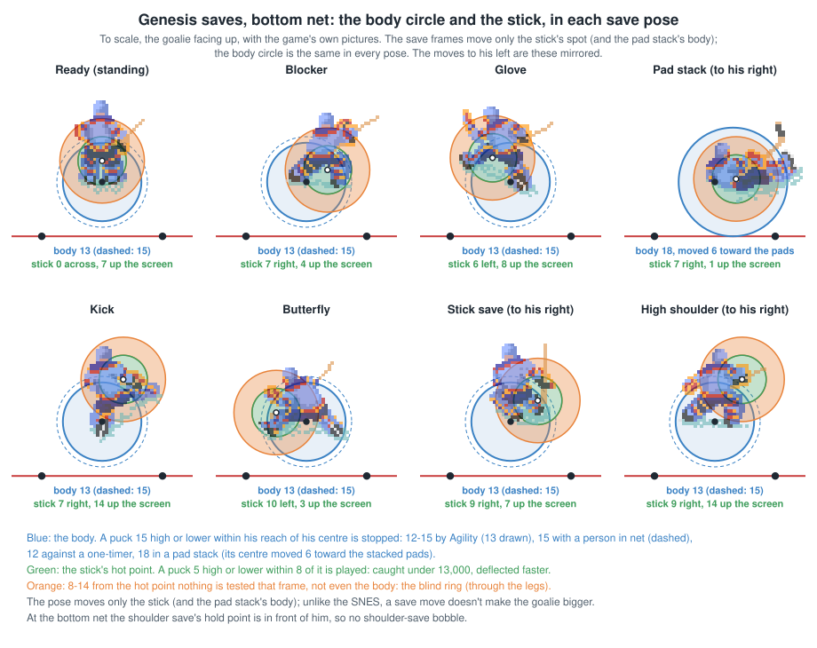

The goalie stops a puck only if it physically reaches him:

- **Body:** a puck at height 15 or lower within his **reach** of his centre is stopped.

  | Situation | Reach (game units) |
  |---|---|
  | Computer goalie, by Agility | 12 to 15 |
  | **A person controls him** | **always 15** |
  | In a pad stack | 18 |
  | **Against a one-timer** | **12, whatever his Agility** |
  | Shootout | 2 less |

- **Stick:** a puck at height 5 or lower near his stick blade. Within 8 units he plays it: slower than 13,000 he
  catches it, faster it deflects off in a random direction. **Between 8 and 14 units nothing happens that frame and the
  body test is skipped**: a small gap beside the stick.
- After a body touch the puck is held or rebounds (5.2).
- **The glove and stick save ratings are never used.**

**Confirmed:**

- As the puck reached the goalie's line, saves passed a median 13 units from his centre (49 of 71 within 15); goals a
  median 24 (31 of 40 at 15 or more). 111 goals and saves.
- 5 of the 9 goals that went in close to the goalie were one-timers (reach cut to 12).
- The other 4 all had the computer in net, with Agility rated 3-4 (reach 13-14). **With a person in net, no goal other
  than a one-timer passed within 20 units.** Taking the goalie yourself really does make him bigger.

### 5.2 Rebounds

- After the puck touches his body, he **holds it** if both of its speed components are under a random threshold set
  by his Puck Control; otherwise it **rebounds**.
- **In close with the goalie standing still** (puck within 44 of the middle, 210-270 from centre ice, goalie not in a
  save move) the threshold is quartered, so point-blank shots mostly rebound. A **diving** goalie never holds it.
- **The rebound goes straight out from the goalie's centre through the spot the puck touched**, at a speed set by how
  far from his centre that was. A shot clipping his left pad comes off to his left.
- **Confirmed** on 135 saves: in close with the goalie standing, 28 rebounds in 47 (60%); in close mid-save, 19 of 72
  (26%); farther out, 2 of 8. Rebounds left a median 6 degrees off the centre-to-contact line (3 in 4 within 19).

### 5.3 The computer goalie

**Positioning** (`checkanim`, `findpc`). He re-aims every 1-3 frames depending on his Defensive Awareness (12.1), and
each time picks a spot to skate toward:

- **Normally: where the puck is about to be.** He takes the puck's position plus a slice of its velocity (a look-ahead
  that varies with the game clock), and stands on an ellipse around the middle of his net, **26 units across and 18
  out**, on the line toward that point.
- **When a shot is coming:** once the puck will cross his goal line within 24 of the middle **in under 34 frames**
  (about 0.6 s), he **skates sideways to the point where it will cross**.
- **12 frames (0.2 s) before it arrives he commits to a save move** (below), and **his speed is cut to a quarter**: he
  stops sliding and can't adjust any more.
- He skates like a player: acceleration from his Weight and Agility (**goalies count Agility twice**), top speed from
  his Speed.

**Confirmed:** emulating this frame by frame and driving it with the recorded puck, the goalie lands a median 1.1 units
from where the recorded goalie actually was when the puck arrived (120 shots at computer goalies; 95 within 3 units),
against 3.7 for a goalie assumed to stand still.

**Save moves** (`goaliesave`), chosen when he commits:

| Puck | Where it will cross | Move |
|---|---|---|
| High (above 8, or rising fast) | near him (within 16) | shoulder save |
| High | farther out | glove or blocker (reaching glove save with Glove Left 11+) |
| Low, arriving within 8 frames | near him | kick / butterfly |
| Low, arriving within 8 frames | farther out | stick save |
| Low, further off, **someone still carrying it** | | **pad stack** (slides across toward that side) |

**Dives:** the computer goalie **only dives to smother a slow loose puck right in front of him** (within 20 across and
30 out), never at a shot. **Confirmed**: all 7 computer dives in the recordings were at loose pucks within 45 units.

The save-move mix in the recordings (115 saves) fits: stick 62, high 14, pad stack 12, dive 5, glove 2, none 20.

**The shoulder-save bobble at the top net** (the user's observation: a high shot at the top net's goalie, a shoulder
save, the puck in his possession, then loose for a frame and either back to him or in). A held puck is pulled a quarter
of the way each frame toward the holder's hold point (`pucknorm`: "bungie the puck towards the hot spot"), and the hold
point comes from the sprite frame (`HotList`), measured on the screen, where up on the screen is up the rink. The
shoulder saves hold the puck high, near the shoulder: **14-15 units up the rink**. For the bottom net's goalie, facing up,
that's out in front of him; for the **top net's goalie, facing down, it's 14-15 units behind him, back toward his own goal
line** (his ready stance holds it 4-6 units in front). Standing about 242-250 from centre, he drags the puck to the net's
front (261), and a carried puck entering the net is taken off its carrier, who can't touch it for 8 frames, and
bounced away (`checkgoal`). Loose on the next frame, it is a goal if it then crosses the line inside the mouth;
otherwise he takes it back. It can't happen at the bottom net. **Code** (the hold points read from the ROM: shoulder
saves facing down (-10, +15) and (+10, +14), facing up (+9, +14) and (-9, +14)). **Confirmed** (2026-10-19_0818_ANA-ATL,
the user's 2v2 test game, P3 4:00, which the user took for a bump): Rucchin's flat pass shot at the standing top goalie
was knocked up by his stick (no-touch 8), he caught it in a high save (ghighl, frame 667, hold point 14 behind him), the
puck was pulled back to y 260, the net's front took it off him (no-touch 8 again) and it slid in. No skater came within
17 of it after the pass. The puck isn't sent anywhere new when it's stripped: it keeps the velocity the hold-point pull
gave it, which points into the net. **Why it isn't bounced back out** (frame by frame from the recording, then the
code): on the strip frame (1671) the puck, carried to y 260.7, entered the net's box; `checkgoal` cleared the carrier
(his no-touch 8), marked the puck `pfgoal` ("in its own team's net") and set the collision flag, which put the puck back
to its previous position (y 260.0). It then sends the puck to `wallcoll` to bounce off the net's front. But `wallcoll`
first asks whether the puck is moving into the surface, and with the normal `checkgoal` sets up there, a puck moving
into the goal mouth reads as moving away from it, so the bounce is skipped and the velocity (1,798 / 1,155) is kept. The
loose puck slid on, was in the box again at frame 1675 (the mark cleared) and crossed the line at frame 1676. The same
sign holds at the bottom net: **the net never bounces a puck moving into the mouth**, only one entering from behind. So
a puck its own team carries into its net is only held back one frame and goes in if it keeps moving (5.9, 13.3). In the
7 earlier top-net shoulder-save losses in the recordings, the puck never reached the net.

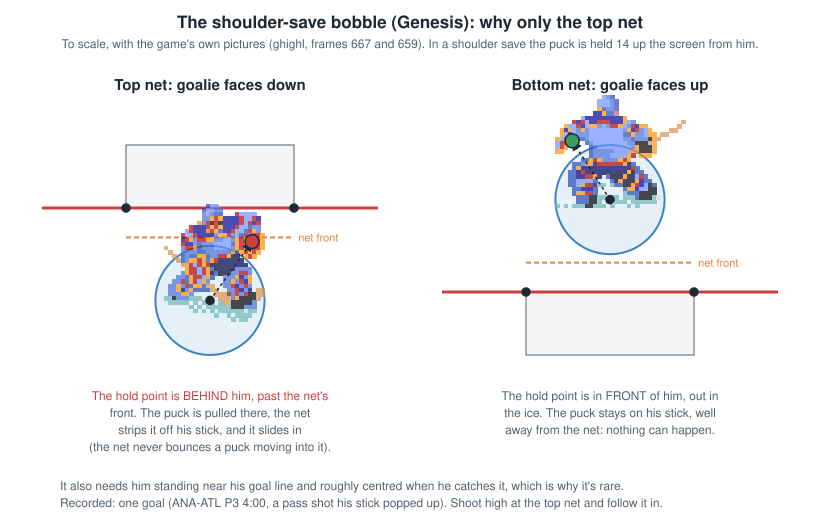

### 5.4 Goalie whistles

- Holding the puck: about 2.3 s (140 frames) after he takes it; 5 frames if he took it in a dive.
- A goalie a person controls who comes nearer centre ice than 170 units (past the tops of the faceoff circles) is
  whistled; without the puck he can't skate out that far anyway (a person's goalie is kept within 36 of the middle and
  231 from centre). League ROMs can change all three numbers (section 15).

### 5.5 Pressing C as the goalie (a person in net)

**What C does** (`doinput_cbut`, for a goalie): he turns to face the puck and starts **the same save move the computer
would pick** (`goaliesave`, the table in 5.3), chosen from where the puck is predicted to cross his goal line. His speed
is cut to a quarter and **he is locked in the move until it ends**: no skating, no other button. The moves last about
0.57 s (glove, stick, shoulder) and 0.72 s (pad stack). **Code**; the lengths measured over 300+ recorded moves.

**How the move is chosen** (`doinput_cbut` `.press`, then `goaliesave`): he turns to face the puck where it is now,
then `goaliesave` picks the move from the angle between that facing and the point where the puck is predicted to cross
his goal line (`puckcross`, worked out every 5 frames), and from the puck's height. **Leftover code:** before that, the
press works out a target (the puck's position plus its velocity times a lead time of 160 + 16 x the clock's seconds
mod 8, 64 less beyond either blue line, clamped and scaled), and then six bounds tests on it and on the puck that have
no branches after them. `goaliesave` overwrites those registers in its first lines and never reads the rest, so none
of it has any effect: probably what's left of an earlier design in which C moved the goalie. **Code**

**What it doesn't do: make him bigger.** His reach is 15 whatever he does (5.1). Glove, shoulder and stick saves don't
change it, and the glove and stick save ratings are never used. **Being in the way is what saves shots.**

What a save move does change:

- **The pad stack.** If you press C while the puck is still on the shooter's stick (and it's low, and the goalie isn't
  facing straight sideways), the move is a pad stack. His reach becomes 18, the biggest it gets. He also jumps 6 units
  and slides **toward the middle and past it, away from the side he was standing on**, which opens that side.
- **Fewer rebounds in close.** The rule that makes a standing goalie hold far fewer pucks in close (5.2) doesn't apply
  in a save move. Recordings: computer goalies in a save move held 62 of their 100 saves; standing, 32 of 89.
- **His stick moves.** The save frames put the blade 5-10 units out to one side. A low puck within 8 of the blade is
  the stick's: caught if slower than 13,000, deflected if faster. That's a little extra cover along the ice.

**The cost:** over half a second frozen at a quarter speed. Press too early, or while you're sliding across, and a
pass across, a deke or a shooter who keeps moving beats you.

**Why hard shots and passes seem to slip right under a goalie in a save move** (2026-10-19; the user's league knows
it, Genesis only, and has learned to take the goalie and let the puck hit him instead of pressing C):

- **The game picks a save move because the puck is going to miss his body.** The stick save (`gstick2`) is chosen when
  the puck is predicted to cross more than 16 units to his side, and the glove and shoulder saves by the same kind of
  test. The picture then stretches the pad, glove or stick toward the puck, but **his body is still the same 12-15
  circle around his centre**. A puck passing 15-20 out goes straight past the outstretched pad and in.
- **The stick doesn't help with shots.** It only plays a puck that is low (5 or under) and **not rising**, and a shot is
  lifted on its way, so the stick in a save pose almost never touches one; flat passes and pass shots it can catch or
  knock away.
- **Recordings** (Genesis shots and passes at a goalie, the puck below 15 as it passed him, by how close it came to his
  centre): 12-16 units out, a goalie standing let in 11 of 82 (13%), one in a save move 28 of 74 (38%); 16-20 out, 7 of
  12 against 18 of 24. Stick saves were the worst: 27 goals in 47 from 12-20 out. Two traced examples (2026-10-16_1314
  BOS-PIT P1 2:06 and P2 4:34, 19,000 shots, the goalie in a kick save): the puck passed 15 from his centre, rising,
  never touched.
- **For a person in net:** C freezes him for over half a second at a quarter speed with the controls ignored, so he
  can't skate into the line. Steering him so the puck meets his body (reach 15 for a person) is what stops it: the
  league's habit is right.
- **The pad stack is the exception:** reach 18, shifted 6 units: a real extension.
- **Why never on the SNES:** there, the save frames add hit areas 12-28 units out to the side (5.1), so a SNES save
  move really does make the goalie bigger.

**Through his legs: a fast, flat puck straight at the middle of a goalie in the butterfly** (the user's clarification,
2026-10-19: the puck heads up or down the ice right at the goalie's middle, he goes into a save move, most often the
butterfly, and it goes through, sometimes slowing or seeming to be held for a moment). For a puck at ice level (height 5
or under) and not rising, `.ccx` tests the goalie's stick before his body, and a puck 8-14 units from the blade gets
neither test that frame (5.1). The butterfly frames (gstickl) and some kick-save frames (gstickr) put the blade 10-13
units out to the side, so **the middle of his body falls in that blind band.** Along a straight line through his centre
(stick S, body B, nothing ., one unit each, the puck coming from the right):

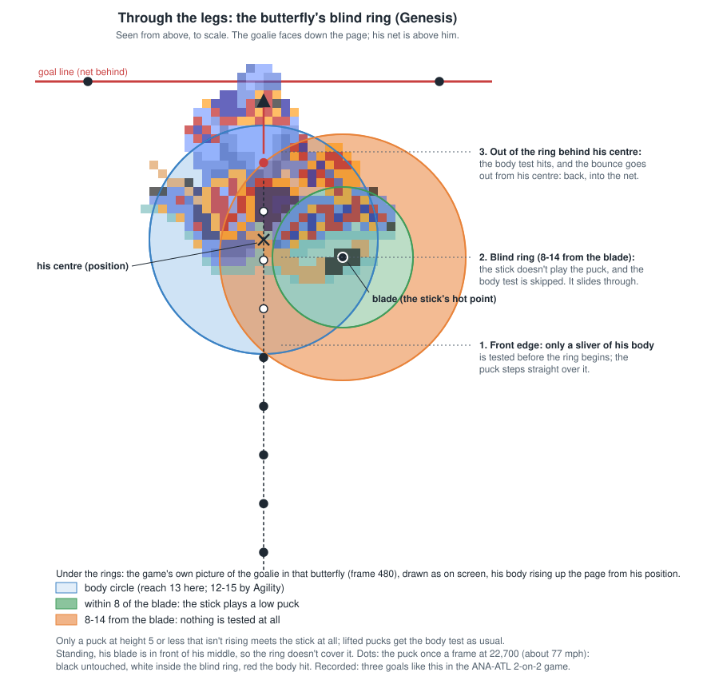

| Pose | Through the middle (x = 0) |
|---|---|
| Ready, bottom net (frame 407) | `BBBBBBB......SSSSSSSSSSSSSSSS` (the stick, in front, plays it first) |
| Butterfly, bottom net (472) | `BBBBBBBB...................BB` |
| Butterfly, top net (480, the puck from the left) | `BB.....................BBBBBB` |
| Kick save, top net (479, from the left) | `....................BBBBBBBBB` |

So the puck crosses his front half untouched and first meets his body **behind his centre**, toward his goal line. A body
hit sends the puck straight out from his centre through the contact point, at the offset x 256 (slow): from behind his
centre that's backward, into his own net, and slowly (or, slow enough, he holds it for a moment). Standing, his stick
sits in front of his middle and plays the puck first. A puck in the air skips the stick test and meets his body in
front. That fits what players see: flat pucks only (pass shots, errant passes, slapshots aimed along the ice), straight
at him, in a butterfly or kick save. **Confirmed** on the user's 2v2 test game (2026-10-19_0818_ANA-ATL, three goals at
the top net: P1 2:48, P1 2:11, P3 2:24; `analysis/goal_trace.py` prints any goal this way): Rucchin's flat pass shots at
about 22,700 went straight up at the goalie in the butterfly (frame 480, blade 9-13 to the side), passed 1-4 units from
his centre entirely in the blind band, met his body 8-13 behind his centre and bounced backward at 2,200-3,500 (his
no-touch going to 10), into the net. Of the eight flat pass shots through the middle of the butterfly in that period,
six were saved: the puck came within 8 of the blade at some frame (2 units toward his stick side), or a frame landed on
the thin strip of body at the front edge. So it's partly the line (dead centre, or away from his stick side) and partly
where the frames fall. Pucks in the air met his body in front and were saved (the user: "all of my attempts that hit
the goalie with the puck above the ice were saved and held"). The bottom net's butterfly (frame 472) has the same band;
the user's period 2 pass shots at it all came off the stick lifted (heights 8-16, see 6.1: a pass shot's lift is random),
which is why that period gave none.

**Speed helps.** The game checks the puck's position once a frame, so a fast puck takes big steps (its speed / 4096
units a frame) and more often jumps the thin strip of body (about 2 units) at the front edge of the blind band: a puck at
13,000 (3 a frame) lands on it about 2 times in 3, one at 22,700 (5.5) about 1 in 3, a full slapshot at 28,000 (7)
about 1 in 4. A slow puck that comes within 8 of the blade is also simply caught (under 13,000) rather than knocked
away. Once through, the bounce off the back of him is slow whatever the puck's speed.

**To try for it:** a flat puck is the key, and a pass shot's lift is random. A slapshot with Down held aims at the middle
at ice level with no lift, and within about 200 units goes exactly there (Shot Accuracy + 1) / (Shot Accuracy + 16) of
the time, otherwise scattering only upward: **tested in the real game (4.10): from the middle 88-168 out against a set
computer goalie it goes in 20% of the time at the top net and 14% at the bottom, up to 47% at the best spots.** Hard
(full wind-up; a pass shot taken while skating at the net gets the skater's speed added), straight up or down the ice
at the goalie's middle, dead centre or away from the side his stick goes to in the butterfly, after he has set (a
goalie committing while the puck is still carried pad-stacks instead, with no band). Expect odds, not a sure thing: 2
in 8 in the test.

Also from the code: **a goalie you control who goes out of view** (more than $74 across or $64 up or down from the
camera's centre) is moved by the computer's routine, save moves included, until he's back on screen
(`assgoaliectrl`).

**Recordings** (64 Genesis shots at a goalie a person controlled): C pressed between 0.6 s before the release and the
result, 19 shots, 7 goals; not pressed, 45 shots, 18 goals. The C shots were easier ones (xG 0.21 a shot against 0.37),
so if anything pressing did worse than expected, but there are too few shots to tell.

**Holding C while he holds the puck: he skates up and to the left, at either net (a bug).** With the puck, C has no
job for a goalie (`doinput_ispc` starts a shot only for a skater), so the input goes on to the skating routine with
`d0`, which `ReadJoy` fills with the d-pad direction in its low four bits and the buttons held in the high four (C =
`$20`). A skater's skating routine masks the buttons off (`doplayeracc`: `andi.w #$F,d0`); the goalie's
(`goalieacc`, `.normalgoalie`) masks them only for a computer goalie (`.goalieacc2`), so for a person's goalie the
wanted direction is `$28` (no direction, plus C). That isn't 8 ("none"), so he turns toward it one step a frame
(`.d1`); 40 is a multiple of 8, so the turn logic treats it as "up" but never reaches it (it is never equal to his
facing), and his facing flips between up (0) and up-left (7) every frame while he skates along it (`playeracc` with
his facing). Facing 0 is up the screen at both ends, so he goes up and a little left whatever net he is in. With a
d-pad direction held too, the same flip-flop should make him drift one step anticlockwise of where you point (not
checked). **Code** (`input94.asm` `doinput_ispc`, `video94.asm` `ReadJoy`, `checks94.asm` `goalieacc`; seen in play
by the user, 2026-10-23).

### 5.6 Save moves that start before the shot: the wind-up rule

**The rule** (`checkanim`): **while a shot is being wound up** (shot mode: a person holding C with the puck), with the
puck **within about 60 units (20 feet) of the goal line** and the computer goalie **within 20 units of the middle**,
he starts his save move straight away, at his next rethink. He doesn't wait for the shot.

- **The move:** the puck is still carried and low, so it's almost always a **pad stack**. That slides him toward the
  middle and past it, **away from the side he stood on**, and **locks him for 0.72 s at a quarter speed**.
- **A clock quirk:** the rule only works while bit 1 of the seconds left on the period clock is clear. That means 2 game
  seconds on, 2 off (about 0.8 s of real time each), so **it happens about half the time.**
- **His positioning spot also widens during a wind-up** (34 across and 26 out, instead of 26 by 18). **Code**; at the
  release, recorded goalies stood close to their normal spot.

**Confirmed** (shots from within 60 of the goal line at computer goalies, Genesis recordings):

| Computer goalie | Shots | Goals |
|---|---|---|
| Save move started before the release (a median 92 ms before) | 35 | 13 (37%) |
| Waited for the shot | 65 | 8 (12%) |

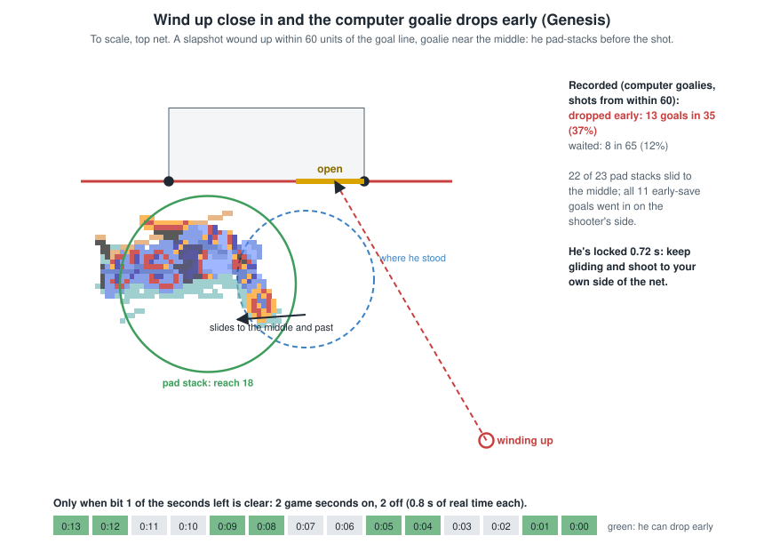

- 33 of the 35 early moves came while the clock rule was on; by chance it would be about half.
- 27 were pad stacks, and 22 of 23 pad stacks slid him toward the middle, away from his side.
- **All 11 early-save goals whose crossing point is known went in on the shooter's side of the net**: the side the pad
  stack slid away from.
- Farther out than 60, no computer goalie moved before a shot.

The other early trigger is **a carried puck heading straight for the goal mouth**. `findpc` treats the carried puck like a
shot, so a carrier driving at the net makes him commit 12 frames out. This was seen once in the recordings.

### 5.7 Cross-crease goals

A cross-crease goal: **the carrier skates straight across the front of the goal, just outside the crease, and shoots
while the goalie is still catching up.** Why it works on the Genesis:

- **He chases a point, not the puck.** He re-aims every 1-3 frames (Defensive Awareness) for a spot on an ellipse 26
  across and 18 out from the middle of his net. The spot is on the line toward a point halfway between the carrier and
  the puck, plus a look-ahead of its motion (5.3). Close in front, that spot swings from one side of the ellipse to the
  other in a moment, and he has to accelerate to follow it, Weight and Agility permitting.
- **Measured:** how far he trails the line from the puck to the middle of the net (at his depth), while an attacker
  carries the puck in front:

  | Carrier's distance from the goal line | Moving across under 30 units/s | 30-70 | 70-110 | 110+ |
  |---|---|---|---|---|
  | Within 30 | 3.0 | 0.9 | 10.1 | **18.0** |
  | 30-60 | 0.1 | 5.1 | 5.8 | 6.5 |
  | 60-100 | 2.0 | 2.6 | 3.9 | 3.2 |

  Within 30 units at full speed he trails by 18, more than his whole reach (12-15). That's the open side. Farther out,
  the same speed across leaves him only 3-7 behind.
- **A slapshot makes it worse:** winding up within 60 of the goal line usually freezes him in a pad stack (5.6). The
  carrier glides on during the wind-up, and the shot goes in on his own side.
- **Why it doesn't always work:** the clock rule (half the time there's no early save move), his rethink rate (high
  Defensive Awareness re-aims every frame), how close in the carrier comes, and a person in net (who isn't moved by any
  of this).
- **Recordings:** 12 carries that crossed the middle within 90 of the goal line in under 2 s; 9 shots, 3 goals.

### 5.8 Long slapshots

What decides a slapshot from 100-200 units out (about 33-67 feet):

- **Exact or scattered.** From within 200 of the aim point a shot goes exactly where aimed with chance
  (ShA + 1) / (ShA + 16): 65% at working Shot Accuracy 27, 50% at 15. From farther, it's never exact (4.2).
- **Time.** The goalie starts sliding to the crossing point once the puck will cross within 34 frames. He only learns
  that every 5 frames (`findpc`) and acts at his next rethink, and he freezes 12 frames out (5.3). **A harder shot
  leaves him less of that window**, so Shot Power matters most, and the forehand: a backhand loses a quarter of its
  power (4.3).
- **Worked out with the xG model's rules** (computer goalie, started where recorded computer goalies stood at long
  shots; working Shot Accuracy 27; aimed just inside a post at mid-height, or the middle). Percent that go in:

  | Spot | 16,500 (backhand) | 20,000 | 24,000 | 28,000 |
  |---|---|---|---|---|
  | 120 out, 25 to the side: far / near / middle | 0.6 / 3.5 / 1.9 | 5.2 / 8.6 / 3.9 | **16.1** / 14.8 / 4.8 | **23.5** / 21.5 / 6.0 |
  | 120 out, 60 to the side | 0.4 / 3.3 / 1.6 | 1.5 / 4.3 / 3.2 | 7.8 / 10.5 / 3.5 | 14.4 / 16.8 / 4.2 |
  | 160 out, 25 to the side | 0 / 0.9 / 0.2 | 0.1 / 2.4 / 0.8 | 1.4 / 4.4 / 2.0 | 9.1 / 9.2 / 2.9 |
  | 200 out, 25 to the side | 0 / 0 / 0 | 0 / 0.6 / 0 | 0.2 / 1.9 / 0.5 | 0.5 / 3.4 / 0.8 |

  - **Shot Power is what scores from distance.** Below 20,000 a long slapshot hardly ever goes in. The hardest shots
    (24,000-29,000, from Shot Power 20+) go in 15-23% of the time from about 40 feet near the middle.
  - **The far post** catches the near post only with that power, and from near the middle. With less power, the near
    post is better.
  - **Shot Accuracy** about doubles the chance at 40 feet (a 26,000 shot: 10% at working 5, 20% at 27), and matters
    less farther out.
  - Beyond 200, almost nothing.
- **Recordings:** 15 Genesis goals came from 90+ units. Most went in at mid-height (about 6) just inside a post. The
  goalie had usually picked a stick save: he chooses a low move for a puck under height 8, and it doesn't change his
  reach. The four slapshot goals from 100+ were all by a Shot Accuracy 27 shooter; far post and near post were mixed.
  The model doesn't show the far-post advantage players report. **Played in the game itself (4.10-4.11) it shows:**
  standing, from the middle, the far post is the best aim for a strong shooter at the top net from 28-41 ft (31-69%),
  Down everywhere else, and the far-post slapshot players describe is also a skating shot, across toward the stick side and released before the middle
  (50-62% from 28-35 feet for a 27 / 27 shooter). Both need Shot Power 4 or more on the roster (a working 20), and
  both fall a long way against better goalies. Over all the Genesis recordings, slapshots from 100-200 units out
  scored 5 times in 39 (13%), where the model's xG for them adds up to 4.5. On the SNES it's far harder:
  SNES_SHOOTING 5.8.

### 5.9 Pushing the goalie into the net with the puck

**Code** (`checkgoal`, `puckgoalie`, `checkgoalp`); not seen in the recordings.

1. A carried puck that enters the goal area is **taken off its carrier**. He can't touch it for 8 frames, and the puck is
   loose. **This includes a goalie holding the puck.** The net means to bounce it back out, but for a puck moving into
   the mouth that bounce never fires (5.3, 13.3), so it slides on in.
2. Goalies hold the puck at a hold point that in many frames is **behind his centre**, toward his goal line, up to
   13-15 units in the recordings. A goalie can be shoved back until his centre is about 11 units in front of the goal
   line (the net's shape for players).
3. So a goalie pushed back against his net while holding the puck can have it stripped right at the goal line.
4. Loose there, and out of his reach for 8 frames, **any nudge puts it in, and it counts**: the pushing attacker's stick
   or body, or the goalie's own body once he can touch it again. A puck touching the goalie bounces away from his
   centre, so with the puck behind him it goes back toward the net.

**The SNES can't do this:** its `checkgoal` ignores the net entirely while a goalie holds the puck (SNES_SHOOTING
5.7). In the recordings, a goalie-held puck reached the goal line inside the posts in only 3 samples.

---
