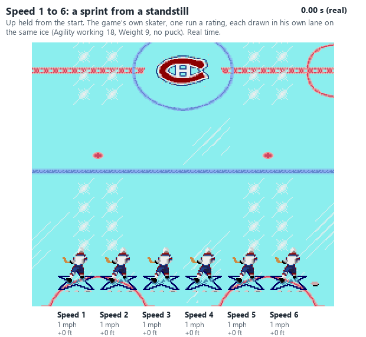
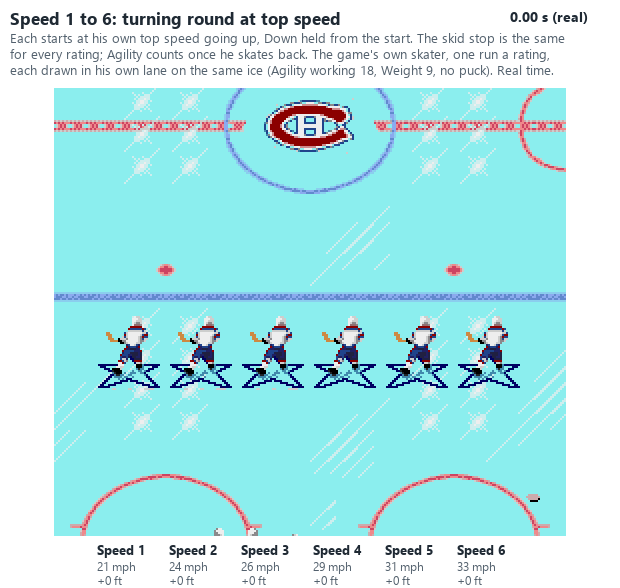
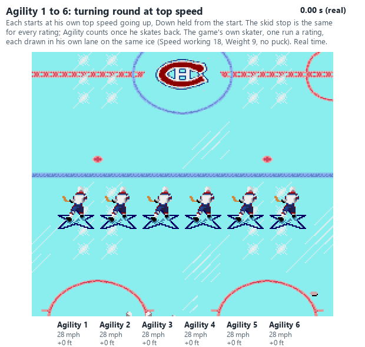
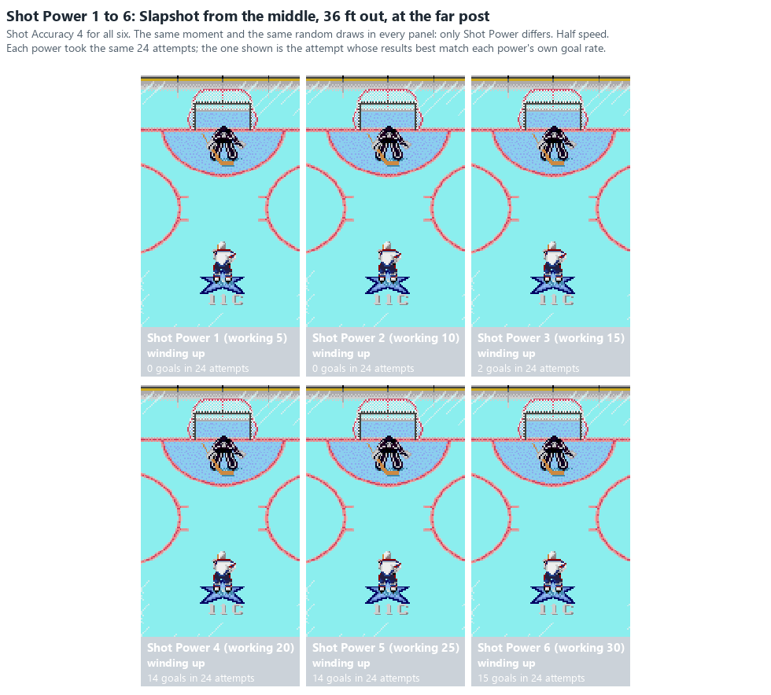
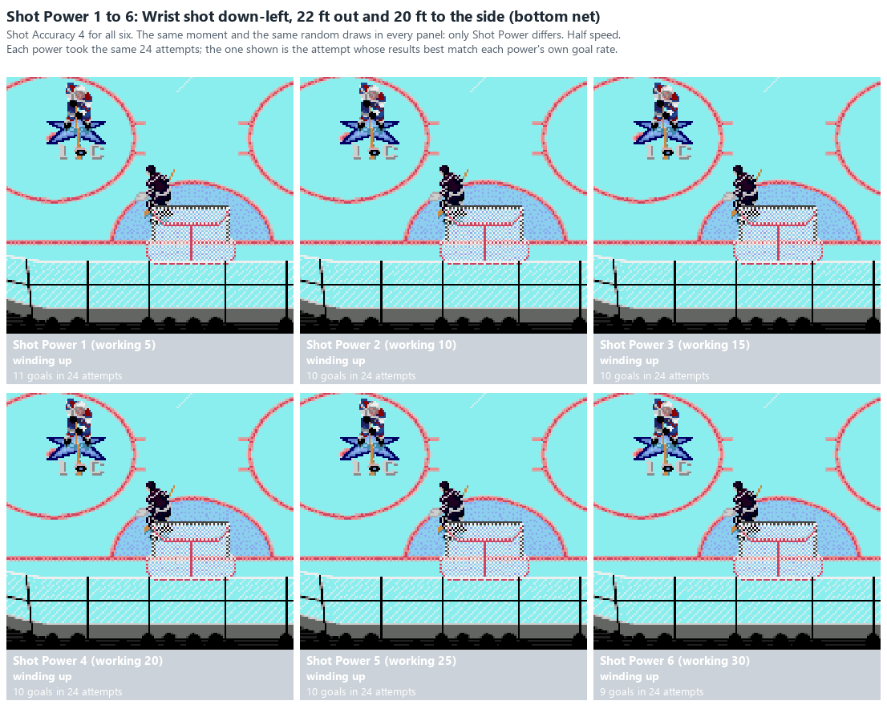
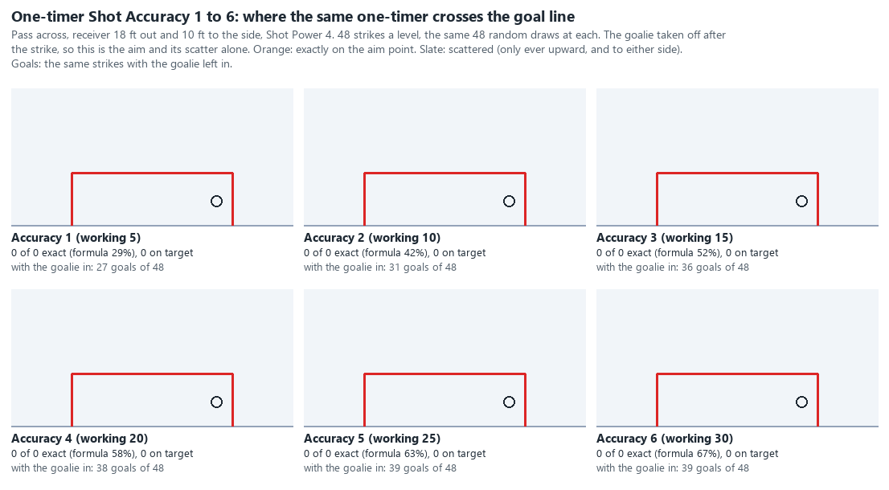

# What a rating step is worth in league play

For NOSE4Web and the league commissioner (2026-11-11): how much each rating changes results **the way the leagues
play**: person against person, line changes off, each person controlling one skater at a time (switching freely),
computer teammates, penalties on (offsides off), and the goalie taken by a person at times. The aim is a "league value"
beside the game's Overall (GENESIS_MECHANICS 2.5), which weights ratings that do little in league play.

Built in chunks. **Chunk A** (this version) puts together everything the project already knows: the game's own
formulas worked out per step, the scoring-map runs, and the regression on the leagues' results. Later chunks fill the
gaps listed at the end: B played in the game, C the Awareness ratings, D the league value itself.

**Steps.** A roster rating 0-6 is a working value of 5 x the rating (0-30); each game, a player's hot / cold moves all
his working ratings by -3 to +2 together (GENESIS_MECHANICS 2.2), so a roster 4 plays as 17-22. "2 -> 3" below is
working 10 -> 15, and "4 -> 5" is 20 -> 25. Sources: **Code** (the disassembly), **Confirmed** (checked in recordings),
**Played** (the headless game, the scoring maps), **League** (every Classic league game since 2013, the retail ratings,
fitted within each team and position: LEAGUE_RESULTS "Ratings, game flow, skill and luck"; PLAYER_GUIDE_GENESIS).

## Genesis

### The ledger

| Rating | What one step changes | 2 -> 3 | 4 -> 5 | League: forwards, per step |
|---|---|---|---|---|
| **Speed** | Top speed (cap (20 + (Spd + 2) / 2) x 275) | 25.0 -> 26.9 mph (+7.7%) | 29.8 -> 31.7 mph (+6.5%) | goals +0.22, shots +0.52, points +0.15 a game |
| **Agility** | Acceleration (and so turning and stopping); the computer goalie's reach | to top speed 0.73 -> 0.68 s (real); reversing at top speed 1.47 -> 1.36 s (real) | 0.63 -> 0.59 s; 1.26 -> 1.18 s (real) | goals +0.09, points +0.12 |
| **Weight** | Acceleration (each point -2.8%, so 2.5 points = one Agility step); knockdowns, both ways (below) | per point, as one step of Agility over 2.5 | | goals -0.06, points -0.06; checks thrown -0.56 |
| **Shot Power** | Shot speed (x (20 + ShP / 2), +1/16 on odd values); **below working 20 no full slapshot** | x 1.15 speed; still no full slapshot | x 1.13 speed | **goals +0.29**, shooting % +1.9 points |
| **Shot Accuracy** | The chance a shot within 200 goes exactly where aimed ((ShA + 1) / (ShA + 16)); the scatter otherwise | exact 42% -> 52% | exact 58% -> 63% | goals +0.15, shooting % +0.7 |
| **Passing** | Pass speed only (160 + 2 x Pas): passes are always aimed perfectly | 180 -> 190 (+5.6%) | 200 -> 210 (+5.0%) | points +0.01 (defencemen +0.06) |
| **Stickhandling** | Steals (both ways); catching hard passes; **wobbling instead of falling at working 24+** | steal odds per frame of contact -6% as carrier, +7% as stealer; catch limit +1,750 | the same, and **the wobble arrives** | goals +0.10, points +0.06 |
| **Checking** | The knockdown roll; upends at 20+; the computer's checking | person check 6.7 -> 8.9%, computer check 20 -> 27% (equal weight, impact 30) | 12.2 -> 14.4%; 37 -> 43% | checks thrown +0.66 (defencemen +1.04); points +0.01 |
| **Off. Awareness** | Computer players' reactions in some jobs (12.1): never the skater you control | decision every 13-12 -> 12-11 frames | 11-9 -> 9-8 frames | points +0.07 (forwards), -0.02 (defencemen) |
| **Def. Awareness** | Computer players' reactions in other jobs; the computer goalie's re-aim | as above | as above | not fitted yet |
| **Aggression** | Penalty odds, with the wrap-around (8.2) | x 1.35 -> 1.4 of a 0 | **x 1.1 -> 1.3**: a 4 plays like a 1 | penalties per 100 games 27, 33, 35, **29** at roster 1-4 |
| **Endurance** | Energy drain: only with line changes on | nothing | nothing | |
| **"Rgh" (pass / shoot bias)** | Whether a **computer** carrier shoots or passes | next to nothing | | |
| **H/F** | How long players you injure are out (not in order) | | | |
| **Goalie Agility** | Reach 12-15 **with the computer in net** (a person's goalie always has 15); acceleration | | | **save % +2.25 points** (64.7 / 68.3 / 69.6 / 72.2% at 3-6) |
| **Goalie Puck Control** | How often he holds a shot instead of letting a rebound out | | | |
| **Goalie Def. Awareness** | How often the computer goalie re-aims his position | | | |
| **Goalie glove / stick (4)** | **Nothing**: looked up and never used | | | |

The league column is what each rating does as people really use the players: a fast, strong shooter also gets the puck
more, so it holds more than the rating's own mechanics. Points per game for every rating are in PLAYER_GUIDE_GENESIS
("What the ratings are worth").

### Skating: Speed, Agility, Weight

- **Top speed** comes from Speed alone. Each step adds about 1.9 mph (6.5-8%). The cap uses (Spd + 2) / 2 rounded
  down, so odd working values (hot / cold) add half a point's worth less. **Code, Confirmed** (61 skaters, three games).
- **Acceleration** = (64 - 2 x Weight + Agility + 2) / 2 x 200 / 32 speed units a frame while pushing, Weight in
  roster points (0-15), Agility working. At Weight 7: 194 / 209 / 225 / 241 at Agility 10 / 15 / 20 / 25. A step of
  Agility is +7-8% acceleration; a Weight point -2.8%. **Code, Confirmed** (19,500 samples, within 1-5%). **A person's
  own puck carrier accelerates at half rate** (Code).
  - From a standstill to a Speed-4 top speed: 0.73 s (real) at Agility 2, 0.63 s at 4, 0.59 s at 5. Turning round at
    top speed takes about twice that.
- **Stopping ignores the ratings.** Pushing against the way he's skating starts the skid stop (`dostop`), which takes
  a fixed 150 off each axis every frame: no Agility, no Weight. So **every skater stops in the same time from the same
  speed**, and **a faster skater needs more room to stop** (about 9 ft at Speed 1 to 16 ft at 6). Agility only counts
  once he skates back the other way. **Code, Played** (both ends of Agility gave the same stop to the unit).
- **Who wins a race to a loose puck** depends on both, and on the head start: not yet played (chunk B).

Played (`analysis/scoring_map/rating_gifs.py skating_real`): the game's own skater without the puck, one rating moved,
one run a rating with the camera held still, each run's skater cut from its frames and drawn in his own lane on the
same ice, real time. Speed sets where he ends up; Agility only how soon he gets going.

### Shooting: Shot Power and Shot Accuracy

- **Shot speed** = (20 + ShP / 2) x the wind-up, +1/16 on odd values. A step is +13-15% shot speed. **Below working 20
  the wind-up is cut short (step 8 instead of 16): no full slapshot.** Roster 3 never has it, **roster 4 loses it when
  he is cold** (17-19), roster 5 and 6 always have it. **Code, Confirmed** (the weaker shooters topped at 20,746).
- **Shot Accuracy:** within 200 units (about 65 feet) of the aim point, the chance the shot goes exactly where aimed is
  (ShA + 1) / (ShA + 16): 42% at roster 2, 52% at 3, 58% at 4, 63% at 5, 67% at 6. Otherwise it scatters, more for
  harder and longer shots, less for better Accuracy, and **only ever upward** (a high aim has no room). **Code,
  Confirmed.**
- **Played** (the scoring maps, SCORING_GENESIS), a computer goalie of middling Agility (working 13):

| Shot | 2 -> 3 | 3 -> 4 | 4 -> 5 | 5 -> 6 |
|---|---|---|---|---|
| Standing slapshot, Power steps (Accuracy 4), best aim over 18 spots | 5 -> 7% | **7 -> 19%** | 19 -> 24% | 24 -> 31% |
| Skating far-post slapshot, Power steps (Accuracy 4) | 7 -> 15% | **15 -> 44%** | 44 -> 53% | 53 -> 61% |
| Standing slapshot, Accuracy steps (Power 4) | 14 -> 17% | 17 -> 19% | 19 -> 20% | 20 -> 21% |
| Skating far-post slapshot, Accuracy 2 -> 4 -> 6 (Power 4) | 34 -> 44 -> 48% | | | |
| One-timer, Accuracy steps (Power 4), best spots | 50 -> 54% | 54 -> 58% | 58 -> 60% | 60 -> 63% |
| One-timer, Power steps (Accuracy 4) | 55 -> 57% | 57 -> 58% | 58 -> 59% | 59 -> 59% |

  - **Slapshots:** Power is the rating, with a cliff between 3 and 4. Accuracy adds 1-2 points below Power 4 and
    7-11 above it.
  - **One-timers:** Accuracy is the rating (2-4 points a step); Power adds 1-3 in all. Off to one side the gap
    between a 2 / 2 and a 6 / 6 shooter is 18-23 points; on the doorstep 9.
  - Against a better goalie (Agility working 20+) the slapshot mostly stops working: 19% falls to 5-9% (below).
- Wrist shots by rating, and slapshots from the point: not yet played (chunk B).

Played (`rating_gifs.py shots 24`): Shot Power 1 to 6, Accuracy 4, the same 24 attempts at each power (the same moments
and random draws); each GIF shows the attempt whose results best match each power's rate.

- **The slapshot** from the middle, 36 ft out, at the far post: 51 / 58 / 62 / **78** / 83 / 91 mph, and **0 / 0 / 2 /
  14 / 14 / 15 goals** in 24. The cliff between 3 and 4 is the full wind-up.

- **The wrist shot** at the bottom net's early-pad-stack spot (one of the few places a wrist shot beats a set
  goalie): 23 to 36 mph, but **11 / 10 / 10 / 10 / 10 / 9 goals** in 24. **Power does nothing for a wrist shot**:
  it beats the goalie by where it goes, not how fast.

Played (`rating_gifs.py onetimer 48`): one one-timer (the pass across, receiver 18 ft out and 10 ft to the side, Shot
Power 4), the same 48 strikes at each Accuracy. With the goalie taken off after the strike, where each crosses the goal
line; then the same strikes with him in:

| Accuracy | 1 | 2 | 3 | 4 | 5 | 6 |
|---|---|---|---|---|---|---|
| Exactly on the aim point (formula) | 15 / 46 (29%) | 21 / 47 (42%) | 26 / 48 (52%) | 29 / 48 (58%) | 32 / 48 (63%) | 35 / 48 (67%) |
| On target | 29 | 32 | 36 | 38 | 39 | 39 |
| Goals with the goalie in | 27 | 31 | 36 | 38 | 39 | 39 |

- **The goals are the shots on target:** against this one-timer the goalie stops almost nothing, and Accuracy alone
  decides it. The misses go wide of the post on the shooter's side; better Accuracy pulls the scatter in.

### Passing

- **Pass speed only** (160 + 2 x Pas): +5% a step, so a pass arrives about 5% sooner. Every targeted pass is aimed
  perfectly at where the receiver will be. **Code, Confirmed.**
- Fast passes are mostly made by the meeting-time rounding (the "rocket pass", 6.1), not by the rating.
- **League:** next to nothing for forwards (+0.01 points a game a step), +0.06 for defencemen, who pass more.

### Stickhandling

- **Steals:** any opposing stick touching a carried puck rolls about 3 in (36 + carrier Stk / 2 - stealer Stk / 2)
  each frame of contact. A step of the carrier's Stickhandling cuts that by about 6%; a step of the stealer's raises it
  by about 7%. **Code.**
- **Catching:** a pass faster than 13,000 + 350 x Stk deflects off the stick (a bobble). A step raises the limit by
  1,750. Ordinary passes (about 12,000-14,000) are under every player's limit; rocket passes (27,000-32,000) are over
  everyone's. So it matters only for the hard passes in between. **Code, Confirmed** (300 of 302 catches within).
- **The wobble:** a hit player wobbles instead of falling only at **working 24 or more**, and only on a softer hit.
  Roster 4 never gets it (17-22), roster 5 does unless 2-3 cold (22-27), roster 6 always. **A step from 4 to 5 adds
  a whole new way to keep the puck.** **Code.**

### Checking and Weight

- **A knockdown** (GENESIS_MECHANICS 7.1-7.2): value = (base - checker weight + target weight) / 2 - impact, weights
  as roster x 8, base 120 (computer checker) or 240 (a person's checker). At 0 or less, or against the boards, he goes
  down; otherwise the chance is (Chk / 2 + 1) / value. **Code, Confirmed.**
  - **A person's checker:** against a man 2+ Weight points heavier the sum wraps: **automatic**. Otherwise the value is
    about 90 at an impact of 30, so Checking moves the chance a little: 6.7 / 8.9 / 12.2 / 14.4% at roster 2 / 3 / 4
    / 5 at equal weight.
  - **A computer checker, and the CB check:** the value is about 30 at equal weight, so **Checking matters about three
    times as much**: 20 / 27 / 37 / 43%. Heavier checkers do better here.
  - **As the target:** against computer checkers a heavier man is harder to knock down; **against a person, a man 2+
    points heavier than the checker always goes down** (the weight bug). In league play the people throw most of the
    checks, so **heavy players are the easy ones to knock down**.
- **Upends** need Checking working 20+: roster 4 unless cold, 5 and 6 always.
- **Checking also drives the computer:** how often computer skaters try to check, and how hard the computer chaser
  goes at the carrier (12.3).
- **League:** checks thrown +0.66 a Checking step (forwards), +1.04 (defencemen); Weight -0.56 a step for forwards
  (lighter forwards reach more men). Points: next to nothing.

### Awareness

- **Offensive and Defensive Awareness set how often a computer player re-decides** (GENESIS_MECHANICS 12.1): every
  15-14 frames at 0 to 8-7 at 6, about 1.3 frames (22 ms (real)) a step. **They never touch the skater you control**;
  since people switch to whoever is near the puck, they act on the teammates away from it and on the computer goalie.
- **Defensive Awareness** covers a defenceman's gap on rushes, everyone's switch to defence after a turnover, and
  (a coding slip) forwards' positioning on offence. **Offensive Awareness** covers the chaser on loose pucks and the
  defenceman's retreat after a turnover.
- **League:** Offensive Awareness +0.07 points a game a step for forwards, -0.02 for defencemen. What either does to
  goals against is not measured yet (chunk C).

### Aggression

- Penalty odds by roster Aggression against a 0 (8.2), the working value wrapping at 16: **x 1.0 / 1.2 / 1.35 / 1.4 /
  1.1 / 1.3 / 1.5** at 0-6. **A 4 plays like a 1; 3 and 6 draw the most.** A person's own skater draws half the
  penalties of a computer one (and the CB check counts as a computer's). **Code, Confirmed.**
- **League:** penalties per 100 games 23 / 27 / 33 / 35 / **29** / 41 at roster 0-5. The whole spread is about 1.5
  to 1, a few penalties a season for one player.

### Endurance, the pass / shoot bias, H/F

- **Endurance:** energy drains only with line changes on. Leagues play with them off: **nothing.** **Code, Played**
  (STUDY_NOTES "Energy, speed and the drain").
- **The pass / shoot bias ("Rgh"):** read only when a **computer** player carries the puck. In league play a person
  takes the carrier almost always (control switches to him): **next to nothing.** **Code.**
- **H/F:** how long a player *you* injure is out (period or game), and not in order (3, 5, 6, 7 put him out for the
  game). Injuries come about once in three games. **Code.**

### Goalies

- **Agility is the goalie's rating.** It sets the computer goalie's reach (12-15). **A person in net always has reach
  15, whatever the Agility**, so it counts for the time the computer has him. Against a computer goalie, the standing
  slapshot's best chance goes 17% / 8% / 5% at working 10 / 20 / 30 (Played). **League:** save % +2.25 points a step.
- **Puck Control:** whether a body save is held or rebounds. Played: the standing slapshot 11% / 8% / 6% at working 10
  / 20 / 30.
- **Defensive Awareness:** how often the computer goalie re-aims. Played: no change to the standing slapshot at any
  level.
- **Speed:** no change to the slapshot (Played).
- **The four glove / stick save ratings: nothing.** They are looked up and never used. **Code.** (The game's Overall
  gives them a quarter of a goalie's weight.)
- **One-timers ignore the goalie's ratings:** reach is cut to 12 against a one-timer, whatever his Agility, and the
  scoring maps found 58-62% at every goalie level (Played).

### Steps where a rating suddenly matters, and where it doesn't

- **Stopping:** no rating at all. Faster skaters need more room to stop.
- **Shot Power on a wrist shot:** nothing.

- **Shot Power 3 -> 4:** the full slapshot (working 20). The standing slapshot nearly triples (7 -> 19%), the skating
  far-post slapshot triples (15 -> 44%). **A cold 4 falls back below the line** for that game.
- **Stickhandling 4 -> 5:** the wobble (working 24).
- **Checking 3 -> 4:** upends (working 20), unless cold.
- **Aggression 3 -> 4:** penalties *drop* (the wrap-around), then rise again at 5 and 6.
- **Weight:** two points heavier than the checker is the line for the weight bug: a person always knocks such a man
  down.
- **Goalie Agility:** worth the most of any goalie rating, but only while the computer has him.

### What the game's Overall gets wrong for league play

Overall counts Speed, Offensive Awareness and Stickhandling three times; Agility, Defensive Awareness, Checking and Shot
Accuracy twice; Shot Power, Endurance and Passing once; Weight, Aggression and the bias not at all. Goalies: Agility,
Defensive Awareness and Puck Control 4.5 each, the four glove / stick ratings 1 each. Against the ledger:

- **Shot Power is the Genesis scorer's rating** (+0.29 goals a game a step, the most of any) and counts once.
- **Offensive Awareness** counts three times but never moves the skater a person controls (+0.07 points).
- **Endurance** counts once and does nothing with line changes off.
- **Weight** counts nothing, but it costs acceleration and makes a man easy to knock down.
- **Goalies:** the four unused ratings are a quarter of a goalie's Overall; Agility counts no more than Defensive
  Awareness, which does nothing measurable to shots.

### Chunk B, played (2026-11-11, `analysis/scoring_map/ratings_chunk_b.py`, one process)

**Races to a loose puck** (`races`): the pad-1 skater without the puck, frames (60 a second) to cover a distance from a
standstill, and from his top speed going the wrong way (Up held from the start); the others the test skater's (Weight
9, Agility and Speed working 18).

| From a standstill: 20 / 40 / 60 / 100 ft | 2 | 3 | 4 | 5 | 6 |
|---|---|---|---|---|---|
| Speed | 56 / 90 / 124 / 192 | 55 / 87 / 118 / 180 | 55 / 84 / 113 / 170 | 55 / 83 / 110 / 162 | 55 / 83 / 108 / 159 |
| Agility | 60 / 90 / 120 / 179 | 57 / 88 / 117 / 176 | 54 / 84 / 114 / 173 | 53 / 82 / 112 / 171 | 50 / 80 / 110 / 169 |

Weight 4 / 7 / 9 / 12 / 15 (roster points): 51 / 54 / 55 / 58 / 62 frames to 20 ft, 170 / 172 / 174 / 177 / 182 to 100
ft. From top speed the wrong way every distance takes about 30 frames longer (the skid stop is the same for all), and
the order is the same.

- **Speed doesn't win short races:** every Speed level reaches 20 ft in 55-56 frames. It counts from about 40 ft on: over
  100 ft a Speed 6 skater is 33 frames (0.55 s real, about 18 ft) ahead of a Speed 2.
- **Agility wins the short ones:** 10 frames over 20 ft from 2 to 6, about what Speed gains over 60 ft. A step of
  Agility is worth about 2.5 Weight points, as the formula says.
- So for loose pucks within a few strides, Agility and low Weight matter; for a long chase, Speed.

**Standing shots against a retail starter** (`shots 32`: the computer goalie at working Agility / Speed / Defensive
Awareness / Puck Control 20 / 20 / 25 / 20, the shooter standing, all nine aims, 32 moments x 2 seeds: 576 shots a spot
and shot type for each rating pair; the best aim 64):

| Spot (top net) | Wrist shot | Slapshot |
|---|---|---|
| Slot, 21 ft straight in | 0-1% over the aims, best aim 0-6% | 0-1%, best 0-9% |
| Left circle, 21 ft out, 21 ft to the side | 0-1.4%, best 2-12% | **6-14%, best aim 28-38%** |
| Left point, 62 ft out | 0-1%, best 0-9% | 0-0.3%, best 0-3% |

- **Against a set retail goalie a standing shot hardly ever scores, at any rating**, except the slapshot from the
  circle. (Against the weak test goalie, working Agility 13, the same shots scored several times as often: SCORING_GENESIS.)
- **From the circle Shot Power hardly matters** once the aim is right: the best aim (down-left, at the far side) scored
  19 / 22 / 19 / 19 / 18 of 64 at Power 2-6. Weak shooters' average over all aims was higher (13.7% at Power 2 against
  6.8% at 4), as a few more aims also worked for them. The near-post aim (Left) scored 18-20 of 64 at Powers 2, 3 and 5
  and 0-1 in every Power-4 case: some timing at that one shot speed. Accuracy 2 -> 6 at Power 4: best aim 20% -> 38%.
- So the slapshot cliff at Power 3 -> 4 (the scoring maps, against the weak goalie) is about beating a slow goalie on
  the far side; against a retail starter, standing, it is mostly the aim that counts. The skating far-post slapshot and
  one-timers, the shots people really score with, are in the tables above.

**Steals** (`steals`): not measured yet. A pad-1 skater poking a computer carrier standing still started no steal roll
in any of 60 tries a setting (the carrier's puck sat out of reach, or the stick test needs more than reach); the
carrier's own passes were the only losses. The steal formula above stands (Code).

### Chunk D: a league value (2026-11-11, `analysis/league_value.py`)

One number per player, 0-99 like the game's Overall, weighting each roster rating by what a step was worth in the
Classic leagues' results:

- **Forwards:** goals a game per step (above): Shot Power +0.29, Speed +0.22, Shot Accuracy +0.15, Stickhandling
  +0.10, Agility +0.09; **Weight -0.52 a point, from the teams' results** (below); nothing for the rest.
- **Defencemen:** points a game per step (PLAYER_GUIDE_GENESIS): Pass Accuracy +0.060, Checking +0.042, Agility +0.033,
  Speed +0.026, Shot Power +0.013, Shot Accuracy +0.009, Weight -0.022, Off. Awareness -0.018, Stickhandling -0.010.
  **Offence only**: what a defenceman's ratings do to goals against isn't measured.
- **Goalies:** Agility alone, +2.25 save-% points a step times the 11.8 shots a goalie faces a game in Genesis Classic:
  **0.27 goals saved a game a step**. (So the goalie value has only five levels; Puck Control and Defensive Awareness
  add little or nothing, the glove and stick ratings nothing.)
- Each position's weighted sum is put on 40-99 across its retail players.

**Weight: the leagues' experience, measured** (the user, 2026-11-11: "we particularly have success with lighter players
and their superior checking and ability not to be knocked over by opposing human controlled skaters"). A forward's own
scoring barely shows it (-0.06 goals a Weight point), but the weight bug works on the whole team's play: a person's
skater knocks anyone 2+ points heavier down automatically, and is himself hard for a person to knock down (7.2), and
light forwards throw more checks (-0.56 a game a point). The teams show it: beside the three value parts, the
regular forwards' average Weight takes **-2.15 +- 0.65 points of win chance a Weight point** (three standard errors
from zero), the defencemen's average Weight nothing (+0.18). Against the forwards' scoring part of the same fit, that's
**-0.52 goals a game a Weight point** in a forward's value; how big exactly is uncertain (the middle 80% of resampled
teams: -0.16 to -1.30), but it's large: a forward 3 points lighter is worth about one more step of Shot Power and
Speed together.

**Does it make sense? The teams' measured strength.** COACH_RATING section 9 measures each Classic team's strength from
the results with the coaches taken out. The 22 teams' strength fitted on each set of parts, and each team predicted from
the other 21:

| Built from | R^2 | Left one team out |
|---|---|---|
| League value: forwards' scoring, defencemen, goalie | 0.54 | 0.18 |
| **League value with the forwards' Weight** | **0.72** | **0.47** |
| The game's Overall: forwards, defencemen, goalie | 0.34 | 0.01 |
| The game's Overall with the forwards' Weight | 0.62 | 0.37 |

The game's Overall alone predicts almost nothing a team didn't already tell it; Weight, which Overall leaves out, is
what fixes it most. Pittsburgh (forwards 9.2 on average, the heaviest) is -6.3 for all its stars; Chicago, Detroit,
Buffalo and Montreal, the strongest, average 5.9-6.1.

**Forwards with 150+ league games (93), the top 20 by league value:**

| Player | Team | League value | Rank | Game's Overall | Rank |
|---|---|---|---|---|---|
| Jeremy Roenick | CHI | 99 | 1 | 89 | 8 |
| Theoren Fleury | CGY | 98 | 2 | 86 | 12 |
| Dino Ciccarelli | DET | 93 | 3 | 80 | 25 |
| Andrei Kovalenko | QUE | 93 | 4 | 69 | 78 |
| Doug Gilmour | TOR | 93 | 5 | 89 | 9 |
| Pavel Bure | VAN | 93 | 6 | 90 | 6 |
| Brian Bradley | TB | 91 | 7 | 71 | 69 |
| Steve Yzerman | DET | 89 | 8 | 95 | 3 |
| Nelson Emerson | STL | 89 | 9 | 70 | 73 |
| Teemu Selanne | WPG | 89 | 10 | 90 | 7 |
| Dallas Drake | DET | 88 | 11 | 66 | 83 |
| Wayne Gretzky | LA | 88 | 12 | 87 | 10 |
| Ted Donato | BOS | 87 | 13 | 65 | 85 |
| Joe Juneau | BOS | 87 | 14 | 72 | 62 |
| Pat LaFontaine | BUF | 87 | 15 | 91 | 5 |
| Alexander Mogilny | BUF | 87 | 16 | 96 | 2 |
| Neal Broten | DAL | 87 | 17 | 69 | 76 |
| Stephan Lebeau | MTL | 87 | 18 | 74 | 49 |
| Russ Courtnall | DAL | 86 | 19 | 73 | 54 |
| Denis Savard | MTL | 86 | 20 | 75 | 41 |

- **Overall's biggest overrates are the heavy stars:** Mario Lemieux (rank 1 by Overall, 80 by league value), Cam Neely
  (11 -> 85), Mark Messier (16 -> 88), Eric Lindros (19 -> 91), Jaromir Jagr (29 -> 89), Kevin Stevens (35 -> 92).
  With Weight at the low end of its range (-0.16) they fall far less; at any value they fall.
- **Its biggest underrates are light shooters:** Andrei Kovalenko (78 -> 4), Dallas Drake (83 -> 11), Ted Donato (85 ->
  13), Bob Bassen (92 -> 24), Nelson Emerson (73 -> 9), Brian Bradley (69 -> 7).
- Gretzky (Shot Power 2, Shot Accuracy 2, below the slapshot cliff) stays near his Overall: his light Weight (4) makes
  up for the shot.

**Defencemen with 150+ games (63), the top 12** (offence only): Ray Bourque 99 (Overall rank 1), Phil Housley 97 (3),
Don Sweeney 93 (17), Gary Suter 90 (5), Brian Leetch 88 (9), Chris Chelios 86 (2), Paul Coffey 86 (4), Glen Wesley 85
(18), Nicklas Lidstrom 85 (25), Dave Ellett 85 (16), Scott Stevens 84 (8), James Patrick 84 (19). Overrated by Overall:
Steve Chiasson (21 -> 52), Larry Murphy (11 -> 40), Jeff Brown (20 -> 49), Rob Blake (14 -> 39).

**Goalies with 150+ games (24):** Ed Belfour and Patrick Roy 99 (Agility 6), Grant Fuhr 84 (5), then the Agility-4
goalies at 70. By Overall, Andy Moog (rank 20), Jon Casey (18), Chris Terreri (17) and Sean Burke (16) sit well below
their Agility; Felix Potvin (4 -> 14), Bob Essensa (7 -> 16) and Curtis Joseph (5 -> 13) well above it.

**Limits.** The scoring weights come from fits within each team (who scores on a team, not how much more the team
scores), and Weight's size from only 22 teams; the defencemen's value is offence only; a goalie's Agility counts only
while the computer has him (a person's goalie always has the longest reach). Chunk C (the Awareness ratings) may move
the defencemen.

### Gaps for the next chunks

- **B (played, done above but the steals):** races to a loose puck by Speed, Agility and Weight from even and uneven starts; wrist shots and
  slapshots from the slot, the circles and the point by Power and Accuracy, against a goalie of retail starter quality
  (working Agility 20); steals and keeping the puck by Stickhandling, poked and checked.
- **C (played):** Offensive and Defensive Awareness in whole games, the computer against itself, one team's Awareness
  moved (the nearest thing to the teammates and goalie around a person); goals for and against.
- **D (done above):** the league value.
- **Defencemen:** the league regression above is about scoring. What a defenceman's ratings do to goals against needs
  its own fit (D).
