# Scoring maps: Genesis shots and goalies

*The scoring maps: [overview and method](SCORING_MAP.md) · [Genesis shots and goalies](SCORING_GENESIS.md) · [Genesis dekes and floaters](SCORING_GENESIS_DEKES.md) · [Genesis EA Specials](SCORING_GENESIS_EA.md) · [SNES](SCORING_SNES.md)*

Genesis shots played in the real game (the method: [SCORING_MAP](SCORING_MAP.md)): the kinds of goal, one-timers, slapshots and the shooter's ratings, moving shooters, and the computer goalie's ratings.

## Contents

1. [The goals that went in](#the-goals-that-went-in)
2. [Makes and misses, animated](#makes-and-misses-animated)
3. [One-timers](#one-timers)
4. [Slapshots and the shooter's ratings](#slapshots-and-the-shooters-ratings)
5. [Moving shooters (Genesis, 2026-10-24)](#moving-shooters-genesis-2026-10-24)
6. [The computer goalie's ratings (Genesis, 2026-10-25)](#the-computer-goalies-ratings-genesis-2026-10-25)

## The goals that went in

Almost every goal against a set goalie comes through one of a few gaps in the game's rules, and each one below is a
real goal replayed in the game (`goal_frames.py`). The frames are the emulator's own output, zoomed 3x on the net. The
diagram under each (`goal_diagram.py`) is drawn from the game's numbers frame by frame: the crease from above (one dot
per frame for the puck, coloured by height; grey dots for where the goalie moved; his reach or body box and save area
as they were when the puck passed closest) and the puck's height on the way in.

### Genesis 1: through the butterfly's blind ring (47% of Genesis goals)

A slapshot with Down held, from straight in front of him 118 units out, at the top net. A flat puck arriving at his
middle makes him drop into the butterfly. The ring around his stick doesn't touch a puck on the ice, so it passes his
centre (3 units off it, frame 12), hits his body behind his centre and bounces in. 5,629 of the 6,051 such goals were
slapshots; 4,514 were at the top net.

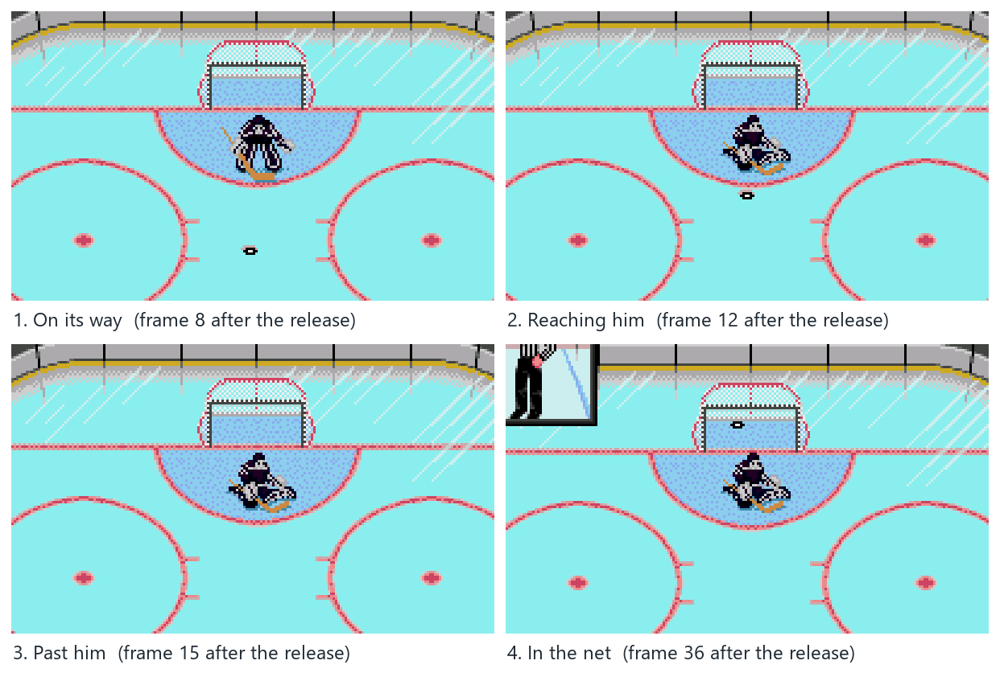

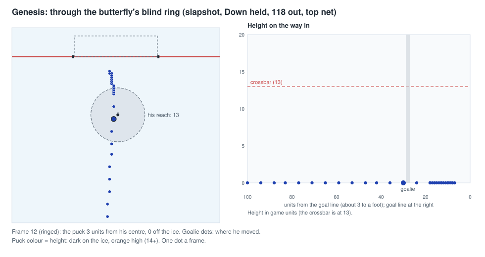

### Genesis 2: past his early pad stack (23%)

A wrist shot aimed down-left from 68 units out, 60 to the side, at the bottom net. He started sliding into a pad stack
as the shot was wound up (his reach grows to 18), but he slid the wrong way: the puck crossed the line 21 units from
his centre.

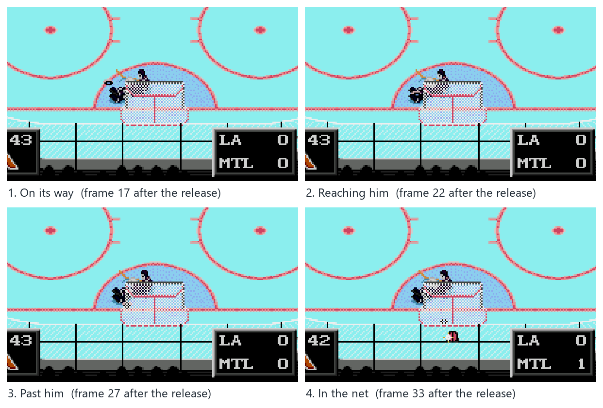

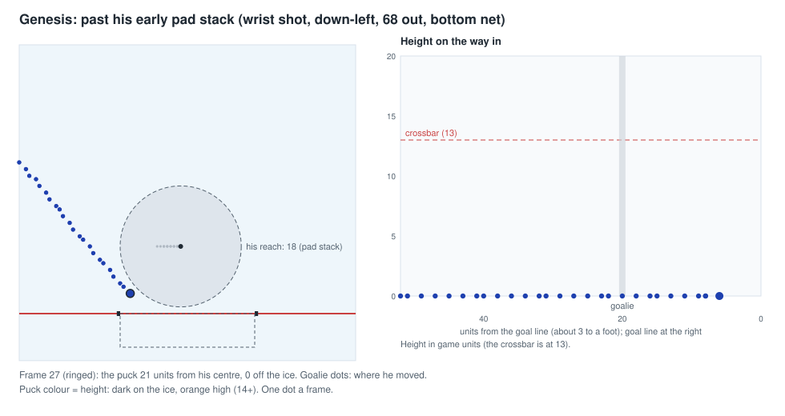

### Genesis 3: clean, never within his reach (21%)

A slapshot aimed high (Up) from 118 units out at the top net. It rises on the way in and passes 14 units from his
centre at height 9, just beyond his reach of 13, and goes in under the crossbar.

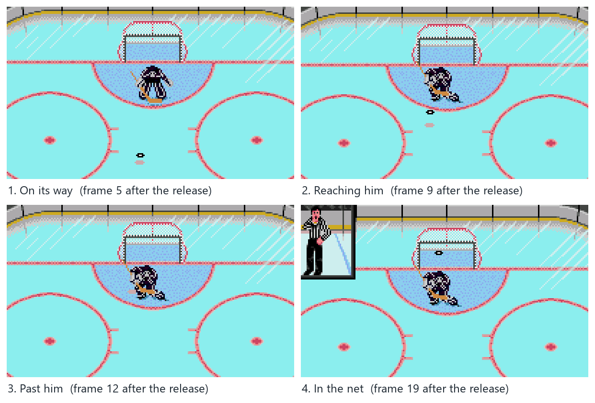

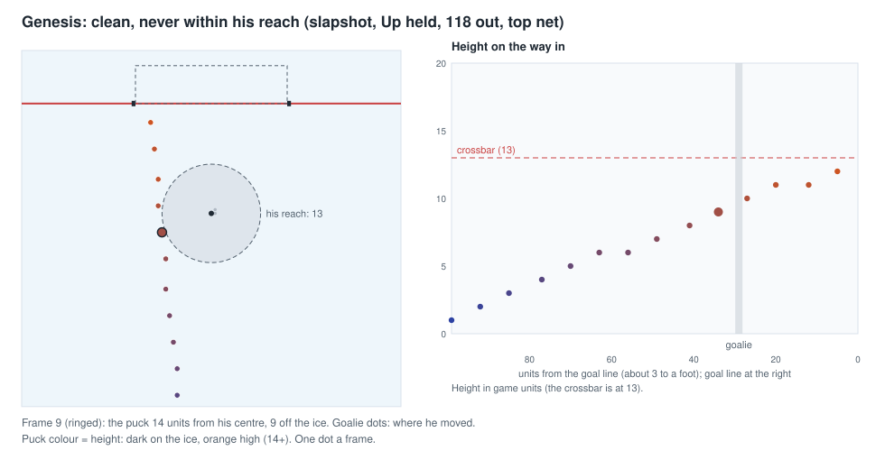

### Genesis 4: held, then carried into the net (7%, top net only)

A high wrist shot from the far left boards, 78 units out. He catches it in a high shoulder save and, still holding it,
drifts back into his own net: 882 of the 905 such goals were at the top net (the shoulder-save bobble).

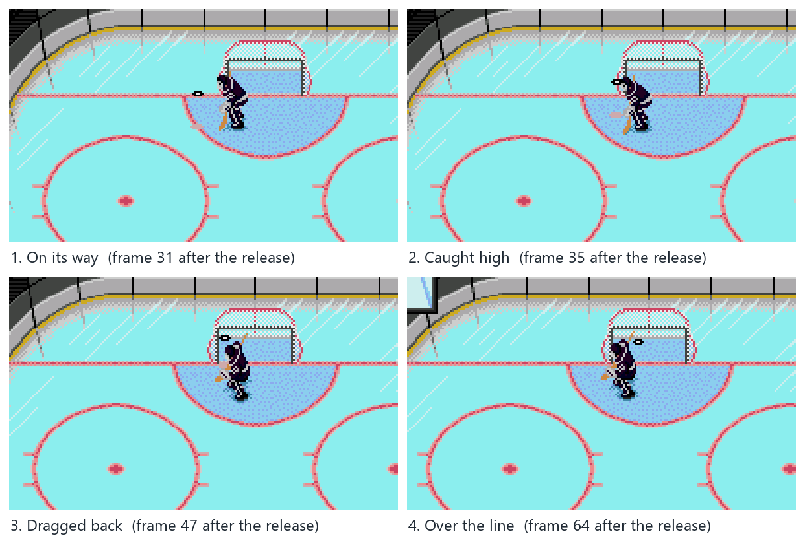

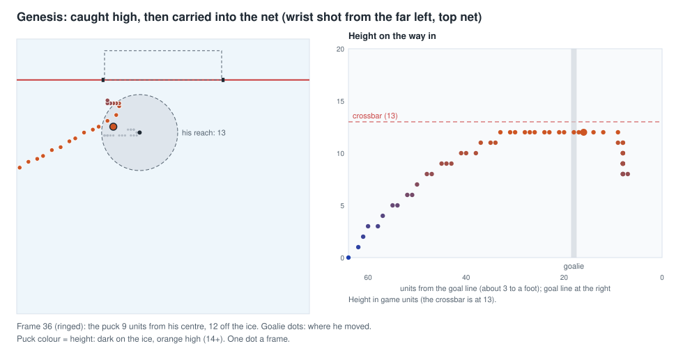

## Makes and misses, animated

At each worthwhile spot, 120 shots were played (one at each of the 120 moments, a fresh random seed each,
`animate.py`) and kept frame by frame. For each spot there are two animations, both at half speed:

- **Nine real clips** side by side: the game's own frames from the wind-up on, showing the shooter and the net, with
  goals in the spot's real proportion, each labelled with what happened (GOAL, SAVED, POST, MISSED) when it's decided.
- **All 120 shots from above at once:** each puck's trail (orange in, grey saved, purple off the post, pale missed), the
  shooter's spot, and the goalie as a dark dot. Shots that went exactly where aimed share one path, so many goals can
  look like a single orange line.

The shooter stays on the ice after the release (the map moves him away). The Genesis rates are the map's (all 120
moments; keeping the shooter changes nothing there). The SNES rates come from 480 shots over all 120 moments with the
shooter on the ice, since on the SNES that changes the result (the frame timing above).

### Genesis: slapshot holding Down, straight in (top net 43%, bottom 10%)

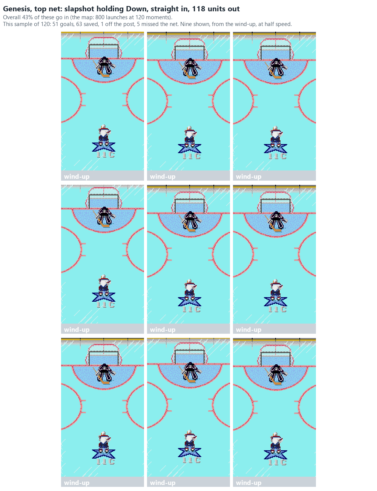

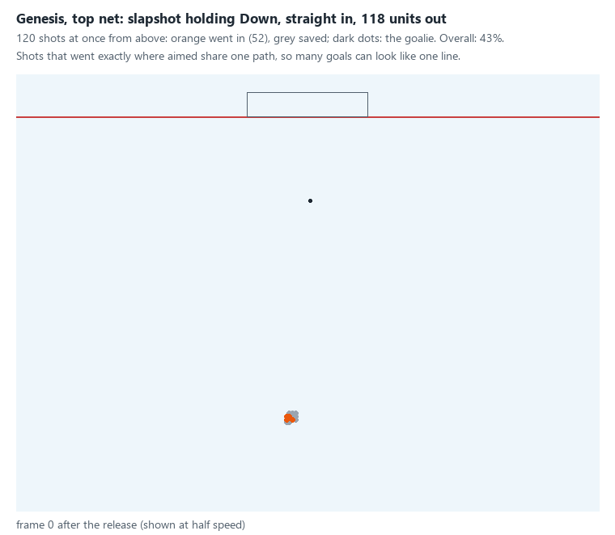

The same shot at the bottom net goes in far less often:

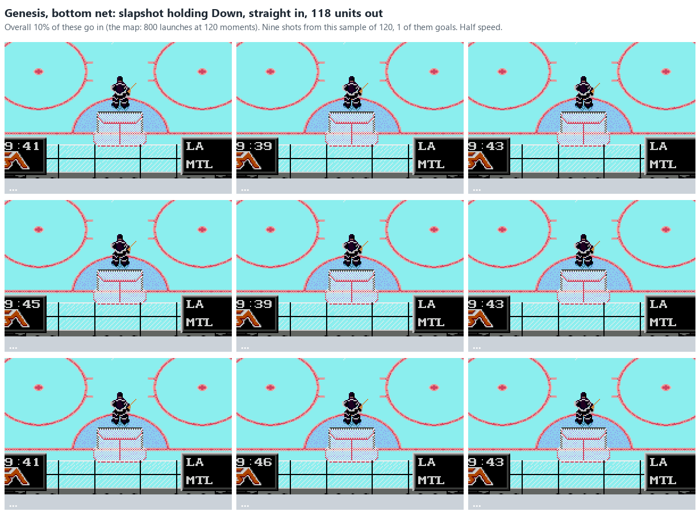

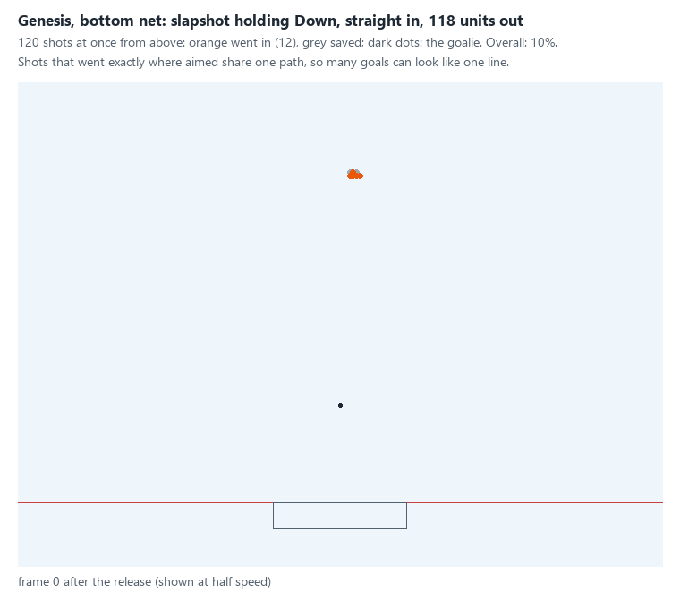

### Genesis: the early pad stack (34%)

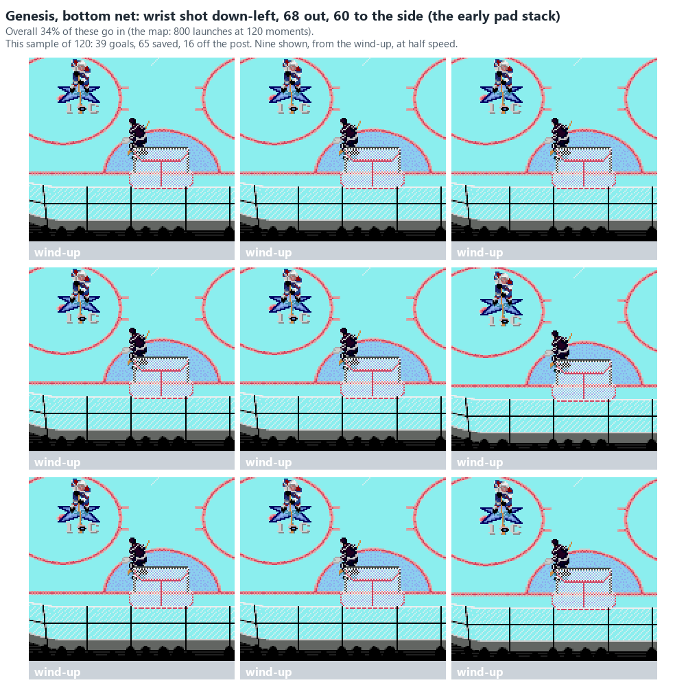

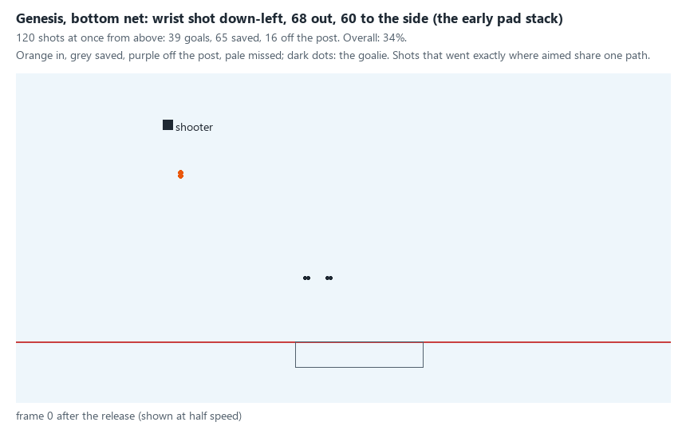

### Genesis: the shoulder-save bobble (31%)

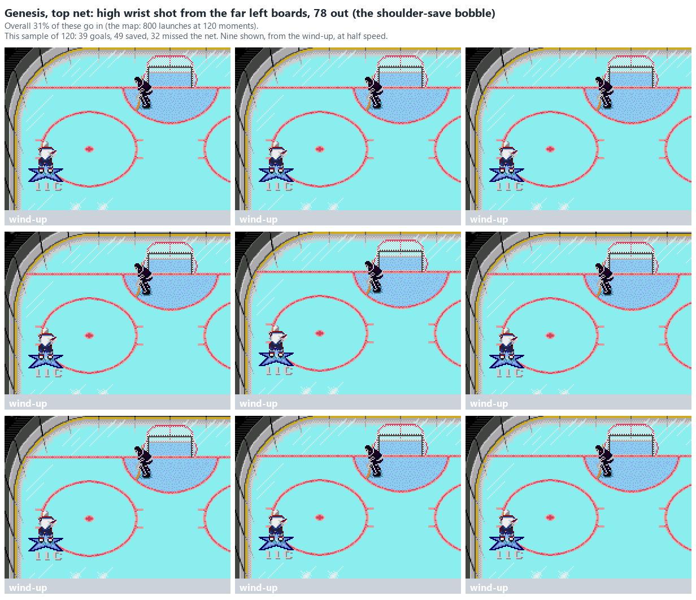

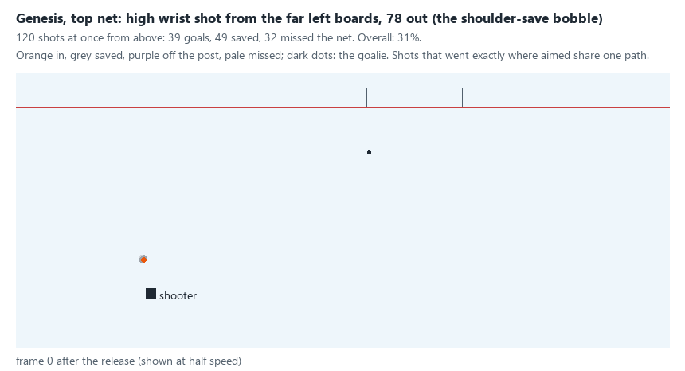

## One-timers

### Genesis

The same harness, now with a pass: a passer holds the puck, a teammate stands where the one-timer will be taken, the
computer goalie sets himself, the passer passes toward the teammate and the one-timer button (C) is pressed during the
pass, then the swing is played to the strike and the shot played out from fresh random draws. The Genesis aims
one-timers itself, so there is no aim to choose. 824 set-ups: 42 receiver spots (10 to 52 feet out, up to 30 feet
either side of the middle) with 6-13 passer spots each, at both nets, each with the button pressed early (2-5 frames
after the pass leaves) and late (2-10 frames before the receiver would take it), 32 moments of the game clock per
set-up. Same shooter and goalie as the maps. (`ot_harness.py`, `ot_run.py`, `ot_report.py`; run 2026-10-23 in
gentle mode, two one-hour chunks.)

**The swing usually connects:** the pass reached the press in 98% of early presses and 83% of late ones (otherwise
the receiver had already taken it), and the swing struck the puck in 83% and 91% of those.

**Where it scores** (goals per struck one-timer, averaged over the passers, both nets and both timings):

| Receiver's distance out | Middle | 10 ft to one side | 20 ft | 30 ft |
| --- | --- | --- | --- | --- |
| 10 ft (the doorstep) | 62% | 39-40% | 17-27% | 8% |
| 18 ft | 49% | 46-53% | 32-34% | 9% |
| 27 ft | 44% | 31-40% | 15-17% | 5-6% |
| 35 ft | 13% | 6-14% | 2-3% | 1-2% |
| 43 ft | 2% | 1-2% | under 10% | under 15% |
| 52 ft | 1% | 0-2% | 0-2% | 1-2% |

Two ranges in a cell are the left and right sides. A few far spots show a high best rate from a handful of strikes (a
pass that rarely connects); they are not real gaps.

- **Inside about 27 feet and within 20 feet of the middle, a one-timer is a good chance;** beyond 35 feet it almost
  never scores. Compare a standing shot at a set goalie: about 1% averaged over the spots and aims.
- **The pass across is the one to make.** With the receiver inside 18 feet: a pass from the other side at the same
  depth scores 63% on average (13 of 18 set-ups over half), one from the other side and farther out 43%, one from his
  own side 20-30%. **Why: the goalie is still on his way.** At the strike the computer goalie is a median 12 units off
  the line from the puck to the middle of the net after a pass across, moving 50 units a second, against 3.7 units and
  29 a second after a pass from the same side (a sample of 210 strikes with the receiver inside 18 feet, read from the
  game at the strike frame). Over both kinds, a goalie 10 or more off that line let in 86%, one within 5 of it 25%. The
  pass across moves the puck across his crease and he follows it; the one-timer leaves before he is square again. (The
  recorded-games study found the same: the goalie 10 or more off the line at the strike, 68% scored.)
- **The best set-ups are close to automatic:** the receiver on the doorstep in front of the net with the pass from 14-20
  feet to either side (90-99%); the receiver 10 feet to one side on the doorstep with the pass from 30 feet on the far
  side (88-94%); the receiver 18 feet out and 10 to one side, the pass from 10 feet to the other side (77-79%).
- **Timing barely matters on average:** early and late presses score the same overall (about 14-16% over every
  set-up). A given set-up can favour one; the swing has narrow timing holes where it whiffs.
- **The two nets agree on average** (14-16% each) **but not spot by spot:** about one set-up in six differs by more
  than 15 points between the top and bottom net, up to 60. It is not a left-right mirror (flipping one net doesn't
  line them up better) and not sampling noise (about 1 point a set-up): as with the Down slapshot in the maps, a unit of
  position decides whether the puck meets the goalie's body, so which net is better at a spot is geometry no player can
  aim for.
- **Recorded games agree:** the earlier study of 91 recorded Genesis one-timers ([SHOOTING_STUDY](SHOOTING_STUDY.md)
  part 3) found 44% scored inside 100 units (33 feet) and 10% beyond, with passes that moved the puck across scoring
  most.

**The xG model gets one-timers right.** At 748 strikes from 59 of the set-ups (both nets, both timings, 8 moments
each; `ot_xg_check.py`) the game's own rate, from 8 fresh seeds a strike, was set beside the viewer's xG for a recorded
one-timer from the same state (the goalie's position, speed and ratings, the puck's spot and speed, auto-aim, reach
12): the game 20.7% overall, the model 22.1%; correlation 0.83 strike by strike; log loss 0.290 against 0.510 for one
rate for all. Pass across (receiver inside 18 feet): game 69%, model 67%; from the same side 24% and 24%. Without the
position blur, or with the goalie's stick and rebound, it does no better (log loss 0.32), so the model stays as it is:
what decides a one-timer is where the goalie is when it is struck, and the model already reads that from the
recording.

### Genesis: by Shot Power and Accuracy (2026-10-24)

To see what the receiver's ratings change, the best one-timer spots were played again with every pair of Shot Power and
Shot Accuracy from 2 to 6, the same steps as the slapshot table below. There were four receivers: in front of the net
10 and 18 feet out, and 18 feet out with 10 feet to either side. Passes came from either side, 20 and 40 feet away.
That made 60 set-ups at both nets, with early and late presses, giving about 26,000 struck one-timers per pair (plan
`ratings` in `ot_run.py`, run in gentle mode).

Each cell is goals per struck one-timer:

| Shot Power \ Accuracy | 2 | 3 | 4 | 5 | 6 |
| --- | --- | --- | --- | --- | --- |
| 2 | 48% | 51% | 55% | 57% | 60% |
| 3 | 49% | 53% | 57% | 59% | 62% |
| 4 | 50% | 54% | 58% | 60% | 63% |
| 5 | 50% | 55% | 59% | 62% | 64% |
| 6 | 49% | 54% | 59% | 61% | 64% |

- **For one-timers, Accuracy is the rating that counts.** Each step of Accuracy adds 2-4 points, about 15 from 2 to 6.
  Power adds at most 1-3 points. There is no jump between Power 3 and 4 like the one for standing slapshots. The
  one-timer is already fast, and it beats a goalie who is still moving rather than one who is set.
- **The stick meets the puck 90% of the time whatever the ratings.** Ratings change where the shot goes, not whether the
  swing connects.
- **Off to one side, ratings matter most.** With Power and Accuracy rated the same, by receiver:

| Receiver | 2/2 | 3/3 | 4/4 | 5/5 | 6/6 |
| --- | --- | --- | --- | --- | --- |
| In front, 10 ft out | 60% | 62% | 65% | 67% | 69% |
| In front, 18 ft out | 54% | 59% | 63% | 66% | 68% |
| 18 ft out, 10 ft to the screen's left | 42% | 48% | 54% | 57% | 60% |
| 18 ft out, 10 ft to the screen's right | 37% | 43% | 50% | 57% | 60% |

  On the doorstep a weak shooter gives up only 9 points to a strong one. From the side the gap is 18-23 points. There,
  an accurate shooter scores about as well as a weak one does from straight in front.

### Genesis, animated

`ot_animate.py`: four set-ups from the ratings run at the top net, each played 32 times (the press early or late in the
pass, as in the run), the game's own frames from the pass to the result. Rates are from the run (512 struck
one-timers each). The paths view lines every attempt up on the strike and draws the goalie's track. After the pass
across he is still sliding when the puck is struck. After the pass from the same side he is already square.

**The pass across, receiver 18 ft out and 10 ft to the side, Shot Power 4 / Accuracy 4: 89% (455 of 512).**

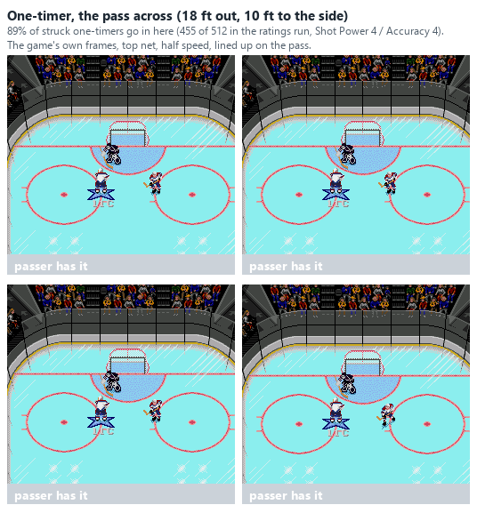
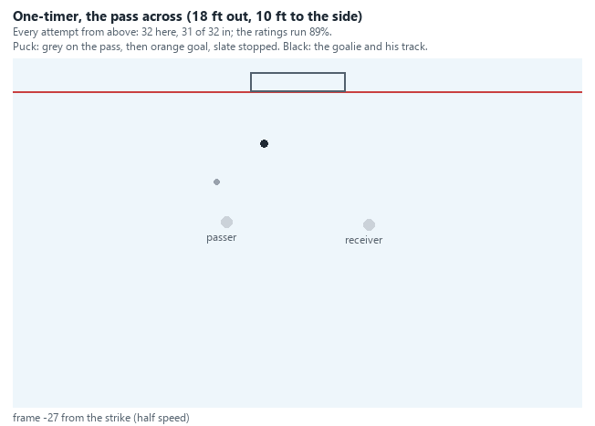

**The pass from his own side, 20 ft farther to his side, same receiver and ratings: 38% (197 of 512).**

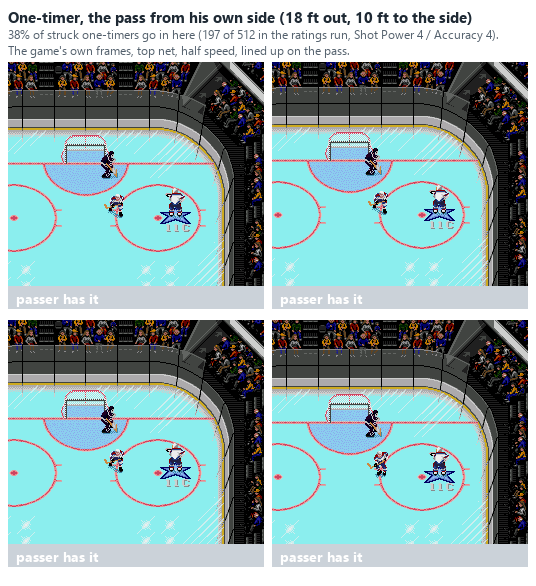
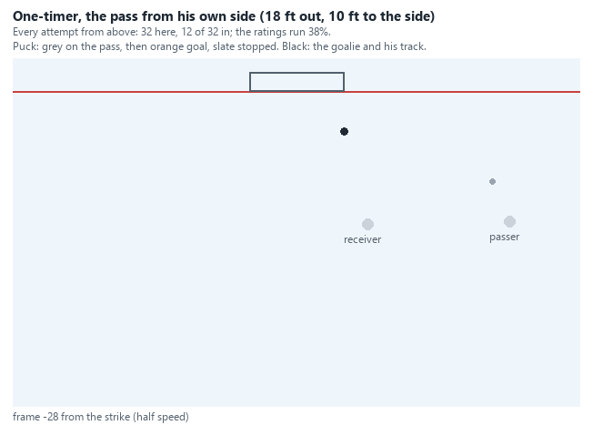

**From the side (the pass from 17 ft farther to his side and 10 ft nearer the goal line), Shot Power 2 / Accuracy 2: 20% (104 of 512).**

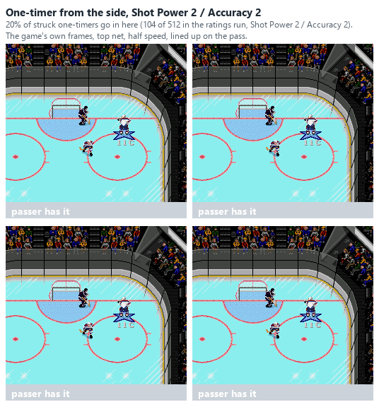
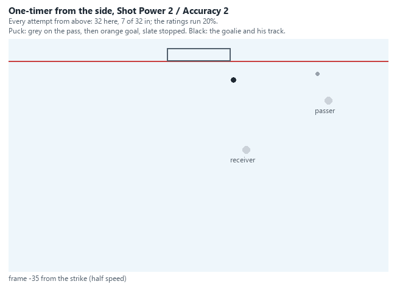

**The same set-up, Shot Power 6 / Accuracy 6: 67% (345 of 512).**

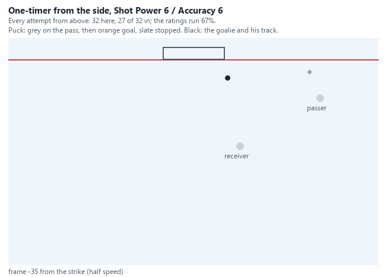

## Slapshots and the shooter's ratings

### Strong shooters (2026-10-24)

The user: far-post slapshots work more often for strong, accurate shooters. The same 70 spots for each (slapshots from
the middle half of the ice, x -60..60 by 20, 30-55 feet out, both nets; `NHL94_SMAP_SUBSET=slapmid` with `map_run.py`
and `snes_map_run.py`), a set computer goalie. "Best aim" is the best of the nine aims at each spot.

| | Usual shooter | Strong shooter |
|---|---|---|
| Genesis (Shot Power / Accuracy 20 / 15 against 27 / 27) | 13% at the best aim | **23%** |
| SNES (13 / 13 against 15 / 15, the most the SNES gives) | 3.8% | **6.1%** |

- **Strength nearly doubles a slapshot's chance on both systems**, at every distance (Genesis 100 out 12% to 23%, 140
  out 17% to 28%, 180 out 10% to 14%; SNES best at 120 out, 5.7% to 10.8%).
- **Near and far post (the league's words, the user):** by the shooter's hand, wherever he is. Right-handed: the
  goalie's left is the far post, his right the near post; left-handed: the goalie's right is far, his left near. So
  the far post is on the shooter's forehand side. Both test shooters shoot left (Genesis attribute +$04 bit 3 clear,
  which is what the game reads; SNES attribute bit $0800 clear), so their far post is the goalie's right.
- **Genesis, from the middle of the ice: it depends on the net and the distance.** Over the 10 middle spots (28-55 ft,
  both nets) Down (straight at him) averages 28% for a strong shooter (27 / 27), the far post at mid-height 21%, high
  19%; for the usual shooter (20 / 15) 17% / 14% / 12%. At the top net the far post is the shot from 28-41 ft (65%,
  69%, 31%) and Down from 48-55 ft (48-51%); at the bottom net Down from 35-55 ft (31-60%), the far post no more than
  18%. From his forehand side (left of the middle for a left-hander) Down is best (10%), the far post next (5%); from
  his backhand side Down (21%), the near post hardly scores (1% or less). Against a goalie with Agility 20 (roster 4) the far post closes (23% at 35 ft at the top net, near
  nothing elsewhere) and Down holds best (bottom net 40-43% at 35-41 ft).
- **SNES: the post on the shooter's side of the ice.** From his forehand side the far post (strong 5-6%, usual 3-4%),
  from his backhand side the near post (strong 6% high, usual 3%), from the middle almost nothing (2% or less). The
  user: SNES slapshot goals are rare and usually near post; the near post scores from the backhand side here.
- A standing shooter, a set computer goalie: the user's far-post slapshots in games are taken skating across (below:
  Neely's in the 2026-10-23 games), which this part doesn't have.

### Every Shot Power and Accuracy (Genesis, 2026-10-24)

The user: long far-post slapshots are taken by shooters of 4 / 4 or better; below 4, especially in power, the puck
doesn't get past the goalie often enough. The same slapshot (held 20 frames) from 18 spots (x -40 / 0 / 40, 104-144
out, both nets; `NHL94_SMAP_SUBSET=slapcore`), a set computer goalie, for each roster step 2-6 of Shot Power and of
Shot Accuracy (working value = step x 5, before hot / cold). The best aim's chance, averaged over the spots (in
brackets: from the middle, x 0):

| Shot Power \ Accuracy | 2 | 3 | 4 | 5 | 6 |
|---|---|---|---|---|---|
| 2 | 4% (7%) | 4% (9%) | 5% (9%) | 4% (9%) | 5% (10%) |
| 3 | 5% (8%) | 6% (10%) | 7% (12%) | 7% (13%) | 7% (13%) |
| **4** | 14% (25%) | 17% (30%) | **19% (33%)** | 20% (33%) | 21% (36%) |
| 5 | 19% (31%) | 22% (38%) | 24% (41%) | 27% (44%) | 27% (46%) |
| 6 | 24% (31%) | 28% (36%) | 31% (41%) | 34% (44%) | 35% (46%) |

- **Shot Power has a threshold between 3 and 4, as the user said:** at accuracy 4 the chance nearly triples from 7%
  to 19%. Below 4 the slapshot hardly scores from anywhere (4-7%), whatever the accuracy. Above 4 each step of power
  adds 5-10 points over the spots, but from the middle 5 and 6 are about level.
- **Accuracy matters only once the power is there:** from 2 to 6 it adds 1-2 points at power 2-3, 7-11 points at
  power 4-6.
- **Distance:** from the middle at accuracy 4, power 4 scores 27% / 35% / 58% at 144 / 124 / 104 out (about 48 / 41 /
  35 feet); power 3 7-17%, power 2 7-15%.

**Animated (`animate.py`, the RATED spots):** the far post (aim Left) from the middle 108 out (36 ft), top net, the
best single spot and aim for showing the threshold. Rates are from the ratings run (400 launches at 120 moments). At
Power 3 most are saved or go wide (in the 24 here: 16 saved, 7 wide, 1 goal). At Power 4 most go in (17 of 24).

**Shot Power 3 / Accuracy 4: 10%.**

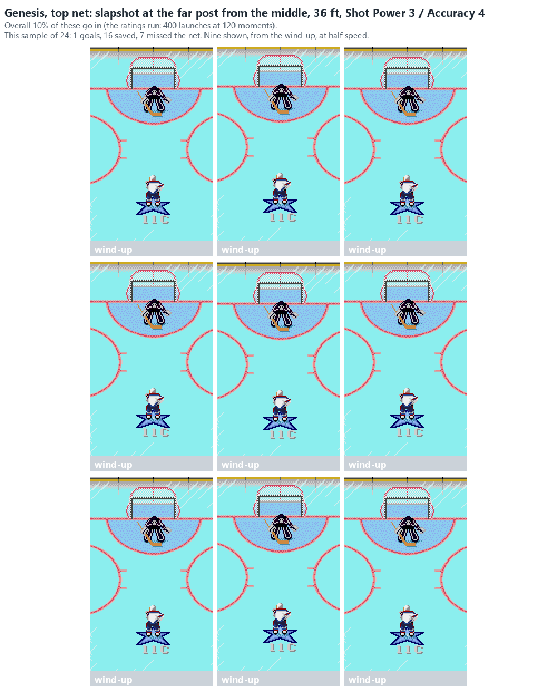
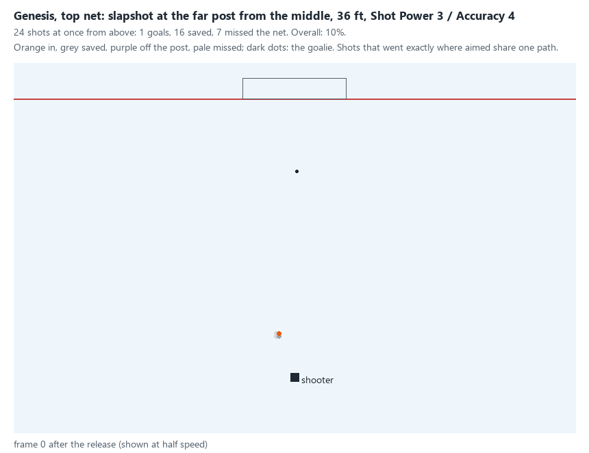

**Shot Power 4 / Accuracy 4: 58%.**

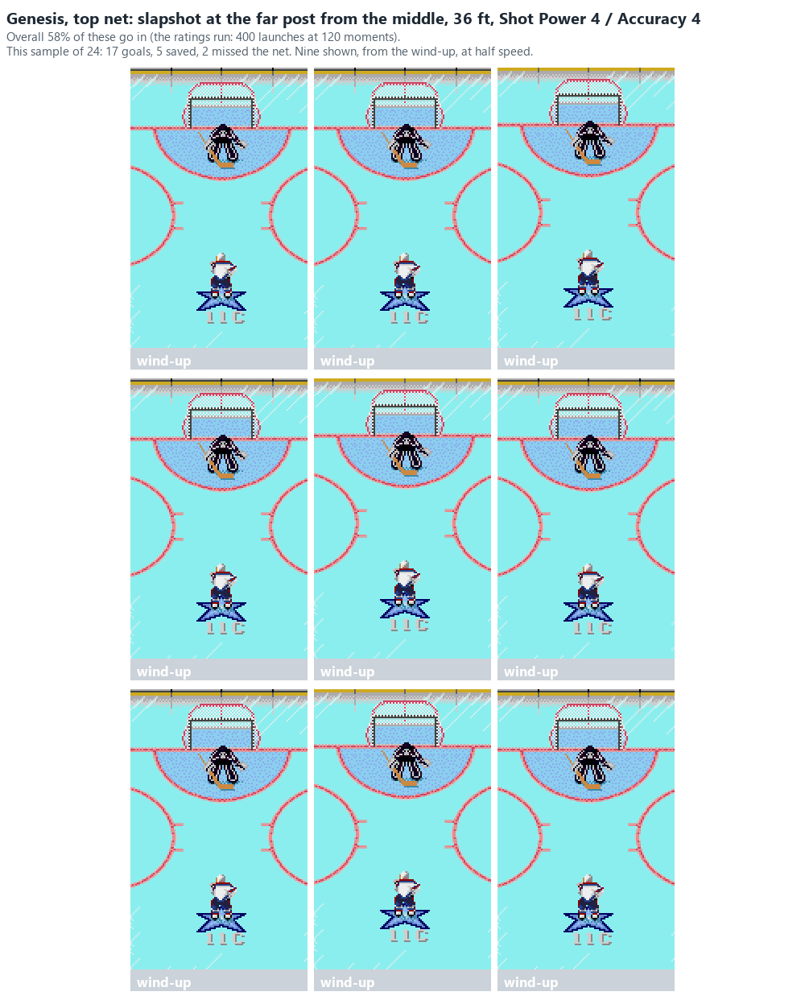
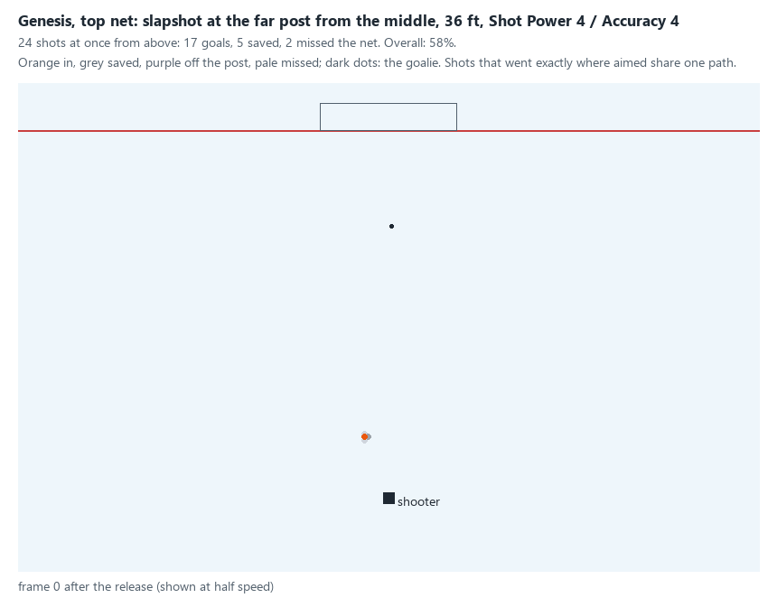

**Shot Power 6 / Accuracy 6: 72%.**

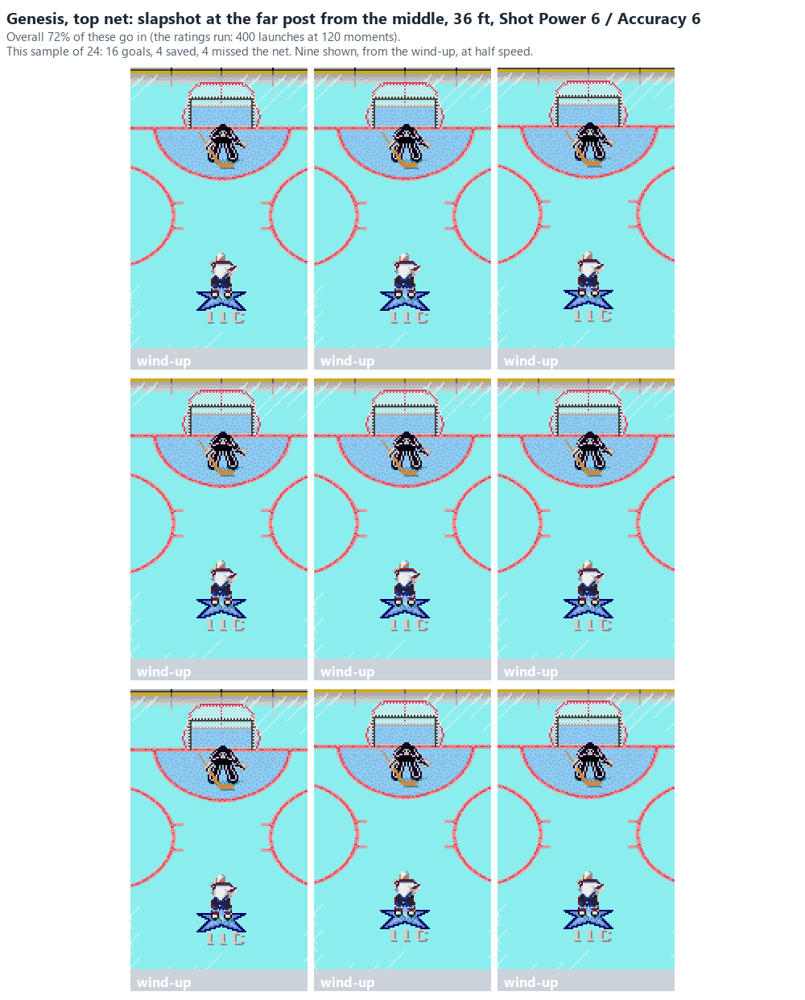
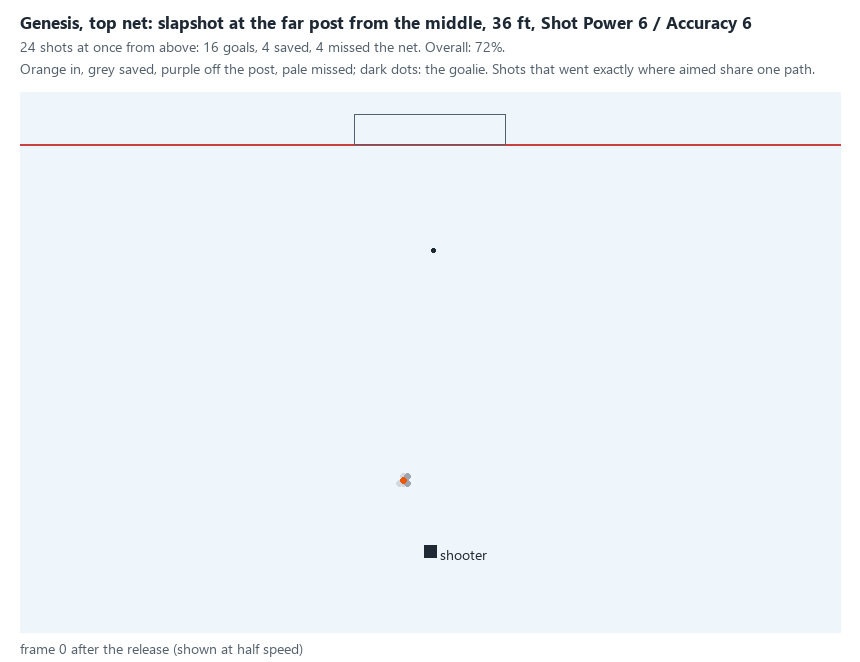

## Moving shooters (Genesis, 2026-10-24)

`mv_run.py`: the shooter skates (speed 8000) with the d-pad held his way while a set computer goalie waits, and takes
a wrist shot (C tapped) at a set release point with each of the nine aims; 16 moments x 4 seeds per aim, both nets
and both sides.

- **Across the crease (the user's method 3: a soft shot into the far side before the goalie gets there):** from 90 to
  one side, skating across. **Aimed the way he is skating**: 51-53% at 35 out (about 11 feet), 32-38% at 45 out;
  **aimed back the way he came: 0-1%**; straight at the middle 13% at 35 out, 2% at 45. The way he skates decides,
  not the post: crossing toward his forehand side that is the far post (55% at 35 out), toward his backhand side the
  near post (48%). Released
  just before the middle is best (35 out: 80% at 20 short of the middle, 72% at the middle, 49% at 20 past, 18% at 40
  past). Holding nothing but his skating direction scores as well as aiming that way. At 25 out he never gets the shot
  off: the goalie takes the puck.
- **On the 45-degree diagonal straight for the net (method 5: the near post as the goalie starts for the far
  one):** almost nothing against a set computer goalie: 0-2% released 100 to 60 out, 5-8% at 45 out aimed at the near
  side, far side and middle 0%. The goalie stays on the puck's line (1-6 units off it), so there is no near post to
  hit; the method needs the goalie to start across first, which a computer goalie doesn't do on his own here.
- **Slapshots skating across (the user's far-post slapshot; Neely's 4-1, 6-3 and 7-4 in 2026-10-23_1126_LA-BOS),
  plans "slapx" / "slapxslow":** a strong shooter (27 / 27, left-handed) from 130 to one side, 85 / 105 / 125 out
  (about 28 / 35 / 42 feet), a full wind-up begun at five points across; he glides about 50 through the wind-up, so
  the shots left from 7 before the middle to 70 past it. Starting at half speed changed nothing (he speeds back up with
  the d-pad held: the same release points).
  - **Crossing toward his stick side, the far post (ahead of him) is the shot: 50-62% released just before or at the
    middle from 85-105 out** (from 125 out, at the bottom net only: 64% with the wind-up begun 60 before the
    middle, 36% from 40 before; see the note below). Standing in the middle at those distances (84-104 out) the best
    aim scores 65-69% at the top net (the far post) but 21-45% at the bottom (Down), so the skating shot's edge is
    at the bottom net. It
    falls fast once he is past the middle (10-15% released 30 past, 0-4% beyond). The near post (behind him): 0-2%.
  - Crossing toward his backhand side the near post is ahead, and does worse: 34-36% released at the middle from 85
    out, 6-16% from 105, 0-34% from 125 (uneven between the nets).
  - **A fault in the runs at one start, found 2026-10-24:** from 130 to the right at 125 out at the top net, the
    skater is turned back toward centre ice about 24 frames in (the release points read 190-254 out), so those
    set-ups say nothing about the shot. They are left out of every 125-out figure here; that start's cause is not yet
    found. Mapped: at the top net only, a skater crossing leftward at 125-140 out is turned back on reaching
    about 70-78 to the right of the middle (at 145 out and beyond he passes; at the bottom net, nothing). No object
    record stands there. No other run crosses that patch (the diagonal and standing runs were checked). The other three starts at 125 out (left at the top net, both at the bottom) skate normally.
  - So the far-post slapshot is a skating shot: across toward the stick side, released in front of the middle. Neely's
    7-4 left from 50 before the middle, 86 out, earlier than any release tried here.
- **Every Shot Power and Accuracy (plan "slapxr", 2026-10-24):** crossing toward the stick side only, the wind-up
  begun 60 or 40 before the middle, 85 / 105 / 125 out (about 28 / 35 / 42 feet), both nets (125 out: the bottom net
  only, the fault above), roster steps 2-6 of each (working = step x 5). The best aim's chance, averaged over the set-ups (in brackets by distance):

  | Shot Power \ Accuracy | 2 | 4 | 6 |
  |---|---|---|---|
  | 2 | 7% (14 / 4 / 2%) | 7% (14 / 4 / 1%) | 9% (16 / 5 / 3%) |
  | 3 | 12% (23 / 6 / 4%) | 15% (26 / 9 / 5%) | 17% (29 / 10 / 6%) |
  | **4** | 34% (48 / 33 / 9%) | **44% (62 / 41 / 10%)** | 48% (70 / 45 / 11%) |
  | 5 | 41% (46 / 44 / 23%) | 53% (61 / 56 / 30%) | 59% (68 / 62 / 36%) |
  | 6 | 47% (47 / 55 / 30%) | 61% (62 / 69 / 43%) | 68% (68 / 78 / 50%) |

  - **The same threshold between Shot Power 3 and 4 as standing** (15% to 44% at accuracy 4): the user's 4 / 4 rule.
  - **Distance needs power:** from 85 out power 4 is as good as 5 or 6 (about 60%); from 105 out each step adds 10-15
    points; from 125 out power 4 scores about 10%, 5 about 30%, 6 30-50%.
  - Accuracy adds 10-20 points at power 4-6, a few at 2-3.

### The skating far-post slapshot by rating, animated

`slapx_animate.py`: the slapxr set-up at the bottom net (a left-hander starting 130 to his right,
crossing to his stick side, the wind-up begun 60 before the middle), aimed at the far post ahead of him. Each rate is
the ratings run's for that exact set-up and aim (64 shots); the clips show goals in about that proportion. Each pair:
four attempts in the game's own frames, then 24 attempts from above, turned so the net is at the top.

**Shot Power 3 / Accuracy 3, 105 out (35 ft): 3%** (2 of 64).

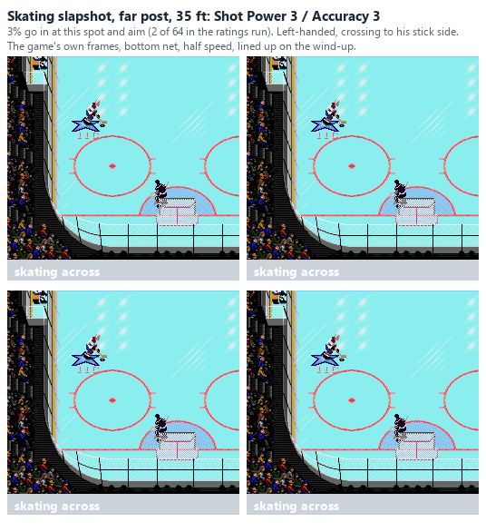

**Shot Power 4 / Accuracy 4, 105 out (35 ft): 44%** (28 of 64).

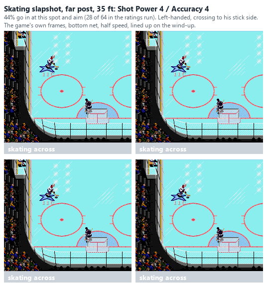
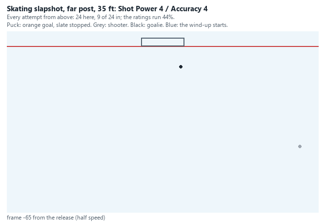

**Shot Power 6 / Accuracy 6, 105 out (35 ft): 80%** (51 of 64).

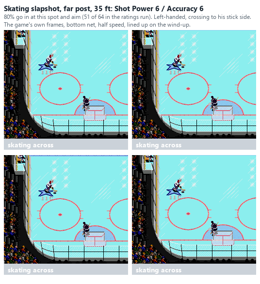

**Shot Power 4 / Accuracy 4, 125 out (42 ft): 14%** (9 of 64).

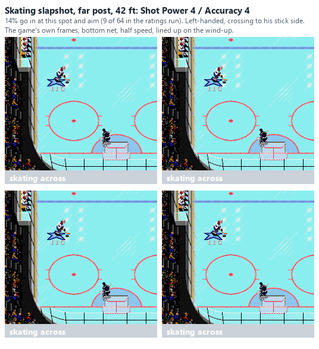

**Shot Power 6 / Accuracy 6, 125 out (42 ft): 59%** (38 of 64).

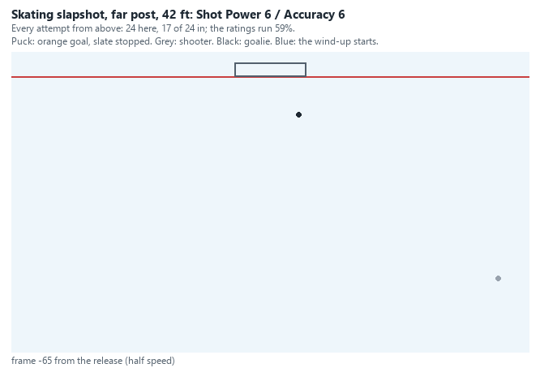

## The computer goalie's ratings (Genesis, 2026-10-25)

The levels in the first table set the goalie's Agility, Speed and Puck Control to 10 / 20 / 30, and his reaction
value `aidef` to the same number (the game stores 15 - DfA / 4 there, 7-15, and his reaction timer is a quarter of it,
so "20" and "30" also make him slower to react than any real goalie). **Defensive Awareness makes no difference to the
slapshot** (one rating at a time, below), so that table stands for Agility, Speed and Puck Control moved together.

Every run above used one computer goalie, the test state's (Hrudey: working Agility 13, Speed 13, `aidef` 10, which is
Defensive Awareness about 20, Puck Control 18; his save ratings are never used). Here the same shots against goalies with all four of those at 10,
20 or 30 (`harness.py`: `NHL94_GOALIE`), the shooter at Shot Power / Accuracy 4 / 4:

| Goalie | Standing slapshot (best aim, 18 spots) | Far post from the middle, 35 ft | Skating far-post slapshot (best aim) | One-timers | Dekes and floaters |
| --- | --- | --- | --- | --- | --- |
| Test goalie (13 / 13 / 10 / 18) | 19% | 58% | 37% | 58% | 71% |
| 10 | 21% | 57% | 41% | 60% | 71% |
| 20 | **5%** | **3%** | **15%** | 62% | 68% |
| 30 | **7%** | **2%** | **7%** | 59% | 63% |

The runs: the standing slapshot as "Every Shot Power and Accuracy" (`map_run.py`, slapcore, 400 launches at 120
moments a spot); the skating one as plan "slapxr" (`mv_run.py`); the one-timers as plan "ratings" (`ot_run.py`, about
26,000 struck each); the dekes and floaters as `deke_run.py` plan "best" (the best set-up of each move and hand, both
nets, 24 moments x 4 seeds; the test goalie re-run over the same moments for the comparison).

- **Slapshots depend on the goalie's ratings more than on anything else measured here.** From a goalie rated 10 (or
  the test goalie) to one rated 20, the standing slapshot's best chance falls from about 20% to 5%. The far post from
  the middle, the best single spot, falls from 57% to 3%. The skating far-post slapshot falls from 41% to 15%, then to
  7% at 30. The goalie gets across to the far post sooner, and the shot is stopped farther out (animated below).
- **One-timers don't care** (58-62% at every level). This fits the Genesis one-timer finding: it beats a goalie still
  moving across, before his ratings come into it.
- **Dekes lose a little and floaters nothing.** Over the best set-ups 71% / 71% / 68% / 63% (goals per attempt, a
  puck carried in counted as a goal). The left-hander's forehand deke falls from 80-83% to 67% and his backhand deke
  from 95-97% to 67%; the right-hander's dekes stay at 77-91%,
  and the floaters at 42-56% whatever the goalie.
- **So the test goalie was a weak one,** and the slapshot rates in this document are for a weak goalie. Against an
  average-to-strong computer goalie the slapshot is a poor shot, and one-timers and dekes are worth even more by
  comparison.
- **Which rating does it:** Agility, with some help from Puck Control (one rating at a time, below).

### One rating at a time: Agility stops slapshots

The standing slapshot again (slapcore, 18 spots, 400 launches at 120 moments a spot), the shooter at a working 20 / 20
(roster 4 / 4), changing one goalie rating at a time (working values; a roster rating is a fifth of it: 10 is 2, 20
is 4, 30 is 6). Defensive Awareness is set as the game sets it (`aidef`, reaction 3 frames at 10, 2 at 20, 1 at 30).

| Goalie (Agility / Speed / Def. Awareness / Puck Control) | Best aim, average of 18 spots | Far post from the middle, 35 ft |
| --- | --- | --- |
| Test goalie, Hrudey (13 / 13 / about 20 / 18) | 18.9% | 58% |
| Agility 20 | **8.9%** | **3%** |
| Speed 20 | 18.7% | 58% |
| Def. Awareness 30 | 18.9% | 61% |
| Puck Control 25 | 15.4% | 55% |
| All four 20 | 8.4% | 4% |
| Agility 10 | **16.9%** | **57%** |
| Agility 30 | **4.6%** | **1%** |
| Speed 10 | 8.3% | 3% |
| Def. Awareness 10 | 7.8% | 2% |
| Def. Awareness 30 | 8.3% | 2% |
| Puck Control 10 | 11.4% | 3% |
| Puck Control 30 | 6.3% | 3% |

(The rows below "All four 20" change one rating from 20 / 20 / 20 / 20.)

- **Agility is the rating that stops slapshots.** Hrudey's 13 raised to 20 halves the best-aim chance (18.9% to 8.9%)
  and closes the far post from the middle (58% to 3%); from 20, lowering it to 10 doubles the chance again (16.9%)
  and raising it to 30 halves it (4.6%). Agility is the goalie's reach (GENESIS_SHOOTING 5.1): a longer reach covers
  the far post the shot was beating.
- **Puck Control helps some:** from 20 to 10 the chance rises from 8.4% to 11.4%, to 30 it falls to 6.3%; from
  Hrudey's 18 to 25 it falls from 18.9% to 15.4%. It doesn't open or close the far post from the middle. Puck Control
  is how often he holds the shot; a shot he doesn't hold can still go in.
- **Speed and Defensive Awareness do nothing** to the standing slapshot (within a point at every level).
- **For a league goalie** (roster ratings, a fifth of the working ones): Hrudey is a roster Agility 3 played cold; a
  goalie with roster Agility 4 or more (working 20+) stops most of the slapshot chances in this document (the real
  goalie profiles, below).

### Real goalie profiles: every shot against retail, CDL, Roy and Belfour

The same studies against four goalie profiles from the ROMs (working ratings, a roster rating x 5): a typical retail
starter (roster Agility 4, Speed 4, Defensive Awareness 5, Puck Control 4: working 20 / 20 / 25 / 20); the same goalie
with the CDL edit (+1 Agility, Defensive Awareness and Puck Control, as `CDL_Season_12.bin` has it: 25 / 20 / 30 / 25);
Roy (6 / 4 / 4 / 6: 30 / 20 / 20 / 30) and Belfour (6 / 4 / 6 / 5: 30 / 20 / 30 / 25), the two the leagues leave
unedited and rank above the rest. Hrudey, the test goalie, for comparison. A profile is the four working ratings
written into the save state's goalie (harness `NHL94_GOALIE`) before every play, so the animations still show the LA
goalie's sprite and colours: only his ratings change.

| Goalie | Standing slapshot, shooter 4 / 4 (best aim, 18 spots) | Standing slapshot, shooter 27 / 27 (best aim, 70 middle spots; top / bottom net) | Skating far-post slapshot, 4 / 4 (best) | One-timers, receiver 4 / 4 | Dekes (best set-ups) | Floaters (best set-ups) |
| --- | --- | --- | --- | --- | --- | --- |
| Hrudey (13 / 13 / about 20 / 18) | 19% | 23% (29% / 17%) | 37% | 58% | 85% | 51% |
| Retail starter (20 / 20 / 25 / 20) | 8% | 13% (15% / 12%) | 18% | 54% | 81% | 33% |
| CDL starter (25 / 20 / 30 / 25) | 6% | 11% (13% / 9%) | 19% | 51% | 82% | 26% |
| Roy (30 / 20 / 20 / 30) | **3%** | **6%** (7% / 5%) | **9%** | 51% | 72% | 20% |
| Belfour (30 / 20 / 30 / 25) | **4%** | **7%** (9% / 5%) | **9%** | 48% | 76% | 16% |

(The CDL slapshot from the middle was run with Defensive Awareness 25 rather than the profile's; that rating
makes no difference to slapshots. Dekes and floaters: goals per attempt, a puck carried in counted as a goal, 24
moments x 4 seeds, both nets.)

- **Against Roy and Belfour the slapshot is close to worthless:** 3-4% for a 4 / 4 shooter and 6-7% for the best
  shooters even from the middle, a third or less of what the same shots score against Hrudey. The far post from the
  middle is gone (1%); straight Down holds a little at the bottom net. Even the retail starter halves every slapshot.
- **One-timers barely notice the goalie:** 58% against Hrudey, 48-51% against Roy and Belfour. They beat a goalie still
  sliding across, before his reach comes into it.
- **Dekes hold up:** 85% against Hrudey, 72-76% against Roy and Belfour; the swing baits the pad stack whoever is in
  net.
- **Floaters fade:** 51% against Hrudey, a third against a retail starter, 16-20% against Roy and Belfour. A floater
  is a slow shot at the far post, which a longer reach covers.
- **The CDL edit** makes the ordinary goalies a little better (slapshots 8% to 6%, floaters 33% to 26%) and leaves dekes
  and one-timers where they were; Roy and Belfour stay well above them, as the leagues rank them.
- **The top net stays the better one for slapshots** against every goalie.
- **So against a good goalie, score with one-timers and dekes.** The ranking of the shots is the same for every
  goalie, but the gap grows: against Roy a one-timer (51%) is worth about eight of the best shooter's standing
  slapshots from the middle (6%).

**Animated (`animate.py`, the RATED spots):** the far-post slapshot from the middle 35 ft out (top net, the shooter 4 /
4), against Hrudey (the run 58%), a typical retail starter (4%; 4 of the 120 filmed went in) and Roy (2%; 2 of 120).
(The goalie GIFs made before 2026-10-25, "rated 10 / 20", had the Defensive Awareness slot wrong and are replaced.)

**Hrudey: 58%.**

**A typical retail starter (Agility 4): 4%.**

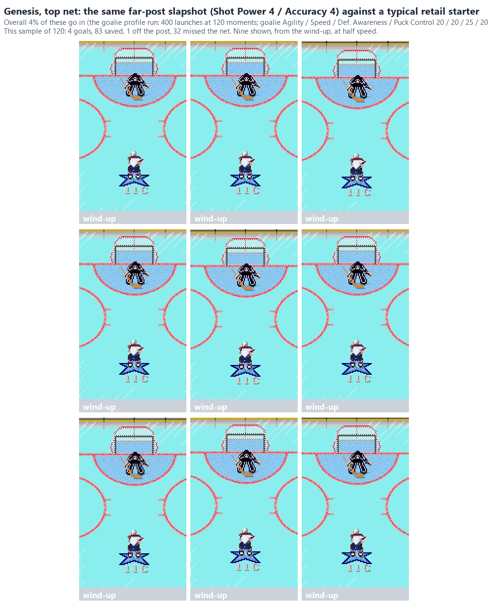
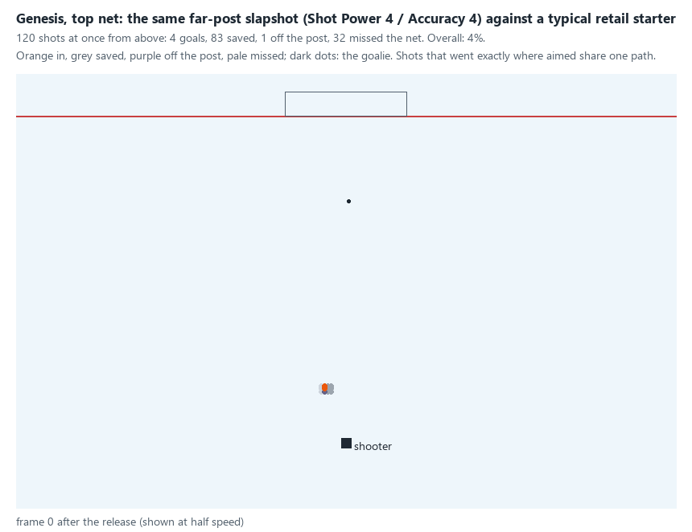

**Roy: 2%.**

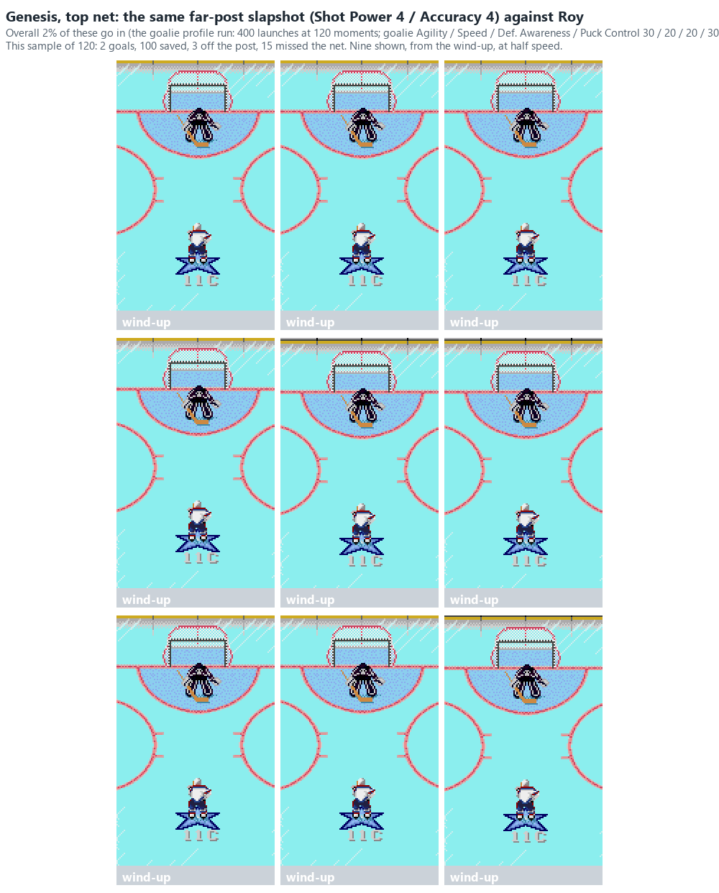
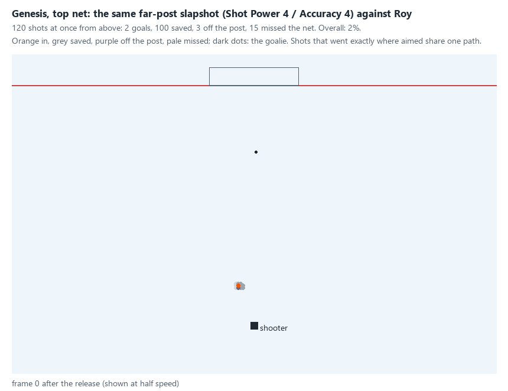
