# Scoring maps: Genesis dekes and floaters

*The scoring maps: [overview and method](SCORING_MAP.md) · [Genesis shots and goalies](SCORING_GENESIS.md) · [Genesis dekes and floaters](SCORING_GENESIS_DEKES.md) · [Genesis EA Specials](SCORING_GENESIS_EA.md) · [SNES](SCORING_SNES.md)*

Dekes and floaters played in the real Genesis game (the method: [SCORING_MAP](SCORING_MAP.md)).

## Contents

- [Dekes and floaters (Genesis, 2026-10-24)](#dekes-and-floaters-genesis-2026-10-24)
   - [The moves, animated](#the-moves-animated)
   - [Going down the screen (the bottom net)](#going-down-the-screen-the-bottom-net)
   - [The user's refinements (plan "deke2", 2026-10-24)](#the-users-refinements-plan-deke2-2026-10-24)
   - [The deke on the backhand (plan "dekebh", 2026-10-24)](#the-deke-on-the-backhand-plan-dekebh-2026-10-24)
   - [The floater on the backhand (plan "floaterbh", 2026-10-24)](#the-floater-on-the-backhand-plan-floaterbh-2026-10-24)
   - [By the shooter's skating and shot (plan "best", 2026-10-25)](#by-the-shooters-skating-and-shot-plan-best-2026-10-25)
   - [Re-timed for slow and fast skaters (plan "retime", 2026-10-26)](#re-timed-for-slow-and-fast-skaters-plan-retime-2026-10-26)

## Dekes and floaters (Genesis, 2026-10-24)

`deke_run.py` plays the user's close-in moves (PROJECT_NOTES "Examples in the 2026-10-23 BOS-LA games") against a set
computer goalie, with the inputs read from those recordings. He comes in with his facing a step to one side. Close in,
he holds the other diagonal (up-left or up-right; straight left or right turns him sideways and C then drops the
puck). His facing swings two steps, and the puck crosses in front of him in about 15 frames while his skating barely
changes. He then taps C with the swing's side held, a wrist shot aimed at that side. The usual shooter is 20 / 15. Each
hand was played (attribute bit 3, which the game reads; the first run set only +$76, which it ignores, so its "right-
handers" were left-handers and were run again). Both nets, 12 moments x 4 seeds per set-up, 4,320 set-ups a hand.
"Still" is the control: the same shot at the same moment with no swing.

> **Caveat (2026-10-31, the scripted bot; STUDY_NOTES "A scripted bot"):** these runs kept every other skater off
> the ice. With them on it (still far from the play), a right-hander's facing turns more slowly in the swing, and the
> best right-hander set-up (deke2, swing at 60, C 13 frames on) fell from 48 of 48 to 4 of 48 (`bot_deke_check.py`;
> left-handers 38 against 40). Re-timed with everyone on the ice (24 tries each): right-handers C **16** frames on
> 23 of 24 (13: 1, 19: 9); left-handers 13 frames 23 of 24 (10: 20, 16: 21). Why the others change the turn isn't
> known. The timings below are the cleared-ice ones.

- **The swing is the goal.** The same shots without it score 0-1% (deke and floater alike); with it, the best set-ups
  score 60-93%.
- **Deke (straight in: Neely's 1-0s, his near-post 9-0):** come in about 30 off the middle on the side you will swing
  toward, drifting toward the middle. Start the swing about 72 from the goalie, shoot 13-19 frames later (released
  about 45 out), and the shot goes in at the post on the side he came from.
  - Left-hander swinging to his left (forehand): 83-88%. Right-hander to his left (backhand): 80-93%. Right-hander to
    his right (forehand, swing at 85): 57-66%. Left-hander to his right: 46%, but **not a backhand deke** (the
    user, from the animations): the two-step swing doesn't get the puck across to his right. At the release it was
    still about 4 units on his left over the grid, against about 14 across in the right-hander's backhand deke.
  - Over the whole grid: lefty to his left 32%, to his right 3%; righty to his left 16%, to his right 12%. **Two
    things add up: a swing to the forehand** (each mirror-image pair, a lefty against a righty, favours the forehand
    swing: 45% against 25%, 28% against 6%), **and a swing to the shooter's own left** whatever his hand. That second
    one is the same at both nets, so it is in the game, not the screen. The left-hander's swing to his right doesn't
    get the puck across (above), so part of this is that swing failing, not the goalie; see "Why it works".
  - Swung too late (shot more than about 16 frames after a swing begun at 60), the goalie takes the puck first.
  - Along the ice instead of mid-height: a little worse (27% against 30% over the grid).
- **Floater (Juneau's 3-0, Sweeney's 4-0):** skate up and across on the diagonal from the forehand side, 35-50 out to
  the side, swing the puck back to the forehand, and hold C 6-9 frames: the far post from about 60 out.
  - Left-hander from his left, swung back left: 54-60% (swing at 95 from the goalie, C 14-18 frames later).
    Right-hander from his right, swung back right: 50-65% (swing at 110, C 22 frames later; the edge of the grid, so
    it may be better still a little later).
  - Swung to the backhand instead: 26% (lefty), 29-38% (righty) at best; the forehand rule holds for the floater with
    no left-right bias.
- **Why the deke works: it baits a pad stack that slides the wrong way** (traced 2026-10-24: the goalie's save and
  where the puck crossed, 48 attempts per set-up and net). With the puck still carried, the swing makes the computer
  goalie commit early, and a carried puck gets the pad stack (`goaliesave`, checks94.asm). That code ignores the
  puck's side: it moves the goalie 6 units toward the middle of the ice (x = 0) and slides him that way at $1000, and
  picks the stack picture (R or L) from the end he defends, the side of centre he is on and his catching hand. The deke
  has carried the puck out to the side the shooter came from, so he slides away from it: in the right-hander's
  backhand deke (83%) he was already stacking at the release, 4-5 to the right of the middle, and the puck went in 13
  beside him. Against the deke swung to the shooter's left the goalie stacked, made a shoulder save or kicked, and
  80-100% of each went in. In the left-hander's mirror image (swing right, the same timing), the puck was still at the
  middle when the goalie stacked (-3), so the same slide put him on it: 0 of 20.
  - The swings to the right get a butterfly instead, and the butterfly differs by net: it let in 62-85% going down
    (the bottom net) against 18-39% going up. That is why those dekes score so much better going down.
- **The goalie off the puck's line (deke and floater):** the goalie doesn't follow the swing; he moves with the shooter's skating (6-9 units across the
  floater, as he does with no swing). The puck leaves from 10-18 units across the shooter on the swing's side, aimed
  at that side. In the best deke (a lefty swinging left, 85%) that leaves the goalie 11 units off the puck's line to
  the net at the release, against 4 with no swing. In the other best set-ups he is no further off it (righty swinging
  right 2 against 5, floaters 2-4 against 3-4), so there the swing must beat a save test some other way (the shot's
  angle across him); which one is not yet traced. Averaged over the whole grid he is 2-5 units off either way.
- **The recorded games** (`analysis/deke_games.py`, 158 close wrist shots by a person at a computer goalie in 47
  games): a swing to the forehand 32% (25 shots, xG 33%) close straight in, to the backhand 40% (15); too few to tell
  the sides apart yet.
- **Animations:** `deke_animate.py` plays each best set-up 24 times at the top net and makes two GIFs per move: four
  attempts in the game's own frames, and every attempt from above (shooter, puck and goalie paths, the swing marked).
  They are below (the rates are the full run's: 96 attempts, both nets).

### The moves, animated

Each pair: four attempts in the game's own frames, then every attempt from above. Top net, a 20 / 15 shooter, half
speed. Coordinates are in units from the middle of the ice (3 units are about a foot); frames are 1/60 s.

**Deke, left-hander, swing to his left (forehand): 85%.** Come in about 30 left of the middle with the puck on
his right, drifting toward the middle; about 72 from the goalie hold Up-Left; about 16 frames later tap C with Left
held.

**Deke, right-hander, swing to his left (backhand): 83%.** The same inputs.

**Deke, right-hander, swing to his right (forehand): 66%.** About 30 right of the middle with the puck on his
left; about 85 from the goalie hold Up-Right; about 13 frames later tap C with Right held.

**Deke, left-hander, swing to his right: 46%.** The same inputs as the right-hander's. Not a backhand deke: the
puck doesn't get across to his right (above).

**Floater, right-hander, across from his right: 65%.** About 35 right of the middle, skating up and across to the
left; about 110 from the goalie hold Up-Right; about 22 frames later hold C 9 frames with Right held.

**Floater, left-hander, across from his left: 60%.** About 50 left of the middle, skating up and across to the
right; about 95 from the goalie hold Up-Left; about 18 frames later hold C 6 frames with Left held.

**The control: the left-hander's best deke with no swing: 0% (0 of 80).**

### Going down the screen (the bottom net)

The full run played every set-up at both nets; the animations above are all at the top net, going up the screen.
The same moves going down (48 attempts per move at each net):

| Move | Going up (top net) | Going down (bottom net) |
|---|---|---|
| Deke, left-hander, swing to his left (forehand) | 75% | 96% |
| Deke, right-hander, swing to his left (backhand) | 85% | 81% |
| Deke, right-hander, swing to his right (forehand) | 44% | 88% |
| Deke, left-hander, swing to his right (the puck doesn't get across) | 31% | 60% |
| Floater, left-hander, across from his left | 71% | 50% |
| Floater, right-hander, across from his right | 65% | 65% |
| The same deke with no swing | 0% | 0% |

- The moves work going down too, and the swings to the shooter's right do much better going down: the right-hander's
  forehand deke doubles (44% to 88%), the left-hander's backhand one nearly does (31% to 60%). So the left-right
  difference in the deke (above) depends partly on the direction of play, not only on the shooter's left.
- Over the whole grid the picture is the same as before: a left-hander swinging to his left 33% up, 31% down; to his
  right 2% / 4%; a right-hander to his left 15% / 17%, to his right 7% / 18%.

Animated going down, the same inputs (`deke_animate.py`, the DOWN list; rates: the bottom net's 48):

**Going down: deke, left-hander, swing to his left (forehand): 96%.**

**Going down: deke, right-hander, swing to his left (backhand): 81%.**

**Going down: deke, right-hander, swing to his right (forehand): 88%.**

**Going down: deke, left-hander, swing to his right: 60%** (not a backhand: the puck doesn't get across).

**Going down: floater, right-hander, across from his right: 65%.**

**Going down: floater, left-hander, across from his left: 50%.**

**Going down: the same deke with no swing: 0%.**

### The user's refinements (plan "deke2", 2026-10-24)

From the user, after the animations: come in from a bit farther out to the side, get a little closer to the goalie,
and shoot with the stick straight up or a bit up and toward the swing's side. `deke_run.py deke2`: both hands, both
swing directions, both nets; starting 30 / 45 / 60 to the side, the swing begun 50 / 60 / 72 from the goalie, C 10-22
frames later, aimed to the side (as before), straight Up, or Up and toward the swing's side; 12 moments x 4 seeds.
Rates below are out of 96 attempts (both nets). A puck the skater carried into the net himself counts as a goal (run
"dekes2_c"); the shots-only figures are in brackets.

| Move | Before (the first grid) | Now | Best set-up |
|---|---|---|---|
| Left-hander, swing to his left (forehand) | 85% | **95%** | from 45 to his left, swing 60 from the goalie, C 10 frames later |
| Right-hander, swing to his left (backhand side) | 83% | **96%** | from 45, swing at 60, C 13 frames later |
| Right-hander, swing to his right (forehand) | 66% | **80%** (76% counting only shots) | from 45-60 to his right, swing at 72, C 22 frames later |
| Left-hander, swing to his right (backhand side) | 46% (the puck never got across) | **83%** (67% counting only shots) | from 45, swing at 72, C 22 frames later: the puck 12 across to his right |

- **Farther out to the side helps every move** (45 to the side is best for all four; 30 was the first grid's).
  Getting closer before the swing (60 instead of 72) helps the swings to the left; the swings to the right need the
  longer swing (72, C 22 frames later) to get the puck across.
- **The stick:** up and toward the swing's side does as well as holding the side (73-93% against 66-96% at each
  move's best); **straight Up is clearly worse** (60% for the right-hander's forehand deke, 33-48% for the others).
  Against the computer goalie, keep the stick angled toward the swing.
- **The left-hander's swing to his right now gets the puck across** with the longer swing (12 units to his right at
  the release), and scores 67%. A test that waits for the puck to be across before shooting (plan "dekebh") is next.
- Going up and going down are close for the best set-ups (45 / 46 and 45 / 47 of 48 for the swings to the left; the
  swings to the right still differ by net: the right-hander 47 / 30 of 48 counting carried-in goals, the left-hander
  44 / 36).
- **Skating it in:** the right-hander from 45 to his right with the swing begun at 60 and C 22 frames later never
  shoots. He reaches the goalie first and carries the puck into the net in 20 of 24 moments (83%: top net 8 of 12,
  bottom 12 of 12). Begun at 72 he shoots instead (80%).

**Animated** (`deke_animate.py`, DEKE2: each best set-up going up, 24 attempts; rates are that net's 48 in the run):

**Refined deke, left-hander, from 15 ft to his left, swing to his left: 94% (45 of 48).**

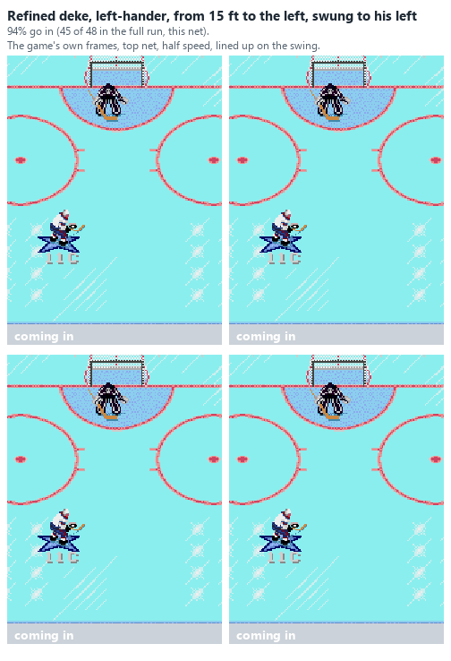
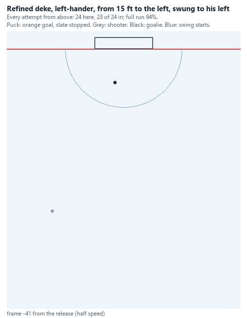

**Refined deke, right-hander, from 15 ft to his left, swing to his left: 94% (45 of 48).**

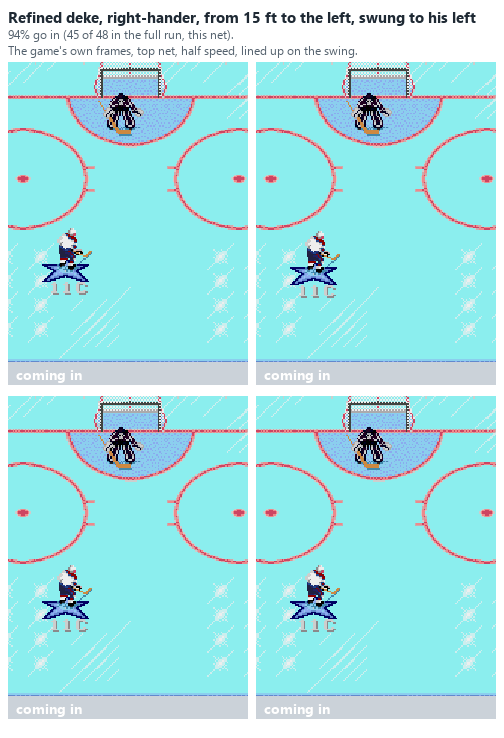
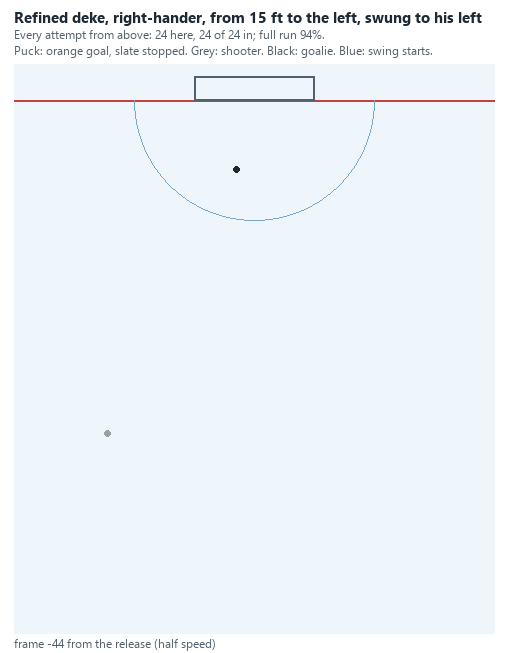

**Refined deke, right-hander, from 20 ft to his right, swing to his right: 81% (39 of 48).**

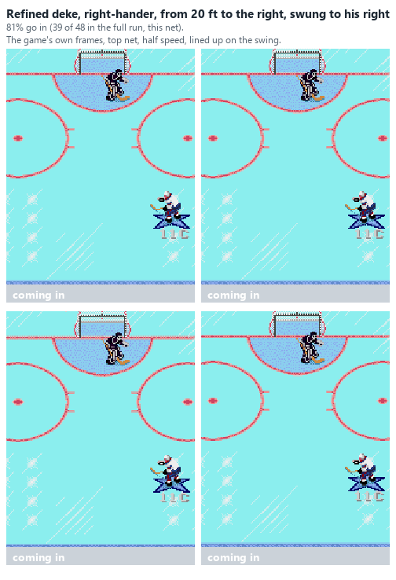
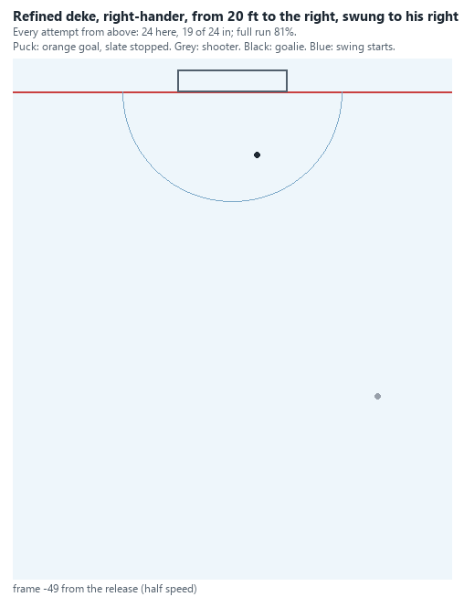

**Refined deke, left-hander, from 15 ft to his right, swing to his right, stick up and right: 83% (40 of 48).**

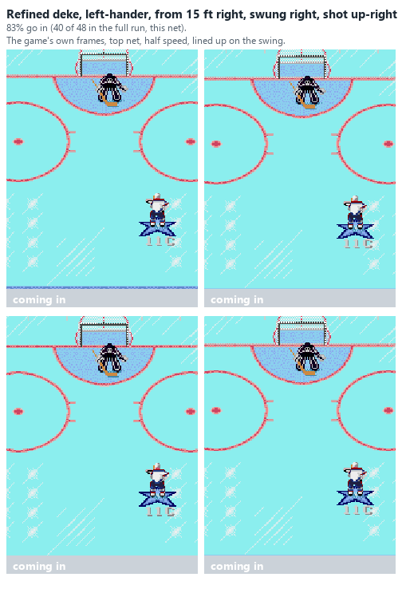
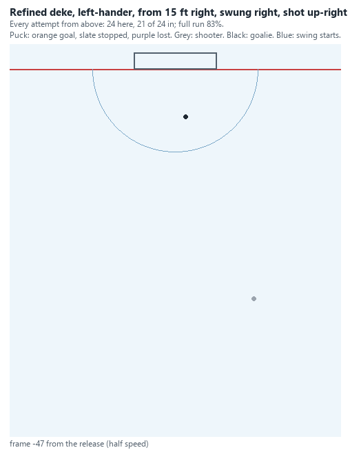

### The deke on the backhand (plan "dekebh", 2026-10-24)

The user, from the animations: the left-hander's "swing to his right" above isn't a backhand deke, because the puck never
gets far enough across. Traced: a left-hander carries the puck about 16 out on his left, a right-hander about 12 out
on his right, and the facing only starts to turn about 9 frames into the swing; 14 frames in, the right-hander's
puck was 12 across to his left, the left-hander's still 3 short of his middle. So a shot at a set time comes too
early for some moves. `deke_run.py dekebh` shoots instead **once the puck is a set distance across on the swing's
side** (4 / 8 / 12 / 16 units), with the swing begun earlier (72 / 85 / 100 / 115 from the goalie), from 15 / 30 / 45
to the side; both hands, both directions, both nets, aimed to the side, straight Up, or Up and toward the side; and
each release is checked against the game's own forehand / backhand rule (`Findhittype`: the net 45-180 degrees round
to his backhand side). Out of 96 attempts (both nets), a puck the goalie took before the shot counted as a failure:

| Move | Rate | Best set-up | Backhands (the game's rule) |
|---|---|---|---|
| Left-hander, **backhand** (swing to his right) | **96%** (top 47, bottom 45 of 48) | from 45 to his right, swing 85 from the goalie, C when the puck is 8 across | 24 of 24 |
| Right-hander, **backhand** (swing to his left) | **82%** (top 38, bottom 41 of 48; 83% aimed up and across) | from 30 to his left, swing at 72, C at 8 across | 24 of 24 |
| Left-hander, forehand (swing to his left) | 89% (top 40, bottom 45) | from 30, swing at 72, C at 8 across | 0 |
| Right-hander, forehand (swing to his right) | 88% (top 46, bottom 38) | from 45, swing at 85, C at 16 across | 0 |

- **The backhand deke works**, for both hands, going up and going down, once the shot waits for the puck to be across.
  The lopsided results of the timed tests mostly go away: all four moves score 83-96%.
- **What is left of the left-right difference:** swings to the shooter's right need to begin earlier (about 85 from
  the goalie against 72 for swings to his left), whatever his hand, because the puck takes longer to get across that
  way.
- How far across before C matters less than when the swing starts (over the grid: 9-25% at each distance against
  0-42% at each start).
- Aimed straight Up: 0-3%. Up and toward the side: a little below the side (17-30% against 21-38% over the grid).
- A first run of this plan had a bug (the facing kept at each release overwrote the move's starting facing, so every
  later moment's skater came in already turned); its results were set aside and the run repeated.

Animated (`deke_animate.py`, the ACROSS list; rates: that net's 48):

**Backhand deke, left-hander, swing to his right, going up: 98% (47 of 48).**

**Backhand deke, left-hander, swing to his right, going down: 94% (45 of 48).**

**Backhand deke, right-hander, swing to his left, going up: 79% (38 of 48).**

**Backhand deke, right-hander, swing to his left, going down: 85% (41 of 48).**

**Forehand deke shot once across, left-hander, swing to his left, going up: 83% (40 of 48).**

**Forehand deke shot once across, right-hander, swing to his right, going up: 96% (46 of 48).**

### The floater on the backhand (plan "floaterbh", 2026-10-24)

The user asked for the floater on the backhand as well as the forehand. `deke_run.py floaterbh`: skating up and across
from the backhand side (a left-hander from his right, a right-hander from his left), 35 or 50 out to the side, the puck
swung back to the backhand at 80 / 95 / 110 / 125 from the goalie, C held 3 / 6 / 9 frames, 10-30 frames after the
swing, aimed to the side or up and toward it; both hands, both nets; each release checked against the game's backhand
rule. Out of 96 attempts (both nets), a puck lost before the shot counted as a failure:

| Move | Rate | Best set-up | Backhands |
|---|---|---|---|
| Left-hander, backhand floater | **51%** (going up 22, going down 27 of 48) | from 50 to his right, swing at 110, C held 9 frames, 26 frames after the swing | 24 of 24 |
| Right-hander, backhand floater | **41%** (going up 26, going down 13 of 48) | from 50 to his left, swing at 95, C held 9 frames, 14 frames after | 24 of 24 |

- **It works, on a true backhand, but in a narrow window:** over the whole grid only 3% (left-hander) and 5%
  (right-hander) go in, against the forehand floater's 54-65% at its best. The swing has to start from far out (95-110)
  and C be held long (9 frames). The left-hander's needs a much longer wait (26 frames) than the right-hander's (14):
  the same slower crossing to the shooter's right as in the deke.
- Up and toward the side scores about the same as the side.

Animated (`deke_animate.py`, the FLOATERBH list; rates: that net's 48):

**Backhand floater, left-hander, going up: 46% (22 of 48).**

**Backhand floater, left-hander, going down: 56% (27 of 48).**

**Backhand floater, right-hander, going up: 54% (26 of 48).**

**Backhand floater, right-hander, going down: 27% (13 of 48).**

### By the shooter's skating and shot (plan "best", 2026-10-25)

The best set-up of each move and hand (`deke_run.py` plan "best": the refined dekes, the backhand deke, both
floaters; both nets, 24 moments x 4 seeds), played by nine kinds of skater: working Agility and Speed 10, 20 or 30
(`NHL94_DEKE_SKATE`; the test state's skater has 18 / 18, and the set-ups were tuned on him), crossed with Shot Power
and Accuracy 10, 20 or 30 (roster steps 2, 4, 6), against the test goalie. Goals per attempt; a puck lost before the
shot counts as a failure, a puck the skater carried into the net himself as a goal:

| Agility / Speed \ Shot | 10 | 20 | 30 |
| --- | --- | --- | --- |
| 10 (slow) | 31% | 45% | 53% |
| 20 | 64% | 71% | 76% |
| 30 (fast) | 57% | 59% | 61% |
| Test skater (18) with 20 / 20 | | 71% | |

- **Skating counts most, and the timing is tuned to the skater.** The slow skater (10) keeps the puck every time but
  scores 31-53%: the swing starts at a fixed distance from the goalie, and he gets there too slowly for it to beat
  him. Skaters of 18-20 score 64-76%. The fast skater (30) runs out of room: in a quarter of his attempts he reached
  the goalie with the puck still on his stick and no shot taken. In 78 of those 120 he carried it into the net (a
  goal), in 42 he lost it. A fast skater needs the swing started farther out.
- **The shot ratings add 15-22 points for a slow skater and 10-12 for the others** (10 to 30), mostly through the
  floaters (the slow skater's backhand floater 2-6% at 10, 28-31% at 30). The dekes hardly depend on them.
- **The carried-in goal** (animated below): on the left-hander's backhand deke at the top net the fast skater took the
  puck into the net at all 24 moments, past a goalie already down. The game gives the goal: the puck crosses the line
  on his stick.
- **Carried-in goals** (a puck the skater took into the net himself, counted as a goal; runs "dekes_c", "dekes2_c",
  "dekes3_c"): no best set-up of the first deke grid, the backhand deke or the backhand floater carried it in, so
  their rates are the shots'. Over whole grids carried-in goals add 0-2 points for the first dekes, 0-6 for the
  backhand dekes and 4-9 for the refined dekes (the left-hander's swing to his left 22% to 31%), which start closest
  to the goalie. The refined dekes' table above includes them.

**Animated (`deke_animate.py`, the SKATE list):** the left-hander's backhand deke at the top net, by a skater of 20
(96 of 96 in the run, shot in) and 30 (24 of 24 moments carried in, no shot).

**Agility / Speed 20: shot in.**

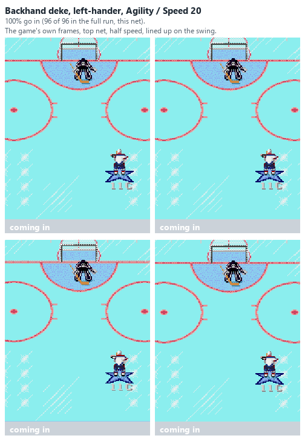
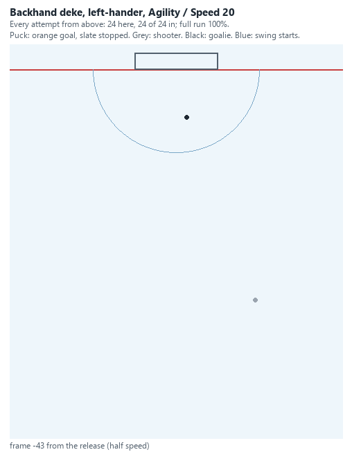

**Agility / Speed 30: carried in.**

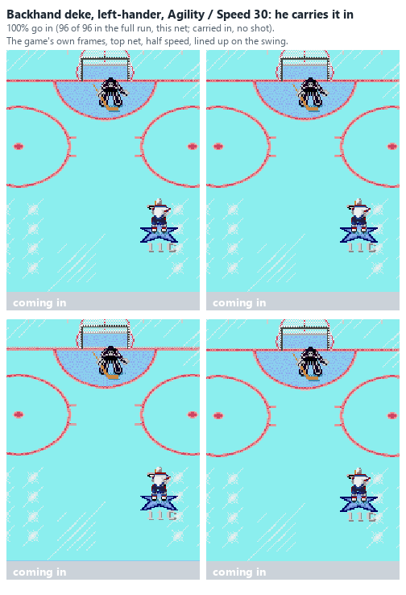
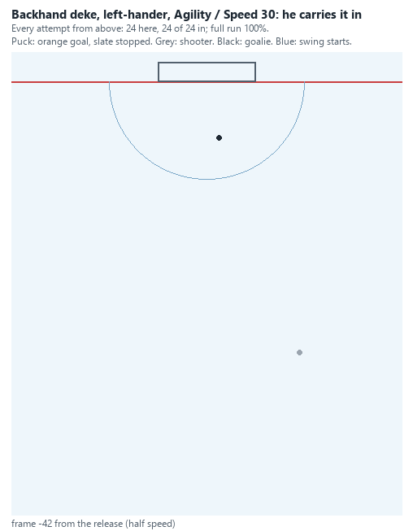

### Re-timed for slow and fast skaters (plan "retime", 2026-10-26)

The same best set-ups (`deke_run.py` plan "retime"), with the swing begun 15 nearer the goalie to 60 farther out than
tuned, and C pressed 6 frames earlier to 6 later (the backhand deke: the puck 6 less to 6 more across). It was played
by the slow (Agility / Speed 10) and the fast (30) skater, Shot Power / Accuracy 20 / 20, both nets, 12 moments x 4
seeds a timing. A puck carried in counts as a goal.

| Skater | As tuned (on the 18 / 18 skater) | One change for every move | Each move's own best timing |
| --- | --- | --- | --- |
| Agility / Speed 10 (slow) | 45% | **57%**: the swing begun 15 nearer | 70% |
| Agility / Speed 30 (fast) | 59% | **71%**: the swing begun 15 farther out, C 3 frames later | 82% |

- **A slow skater should start the swing closer; a fast one farther out.** That fits the earlier result: the slow
  skater got there too slowly for the swing to beat the goalie, and the fast one ran out of room.
- **For the slow skater, "15 nearer" was the closest timing tried**, and it was the best timing for 15 of the 20
  set-ups. Starting the swing nearer still may do better; this run doesn't show it.
- **The biggest gains are in the dekes.** The slow skater's backhand dekes went from 25-56% to 81-100%, the
  left-hander's refined deke from 50% to 98% at both nets. The fast skater's refined deke swung to the right went from
  4-48% to 92-100% (as tuned, at the top net, he lost the puck before shooting in 9 of 48). The floaters gain less (the slow skater's 8-54% to 27-75%).
- "Each move's own best" picks the best of 30 timings at 48 attempts each, so it flatters a little. The
  one-change column doesn't.

**Animated (`deke_animate.py`, the RETIME list):** 48 moments each, at the top net.

**The slow skater's backhand deke as tuned: 33% (16 of 48).**

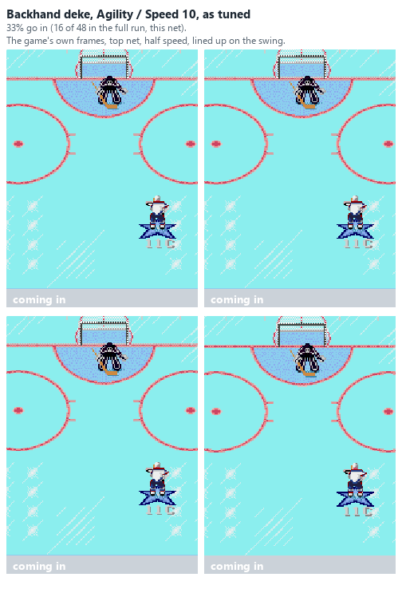
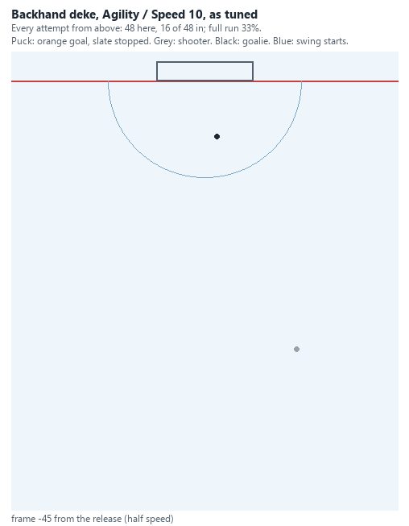

**The same with the swing begun 15 nearer and C with the puck 3 less across: 100% (48 of 48).**

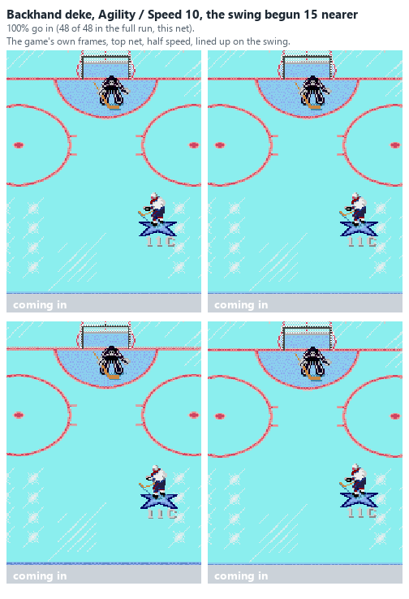
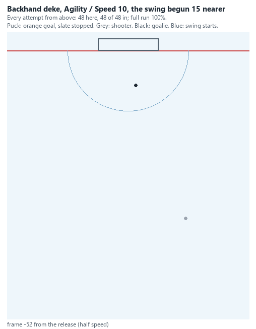

**The fast skater's floater as tuned: 77% (37 of 48).**

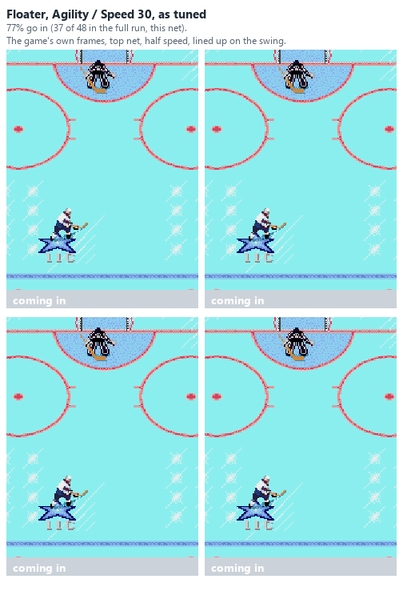
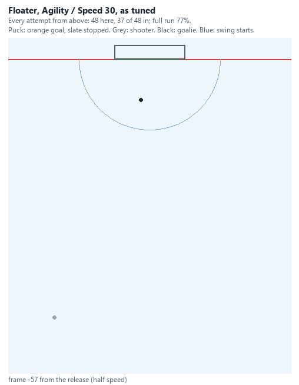

**The same with the swing begun 15 farther out and C 6 later: 90% (43 of 48).**

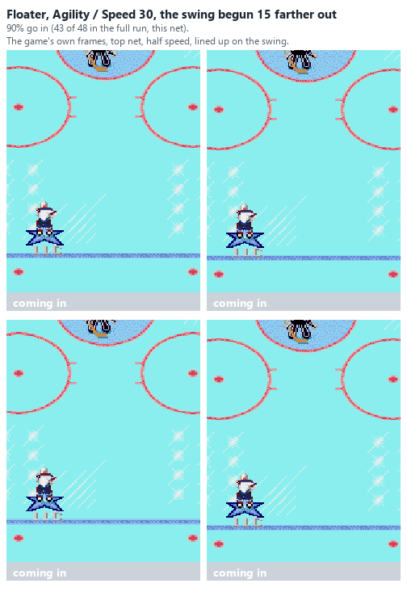
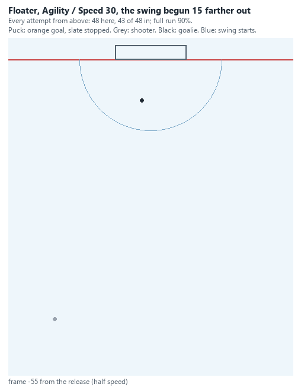
