# Scoring maps: Genesis EA Specials

*The scoring maps: [overview and method](SCORING_MAP.md) · [Genesis shots and goalies](SCORING_GENESIS.md) · [Genesis dekes and floaters](SCORING_GENESIS_DEKES.md) · [Genesis EA Specials](SCORING_GENESIS_EA.md) · [SNES](SCORING_SNES.md)*

EA Specials played in the real Genesis game with a bot following up, and the ones in the recorded games (the method: [SCORING_MAP](SCORING_MAP.md)).

## Contents

- [EA Specials (Genesis, 2026-10-24)](#ea-specials-genesis-2026-10-24)
   - [From the faceoff dots, skating at the goal (plan "dots", 2026-10-25)](#from-the-faceoff-dots-skating-at-the-goal-plan-dots-2026-10-25)
   - [Across, at 45 degrees or at the goal, against real goalies (plan "angle", 2026-10-25)](#across-at-45-degrees-or-at-the-goal-against-real-goalies-plan-angle-2026-10-25)
   - [Released from the marked spots (plan "xspot", 2026-10-25)](#released-from-the-marked-spots-plan-xspot-2026-10-25)
   - [The best depth at each net (plan "depth", 2026-10-25)](#the-best-depth-at-each-net-plan-depth-2026-10-25)
   - [The best set-up at each net (plan "refine", 2026-10-26)](#the-best-set-up-at-each-net-plan-refine-2026-10-26)
   - [Skating speed and a person's slop (plans "slop", "slopfull", "refine" at 1.7, "lefttop", 2026-10-26)](#skating-speed-and-a-persons-slop-plans-slop-slopfull-refine-at-17-lefttop-2026-10-26)
   - [Why it works: what the goalie does (the user's 2v2 games, 2026-10-27)](#why-it-works-what-the-goalie-does-the-users-2v2-games-2026-10-27)
   - [The whole zone, and the user's set-ups, in the simulation (plans "wide" and "real2v2", 2026-10-27)](#the-whole-zone-and-the-users-set-ups-in-the-simulation-plans-wide-and-real2v2-2026-10-27)
   - [EA Specials in the recorded games (`analysis/ea_real.py`, 2026-10-26)](#ea-specials-in-the-recorded-games-analysisea_realpy-2026-10-26)

## EA Specials (Genesis, 2026-10-24)

The user's play: a wrist shot meant to be bobbled, the save pushing the goalie back. The skater skates on, claims the
loose puck and at once shoots inside the near post, open because the goalie was pushed back (and may have dived at the
loose puck). The user's view: the best shooters are bad at it, because their harder shots are held more; middling
shooters' shots are bobbled more. `ea_run.py`: one left-handed shooter at each of 9 spots (40 / 70 / 100 to his
right, 60 / 90 / 120 out: his off-wing, the stick toward the middle; `ea_run.py` calls it his forehand side), standing or skating in at 1.5 a frame, every Shot Power and Shot Accuracy from roster step 2 to 6
(working 10-30), all nine aims, 8 moments x 2 seeds, both nets: 129,600 first shots. After the shot a simple bot plays
the rest: skate on; once the goalie has touched the puck and it is loose, chase it; on claiming it, tap C aimed at the
near post.

**How the play is really taken (the user, 2026-10-25):** a left-hander from the right side (this study's side), a
right-hander from the left, now and then a backhand flip from the other side. The shooter always faces straight
across the rink or diagonally toward the goalie as he wrists the puck, never straight up the ice (he would have to
turn sharply to claim the rebound). So the standing and straight-up-the-ice shooters of the first two runs below
aren't the real play; the faceoff-dot run (skating at the goal) is, plan "angle" (below) plays it skating
straight across, at 45 degrees and at the goal, against the test goalie and the goalie profiles, and plan "xspot"
releases the shot at the spots the user marked.

- **The first shot to bobble is aimed across, at the far side from the shooter:** 60-77% of those are touched and
  left loose, against 14-28% aimed down along the ice (held 70-85%).
- **Shot Power (far-side first shots, every spot):** held 20% / 19% / 21% / 21% / 27% from steps 2 to 6, bobbled 63% /
  69% / 72% / 72% / 66%. Weak shots (2-3) miss the net more (11-16%, against 6% at 5-6). So the hardest shooter's
  shots are held more and bobbled less, as the user said, but only at the top: steps 3-5 are much the same.
- **The goalie's dive at the loose puck falls steadily with Shot Power:** after a bobble he dives 43% / 35% / 25% /
  18% / 17% of the time (steps 2-6). Close in (40 to the side) it is 55% at step 2 and 21% at step 6.
- **The whole play, close in (40 to the side), where it works best:** a goal from the bobble 10% / 11% / 9% / 8% / 4%
  of first shots (steps 2-6), with 89-95% of bobbles claimed. The strongest shooter scores about half as often, held
  35% against 16%. From 100 to the side the shooter seldom gets to the puck first (14-41% claimed) and it hardly works
  (0-1%). Over all spots, steps 2 to 6: 5 / 6 / 5 / 4 / 4%.
- **Shot Accuracy hardly matters here:** held 49-57%, bobbled 41-42% over all aims; only misses fall (8% to 2%).
- **Pushed back:** measured as the goalie's movement toward his goal line within 20 frames of the save, only 0.3-0.8
  units after far-side shots (up to 3 after shots he holds). So in these runs the save doesn't move the goalie; the
  opening comes from the dive and from where the loose puck goes.
- **Limits:** the bot is no person. In this first run it took about 44 frames to claim the puck, and half the bobbles end with nothing
  (the puck not reached, or the follow-up still loose), so the scoring rates here are a floor. The comparisons between
  ratings are fair: every shooter had the same bot. The game's hold rule (the goalie holds a puck whose speed parts
  are under a random threshold set by Puck Control) predicts faster shots held less. Over all aims that is what
  happens (the firm-up below: held 46% / 51% / 58% / 58% / 40% at steps 2-6), but the far-side shots at step 6 are
  held more (35% against 16-24%); that is still to be traced.
- **Firmed up (plan "firm", 2026-10-25):** the 40-to-the-side spots again over 48 moments (6 times as many),
  Shot Accuracy 2 / 4 / 6, 155,520 first shots. The far-side first shots end in a goal 8% / 12% / 8% / 7% / 4% of the
  time at Shot Power 2-6, against the first run's 10% / 11% / 9% / 8% / 4%: the result holds. Steps 2-5 are much the
  same and step 6 scores about half as often. By distance, 40 ft out (120) is where it works: 12% / 20% / 18% / 18%
  / 9%; at 30 ft 2-14%, falling with power; at 20 ft (60) about 1%. Skating in at 1.5 a frame scores 3-4% of all
  first shots at steps 2-5, standing 1-3%. Shot Accuracy again changes little (2-3%).

**Animated** (`ea_animate.py`): the spot where Shot Power makes the most difference. A left-hander standing 30 ft out
and 13 ft to his right at the top net, the first wrist shot aimed across (Left), with ea_run's own bot playing
on and Shot Accuracy 2-6 in turn. Measured over 120 game moments, the play ends in a goal **22% of the time at Shot
Power 2 (26 of 120) and 2% at Power 6 (2 of 120)**. At Power 2 every first shot was bobbled and the goalie dived in 79%
of plays. At Power 6, 20% were held at once and he dived in 32%. The EA run had given 39% and 0% at this set-up, but
its 80 plays share 8 moments, so a single set-up's rate there moves a lot from moment to moment. Its averages over many
spots are steadier. The paths view colours the goalie red while he dives.

**EA Special, Shot Power 2: 22% (26 of 120).**

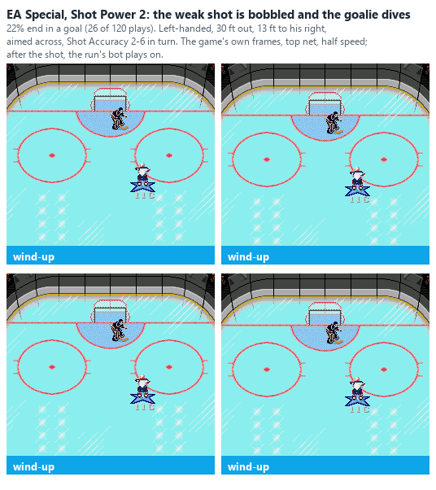
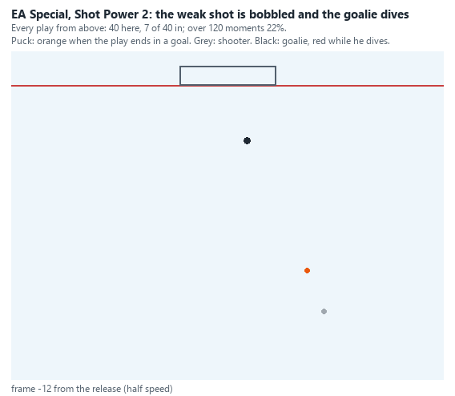

**EA Special, Shot Power 6: 2% (2 of 120).**

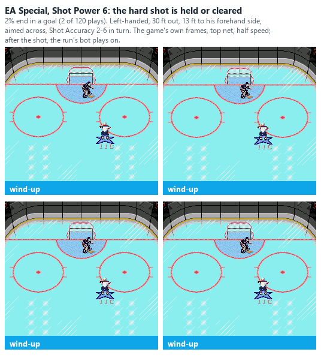
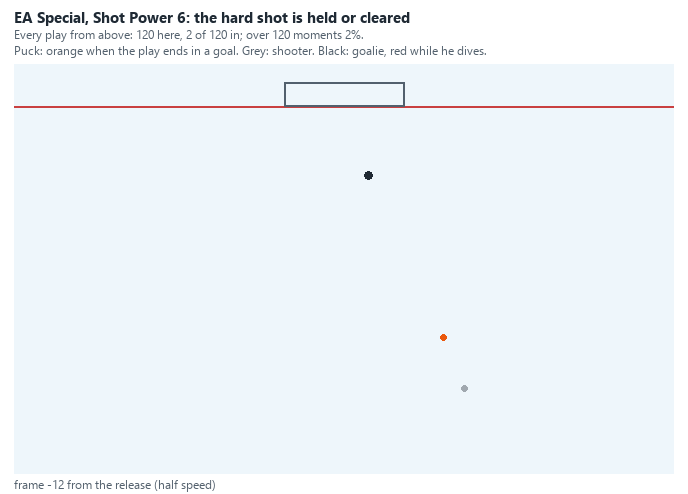

### From the faceoff dots, skating at the goal (plan "dots", 2026-10-25)

The user: more EA Specials come from farther to the side, on or near the end-zone faceoff dot, with the skater
skating toward the goal as he shoots. The dot is about 70 to the side and 60 out (23 ft and 20 ft). `ea_run.py` plan
"dots": spots 55 / 70 / 85 to the side (18 / 23 / 28 ft) and 45 / 60 / 75 out (15 / 20 / 25 ft), on his right as
before, skating straight at the middle of the goal line at 1.5 or 2.5 a frame (and still skating at it after the
shot), Shot Power 2-6, Shot Accuracy 2 / 4 / 6, all nine aims, 24 moments x 2 seeds, both nets: 233,280 first shots.
The same bot plays on.

- **Over the dots the play ends in a goal 1-3% of the time** (Shot Power 2 to 6: 2 / 2 / 1 / 1 / 1%), about what the
  first run found 70 to the side (2-4%), less than its best close-in skating spot (40 to the side, 120 out, skating:
  8%).
- **Farther to the side and faster is better here.** 85 to the side (28 ft): 3-4% skating at 2.5, 1-2% at 1.5; 55
  to the side: 0-2%. At 2.5 a frame the shooter claims fewer bobbles (63% against 87%) but more of his follow-ups go in
  (4% of bobbles against 2%): he arrives sooner, while the goalie is still down.
- **The first shot to bobble is aimed across again** (top net Up-Left / Left, bottom net Down-Right / Right): 70-79%
  bobbled, the goalie diving after 29-43% of those. Aimed at the near side or down the ice, 66-79% are held.
- **Shot Power 6 behaves differently from here:** held 41% against 55-58% at steps 2-5 and bobbled 55%, but his
  bobbles are claimed less (65% against 76-79%) and the goalie dives less (14% against 19-22%), so it still scores the
  least. Shot Accuracy changes nothing (2% at every step).
- **The best single set-ups** (all at Power 2-3, skating at 2.5): bottom net, 85 to the side, 45 out, no direction held,
  55 of 144 (38%); top net, 85 to the side, 75 out, Up-Left, 46 of 144 (32%). These rest on 24 moments, so like the
  first run's single set-ups they wander (below: 29% over 120 moments).

**Animated** (`ea_animate.py`, the dots cases): the best top-net set-up, 28 ft to his right and 25 ft out,
skating at the goal at 2.5 a frame, the first wrist shot Up-Left, Shot Accuracy 2-6 in turn. Measured over 120 game
moments: **29% at Shot Power 2 (35 of 120), 4% at Power 6 (5 of 120)**.

**From beside the faceoff dot, Shot Power 2: 29% (35 of 120).**

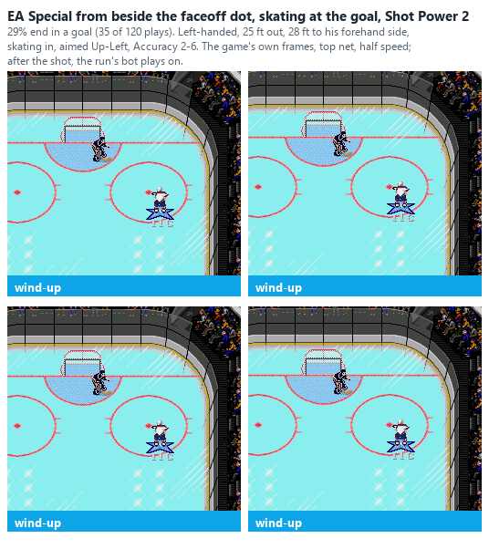
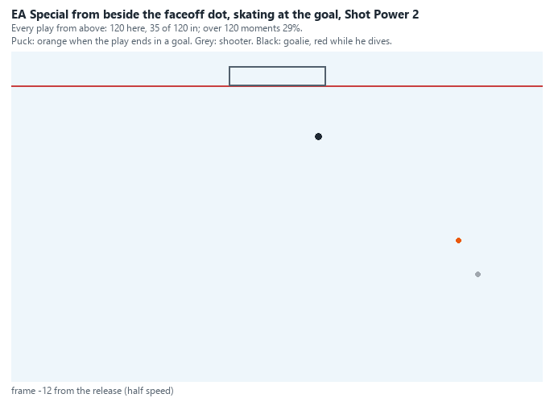

**From beside the faceoff dot, Shot Power 6: 4% (5 of 120).**

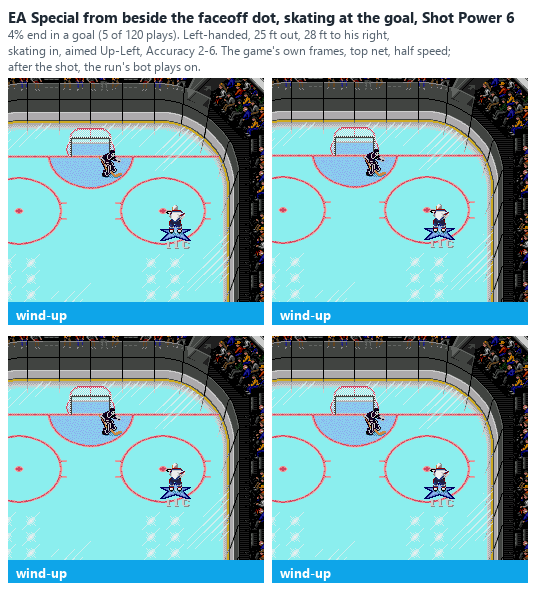
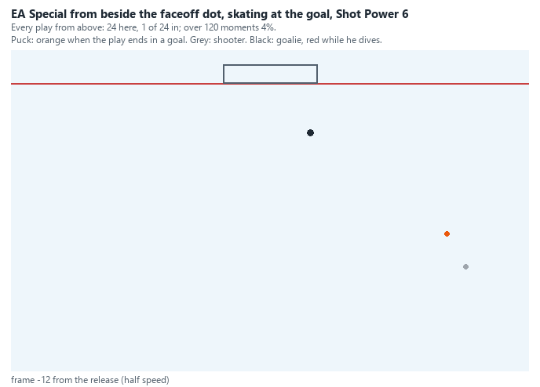

### Across, at 45 degrees or at the goal, against real goalies (plan "angle", 2026-10-25)

The user: the shooter faces straight across the rink or diagonally toward the goalie as he shoots, never straight up
the ice. `ea_run.py` plan "angle": the dots run's 9 spots (18 / 23 / 28 ft to his right, 15 / 20 / 25 ft out), a
left-hander skating at 2.5 a frame straight across toward the middle, at 45 degrees (across and toward the goal
line) or straight at the middle of the goal line, Shot Power 2 / 4 / 6, Shot Accuracy 4, all nine aims, 24 moments x
2 seeds, both nets: 7,776 first shots per goalie. Four goalies: the test goalie (Hrudey) and the profiles of
[the goalie section](SCORING_GENESIS.md#real-goalie-profiles-every-shot-against-retail-cdl-roy-and-belfour) (a retail starter, the CDL edit, Roy: the save state's LA goalie given that goalie's working ratings, so the GIFs still show the LA goalie). The same bot plays on (after the
shot it skates at the middle of the goal line, and at the loose puck once the goalie has touched it).

| Goalie | Straight across | At 45 degrees | At the goal | Goalie dives after a bobble |
| --- | --- | --- | --- | --- |
| Test goalie (Hrudey) | 0.1% (best aim 1.3%) | 1.8% (best aim 3.8%) | 2.0% (best aim 4.4%) | 17-21% |
| Retail starter | 0.1% (1.1%) | 1.5% (3.4%) | 1.5% (3.4%) | 11-13% |
| CDL | 0.1% (1.2%) | 1.2% (2.5%) | 1.6% (3.4%) | 11% |
| Roy | 0.1% (1.3%) | 1.1% (2.9%) | 1.4% (3.5%) | 7-8% |

(Goals off the rebound, over all nine aims; in brackets the best aim's whole-play rate, the two nets averaged.)

- **Straight across hardly ever works for the bot.** The first shot is bobbled as often (38-46%), but the shooter
  reaches only 7-10% of the bobbles, against 58-69% at 45 degrees or at the goal: moving sideways at full speed he
  carries on past the loose puck. Its few goals (best aim about 1%) are first shots straight in, not rebounds. A
  person who turns at once may do better than this bot, which steers at the puck from the moment it is loose but
  can't shed its sideways speed in time; the animation below shows it.
- **45 degrees and straight at the goal are about the same** (best aim 2.5-4.4%), and both are best from the widest,
  farthest spot (28 ft to the side, 25 ft out: 5-13% at the best aim, every goalie).
- **Better goalies take less off this play than off slapshots.** From Hrudey to Roy the best aim at the goal falls
  from 4.4% to 3.5% (the slapshot's best: 19% to 3%). What changes is the dive: a good goalie dives at the loose puck less than
  half as often (17-21% against 7-8%). So the weak first shot loses its edge: against Hrudey Shot Power 2 is best (8.0%
  at the best aim, at the goal, against 3.5% at Power 4), against Roy Power 4 (4.6%, against 3.6% at 2).

**Animated** (`ea_animate.py`, the angle cases): the same spot, 23 ft to his right and 25 ft out, aimed Up-Left at
the top net, Shot Power 2, Accuracy 4, against the test goalie: skating straight across against skating in at 45
degrees.

**Skating straight across: 0 of 120.** The paths view shows why: carrying his sideways speed, the shooter loops
away past the goalie and comes back too late for the loose puck.

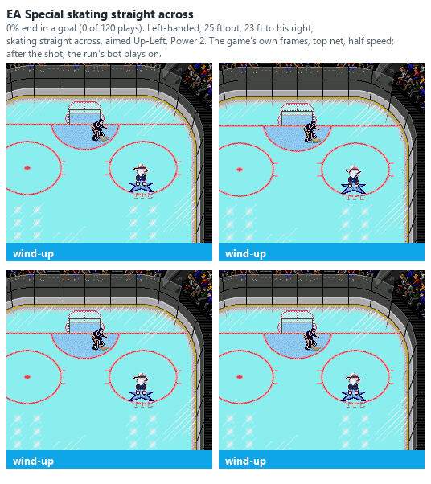
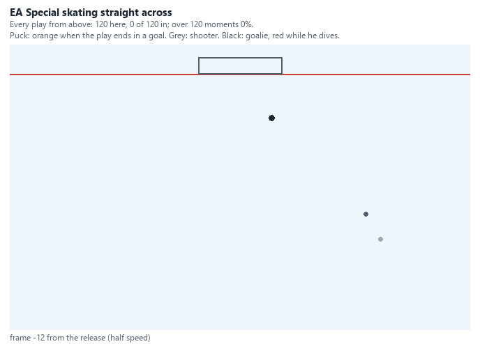

**Skating in at 45 degrees: 17 of 120 (14%).**

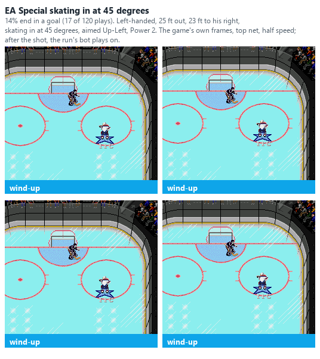
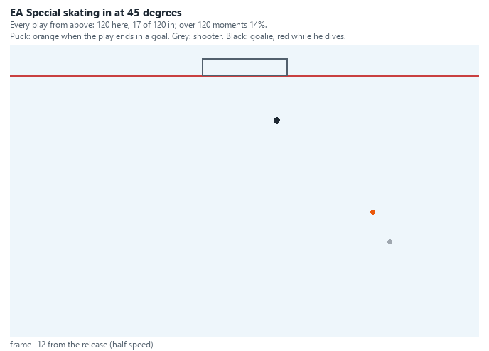

### Released from the marked spots (plan "xspot", 2026-10-25)

The user: the runs above released the shot too late. In two marked screenshots the release is level with the
end-zone faceoff dot across the ice and a little deeper (the dot is 70 to the side and 62 out; the marks about 70 to
the side and 40-44 out, 23 ft and 14 ft). `ea_run.py` plan "xspot" places the release itself there: the skater starts
4 frames of skating back along his line, since a wrist shot leaves the stick 4 frames after C. The release lands
within a unit or two of the target. Spots 65 / 70 / 75 to the side (22 / 23 / 25 ft) and 38 / 42 / 46 out (13-15 ft),
on both sides, each the way the user takes it (a left-hander from his right, a right-hander from his left: the
off-wing, the stick toward the middle). He skates
at the middle of the goal line at 1.5 or 2.5 a frame or in at 45 degrees. Shot Power 2 / 4 / 6, Shot Accuracy 4,
all nine aims, 24 moments x 2 seeds, both nets: 139,968 first shots each against the test goalie (Hrudey) and Roy. The
same bot plays on.

- **On average this is no better than the later release.** Over every aim and set-up the play ends in a goal 1.6% of
  the time against Hrudey and 1.1% against Roy. At each set-up's best aim it is 3-4% (Roy 3%), as in the angle run.
- **One set-up is far better than the rest, and Roy stops little more of it: bottom net, a right-hander from his
  left.** He releases 25 ft to his left, skating at the goal at 2.5 a frame, Shot Power 2, no direction held. It
  scored 62 of 144 against Hrudey (43%) and 55 of 144 against Roy (38%). By depth (13 / 14 / 15 ft out) it was
  31 / 50 / 48% against Hrudey and 46 / 54 / 15% against Roy. The first shot is bobbled 83-94% of the time and the
  shooter reaches nearly every bobble at once (95-96%). The goalie hardly goes back or dives (3-4 dives in 144), so
  the goal is the quick follow-up, not a dive. That is why Roy, who dives less, gives up nearly as much here.
- **The same play elsewhere is much weaker.** At the top net it scored 7% against Hrudey and 3% against Roy. The
  shot is bobbled and claimed just as often, but 72-84% of the follow-ups are held. A left-hander from his right
  at the bottom net scored 18% against both goalies. The top and bottom nets differ, as they do for slapshots.
- **What helps over every set-up:** skating at the goal at 2.5 a frame (best aim 5.5% against Hrudey, 3.4% against
  Roy), against 1.5 a frame (1.9%, 2.5%) or 45 degrees (3.8%, 3.2%). Also the widest spot: 25 ft to the side 5.1%,
  22 ft 2.0% (Roy 4.2%, 1.8%). Also Shot Power 2: Hrudey 4.7% against 2.4% at 6, Roy 4.0% against 2.3%. And the
  right-hander from his left: 4.5% against 2.9% (Roy 3.8%, 2.2%). Depth matters less (13 ft out 2.8%, 15 ft 4.5%).

**Animated** (`ea_animate.py`, the xspot cases): the standout set-up, 120 game moments each. The bottom net's plays
are turned round in the paths view so the net is at the top.

**Bottom net, against the test goalie: 55% (66 of 120).** The bobble drops at the shooter's stick, and he shoots again
before the goalie has moved.

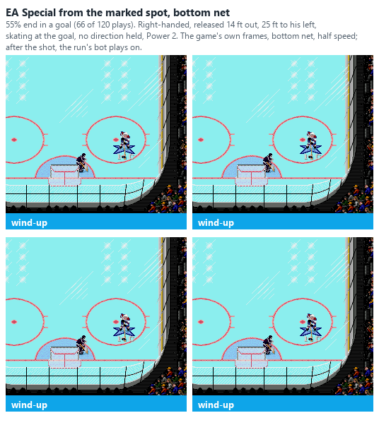
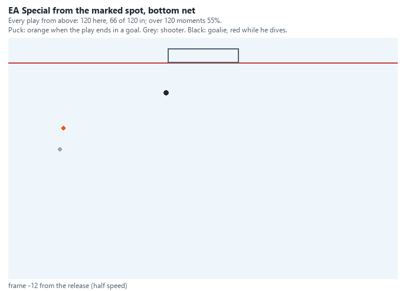

**Bottom net, against Roy: 43% (52 of 120).**

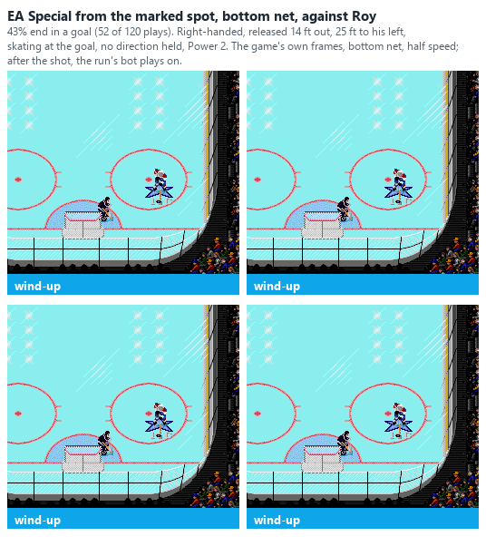
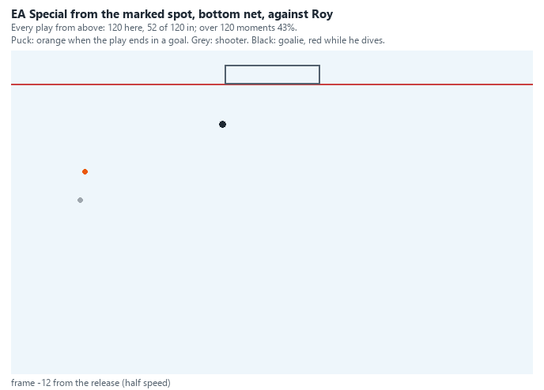

**The same play at the top net: 18% (22 of 120).** The run's 24 moments gave 7%: a single set-up's rate wanders
there. Over 120 moments the bottom net is still about three times better.

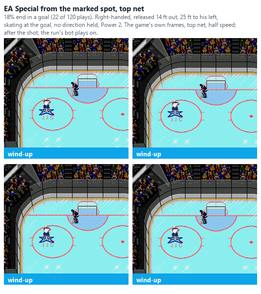
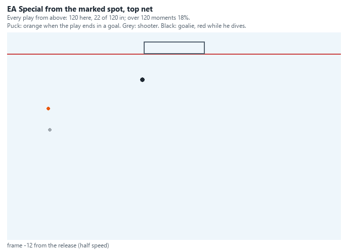

### The best depth at each net (plan "depth", 2026-10-25)

The user: find the best EA Special at both nets, the Up (top) and the Down (bottom) one. Is the best depth different?
`ea_run.py` plan "depth" releases the shot 40 / 52 / 64 / 76 / 88 out (13-29 ft), 65 / 75 / 85 to either side (22-28
ft), skating at the goal or in at 45 degrees at 2.5 a frame, Shot Power 2 / 4, Shot Accuracy 4, all nine aims, 48
moments x 2 seeds: 207,360 first shots against each of Hrudey (the test goalie) and Roy. The bot plays on, so a goal
is the first shot or the follow-up.

**Both nets peak at the same depth: about 21-25 ft out.** Over every aim and set-up, the play ended in a goal:

| Released (out) | 13 ft | 17 ft | 21 ft | 25 ft | 29 ft |
| --- | --- | --- | --- | --- | --- |
| Top net, Hrudey | 1.6% | 2.5% | 3.3% | **4.4%** | 3.0% |
| Bottom net, Hrudey | 1.9% | 2.9% | 5.6% | **5.8%** | 5.4% |
| Top net, Roy | 1.0% | 1.6% | 2.1% | **2.9%** | 1.7% |
| Bottom net, Roy | 1.4% | 2.2% | **5.1%** | 4.3% | 3.0% |

- **The bottom net is better at every depth**, by about 1.2-2.4 times. So it isn't a different depth the top net
  needs: it is simply harder.
- **At the top net, the right-hander from his left** (3.7% against 2.2%; Roy 2.5% against 1.2%). At the bottom net
  the hands are close (left-hander 4.6% against 4.0%; Roy 3.5% against 2.9%).
- **Shot Power 2** beats 4 against Hrudey (top 3.6% against 2.4%, bottom 5.0% against 3.6%); against Roy they are
  even.
- **The best single spots** (the best aim for each hand): at the top net a right-hander 21-25 ft out and 22-25 ft to
  his left, 12-21% against Hrudey and 8-18% against Roy; at the bottom net 25 ft out and 25 ft to the side, either
  hand, 13-24% against both goalies.
- **The close spot from "xspot" holds up, at the bottom net only:** a right-hander 13 ft out and 25 ft to his left,
  skating at the goal, Shot Power 2, no direction held: 50% against Hrudey and 45% against Roy over these 48 moments.
  At the top net the same play gave 22% and 16%, as the xspot GIF's 18%.

So there are two kinds of EA Special. The bottom net has a narrow close spot that scores about half the time (the
top net under half that). Both nets also have a broad spot about 25 ft out, the top net's best a little below the
bottom's. The plan "refine" run looks closer around both (next).

### The best set-up at each net (plan "refine", 2026-10-26)

**Note (2026-10-26):** this search and every EA run before it had the skater at 2.5 a frame, which no skater reaches.
At a real skater's speed these set-ups mostly fail; see "Skating speed and a person's slop" below.

`ea_run.py` plan "refine" looks around the depth sweep's best. The release is 60 / 68 / 76 / 84 out (20-28 ft) and 58 / 65 /
72 / 80 to the side (19-27 ft): at the top net only to his left (the right-hander, the better side there), at the bottom
net to either side. He skates at the goal or in at 45 degrees at 2.5 a frame. Shot Power is 2 / 3 / 4, Shot Accuracy 4,
all nine aims. The bottom net's close spot is in too (34-46 out, 70-80 to his left, Shot Power 2 / 3, skating at the
goal). 48 moments x 2 seeds against each of Hrudey and Roy, 306 set-ups each.

**A single set-up's best against one goalie doesn't hold against the other.** Hrudey's two best were a left-hander at
the bottom net from 28 ft out and 19 ft to his right, holding Up-Right: 73%; and a right-hander at the top net from the
same spot on his left: 60%. Roy held them to 32% and 16-18%. So the picks below are by the worse of the two goalies.
Then they were played again over 120 new moments for the GIFs.

| Net | Set-up (a right-hander, from his left, skating in at 45 degrees, Shot Power 3) | Hrudey (run / 120 moments) | Roy (run / 120 moments) |
| --- | --- | --- | --- |
| Top | released 23 ft out, 24 ft to the side, Up held (straight at the goal) | 33% / **24%** | 23% / **20%** |
| Bottom | released 25 ft out, 27 ft to the side, Down-Left held (at the goal and across, to the far side) | 46% / **42%** | 52% / **54%** |
| Bottom, close (xspot) | released 14 ft out, 25 ft to the side, skating at the goal, Shot Power 2, nothing held | 50% / 55% | 45% / 43% |

- **The bottom net is about twice the top net** for the best set-ups, as for every depth in the sweep. Its broad spot
  (25 ft out, near the faceoff dot) is now as good as the close spot, and it is a much wider target.
  Around it, 68-76 out and 65-80 to the side, holding Down and toward the far side (Down-Left for the right-hander,
  Down-Right for the left-hander) gave 13-30% against Roy.
- **The top net's best is about 1 in 5** against either goalie, the same spot and aim against both. Around it, 68-76
  out and 72-80 to the side, Up held: 16-22% against Hrudey and 10-13% against Roy (Roy does a little better against
  Down-Right held there, 14-15%, which does little against Hrudey).
- **Shot Power:** against Hrudey the weakest shot is best (2 over 4 by about one and a half to nearly two times); against Roy,
  2, 3 and 4 are even. Shot Power 3 is the safe middle.
- **Every goal here is the follow-up.** The first shot almost never goes in; it is the bobble and the shot after it.

**Animated** (`ea_animate.py`, the refine cases): 120 game moments each. The bottom net's plays are turned round in
the paths view so the net is at the top.

**Top net, against the test goalie: 24% (29 of 120).**

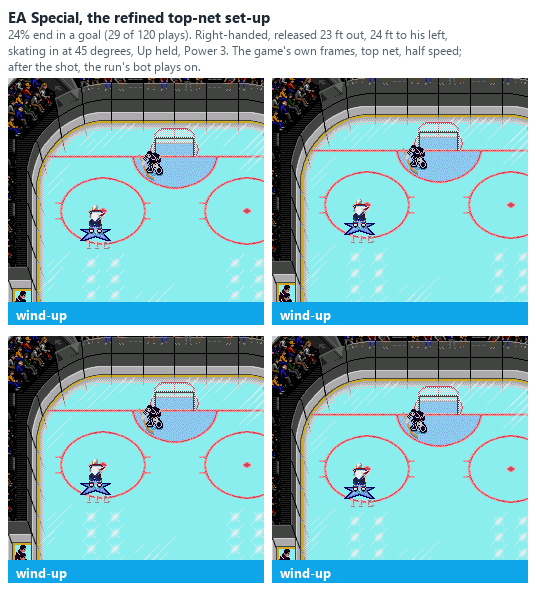
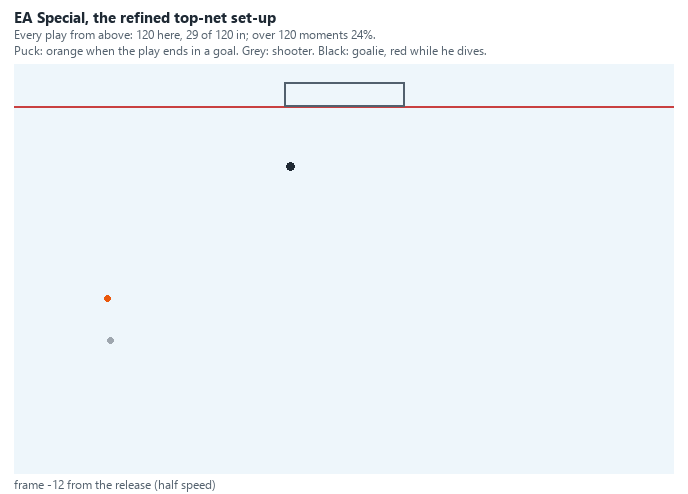

**Top net, against Roy: 20% (24 of 120).**

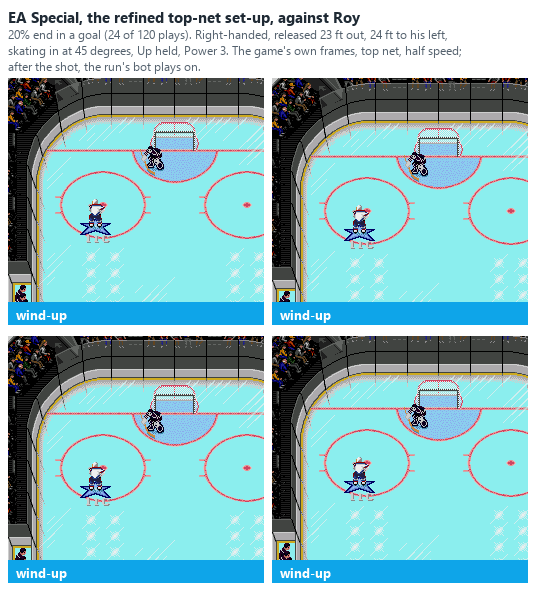
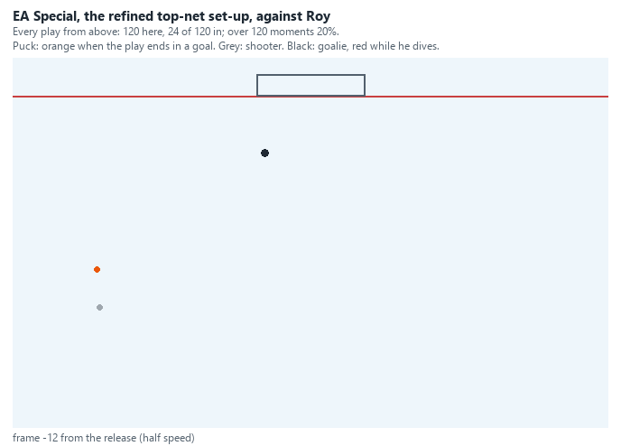

**Bottom net, against the test goalie: 42% (50 of 120).**

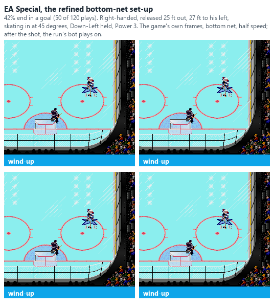
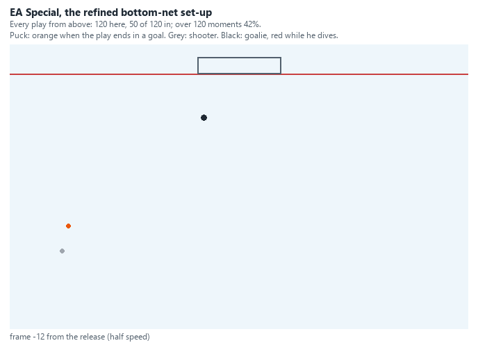

**Bottom net, against Roy: 54% (65 of 120).**

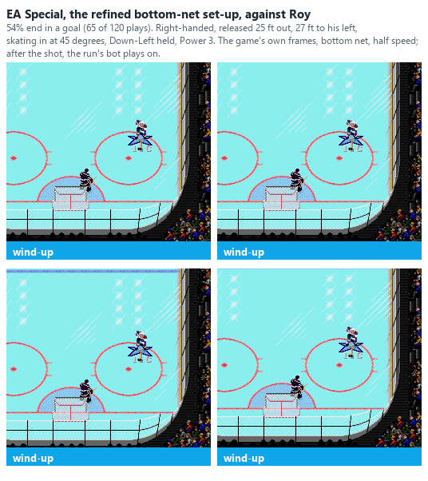
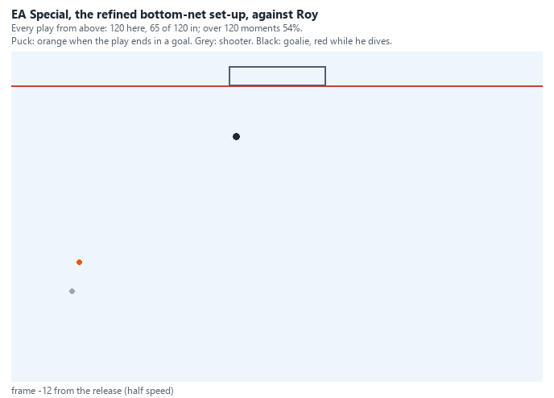

### Skating speed and a person's slop (plans "slop", "slopfull", "refine" at 1.7, "lefttop", 2026-10-26)

**Every EA run above had the skater at 2.5 a frame. No skater gets there.** The test skater (working Agility / Speed
18) tops out at 2.0 holding the d-pad; a 10 / 10 skater at 1.75, 20 / 20 at 2.05, 30 / 30 at 2.35 (measured). And
people don't take an EA Special at full speed: the user skates a little below it, tapping the d-pad rather than
holding it, to be placed for the rebound rather than charging at the net. So the set-ups above are the best for a
speed nobody plays at. This section is about what happens at real speeds: at 1.7 a frame the bottom net's EA Special
still goes in about 40% of the time against both goalies, from a wide, forgiving spot 20-21 ft out (below).

**How forgiving the 2.5 set-ups are (plan "slop").** A person can't release at the exact spot and frame. Each moment
draws its own errors (uniform, either way) in the release spot, the skating speed and angle and the release frame:
small (1 ft, 0.2 a frame, 5 degrees, 1 frame), medium (3 ft, 0.5, 10 degrees, 2 frames), large (5 ft, 1.0, 20
degrees, 3 frames). Nine of the best set-ups, each with its best aim, 120 moments, Hrudey / Roy:

| Set-up (a right-hander from his left; out and side in ft) | exact | small | medium | large |
| --- | --- | --- | --- | --- |
| Top: 23 out, 24 side, in at 45°, Power 3, Up | 34 / 20 | 16 / 10 | 11 / 8 | 4 / 2 |
| Top: 25 out, 27 side, in at 45°, Power 4, Up | 15 / 19 | 9 / 7 | 5 / 5 | 3 / 1 |
| Top: 23 out, 27 side, at the goal, Power 4, Down-Right | 12 / 26 | 15 / 24 | 8 / 13 | 1 / 2 |
| Top: 25 out, 24 side, in at 45°, Power 3, Up | 22 / 17 | 16 / 8 | 8 / 5 | 6 / 3 |
| Bottom: 25 out, 27 side, in at 45°, Power 3, Down-Left | 50 / 52 | 15 / 16 | 16 / 20 | 9 / 6 |
| Bottom: 25 out, 27 side, in at 45°, Power 4, Down-Left | 63 / 58 | 23 / 29 | 15 / 18 | 7 / 7 |
| Bottom: 28 out, 19 side, in at 45°, Power 2, Up-Left | 69 / 49 | 55 / 18 | 37 / 16 | 14 / 5 |
| Bottom: 13 out, 25 side, at the goal, Power 2, nothing held | 52 / 48 | 30 / 18 | 3 / 5 | 2 / 1 |
| Bottom: 11 out, 27 side, at the goal, Power 2, nothing held | 38 / 56 | 20 / 14 | 5 / 3 | 3 / 2 |

- **They are knife-edges.** Even the small errors (a foot, a frame) halve most of them, and the close spot is gone at
  medium. A person playing the 2.5 set-ups would get about 15-20% at the bottom net and 10-15% at the top.

**The bottom net's 2.5 set-up with the small errors, against the test goalie: 24% (29 of 120 in the GIF's own plays;
15% in the table's run, which drew other errors).** Each play is off by up to a foot, 0.2 a frame, 5 degrees and a
frame, so the release spots spread.

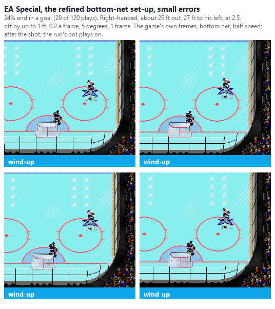
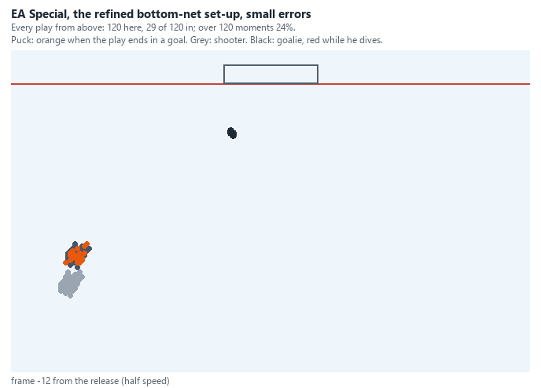

**At the test skater's real top speed (plan "slopfull": the same, at 2.0 a frame).** The timing tuned for 2.5 doesn't
carry over: exact, Hrudey / Roy, the bottom net's best (25 out, Power 3, Down-Left) falls from 50 / 52% to 2 / 1%, the
close spot from 52 / 48% to 10 / 15%, the top net's best from 34 / 20% to 31 / 6%. This shows the set-ups are tuned to
the speed, not that the EA Special fails at real speed; so the search was run again at a real one.

**The bottom net's 2.5 set-up at 2.0 a frame: 2.5% (3 of 120).** Same release spot, aim and Shot Power; only the
skating speed differs.

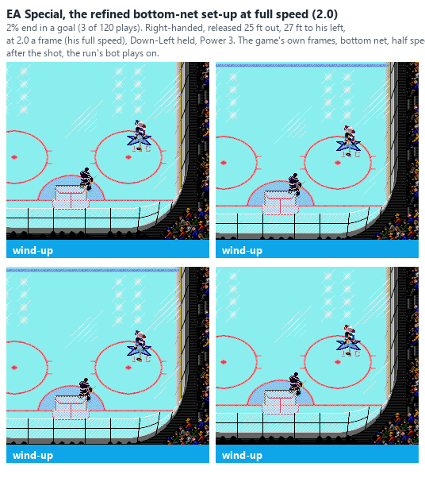
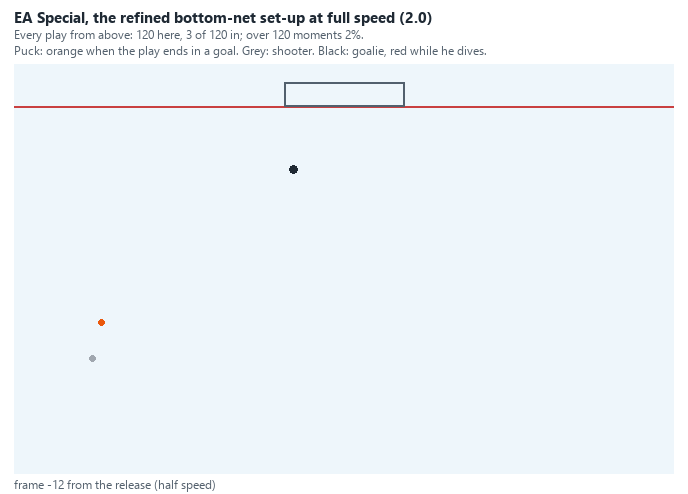

**The search again at 1.7 a frame (plan "refine", NHL94_EA_SPEED=1.7):** the same grid (306 set-ups, 48 moments x 2
seeds against each goalie), a little below the test skater's full speed, as the user plays it. By the worse of the two
goalies:

| Net | Best set-up at 1.7 (in at 45°) | Hrudey | Roy |
| --- | --- | --- | --- |
| Bottom | a right-hander from his left, released 20 ft out, 27 ft to the side, Power 4, Down-Right (toward his own side: the near side) | 40% | 40% |
| Bottom | a left-hander from his right, the same spot mirrored, Power 4, Down-Left (the near side) | 32% | 31% |
| Top | a right-hander from his left, 20 ft out, 27 ft to the side, Power 2, Down held | 19% | 18% |
| Top | the same, 23 ft out, Up | 26% | 17% |

- **The bottom net still does about twice the top,** as at 2.5, and the best aim there turns from the far side to the
  near side.
- **The bottom net works at one depth only.** The right-hander's best at each release depth (the worse goalie): 15 ft
  out 5%, **20 ft 40%**, 23 ft 9%, 25 ft 5%; the left-hander's the same shape. At 20 ft, skating in at 45 degrees,
  it is steady: 29-40% against both goalies from 22-27 ft to the side at every Shot Power (one cell of nine, 22 ft
  and Power 4, 4% against Roy). Skating at the goal works against Hrudey but Roy often stops it (4-6% in four of
  nine cells), and from 19 ft to the side it fails (1-25%). So the depth is most of the skill.
- **Both nets' best were at the edge of the grid,** so a finer search followed (next).

**The 20 ft set-up, against the test goalie: 35% (42 of 120); against Roy: 33% (39 of 120); released 3 ft farther out: 0 of 120.**

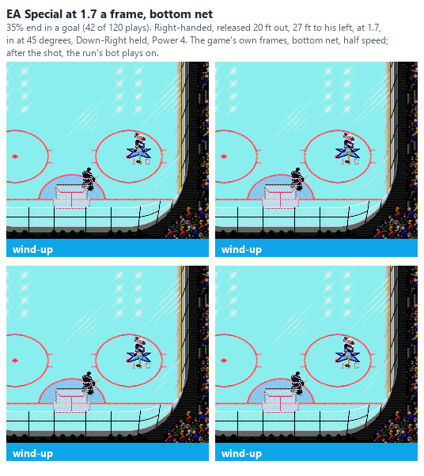
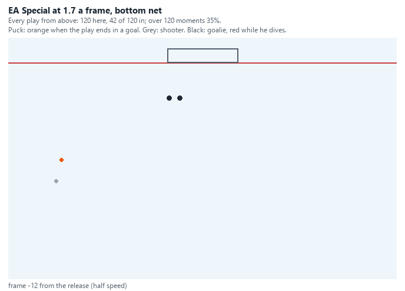

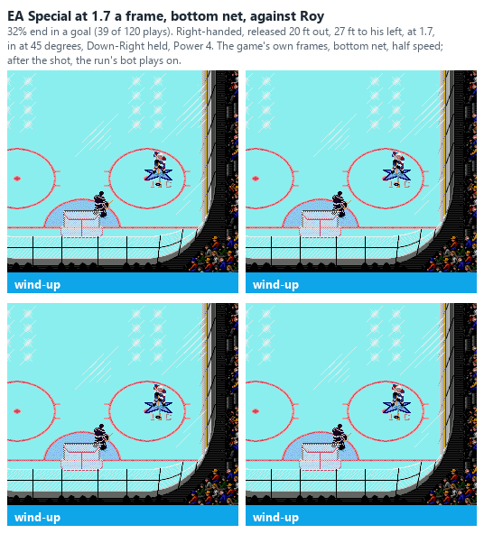
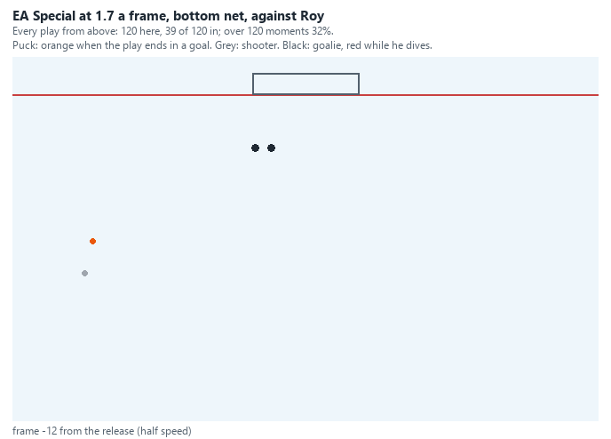

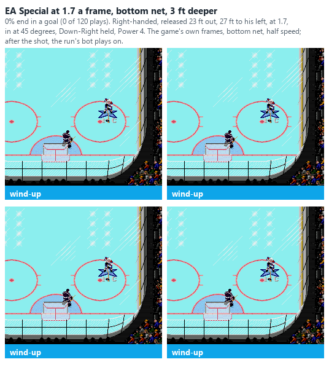
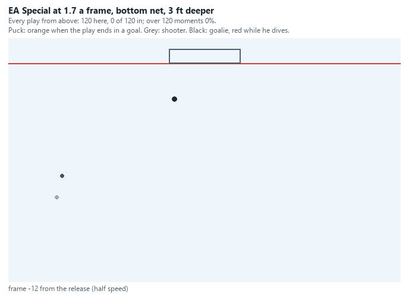

**The finer search at 1.7 (plan "fine", 2026-10-26).** At the bottom net: released 17-21 ft out (52-64), 22-29 ft to
either side (65-88), both hands. At the top net: a right-hander from his left, 19-24 ft out (56-72), 25-29 ft to the
side. Shot Power 2-4 (the top net 2-3), skating in at 45 degrees or at the goal, every aim, 48 moments x 2 seeds against each goalie (96
plays a cell, so about 5 points either way). The best for each, by the worse of the two goalies:

| Net | Best set-up at 1.7 | Hrudey | Roy |
| --- | --- | --- | --- |
| Bottom | a right-hander from his left, released 21 ft out, 24 ft to the side, at the goal, Power 2, Down-Right | 43% | 43% |
| Bottom | the same, 27 ft to the side, Power 3 | 42% | 44% |
| Bottom | a left-hander from his right, 21 ft out, 27 ft to the side, in at 45°, Power 2, Down-Left | 35% | 40% |
| Top | a right-hander from his left, 20 ft out, 25 ft to the side, in at 45°, Power 2, Down-Right | 21% | 20% |

The right-hander's best at the bottom net (aim Down-Right, best over Power and skating line, the worse goalie), by
release depth across and side down:

| Side / out | 17 ft | 19 ft | 20 ft | 21 ft |
| --- | --- | --- | --- | --- |
| 29 ft | 0% | 0% | 25% | 40% |
| 27 ft | 0% | 19% | 40% | 42% |
| 24 ft | 1% | 33% | 39% | 43% |
| 22 ft | 4% | 8% | 39% | 16% |

- **At 21 ft out the bottom net's EA Special is forgiving.** Every one of the 18 cells there from 24-29 ft to the side
  (Power 2, 3 or 4, skating at the goal or in at 45 degrees) gave 28-43% against both goalies. At 20 ft it holds when
  skating in at 45 degrees (21-40%) but skating at the goal mostly fails there. At 17 ft it is gone, and the earlier
  search had 23 ft at 9%. **So the target is 20-21 ft out (level with the faceoff dot, 21 ft out) and a little wider
  than the dot (23 ft to the side), and the depth is what matters.** Side, Shot Power and line forgive a lot.
- **The aim is toward the near side (Down-Right for the right-hander).** Holding the far side gives nothing here. The
  left-hander mirrors it (Down-Left): 35% at 21 ft from 24-29 ft to the side, a little below the right-hander.
- **The top net has no such spot.** Its best cells are 15-21% by the worse goalie (up to 26-29% against one) and scattered (20 ft with Down-Right or Down held, 23-24
  ft with Up held), each with weak neighbours, so a person can't aim for them. At 1.7 the top net's EA Special is
  about half as good as the bottom net's at best.
- **What comes next at 1.7, from the 21 ft spot:** a person's slop (plan "slop"), a speed sweep from 1.5 to 2.0 (how
  much below full speed works), the goalie's ratings one at a time and the shooter's skating ratings. The left-hander
  at the top net is still only known at 2.5 (below).
- **The bot's follow-up was always aimed at the near post** (as first described; every run so far). The user: people
  aim it at the middle or the far post, the middle better. Plan "follow" (the follow-up's aim as a setting,
  `NHL94_EA_FOLLOW`) and the fine search again with a middle and a far follow-up are running; the first shot's best aim
  may move with it.

**The bottom net, 21 ft out and 27 ft to the side, skating at the goal, Power 4, Down-Right: 40% (48 of 120) against the
test goalie, 33% (40 of 120) against Roy.**

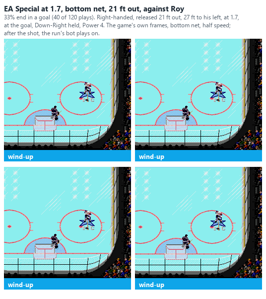
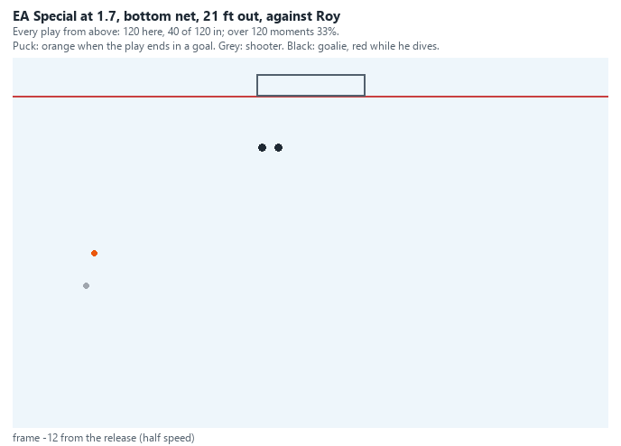

**The left-hander at the bottom net, mirrored, in at 45 degrees, Power 2, Down-Left: 35% (42 of 120).**

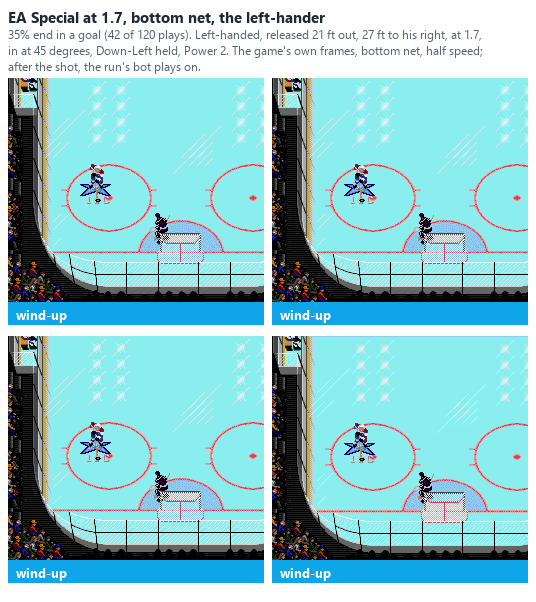
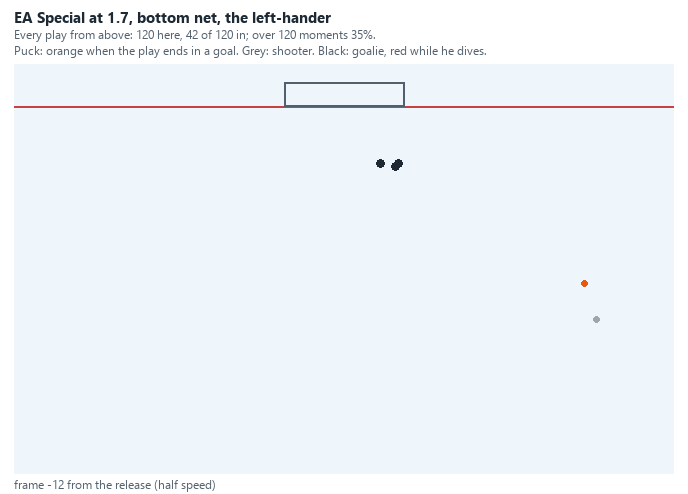

**The top net's best cell, 20 ft out and 25 ft to the side, Power 2, Down-Right: 12.5% (15 of 120)** against the test
goalie in the GIF's own plays (21% in the search), which shows how loose the top net's best is.

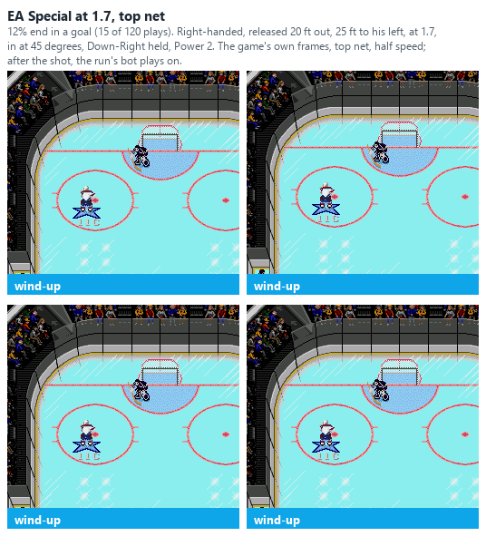
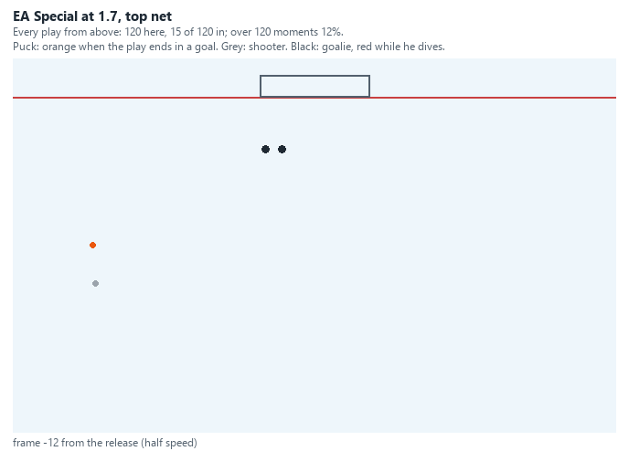

**The left-hander at the top net (plan "lefttop", at 2.5, so provisional).** The refine grid at the top net mirrored for
a left-hander from his right (plus the close spot on that side), against both goalies. His best: released 28 ft out,
19 ft to the side, in at 45 degrees, Power 2, Up-Left: **54% / 30%** (Hrudey / Roy), against the right-hander's 34 / 20%
at the same speed. It is on the grid's far edge too. The close spot for him (11 ft out, 27 ft to the side, Left held)
gave 16 / 15%.

**The left-hander at the top net (at 2.5), against the test goalie: 53% (63 of 120); against Roy: 27% (32 of 120).**

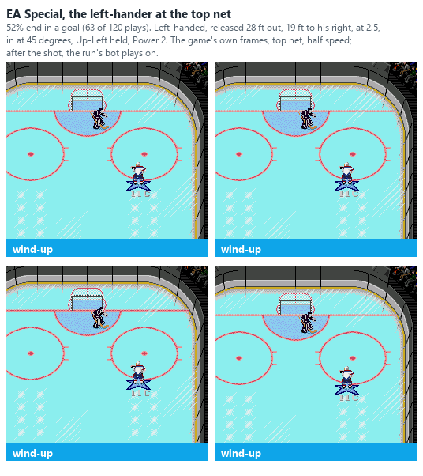
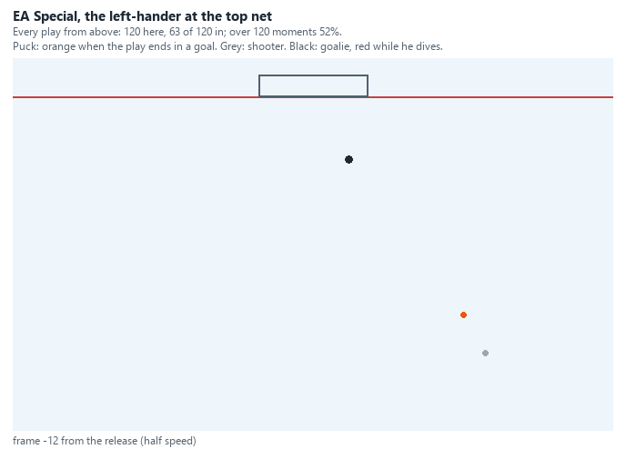

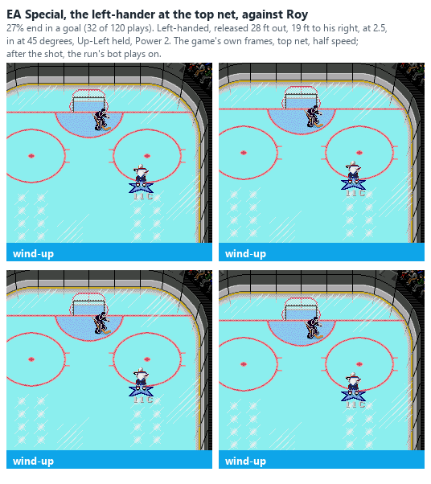
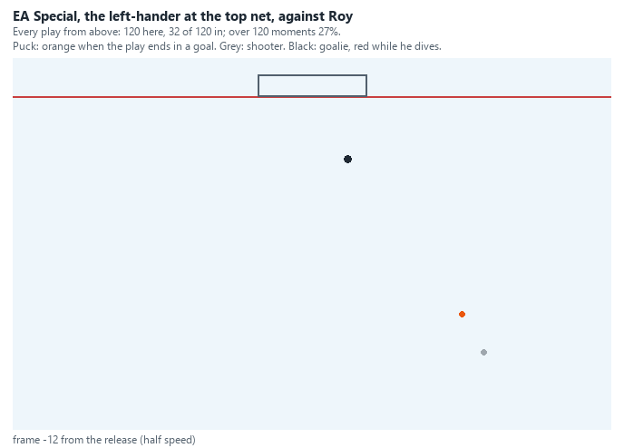

### Why it works: what the goalie does (the user's 2v2 games, 2026-10-27)

The user asked whether the goalie is really "pushed back" by the first shot, or is moving toward the far post because
that is where the shot is going. Measured in the user's two 2v2 games (`2026-10-27_0733_EDM-HFD`,
`2026-10-27_0744_HFD-EDM`: 70 forehand attempts, 22 scored on the follow-up), the goalie across (toward the far post)
and out from his goal line, medians:

| | At the release | At the save | At the follow-up |
| --- | --- | --- | --- |
| Goals (22): across | 15 toward the near post | 7 toward the near post | 4 past the middle, toward the far post |
| Goals: out from his line | 17.5 | 18.2 | 17.2 |
| Misses (48): across | 15 toward the near post | 11 toward the near post | 2 toward the far post |

- **He is not pushed back:** his depth doesn't change.
- **He slides toward the far post because the first shot is going there.** The computer goalie skates to the point
  where a shot will cross his line once it is under 0.6 s away, and 0.2 s before it arrives commits to a save move at
  a quarter of his speed (GENESIS_SHOOTING 5.3), so he can't stop or turn back.
- **The puck catches him on his near side as he crosses** (a median 9 units to the near side of his centre), and a
  rebound leaves straight out from his centre through where it touched (GENESIS_SHOOTING 5.2): **back toward the
  shooter's side.** In all 22 goals the puck was on the shooter's side 0.25 s after the save (a median 21 units out
  from the middle), while the goalie had slid another 8 units toward the far post.
- **So the near post is open for the follow-up,** with the goalie past the middle chasing where the first shot was
  going, not where the puck went. In the misses he moved a little less (16 units against 20). It is also why the
  first shot is aimed at the far post: aimed at the near post he has no reason to cross.

### The whole zone, and the user's set-ups, in the simulation (plans "wide" and "real2v2", 2026-10-27)

Both run after the follow-up fix, with the 2v2 ROM's ratings (skater Agility / Speed 20 / 20, Shot Power 20, Hartford's
goalie), skating in at 1.6 a frame (78% of full speed, the user's median), the follow-up at the near post. In the EA
runs `x` and `out` are **the shooter's** position at the release. The converter's shot spot is the puck's, which in the
user's attempts sat a median 17.5 units (6 ft) nearer the middle than the shooter and level with him. So the user's
releases, taken as the shooter's spot, were about 22-24 ft out and 25-27 ft to the side.

**"wide": first shots from everywhere** (13-37 ft to either side, 12-36 ft out, at the goal or in at 45 degrees, every
aim; 32,256 plays). Goals per attempt with the first shot at the far post, mid height (the best aim in 220 of the 336
set-ups, and the user's), both sides and both moves together:

| Out \ to the side | 13 ft | 18 ft | 23 ft | 28 ft | 33 ft | 37 ft |
| --- | --- | --- | --- | --- | --- | --- |
| **Top net** 12 ft | 0 | 1 | 1 | 3 | 23 | 10 |
| 16 ft | 0 | 1 | 3 | 17 | 17 | 23 |
| 20 ft | 0 | 1 | 5 | 33 | 32 | 32 |
| 24 ft | 4 | 8 | **73** | **75** | 72 | 65 |
| 28 ft | 43 | 69 | **78** | 73 | 69 | 60 |
| 32 ft | 63 | 66 | 73 | **77** | 71 | 67 |
| 36 ft | 66 | 66 | 63 | 69 | 61 | 63 |
| **Bottom net** 12 ft | 0 | 1 | 2 | 1 | 9 | 0 |
| 16 ft | 0 | 1 | 2 | 19 | 21 | 16 |
| 20 ft | 0 | 0 | 7 | 40 | 44 | 21 |
| 24 ft | 1 | 6 | **78** | **85** | 77 | 69 |
| 28 ft | 24 | 69 | **89** | **85** | 77 | 71 |
| 32 ft | 74 | 76 | **85** | **86** | 78 | 73 |
| 36 ft | 72 | 77 | 71 | 82 | 74 | 76 |

- **No hidden spot:** the best is a broad plateau, **24-32 ft out and 23-28 ft to the side** (73-89%), and the user's
  usual release is already on it. Beyond it the rate falls slowly. Closer than 24 ft, or narrower than about 20 ft, it
  falls off a cliff: the goalie holds about half the first shots, and the rest are claimed with the goalie still
  covering the near post.
- **The two nets come out alike** (the bottom net a few points better), so the net itself doesn't explain the user's
  difference (below).
- Farther out costs little time: from 24 ft the shooter claimed the rebound a median 12-14 frames after the save, from
  36 ft 19-21.
- The best single cells were 88-91% (bottom net, 28 ft out, 23-28 ft to the side). Every best cell is a follow-up goal;
  no first shot went straight in.

**"real2v2": the user's set-ups** (17-23 ft to either side, 21-27 ft out, both moves; matching the converter's puck
spot, so 6 ft narrower than the user really was) gave the same picture: from 27 ft out 61-64%, from 21 ft 5-7%.

**Against the user's games (70 forehand attempts):** each attempt given the "wide" rate at its nearest grid cell, by
the shooter's own spot:

| | Attempts | Simulation predicts | Shooter scored | Defender claimed |
| --- | --- | --- | --- | --- |
| Top net, where the simulation gives over 50% | 24 | 74% | 10 (42%) | 4 |
| Top net, the rest | 16 | 9% | 5 (31%) | 4 |
| Bottom net, where the simulation gives over 50% | 24 | 82% | 4 (17%) | 8 |
| Bottom net, the rest | 6 | 15% | 0 | 2 |

- **The simulation doesn't match the user's play.** It is far too optimistic on its plateau (the bot has no defender
  and no hesitation), and too pessimistic close in at the top net, where the user scored 5 of 16.
- **The bottom net's trouble is after the shot, not the release:** 24 of the 30 attempts were from good spots. Of the
  bottom net's 30, the defender claimed the puck in 10, and in 7 the user's side had it but took no shot within 2 s (in
  5 of those the shooter himself had claimed it, 0.3-1.7 s after the save). At the top net it was 8 and 4 of 40.
- Not yet checked: where the goalie stands at the release in the simulation against the user's games (15 units toward
  the near post at the release in the user's goals). The defender test (plan E) would show what a defender changes.

### EA Specials in the recorded games (`analysis/ea_real.py`, 2026-10-26)

The converter marks EA Special attempts (a person's forehand wrist shot from the side at a goalie in position, carried
in; `export_match.add_shot_context`). `ea_real.py` measures each the way the EA runs set them up: the release depth and
side, the shooter's skating speed over the quarter second before it, and that as a share of his full speed (from his
working Speed rating). The viewer now gives the same on each attempt's shot line and puts attempts that didn't score in
the Highlights.

**25 attempts in 9 of the 17 recorded Genesis games** (14 of them in one game, 2026-10-16_1314_BOS-PIT):

- **Three scored on the follow-up, all at the top net** (3 of 17 there, none of 8 at the bottom net). They were released
  21, 24 and 37 ft out, at 87%, 92% and 65% of the shooter's full speed. Five attempts had a follow-up shot at all.
- **People do skate in below full speed,** as the user said: a median of 78% of full speed (1.59 a frame). 10 attempts
  were under 70%, 8 at 70-90%, 7 at 90% or more. The search at 1.7 is about 85% for the test skater.
- **Released a median of 22 ft out and 21 ft to the side** (16-37 ft out). The game's best at the bottom net, 20 ft out
  and 27 ft to the side, is wider than people usually go.
- **Too few to test the simulation:** four bottom-net attempts came within 4 ft of 20 ft out, none of them near the
  1.7 set-up's speed and aim. The recordings show how people play it, not yet whether the bot's best works for them.
