# Scoring maps: Genesis EA Specials

*The scoring maps: [overview and method](SCORING_MAP.md) · [Genesis shots and goalies](SCORING_GENESIS.md) · [Genesis dekes and floaters](SCORING_GENESIS_DEKES.md) · [Genesis EA Specials](SCORING_GENESIS_EA.md) · [SNES](SCORING_SNES.md)*

EA Specials played in the real Genesis game with a bot following up, and the ones in the recorded games (the method: [SCORING_MAP](SCORING_MAP.md)).

## Contents

- [EA Specials (Genesis, 2026-10-24)](#ea-specials-genesis-2026-10-24)
   - [The first shot (plans "ea", "firm", "dots", "angle", 2026-10-24 / 25)](#the-first-shot-plans-ea-firm-dots-angle-2026-10-24--25)
   - [The best set-ups at 1.7 a frame (plan "fine" and the runs from it, 2026-10-27)](#the-best-set-ups-at-17-a-frame-plan-fine-and-the-runs-from-it-2026-10-27)
   - [Why it works: what the goalie does (the user's 2v2 games, 2026-10-27)](#why-it-works-what-the-goalie-does-the-users-2v2-games-2026-10-27)
   - [The whole zone, and the user's set-ups, in the simulation (plans "wide" and "real2v2", 2026-10-27)](#the-whole-zone-and-the-users-set-ups-in-the-simulation-plans-wide-and-real2v2-2026-10-27)
   - [Backhands (plan "backhand", 2026-10-27)](#backhands-plan-backhand-2026-10-27)
   - [Which goalies and which shooters (plans "goalie17" with the league's goalies and "shooter17", 2026-10-28)](#which-goalies-and-which-shooters-plans-goalie17-with-the-leagues-goalies-and-shooter17-2026-10-28)
   - [The walk-in on the Genesis (plan "walkin", 2026-10-28)](#the-walk-in-on-the-genesis-plan-walkin-2026-10-28)
   - [EA Specials in the recorded games (`analysis/ea_real.py`, 2026-10-26)](#ea-specials-in-the-recorded-games-analysisea_realpy-2026-10-26)

## EA Specials (Genesis, 2026-10-24)

The user's play: a wrist shot from the side meant to come off the goalie loose. The skater skates on, claims the loose
puck and at once shoots inside the near post, which is open because the goalie has moved. The user's view: the best
shooters are bad at it, because their harder shots are held more; middling shooters' shots are bobbled more.

**How the play is taken (the user, 2026-10-25):** a left-hander from the right side, a right-hander from the left (the
off-wing, the stick toward the middle), now and then a backhand flip from the other side. The shooter faces straight
across the rink or diagonally toward the goalie as he wrists the puck, never straight up the ice (he would have to
turn sharply to claim the rebound). People skate in a little below full speed, tapping the d-pad, to be placed for
the rebound rather than charging the net: in the recorded games a median 78% of full speed.

**The test** (`ea_run.py`): the shooter is placed so that the wrist shot leaves his stick at a set spot (`x` across and
`out` from the goal line, 3 units a foot: the shooter's own position; the converter's shot spot is the puck's, about 6
ft nearer the middle), skating at the goal, in at 45 degrees or (for backhands) straight up the ice or across, at a
set speed, with each of the nine aims. A simple bot plays the rest: it skates on; once the goalie has touched the puck
and it is loose, it chases it; on claiming it, it taps C with the aim held at the near post until the puck leaves.
Each set-up is played from many game moments (the goalie's seed, the clock, the settle frames) and release seeds,
against the test goalie (Hrudey: working Agility 13, Speed 13, Puck Control 18) and Roy's ratings (30 / 20 / 20 / 30,
written into the same goalie, so the GIFs show the save state's LA goalie). A goal is the first shot straight in or
the follow-up.

**Skating speed.** Full speed holding the d-pad, measured: a 10 / 10 skater (working Agility / Speed) 1.75 a frame, the
test skater (18 / 18) 2.0, 20 / 20 2.05, 30 / 30 2.35. The runs use 1.7 a frame (the 2v2 runs 1.6), a little below
full speed as people play it; how much below matters (below).

### The first shot (plans "ea", "firm", "dots", "angle", 2026-10-24 / 25)

What the first wrist shot does, from spots 13-33 ft to the side and 15-40 ft out, standing or skating, Shot Power and
Shot Accuracy roster 2-6, every aim, against the test goalie and the goalie profiles (over 500,000 first shots):

- **The first shot to bobble is aimed across, at the far side from the shooter:** 60-79% of those are touched and
  left loose, against 14-28% aimed down along the ice (held 70-85%); aimed at the near side or down the ice
  from the faceoff dots, 66-79% are held.
- **Shot Power (far-side first shots):** held 20% / 19% / 21% / 21% / 27% from steps 2 to 6, bobbled 63% / 69% / 72% /
  72% / 66%. Weak shots (2-3) miss the net more (11-16%, against 6% at 5-6). So the hardest shooter's shots are held
  more and bobbled less, as the user said, but only at the top.
- **The goalie dives at the loose puck less as Shot Power rises:** after a bobble 43% / 35% / 25% / 18% / 17% of the
  time (steps 2-6). Better goalies dive less: the test goalie after 17-21% of bobbles, a retail starter 11-13%, Roy 7-8%.
- **Shot Accuracy hardly changes the first shot:** held 49-57%, bobbled 41-42% over all aims; only misses fall (8% to
  2%). It matters for the whole play (below).
- **Skating straight across, the shooter reaches only 7-10% of the bobbles,** against 58-69% skating in at 45 degrees
  or at the goal: moving sideways he carries on past the loose puck.
- **The save doesn't push the goalie back:** within 20 frames of a far-side shot he moves only 0.3-0.8 units toward
  his goal line. Where he goes instead is in "Why it works".

### The best set-ups at 1.7 a frame (plan "fine" and the runs from it, 2026-10-27)

The test skater (working Agility / Speed 18 / 18, full speed 2.0 a frame) skating in at 1.7 a frame, against the test
goalie and Roy. Rates are goals per attempt, the first shot and the follow-up together; "straight
in" is the first shot alone.

**The fine search** (plan "fine": the bottom net 17-21 ft out and 22-29 ft to either side, both hands; the top net, a
right-hander from his left, 19-24 ft out and 25-29 ft to the side; Shot Power 2-4, at the goal or in at 45 degrees, every
aim, 96 plays a cell against each goalie). The best, by the worse of the two goalies:

| Net | Best set-up at 1.7 | Test goalie | Roy |
| --- | --- | --- | --- |
| Top | a right-hander from his left, released 23 ft out, 28 ft to the side, in at 45°, Power 3, first shot Right (middle height, the far side) | 73% | 74% |
| Bottom | a left-hander from his right, released 17 ft out, 29 ft to the side, at the goal, Power 3, first shot Right (middle height, the far side) | 61% | 70% |
| Bottom | the right-hander from his left, mirrored (Left held) | 66% | 38% |

- **The top net is the forgiving one.** Every cell 23-24 ft out and 25-29 ft to the side gave 65-73% against the
  worse goalie; 19-21 ft out, 29-40%. Nearly all of it (98% of the top net's goals) is the follow-up.
- **At the bottom net the EA Special is at the grid's near edge,** 17 ft out and 29 ft to the side (the left-hander
  61-70%; the right-hander's mirror is goalie-dependent, as the league's goalies show below). The 20-21 ft cells (40-43%)
  are a different play: the first shot going straight in, low inside the near post (a third of the bottom net's goals
  over the grid), a good wrist shot from just outside the faceoff dot rather than an EA Special. The grid stopped at 21 ft out; the whole-zone search below (2v2 ratings) found both nets best
  24-32 ft out.
- **The first shot goes to the far side at middle height** (the user's far post, then near post), and the follow-up at
  the near post. Plan "follow" played the best set-ups with the follow-up aimed at the near post, the middle or the
  far post (the user: people aim it at the middle or the far post): the near post scores, the others hardly do (top
  net 26% / 2% / 1% against the test goalie; bottom net 31% / 6% / 8%). The bot claims the rebound on its own side
  almost every time (4 of 512 claims across the middle), so "near" is the post on the shooter's side.

The left-hander at the bottom net, by release depth across and side down (the best over Power, line and aim, the worse
goalie; the share of it that was the first shot straight in, in brackets):

| Side / out | 17 ft | 19 ft | 20 ft | 21 ft |
| --- | --- | --- | --- | --- |
| 29 ft | **61% (0)** | 35% (0) | 44% (0) | 40% (0) |
| 27 ft | 33% (0) | 30% (0) | 33% (1) | 35% (37) |
| 24 ft | 21% (0) | 30% (31) | 29% (30) | 35% (33) |
| 22 ft | 5% (1) | 4% (0) | 19% (21) | 22% (24) |

**A person's slop** (plan "slop"). A person can't release at the exact spot and frame, so each moment draws its own
errors (uniform, either way) in the release spot, the skating speed and angle and the release frame: small = 1 ft,
0.2 a frame, 5 degrees, 1 frame; medium = 3 ft, 0.5, 10 degrees, 2 frames; large = 5 ft, 1.0, 20 degrees, 3 frames. Each set-up's best aim, 120 moments, test goalie /
Roy:

| Set-up (out and side in ft) | exact | small | medium | large |
| --- | --- | --- | --- | --- |
| Top: right-hander, 23 out, 28 side, in at 45°, Power 3, Right | 69 / 66 | 62 / 58 | 49 / 47 | 33 / 28 |
| Top: right-hander, 24 out, 27 side, at the goal, Power 3, Right | 74 / 74 | 72 / 77 | 52 / 49 | 42 / 36 |
| Bottom: right-hander, 17 out, 29 side, at the goal, Power 3, Left | 61 / 34 | 58 / 34 | 40 / 31 | 30 / 30 |
| Bottom: left-hander, 17 out, 29 side, at the goal, Power 3, Right | 59 / 66 | 49 / 54 | 37 / 36 | 23 / 25 |
| Bottom: left-hander, 20 out, 29 side, in at 45°, Power 4, Right | 37 / 39 | 38 / 38 | 41 / 43 | 43 / 45 |
| Bottom straight-in shot: right-hander, 21 out, 24 side, at the goal, Power 2, Down-Right | 36 / 36 | 30 / 25 | 17 / 14 | 8 / 6 |

- **They forgive a person's slop.** A foot and a frame off costs 0-10 points, the medium errors about a third. The 20 ft left-hander's set-up doesn't care at all (37-45% at every level).
- **Where you release matters most** (plan "slopparts", one kind of error at a time): at the top net's best, a medium
  error in the release spot alone gives 51%, in the skating speed alone 48-54%, in the release frame 60-62%, in the
  angle 65-70% (exact 66-69%). The straight-in shot needs the spot most: 12-13% with the medium spot error alone.

**How fast to skate in** (plan "speed": 1.5 to 2.0 a frame, the release 1.3 or 2.7 ft nearer or farther; test goalie /
Roy, best aim). The top net's best:

| Speed / released | 20 ft | 21 ft | 23 ft | 24 ft | 25 ft |
| --- | --- | --- | --- | --- | --- |
| 1.5 | 39 / 42 | 41 / 38 | 58 / 58 | 75 / 75 | 74 / 72 |
| 1.6 | 31 / 32 | 43 / 42 | 72 / 74 | 74 / 76 | 73 / 76 |
| 1.7 | 32 / 31 | 38 / 36 | 69 / 67 | 64 / 66 | 67 / 68 |
| 1.8 | 37 / 35 | 39 / 36 | 71 / 68 | 65 / 69 | 53 / 64 |
| 1.9 | 30 / 33 | 36 / 35 | 61 / 62 | 60 / 55 | 59 / 65 |
| 2.0 (full speed) | 32 / 26 | 30 / 27 | 27 / 23 | 21 / 20 | 31 / 18 |

- **Anything from 1.5 to 1.9 works; full speed doesn't.** At the top net 23-25 ft out stays 53-76% up to 1.9 and
  falls to 18-31% at 2.0. The bottom net's 17 ft set-ups behave the same way, with 16 ft as good or better (the
  left-hander 51-69% / 61-72% at 1.5-1.7; at 1.8 and over his 17 ft falls to 22-32% and 16 ft holds 41-66%).
- The right-hander's bottom set-up is goalie-dependent here too: from 20 ft Roy let in 71-82% at 1.5-1.9 and the test
  goalie 25-32%.

**The skater's own speed** (plan "skate17": working Agility / Speed 10 / 10, 13 / 13, 18 / 18, 20 / 20, 30 / 30, each at
his full speed and 0.3 a frame below it). What matters is the speed in units a frame, not the ratings:

- 0.3 below full speed (1.45-1.75 a frame for the first four), every skater scores as the test skater does: the top net
  62-76% from 23-24 ft out, the bottom net 47-75% (the better of 16 and 17 ft out).
- At full speed the slow skaters still do (10 / 10 at 1.75 and 13 / 13 at 1.85: the top net 61-71%), and the others
  don't (18 / 18 and 20 / 20 at 2.0-2.05: 13-28%).
- The fastest skater (30 / 30) fails at full speed (2.35) and still at 0.3 below it (2.05): the top net 16-29%. A fast
  skater has to hold back well below full speed.

**The left-hander at the top net** (plan "lefttop17": from his right, 19-24 ft out, 22-29 ft to the side, Power 2-4):
the best, 24 ft out and 29 ft to the side, at the goal, Power 3 or 4, first shot Left (middle height, the far side):
**74% / 73%**. Cells 23-24 ft out and 27-29 ft to the side gave 61-79%. So the left-hander is as good as the
right-hander there.

**The goalie's ratings one at a time** (plan "goalie17": each net's best set-up, from a 20 / 20 / 20 / 20 goalie,
one rating at 10 or 30; the three aims around each best):

- **The top net doesn't notice:** 64-70% for every goalie.
- **Agility moves the bottom net's two set-ups in opposite directions:** the right-hander's (from his left) 29% at
  Agility 20, 53% at 10, 33% at 30; the left-hander's 65%, 27%, 70%. Defensive Awareness 30 swaps them the same way
  (65% and 33%).
- **Defensive Awareness 10 kills the straight-in shot** (0%, against 36-39%): the goalie reacts later and is still
  standing where it hits him.
- Speed and Puck Control changed nothing.

### Why it works: what the goalie does (the user's 2v2 games, 2026-10-27)

The user asked whether the goalie is really "pushed back" by the first shot, or is moving toward the far post because
that is where the shot is going. Measured in the user's two 2v2 games (`2026-10-27_0733_EDM-HFD`,
`2026-10-27_0744_HFD-EDM`: 70 forehand attempts, 22 scored on the follow-up: 19 by the shooter, 3 by a teammate), the goalie across (toward the far post)
and out from his goal line, medians:

| | At the release | At the save | At the follow-up |
| --- | --- | --- | --- |
| Goals (22): across | 15 toward the near post | 7 toward the near post | 4 past the middle, toward the far post |
| Goals: out from his line | 17.5 | 18.2 | 17.2 |
| Misses (48): across | 15 toward the near post | 11 toward the near post | 2 toward the far post |

- **He is not pushed back:** his depth doesn't change.
- **He slides toward the far post because the first shot is going there.** The computer goalie skates to the point
  where a shot will cross his line once it is under 0.6 s away, and 0.2 s before it arrives commits to a save move at
  a quarter of his speed (GENESIS_SHOOTING 5.3), so he can't stop or turn back.
- **The puck catches him on his near side as he crosses** (a median 9 units to the near side of his centre), and a
  rebound leaves straight out from his centre through where it touched (GENESIS_SHOOTING 5.2): **back toward the
  shooter's side.** In all 22 goals the puck was on the shooter's side 0.25 s after the save (a median 21 units out
  from the middle), while the goalie had slid another 8 units toward the far post.
- **So the near post is open for the follow-up,** with the goalie past the middle chasing where the first shot was
  going, not where the puck went. In the misses he moved a little less (16 units against 20). It is also why the
  first shot is aimed at the far post: aimed at the near post he has no reason to cross.

### The whole zone, and the user's set-ups, in the simulation (plans "wide" and "real2v2", 2026-10-27)

Both with the 2v2 ROM's ratings (skater Agility / Speed 20 / 20, Shot Power 20, Hartford's
goalie), skating in at 1.6 a frame (78% of full speed, the user's median), the follow-up at the near post. In the EA
runs `x` and `out` are **the shooter's** position at the release. The converter's shot spot is the puck's, which in the
user's attempts sat a median 17.5 units (6 ft) nearer the middle than the shooter and level with him. So the user's
releases, taken as the shooter's spot, were about 22-24 ft out and 25-27 ft to the side.

**"wide": first shots from everywhere** (13-37 ft to either side, 12-36 ft out, at the goal or in at 45 degrees, every
aim; 32,256 plays). Goals per attempt with the first shot at the far post, mid height (the best aim in 220 of the 336
set-ups, and the user's), both sides and both moves together:

| Out \ to the side | 13 ft | 18 ft | 23 ft | 28 ft | 33 ft | 37 ft |
| --- | --- | --- | --- | --- | --- | --- |
| **Top net** 12 ft | 0 | 1 | 1 | 3 | 23 | 10 |
| 16 ft | 0 | 1 | 3 | 17 | 17 | 23 |
| 20 ft | 0 | 1 | 5 | 33 | 32 | 32 |
| 24 ft | 4 | 8 | **73** | **75** | 72 | 65 |
| 28 ft | 43 | 69 | **78** | 73 | 69 | 60 |
| 32 ft | 63 | 66 | 73 | **77** | 71 | 67 |
| 36 ft | 66 | 66 | 63 | 69 | 61 | 63 |
| **Bottom net** 12 ft | 0 | 1 | 2 | 1 | 9 | 0 |
| 16 ft | 0 | 1 | 2 | 19 | 21 | 16 |
| 20 ft | 0 | 0 | 7 | 40 | 44 | 21 |
| 24 ft | 1 | 6 | **78** | **85** | 77 | 69 |
| 28 ft | 24 | 69 | **89** | **85** | 77 | 71 |
| 32 ft | 74 | 76 | **85** | **86** | 78 | 73 |
| 36 ft | 72 | 77 | 71 | 82 | 74 | 76 |

- **No hidden spot:** the best is a broad plateau, **24-32 ft out and 23-28 ft to the side** (73-89%), and the user's
  usual release is already on it. Beyond it the rate falls slowly. Closer than 24 ft, or narrower than about 20 ft, it
  falls off a cliff: the goalie holds about half the first shots, and the rest are claimed with the goalie still
  covering the near post.
- **The two nets come out alike** (the bottom net a few points better), so the net itself doesn't explain the user's
  difference (below).
- Farther out costs little time: from 24 ft the shooter claimed the rebound a median 12-14 frames after the save, from
  36 ft 19-21.
- The best single cells were 88-91% (bottom net, 28 ft out, 23-28 ft to the side). Every best cell is a follow-up goal;
  no first shot went straight in.

**"real2v2": the user's set-ups** (17-23 ft to either side, 21-27 ft out, both moves; matching the converter's puck
spot, so 6 ft narrower than the user really was) gave the same picture: from 27 ft out 61-64%, from 21 ft 5-7%.

**Against the user's games (70 forehand attempts):** each attempt given the "wide" rate at its nearest grid cell, by
the shooter's own spot:

| | Attempts | Simulation predicts | Shooter scored | Defender claimed |
| --- | --- | --- | --- | --- |
| Top net, where the simulation gives over 50% | 24 | 74% | 10 (42%) | 4 |
| Top net, the rest | 16 | 9% | 5 (31%) | 4 |
| Bottom net, where the simulation gives over 50% | 24 | 82% | 4 (17%) | 8 |
| Bottom net, the rest | 6 | 15% | 0 | 2 |

- **The simulation doesn't match the user's play.** It is far too optimistic on its plateau (the bot has no defender
  and no hesitation), and too pessimistic close in at the top net, where the user scored 5 of 16.
- **The bottom net's trouble is after the shot, not the release:** 24 of the 30 attempts were from good spots. Of the
  bottom net's 30, the defender claimed the puck in 10, and in 7 the user's side had it but took no shot within 2 s (in
  5 of those the shooter himself had claimed it, 0.3-1.7 s after the save). At the top net it was 8 and 4 of 40.
- Not yet checked: where the goalie stands at the release in the simulation against the user's games (15 units toward
  the near post at the release in the user's goals). The defender test (plan E) would show what a defender changes.

### Backhands (plan "backhand", 2026-10-27)

The user: backhand EA Specials are much harder, and taken from much closer. From close in to
the faceoff dots (5-25 ft out, 8-28 ft to either side), both nets, the 2v2 ROM's skater (20 / 20, Shot Power and
Accuracy 20) at 1.6 a frame, against Hartford's goalie and Roy, every aim. The game picks forehand or backhand by the
skater's facing against the direction to the goal (`Findhittype`), not by the play: skating at the goal or in at 45
degrees is always a forehand. So the backhand runs skate **straight up the ice** with the usual hand (a right-hander
from his left), and **straight across** with the hand swapped (a left-hander from his left). Only cells where the game
swung a backhand on at least 90% of the shots count.

- **Overall it barely works:** over every aim, 0-9% of attempts scored skating up the ice and 0-4% skating across,
  though the goalie left 20-63% of them loose.
- **The good bottom-net backhands are plain shots, not EA Specials.** Skating up the ice, 17-21 ft out and 18-23 ft to
  either side (28 ft at 21 ft out), a low backhand at the far side went straight in 39-50% of the time against
  Hartford's goalie and mostly 31-46% against Roy. The same spots at the top net gave less: on his left side a few
  straight-in cells (30-38% against Hartford's goalie, 16-28% against Roy), on his right follow-ups (22-30%, Roy 8%).
- **Real backhand EA Specials, with a quick follow-up** (the rebound claimed 13-43 frames after the save, under
  three quarters of a second):
  - skating up the ice, 25 ft out and 23 ft to the side (a left-hander from his right), nothing held: the top net
    **48%** against Hartford's goalie and 24% against Roy, the bottom net 36% and 31%, all on the follow-up;
  - skating across with the hand swapped, 21-25 ft out and 23-28 ft to his left: the top net 19-39% against Hartford's
    goalie and 9-19% against Roy; the bottom net 13-17 ft out, 28 ft to his left, 19-24% against both.
- **Close in (5-13 ft out) the goalie spills about a third to a half of the backhands, but the follow-up never scores.**
  Traced frame by frame (about 90 plays):
  - from about 5 ft out the rebound drops beside the near post, 1-5 ft behind the goal line. The shooter claims it
    quickly (about 0.6 s), but a Genesis shot goes straight at the net, so from behind the line it runs along the goal
    line into the goalie at the post and caroms away;
  - from about 9 ft out and beyond, the save kicks the puck 30-40 ft to the side and the shooter reaches it about 2 s
    later.
- **Late second shots are not counted as EA Specials** (the user: a backhand EA Special is a quick fetch-the-rebound
  and flip into the open net). The test window (2.5 s from the release) cuts some of the 2-second follow-ups off in
  flight, so they show as "nothing". By then the goalie is set again, so a longer window would add ordinary shots at a
  set goalie, not EA Specials, and it was left as it is. The quick cells above have claims well inside it.

So in the game a backhand EA Special is much harder than the forehand one, as the user found: where the save sends
the puck, not the release, is why. Close in the rebound ends where nothing can score; farther out it comes back too
slowly to catch the goalie out of position, except from about 25 ft out.

### Which goalies and which shooters (plans "goalie17" with the league's goalies and "shooter17", 2026-10-28)

Both from the best set-ups at 1.7 (`ea_run.py` BEST17, from [the fine search](#the-best-set-ups-at-17-a-frame-plan-fine-and-the-runs-from-it-2026-10-27)): **the top net**, a right-hander from his left, released
23 ft out and 28 ft to the side, in at 45 degrees, Power 3; **the bottom net**, released 17 ft out and 29 ft to the side
skating at the goal, Power 3, a right-hander from his left and a left-hander from his right; and the bottom net's
**close spot** (21 ft out, 24 ft to the side, Power 2). Each with its best aim and the two beside it, 120 moments, the
follow-up at the near post. Rates are each set-up's best aim.

**The league's goalies.** Every starter in the league ROM (`9438f5dd`), as working ratings (roster x 5: Agility,
Speed, Defensive Awareness, Puck Control) written into the test goalie, base ratings (no hot or cold):

| Goalies | Working ratings | Top net | Bottom, right-hander | Bottom, left-hander | Bottom close spot |
| --- | --- | --- | --- | --- | --- |
| Belfour | 30 / 20 / 30 / 25 | 66% | 29% | 33% | 37% |
| Roy | 30 / 20 / 20 / 30 | 66% | 33% | **70%** | 37% |
| Fuhr | 25 / 20 / 25 / 25 | 68% | **73%** | 32% | 36% |
| Potvin, Joseph | 20 / 20 / 30 / 20 | 67% | 65% | 33% | 39% |
| Hextall, McLean, Cheveldae, Soderstrom, Essensa, Barrasso, Ranford, Casey, Terreri | Agility 20, Defensive Awareness 15-25 | 70% | 29% | 65% | 37% |
| Moog, Burke | 20 / 20 or 15 / 10 / 20 | 69% | 33% | 53-54% | **0%** |
| Vernon, Vanbiesbrouck, Hrudey, Beaupre | Agility 15 | 65% | 54% | 37% | 36% |
| Young | 15 / 15 / 10 / 15 | 69% | 43% | 39% | 35% |
| Irbe, Healy, Hebert | Agility 10 | 65% | 53% | 27-28% | 36% |
| Sidorkiewicz | 10 / 15 / 5 / 10 | 67% | 32% | 50% | 3% |

- **The top net's set-up works on every goalie: 65-70%,** Belfour and Roy included.
- **The bottom net's two set-ups trade places from goalie to goalie,** between about 30% and 70%, with no order by
  quality: against Roy the left-hander's works (70%) and the right-hander's doesn't (33%); against Fuhr the reverse.
  Only Belfour stops both (29% and 33%). A set-up this exact is a narrow window, and the goalie's Agility (his reach
  and how he moves) shifts which window is open. For a person, whose release varies, expect something between the two.
- **Goalies with the same Agility and much the same Defensive Awareness gave identical results** (the plays are
  repeatable): Speed and Puck Control changed nothing. Defensive Awareness (his reaction time, `aidef`) mattered at
  the ends: 30 (Potvin, Joseph) swaps the bottom net's two set-ups as Agility does, and 10 or below moves them and
  closes the close spot for an Agility-20 goalie.
- **The close spot isn't an EA Special:** its goals are the first shot going straight in (about a third of attempts),
  not the rebound. Moog, Burke (Agility 20, Defensive Awareness 10) and Sidorkiewicz (Awareness 5), slower to react,
  are still standing where that shot hits him, and it fails (0-3%); Young (Agility 15, Awareness 10) isn't.

**The shooter's Shot Power and Shot Accuracy** (roster 1-6, working 5-30), every pair, against the test goalie and Roy.
The top net (test goalie; Roy within a few points):

| Shot Power \ Accuracy | 1 | 2 | 3 | 4 | 5 | 6 |
| --- | --- | --- | --- | --- | --- | --- |
| 1 | 8% | 10% | 10% | 8% | 8% | 9% |
| 2 | 21% | 19% | 22% | 27% | 25% | 28% |
| 3 | 38% | 53% | 65% | 67% | 80% | 84% |
| 4 | 43% | 57% | 65% | 75% | 73% | 88% |
| 5 | 36% | 55% | 60% | 72% | 76% | 89% |
| 6 | 25% | 38% | 45% | 45% | 53% | 58% |

- **Shot Power 3-5 is the range,** as the user said: Power 6 falls back (the hardest shots are held), and 1-2 are
  worse still (too weak to push the goalie anywhere). At the bottom net the peak is Power 3, and 4-5 cost more there
  (right-hander, test goalie, Accuracy 6: 72% at Power 3, 65% at 4, 51% at 5, 21% at 6).
- **Shot Accuracy matters a lot:** at Power 3-5, Accuracy 6 scores about twice as often as Accuracy 1. Both the first
  shot (bobbled the right way) and the follow-up (a short shot that goes exactly where aimed more often) depend on it.
- **For the user's teams** (league ROM, roster Shot Power / Accuracy): Boston's best are Bourque 5 / 5 and Neely 4 / 5,
  then Oates and Reid 3 / 4; the defencemen Sweeney, Wesley and Murphy (4 / 1) are poor at it. Edmonton's are Klima and
  Simpson (4 / 5).
- **The close spot doesn't care:** 18-45% whatever the Power, rising with Accuracy, a third of it straight in.

**The best set-ups, against the test goalie and Roy** (each GIF's rate is its own 24 plays):

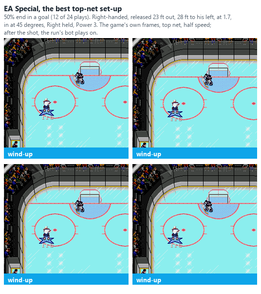
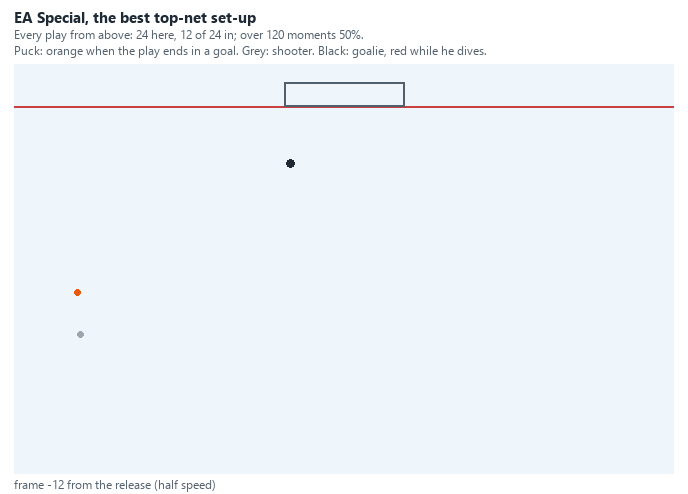

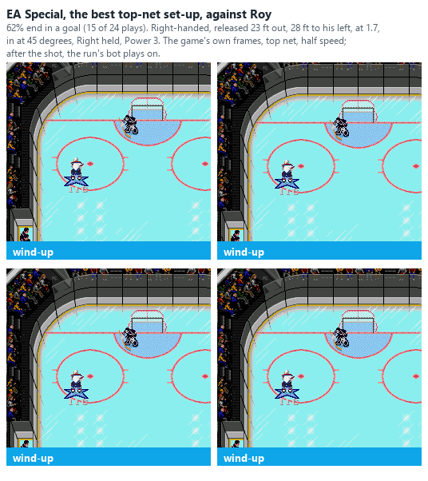
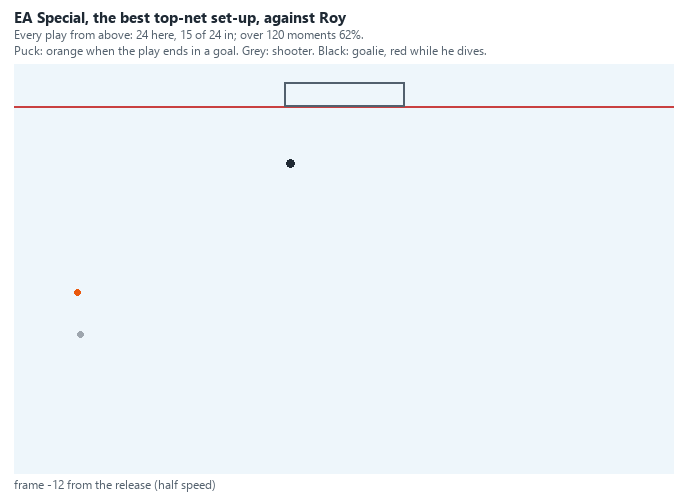

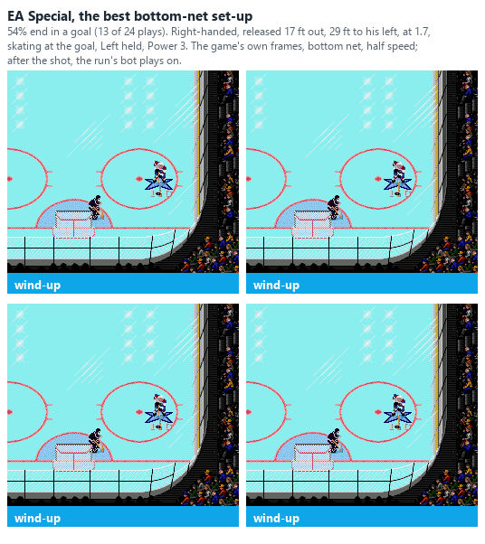
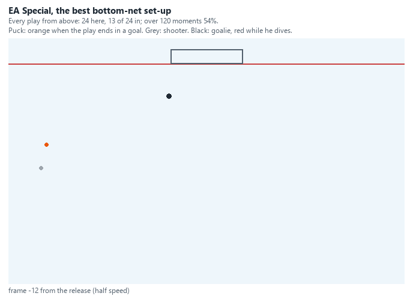

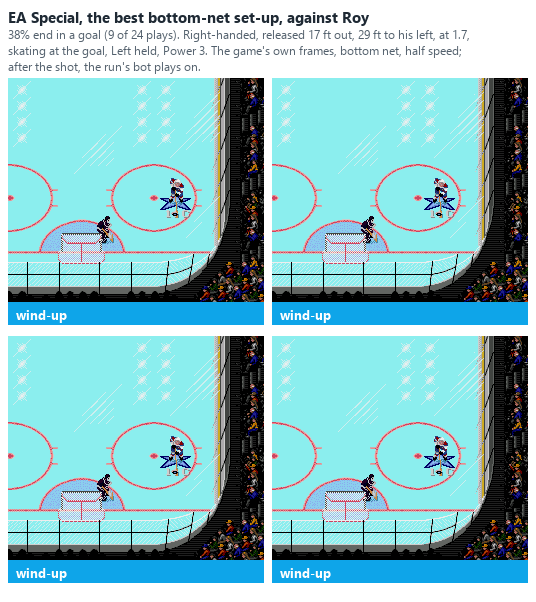
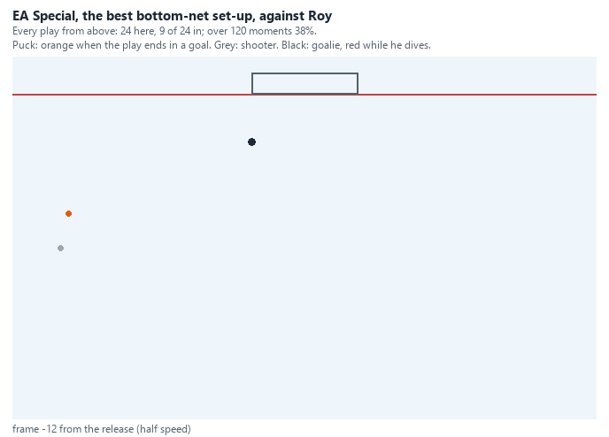

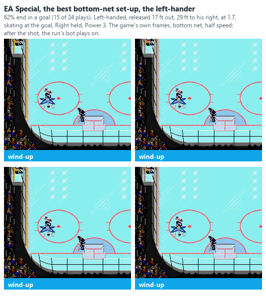
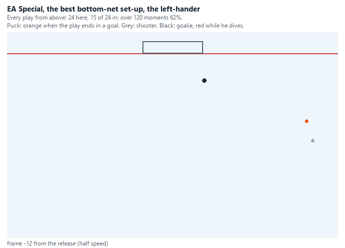

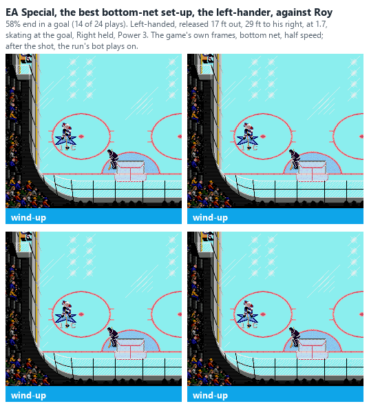
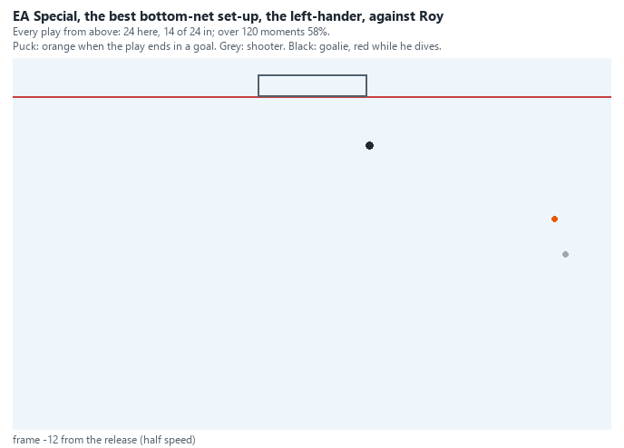

### The walk-in on the Genesis (plan "walkin", 2026-10-28)

The SNES's best follow-up play ([SCORING_SNES](SCORING_SNES.md#ea-specials-on-the-snes-snes_ea_runpy-2026-10-27)): a
weak low wrist shot at the far side that the shooter catches up with before it reaches the goalie, carried on at the
middle of the goal line and shot at the near post as he cuts across in front of the goalie (the carried puck turning
within 24 of him). Played the same way on the Genesis: both nets and hands, 17-25 ft out, 23-27 ft to the side, skating
at the goal at 1.7 a frame, Shot Power 1-4, Shot Accuracy 4, the three low aims (13,824 plays against the test goalie).

- **The shooter seldom catches his own shot:** 15% of the plays. Only a Shot Power 1 shot is slow enough to catch
  often (31% at the top net, 67% at the bottom); at 2 it is 10-11%, and at 3-4 at most 2%.
- **A retaken puck seldom scores: 6% of them** (1% of all the plays). The best set-up scored 10 of 48 (the top net, a
  left-hander from his right, released 17 ft out and 27 ft to the side, Shot Power 1, Down held). No set-up reached a
  quarter.
- **Carrying the puck in without the first shot doesn't work either** (`carry_run.py`, as on the SNES): carried all
  the way, the goalie takes it every time (576 of 576), and a near-post shot from 12-32 units out scores at most 18 of
  576.

So the walk-in is a SNES play; on the Genesis the EA Special itself is the one to use.

### EA Specials in the recorded games (`analysis/ea_real.py`, 2026-10-26)

The converter marks EA Special attempts (a person's forehand wrist shot from the side at a goalie in position, carried
in; `export_match.add_shot_context`). `ea_real.py` measures each the way the EA runs set them up: the release depth and
side, the shooter's skating speed over the quarter second before it, and that as a share of his full speed (from his
working Speed rating). The viewer now gives the same on each attempt's shot line and puts attempts that didn't score in
the Highlights.

**25 attempts in 9 of the 17 recorded Genesis games** (14 of them in one game, 2026-10-16_1314_BOS-PIT):

- **Three scored on the follow-up, all at the top net** (3 of 17 there, none of 8 at the bottom net). They were released
  21, 24 and 37 ft out, at 87%, 92% and 65% of the shooter's full speed. Five attempts had a follow-up shot at all.
- **People do skate in below full speed,** as the user said: a median of 78% of full speed (1.59 a frame). 10 attempts
  were under 70%, 8 at 70-90%, 7 at 90% or more. The search at 1.7 is about 85% for the test skater.
- **Released a median of 22 ft out and 21 ft to the side** (16-37 ft out), measured at the puck, which sits about 6 ft
  nearer the middle than the shooter (see "The whole zone").
- The user's 2v2 games (70 more attempts) are compared with the simulation in "The whole zone".

**The user's own EA Special goals** (`analysis/ea_real_gifs.py`, 2026-10-28): 22 of the attempts in the recordings
(forehand and backhand, now 106 in 19 games) were finished by the shooter's own follow-up for the user's teams (Edmonton
in the 2v2 games, Boston). One of each kind in turn (net, hand, forehand or backhand), eight in all, drawn by the viewer
(headless Edge, frame by frame, real time). The spots are the puck's at the release, as the converter records
them, about 6 ft nearer the middle than the shooter:

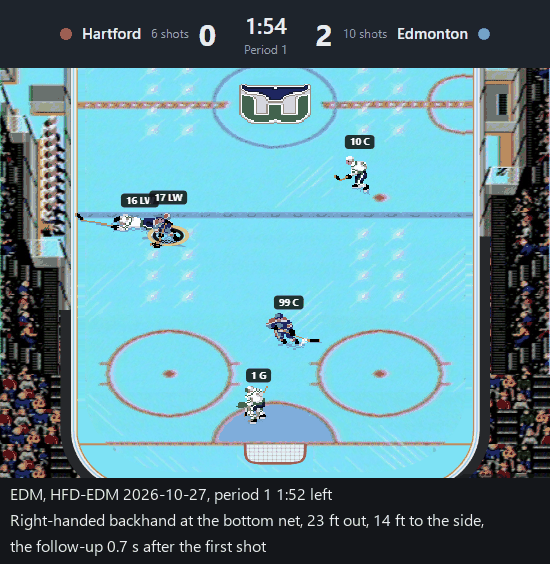

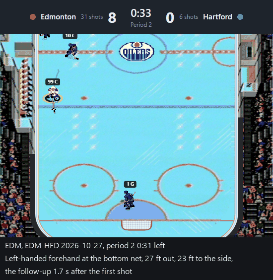

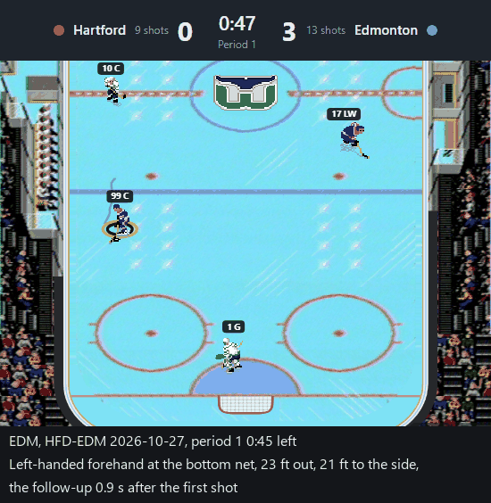

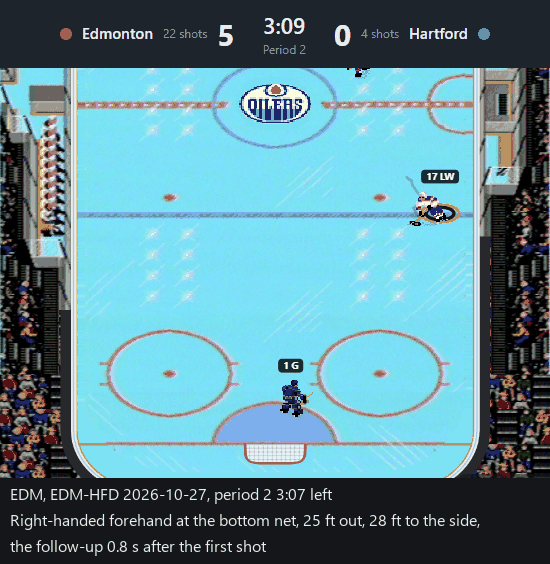

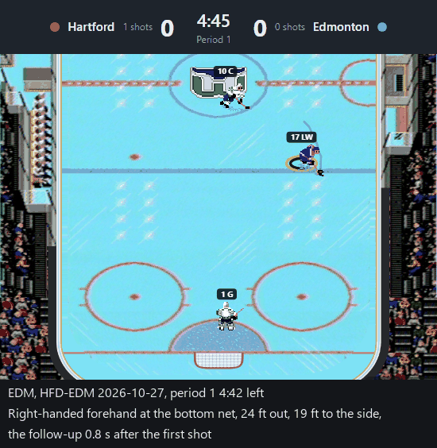

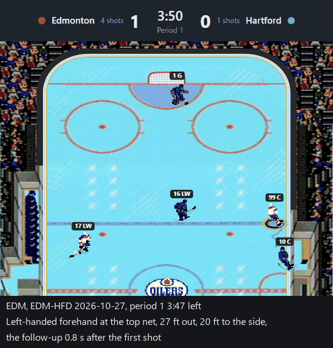

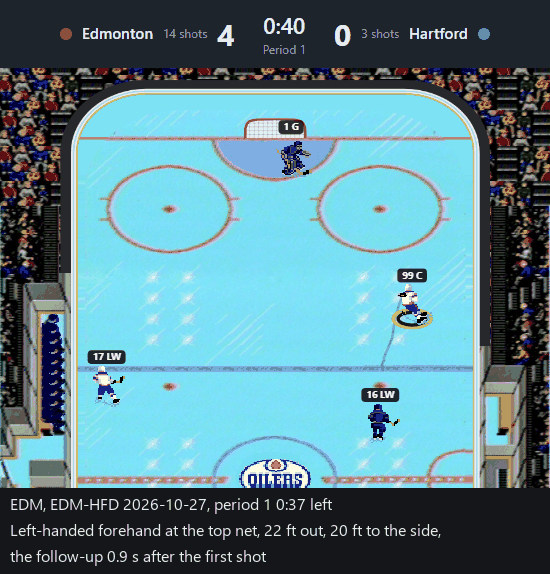

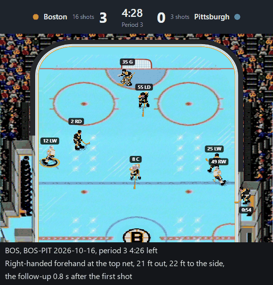
