# NHL '94 Scoring Maps: How the Simulation Was Built

Every shot in these maps was played in the real game, not a model: the Genesis and SNES ROMs ran headless thousands of
times faster than real time, and each shot was played out until it was a goal or a save. (2026-10-23. The findings are
also in [GENESIS_MECHANICS](GENESIS_MECHANICS.md) 4.10 and [SNES_MECHANICS](SNES_MECHANICS.md) 4.8; the run notes in
[PROJECT_NOTES](PROJECT_NOTES.md), "Scoring map"; the tools in [`analysis/scoring_map/`](../analysis/scoring_map/).)

## Contents

1. [At a glance](#at-a-glance)
2. [Building the Genesis simulator](#building-the-genesis-simulator)
3. [Making every Genesis shot count exactly](#making-every-genesis-shot-count-exactly)
4. [What went wrong and how it was fixed](#what-went-wrong-and-how-it-was-fixed)
5. [Building the SNES simulator](#building-the-snes-simulator)
6. [The goals that went in](#the-goals-that-went-in)
7. [Makes and misses, animated](#makes-and-misses-animated)
8. [How often each kind of goal happens](#how-often-each-kind-of-goal-happens)
9. [The maps](#the-maps)
10. [One-timers (Genesis, then SNES)](#one-timers-genesis)
11. [Limits and what comes next](#limits-and-what-comes-next)
12. [Rebuilding it yourself](#rebuilding-it-yourself)

## At a glance

A computer goalie who has set himself stops almost every shot from a standing shooter on both systems; the goals come
from a few gaps in the game's own rules.

| | Genesis | SNES |
| --- | --- | --- |
| Shots played | about 10.6 million launches for the map (800 per aim at each spot) + 1.09 million for the goal sample | 2.07 million for the map + 761,400 for the goal sample |
| Goals, averaged over every spot and aim | 1.18% | 0.36% |
| The biggest gap | A slapshot holding Down, straight at him from the middle: 21% (top net), 14% (bottom), up to 47%, through the butterfly's blind ring | A slapshot from 2-5 feet to the shooter's left of centre, 25-40 feet out, aimed at that side: about 50%, past his right-side save |
| Other gaps | Early pad stack (30-50% close in); the top net's shoulder-save bobble (31% at one spot) | Deflections off the edge of his body box |
| Emulator | Genesis Plus GX, a test ROM with a hook | Snes9x, the retail ROM unmodified |

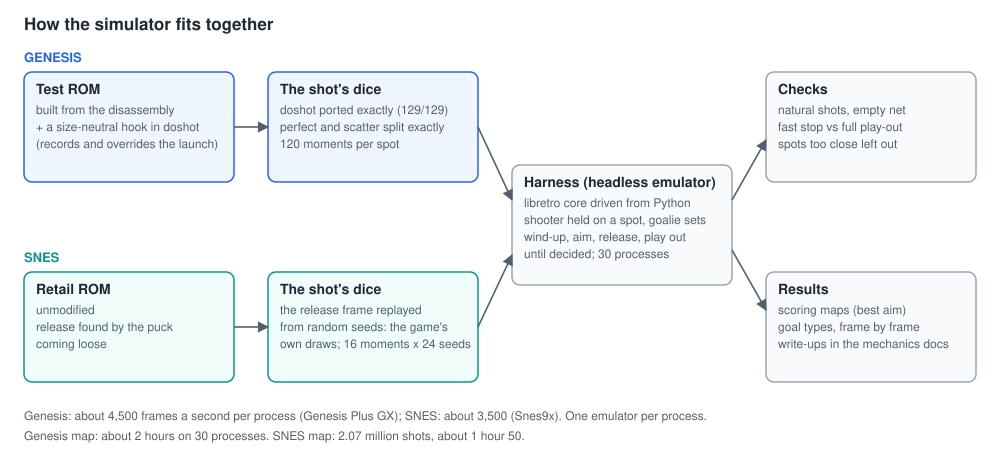

The two systems took different roads to the same harness. The Genesis map rebuilt the ROM from the disassembly with a
hook in the shot routine so its dice could be covered exactly; the SNES map ran the untouched ROM and let the game roll
its own dice millions of times.

## Building the Genesis simulator

The Genesis map runs a test ROM built from the community disassembly, with one small hook added to the shot routine,
inside a minimal emulator front end written for the job.

**1. The ROM.** The [NHL94Genesis](https://github.com/abdulahmad/NHL94Genesis) disassembly rebuilds the retail ROM byte
for byte. A copy of it is built with its own tools (SNASM68k), never in the clone itself. The build's listing gives the
address of every routine and variable.

**2. The hook.** The shot routine, `doshot`, is where the game turns the shooter's power, aim and accuracy into the
puck's speed. Two calls were added:

- one at the start of `doshot`, which records what goes in: the random seed, the shot power, the aim, the puck's spot
  and the goalie's animation;
- one just before its sound effect, which records the launch the game chose and, when a flag is set, replaces it with a
  launch the harness supplies.

Inserting bytes would have moved every routine after it and broken branches, so the hook had to fit in place. It does:
a 164-byte block in the button-handling code (`doinput_cbut`) is dead (nothing ever reaches it), and the two hook
routines plus padding fit in it with 8 bytes to spare, which pays for the two new calls. The hook writes to a RAM area
(`FFE000-FFE031`) the game never touches.

**3. The emulator.** A copy of RetroArch's Genesis Plus GX core is driven directly from Python through its libretro
interface (`emu.py`): load the ROM, load a saved state, hold buttons, run frames, read and write work RAM, take
screenshots. With no video or sound to show it runs about 4,500 frames a second per process. One core per process: a
second emulator in the same process takes over the first one's callbacks (this silently broke the first attempt).

**4. The game states.** `make_states.py` boots the test ROM through the menus (Montreal v Los Angeles, the defaults)
and saves two live moments: period 1, where the shooter attacks the top net, and period 2, the bottom net.

**5. A shot.** `harness.py` holds the shooter on a spot with the puck and every other skater parked out of the way
while the computer goalie sets himself (80-94 frames). It then presses the shoot button (C) for 3 frames (a wrist
shot) or 20+ (a full slapshot) with the d-pad held for the aim, and stops on the frame `doshot` runs.

## Making every Genesis shot count exactly

A shot's outcome depends on two random things: the dice `doshot` rolls at the release, and the moment the shot is
taken. The Genesis map covers the first exactly and the second with 120 moments per spot.

**The shot's dice, ported exactly.** `doshot` makes four random draws: a perfect-shot roll (the puck goes exactly to
the aim point) and, when that fails, three scatter draws (across, along and up). `shotport.py` is a line-by-line Python
copy of the routine, down to the 68000's integer rules (a division that overflows leaves its register unchanged; a
byte that wraps in the scatter size; the top-shelf lift for a few pad-stack cases). Checked against the hook's record
of the game's own launch: **129 of 129 shots identical**, both nets.

**Splitting the shots by the dice.** With the port, each aim's outcome is the perfect shot's chance times its result,
plus the scatter's chance times the average over scatter draws. The harness asks the hook to fire the launches it wants
(800 per aim at each spot), so no shots are wasted re-rolling the perfect case.

**What happens after the release is random too.** The goalie's movement never calls the random generator, but contact
does: whether he holds the puck or it bounces, and which way a deflection goes. The first version kept the seed after
the release and came out low (5.6% where natural shots gave 7.8%), so the seed is now randomised right after the
launch.

**The moment.** The same shot from the same spot can score at one moment and not the next: the goalie rethinks on a
5-frame cycle and has a countdown no player can see. A perfect slapshot just inside the post scored at 13 of 16
moments in one test. Each spot is played at 120 moments: the game clock at 590 down to 583, times 15 settle lengths
(80 to 94 frames).

**When a shot is decided.** Playing every shot 240 frames would waste time, so a shot stops when the goalie has held
the puck 20 frames, the puck has moved away from the goal 4 frames running, or it is 12 units past the goal line. This
agreed with full 240-frame play-outs on 1,475 of 1,475 shots. (A first version stopped the moment the goalie caught it
and missed six goals the top net's shoulder-save bobble lets in 48-79 frames later.)

**Which spots count.** Within about 30 units of the net, the goalie's set spot is the puck itself: he skates onto it,
and the shot would start inside him, which no game allows. A spot counts when, at the release, the puck is at least 24
units from his centre and in front of him, and the shooter at least 16 away (`validity.py`).

**The run.** 23 x 16 spots (x -110 to 110, 100 to 250 from centre ice, every 10 units), both nets, wrist shot and
slapshot, all nine aims; shooter working Shot Power 20, Shot Accuracy 15; Los Angeles's goalie (weight 48, Agility
13, Speed 13, Defensive Awareness 10). 30 processes, about 2 hours.

## What went wrong and how it was fixed

Every problem below was caught by a check before the results were used; the final Genesis map matches natural shots
(the game rolling its own dice from a random seed) within about one standard error at every spot tested.

| Problem found | How it showed | Fix |
| --- | --- | --- |
| Two emulators in one process | No shots happened at all: the second emulator took over the first's input | One emulator per process, shared by both nets |
| The hook moved code | Branches out of range when bytes were inserted | Made the hook size-neutral, inside a dead 164-byte block |
| Shots stopped too early | Six top-net goals missed: the shoulder-save bobble scores 48-79 frames after the catch | Stop only after the goalie holds the puck 20 frames |
| The seed kept after the release | 5.6% at one spot where natural shots scored 7.8% | Randomise the seed right after the launch |
| Too few moments | Results swung with the shot's timing | 16 moments, then 120 |
| Spots too close to the net | The goalie skated onto the puck; 65-100% "goals" from 28-48 units out | `validity.py`: the puck 24+ from his centre and in front of him |
| Replayed recorded shots started in the wrong spot | Up to about 195 units off | Settle 80 frames, then correct the start twice from `doshot`'s own record |
| Replays of recorded shots too sure of themselves | Worse shot-by-shot predictions than the xG model | Added the goalie's ratings, animation and a 2-4 unit position blur; the xG model still predicts recorded shots better |

**The checks that passed:**

| Check | Result |
| --- | --- |
| Ported shot code against the game's own launch | 129 of 129 identical |
| Map against natural shots, four spots (map / natural) | 51.6 / 52.0%, 32.6 / 33.9%, 7.3 / 7.8%, 43.0 / 44.4% |
| Fast stop against full 240-frame play-outs | 1,475 of 1,475 agree |
| 135 recorded shots at computer goalies, replayed in the game | 20.5-22.5 expected goals against 22 scored |
| SNES harness with the goalie moved away | Close to the mechanics doc's empty-net rates (80% / 95% / 60% / 78% on 40 shots each, against 87% / 100% / 49% / 68%) |

## Building the SNES simulator

The SNES map needed no test ROM: the unmodified retail ROM runs in a copy of RetroArch's Snes9x core, and the game
rolls its own dice for every shot.

**1. The emulator.** The same Python front end, pointed at Snes9x (`snes_emu.py`), about 3,500 frames a second per
process. SNES work RAM is read in its natural byte order (the Genesis core stores it in swapped pairs).

**2. Reading the code.** From the [NHL94SNES](https://github.com/abdulahmad/NHL94SNES) disassembly: the shot is
`doshot`, started by the A button (`SetShotMode`, then `ShotMode` each frame); tapping A jumps the shot animation to
its end (a wrist shot leaves on frame 3), holding it winds up a slapshot (released on frame 26). The random generator,
`RandomWord`, is two 16-bit shift registers at `7E0792` and `7E0794`. The puck carrier is `puckc` (`7E0AD9`),
negative when the puck is loose.

**3. The game states.** `snes_make_states.py` presses Start 12 times from power-on to reach the rink, then once more:
Los Angeles (home, pad 1, the centre controlled) against Montreal, with Los Angeles attacking the top net in period 1
and the bottom net in period 2, both against Montreal's goalie.

**4. Finding the release.** During the wind-up the harness saves the state before every frame; the frame on which the
puck comes loose is the one where `doshot` ran.

**5. Natural sampling.** That frame is replayed from a fresh random seed each time, so every draw comes from the game
itself: the perfect-shot roll, the scatter, the goalie's look-ahead (the SNES goalie's positioning does use the random
generator), rebounds and post deflections. No ported code is involved, so there is nothing to verify against.

**6. The run.** 23 x 17 spots (x -110 to 110, 90 to 250 from centre ice, every 10 units), both nets, wrist shot (A
held 3 frames) and slapshot (A held 40), all nine aims; 16 moments (a seed for the settle, the clock, 80-94 frames to
settle) x 24 release seeds = 384 shots per aim at every spot. The shooter is the typical recorded SNES shooter:
working Shot Power 13 and Shot Accuracy 13, the median of 297 recorded shots. 782 jobs on 30 processes, about 1 hour
50 minutes, 2.07 million valid shots.

**Too few moments, found later (2026-10-23):** the map sampled 16 of the 120 moments (clock x settle) a spot, and the
goal rate swings by about 0.27 (standard deviation) from moment to moment, so a single square is only good to about 7
points either way. Over all 120 moments (480 shots each): the top-net lane spot (10 left of centre, 88 out, Left held)
53.6% (map 47.7%), the bottom-net one (10 right, 118 out, Right held) 26.5% (map 30.2%), the mirror spot 1.7% (map
0.8%). The findings stand; the squares' exact values would need a rerun at 120 moments.

**The lane depends on the game's frame timing** (found making the animations, 2026-10-23). The SNES game doesn't move
the puck every frame, and the lane puck passes at the edge of the goalie's body box (11-12 from his centre), so which
frames it is checked on decides goal or save. Replaying the same shots with only the shooter's position changed (left
where he shot, instead of moved away as the map does with every skater) shifted the frames the puck stood still on,
and the result with them: over 480 shots each, 53.8% at the top-net lane spot (53.6% with him moved), 20.4% at the
bottom-net one (26.5%), 0.8% at the mirror spot (1.7%). The Genesis moves the puck every frame and didn't change. In a
real game, with ten skaters on the ice, the timing differs again: the lane is real, but its rate in games is uncertain
until the practice test in NEEDS_FROM_YOU (item 6) is done.

**7. Narrowing the lane.** The 10-unit grid showed hot squares next to near-zero ones. A second pass at 2- and 3-unit
steps across the middle (96 shots per aim per spot) showed one lane about 10 units wide, and tracing single shots frame
by frame showed why (below).

## The goals that went in

Almost every goal against a set goalie comes through one of a few gaps in the game's rules, and each one below is a
real goal replayed in the game (`goal_frames.py`). The frames are the emulator's own output, zoomed 3x on the net. The
diagram under each (`goal_diagram.py`) is drawn from the game's numbers frame by frame: the crease from above (one dot
per frame for the puck, coloured by height; grey dots for where the goalie moved; his reach or body box and save area
as they were when the puck passed closest) and the puck's height on the way in.

### Genesis 1: through the butterfly's blind ring (47% of Genesis goals)

A slapshot with Down held, from straight in front of him 118 units out, at the top net. A flat puck arriving at his
middle makes him drop into the butterfly. The ring around his stick doesn't touch a puck on the ice, so it passes his
centre (3 units off it, frame 12), hits his body behind his centre and bounces in. 5,629 of the 6,051 such goals were
slapshots; 4,514 were at the top net.

### Genesis 2: past his early pad stack (23%)

A wrist shot aimed down-left from 68 units out, 60 to the side, at the bottom net. He started sliding into a pad stack
as the shot was wound up (his reach grows to 18), but he slid the wrong way: the puck crossed the line 21 units from
his centre.

### Genesis 3: clean, never within his reach (21%)

A slapshot aimed high (Up) from 118 units out at the top net. It rises on the way in and passes 14 units from his
centre at height 9, just beyond his reach of 13, and goes in under the crossbar.

### Genesis 4: held, then carried into the net (7%, top net only)

A high wrist shot from the far left boards, 78 units out. He catches it in a high shoulder save and, still holding it,
drifts back into his own net: 882 of the 905 such goals were at the top net (the shoulder-save bobble).

### SNES 1: past his right glove save (the lane)

A slapshot aimed Left from 10 units left of centre, 88 out, at the top net. The puck passes 12 units from his centre,
just outside his body box (11). He's in his right glove save, whose save area (green) covers heights 7-15 and sits
close to his body; the puck goes by at height 4.

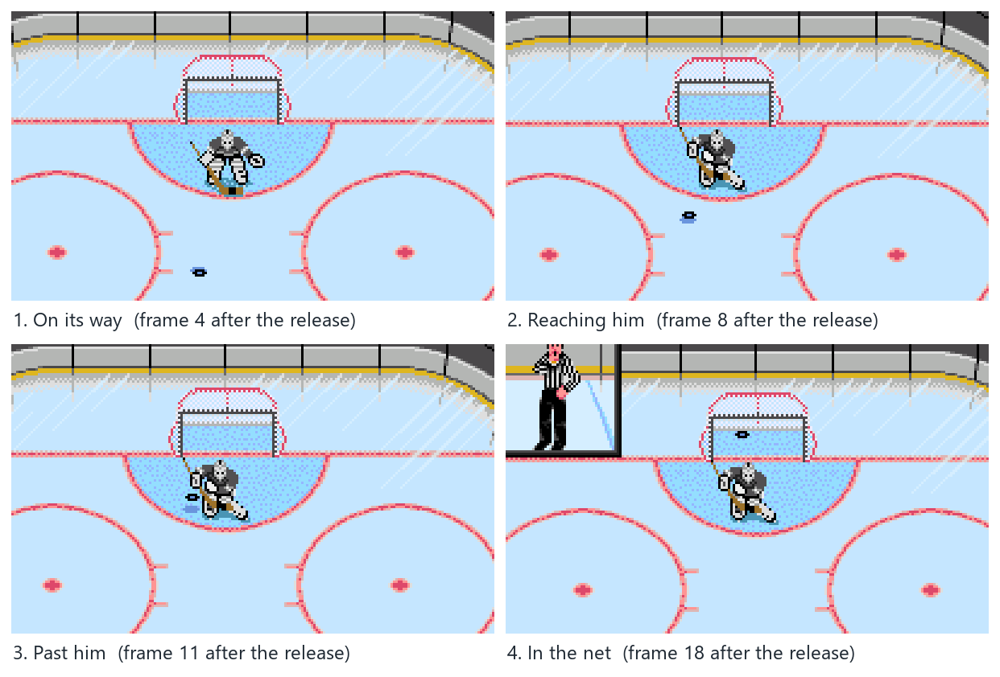

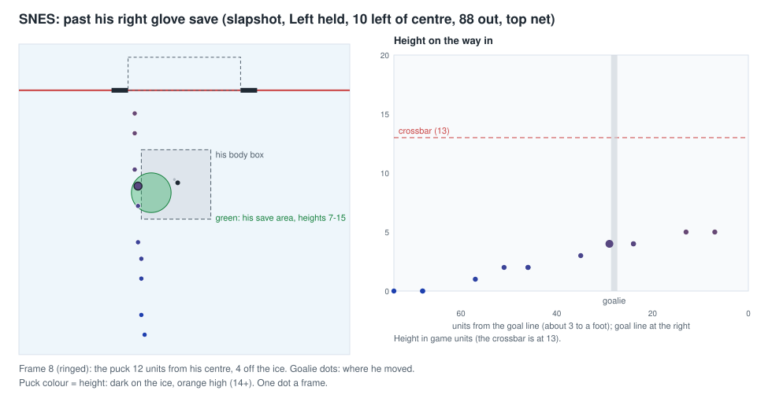

### SNES 2: past his right stick save

The same lane at the bottom net: a slapshot aimed down-right from 10 right of centre (the shooter's left), 118 out.
The puck stays on the ice and passes 13 units from his centre; his stick save's area is a small circle at the corner of
his body box, 2-5 off the ice, so the puck slides under it.

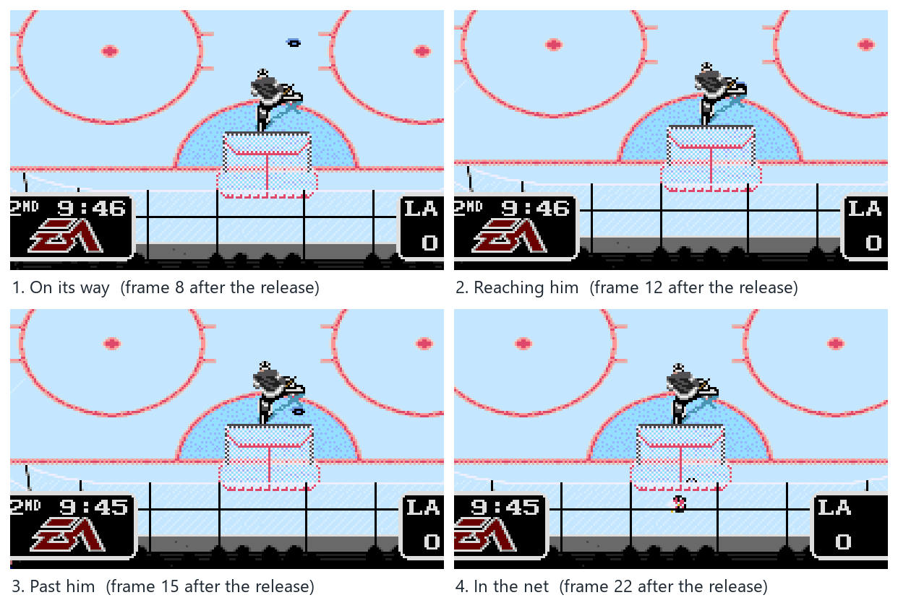

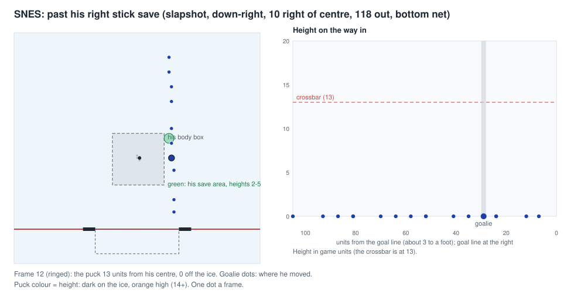

### SNES 3: past his right sprawl

A slapshot aimed down-left from 14 left of centre, 88 out, at the top net. The puck passes 12 units from his centre on
the ice; the sprawl's save area at that moment covers heights 4-8, so it goes under.

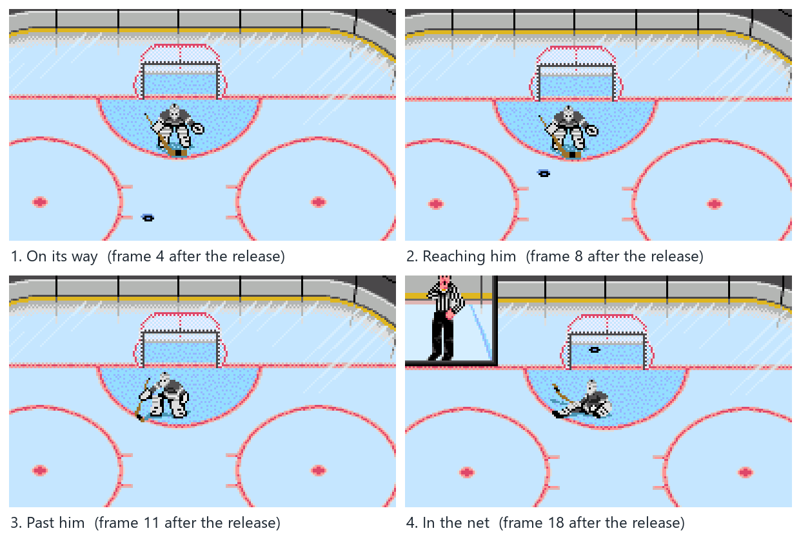

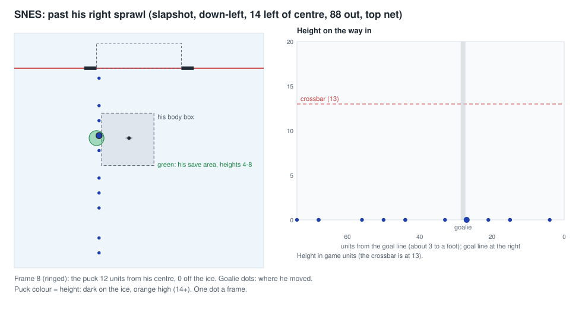

### SNES 4: off the goalie (24% of SNES goals)

A puck that clips the edge of his body box and deflects in. Here a slapshot from 10 left of centre catches his edge 11
units from his centre and glances into the net. Most of these were wrist shots (423 of 645).

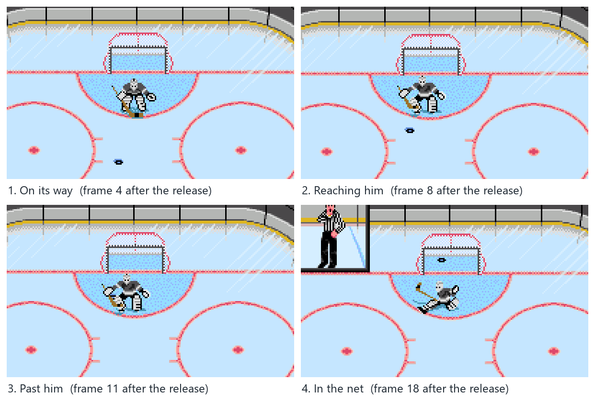

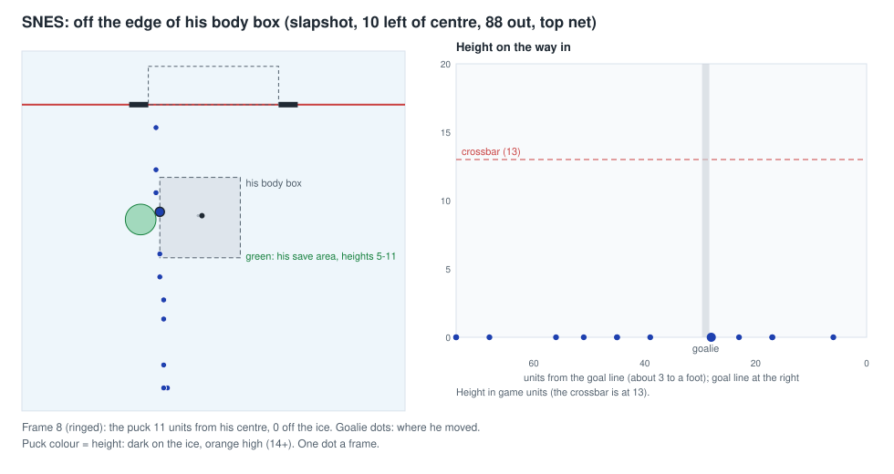

## Makes and misses, animated

At each worthwhile spot, 120 shots were played (one at each of the 120 moments, a fresh random seed each,
`animate.py`) and kept frame by frame. For each spot there are two animations, both at half speed:

- **Nine real clips** side by side: the game's own frames from the wind-up on, showing the shooter and the net, with
  goals in the spot's real proportion, each labelled with what happened (GOAL, SAVED, POST, MISSED) when it's decided.
- **All 120 shots from above at once:** each puck's trail (orange in, grey saved, purple off the post, pale missed), the
  shooter's spot, and the goalie as a dark dot. Shots that went exactly where aimed share one path, so many goals can
  look like a single orange line.

The shooter stays on the ice after the release (the map moves him away). The Genesis rates are the map's (all 120
moments; keeping the shooter changes nothing there). The SNES rates come from 480 shots over all 120 moments with the
shooter on the ice, since on the SNES that changes the result (the frame timing above).

### Genesis: slapshot holding Down, straight in (top net 43%, bottom 10%)

The same shot at the bottom net goes in far less often:

### Genesis: the early pad stack (34%)

### Genesis: the shoulder-save bobble (31%)

### SNES: the lane (top net 54%, bottom 20%)

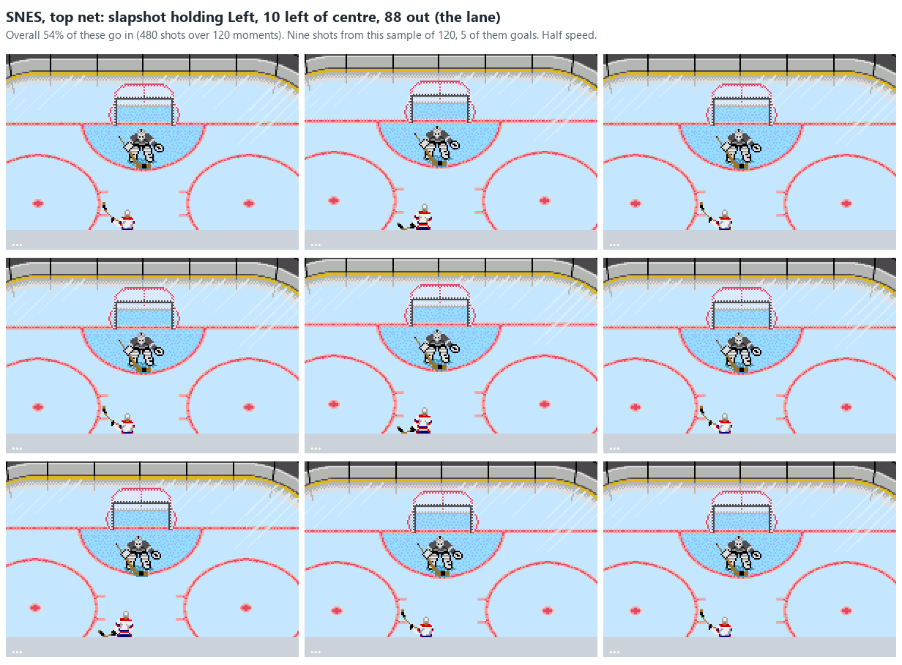

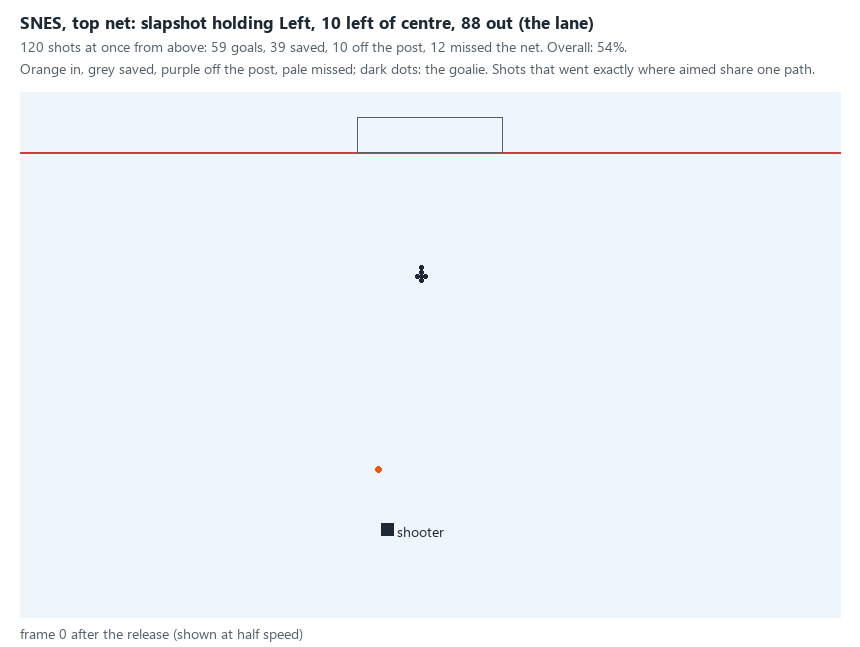

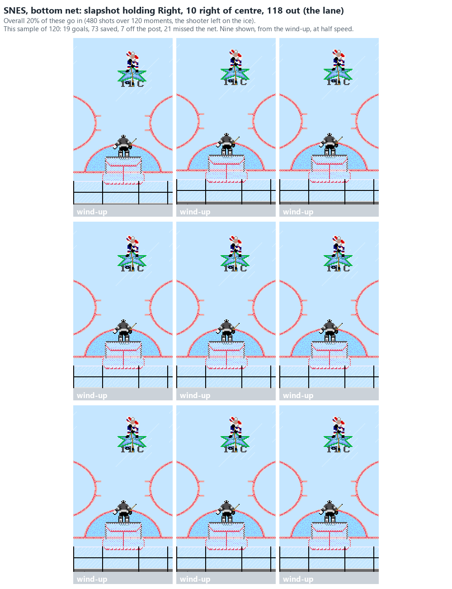

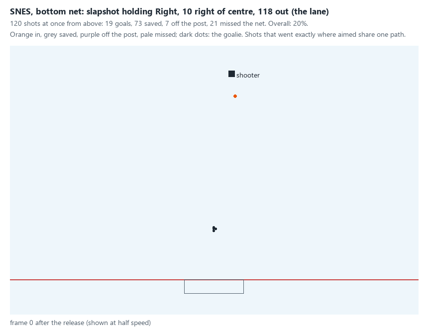

### SNES: the mirror shot (1%)

The same slapshot from 10 right of centre, aimed right, at the top net: his left-side saves cover it.

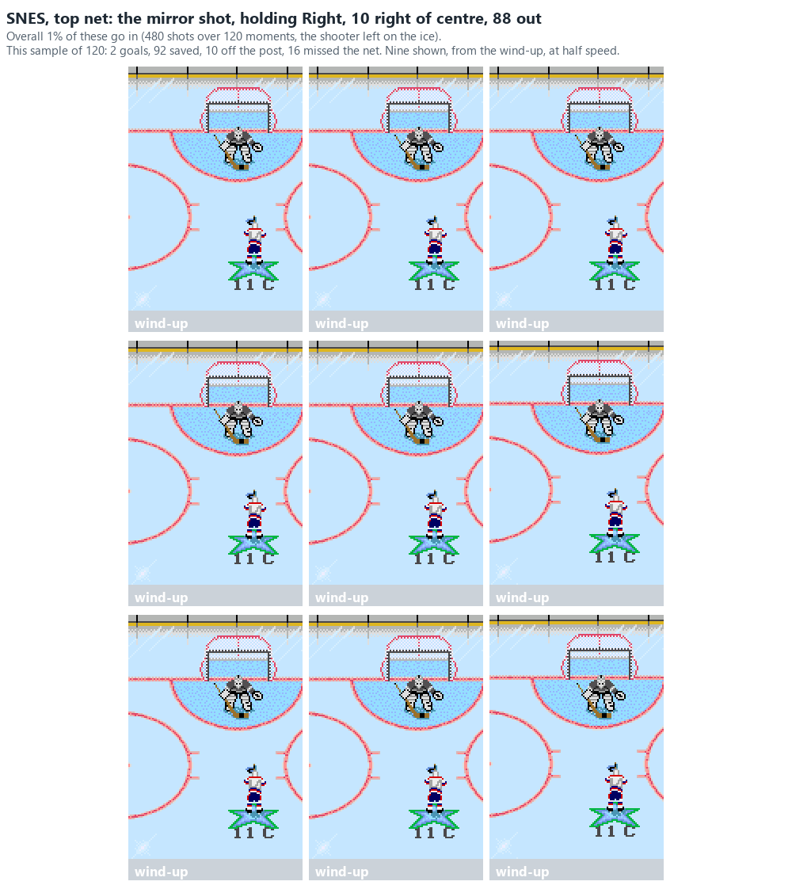

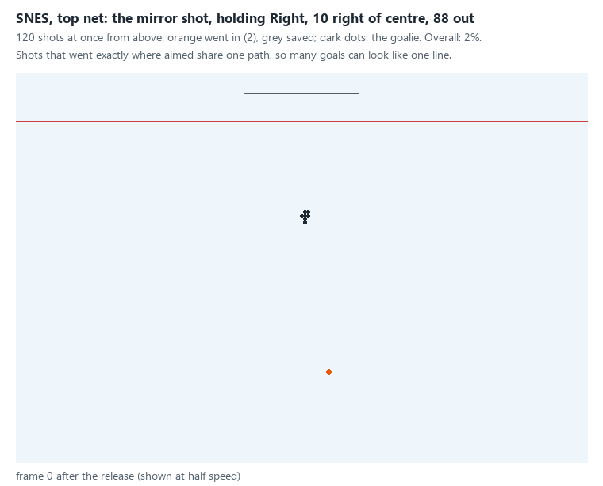

## How often each kind of goal happens

On the Genesis nearly half the goals go through the butterfly's blind ring; on the SNES half go past a save move on
the goalie's right, against a fifth past one on his left.

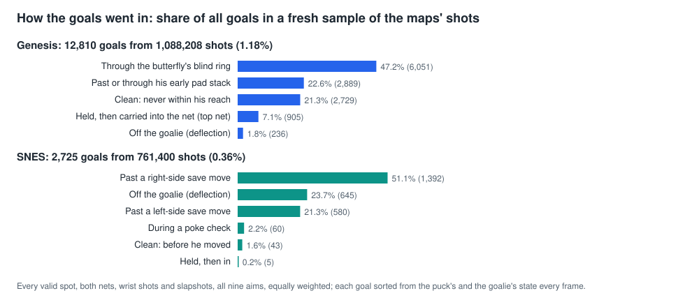

The sample (`goal_types.py`) is fresh: the same spots as the maps, both nets, wrist shots and slapshots, all nine aims,
each equally weighted, with the game rolling its own dice. Every goal was sorted by what the puck and the goalie did
each frame between the stick and the net:

- **Held, then in:** the goalie had the puck and it still crossed the line.
- **Off the post / off the goalie:** the puck's speed jumped near a post or near the goalie before it went in.
- **Genesis, through the blind ring:** the puck passed his centre low and untouched, or touched him only behind his
  centre (his body, after slipping past the stick).
- **Genesis, pad stack:** he was in a pad stack as it passed. **Clean:** it never came within his reach.
- **SNES, past a save move:** he was in a save move as it passed and nothing touched it, named by the move
  (`GoalieSaveList`). Of the 911 goals from the lane, 873 passed a right-side move (glove 491, stick 293, sprawl 89),
  35 were deflections and 3 passed a left-side move.

The two systems' rates differ partly by design: the Genesis map's shooter is stronger (Shot Accuracy 15 against 13).

## The maps

A set computer goalie stops nearly every shot from a standing shooter on both systems; each map's hot spots are the
few places a rule of the game leaves a gap. Each square is one spot, coloured by the chance with the best of the nine
aims; the arrow is the d-pad direction to hold (Up is always high, Down along the ice). Grey squares are spots too
close to the goalie for a real shot.

**Genesis** (Shot Power 20, Shot Accuracy 15; Los Angeles's goalie):

- Wrist shots: under 1% averaged over the aims; the best aim reaches 4-5% in patches.
- A slapshot holding Down, straight at him from the middle, 30-55 feet out: 20.7% at the top net, 13.6% at the bottom,
  up to 47% at the best spots (through the butterfly's blind ring).
- Close in (within about 20 feet): the early pad stack, 30-50% with a down-diagonal aim to the side he slides away
  from.
- The top net's far-left high wrist shot: 31%, every goal the shoulder-save bobble.

**SNES** (Shot Power 13, Shot Accuracy 13; Montreal's goalie):

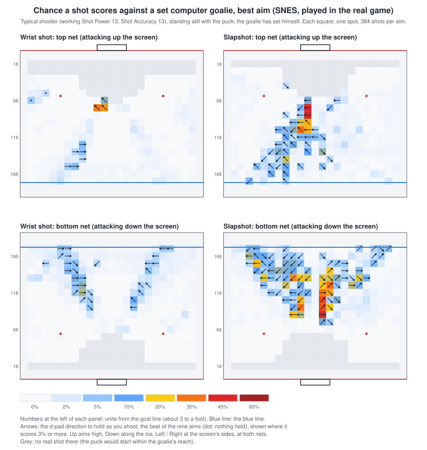

- Averaged over the aims everything is under about 1%; nothing within 20 feet.
- One lane: a slapshot from 2-5 feet to the shooter's own left of centre, 25-40 feet out, aimed at that side, scores
  about half the time. The mirror shot on the right scores 0-3%.
- The rays of blue squares pointing at the net are the same gap reached from farther out at an angle.

## One-timers (Genesis)

The same harness, now with a pass: a passer holds the puck, a teammate stands where the one-timer will be taken, the
computer goalie sets himself, the passer passes toward the teammate and the one-timer button (C) is pressed during the
pass, then the swing is played to the strike and the shot played out from fresh random draws. The Genesis aims
one-timers itself, so there is no aim to choose. 824 set-ups: 42 receiver spots (10 to 52 feet out, up to 30 feet
either side of the middle) with 6-13 passer spots each, at both nets, each with the button pressed early (2-5 frames
after the pass leaves) and late (2-10 frames before the receiver would take it), 32 moments of the game clock per
set-up. Same shooter and goalie as the maps. (`ot_harness.py`, `ot_run.py`, `ot_report.py`; run 2026-10-23 in
gentle mode, two one-hour chunks.)

**The swing usually connects:** the pass reached the press in 98% of early presses and 83% of late ones (otherwise
the receiver had already taken it), and the swing struck the puck in 83% and 91% of those.

**Where it scores** (goals per struck one-timer, averaged over the passers, both nets and both timings):

| Receiver's distance out | Middle | 10 ft to one side | 20 ft | 30 ft |
| --- | --- | --- | --- | --- |
| 10 ft (the doorstep) | 62% | 39-40% | 17-27% | 8% |
| 18 ft | 49% | 46-53% | 32-34% | 9% |
| 27 ft | 44% | 31-40% | 15-17% | 5-6% |
| 35 ft | 13% | 6-14% | 2-3% | 1-2% |
| 43 ft | 2% | 1-2% | under 10% | under 15% |
| 52 ft | 1% | 0-2% | 0-2% | 1-2% |

Two ranges in a cell are the left and right sides. A few far spots show a high best rate from a handful of strikes (a
pass that rarely connects); they are not real gaps.

- **Inside about 27 feet and within 20 feet of the middle, a one-timer is a good chance;** beyond 35 feet it almost
  never scores. Compare a standing shot at a set goalie: about 1% averaged over the spots and aims.
- **The pass across is the one to make.** With the receiver inside 18 feet: a pass from the other side at the same
  depth scores 63% on average (13 of 18 set-ups over half), one from the other side and farther out 43%, one from his
  own side 20-30%. **Why: the goalie is still on his way.** At the strike the computer goalie is a median 12 units off
  the line from the puck to the middle of the net after a pass across, moving 50 units a second, against 3.7 units and
  29 a second after a pass from the same side (a sample of 210 strikes with the receiver inside 18 feet, read from the
  game at the strike frame). Over both kinds, a goalie 10 or more off that line let in 86%, one within 5 of it 25%. The
  pass across moves the puck across his crease and he follows it; the one-timer leaves before he is square again. (The
  recorded-games study found the same: the goalie 10 or more off the line at the strike, 68% scored.)
- **The best set-ups are close to automatic:** the receiver on the doorstep in front of the net with the pass from 14-20
  feet to either side (90-99%); the receiver 10 feet to one side on the doorstep with the pass from 30 feet on the far
  side (88-94%); the receiver 18 feet out and 10 to one side, the pass from 10 feet to the other side (77-79%).
- **Timing barely matters on average:** early and late presses score the same overall (about 14-16% over every
  set-up). A given set-up can favour one; the swing has narrow timing holes where it whiffs.
- **The two nets agree on average** (14-16% each) **but not spot by spot:** about one set-up in six differs by more
  than 15 points between the top and bottom net, up to 60. It is not a left-right mirror (flipping one net doesn't
  line them up better) and not sampling noise (about 1 point a set-up): as with the Down slapshot in the maps, a unit of
  position decides whether the puck meets the goalie's body, so which net is better at a spot is geometry no player can
  aim for.
- **Recorded games agree:** the earlier study of 91 recorded Genesis one-timers ([SHOOTING_STUDY](SHOOTING_STUDY.md)
  part 3) found 44% scored inside 100 units (33 feet) and 10% beyond, with passes that moved the puck across scoring
  most.

**The xG model gets one-timers right.** At 748 strikes from 59 of the set-ups (both nets, both timings, 8 moments
each; `ot_xg_check.py`) the game's own rate, from 8 fresh seeds a strike, was set beside the viewer's xG for a recorded
one-timer from the same state (the goalie's position, speed and ratings, the puck's spot and speed, auto-aim, reach
12): the game 20.7% overall, the model 22.1%; correlation 0.83 strike by strike; log loss 0.290 against 0.510 for one
rate for all. Pass across (receiver inside 18 feet): game 69%, model 67%; from the same side 24% and 24%. Without the
position blur, or with the goalie's stick and rebound, it does no better (log loss 0.32), so the model stays as it is:
what decides a one-timer is where the goalie is when it is struck, and the model already reads that from the
recording.

### One-timers on the SNES

The same 824 set-ups on the SNES (retail ROM, Snes9x), the one-timer button A pressed early or late in the pass and
each of the nine d-pad directions held from the press (the SNES reads the aim during the swing), 32 moments, 4 seeds a
strike. Run 2026-10-23 in nine one-hour chunks, gentle mode.

**The swing connects even more often than on the Genesis:** 92% of the presses the pass reached struck the puck.

**Where it scores** (goals per struck one-timer; first averaged over the nine aims, then at the best aim for each
set-up; averaged over the passers, both nets and both timings):

| Receiver's distance out | Middle | 10 ft to one side | 20 ft | 30 ft |
| --- | --- | --- | --- | --- |
| 10 ft (the doorstep) | 44% / 62% | 35% / 53-55% | 10-11% / 4-20% | 7-9% / 12-14% |
| 18 ft | 24% / 56% | 18-21% / 38-46% | 9-12% / 21-27% | 2-3% / 5-8% |
| 27 ft | 13% / 34% | 11-15% / 31-37% | 9-10% / 25-26% | 2-3% / 6-9% |
| 35 ft | 8% / 26% | 5-8% / 16-24% | 5-7% / 14-15% | 1% / 3% |
| 43 ft and beyond | 0-3% / 1-11% | | | |

- **The aim matters on the SNES** (the Genesis aims one-timers itself): the best aim roughly doubles the average one,
  and beyond the doorstep it is the difference between a poor chance and a good one.
- **The pass across is even more decisive than on the Genesis:** with the receiver inside 18 feet, a pass from the
  other side scores 36% over the aims and 58% at the best aim; one from his own side 7% and 16%.
- **The doorstep in the middle is a little weaker than on the Genesis** (62% at the best aim against 62% with the
  Genesis's own aim; 44% over all the aims), and the SNES falls off faster with distance.
- **The SNES xG model gets them right:** at 3,627 strikes played in the game (`ot_xg_check_snes.py`) the game 8.9%,
  the model 7.8%, correlation 0.82; the pass across 45% / 42%, from the same side 1% / 3%. Unchanged.
- Averaged over every set-up and aim, a SNES one-timer scores about 6%; the Up aim is the poorest (3.6%), the
  diagonals toward the shooter's sides the best (7-9%), but the right aim depends on the spot and the net.

## Strong shooters' slapshots (2026-10-24)

The user: far-post slapshots work more often for strong, accurate shooters. The same 70 spots for each (slapshots from
the middle half of the ice, x -60..60 by 20, 30-55 feet out, both nets; `NHL94_SMAP_SUBSET=slapmid` with `map_run.py`
and `snes_map_run.py`), a set computer goalie. "Best aim" is the best of the nine aims at each spot.

| | Usual shooter | Strong shooter |
|---|---|---|
| Genesis (Shot Power / Accuracy 20 / 15 against 27 / 27) | 13% at the best aim | **23%** |
| SNES (13 / 13 against 15 / 15, the most the SNES gives) | 3.8% | **6.1%** |

- **Strength nearly doubles a slapshot's chance on both systems**, at every distance (Genesis 100 out 12% to 23%, 140
  out 17% to 28%, 180 out 10% to 14%; SNES best at 120 out, 5.7% to 10.8%).
- **Near and far post (the league's words, the user):** by the shooter's hand, wherever he is. Right-handed: the
  goalie's left is the far post, his right the near post; left-handed: the goalie's right is far, his left near. So
  the far post is on the shooter's forehand side. Both test shooters shoot left (Genesis +$76 bit 0 set; SNES
  attribute bit $0800 clear), so their far post is the goalie's right.
- **Genesis, from the middle of the ice: the far post is the best aim** (strong shooter: far post at mid-height 21%,
  high 19%, against 11% for Down's ice-level middle; usual shooter 14% / 12% / 9%). From his forehand side (left of
  the middle for a left-hander) Down is best (9%), the far post next (5%); from his backhand side Down (13%), the near
  post hardly scores (2% or less).
- **SNES: the post on the shooter's side of the ice.** From his forehand side the far post (strong 5-6%, usual 3-4%),
  from his backhand side the near post (strong 6% high, usual 3%), from the middle almost nothing (2% or less). The
  user: SNES slapshot goals are rare and usually near post; the near post scores from the backhand side here.
- A standing shooter, a set computer goalie: the user's far-post slapshots in games are taken skating across (below:
  Neely's in the 2026-10-23 games), which this part doesn't have.

### Every Shot Power and Accuracy (Genesis, 2026-10-24)

The user: long far-post slapshots are taken by shooters of 4 / 4 or better; below 4, especially in power, the puck
doesn't get past the goalie often enough. The same slapshot (held 20 frames) from 18 spots (x -40 / 0 / 40, 104-144
out, both nets; `NHL94_SMAP_SUBSET=slapcore`), a set computer goalie, for each roster step 2-6 of Shot Power and of
Shot Accuracy (working value = step x 5, before hot / cold). The best aim's chance, averaged over the spots (in
brackets: from the middle, x 0):

| Shot Power \ Accuracy | 2 | 3 | 4 | 5 | 6 |
|---|---|---|---|---|---|
| 2 | 4% (7%) | 4% (9%) | 5% (9%) | 4% (9%) | 5% (10%) |
| 3 | 5% (8%) | 6% (10%) | 7% (12%) | 7% (13%) | 7% (13%) |
| **4** | 14% (25%) | 17% (30%) | **19% (33%)** | 20% (33%) | 21% (36%) |
| 5 | 19% (31%) | 22% (38%) | 24% (41%) | 27% (44%) | 27% (46%) |
| 6 | 24% (31%) | 28% (36%) | 31% (41%) | 34% (44%) | 35% (46%) |

- **Shot Power has a threshold between 3 and 4, as the user said:** at accuracy 4 the chance nearly triples from 7%
  to 19%. Below 4 the slapshot hardly scores from anywhere (4-7%), whatever the accuracy. Above 4 each step of power
  adds 5-10 points over the spots, but from the middle 5 and 6 are about level.
- **Accuracy matters only once the power is there:** from 2 to 6 it adds 1-2 points at power 2-3, 7-11 points at
  power 4-6.
- **Distance:** from the middle at accuracy 4, power 4 scores 27% / 35% / 58% at 144 / 124 / 104 out (about 48 / 41 /
  35 feet); power 3 7-17%, power 2 7-15%.

## Moving shooters (Genesis, 2026-10-24)

`mv_run.py`: the shooter skates (speed 8000) with the d-pad held his way while a set computer goalie waits, and takes
a wrist shot (C tapped) at a set release point with each of the nine aims; 16 moments x 4 seeds per aim, both nets
and both sides.

- **Across the crease (the user's method 3: a soft shot into the far side before the goalie gets there):** from 90 to
  one side, skating across. **Aimed the way he is skating**: 51-53% at 35 out (about 11 feet), 32-38% at 45 out;
  **aimed back the way he came: 0-1%**; straight at the middle 13% at 35 out, 2% at 45. The way he skates decides,
  not the post: crossing toward his forehand side that is the far post (55% at 35 out), toward his backhand side the
  near post (48%). Released
  just before the middle is best (35 out: 80% at 20 short of the middle, 72% at the middle, 49% at 20 past, 18% at 40
  past). Holding nothing but his skating direction scores as well as aiming that way. At 25 out he never gets the shot
  off: the goalie takes the puck.
- **On the 45-degree diagonal straight for the net (method 5: the near post as the goalie starts for the far
  one):** almost nothing against a set computer goalie: 0-2% released 100 to 60 out, 5-8% at 45 out aimed at the near
  side, far side and middle 0%. The goalie stays on the puck's line (1-6 units off it), so there is no near post to
  hit; the method needs the goalie to start across first, which a computer goalie doesn't do on his own here.
- **Slapshots skating across (the user's far-post slapshot; Neely's 4-1, 6-3 and 7-4 in 2026-10-23_1126_LA-BOS),
  plans "slapx" / "slapxslow":** a strong shooter (27 / 27, left-handed) from 130 to one side, 85 / 105 / 125 out
  (about 28 / 35 / 42 feet), a full wind-up begun at five points across; he glides about 50 through the wind-up, so
  the shots left from 7 before the middle to 70 past it. Starting at half speed changed nothing (he speeds back up with
  the d-pad held: the same release points).
  - **Crossing toward his stick side, the far post (ahead of him) is the shot: 50-62% released just before or at the
    middle from 85-105 out** (from 125 out, at the bottom net only: 64% with the wind-up begun 60 before the
    middle, 36% from 40 before; see the note below), against 21% for the best standing slapshot from the middle. It
    falls fast once he is past the middle (10-15% released 30 past, 0-4% beyond). The near post (behind him): 0-2%.
  - Crossing toward his backhand side the near post is ahead, and does worse: 34-36% released at the middle from 85
    out, 6-16% from 105, 0-34% from 125 (uneven between the nets).
  - **A fault in the runs at one start, found 2026-10-24:** from 130 to the right at 125 out at the top net, the
    skater is turned back toward centre ice about 24 frames in (the release points read 190-254 out), so those
    set-ups say nothing about the shot. They are left out of every 125-out figure here; that start's cause is not yet
    found. Mapped: at the top net only, a skater crossing leftward at 125-140 out is turned back on reaching
    about 70-78 to the right of the middle (at 145 out and beyond he passes; at the bottom net, nothing). No object
    record stands there. No other run crosses that patch (the diagonal and standing runs were checked). The other three starts at 125 out (left at the top net, both at the bottom) skate normally.
  - So the far-post slapshot is a skating shot: across toward the stick side, released in front of the middle. Neely's
    7-4 left from 50 before the middle, 86 out, earlier than any release tried here.
- **Every Shot Power and Accuracy (plan "slapxr", 2026-10-24):** crossing toward the stick side only, the wind-up
  begun 60 or 40 before the middle, 85 / 105 / 125 out (about 28 / 35 / 42 feet), both nets (125 out: the bottom net
  only, the fault above), roster steps 2-6 of each (working = step x 5). The best aim's chance, averaged over the set-ups (in brackets by distance):

  | Shot Power \ Accuracy | 2 | 4 | 6 |
  |---|---|---|---|
  | 2 | 7% (14 / 4 / 2%) | 7% (14 / 4 / 1%) | 9% (16 / 5 / 3%) |
  | 3 | 12% (23 / 6 / 4%) | 15% (26 / 9 / 5%) | 17% (29 / 10 / 6%) |
  | **4** | 34% (48 / 33 / 9%) | **44% (62 / 41 / 10%)** | 48% (70 / 45 / 11%) |
  | 5 | 41% (46 / 44 / 23%) | 53% (61 / 56 / 30%) | 59% (68 / 62 / 36%) |
  | 6 | 47% (47 / 55 / 30%) | 61% (62 / 69 / 43%) | 68% (68 / 78 / 50%) |

  - **The same threshold between Shot Power 3 and 4 as standing** (15% to 44% at accuracy 4): the user's 4 / 4 rule.
  - **Distance needs power:** from 85 out power 4 is as good as 5 or 6 (about 60%); from 105 out each step adds 10-15
    points; from 125 out power 4 scores about 10%, 5 about 30%, 6 30-50%.
  - Accuracy adds 10-20 points at power 4-6, a few at 2-3.

### The skating far-post slapshot by rating, animated

`slapx_animate.py`: the slapxr set-up at the bottom net (a left-hander starting 130 to his right,
crossing to his stick side, the wind-up begun 60 before the middle), aimed at the far post ahead of him. Each rate is
the ratings run's for that exact set-up and aim (64 shots); the clips show goals in about that proportion. Each pair:
four attempts in the game's own frames, then 24 attempts from above, turned so the net is at the top.

**Shot Power 3 / Accuracy 3, 105 out (35 ft): 3%** (2 of 64).

**Shot Power 4 / Accuracy 4, 105 out (35 ft): 44%** (28 of 64).

**Shot Power 6 / Accuracy 6, 105 out (35 ft): 80%** (51 of 64).

**Shot Power 4 / Accuracy 4, 125 out (42 ft): 14%** (9 of 64).

**Shot Power 6 / Accuracy 6, 125 out (42 ft): 59%** (38 of 64).

## Dekes and floaters (Genesis, 2026-10-24)

`deke_run.py` plays the user's close-in moves (PROJECT_NOTES "Examples in the 2026-10-23 BOS-LA games") against a set
computer goalie, with the inputs read from those recordings. He comes in with his facing a step to one side. Close in,
he holds the other diagonal (up-left or up-right; straight left or right turns him sideways and C then drops the
puck). His facing swings two steps, and the puck crosses in front of him in about 15 frames while his skating barely
changes. He then taps C with the swing's side held, a wrist shot aimed at that side. The usual shooter is 20 / 15. Each
hand was played (attribute bit 3, which the game reads; the first run set only +$76, which it ignores, so its "right-
handers" were left-handers and were run again). Both nets, 12 moments x 4 seeds per set-up, 4,320 set-ups a hand.
"Still" is the control: the same shot at the same moment with no swing.

- **The swing is the goal.** The same shots without it score 0-1% (deke and floater alike); with it, the best set-ups
  score 60-93%.
- **Deke (straight in: Neely's 1-0s, his near-post 9-0):** come in about 30 off the middle on the side you will swing
  toward, drifting toward the middle. Start the swing about 72 from the goalie, shoot 13-19 frames later (released
  about 45 out), and the shot goes in at the post on the side he came from.
  - Left-hander swinging to his left (forehand): 83-88%. Right-hander to his left (backhand): 80-93%. Right-hander to
    his right (forehand, swing at 85): 57-66%. Left-hander to his right: 46%, but **not a backhand deke** (the
    user, from the animations): the two-step swing doesn't get the puck across to his right. At the release it was
    still about 4 units on his left over the grid, against about 14 across in the right-hander's backhand deke.
  - Over the whole grid: lefty to his left 32%, to his right 3%; righty to his left 16%, to his right 12%. **Two
    things add up: a swing to the forehand** (each mirror-image pair, a lefty against a righty, favours the forehand
    swing: 45% against 25%, 28% against 6%), **and a swing to the shooter's own left** whatever his hand. That second
    one is the same at both nets, so it is in the game, not the screen. The left-hander's swing to his right doesn't
    get the puck across (above), so part of this is that swing failing, not the goalie; see "Why it works".
  - Swung too late (shot more than about 16 frames after a swing begun at 60), the goalie takes the puck first.
  - Along the ice instead of mid-height: a little worse (27% against 30% over the grid).
- **Floater (Juneau's 3-0, Sweeney's 4-0):** skate up and across on the diagonal from the forehand side, 35-50 out to
  the side, swing the puck back to the forehand, and hold C 6-9 frames: the far post from about 60 out.
  - Left-hander from his left, swung back left: 54-60% (swing at 95 from the goalie, C 14-18 frames later).
    Right-hander from his right, swung back right: 50-65% (swing at 110, C 22 frames later; the edge of the grid, so
    it may be better still a little later).
  - Swung to the backhand instead: 26% (lefty), 29-38% (righty) at best; the forehand rule holds for the floater with
    no left-right bias.
- **Why the deke works: it baits a pad stack that slides the wrong way** (traced 2026-10-24: the goalie's save and
  where the puck crossed, 48 attempts per set-up and net). With the puck still carried, the swing makes the computer
  goalie commit early, and a carried puck gets the pad stack (`goaliesave`, checks94.asm). That code ignores the
  puck's side: it moves the goalie 6 units toward the middle of the ice (x = 0) and slides him that way at $1000, and
  picks the stack picture (R or L) from the end he defends, the side of centre he is on and his catching hand. The deke
  has carried the puck out to the side the shooter came from, so he slides away from it: in the right-hander's
  backhand deke (83%) he was already stacking at the release, 4-5 to the right of the middle, and the puck went in 13
  beside him. Against the deke swung to the shooter's left the goalie stacked, made a shoulder save or kicked, and
  80-100% of each went in. In the left-hander's mirror image (swing right, the same timing), the puck was still at the
  middle when the goalie stacked (-3), so the same slide put him on it: 0 of 20.
  - The swings to the right get a butterfly instead, and the butterfly differs by net: it let in 62-85% going down
    (the bottom net) against 18-39% going up. That is why those dekes score so much better going down.
- **The goalie off the puck's line (deke and floater):** the goalie doesn't follow the swing; he moves with the shooter's skating (6-9 units across the
  floater, as he does with no swing). The puck leaves from 10-18 units across the shooter on the swing's side, aimed
  at that side. In the best deke (a lefty swinging left, 85%) that leaves the goalie 11 units off the puck's line to
  the net at the release, against 4 with no swing. In the other best set-ups he is no further off it (righty swinging
  right 2 against 5, floaters 2-4 against 3-4), so there the swing must beat a save test some other way (the shot's
  angle across him); which one is not yet traced. Averaged over the whole grid he is 2-5 units off either way.
- **Animations:** `deke_animate.py` plays each best set-up 24 times at the top net and makes two GIFs per move: four
  attempts in the game's own frames, and every attempt from above (shooter, puck and goalie paths, the swing marked).
  They are below (the rates are the full run's: 96 attempts, both nets).

### The moves, animated

Each pair: four attempts in the game's own frames, then every attempt from above. Top net, a 20 / 15 shooter, half
speed. Coordinates are in units from the middle of the ice (3 units are about a foot); frames are 1/60 s.

**Deke, left-hander, swing to his left (forehand): 85%.** Come in about 30 left of the middle with the puck on
his right, drifting toward the middle; about 72 from the goalie hold Up-Left; about 16 frames later tap C with Left
held.

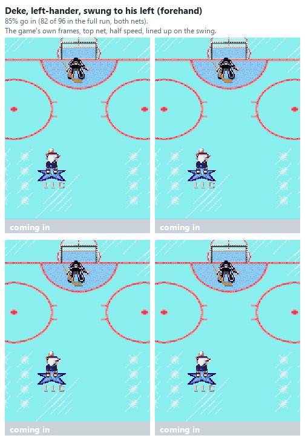
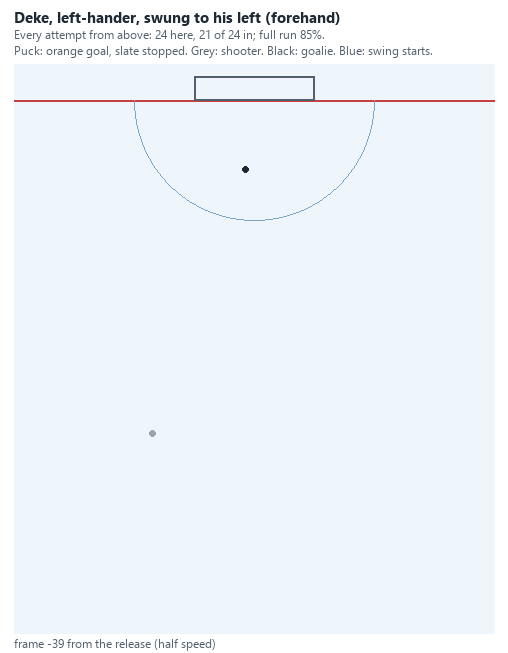

**Deke, right-hander, swing to his left (backhand): 83%.** The same inputs.

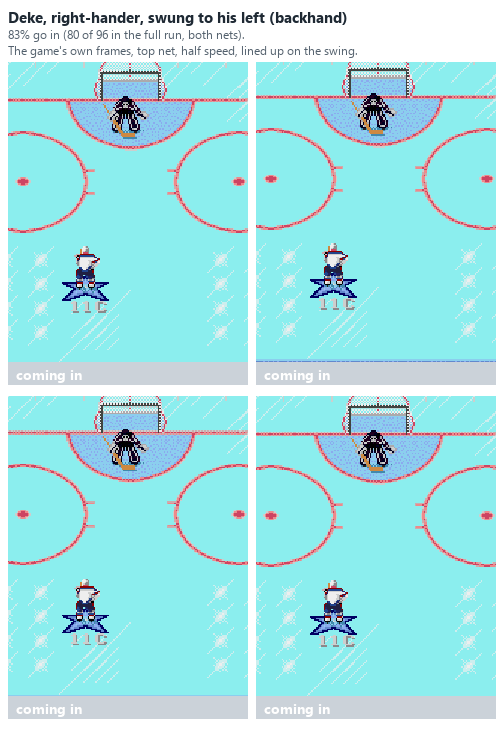
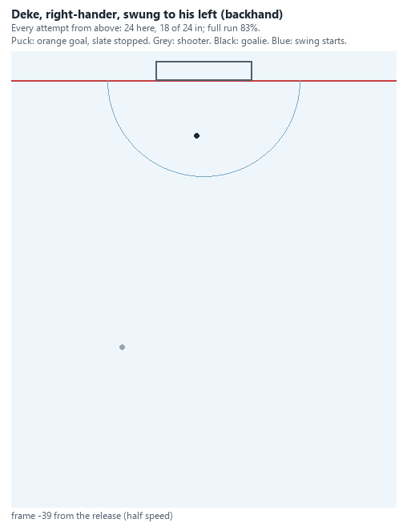

**Deke, right-hander, swing to his right (forehand): 66%.** About 30 right of the middle with the puck on his
left; about 85 from the goalie hold Up-Right; about 13 frames later tap C with Right held.

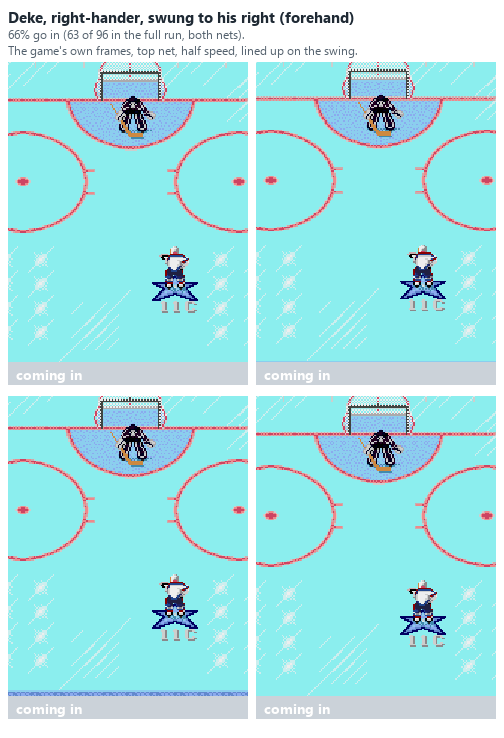
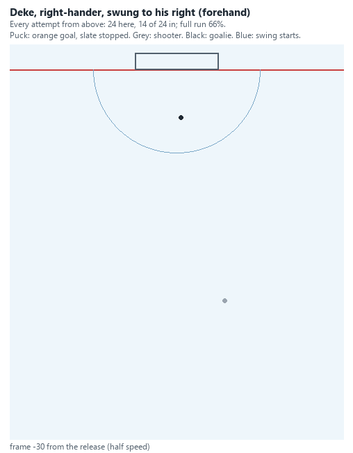

**Deke, left-hander, swing to his right: 46%.** The same inputs as the right-hander's. Not a backhand deke: the
puck doesn't get across to his right (above).

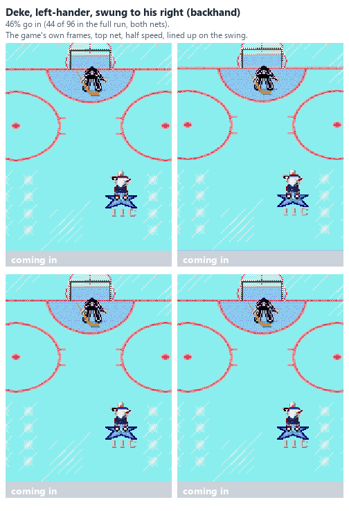
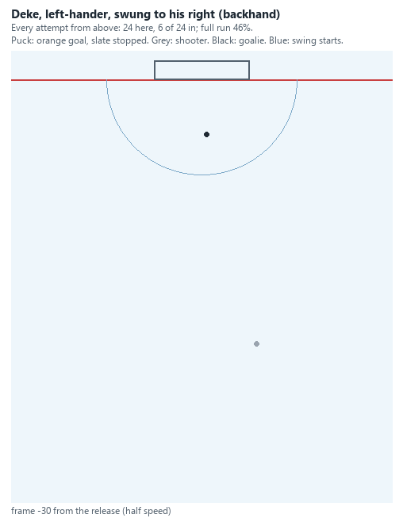

**Floater, right-hander, across from his right: 65%.** About 35 right of the middle, skating up and across to the
left; about 110 from the goalie hold Up-Right; about 22 frames later hold C 9 frames with Right held.

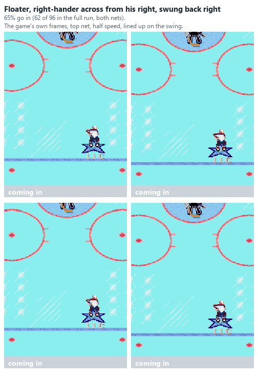
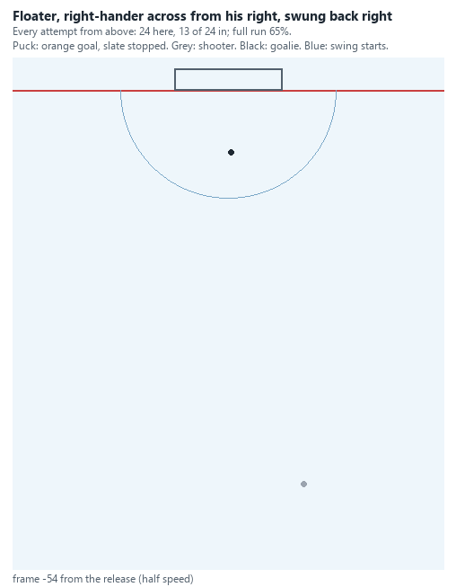

**Floater, left-hander, across from his left: 60%.** About 50 left of the middle, skating up and across to the
right; about 95 from the goalie hold Up-Left; about 18 frames later hold C 6 frames with Left held.

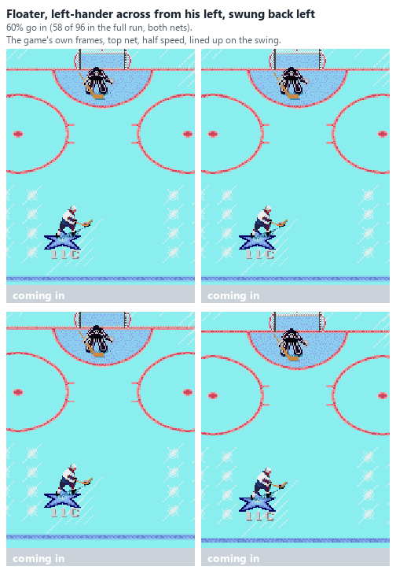
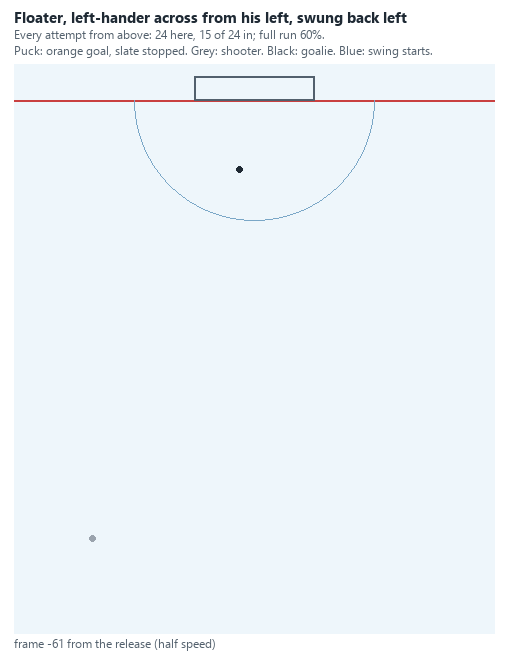

**The control: the left-hander's best deke with no swing: 0% (0 of 80).**

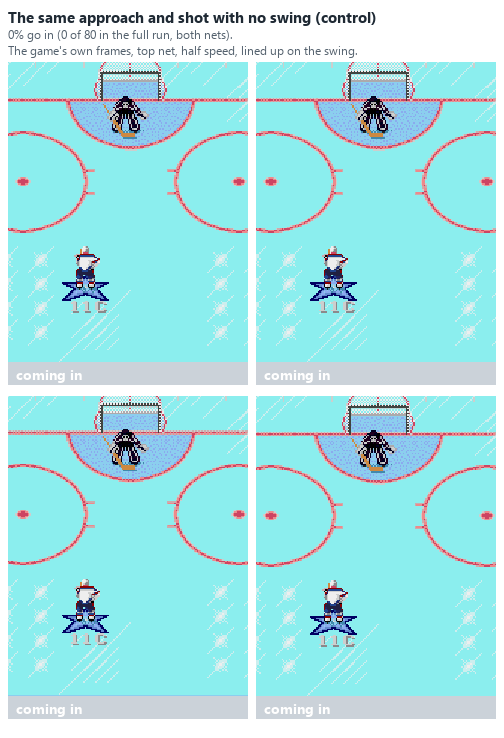
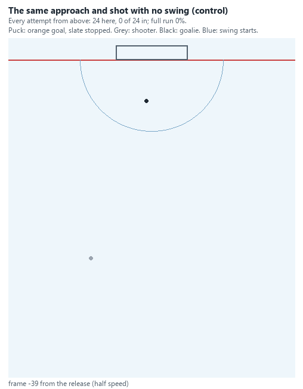

### Going down the screen (the bottom net)

The full run played every set-up at both nets; the animations above are all at the top net, going up the screen.
The same moves going down (48 attempts per move at each net):

| Move | Going up (top net) | Going down (bottom net) |
|---|---|---|
| Deke, left-hander, swing to his left (forehand) | 75% | 96% |
| Deke, right-hander, swing to his left (backhand) | 85% | 81% |
| Deke, right-hander, swing to his right (forehand) | 44% | 88% |
| Deke, left-hander, swing to his right (the puck doesn't get across) | 31% | 60% |
| Floater, left-hander, across from his left | 71% | 50% |
| Floater, right-hander, across from his right | 65% | 65% |
| The same deke with no swing | 0% | 0% |

- The moves work going down too, and the swings to the shooter's right do much better going down: the right-hander's
  forehand deke doubles (44% to 88%), the left-hander's backhand one nearly does (31% to 60%). So the left-right
  difference in the deke (above) depends partly on the direction of play, not only on the shooter's left.
- Over the whole grid the picture is the same as before: a left-hander swinging to his left 33% up, 31% down; to his
  right 2% / 4%; a right-hander to his left 15% / 17%, to his right 7% / 18%.

Animated going down, the same inputs (`deke_animate.py`, the DOWN list; rates: the bottom net's 48):

**Going down: deke, left-hander, swing to his left (forehand): 96%.**

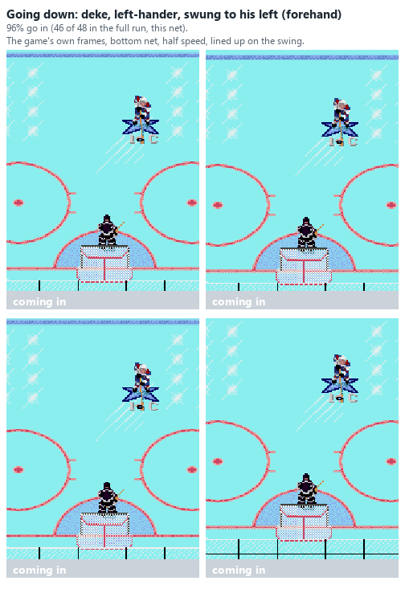

**Going down: deke, right-hander, swing to his left (backhand): 81%.**

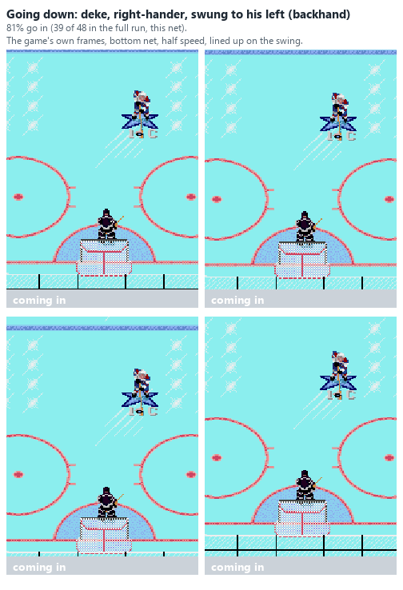
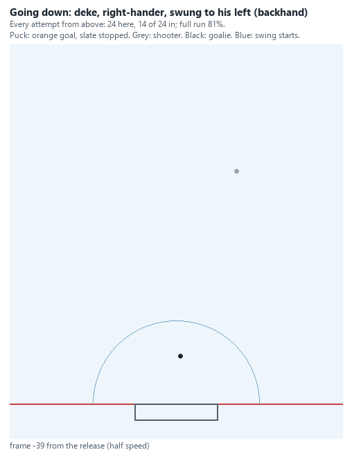

**Going down: deke, right-hander, swing to his right (forehand): 88%.**

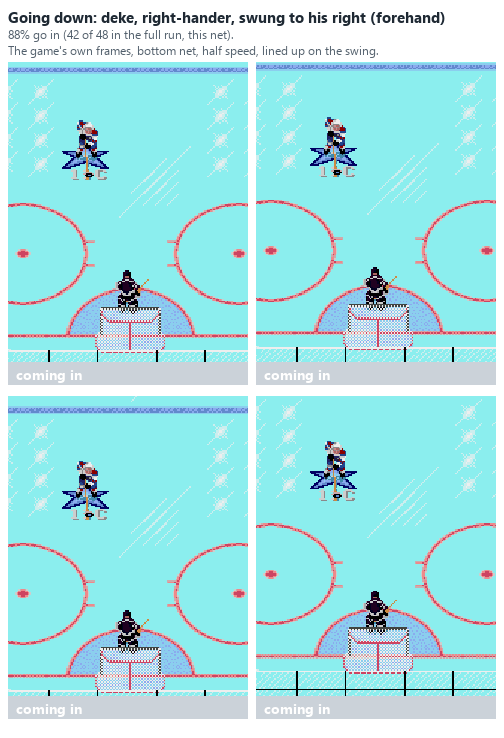
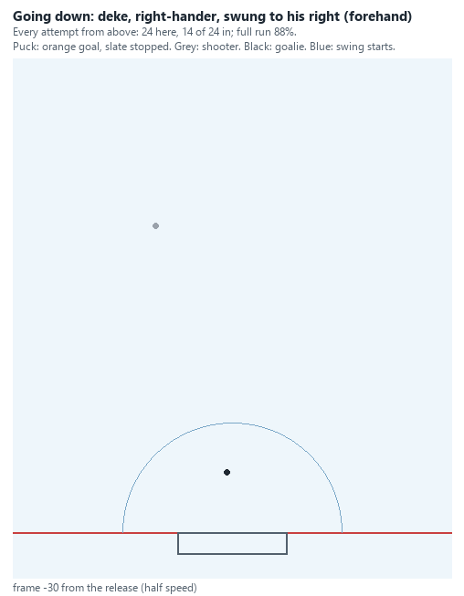

**Going down: deke, left-hander, swing to his right: 60%** (not a backhand: the puck doesn't get across).

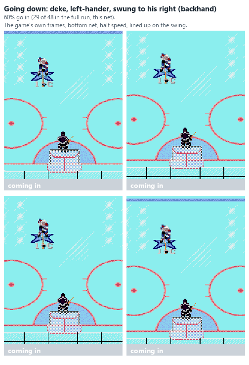
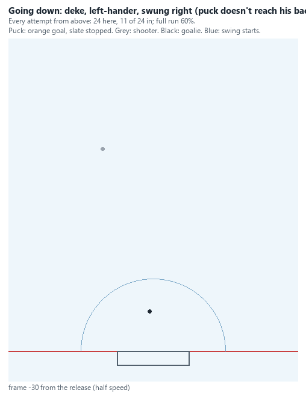

**Going down: floater, right-hander, across from his right: 65%.**

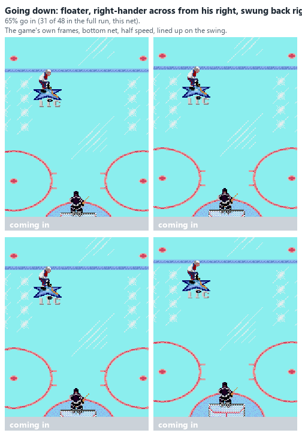
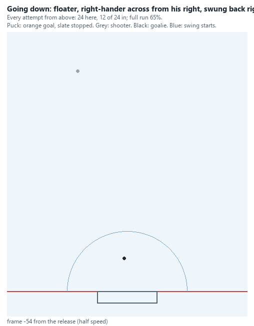

**Going down: floater, left-hander, across from his left: 50%.**

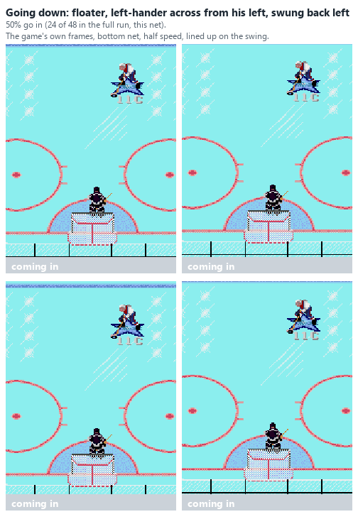
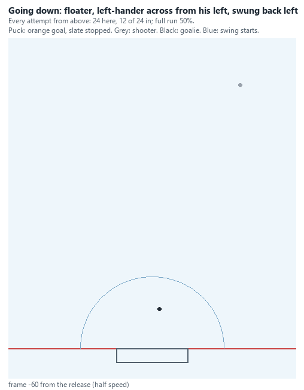

**Going down: the same deke with no swing: 0%.**

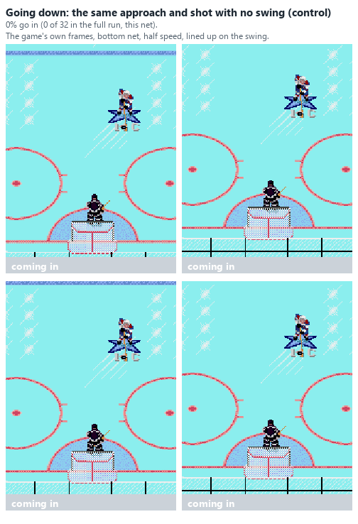
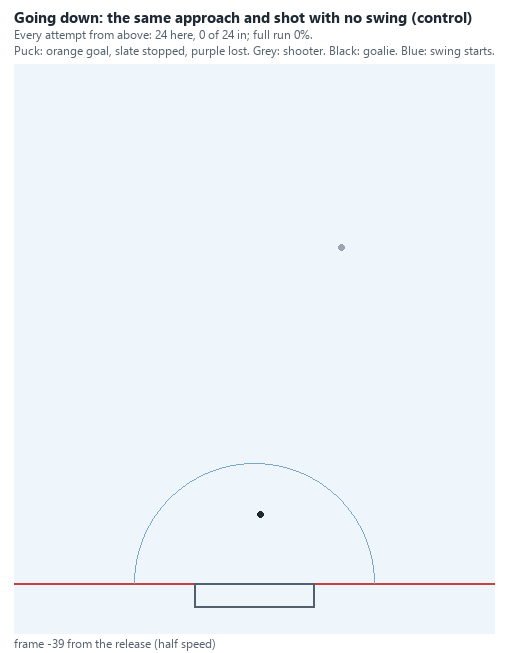
- **The recorded games** (`analysis/deke_games.py`, 158 close wrist shots by a person at a computer goalie in 47
  games): a swing to the forehand 32% (25 shots, xG 33%) close straight in, to the backhand 40% (15); too few to tell
  the sides apart yet.

### The user's refinements (plan "deke2", 2026-10-24)

From the user, after the animations: come in from a bit farther out to the side, get a little closer to the goalie,
and shoot with the stick straight up or a bit up and toward the swing's side. `deke_run.py deke2`: both hands, both
swing directions, both nets; starting 30 / 45 / 60 to the side, the swing begun 50 / 60 / 72 from the goalie, C 10-22
frames later, aimed to the side (as before), straight Up, or Up and toward the swing's side; 12 moments x 4 seeds.
Rates below count a puck the goalie took before the shot as a failure (out of 96 attempts, both nets).

| Move | Before (the first grid) | Now | Best set-up |
|---|---|---|---|
| Left-hander, swing to his left (forehand) | 85% | **95%** | from 45 to his left, swing 60 from the goalie, C 10 frames later |
| Right-hander, swing to his left (backhand side) | 83% | **96%** | from 45, swing at 60, C 13 frames later |
| Right-hander, swing to his right (forehand) | 66% | **76%** | from 45-60 to his right, swing at 72, C 22 frames later |
| Left-hander, swing to his right (backhand side) | 46% (the puck never got across) | **67%** | from 45, swing at 72, C 22 frames later: the puck 12 across to his right |

- **Farther out to the side helps every move** (45 to the side is best for all four; 30 was the first grid's).
  Getting closer before the swing (60 instead of 72) helps the swings to the left; the swings to the right need the
  longer swing (72, C 22 frames later) to get the puck across.
- **The stick:** up and toward the swing's side does as well as holding the side (73-93% against 66-96% at each
  move's best); **straight Up is clearly worse** (60% for the right-hander's forehand deke, 33-48% for the others).
  Against the computer goalie, keep the stick angled toward the swing.
- **The left-hander's swing to his right now gets the puck across** with the longer swing (12 units to his right at
  the release), and scores 67%. A test that waits for the puck to be across before shooting (plan "dekebh") is next.
- Going up and going down are close for the best set-ups (45 / 46 and 45 / 47 of 48 for the swings to the left; the
  swings to the right still differ by net: 43 / 30 and 40 / 24).

### The deke on the backhand (plan "dekebh", 2026-10-24)

The user, from the animations: the left-hander's "swing to his right" above isn't a backhand deke, because the puck never
gets far enough across. Traced: a left-hander carries the puck about 16 out on his left, a right-hander about 12 out
on his right, and the facing only starts to turn about 9 frames into the swing; 14 frames in, the right-hander's
puck was 12 across to his left, the left-hander's still 3 short of his middle. So a shot at a set time comes too
early for some moves. `deke_run.py dekebh` shoots instead **once the puck is a set distance across on the swing's
side** (4 / 8 / 12 / 16 units), with the swing begun earlier (72 / 85 / 100 / 115 from the goalie), from 15 / 30 / 45
to the side; both hands, both directions, both nets, aimed to the side, straight Up, or Up and toward the side; and
each release is checked against the game's own forehand / backhand rule (`Findhittype`: the net 45-180 degrees round
to his backhand side). Out of 96 attempts (both nets), a puck the goalie took before the shot counted as a failure:

| Move | Rate | Best set-up | Backhands (the game's rule) |
|---|---|---|---|
| Left-hander, **backhand** (swing to his right) | **96%** (top 47, bottom 45 of 48) | from 45 to his right, swing 85 from the goalie, C when the puck is 8 across | 24 of 24 |
| Right-hander, **backhand** (swing to his left) | **82%** (top 38, bottom 41 of 48; 83% aimed up and across) | from 30 to his left, swing at 72, C at 8 across | 24 of 24 |
| Left-hander, forehand (swing to his left) | 89% (top 40, bottom 45) | from 30, swing at 72, C at 8 across | 0 |
| Right-hander, forehand (swing to his right) | 88% (top 46, bottom 38) | from 45, swing at 85, C at 16 across | 0 |

- **The backhand deke works**, for both hands, going up and going down, once the shot waits for the puck to be across.
  The lopsided results of the timed tests mostly go away: all four moves score 83-96%.
- **What is left of the left-right difference:** swings to the shooter's right need to begin earlier (about 85 from
  the goalie against 72 for swings to his left), whatever his hand, because the puck takes longer to get across that
  way.
- How far across before C matters less than when the swing starts (over the grid: 9-25% at each distance against
  0-42% at each start).
- Aimed straight Up: 0-3%. Up and toward the side: a little below the side (17-30% against 21-38% over the grid).
- A first run of this plan had a bug (the facing kept at each release overwrote the move's starting facing, so every
  later moment's skater came in already turned); its results were set aside and the run repeated.

Animated (`deke_animate.py`, the ACROSS list; rates: that net's 48):

**Backhand deke, left-hander, swing to his right, going up: 98% (47 of 48).**

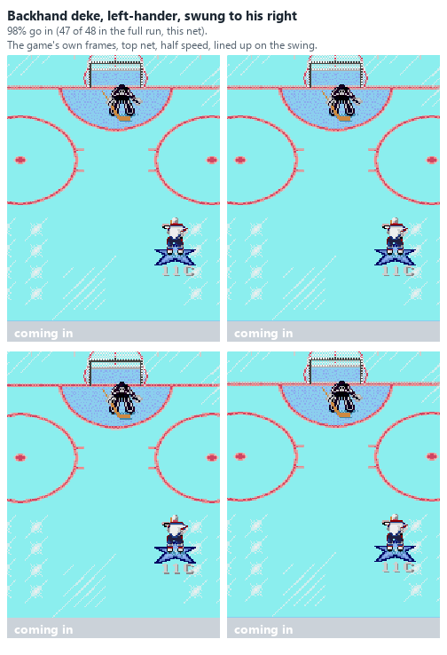
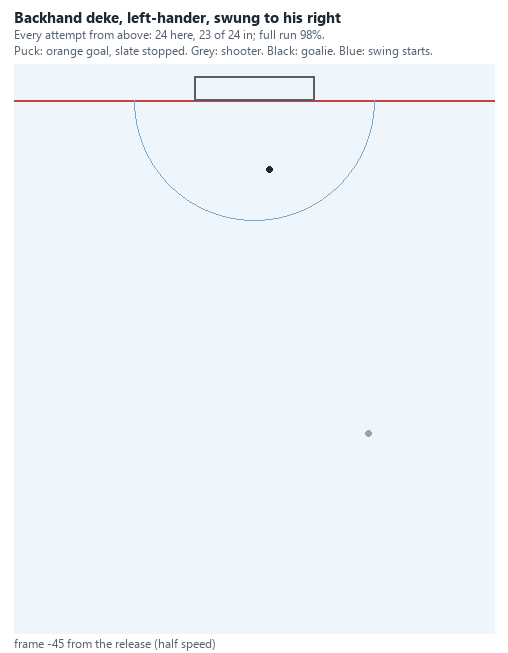

**Backhand deke, left-hander, swing to his right, going down: 94% (45 of 48).**

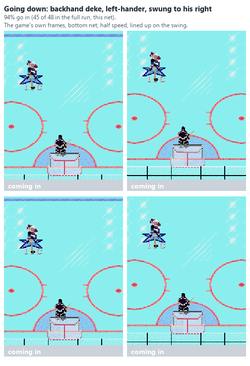
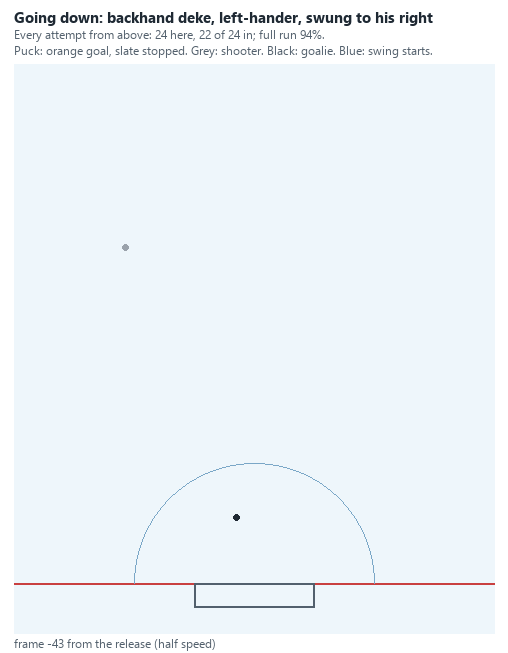

**Backhand deke, right-hander, swing to his left, going up: 79% (38 of 48).**

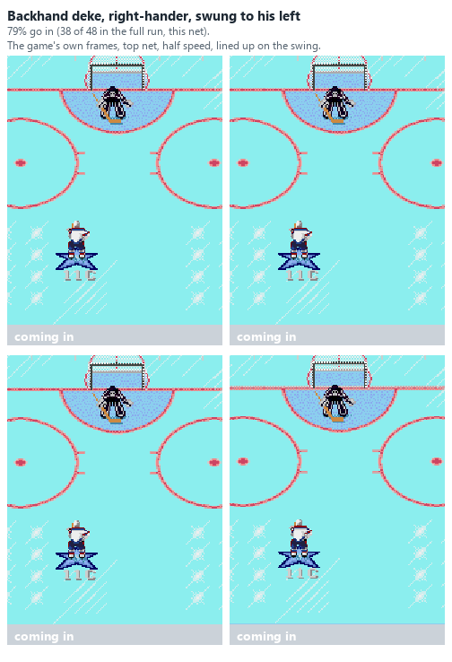

**Backhand deke, right-hander, swing to his left, going down: 85% (41 of 48).**

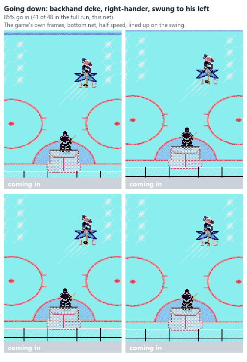

**Forehand deke shot once across, left-hander, swing to his left, going up: 83% (40 of 48).**

**Forehand deke shot once across, right-hander, swing to his right, going up: 96% (46 of 48).**

### The floater on the backhand (plan "floaterbh", 2026-10-24)

The user asked for the floater on the backhand as well as the forehand. `deke_run.py floaterbh`: skating up and across
from the backhand side (a left-hander from his right, a right-hander from his left), 35 or 50 out to the side, the puck
swung back to the backhand at 80 / 95 / 110 / 125 from the goalie, C held 3 / 6 / 9 frames, 10-30 frames after the
swing, aimed to the side or up and toward it; both hands, both nets; each release checked against the game's backhand
rule. Out of 96 attempts (both nets), a puck lost before the shot counted as a failure:

| Move | Rate | Best set-up | Backhands |
|---|---|---|---|
| Left-hander, backhand floater | **51%** (going up 22, going down 27 of 48) | from 50 to his right, swing at 110, C held 9 frames, 26 frames after the swing | 24 of 24 |
| Right-hander, backhand floater | **41%** (going up 26, going down 13 of 48) | from 50 to his left, swing at 95, C held 9 frames, 14 frames after | 24 of 24 |

- **It works, on a true backhand, but in a narrow window:** over the whole grid only 3% (left-hander) and 5%
  (right-hander) go in, against the forehand floater's 54-65% at its best. The swing has to start from far out (95-110)
  and C be held long (9 frames). The left-hander's needs a much longer wait (26 frames) than the right-hander's (14):
  the same slower crossing to the shooter's right as in the deke.
- Up and toward the side scores about the same as the side.

Animated (`deke_animate.py`, the FLOATERBH list; rates: that net's 48):

**Backhand floater, left-hander, going up: 46% (22 of 48).**

**Backhand floater, left-hander, going down: 56% (27 of 48).**

**Backhand floater, right-hander, going up: 54% (26 of 48).**

**Backhand floater, right-hander, going down: 27% (13 of 48).**

## EA Specials (Genesis, 2026-10-24)

The user's play: a wrist shot meant to be bobbled, the save pushing the goalie back. The skater skates on, claims the
loose puck and at once shoots inside the near post, open because the goalie was pushed back (and may have dived at the
loose puck). The user's view: the best shooters are bad at it, because their harder shots are held more; middling
shooters' shots are bobbled more. `ea_run.py`: one left-handed shooter at each of 9 spots (40 / 70 / 100 to the side,
60 / 90 / 120 out), standing or skating in at 1.5 a frame, every Shot Power and Shot Accuracy from roster step 2 to 6
(working 10-30), all nine aims, 8 moments x 2 seeds, both nets: 129,600 first shots. After the shot a simple bot plays
the rest: skate on; once the goalie has touched the puck and it is loose, chase it; on claiming it, tap C aimed at the
near post.

- **The first shot to bobble is aimed across, at the far side from the shooter:** 60-77% of those are touched and
  left loose, against 14-28% aimed down along the ice (held 70-85%).
- **Shot Power (far-side first shots, every spot):** held 20% / 19% / 21% / 21% / 27% from steps 2 to 6, bobbled 63% /
  69% / 72% / 72% / 66%. Weak shots (2-3) miss the net more (11-16%, against 6% at 5-6). So the hardest shooter's
  shots are held more and bobbled less, as the user said, but only at the top: steps 3-5 are much the same.
- **The goalie's dive at the loose puck falls steadily with Shot Power:** after a bobble he dives 43% / 35% / 25% /
  18% / 17% of the time (steps 2-6). Close in (40 to the side) it is 55% at step 2 and 21% at step 6.
- **The whole play, close in (40 to the side), where it works best:** a goal from the bobble 10% / 11% / 9% / 8% / 4%
  of first shots (steps 2-6), with 89-95% of bobbles claimed. The strongest shooter scores about half as often, held
  35% against 16%. From 100 to the side the shooter seldom gets to the puck first (14-41% claimed) and it hardly works
  (0-1%). Over all spots, steps 2 to 6: 5 / 6 / 5 / 4 / 4%.
- **Shot Accuracy hardly matters here:** held 49-57%, bobbled 41-42% over all aims; only misses fall (8% to 2%).
- **Pushed back:** measured as the goalie's movement toward his goal line within 20 frames of the save, only 0.3-0.8
  units after far-side shots (up to 3 after shots he holds). So in these runs the save doesn't move the goalie; the
  opening comes from the dive and from where the loose puck goes.
- **Limits:** the bot is no person. It takes about 44 frames to claim the puck, and half the bobbles end with nothing
  (the puck not reached, or the follow-up still loose), so the scoring rates here are a floor. The comparisons between
  ratings are fair: every shooter had the same bot. The game's hold rule (the goalie holds a puck whose speed parts
  are under a random threshold set by Puck Control) would predict faster shots held less, the opposite of what
  happened at step 6; that is still to be traced.

## Limits and what comes next

The maps are exact for one situation (a standing shooter, a set computer goalie, nobody else near) and say nothing
yet about shots off the rush or a person in net; one-timers are above (both systems).

- **Not yet seen in real play.** Two practice tests are on the request list ([NEEDS_FROM_YOU](NEEDS_FROM_YOU.md)
  items 5 and 6): a dozen Down slapshots from the middle on the Genesis, and a dozen slapshots from the SNES left lane
  against its mirror.
- **One shooter, one goalie per system.** Other ratings change the perfect-shot chance (the SNES lane scores about that
  chance: 35% at Shot Accuracy 7, 52% at 15). The goalie's ratings barely matter on the SNES (the same body box and save
  frames for all); on the Genesis Agility sets his reach (12-15).
- **Recorded games still use the xG models.** Replaying 135 recorded Genesis shots in the game gave the right total but
  worse shot-by-shot predictions than the xG model: a recording can't pin down the exact frame and the goalie's internal
  state.
- **Next, if wanted:** a moving-goalie map using goalie states from recorded games (about 2 hours a system); other
  shooters; and testing whether adding the Genesis goalie's stick (the blind ring) improves the xG model on
  recorded games.

## Rebuilding it yourself

You need your own ROMs (none are in this repository), RetroArch 1.17's Genesis Plus GX and Snes9x cores, and clones of
the two disassemblies in `%USERPROFILE%\NHL94_disasm`. Work files go to `%USERPROFILE%\NHL94_scoring_map` (or
`NHL94_SMAP_WORK`). From `analysis/scoring_map/`:

| Step | Genesis | SNES |
| --- | --- | --- |
| Build and states | `build.py` (its docstring is the how-to) | copy the Snes9x core to the work folder's `core/`, put the ROM at the disassembly's `lst/nhl94snes.sfc`, then `snes_make_states.py` |
| The map | `map_run.py WORKER WORKERS RUN` (one per process; its docstring), `validity.py RUN` | `snes_map_run.py RUN` |
| The picture | `render_map.py RUN OUT.svg` | `render_map.py RUN OUT.svg` |
| Goal types | `goal_types.py genesis RUN` | `goal_types.py snes RUN` |
| One goal, pictured | `goal_frames.py genesis RUN TYPE N OUT.png`, then `goal_diagram.py genesis OUT.json OUT.svg "Title"` | the same with `snes` |
| The share chart | `goal_chart.py RUN OUT.svg` | (both systems in one chart) |
| The animations | `animate.py OUT_DIR` (all seven spots, both systems; gentle mode) | |

The game frames in this page are screenshots of the games as the emulator drew them, shown to explain how the goals
happen.
