# Scoring maps: SNES

*The scoring maps: [overview and method](SCORING_MAP.md) · [Genesis shots and goalies](SCORING_GENESIS.md) · [Genesis dekes and floaters](SCORING_GENESIS_DEKES.md) · [Genesis EA Specials](SCORING_GENESIS_EA.md) · [SNES](SCORING_SNES.md)*

SNES shots played in the real game (the retail ROM; the method: [SCORING_MAP](SCORING_MAP.md)): the kinds of goal, one-timers, slapshots, the goalie profiles and the dekes.

## Contents

1. [The goals that went in](#the-goals-that-went-in)
2. [Makes and misses, animated](#makes-and-misses-animated)
3. [One-timers](#one-timers)
4. [Slapshots and the shooter's ratings](#slapshots-and-the-shooters-ratings)
5. [The computer goalie's ratings](#the-computer-goalies-ratings)
6. [SNES dekes in the game](#snes-dekes-in-the-game)
7. [EA Specials on the SNES](#ea-specials-on-the-snes-snes_ea_runpy-2026-10-27)

## The goals that went in

Almost every goal against a set goalie comes through one of a few gaps in the game's rules, and each one below is a
real goal replayed in the game (`goal_frames.py`). The frames are the emulator's own output, zoomed 3x on the net. The
diagram under each (`goal_diagram.py`) is drawn from the game's numbers frame by frame: the crease from above (one dot
per frame for the puck, coloured by height; grey dots for where the goalie moved; his reach or body box and save area
as they were when the puck passed closest) and the puck's height on the way in.

### SNES 1: past his right glove save (the lane)

A slapshot aimed Left from 10 units left of centre, 88 out, at the top net. The puck passes 12 units from his centre,
just outside his body box (11). He's in his right glove save, whose save area (green) covers heights 7-15 and sits
close to his body; the puck goes by at height 4.

### SNES 2: past his right stick save

The same lane at the bottom net: a slapshot aimed down-right from 10 right of centre (the shooter's left), 118 out.
The puck stays on the ice and passes 13 units from his centre; his stick save's area is a small circle at the corner of
his body box, 2-5 off the ice, so the puck slides under it.

### SNES 3: past his right sprawl

A slapshot aimed down-left from 14 left of centre, 88 out, at the top net. The puck passes 12 units from his centre on
the ice; the sprawl's save area at that moment covers heights 4-8, so it goes under.

### SNES 4: off the goalie (24% of SNES goals)

A puck that clips the edge of his body box and deflects in. Here a slapshot from 10 left of centre catches his edge 11
units from his centre and glances into the net. Most of these were wrist shots (423 of 645).

## Makes and misses, animated

At each worthwhile spot, 120 shots were played (one at each of the 120 moments, a fresh random seed each,
`animate.py`) and kept frame by frame. For each spot there are two animations, both at half speed:

- **Nine real clips** side by side: the game's own frames from the wind-up on, showing the shooter and the net, with
  goals in the spot's real proportion, each labelled with what happened (GOAL, SAVED, POST, MISSED) when it's decided.
- **All 120 shots from above at once:** each puck's trail (orange in, grey saved, purple off the post, pale missed), the
  shooter's spot, and the goalie as a dark dot. Shots that went exactly where aimed share one path, so many goals can
  look like a single orange line.

The shooter stays on the ice after the release (the map moves him away). The Genesis rates are the map's (all 120
moments; keeping the shooter changes nothing there). The SNES rates come from 480 shots over all 120 moments with the
shooter on the ice, since on the SNES that changes the result (the frame timing above).

### SNES: the lane (top net 54%, bottom 20%)

### SNES: the mirror shot (1%)

The same slapshot from 10 right of centre, aimed right, at the top net: his left-side saves cover it.

## One-timers

### SNES

The same 824 set-ups on the SNES (retail ROM, Snes9x), the one-timer button A pressed early or late in the pass and
each of the nine d-pad directions held from the press (the SNES reads the aim during the swing), 32 moments, 4 seeds a
strike. Run 2026-10-23 in nine one-hour chunks, gentle mode.

**The swing connects even more often than on the Genesis:** 92% of the presses the pass reached struck the puck.

**Where it scores** (goals per struck one-timer; first averaged over the nine aims, then at the best aim for each
set-up; averaged over the passers, both nets and both timings):

| Receiver's distance out | Middle | 10 ft to one side | 20 ft | 30 ft |
| --- | --- | --- | --- | --- |
| 10 ft (the doorstep) | 44% / 62% | 35% / 53-55% | 10-11% / 4-20% | 7-9% / 12-14% |
| 18 ft | 24% / 56% | 18-21% / 38-46% | 9-12% / 21-27% | 2-3% / 5-8% |
| 27 ft | 13% / 34% | 11-15% / 31-37% | 9-10% / 25-26% | 2-3% / 6-9% |
| 35 ft | 8% / 26% | 5-8% / 16-24% | 5-7% / 14-15% | 1% / 3% |
| 43 ft and beyond | 0-3% / 1-11% | | | |

- **The aim matters on the SNES** (the Genesis aims one-timers itself): the best aim roughly doubles the average one,
  and beyond the doorstep it is the difference between a poor chance and a good one.
- **The pass across is even more decisive than on the Genesis:** with the receiver inside 18 feet, a pass from the
  other side scores 36% over the aims and 58% at the best aim; one from his own side 7% and 16%.
- **The doorstep in the middle is as good as on the Genesis at the best aim** (62% against the Genesis's 62% with its
  own aim) but only 44% over all the aims, and the SNES falls off faster with distance.
- **The SNES xG model gets them right:** at 3,627 strikes played in the game (`ot_xg_check_snes.py`) the game 8.9%,
  the model 7.8%, correlation 0.82; the pass across 45% / 42%, from the same side 1% / 3%. Unchanged.
- Averaged over every set-up and aim, a SNES one-timer scores about 6%; the Up aim is the poorest (3.6%), the
  diagonals toward the shooter's sides the best (7-9%), but the right aim depends on the spot and the net.

### SNES: by Shot Power and Accuracy (2026-10-25)

The Genesis ratings study again on the SNES: the same 60 set-ups (four receivers, passes from either side, both nets,
early and late presses, 32 moments), all nine aims, 4 seeds a strike: about 120,000 struck one-timers per pair. Shot
Power and Accuracy at steps 2, 4 and 6 (SNES working 5 / 10 / 15; the recorded shots' median is 13 / 13). Each cell
is goals per struck one-timer over all the aims, then at each set-up's best aim:

| Shot Power \ Accuracy | 2 | 4 | 6 |
| --- | --- | --- | --- |
| 2 | 26% / 54% | 29% / 61% | 31% / 66% |
| 4 | 29% / 57% | 32% / 65% | 34% / 70% |
| 6 | 30% / 57% | 33% / 65% | 35% / 71% |

- **As on the Genesis, Accuracy is the rating that counts for one-timers.** At the best aim it adds 12-14 points from 2
  to 6. Power adds 3-5 points, all of it between 2 and 4. There is no jump like the SNES slapshot's at Power 6.
- **The stick meets the puck 92% of the time whatever the ratings**, as on the Genesis.
- **By receiver**, with Power and Accuracy rated the same (at the best aim):

| Receiver | 2/2 | 4/4 | 6/6 |
| --- | --- | --- | --- |
| In front, 10 ft out | 82% | 87% | 89% |
| In front, 18 ft out | 50% | 65% | 72% |
| 18 ft out, 10 ft to the screen's left | 44% | 55% | 62% |
| 18 ft out, 10 ft to the screen's right | 47% | 58% | 65% |

  On the doorstep the weak shooter loses only 7 points; 18 feet out, 18-22 points, the same pattern as the Genesis.

**Animated (`ot_animate.py`, the SNES cases):** the long pass across (from 40 feet away, the far side) to a receiver
18 feet out and 10 feet to the side, top net, with no direction held through the swing: the run's 47% at 2/2 and 86% at
6/6 (244 struck each). Of the 48 filmed here, 28 went in at 2/2 and 38 at 6/6.

**Shot Power 2 / Accuracy 2: 47%.**

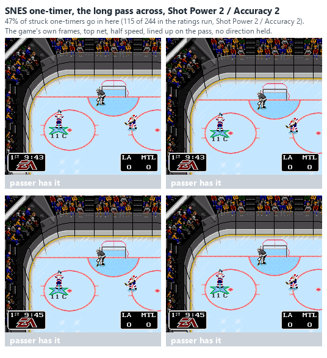
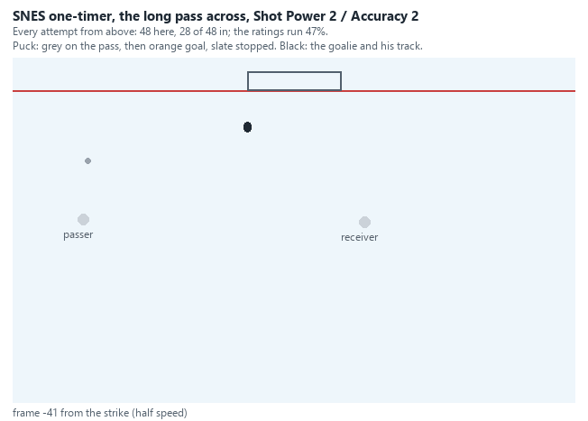

**Shot Power 6 / Accuracy 6: 86%.**

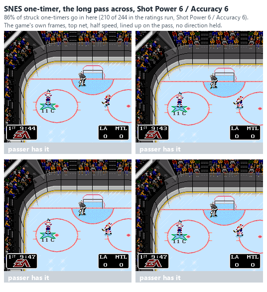

## Slapshots and the shooter's ratings

Strong shooters on both systems: [SCORING_GENESIS](SCORING_GENESIS.md#strong-shooters-2026-10-24).

### Every Shot Power and Accuracy (SNES, 2026-10-25)

The same question on the SNES: the slapshot (held 40 frames, as the SNES map) from the same 18 spots (x -40 / 0 / 40,
108-148 out, both nets; `snes_map_run.py` with `NHL94_SMAP_SUBSET=slapcore`), 60 moments x 4 seeds = 240 shots per aim,
a set computer goalie, for each roster step 2-6 (SNES working value 5 / 7 / 10 / 12 / 15, the most being 15; the
recorded shots' median shooter is 13 / 13, between steps 5 and 6).

The best aim's chance averaged over the 18 spots:

| Shot Power \ Accuracy | 2 | 3 | 4 | 5 | 6 |
|---|---|---|---|---|---|
| 2 | 0% | 0% | 0% | 0% | 0% |
| 3 | 0% | 0% | 0% | 0% | 0% |
| 4 | 1% | 1% | 1% | 1% | 1% |
| 5 | 2% | 2% | 2% | 2% | 2% |
| 6 | 4% | 4% | 5% | 5% | 5% |

The four best spots (goals of 240 at each spot's best aim). The x here is the screen's, the same on both nets, so 40
left of centre is the left-handed shooter's forehand side on the top net and his backhand side on the bottom. All four
best aims are at the post on the screen's left, the side of the ice he shoots from (Up-Left on the top net, Down-Left
on the bottom, Left from the middle). By the league's definition (the shooter's hand) that is the far post at the top
net and the near post at the bottom, as in the strong-shooter result above: the post on his side of the ice.

| Spot | Accuracy | Power 2 | 3 | 4 | 5 | 6 |
|---|---|---|---|---|---|---|
| Bottom net, 40 left, 148 out (50 ft) | 2 | 1 | 1 | 10 | 24 | 25 |
| | 4 | 0 | 1 | 15 | 36 | 38 |
| | 6 | 0 | 2 | 15 | 39 | **44 (18%)** |
| Top net, 40 left, 148 out | 4 | 0 | 0 | 8 | 12 | 34 |
| | 6 | 0 | 0 | 10 | 17 | **42 (18%)** |
| Bottom net, 40 left, 128 out | 6 | 0 | 1 | 1 | 7 | 39 |
| Top net, middle, 108 out | 6 | 0 | 1 | 0 | 2 | 35 |

- **The SNES has a power threshold too, but higher up and steeper.** Below step 4 nothing scores (0-2 of 240 at the
  best spots). Step 4 opens one spot: the bottom net from 40 left, 6%. Step 5 widens that spot to 15-16%.
  Only at step 6 (working 15, the most there is) do the other spots open, at 15-18% each. On the Genesis the jump is
  between 3 and 4 and everything above it scores.
- **Accuracy matters less than on the Genesis.** From 2 to 6 it adds about 1 point over the spots at power 6. At the
  best spot it lifts 25 to 44 of 240 at power 6, and nothing at power 2-3.
- Even at 6 / 6 the SNES slapshot from here scores 5% over the spots against the Genesis's 35%: SNES slapshot goals
  are rare (as the user says), and they go in at the post on the shooter's side of the ice, from far out.

**Animated (`animate.py`, the RATED spots):** the best spot, the bottom net from 40 left of centre 148 out at the near
post (his backhand side, the post nearest him), at 4 / 4 (6% in the ratings run) and 6 / 6 (18%). The shooter stays on the ice here, which shifts the SNES's
frame timing a little (see the top of `animate.py`): of the 120 shots filmed, 2 went in at 4 / 4 and 23 at 6 / 6.

**Shot Power 4 / Accuracy 4: 6%.**

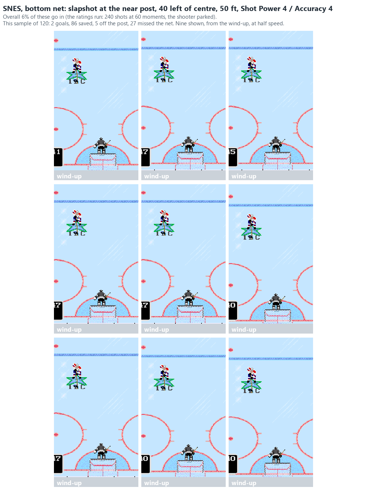
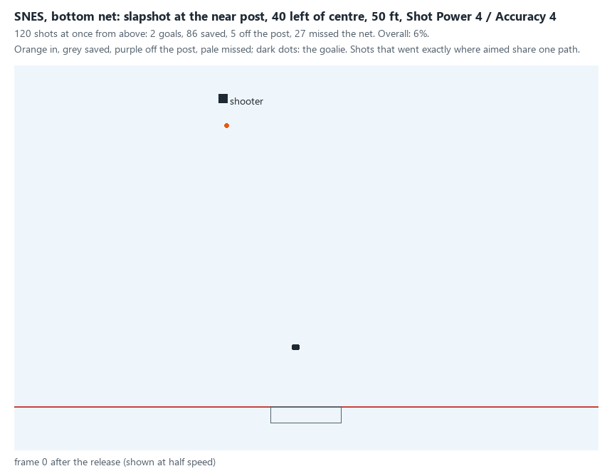

**Shot Power 6 / Accuracy 6: 18%.**

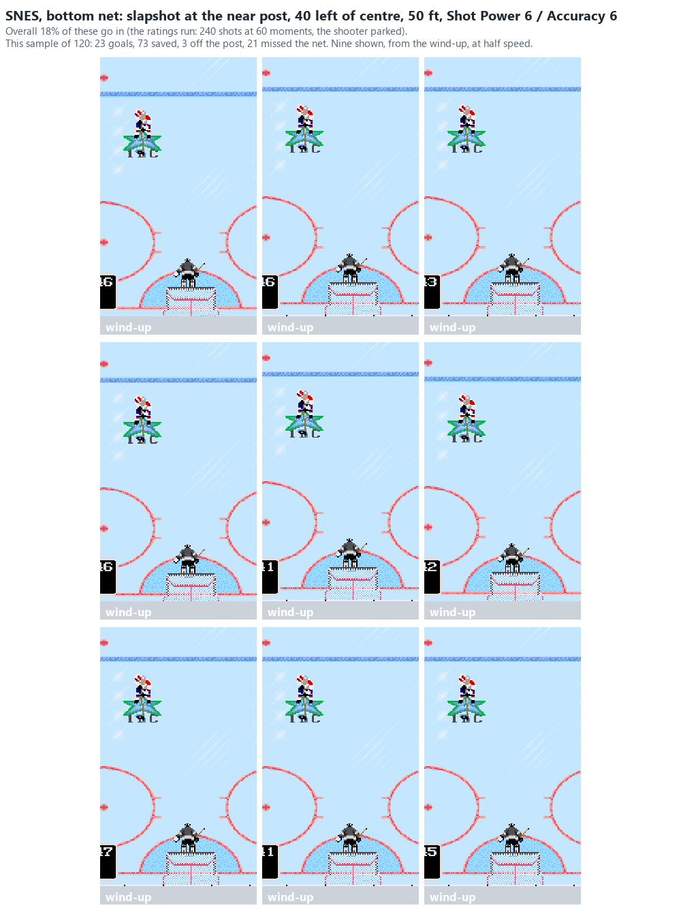
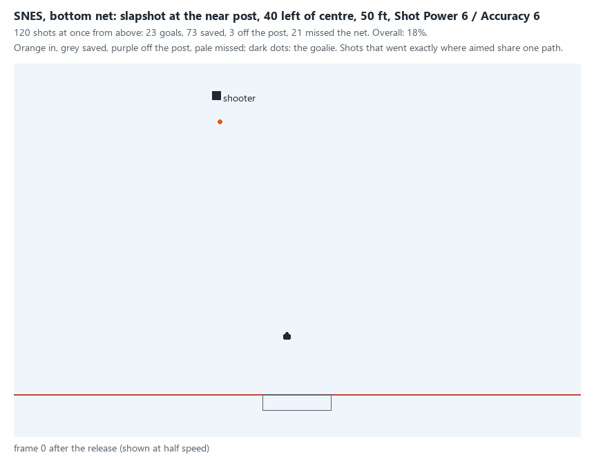

## The computer goalie's ratings

The Genesis goalie's ratings: [SCORING_GENESIS](SCORING_GENESIS.md#the-computer-goalies-ratings-genesis-2026-10-25).

### SNES goalie profiles (2026-10-26)

The SNES studies again against SNES goalie profiles. The working ratings run 0-15, a roster step x 2.5: a backup
(Agility / Speed / Defensive Awareness / Puck Control 5 / 7 / 5 / 5), a typical retail starter (10 / 10 / 12 / 10) and
Roy (15 / 10 / 10 / 15). The test goalie has 8 / 8 / about 15 / 15. The runs are the standing slapshot (18 spots, 60
moments x 4 seeds, the shooter at 6 / 6, the best case: `snes_map_run.py` slapcore, `NHL94_SNES_GOALIE`) and the
one-timer ratings run (60 set-ups, all aims, the receiver at 4 / 4: `ot_run.py snes ratings`).

| Goalie | Standing slapshot, best aim (18 spots; top / bottom net) | One-timers, all aims / best aim |
| --- | --- | --- |
| Test goalie (8 / 8 / ~15 / 15) | 5.5% (5.5% / 5.5%) | 32% / 64% |
| Backup (5 / 7 / 5 / 5) | 5.3% (5.0% / 5.6%) | 37% / 69% |
| Retail starter (10 / 10 / 12 / 10) | 4.8% (4.7% / 4.9%) | 33% / 65% |
| Roy (15 / 10 / 10 / 15) | **3.6% (1.4% / 5.8%)** | 35% / 67% |

- **On the SNES the goalie barely matters**, unlike the Genesis, where Roy cuts every slapshot to a third. Every SNES
  goalie has the same body box and save frames (SNES_SHOOTING 5.1). His Agility only sets how fast he skates (5.3).
- **One-timers don't notice him at all** (64-69% at the best aim, in no order): a computer goalie loses his Agility
  while a pass is in the air (SNES_SHOOTING 5.3), so every goalie slides across alike.
- **The one exception: Roy closes the top net's best slapshot.** That is Up-Left from 40 left of centre, 50 ft out: 42
  of 240 went in against the test goalie, 61 against the retail starter and 5 against Roy. His bottom net is as open
  as anyone's (5.8%). The run doesn't separate his Agility 15 from his Puck Control 15; the test goalie also has Puck
  Control 15 and lets that shot in, so it is likely the Agility, getting him across in time.

**Animated (`animate.py`, the SNES goalie cases):** that top-net slapshot, 120 shots each (other moments than the
run's).

**Test goalie: 18% (21 of 120; the run 18%).**

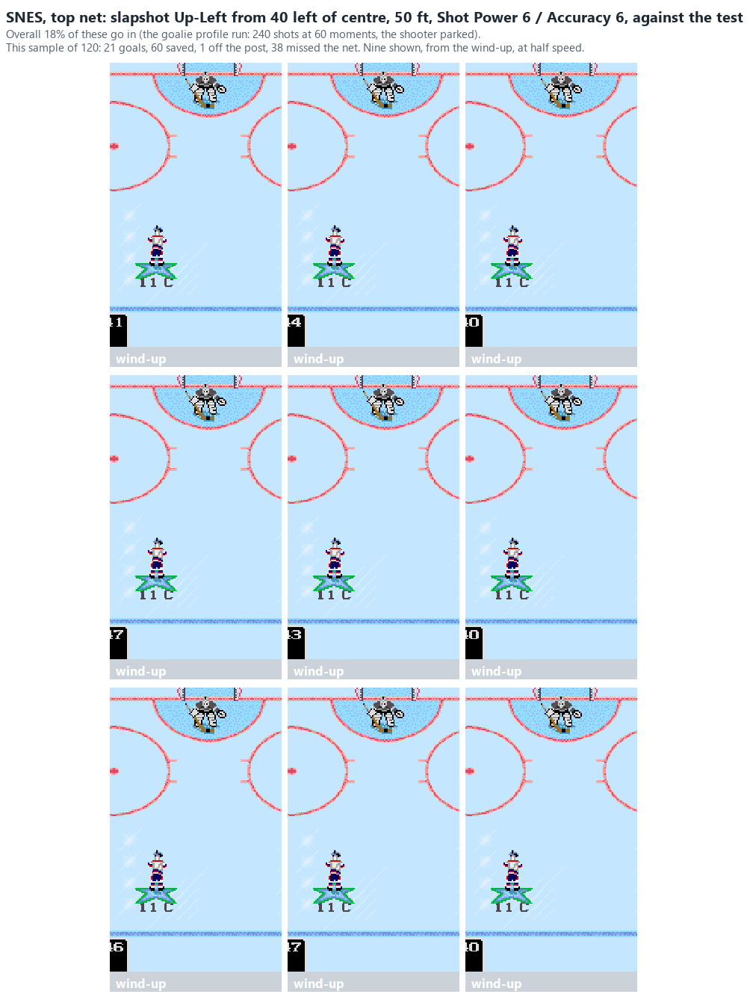
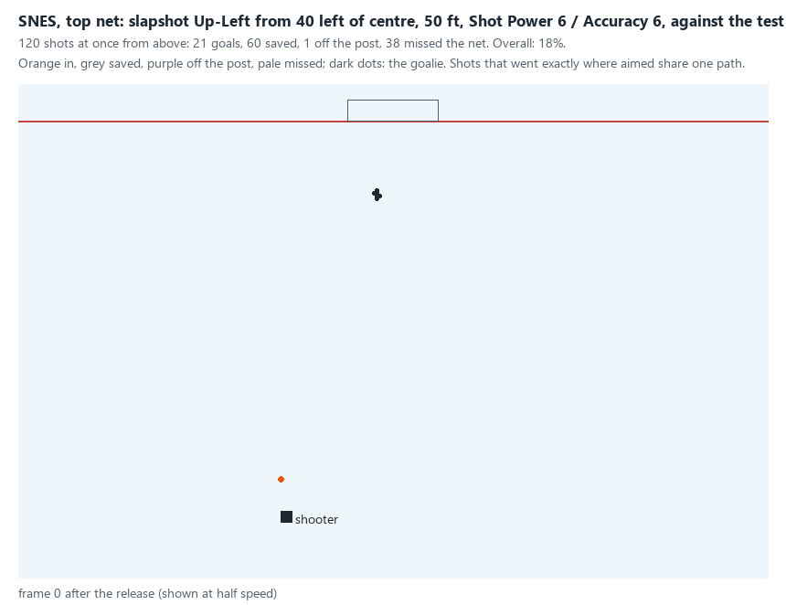

**A typical retail starter: 17% (20 of 120; the run 25%).**

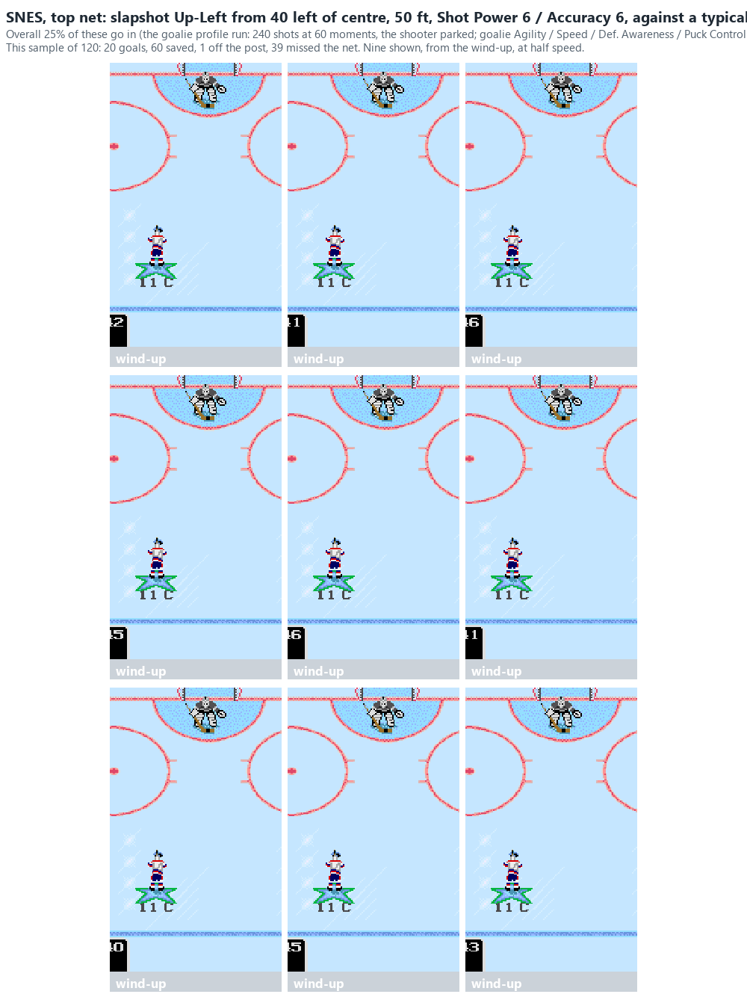

**Roy: 8% (9 of 120; the run 2%).**

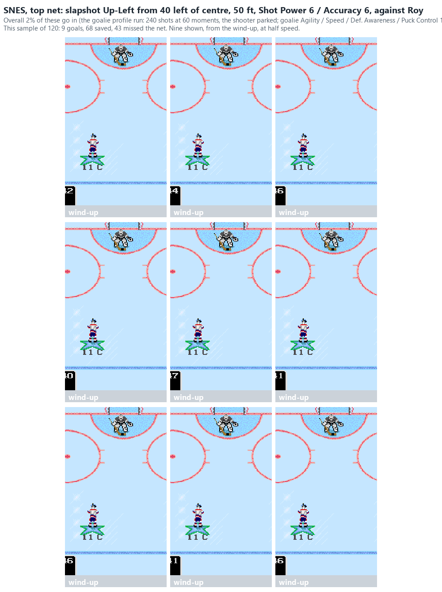
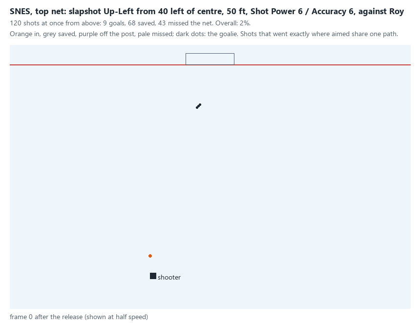

So against Roy on the SNES, shoot slapshots at the bottom net, or use one-timers, which score the same against
every goalie.

## SNES dekes in the game

The user's SNES dekes (the near-post cut and the deke from his own side) replayed in the game from the recording, both nets, both hands: [SNES_SHOOTING](SNES_SHOOTING.md) 4.10, with GIFs.

## EA Specials on the SNES (`snes_ea_run.py`, 2026-10-27)

The user: on the SNES the EA Special has been found not to be a thing, or a very rare one. The Genesis play (a wrist
shot from the side meant to come off the goalie loose, then a quick follow-up inside the near post:
[SCORING_GENESIS_EA](SCORING_GENESIS_EA.md)) played in the retail SNES ROM with the same kind of bot: the shooter
skates on at the goal after the shot, chases the puck once the goalie has touched it, and shoots at the near post as
soon as he has it. The SNES hold rule runs the other way (SNES_SHOOTING 5.4): the goalie holds a puck slower than a
random 8,192-17,000 in each direction, and a harder one bounces straight out from his centre. A save is counted only
where the game can make one: the puck loose and inside his body box or his save frame's area as it turns or slows.

**What the first shot does** (released 17-21 ft out and 27 ft to the side by a right-hander from his left, skating at
1.9 a frame, a wrist shot at Shot Power 8, every aim, 24 plays per aim against the test goalie):

| First shot | What happened |
| --- | --- |
| Low (along the ice) | The shooter caught up with his own shot before it reached the goalie in 63-67 of 72 (top net, bottom net); the rest held |
| Middle | Held 18-22 of 24; loose 2-6, of which 1-2 scored on the follow-up |
| High | Held 22-23 of 24; no goals |

- **A low wrist shot is too slow to get away from the shooter.** It leaves the stick at about 2.4 units a frame, he
  follows at 1.9, and his stick reaches it again 20-24 units short of the goalie. That is a carried puck, not a
  rebound.
- **Middle and high shots reach the goalie and are held,** as the SNES hold rule predicts for soft shots. The few
  that come loose rarely end in a goal.
- **Harder shots** (Shot Power 15, or a wind-up) bounce off more (held 22-46% instead of 73-80%), but the earlier
  searches found their rebounds go farther and were seldom finished; they haven't been re-run with this save test.
- **So in the game, the SNES EA Special is very rare, as the user said.** A full search with this save test (every
  spot, aim, Shot Power and the wind-up) hasn't been run yet, and there is no SNES recording of EA Specials to check
  against.
