# NHL '94 Player's Guide: Super Nintendo (SNES)

What the SNES game's code means for you as a player: how to read the ratings screen, how to pick a lineup, and what
actually works on the ice. It covers `NHL94.smc`, NHL94_Classic and the SDL league ROMs. Everything here comes from
[SNES_MECHANICS.md](SNES_MECHANICS.md), which has the details, the formulas and how each finding was checked. Section
numbers like (7.2) point there.

Playing the Genesis version? It differs in important ways: see the [Genesis player's guide](GENESIS_GUIDE.md).

Some parts of the SNES code haven't been read yet (SNES_MECHANICS.md section 16 lists them). Where this guide has
nothing to say about something, that's why; it doesn't assume the SNES works like the Genesis.

**Buttons:**

| Button | With the puck | Without the puck |
|---|---|---|
| **B** | Pass | Poke check / switch player |
| **A** | Shoot (hold for a slapshot) | Speed burst / body check; one-timer while your pass is on its way |
| **Y** | Flip (a dump-in) | Hook / hold |
| **X** | | Take the goalie |
| **L / R** | | Take the left / right defenceman |

Distances are in the game's units, about **3 to a foot**: see [Distances and speeds](#distances-and-speeds).

## tl;dr

The things about the SNES game that matter most, one line each; the number after each is the section with the details.

1. **A "cold" rating is maxed in play** (a bug): about half of all ratings are maxed every game. Below the band's middle on Edit Lines = maxed. ([1.2](#12-low-in-the-band-is-good))
2. **Up on the d-pad always shoots high**, whichever way you're attacking. ([6](#6-shooting))
3. **Don't count on long slapshots**: from the blue line, even the hardest go in only a few percent of the time. Get closer. ([6](#6-shooting))
4. **The posts are wide**: a shot that drifts a little outward rings off the post. ([6](#6-shooting))
5. **One-timers go where the d-pad points**; passes across slow the computer goalie. ([7](#7-one-timers))
6. **Every goalie is the same size**: ratings don't change it. Holding the save button adds a stick, glove or pad area to one side. ([11](#11-goaltending))
7. **No weight bug**: check anyone, and follow a wobble with a second hit. ([9](#9-checking))
8. **Cold (maxed) players take the penalties**, and at Aggressiveness 12 a person's skater can be called on every hit. ([10.1](#101-cold-players-take-the-penalties), [10.2](#102-aggressiveness-12-a-possible-penalty-on-every-hit))
9. **Both teams can be called at one whistle**: a raised arm against the other team doesn't protect you. ([10.5](#105-delayed-penalties))
10. **Getting up fast**: press hook while down to cut a fall short (a glitch). ([10.3](#103-getting-up-fast-a-glitch))
11. **A stick ignores the puck for a moment** after its player passes, shoots, swings a one-timer or loses it, which is why pucks go right through players. ([8.1](#81-passing))
12. **The flip (Y) is a computer-run dump-in**, aimed by your side of centre, not the d-pad. ([8.2](#82-the-flip-y-with-the-puck))
13. **Your computer teammates are hit-happy** and switch to defence the moment you lose the puck. ([13.1](#131-hit-happy), [13.2](#132-awareness))
14. **With line changes off, energy never drains**: Endurance and fatigue do nothing. ([14](#14-myths-things-that-dont-matter))

---

## Distances and speeds

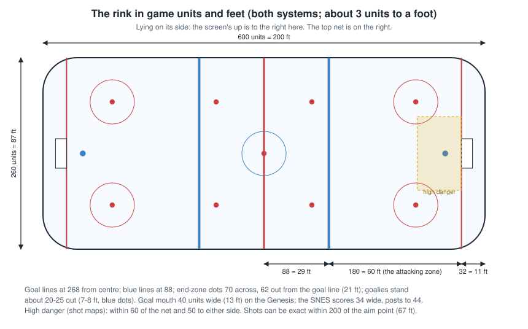

Distances are in the game's own units: **about 3 units to a foot**, so divide by 3 for feet. Speeds are the game's
speed numbers; a puck moves its speed / 4,096 units a frame, 60 frames a second.

**The rink:**

| Landmark | Units | Feet |
|---|---|---|
| Rink length / width | about 600 / 260 | about 200 / 87 |
| Centre of the rink to each goal line | 268 | about 89 |
| Centre to each blue line | 88 | about 29 |
| Blue line to goal line (the attacking zone) | 180 | 60 |
| Goal line to where the goalie stands | about 20-25 | 7-8 |
| End-zone faceoff dots: out from the goal line / across from the middle | 62 / 70 | 21 / 23 |
| Goal mouth (scoring part) | 17 either side of the middle (posts out to 22) | about 6 either side |

**Distances that come up a lot:**

| Distance | Units | Feet | Where it comes up |
|---|---|---|---|
| A goalie's body | a box about 10 either side of his centre, plus areas from his save poses | 3-4 | what a shot must miss to score |
| A stick's reach for a loose puck | 14 | about 5 | catching passes, the goalie's stick |
| A player's body to the puck, up or down, for his stick to be checked | 40 | about 13 | pucks going through a stick |
| High-danger shot (the slot) | within 60 of the net | within 20 | shot maps |
| Shots that can go exactly where aimed | within 200 of the aim point | within about 67 | roughly from the blue line in |

**Speeds:**

| Speed number | Units a frame | About | Example |
|---|---|---|---|
| 9,000 | 2.2 | 30 mph | a skater flat out |
| 15,000 | 3.7 | 50 mph | a typical pass |
| 23,000 | 5.6 | 78 mph | a hard pass shot or slapshot |
| 29,000 | 7.1 | 98 mph | the hardest slapshots |

---

## Contents

1. [Reading the ratings screen](#1-reading-the-ratings-screen)
2. [What each rating does for you](#2-what-each-rating-does-for-you)
3. [Choosing your lineup](#3-choosing-your-lineup)
4. [Faceoffs](#4-faceoffs)
5. [Skating and carrying the puck](#5-skating-and-carrying-the-puck)
6. [Shooting](#6-shooting)
7. [One-timers](#7-one-timers)
8. [Passing and the flip](#8-passing-and-the-flip)
9. [Checking](#9-checking)
10. [Penalties](#10-penalties)
11. [Goaltending](#11-goaltending)
12. [Penalty shots](#12-penalty-shots)
13. [Your computer teammates](#13-your-computer-teammates)
14. [Myths: things that don't matter](#14-myths-things-that-dont-matter)
15. [Cheat sheet](#15-cheat-sheet)

---

## 1. Reading the ratings screen

### 1.1 The numbers come in seven steps

The numbers on Edit Lines and the rosters look fine-grained, but each rating is really one of **seven steps** (0 to
6). The game turns the step into a number and adds the player's hot / cold value for that rating, so each step covers a
band of numbers:

| You see | Step | Middle of the band | In play at the middle (out of 15) |
|---|---|---|---|
| **99-100** | 6 | | 15 |
| **81-99** | 5 | 90 | 12 |
| **63-81** | 4 | 72 | 10 |
| **47-63** | 3 | 54 | 7 |
| **38-47** | 2 | 43 | 5 |
| **29-38** | 1 | 34 | 2 |
| **25-29** | 0 | 25 | 0 |

Below 50 the game squashes the numbers, so the low bands are narrow. Numbers on the edge between two bands (29, 38, 47,
63, 81) could be either step.

### 1.2 Low in the band is good

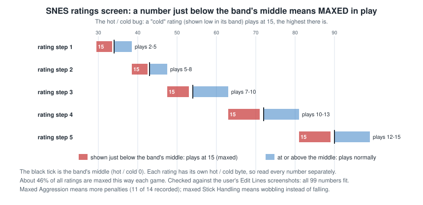

The SNES has a bug in its hot / cold values (2.2): **every "cold" value maxes the rating instead of lowering it.** So
the screen reads backwards:

- **Below the middle of its band, a rating plays at the maximum, 15, as if it were 100.** A Speed of 66 is a maximum
  Speed; a Speed of 75 is an ordinary step 4.
- **Exactly at the middle:** maxed one time in three.
- **Above the middle:** the step's value plus a little (up to +3).

**About half of all ratings are maxed every game**, and which ones changes from game to game. A player's real ratings
matter much less than on the Genesis; what matters is which of them the bug maxed today.

The viewer's player card lists the ratings the bug maxed in a recorded game ("Hot / cold (as played)"). This reading
of the screen is confirmed: in a recorded game, every rating shown below its band's middle played maxed, and none
above it did.

---

## 2. What each rating does for you

You control one skater at a time, usually the one with the puck or nearest it. The other four, and your goalie unless
you take him, are played by the computer.

### 2.1 Skaters

"In play" values are out of 15: a maxed rating is 15.

| Column | What it does | How much it matters |
|---|---|---|
| **Speed** | Top speed: about 18 mph at 0, 24 at 7, 27 at 10, 28 at 12, **31 when maxed** | **A lot**, but most skaters are maxed in a given game, so it separates players less than you'd think |
| **Agility** | Acceleration and stopping | **A lot** for the player you control |
| **Weight** | Costs acceleration (less than on the Genesis); helps checks a little (heavier checkers do slightly better) | Moderate. There's **no weight bug** |
| **Shot Power** | How hard he shoots. **Anyone can take a full slapshot** | Moderate |
| **Shot Accuracy** | The chance a shot goes **exactly** where you aimed (from inside the zone): 17% at 2, 29% at 5, 35% at 7, 42% at 10, 46% at 12, **52% maxed** | **A lot** for your shooters |
| **Stick Handling** | Keeping and stealing the puck, catching passes, and **wobbling instead of falling when hit** (12 or more) | Wobble: **step 5 and 6 always; step 4 only at 78 and up or when maxed; lower steps only when maxed** |
| **Checking** | Your knockdown chance on a check; **upending** (10+ of 15 as played, 9); **how often your computer teammates go for a hit** | Moderate for you, big for the computer's players (13.1) |
| **Pass Accuracy** | How steady your passes' speed is (the game sets the speed by distance), **and how far your flips stray** | Moderate: steadier passes bobble less; it's the flip's accuracy (8.2) |
| **Off. Awareness** | How quickly **computer-controlled** teammates react on offence and to loose pucks (0.25 s down to 0.12 s) | **Nothing for the player you control** |
| **Def. Awareness** | How quickly computer teammates react on defence (0.37 s down to 0.12 s: a bigger range than Offensive) | Matters for the four skaters you're not controlling |
| **Aggressiveness** | Penalty chance. **Maxed (below its band's middle) is the worst** | **Big** if you play with penalties on (section 10) |
| **Endurance** | Energy | **Nothing with line changes off** |

### 2.2 Goalies

| Column | What it does |
|---|---|
| **Agility** | How quickly he moves and gets to loose pucks. **It doesn't change his size**: every SNES goalie stops the same box of ice (11.1) |
| **Def. Awareness** | How quickly the computer goalie reacts; **each pass delays him by half of it**, so low values make him easy to beat with passes |
| **Speed**, **Weight** | Skating |
| **Stick Right / Left, Glove Right / Left** | **Nothing.** The save code looks them up and then overwrites them |

---

## 3. Choosing your lineup

- **Check Edit Lines once the game starts and look for maxed ratings** (below the band's middle). Today's maxed
  Speed, Agility, Shot Accuracy and Stick Handling are worth more than a player's usual reputation.
- **Forwards:** maxed or high Speed, Agility, Shot Accuracy; Stick Handling 12+ so contact makes him wobble, not fall.
- **Defencemen:** Defensive Awareness matters for when the computer plays them (gap control, getting back).
- **Penalties on:** be wary of **maxed Aggressiveness** on the players you'll control, and especially of
  Aggressiveness reading **78-80 or 90-92** (10.2).
- **Goalie:** his ratings don't change how much net he covers. Defensive Awareness and Agility help a computer goalie
  react; if you'll play the goalie yourself, they matter less.
- **Endurance doesn't matter** with line changes off, and speed bursts are free.

---

## 4. Faceoffs

**Ratings play no part. It's timing.**

1. **Mash B** from when the faceoff box appears until the drop. Each new press swings the stick; holding it doesn't.
2. **Hold the d-pad toward the teammate you want the puck to reach**, the whole time. If you win, the puck goes that
   way **3 times in 4**; with nothing held it goes a random way.
3. **Back to your defence is safest**: the puck always gets a push toward the winner's own end.

Checked on 70 recorded draws: the centre whose swing was further along at the drop won about three times in four.

---

## 5. Skating and carrying the puck

- **Speed bursts (A without the puck) give a big push**, and with line changes off they cost nothing. They don't
  stack into a runaway skater as they can on the Genesis: the SNES turns that switch back off reliably (SNES_MECHANICS
  3.3).
- **Don't skate into the goalie with the puck.** Any contact knocks you down and loses the puck, unless your Stick
  Handling is 12+ (2.1), in which case you wobble and **keep the puck**. But **a second contact within a second of a
  wobble always knocks you down**: get away from him.

---

## 6. Shooting

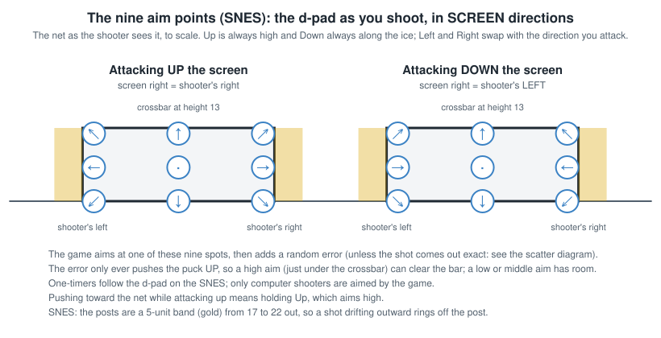

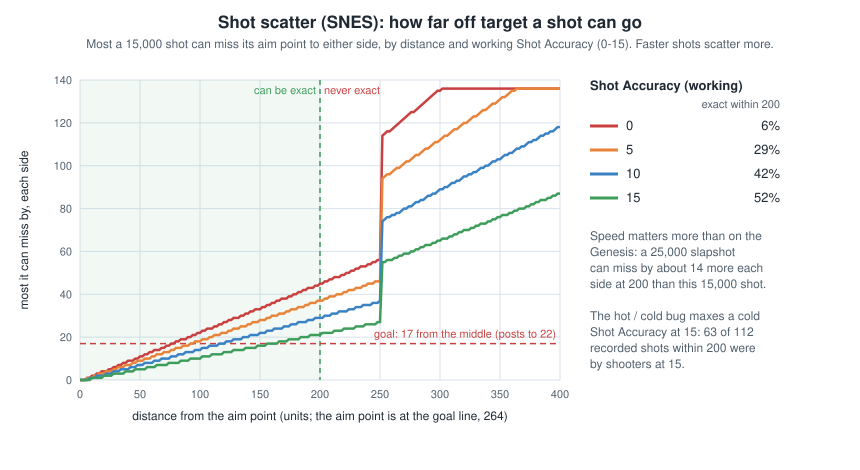

- **You aim with the d-pad as you shoot**, at nine spots in the net, **in screen directions**: Up is high, Down is
  along the ice, Left and Right are the screen's sides. So attacking down the screen, Left is the *shooter's* right,
  and **Up is always high**: pushing toward the top net puts shots high.
- **From inside the attacking zone** (within about 67 feet of the net) a shot can go **exactly** where aimed; at most
  52% of the time, with maxed Shot Accuracy (2.1). **From outside the zone, never**: it always strays.
- **Anyone can take a full slapshot**: hold A longer for more power.
- **At an empty net (or a goalie caught far out): hold Down or nothing, never Up, and get within about 60 feet.**
  - Most shots don't go exactly where you aim: the game adds a small random error, and **that error only ever pushes
    the puck up**, never down.
  - So aim low or in the middle and the error has room to work with. Aim high and the puck is already near the
    crossbar: the error sends it over about half the time, even from close.
  - From 70 feet or more, no shot is ever exact and the error is big, so almost nothing goes in. Skate in first.
  - Watch out attacking up the screen: pushing toward the net means pressing Up, which aims high. Let go of the d-pad
    instead.
- **No delayed-penalty bonus**: a referee's raised arm doesn't make your shots more accurate (the Genesis does).
- **A hard shot that deflects off the goalie's stick or glove isn't a shot on goal**, high or low (in his glove saves
  the glove reaches 7-15 off the ice). About 1 in 7 shots that reach the goalie go uncounted, whichever way you aim.
- **Don't count on long slapshots.** From the blue line to about 40 feet out, even the hardest shots go in only a
  few percent of the time on the SNES (1 in 17 in recorded games), far less than on the Genesis. If you do shoot from
  there, the near post is the better aim. Get closer or pass across instead.
- **The posts are wide on the SNES.** The scoring part of the net is narrower than on the Genesis, and the last 5
  units on each side are post: a shot aimed at a side that drifts a little outward rings off the post (about 1 shot in
  12 that reaches the net, four times the Genesis rate). There's no crossbar to hit: anything high enough to reach it
  goes over.
- **Defenders block low shots only with their sticks.** A low shot almost always passes straight through a defender's
  body; only his stick blade stops it (a soft shot he takes, a hard one deflects at random). A lifted shot below the
  crossbar's height always hits the body and bounces off, and a hard one can knock him over. Anything higher sails
  over everyone.

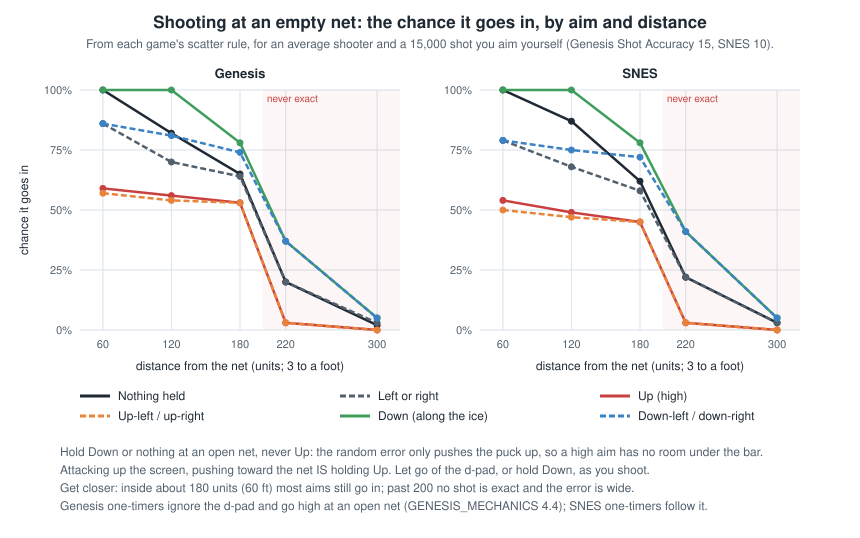

---

## 7. One-timers

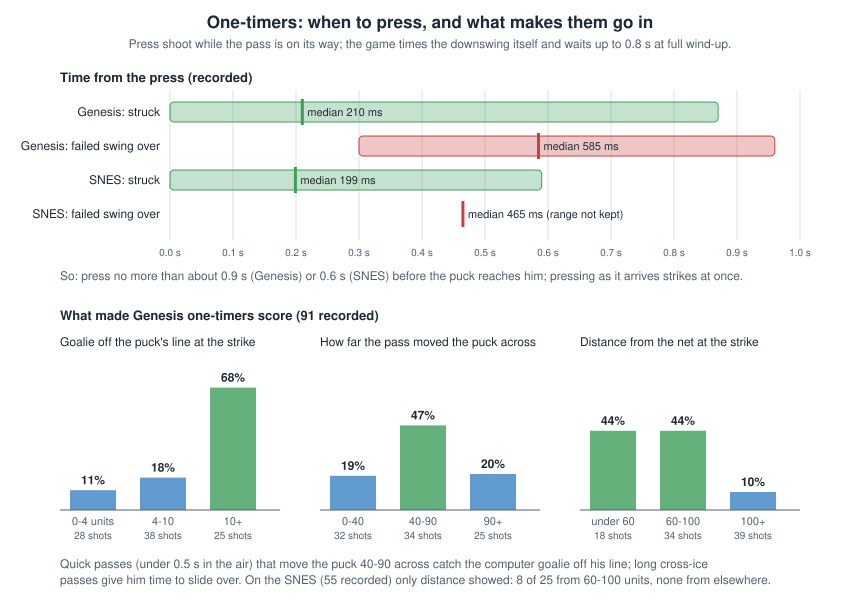

- **How:** pass with B to a teammate, then **press A while the pass is on its way**: control moves to him and he
  swings.
- **They go where your d-pad points**: you aim them, unlike the Genesis.
- **Time the A press late.** The swing starts the moment you press, and the puck must reach his stick blade before it
  ends: in recorded games every one-timer that connected came within 0.6 s of the press. Press A as the pass is about
  to arrive, not as soon as you pass (the Genesis gives you almost a second, the SNES doesn't).
- **They beat computer goalies:** while a pass is in the air the computer goalie **loses his Agility** and is slow to
  slide across, and every pass delays his next adjustment. A quick pass across and a one-timer catches him moving.
- **Offsides on:** a one-timer by an offside player is whistled.

---

## 8. Passing and the flip

### 8.1 Passing

- **B passes** to a teammate. **The game sets the pass's speed by its distance**: short passes go slower, long ones
  faster. Pass Accuracy only makes the speed steadier; a poor passer's passes come in a bit fast or slow at random.
- **Bobbles:** a pass bounces off the receiver's stick when it's faster than he can handle, which depends on his Stick
  Handling. Long passes to poor stickhandlers bobble; short passes almost never do. That's why the same player hardly
  ever bobbles twice in a row: the pass back to him usually comes from close by. A long pass back would bobble again.
- **Why the puck sometimes goes right through a stick:** a player can't touch the puck for a moment after he passes
  (up to about 0.4 s for a long pass), shoots (a quarter of a second), swings a one-timer, flips it (half a second), loses
  it to a steal (about half a second), or has it bounce off him; for 2 seconds after a fall, and through a whole goal
  celebration. A puck in the air or still rising also goes by. Otherwise any stick within reach of a slow puck takes it.
- **Which way:** hold the d-pad toward your teammate as you press B and the pass goes at once that way. Without a
  direction, it goes when you let go of B, the way your player is facing.
- **Who gets it:** the nearest teammate straight that way, or 45 degrees either side (those count as a bit farther).
  **Never your goalie.**
- **Pass shots:** with nobody in that direction, the puck flies off the way you pressed, at a random height (it can
  go high), and can score.

### 8.2 The flip (Y with the puck)

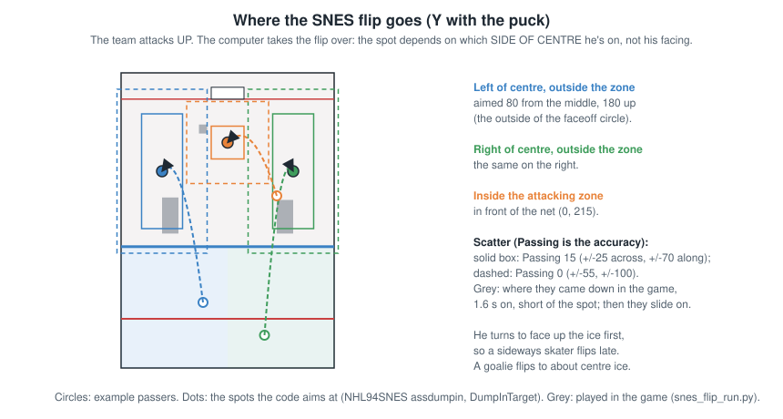

**The SNES flip is a computer dump-in**, not a lob you place:

- **Outside the attacking zone:** it goes deep, between the faceoff circle and the corner, **on whichever side of centre
  you're on**. Which way you face doesn't choose the side.
- **Inside the zone:** in front of the net.
- Your skater **turns to face up the ice first**, so it comes out late if you were facing sideways.
- **It strays a lot**, up to about 70 units along the ice and 20-55 across, less with better Pass Accuracy.

---

## 9. Checking

- **A without the puck** is a speed burst; run into a man hard enough and it's a check.
- **There's no weight bug**: a person and the computer check the same way, and a heavier checker does only slightly
  better (50% against 39% in recorded games). **The Genesis "CB check" gains nothing here.**
- **No "same man" rule**: you can knock the same player down again straight away.
- **Upending** (the flip): hit a man from the side or behind while he skates **straight up or down the ice**, with a
  checker whose Checking is high (10 or more of 15 as played, which the hot / cold bug gives many players). Hit him from
  the front and he falls backward; at an angle, forward. One fall in eight in recorded games was an upend.
- **A man who wobbles keeps the puck**, but **a second hit within a second always knocks him down**: follow up.
- **A soft check can leave you glued to the carrier.** If your burst meets him without much closing speed, he stays up
  and the two of you skate along together, even overlapping, and from then on no check can land: the game only checks
  players who are moving toward each other. Peel off and come at him again rather than riding along. With the puck, it's
  the reverse: a defender stuck to you can't knock you over, so keep going (two overtime winners came this way).
- **Boards:** a player knocked over anywhere in the outer lanes, behind the net or near a corner, with you on the
  inside, is thrown into the boards, from much farther out than on the Genesis.
- **Goalies can't be knocked down.** Skating into one fast knocks *you* down.
- **Don't burst into the net.** A speed burst into either net with the puck anywhere near it knocks the net off
  about one time in eight per frame of contact, and the whistle moves the faceoff out of the zone if it's the
  other team's net: the end of your pressure. Skating into it without bursting never does. If you're pinned against
  the net, every burst you make there rolls the dice again, so skate off it instead of bursting.
- **B without the puck: poke or switch?** On the SNES it acts as you **press** B. Within about 20 units (7 feet) of the
  carrier your skater always pokes. Farther away the game picks your skater nearest the puck, favouring one between the
  puck and your own net: if that's yours he pokes, otherwise control switches. Unlike the Genesis, it goes by where the
  puck is now, not where it's heading.
- **Y without the puck** hooks the nearest opponent in front of you, or **holds** him if he's facing you. If it catches
  him, he keeps the puck but flails and slows to your speed (and a wind-up for a shot is cancelled). Holds connect far
  more often than hooks (136 of 344 against 107 of 594 in recorded games), so go face to face.
- **The poke (B near the carrier)** only takes the puck through the stick's steal roll. With penalties on, a poke that
  touches him in front always knocks him over (a tripping risk); with penalties off, a person's poke trips him only now
  and then. Nearly half of people's pokes were from too far away to do anything (403 of 874).
- **The other buttons:** X takes your goalie (with manual goalie switched on) and pokes with him; L and R jump to the
  defenceman on that side of the screen (with defence control on); Select opens the line-change box.

---

## 10. Penalties

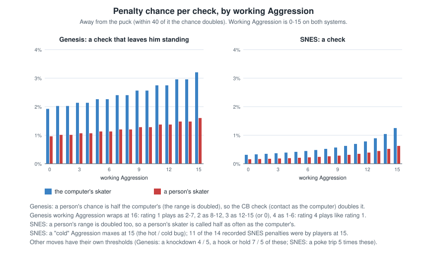

### 10.1 Cold players take the penalties

**11 of 14 penalties in the recorded games were by players with maxed Aggressiveness**: on the SNES, maxed
Aggressiveness (below its band's middle on the screen) is the dirty one.

**Pokes are the risky move.** A poke check (B) that catches an opponent in front of you trips him every time (with
penalties on), and a trip is called about five times as often as a check, a hook or a hold. And anything that stops a
skater on a breakaway is a penalty shot.

### 10.2 Aggressiveness 12: a possible penalty on every hit

Because of an overflow in the penalty roll, **a skater you control at working Aggressiveness 12 would be called on
every qualifying contact**, and 9-11 more often than the computer. On the screen that's **78-80 (step 4) or 90-92 (step
5)**. (From the code; people were at 12 only briefly in the recordings, so it hasn't been seen yet.)

### 10.3 Getting up fast (a glitch)

**When your player is knocked down, press Y (hook) and he gets up at once**, straight into a hook. The game checks the
hook button before the lock that keeps a fallen player down. In recorded games, players who did it were up in 0.5-1.2 s
instead of 2.3. It is a hook, though: near an opponent it can draw a hooking call.

### 10.4 Goalie interference

- **Anyone can be called**, including your computer-controlled teammates.
- Crashing a goalie in his crease hard: called **40% of the time for a maxed-Aggressiveness player**, 15% at 7.
- 4 of the 14 recorded penalties were interference. Stay out of the crease.

### 10.5 Delayed penalties

**Both teams can be called at one whistle.** A raised arm against the other team doesn't protect you (it does on the
Genesis).

The SDL league ROMs use **1-minute minors**.

---

## 11. Goaltending

### 11.1 How saves work

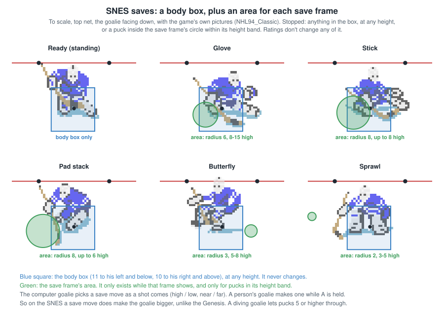

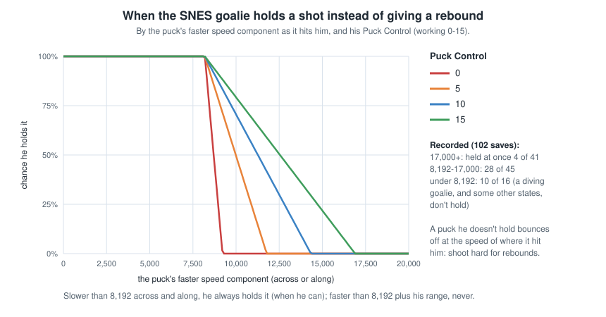

**There's no save roll.** The goalie stops pucks that reach a **fixed box around his body** (about 10 units, 3 feet,
each way), at any height, plus areas for his stick and pads that move with his animation. In recorded games no goal
went in within 12.6 units of a goalie's centre.

- **His size never changes**: not with Agility, not when a person controls him, not in a pad stack, not against
  one-timers.
- **A diving goalie lets lifted pucks through** (height 5 or more): shoot high at a diving goalie.
- To score, put the puck **outside that box**: a corner, from inside the zone where shots can be exact.
- **Hard shots come back out.** A shot at 17,000 or more almost never sticks to him (1 in 10 held in recorded games): it
  bounces straight out from where it hit him. Follow your hard shots in for the rebound. Soft shots he usually holds.

### 11.2 Playing goal yourself (X)

- Taking the goalie doesn't make him bigger, but **a goalie you control accelerates much faster** than the computer's.
- Inside his crease he skates at three-quarters speed.
- **Holding A makes a save move, and on the SNES that does make him bigger, on one side.** Standing, he stops only
  what reaches his body (about 3 feet each way). A save move adds a stick, glove or pad that reaches about 6-7 feet
  out, and a sprawl about 10. The game picks the side from where the puck is heading. You can't steer while it plays,
  so hold A as the shot comes, not before. Before the shot (puck still on the stick) it's a pad stack.

### 11.3 The computer goalie

- **He's slow to react**: he rethinks only every few frames (more often with high Defensive Awareness), heading for
  where the puck is going on a spot about 7 feet out.
- **When a shot is coming he slides to where it will cross**, starts a save move about a third of a second before it
  arrives, and **keeps sliding through the save**. Shots that make him slide a long way, quickly, are the ones that beat
  him: across the crease, or a pass across and a one-timer.
- **He freezes when you wind up a shot** while skating straight up or down the ice: wind up, then shoot where he isn't.
  He stops only for a moment, and he doesn't drop into a pad stack the way the Genesis goalie does.
- **Cross-crease** still works: he rethinks slowly and his body is small. Skate across the front of the net close in
  and shoot before he catches up.
- **A goalie holding the puck can't be pushed into the net** (on the Genesis he can).
- **Passes slow him down** (7): attack with passes across and one-timers.
- He has two attacking moves, the same for every goalie: a **poke check** at a carrier close in front (now and then,
  then not again for 4 seconds), and a **dive** at a loose rebound, which he gets a single small chance at right after
  each save. In recorded games computer goalies poked 18 times in 137 minutes and never dived.
- **Your own goalie** (manual goalie on): X pokes, holding Y dives (toward the d-pad direction, or at the puck), holding A
  makes save moves.
- **When he has the puck and an opponent comes within about 7 feet, he drops onto it and covers it** for a second and a
  half; with nobody near he looks to pass it out. A goalie you control never does this.

The viewer's **xG** plays every SNES shot out this way and shows the chance it had of going in, on each shot, the
cards and the team stats; the **xG map** (Map menu) shows it for every spot.

---

## 12. Penalty shots

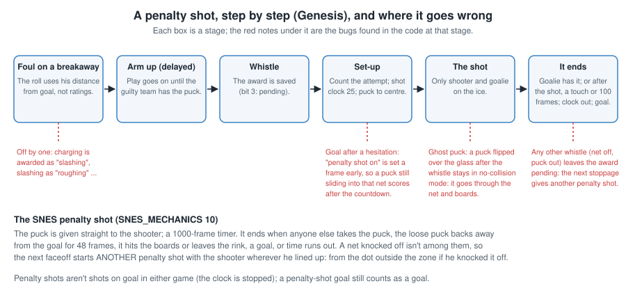

- **The shot ends as soon as anyone picks up a loose puck, including you**: if you lose the puck, picking it back up
  ends your penalty shot. Don't lose it.
- It also ends if the loose puck drifts back away from the net for almost a second, hits the boards, or the shot clock
  (about 17 s) runs out.
- **The retake bug:** if the net is knocked off during a penalty shot, the next faceoff becomes **another penalty shot**,
  starting from wherever the shooter lined up: after an attacker knocks the net off, the dot just outside the zone.

---

## 13. Your computer teammates

### 13.1 Hit-happy

**Computer skaters go for a hit almost every time an opponent is in front of them** when their Checking is high, and
the hot / cold bug gives many players maximum Checking. With penalties on they hold back somewhat (about 64% of the
time instead of 96%). That's why SNES games are so physical, and why the computer's players draw penalties.

### 13.2 Awareness

- **Awareness is reaction time** for computer players: from about 0.25 s (Offensive) or 0.37 s (Defensive) at the
  bottom down to 0.12 s at the top. **It never affects the player you control.** A maxed awareness gives the best value.
- Defensive Awareness drives how often your defencemen re-read the attackers (gap control). **It doesn't slow the switch
  after a turnover:** on the SNES computer players turn to defence the moment the other team has the puck (on the
  Genesis they wait for their awareness countdown).

### 13.3 Where they go

- **Defencemen join the attack by zone:** with your team's puck in the attacking zone they hold the blue line; in the
  neutral zone they wait just outside your own blue line; in your own zone they stay deep.
- **Wingers on defence cover the points:** with the puck in your zone they stop between the circles and the blue
  line, and leave the low slot to the defencemen and centre (as on the Genesis).
- **Stepping out of the zone and back in** works as on the Genesis (its guide, section 14).
- Line changes (only with line changes on) work as on the Genesis: the computer changes when its line is tired and
  dumps the puck in to do it.

---

## 14. Myths: things that don't matter

- **The goalie's glove and stick ratings.**
- **A goalie's ratings changing how much net he covers**: every SNES goalie is the same size.
- **Endurance**, and fatigue in general, with line changes off.
- **Offensive Awareness for the player you control.**
- **"High numbers are always better"**: a number just below its band's middle beats one just above it (1.2).
- **Ratings on faceoffs.**
- **The crowd**: on the SNES the meter changes nothing in play. The code meant to make players hotter at 110 dB is never
  run.
- **"Heavy players get flattened"** (a Genesis thing): the SNES has no weight bug.
- **The comeback bonus** for a team behind in the third: small, and because of a bug it's on in the *first* half of
  the period and off in the second.

---

## 15. Cheat sheet

**Before the game:** check Edit Lines once the game starts. Below the band's middle = maxed. Want maxed Speed, Agility,
Shot Accuracy and Stick Handling on the players you'll control; avoid maxed Aggressiveness (and 78-80 / 90-92) if
penalties are on. The goalie's ratings don't change his size.

**On the ice:**

1. Faceoffs: mash B, hold the d-pad toward your target, back to the defence is safest.
2. Shoot from inside the zone at a corner; Up is always high.
3. One-timers: B to pass, A while it travels, and aim them with the d-pad. Passes across slow the computer goalie.
4. Check anyone: no weight bug. Follow a wobble with a second hit.
5. Stay out of the goalie's crease: anyone can be called, and maxed-Aggressiveness players 40% of the time.
6. The flip (Y) goes deep on your side of centre; good Pass Accuracy keeps it closer to target.
7. Penalty shot: don't lose the puck; picking it back up ends the shot.
