# NHL '94 Game Mechanics: SNES shooting and goaltending

Sections 4 and 5 of [SNES_MECHANICS.md](SNES_MECHANICS.md), which has the rest (ratings, skating, passing, checking, penalties, the computer players, puck physics ...) and explains how the findings are marked (**Confirmed**, **Code**). The section numbers are shared, so a reference such as 7.2 is there.

## Contents

- [ 4.1 The nine aim points](#41-the-nine-aim-points)
- [ 4.2 Perfect shot or scatter](#42-perfect-shot-or-scatter)
- [ 4.3 Shot power](#43-shot-power)
- [ 4.4 Auto-aim](#44-auto-aim)
- [ 4.5 One-timers](#45-one-timers)
- [ 4.6 What counts as a shot on goal](#46-what-counts-as-a-shot-on-goal)
- [ 4.7 Expected goals from the game's own rules](#47-expected-goals-from-the-games-own-rules)
- [ 4.8 The scoring map: shots played in the real game](#48-the-scoring-map-shots-played-in-the-real-game)
- [ 4.9 Other shots played in the real game](#49-other-shots-played-in-the-real-game)
- [ 4.10 Dekes in recorded games](#410-dekes-in-recorded-games)
- [ 5.1 Saves are geometry](#51-saves-are-geometry)
- [ 5.2 Save moves](#52-save-moves)
- [ 5.3 The computer goalie](#53-the-computer-goalie)
- [ 5.4 Holding the puck and rebounds](#54-holding-the-puck-and-rebounds)
- [ 5.5 The save button for a person in net (A, held)](#55-the-save-button-for-a-person-in-net-a-held)
- [ 5.6 Early save moves and cross-crease goals](#56-early-save-moves-and-cross-crease-goals)
- [ 5.7 A goalie holding the puck can't be pushed in](#57-a-goalie-holding-the-puck-cant-be-pushed-in)
- [ 5.8 Long slapshots](#58-long-slapshots)

## 4. Shooting

### 4.1 The nine aim points

Every shot is aimed at one of nine points in the net (`doshot`, `shotsets`), picked by **the direction the d-pad is
held as the shot is taken**, in **screen** directions:

| Held | Aim |
|---|---|
| Up-left / Up / Up-right | High: the screen's left / middle / right |
| Left / nothing / Right | Middle height: left / middle / right |
| Down-left / Down / Down-right | Along the ice: left / middle / right |

The points are 15 units either side of the middle and at heights 12, 6 and 0. Because it is screen direction, when you
attack down the screen the d-pad's left is the shooter's right, and **up is always high**: people pushing toward the top
net put their shots high. **Confirmed**: at every person's shot in two games the recorded direction was the d-pad's, and
goals crossed the line where they were aimed.

### 4.2 Perfect shot or scatter

- **Within 200 units of the aim point** (about 65 feet), a roll decides whether the shot goes **exactly** where aimed:
  chance (Shot Accuracy + 1) / (Shot Accuracy + 16). That's at most **52%** (Shot Accuracy 15), 35% at 7.
- **Beyond 200, never perfect.**
- Otherwise random scatter is added: (shot speed / 8 - Shot Accuracy + 16) x distance / 64, bigger for harder,
  longer and less accurate shots.
- **Confirmed**: 60% of 112 close shots left the stick on the aim point, none of 15 from farther out; 63 of the 112
  were by shooters at the maximum Shot Accuracy (the hot / cold bug).
- There is **no delayed-penalty "snipe"** (the Genesis makes every shot perfect while the other team has a penalty
  coming; the SNES doesn't).

**Shooting at an open net** (the goalie pulled, or far out of his crease). Nothing in the game makes shots at an open
net less accurate (the "goalie pulled" test in the shot code only ever looks at the *shooting* team's own goalie; and
unlike the Genesis, SNES one-timers follow the stick, so they don't get the Genesis's high open-net aim), but
three things from the rules above make them miss: such shots are often taken from far out, where a shot is never
exact and the scatter is wide; the scatter only ever pushes the puck *up*, so a high aim has no room under the
crossbar; and the d-pad direction is the aim, so attacking *up* the screen, pushing toward the net aims high. Worked out
from the game's own scatter rule for an average shooter (working Shot Accuracy 10, a 15,000 shot) at an empty net, the chance it goes in by aim and distance:

| Aim (d-pad at the release) | 60 units | 120 | 180 | 220 | 300 |
|---|---|---|---|---|---|
| Nothing held (middle) | 100% | 87% | 62% | 22% | 3% |
| Left or right | 79% | 68% | 58% | 22% | 3% |
| Up (high) | 54% | 49% | 45% | 3% | 0% |
| Up-left / up-right | 50% | 47% | 45% | 3% | 0% |
| Down (along the ice) | 100% | 100% | 78% | 41% | 5% |
| Down-left / down-right | 79% | 75% | 72% | 41% | 5% |

**At an open net: get within about 180 units (60 feet) if you can, and hold Down or nothing as you shoot, never Up.**
Not yet checked on recorded shots (only five recorded shots had the goalie far out or pulled; they hint at more going
wide: 24% wide with him 35-70 units out, 16% in his crease).

### 4.3 Shot power

Shot speed is (Shot Power x energy + 20) x the wind-up. **Anyone can wind up fully**: the wind-up code doesn't read
Shot Power, so weak shooters can take full slapshots. **Code**

**Backhands lose a quarter of their power** (`doshot`), and facing only picks which it is (`SetShotMode`,
`Findhittype`, as on the Genesis): the direction from the shooter to the net against the way he faces, a backhand when
the net is 45 to 180 degrees round to his backhand side (by his handedness), a forehand otherwise. Nothing else in the
shot reads his facing: the aim point, the perfect-shot roll and the scatter depend on the d-pad, the puck's spot, its
speed and Shot Accuracy. **Code**

### 4.4 Auto-aim

Only **computer** shooters are auto-aimed (`shotdiradj` is skipped for a person's player). **Your one-timers go where
your d-pad points.** **Code**

### 4.5 One-timers

- **Triggering:** while your pass is on its way to a teammate, press **A**: control moves to the receiver and he swings
  at it (`onetimerreq`). **Code**
- The swings are their own animations (two of them, never with the puck), seen in the recordings at every "led to a
  one-timer" moment reviewed.
- **The goalie's reach is not cut** against one-timers (the Genesis cuts it), but the **computer goalie loses his
  Agility while the pass is in the air and his next rethink is delayed by each pass** (5.3), so a quick pass across and
  a one-timer still catches him moving slowly.
- One-timers **can be offside** (11).
- **The swing and the strike** (`asspassrec`): the swing (forehand or backhand by the angle to the net) starts the
  moment the request is made, and **the game doesn't time it to the puck** (the Genesis starts the downswing itself
  and holds the wind-up up to 0.8 s). While the swing runs, the receiver's stick won't catch the puck (his `nopuck`
  is held at 10); the puck has to come **within 8 units of his blade** before the swing ends (the Genesis: within 10,
  pulled in from 18). Then it's struck at a fixed power, **aimed by the d-pad held at the strike** (computer
  one-timers: no direction, then the computer's auto-aim), and counted as a one-timer; a B press while waiting cancels.
  The game counts every swing too (`tmOneTimerSwings`). **Code.**
- **Computer teams** one-time on their own only in the attacking zone (past their blue line), and quickly: a coin flip
  each frame while the pass comes.
- **Confirmed timing** (5 SNES games, a person's A press): one-timers that connected struck 0-0.59 s after the press
  (median 0.20 s); swings that missed ended a median 0.47 s after it. **Press A no more than about 0.6 s before the pass
  arrives**; the Genesis allows about 0.9 s. In one recorded game: 7 one-timers plus 6 swings that missed, against the
  game's own count of 11 tried.

### 4.6 What counts as a shot on goal

As on the Genesis (`ChkShotStat`): the shot counts when the puck touches the goalie's body box (`puckgoalie`) or he
catches it with his stick or glove (`puckglue`), while the "shot taken" flag set at the release still stands; any
other touch on the way (`a2touchpuck`) clears the flag, and nothing counts while the clock is stopped (penalty shots).
A hard shot that **deflects off his stick or glove area** (faster than 13,000; 7.5) clears it too, so it is never
counted, even though his body box gets the puck a moment later. **Code**

**Which shots that is differs from the Genesis.** The SNES goalie's stick / glove area (5.1) comes with a height
window from his sprite frame: none in his ready stance, low (0-6) in the stick saves, but **7-15 off the ice in the
glove saves**. So hard high shots that meet his glove deflect uncounted as well as hard low ones off his stick.
**Confirmed** (5 SNES games, shots that reached the goalie): not counted aimed high 6 of 29, middle 15 of 104, along the
ice 2 of 14: no height stands out, unlike the Genesis (ice 41%, high 3%).

**Direction:** people aim even more by direction than on the Genesis (attacking up the screen 49% of their shots high,
attacking down 2%), but with no height uncounted more than another, that makes little difference: 17% of the shots
that reached the goalie went uncounted going up, 14% going down. One of the stick saves is lopsided (facing down,
the top net's goalie, its area reaches 8 off the ice with a radius of 8; facing up, 2-5 with a radius of 2), which
would make shots at the top net a little more likely to go uncounted. A goal can also come with no shot counted (a
penalty-shot goal, and a Roenick goal in CHI-TOR).

### 4.7 Expected goals from the game's own rules

As on the Genesis, the chance a shot goes in can be worked out by playing it out the SNES game's way, many times; the
NHL '94 Viewer does it for every SNES shot and one-timer (`tools/xg_snes.py`, 400 times each):

1. **The aim**: the recorded d-pad direction (one-timers too; computer shooters' aim as the game set it).
2. **The shot** (`doshot`): exact with the perfect-shot chance (4.2), else the game's scatter (distances by its
   approximate length), at the recorded speed and the shooter's working Shot Accuracy.
3. **The flight** (`updateplayers`): two frames a game step, gravity 96 a frame, the lift worked out to cancel it.
4. **The goalie** moves as the computer goalie does (5.3), with his save move and its frames (5.2); a person in net is
   moved the same way. He stops the puck with his body box or his frame's stick / glove area (5.1).
5. **The net**: a goal within 17 of the middle under 13 at y 259, a post to 22 (5.1).

The one number fitted to the recordings is a 2-unit random spread for the emulated goalie's position. **Checked** on
175 unblocked shots in five recorded SNES games: 40.1 expected goals against 32 scored (computer in net 25.7 / 21,
people 14.4 / 11), the predicted posts and misses matching, and a log loss of 0.27 against 0.48 for giving every shot
the same chance. Getting there showed what matters on the SNES: with the goalie frozen where he was at the release the
model said 62 goals, carrying on at his speed 50; it's his reaction during the shot, and above all that **he keeps
sliding through his save move**, that makes the saves.

The viewer shows SNES xG on shots, cards, team stats, the season page and the xG map (one-timers there face goalies as
they were at recorded one-timers, usually still moving across after the pass).

### 4.8 The scoring map: shots played in the real game

**Real game** (2026-10-23; `analysis/scoring_map/snes_*.py`, PROJECT_NOTES "Scoring map"; the whole method, with pictures of each kind of goal: [SCORING_MAP](SCORING_MAP.md)). As on the Genesis
(GENESIS_SHOOTING 4.10), but with the unmodified ROM: the game runs headless in Snes9x, the shooter is held on a spot
with the puck while the computer goalie sets himself, and each shot is played to the end. The frame the puck leaves the
stick is replayed from many random seeds, so the game rolls its own dice for everything (the perfect-shot roll, the
scatter, the goalie's random look-ahead, rebounds, posts): no ported code to trust.

**The situation it covers:** a typical shooter (working Shot Power 13, Shot Accuracy 13, the median of 297 recorded SNES
shots) standing still with the puck; every other skater away; Montreal's computer goalie set in his spot; a wrist shot
(A tapped) or a full slapshot (A held), each of the nine aims; 384 shots per aim at every spot (16 moments x 24
seeds), 2.07 million valid shots in all. Spots where the puck would start within 24 of his centre are left out. The
goalie's ratings hardly matter here: his body box, his set spot and his save frames are the same for every goalie.
**Checked**: with the goalie moved out of the way the same harness scores at the empty-net rates of 4.2.
**Too few moments, found later (2026-10-23):** the map sampled 16 of the 120 moments (clock x settle) a spot, and the
goal rate swings by about 0.27 (standard deviation) from moment to moment, so a single square is only good to about 7
points either way. Over all 120 moments (480 shots each): the top-net lane spot (10 left of centre, 88 out, Left held)
53.6% (map 47.7%), the bottom-net one (10 right, 118 out, Right held) 26.5% (map 30.2%), the mirror spot 1.7% (map
0.8%). The findings stand; the squares' exact values would need a rerun at 120 moments.

**The lane depends on the game's frame timing** (found making the animations, 2026-10-23). The SNES game doesn't move
the puck every frame, and the lane puck passes at the edge of the goalie's body box (11-12 from his centre), so which
frames it is checked on decides goal or save. Replaying the same shots with only the shooter's position changed (left
where he shot, instead of moved away as the map does with every skater) shifted the frames the puck stood still on,
and the result with them: over 480 shots each, 53.8% at the top-net lane spot (53.6% with him moved), 20.4% at the
bottom-net one (26.5%), 0.8% at the mirror spot (1.7%). The Genesis moves the puck every frame and didn't change. In a
real game, with ten skaters on the ice, the timing differs again: the lane is real, but its rate in games is uncertain
until the practice test in NEEDS_FROM_YOU (item 6) is done.

**What a set goalie gives up:**

- **Almost nothing, from almost everywhere.** Averaged over the nine aims: wrist shots under 0.4% from every distance,
  slapshots at most 1.1%; within about 60 units of the goal line nothing (0.0-0.4%). A set SNES goalie is harder to
  beat from a standstill than a Genesis one (no through-the-legs gap, no shoulder bobble, no early pad stack).
- **The exception: a lane on the goalie's right.** A slapshot from just to the **shooter's left** of centre (6-16
  units off the middle; at the top net x -16 to -6, at the bottom +6 to +16), aimed at that same side (the screen's
  left at the top net, its right at the bottom; high, middle or low all work), scores **about half the time** from
  80-120 units out (25-40 feet): 41-57 goals in 96 shots at 1-unit steps across the lane, about the perfect-shot chance
  for Shot Accuracy 13 (14 in 29). A few units outside the lane it falls to 0-30%; from the mirror spots on the
  shooter's right, aimed at that side, mostly 0-3% (at the top net 0-2% everywhere; at the bottom one spot 21 off
  centre reached 31%).
- **Why** (`analysis/scoring_map/goal_types.py`: a fresh sample of 761,400 shots, every goal classified from the puck
  and the goalie frame by frame; 911 of its goals came from the lane): the puck, going exactly where aimed, passes
  11-13 units from the goalie's centre, just outside his body box (11), and his save move's area (a small circle with
  a height band, 5.1) misses it. In the lane he was in his **right** glove save (54% of the goals), right stick save
  (32%) or right sprawl (10%), never a left one: the right stick and sprawl areas have a radius of 2-4 and start 2-5
  off the ice, so a puck on the ice slides under them; the right glove's area sits 6-8 out, inside his body box, and
  the puck passes beside it. Over the whole sample 1,392 goals went past right-side moves against 580 past left-side
  ones. His right is the screen's left at the top net (he faces down) and its right at the bottom (he faces up): the
  shooter's left both times.
- **Wrist shots** find the same lane only at the top net, 68-78 out (27-30%); elsewhere their best aim reaches 5-15% in a
  few spots.
- **Top against bottom:** slapshots average 1.0-1.1% at the bottom net, 0.3-0.7% at the top.

| Distance from the goal line (shooter) | Wrist, top / bottom (mean of aims) | Slapshot, top / bottom (mean of aims) |
|---|---|---|
| 128-178 units | 0.09% / 0.34% | 0.27% / 1.02% |
| 88-127 | 0.04% / 0.19% | 0.66% / 1.13% |
| 58-87 | 0.36% / 0.02% | 0.38% / 0.08% |
| 18-57 (valid spots only) | 0.00% / 0.00% | 0.04% / 0.00% |

**Against the xG model (4.7):** averaged over the aims they agree (slapshots 88-127 out: 0.7% / 1.1% in the game,
1.3% / 1.6% in the model; elsewhere both under about 1%), but the model doesn't find the lane: at the model's best aim
the game scores 1.3-2.4% from 88-178 out, where its own best aim gives 2.7-4.6% on average and about 50% in the lane.
The lane is a few units wide and comes from frame-exact save areas, which the model's goalie (a 2-unit random spread on
his position) blurs away.

### 4.9 Other shots played in the real game

The same harness with a pass, and the slapshot at every rating; each study in full in [SCORING_MAP](SCORING_MAP.md).

**One-timers in the real game** (2026-10-23, `ot_run.py`, the whole study in [SCORING_MAP](SCORING_MAP.md), "One-timers
on the SNES"): a pass to a standing receiver, A pressed during the pass with one of the nine d-pad directions held from
the press, 824 set-ups over both nets. **Real game:** 92% of presses the pass reached struck the puck; goals per
strike over all the aims (at the best aim): the doorstep middle 44% (62%), 18 feet out in the middle 24% (56%), 27
feet 13% (34%), 35 feet 8% (26%), beyond about 2% (under 11%). With the receiver inside 18 feet, a pass from the other
side 36% (58%), from his own side 7% (16%). The aim roughly doubles the chance at the right direction.
**The xG model (4.7) gets SNES one-timers right too:** at 3,627 strikes (59 set-ups, both timings, 4 moments, all nine
aims; `ot_xg_check_snes.py`) the game scored 8.9%, the model 7.8%; correlation 0.82 strike by strike; log loss 0.158
against 0.299 for one rate for all. Pass across (receiver inside 18 feet): game 45%, model 42%; same side 1% and 3%.
By aim the model is within 2 points everywhere (a little low on the diagonals); by distance it is close in front
(54% / 51% within about 13 feet) and a little low far out (2.9% / 1.9% beyond 30 feet). Unchanged.

**Slapshots by Shot Power and Accuracy** (2026-10-25, SCORING_SNES "Every Shot Power and Accuracy (SNES)"): 18 spots
108-148 out, roster steps 2-6 (working 5-15). Below step 4 nothing scores; step 4 opens only the bottom net from 40
left of centre at the near post (6%); step 6, the most, opens the other spots (15-18% at the best aim, every one at
the post on the shooter's side of the ice). Accuracy adds little (about 1 point over the spots). The Genesis threshold
is lower (between 3 and 4) and much bigger.

**One-timers by Shot Power and Accuracy** (2026-10-25, SCORING_MAP): Accuracy counts (12-14 points at the best aim from
step 2 to 6), Power little (3-5); the stick meets the puck 92% whatever the ratings; ratings matter most 18 feet out
and to the side, least on the doorstep (82% at 2 / 2, 89% at 6 / 6). As on the Genesis.

### 4.10 Dekes in recorded games

The user's examples (2026-10-25), traced sample by sample from the match files (positions, facing, the controller's
buttons): Fleury's goal to make it 2-1 and Suter's to make it 6-1 (`2026-10-20_2119_TOR-CGY`), Neely's 1-0
(`2026-10-18_1934_BOS-PIT`), Robitaille's 2-0 (`2026-10-18_2006_CHI-LA`), Roberts's 1-1 (`2026-10-17_1719_CHI-CGY`).
All five are the same move:

| | Fleury | Suter | Neely | Robitaille | Roberts |
| --- | --- | --- | --- | --- | --- |
| Coming in | down the middle | from 11 ft to his left, across to the middle | from 20 ft to his right, cutting to the middle | from 13 ft to his left, to the middle | from 13 ft to his left, diagonally to the middle |
| The swing: d-pad turned (from the goalie) | to his right, 16 ft | to his left, straight across, 22 ft | back to his right, diagonally, 28 ft | to his left, straight across, 21 ft | to his right, straight across, 19 ft |
| The puck carried across | 12 units | 30 | 14 | 17 | 30 |
| A tapped (from the goalie) | 9 ft | 11 ft | 13 ft | 9 ft | 14 ft |
| The puck leaves the stick | 5-7 ft | 5-7 ft | 8 ft | 6 ft | 7 ft |
| The puck to the side of the goalie at the release | 6 ft | 5 ft | 7 ft | 6 ft | 4 ft |
| Height | low | low | high | low | low |

- **The move:** come in toward the middle; 16-28 feet from the goalie turn the d-pad to one side, mostly straight
  across (the skater turns side-on and the puck slides 4-10 feet across in front of him); keep that direction held;
  tap A 9-14 feet out; the puck leaves the stick 5-8 feet from the goalie and 4-7 feet to his side, and goes in low (one of the five high).
  Either side, swung back toward the side he came from (Neely) or on across (Suter, Robitaille).
- **Like the Genesis deke** (GENESIS_SHOOTING 5.8: a swing, then the shot), but closer in: the Genesis best set-ups
  swing 20-24 feet out and the shot follows from about 10-15 feet; on the SNES the d-pad is still held sideways at
  the shot, and the release is right on top of the goalie.
- **The goalie** barely moves before the release (0-9 units across); a person in net pressed the save button
  (Fleury's goal) and it still went in.
- **Not a deke:** Juneau's goal to make it 11-2 (`2026-10-18_1934_BOS-PIT`), the user's example of a goal that
  scores on the SNES but not on the Genesis: skating across the slot from the left at full speed, a wrist shot 14-16
  feet out, high, into the side he came from; the goalie did not react before it was in.

**The near-post cut** (the user's 2v2 game, `2026-10-25_1951_MTL-LA`, MTL 17-5 against the computer's LA: Muller
and Damphousse; the user's description, then every MTL shot traced). Skating in down the right side (the EA Special's
side), the skater cuts across toward the middle as he comes in, and at about the post's line turns quickly to face
straight up the ice. The goalie slides a little toward the middle (his right), leaving a sliver at the near post, and
a wrist shot goes into it. Seldom seen on the Genesis.

- **The traced move** (attacker's view, units from the middle of the ice and out from the goal line, 3 to the foot):
  in from 50-80 across, about 150 out; facing up-left or left while cutting in, turned to face up 0.1-0.2 s before
  the shot; Up-Right held at the shot (the high aim at the near post, height row 12). The puck leaves the stick 14-27
  across (5-9 ft right of centre) and in the goals 25-34 out (8-11 ft), and goes in high (10-12 off the ice) at
  13-16 across, inside the near post. The goalie tried a glove save on most of them.
- **Going up (the top net): 6 goals in 11 tries**, the game's last five goals among them. The five that failed (four
  saves, one post): released farther out (35-47, three of the four 38 or more) or too wide (a post from 43 across).
  The goalie moved 2-9 units toward the middle in the second before the goals (average 5) and 1-3 before the saves
  (he moved 2 toward the near post before the post): he slides off the near post either way, a little more in the
  goals, so how close the release is splits them more cleanly than the slide.
- **Going down (the bottom net): 0 in 4** from the right side, as the user found. The goalie stayed on the near post:
  three times he moved 0-2 from where he was (10-15 across); the fourth, released 55 out, he came in from 22 to 14. And the shots were not the same shot: going down, holding the d-pad
  toward the goal aims low (Up on the d-pad is always high, 4.1), so the user held only toward the near post, the
  middle height row. The high near-post aim going down is Up and the near side on the d-pad, away from the net
  (coming from the right attacking down: Up-Left). The four tries don't separate the two.
- **Not the mirror image: the deke from the left.** The left-handers also scored coming in on their left (their
  forehand side) and deking, with no EA Special-like approach (the user: a different move, though the goalie comes off
  the near post in the same way). Going up 3 goals in 5 (two wide, from 49 across and from 59 out), aimed high at the
  near post (Up-Left); going down 3 in 6 (two posts, one save from 50 out), aimed at the near post at the middle
  height. In the goals the goalie had moved 0-8 toward the middle; in the two posts going down he had moved 6-10
  *toward* the near post. So that deke worked at both nets for left-handers, and the near-post cut only going up.
- **Other goals in the game:** three cuts across the crease from the right corner (skating left, 3-11 ft out, in at
  the far post), and one straight down the right lane.

So the cut needs the goalie to come off the near post and a release inside about 11 ft.

**The tries replayed in the real game** (`analysis/scoring_map/snes_deke_run.py`, plan "replay", 2026-10-25). Each of
the 26 tries (15 cuts, 11 dekes from the left) was replayed from 1.5 s before the shot: the skater where he was, at
his speed and facing, with his own working ratings and the LA goalie's, then the user's recorded d-pad and A frame by
frame. Each was played at its own net and turned round at the other, by a left- and a right-hander, with the aim as
played or, from the A press, high or middle at the near post: 24 game moments each, every shot with 4 release seeds,
goals carried in counted. Only the skater and the goalie are on the ice. **Checked:** the replayed skater follows the
recorded path to within about 5 units, and the 11 Up-net cuts score 37% (the user: 6 of 11).

- **The cut works at the Down net.** It's the tries, not the net. The 11 cuts from the Up-net periods score 39% at
  the Up net and **46% turned round at the Down net**. The 4 Down-net tries score 12% there and 21% at the Up net:
  they fail at either net. So the user's 0 of 4 going down came from those four tries.
- **What makes a try work:** released close and the goalie sliding a little toward the middle.

  | The try's release (out from the goal line) | Tries | Scored (both nets, all hands and aims) |
  | --- | --- | --- |
  | 25-38 (8-13 ft), the goalie sliding 3-12 toward the middle | 5 | 47-88% |
  | 41-47 (14-16 ft) | 4 | 6-73% (two good, two poor) |
  | 48-76 (16-25 ft) | 3 | 1-22% |
  | 26-40, the goalie not sliding (0-2), sliding toward the near post (-7), or all the way (25) | 3 | 0-3% |

  Each try is counted at each net separately (both hands, all three aims); the range runs over every try in the row.

- **Hand:** a right-hander does as well or better: 47% against 32% at the Down net, 35% against 33% at the Up net
  (the aim as played).
- **Aim: hardly matters.** Up net: high 33%, middle 35%, as played 34%. Down net: high 33%, middle 40%, as played
  40%. The middle aim at the bottom net (4.10 above) was not the trouble.

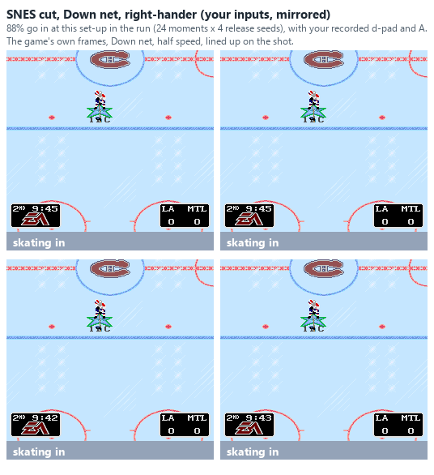
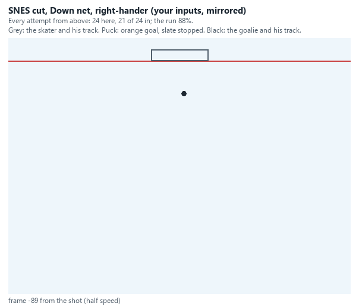

The user's own cut at P3 2:18 turned round to the Down net, by a right-hander: 88% in the run (21 of 24 here; the GIFs
leave the skater on the ice after the shot, where the run takes him off).

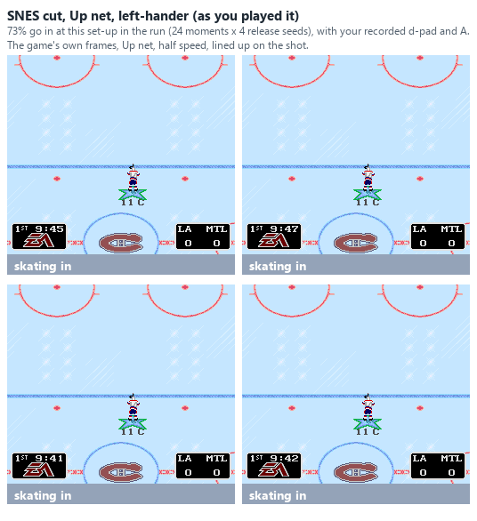
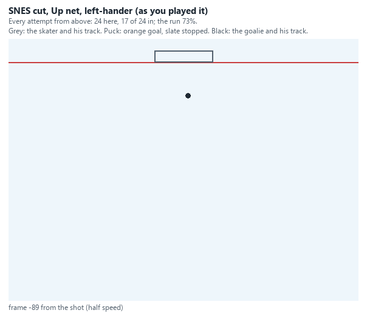

The same try as played, Up net, left-hander: 73% (17 of 24 here).

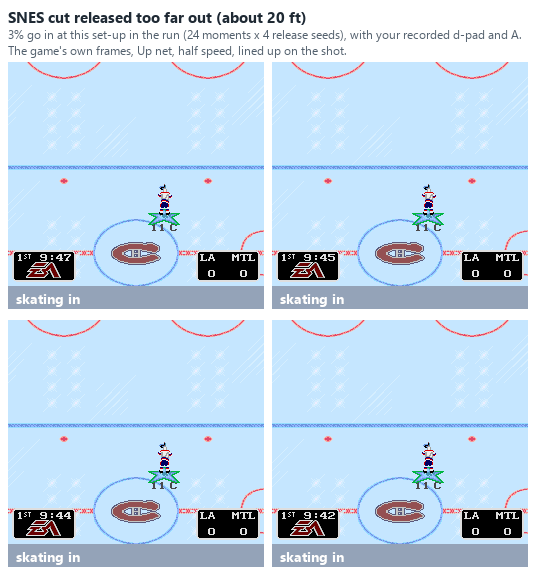
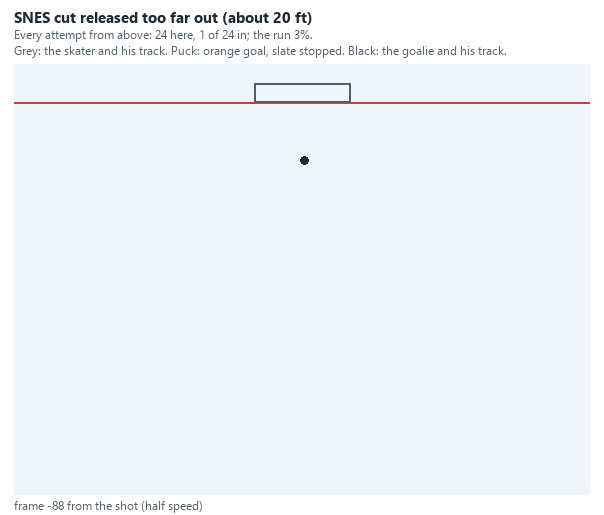

The try at P3 4:02, released about 62 out (21 ft): 3% (1 of 24 here).

- **The deke from the left: the same story.** The 5 Up-net tries score 43% at the Up net and 37% at the Down net; the
  6 Down-net tries 25% at the Down net and 19% at the Up net. So again the tries decide it, not the net. A
  left-hander does better at the Down net (36% against 22%, as played) and the same at the Up net (31%). The high aim
  helps a right-hander at the Down net (32% against 18% for the middle).

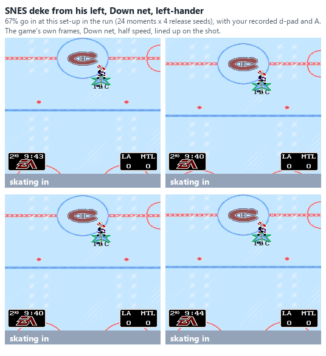
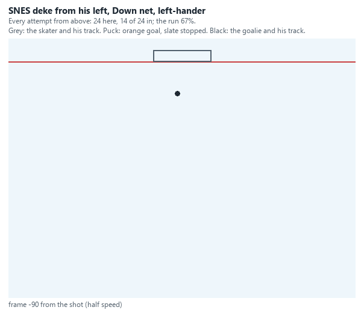

The try at P2 3:40, as played: 67% (14 of 24 here).

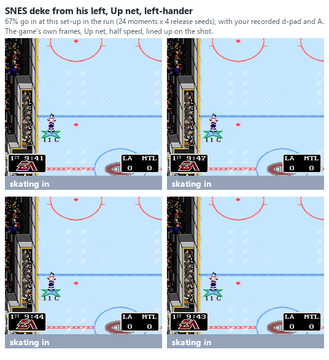
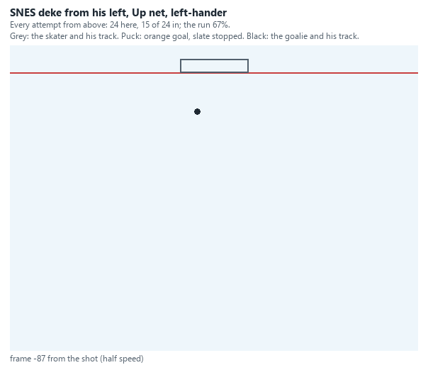

The try at P3 4:51, as played: 67% (15 of 24 here).

So both moves work at both nets and by either hand. For the cut: release inside about 13 ft, after the goalie has
started sliding toward the middle. Next: tuned inputs from scratch (the "near" grid, with the recorded ratings) to
find the best release depth and timing, and these plays against the SNES goalie profiles.

---

## 5. Goaltending

### 5.1 Saves are geometry

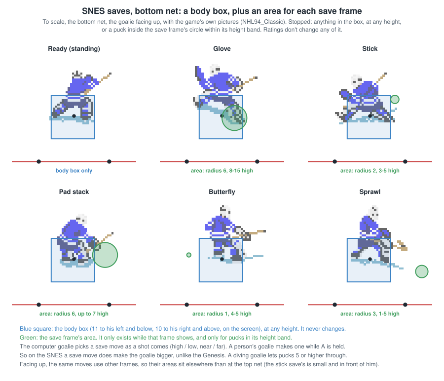

The goalie stops a puck only if it physically reaches him (`checkpuckcoll_ccx`), but the shape differs from the
Genesis:

- **His body is a fixed box**: the puck within 11 units on one side and 10 on the other, across and along, at any
  height.
- **His stick / glove area**, which depends on the sprite frame he shows (`GetHot`, `GetFrameHot`): a circle around the
  frame's hot point, within a band of heights, both read from the frame's record (frame number - 1, as the drawing code
  reads it). A save move's frames change it.
- **The net:** a goal when the puck's centre crosses the net's front (9 units out from the net, y 259) within 17 of the
  middle below the crossbar (13); 18-22 out is a post (`checkgoal`). **Posts are why SNES shots ring off the iron so
  often:** the post is a 5-unit band on each side of a 35-wide mouth, against a 1-unit band beside a 41-wide mouth on the
  Genesis:

| | Goal if it crosses within | Post band, each side | Crossbar | Goal mouth |
|---|---|---|---|---|
| Genesis | 20 of the middle | **1 unit** (20-21) | a 1-unit band at height 13 | 41 wide |
| SNES | 17 of the middle | **5 units** (18-22) | none (anything at 13 or higher passes over) | 35 wide |

  The aim points are 15 from the middle, so a shot aimed at a side has only 2 units of goal outside it, then 5 of post.
  A post deflects the puck away at a random speed and angle, counts as a shot on goal, and ends any breakaway or
  one-timer credit. **The crossbar can't be hit:** the code tests for height 13 only after it has already let anything at
  13 or more pass over (dead code). **Confirmed** in the recordings: 19 of the 234 SNES shots that reached the net hit a
  post (8.1%), against 7 of 316 on the Genesis (2.2%).
- The expected-goals model (4.7), which uses these widths, predicted 16.6-17.6 posts where the first five SNES games
  had 18.
- **No changes for Agility, for a person controlling him, for pad stacks or for one-timers.** (On the Genesis all four
  change his reach.)
- **A diving goalie lets pucks at height 5 or more through.**
- The glove and stick save ratings are looked up and then overwritten: unused.
- **Confirmed:** no goal passed within 12.6 units of the goalie's centre (26 goals); saves a median 12.9.

**No "through the legs" or shoulder-save bobble here** (the Genesis ones are in GENESIS_SHOOTING 5.3 and 5.5): the SNES
goalie's save frames add hit areas 12-28 units out to the side on top of his body box, rather than moving a blind ring
over his middle, and checkgoal returns at once when the puck's carrier is a goalie, so a held puck can't be stripped at
his net.

### 5.2 Save moves

At a rethink with the puck going to cross within 24 of the middle in under 19 frames, he picks a move
(`GoalieSaveList`) by the puck's direction against the way he faces (the game's 8-way directions are coarse: anything
between 1:2 and 2:1 counts as diagonal) and its height: well to one side, a **sprawl**; to one side and low, a **stick
save**; high, a **glove / blocker save**; a pad stack while the puck is still carried; a **butterfly** for a slow puck
straight at him. Most moves hold a single frame; his speed is halved as he starts, **and he keeps skating through the
move** (it sets the animation lock `pfalock`, not `pf2aip`, which is what stops his routine), so he slides on toward
the crossing point. **Confirmed** (the model's goalie in 4.7 lands where the recorded goalies did).

### 5.3 The computer goalie

- **Passes slow him down:** every pass delays his next rethink by half his Defensive Awareness value plus one frame,
  and he loses his Agility while a pass is in flight. **Code**
- **Attacking moves** (`assgoalie`), every goalie alike (no rating enters):
  - a **poke check** (`SPAgpoke`, $E528) at an opponent carrying the puck within 35 units, in front of the goal line, on
    a random roll each time he thinks (1 in 25.6), then 4 seconds before he can poke again;
  - a **dive** (`SPAgdive`, $E4B6) at a **loose** puck within 45 in front of the goal line with an attacker within 60
    of it, on a 1-in-32 roll, then 6 seconds before the next. The dive is tested only at one moment: a counter set to 4
    when the puck touches him (`puckgoalie`) counts down while the puck is on his half and stops at -1, and the dive
    is only possible when it reads 0. So **the computer's dive is a rebound dive, with one 1-in-32 chance per save**.
  - **Recorded** (15 games, 137 minutes): computer goalies poked 18 times and never dived (229 saves; about 90 left a
    loose rebound near him with an attacker close, so 2 or 3 dives at most would be expected). People's goalies dived 14
    times.
- **A goalie you control** (`assgoalie`, when he's yours): **X pokes** (toward the d-pad direction, or at the puck with
  the pad centred), **Y held dives** (the same way), and A held starts save moves (5.5).
- **Covering the puck** (`assgoalie`): once a computer goalie has held the puck a moment, now and then (a 1-in-4 roll)
  he checks the opposing skaters. **If one is within 20 units of the puck he drops onto it and covers it** (`SPAgcover`)
  for 90 frames; within 35, he waits; with nobody within 35 he looks to pass it out (`chk4pass`). A goalie a person
  controls never does this: it's part of the computer goalie's routine. **Confirmed** once (CHI-CGY, the last seconds:
  Chicago's computer goalie took the puck at 0:11 and covered it from 0:09 to 0:05).
- **Positioning** (`assgoalie`). He rethinks every half his Defensive Awareness reaction value (`aidef / 2`: about 3
  to 11 frames, slower than the Genesis goalie's 1-3), each time picking a spot: where the puck is heading (12-24
  frames of its motion ahead, a little at random) on an **ellipse 26 across and 20 out** in front of his net, or the
  puck itself once it is near his goal line. **Once the puck will cross his goal line within 24 of the middle in under
  35 frames** (worked out every 5 frames), he heads for that crossing point, and under 19 frames starts a save move
  (5.2). The crossing is worked out from the puck's velocity whether it is loose or carried (`pucknorm`), so **a carrier
  skating straight at the goal mouth sets off a save move too**: the goalie slides toward the middle and locks while
  the carrier steps to the near post (SCORING_SNES, "EA Specials on the SNES": the walk-in, a weak low shot at the far side the shooter catches up
  with and carries on: 75-85% at its best set-ups in the game. A carrier alone, without that first shot, doesn't draw
  him off the near post). He skates like a player (acceleration from Weight and Agility, + 8 for a goalie, his Agility taken away while a
  pass is in the air; top speed from Speed), and a computer goalie with nowhere to go halves his speed each step.
  **He stops dead when an opposing carrier winds up a shot** while skating mostly up or down the ice.
- **Confirmed:** emulating all this and driving it with the recorded puck, the goalie lands a median 0.8 units from the
  recorded goalie when the puck arrives (100 shots at computer goalies; 78 within 3 units).
- **His ratings, played in the game** (SCORING_SNES "SNES goalie profiles", 2026-10-26): from a backup to Roy, the
  standing slapshot's best chance moves only 5.5% to 3.6% and one-timers not at all (64-69% at the best aim). The
  exception: Roy (Agility 15) all but closes the top net's best slapshot (Up-Left from 40 left of centre: 2% against
  18-25% for the others).

### 5.4 Holding the puck and rebounds

`puckgoalie`, when the puck touches his body box (5.1). **Code**; the hold rule **Confirmed** (below).

- **The shot is counted** (`ChkShotStat`) and the touch clears the "shot taken" flag, unless he's in a dive and the
  puck is 5 or more off the ice: then it goes through him untouched.
- **He holds it** when both the puck's sideways and its up-and-down speed are under a random threshold between 8,192
  and 8,192 + (2 + his Puck Control) x 512: at most about 17,000 for the best puck handler. Otherwise **it bounces off**,
  straight out from his centre through where it touched him, slowly (the speed comes from how far off-centre it hit,
  not from the shot), its up-the-ice direction set against the way he's moving.
- **Differences from the Genesis:** no rule making him hold less in close, and a diving goalie can still hold a low
  puck; on the Genesis the threshold is about twice as high, so a Genesis goalie holds harder shots.
- **His glove and stick save ratings are looked up and never used** (as on the Genesis).
- A puck carried into him is knocked loose (the carrier can't touch it for 20 frames).
- **Confirmed** (102 SNES saves, the faster speed component just before the save): 17,000 or more, held at once 4 of 41
  (10%); 8,192-17,000, 28 of 45 (62%), the random range at work; under 8,192, 10 of 16 (the rule says all; the sampled
  speeds and the "held at once" test are rough).
- **The hold whistle** (`puckglue`, `assgoalie`): taking the puck starts a count of **140 frames (2.33 s)**, as on the
  Genesis, or **5 frames when he catches it in a dive** (a dive catch is a whistle at once). For a goalie a person
  controls, the count runs down only while he stays within about 62 units of his goal line (y beyond +/-187); **holding
  the puck any farther out is whistled at once** (the Genesis line is 170 from centre). **Confirmed:** people's goalies
  never kept the puck longer than 2.34 s before a whistle or a pass (245 pickups), and all 6 dive catches were whistled
  at once. A computer goalie covers instead (5.3); his whistles came 0.6-3.3 s after he got the puck (11).
- **Open:** about 15 times (of 245) a person's goalie got the whistle the instant he caught the puck, near his net,
  with no dive, no penalty and no button held; no route for it has been found in the code yet.

### 5.5 The save button for a person in net (A, held)

**Code** (`assgoalie`): while a person's goalie **holds A** without the puck, every rethink starts a save move. No shot
is needed. The move is chosen as for the computer goalie (5.2): by the puck's direction against the way he faces, and a
pad stack while the puck is still carried. His speed is halved, and **he can't steer until the move ends**: the
animation lock stops `doinput`. (Holding A while carrying the puck does nothing for a goalie; on the Genesis the save
button is C, a single press.)

**Unlike the Genesis, the move makes him bigger, on one side.** Standing, he stops only what reaches the box around his
body (about 10 units each way, 5.1). A save frame adds an area off to one side (the frame's hot point and radius, within
a height band):

| Move | Extra area | Reaches about |
|---|---|---|
| Glove / blocker | 6-12 to the side, radius 5-6, heights 7-15 | 18 |
| Stick save | 12 to the side, radius 5, low | 17 |
| Pad stack | 15 to the side, radius 6-8, low | 22 |
| Sprawl | 19-28 to the side, radius 2-3, low | 30 |
| Butterfly | 13-18 to the side, radius 1-3, low | 20 |

No effect on rebounds: the SNES hold rule (5.4) doesn't look at his animation.

**Recordings:** people pressed A on 25 of the 39 shots at a goalie they controlled, 22 times before the release, which
gave mostly pad stacks (16). With A, 8 goals in 25 (xG 0.41 a shot); without, 4 in 14 (0.32). Too few to say more.

### 5.6 Early save moves and cross-crease goals

- **No wind-up save rule.** The Genesis computer goalie drops into a pad stack the moment a shot is wound up close in
  (GENESIS_SHOOTING 5.6); the SNES one doesn't. Instead, **when an opposing carrier starts a shot or one-timer swing
  while skating mostly up or down the ice** (sideways speed under twice his up-and-down speed), the goalie's speed is
  set to zero once (`goaliestopped`). He picks up again at his next rethink. A carrier moving across doesn't trigger it.
- **During a wind-up his positioning spot widens:** 34 across and 28 out, instead of 26 by 20. **Code**
- **Save moves don't freeze him:** his speed is halved and he keeps sliding and rethinking through the move (5.2).
- **Recordings:** a save move started before the release on 9 of 121 SNES shots at computer goalies, a median 0 ms
  before (Genesis: 35 of 213, a median 92 ms before).
- **Cross-crease goals still happen,** for other reasons:
  - he rethinks only every 3-11 frames (Genesis: 1-3);
  - his standing body is only about 10 units each way (Genesis reach 12-15);
  - he aims for the puck itself with a look-ahead (the Genesis goalie aims halfway between puck and carrier).

  Recordings: 8 carries that crossed the middle within 90 of the goal line, 5 shots, 3 goals (Genesis 12, 9, 3).

### 5.7 A goalie holding the puck can't be pushed in

`checkgoal` returns at once when the puck's carrier is a goalie, so the net never touches a puck the goalie holds. Pushing
him back into the net with it does nothing. On the Genesis the net strips the puck from him at the goal line, and a
nudge then scores (GENESIS_SHOOTING 5.9). **Code**

### 5.8 Long slapshots

Worked out with the expected-goals model's rules (4.7), the computer goalie started where recorded SNES computer
goalies stood at shots from 90+ units, working Shot Accuracy 15, aimed just inside a post or at the middle at
mid-height. Percent that go in (`analysis/goalie_study.py longsnes`):

| Spot | 16,000 | 20,000 | 24,000 | 28,000 |
|---|---|---|---|---|
| 120 out, 25 to the side: far / near / middle | 2.0 / 2.5 / 2.5 | 1.7 / 2.5 / 2.4 | 2.2 / 4.3 / 2.3 | 3.7 / **7.1** / 2.8 |
| 120 out, 60 to the side | 2.6 / 2.6 / 2.6 | 2.3 / 4.5 / 2.7 | 2.0 / 4.4 / 2.1 | 4.4 / **9.1** / 2.3 |
| 160 out, 25 to the side | 1.8 / 1.7 / 2.4 | 2.3 / 2.2 / 2.1 | 1.7 / 2.0 / 2.0 | 2.0 / 2.5 / 2.1 |
| 200 out, 25 to the side | 0.5 / 0.7 / 0.9 | 0.7 / 0.8 / 0.9 | 0.6 / 0.6 / 0.4 | 0.4 / 1.0 / 0.6 |

- **Long slapshots hardly ever score on the SNES**: a few percent at best, against 15-23% for the hardest Genesis
  shots from 40 feet (GENESIS_SHOOTING 5.8). The SNES goalie keeps sliding through his save moves, which also stretch
  his reach to one side, and the goal mouth is narrower (35 against 41) with wide posts.
- **Power helps less, and only at the near post**: with the hardest shots the near post is about twice as good as the
  far one. Shot Accuracy changes little (a 26,000 shot 120 out at the near post: 2.9% at working 5, 4.5% at 15).
- **Confirmed** on the recordings: 1 goal in 17 SNES slapshots from 100-200 units out (the model's xG for them: 0.7),
  against 5 in 39 on the Genesis (xG 4.5).

---
