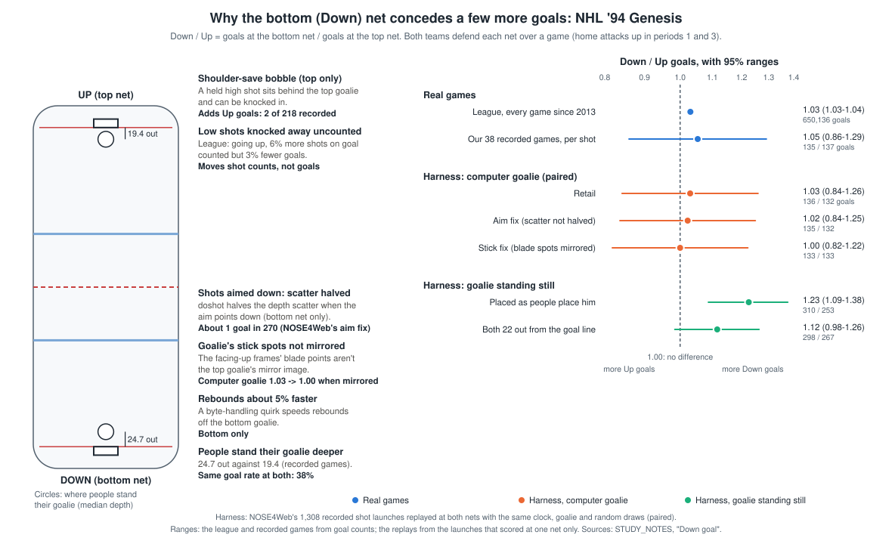
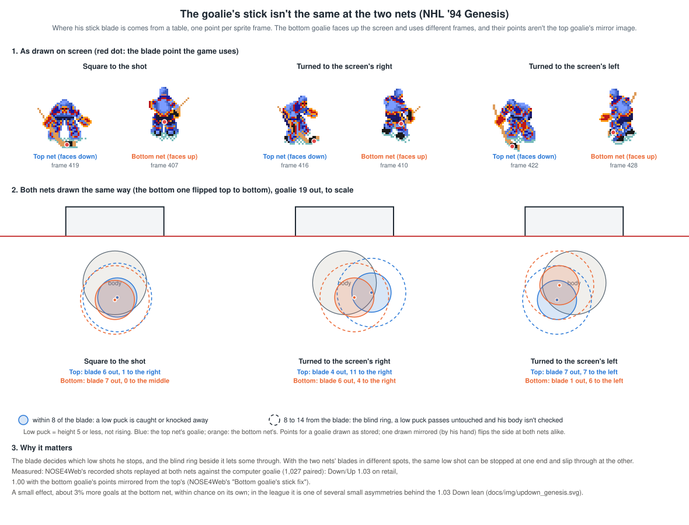
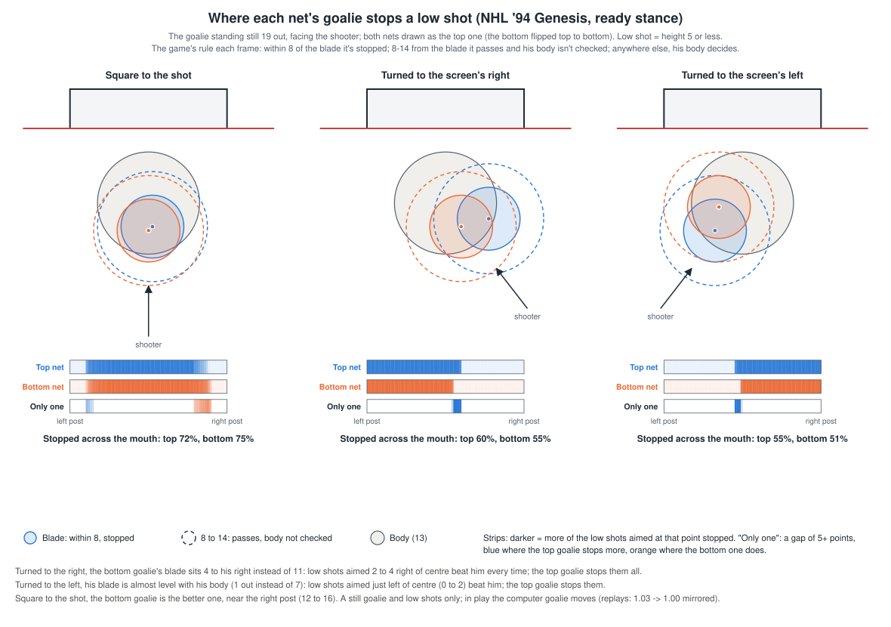

# NHL '94 match viewer: study notes

The working notes of the studies: the game mechanics read from the disassemblies, the scoring map's runs, and what the user's games showed. Moved out of [PROJECT_NOTES.md](PROJECT_NOTES.md) on 2026-10-26. The findings themselves, in order, are in [GENESIS_MECHANICS.md](GENESIS_MECHANICS.md), [SNES_MECHANICS.md](SNES_MECHANICS.md), their *_SHOOTING.md parts and the SCORING_*.md pages.

Durations: game seconds (1 game second = 24 frames = 0.4 s of real time) for anything a second or longer, from
2026-11-06; shorter timings, frames, milliseconds and constants named _MS are real time. Entries before that date may
still give real seconds where not converted.

## Contents

In the order written (newest last).

**Studies, models and the recordings:** [Passing study (2026-10-18)](#passing-study-2026-10-18); [B without the puck: poke or switch (2026-10-19)](#b-without-the-puck-poke-or-switch-2026-10-19); [One-timers struck at the stick's reach (2026-10-21)](#one-timers-struck-at-the-sticks-reach-2026-10-21); [Scoring map: shots played in the real game (2026-10-22)](#scoring-map-shots-played-in-the-real-game-2026-10-22); [Game mechanics from the disassemblies (2026-10-17)](#game-mechanics-from-the-disassemblies-2026-10-17); [Three of the user's observations explained (2026-10-17)](#three-of-the-users-observations-explained-2026-10-17); [The user's five BOS-DAL games (2026-10-17)](#the-users-five-bos-dal-games-2026-10-17); [SNES ratings screen confirmed; the computer goalie's cover (2026-10-17)](#snes-ratings-screen-confirmed-the-computer-goalies-cover-2026-10-17); [Post, body, goal (2026-10-23)](#post-body-goal-2026-10-23); [How league players score against people (the user, 2026-10-23)](#how-league-players-score-against-people-the-user-2026-10-23); [RetroArch videos as a source (pilot, 2026-10-23)](#retroarch-videos-as-a-source-pilot-2026-10-23); [SNES get-up glitch apart from hooks (2026-10-25)](#snes-get-up-glitch-apart-from-hooks-2026-10-25); [A scripted bot (Genesis, 2026-10-31)](#a-scripted-bot-genesis-2026-10-31); [What check attempts lead to (both systems, 2026-11-03)](#what-check-attempts-lead-to-both-systems-2026-11-03); [Keeping the other team out of the slot (Genesis, 2026-11-01)](#keeping-the-other-team-out-of-the-slot-genesis-2026-11-01); [Passing out of a check (Genesis, 2026-11-06 / 07)](#passing-out-of-a-check-genesis-2026-11-06--07); [The SNES second period in full play (2026-11-07)](#the-snes-second-period-in-full-play-2026-11-07); [The scoring maps against a goalie as in games (both systems, 2026-11-07)](#the-scoring-maps-against-a-goalie-as-in-games-both-systems-2026-11-07); [A "count stick deflections" option, tested (Genesis, 2026-11-08)](#a-count-stick-deflections-option-tested-genesis-2026-11-08); [How often the fixed bugs happen in the recorded games (2026-11-08)](#how-often-the-fixed-bugs-happen-in-the-recorded-games-2026-11-08); [Momentum in the recorded games (2026-11-08, a community member's question)](#momentum-in-the-recorded-games-2026-11-08-a-community-members-question); [Game variables: phase 1 (2026-11-08; docs/GAME_VARIABLES_PLAN.md)](#game-variables-phase-1-2026-11-08-docsgame_variables_planmd); [The xG models' goalie spread refitted (2026-11-08)](#the-xg-models-goalie-spread-refitted-2026-11-08); [The SNES lines as loaded (LoadTeamLines; 2026-11-09)](#the-snes-lines-as-loaded-loadteamlines-2026-11-09); [SNES xG for SA-1 games: chunk 1, what it takes (2026-11-09)](#snes-xg-for-sa-1-games-chunk-1-what-it-takes-2026-11-09).

**Checks of ROM edits (NOSE4Web, McMarkis and forum hacks):** [NOSE4Web's rocket pass fix, played in the game (Genesis, 2026-11-07)](#nose4webs-rocket-pass-fix-played-in-the-game-genesis-2026-11-07); [NOSE4Web's runaway-speed fix, played in the game (Genesis, 2026-11-08)](#nose4webs-runaway-speed-fix-played-in-the-game-genesis-2026-11-08); [NOSE4Web's penalty-shot, goalie-pull, Y-button, extra-attacker and blind-ring fixes, played in the game (2026-11-08)](#nose4webs-penalty-shot-goalie-pull-y-button-extra-attacker-and-blind-ring-fixes-played-in-the-game-2026-11-08); [Code readings for NOSE4Web's next fixes (2026-11-08)](#code-readings-for-nose4webs-next-fixes-2026-11-08); [NOSE4Web's sniping, comeback, awareness and crowd fixes, played in the game (2026-11-08)](#nose4webs-sniping-comeback-awareness-and-crowd-fixes-played-in-the-game-2026-11-08); [One check for NOSE4Web's builds (2026-11-08)](#one-check-for-nose4webs-builds-2026-11-08); [The Genesis-only fixes: does the SNES have the bug? (2026-11-08, for NOSE4Web)](#the-genesis-only-fixes-does-the-snes-have-the-bug-2026-11-08-for-nose4web); [NOSE4Web's player photo and score logo editing, seen in the game (2026-11-08)](#nose4webs-player-photo-and-score-logo-editing-seen-in-the-game-2026-11-08); [McMarkis's score-box logos on the original SNES game: what retail leaves free (2026-11-08, for NOSE4Web)](#mcmarkiss-score-box-logos-on-the-original-snes-game-what-retail-leaves-free-2026-11-08-for-nose4web); [NOSE4Web's retail score-box logos, checked in the game (2026-11-08)](#nose4webs-retail-score-box-logos-checked-in-the-game-2026-11-08); [$A130F1 in Genesis Plus GX (2026-11-08, for NOSE4Web)](#a130f1-in-genesis-plus-gx-2026-11-08-for-nose4web); [The SNES big logos' overlapping pieces: which is in front (2026-11-08, for NOSE4Web)](#the-snes-big-logos-overlapping-pieces-which-is-in-front-2026-11-08-for-nose4web); [NOSE4Web's Classic import into the 32-team SA-1 build (2026-11-08)](#nose4webs-classic-import-into-the-32-team-sa-1-build-2026-11-08); [Genesis score-box logos: what the original game leaves free (2026-11-08, for NOSE4Web)](#genesis-score-box-logos-what-the-original-game-leaves-free-2026-11-08-for-nose4web); [NOSE4Web's Genesis score-box logos, checked in the game (2026-11-08)](#nose4webs-genesis-score-box-logos-checked-in-the-game-2026-11-08); [Injuries and NHLPA '93's blood (2026-11-08, for NOSE4Web)](#injuries-and-nhlpa-93s-blood-2026-11-08-for-nose4web); [NOSE4Web's head blood builds, checked (2026-11-08)](#nose4webs-head-blood-builds-checked-2026-11-08); [McMarkis's 60 frames a second: the computer against itself (2026-11-08, for NOSE4Web)](#mcmarkiss-60-frames-a-second-the-computer-against-itself-2026-11-08-for-nose4web); [NOSE4Web's SNES team-block colours, checked (2026-11-08)](#nose4webs-snes-team-block-colours-checked-2026-11-08); [NOSE4Web's SNES photo import freeing replaced photos, checked (2026-11-08)](#nose4webs-snes-photo-import-freeing-replaced-photos-checked-2026-11-08); [Six Genesis bugs looked for on the SNES (2026-11-08, for NOSE4Web)](#six-genesis-bugs-looked-for-on-the-snes-2026-11-08-for-nose4web); [NOSE4Web's SNES Import team with logos, checked (2026-11-08)](#nose4webs-snes-import-team-with-logos-checked-2026-11-08); [SNES "No interference penalties" in every period (2026-11-09, for NOSE4Web)](#snes-no-interference-penalties-in-every-period-2026-11-09-for-nose4web); [The same skater twice on one line (2026-11-09, for NOSE4Web)](#the-same-skater-twice-on-one-line-2026-11-09-for-nose4web); [NOSE4Web's NHL94SNESVault hacks (2026-11-09, NOSE4Web 0100df7)](#nose4webs-nhl94snesvault-hacks-2026-11-09-nose4web-0100df7); [The Genesis one-timer assist bug (2026-11-09, for NOSE4Web)](#the-genesis-one-timer-assist-bug-2026-11-09-for-nose4web); [The Genesis line editor's cursor (2026-11-09, for NOSE4Web)](#the-genesis-line-editors-cursor-2026-11-09-for-nose4web); [Edit Lines on the 1-on-1 ROM (2026-11-09, for NOSE4Web's "Edit Lines for fewer skaters")](#edit-lines-on-the-1-on-1-rom-2026-11-09-for-nose4webs-edit-lines-for-fewer-skaters); [NOSE4Web 6075749 and aaf3864: Edit Lines for fewer skaters rebuilt, and the "looks" build (2026-11-09)](#nose4web-6075749-and-aaf3864-edit-lines-for-fewer-skaters-rebuilt-and-the-looks-build-2026-11-09); [Organ songs moved, played; SNES credits and songs; the song format (2026-11-09, for NOSE4Web 5d1ec5e)](#organ-songs-moved-played-snes-credits-and-songs-the-song-format-2026-11-09-for-nose4web-5d1ec5e); [Assists that disappear (2026-11-09, the user: SNES goals left unassisted after passes, perhaps one-timers)](#assists-that-disappear-2026-11-09-the-user-snes-goals-left-unassisted-after-passes-perhaps-one-timers); [NOSE4Web's splash screen picture, played (2026-11-09, NOSE4Web fdacede)](#nose4webs-splash-screen-picture-played-2026-11-09-nose4web-fdacede); [Genesis forum hacks, from the code (2026-11-09, for NOSE4Web; not played)](#genesis-forum-hacks-from-the-code-2026-11-09-for-nose4web-not-played).

## Passing study (2026-10-18)

analysis/stick_spot.py, analysis/passing_study.py. GetHot (checks94.asm): HotList[frame] x, y bytes; x negated when the
attribute's X flip (bit 11, = our `mirror`), y negated unless Y-flipped; added to the position (ccx: hot + player -
puck). Confirmed: carried puck to blade median 3.6 (variants 7-21); at catch samples the puck sits on the 14 circle.
Passes against the rule (Genesis, nhl94.bin games): rising or above 5 untouched 85-98%; over the catch limit kept 1 of
65; opponents near a low pass took 66% under 9000, 29% over 14000; median pass speed by Passing 0-2 / 3-4 / 5-6: 13485 /
14997 / 16561. Open: about half of slow low pucks within (computed) reach not taken (no nopuck or skip found; the
pass's `to` is the actual catcher for completed passes, so receiver-vs-other comparisons are circular). In
GENESIS_MECHANICS 6.2.

Who takes a loose puck (2026-10-18, the user: sometimes a magnet, sometimes it goes through the stick;
analysis/pickup_study.py reads the raw BOS-DAL captures, which hold sflags2): .ccx skips a player whose no-touch timer
(+$5E) runs (shot / pass 16 frames, steal both 20 + Stk / 2, deflect / body bounce / net strip 8, puck into the goalie
20 (goalie 10), fall 120, faceoff 20, goalie dive 8); then height > 5, Zvel > $200, reach 14 (7 while the puck's own
+$5E runs), goalie 8, speed limit. Blade contacts: timer running 1,078, taken 27. The walk (checkpuckcoll .0 / .1): Ylist ($B84A,
the sort key: our Y; X only while sflags bit 7 sfhor is set, at stoppage screens), OOlistpos $B86A, OOlist $B88A
(object x 2); from the puck outward, stopping at the first object more than 22 ($16) up or down from the puck's Y: only
players whose BODY is within 22 in y are tested, so a stick held 20 out in front can sit on the puck untested (2219
sample 9170). Clean test (seven Genesis games: slow low puck within 11 of the blade, timer out, not shooting / passing /
faceoff, reached by the walk): 117 / 137 taken, 7 another stick first, 13 after a whistle (gmode bit 0, puck pfnc).
SNES (analysis/snes_pickup_study.py, 2026-10-19): nopuck $1203 (word per object; shot / untargeted pass 16, targeted
pass its lead time d6, one-timer swing 10, flip 30, steal both Stk + 20, deflect / body / net 8, into the goalie 20 (goalie
10), fall 120, faceoff 20, box / breakaway glide 60, goal celebration 1800); walk within 40 in y (never blocked);
puckz / puckvz are single words ($0DF9 / $0E01), not per-object arrays; puckc $0AD9 (2 x object). Contacts: catch 924 /
1023, timer 21 / 1208, too high 0 / 80, too fast 0 / 21. SNES_MECHANICS 6.2, SNES_GUIDE 8.1. Record fields: Xpos 0, Ypos $14, Zpos $18 are current; the
match file reads OldXpos / OldYpos / OldZpos ($1C / $20 / $24, the previous frame's). Ylist ($B84A) holds our X: the
game's internal axes are the NHLPA93 horizontal ones, swapped for display (sfhor). GENESIS_MECHANICS 6.2, GENESIS_GUIDE 8.
Uncounted saves explained in GENESIS_SHOOTING 4.7 (analysis/uncounted_study.py); by direction the recordings show
85% counted going up, 91% down (the opposite of the database's gap; samples small). The opponent's iPhone opens game
files from the S3 link; Genesis netplay picks Player 1 / 2 regardless of host, so hosting isn't part of the home edge.

Tapestries (2026-10-18, the user's word): a goal at the end of 2+ quick passes. export_match `add_tapestries` (after
add_own_goals): the last pass (completed or one-timer) to the scorer within TAPESTRY_GOAL_MS 3 s of the goal; each
earlier pass completed to the next passer, released within TAPESTRY_GAP_MS 2.5 s (real time) of the next; the other team
never had the puck; not penalty shots or own goals. A goalie's pass counts as one of the passes (the user, 2026-10-18). Goal `tapestry` {n, chain: roster indices first passer .. scorer}
and kind 'tapestry' (2), 'fine tapestry' (3), 'masterpiece' (4+), beside 'one-timer'. Recordings: about 1 goal in 5;
capture1 P1 3:18 is 8 passes (Montreal, 25 game s, five players, a one-timer). Viewer: tag "fine tapestry · 3 passes"
(goalKindText), the chain in goalNotes (A -> B -> C), team stats Shooting "Tapestry goals" and "· 2 / 3 / 4+ passes",
STAT_HELP, Help. Season VERSION 22: team tap / tapA (Team stats TAP), skater tapG / tapIn (Skaters TAP: scored · passed in).
Missed tapestries (the user): the same chain ending in a shot attempt that did not score: the shot gets `tapestry`
{n, chain} (chain_to in add_tapestries). Viewer: shot tooltip "missed tapestry (3 passes: A -> B -> C)", team stats
"Missed tapestries", Help. Season VERSION 23: team tapMiss / tapMissA, skater tapMiss (TAP MISS columns). Documents
games: 29 tapestry goals, 78 missed (55 saved, 10 wide, 7 blocked, 6 posts): about 27% finished.

Rocket passes and pucks past save moves (2026-10-19, the user, Genesis only). Passes: passtoa0 solves the meeting
time t in whole 1/8 s (truncating divs; 1-24) and sends v = distance x 65536 / (120 t) per axis (capped by divs
overflow: an overflow leaves the puck nearly still); a receiver skating toward the passer 50-70 away gives t 1.x -> 1:
27,000-32,000. analysis/fast_pass_study.py replays the word arithmetic from the sample before each targeted pass
(passplayer $BEE0 set, passspeed $BEDE; receiver +0 / +$14 / +$28 / +$2A, HotList): 750 / 816 within 10%; persons 24 /
718 over 25,000, goalies 5 / 98. SNES dopass sets speed by distance. Save moves: goaliesave picks the side save when the
puck will cross 16+ to his side; the body circle doesn't change (pad stack aside), the stick only plays low pucks not
rising (shots are lifted). analysis/slip_study.py: 12-16 from his centre standing 11 / 82 in, save move 28 / 74; stick
saves 27 / 47 from 12-20. Through the legs (the user's clarification: fast flat puck straight at the middle, butterfly):
butterfly / kick-save frames put the blade 10-13 to the side, so a low non-rising puck through his middle is in the 8-14
blind band (no stick or body test) until behind his centre, where the body hit bounces it backward (offset x 256, slow)
into the net; ready stance has the stick in front. Confirmed on the user's 2v2 game 2026-10-19_0818_ANA-ATL (ROM 784b3674,
Anaheim vs Atlanta): goals P1 2:48, P1 2:11, P3 2:24 (frame 480, puck 1-4 from his centre in the band, bounced back
from 8-13 behind at 2,200-3,500); 2 of 8 such flat pass shots in P1 went in; P3 4:00 was the top net's shoulder-save
bobble (stick knock-up, ghighl hold point 14 behind, net strips it). analysis/goal_trace.py <capture> <period> <m:ss>
traces any moment. Pass lift: targeted puckvz = 256 x min(t, 12) (move.b into puckvz's high byte; 675 / 691),
untargeted randomd0($1000) (quartiles 900 / 2,000 / 3,100); peak height ~ vz^2 / 786432. C freezes a person's goalie (pf2aip: doinput skips his input) ~0.57 s at speed / 4. SNES save
frames add 12-28 hit areas. GENESIS_SHOOTING 5.5 and GENESIS_MECHANICS 6.1, GENESIS_GUIDE 8 and 12.2.

Runaway speed (2026-10-19, the user, Genesis): pfdoff (pflags bit 0, friction >> 9 instead of >> 6) set by asspassrec and
FallDown's boards / bench fall; cleared by asspassrec .exit, puckstick, assnearest insertion, not by assexit (a person
taking over the receiver) or getting up. Bursts (+~6,300) then stack: 2158 BOS-WPG P3 ~1:24 (boards fall, 20,079), 2149
BOS-WPG P2 ~0:22 (taken over mid-pass, 19,413). Flag set 765 times (690 passes, 65 boards falls); a person with it on
> 0.5 s 44 times, runaway only with 2+ bursts. GENESIS_MECHANICS 3.4, GENESIS_GUIDE 5.

## B without the puck: poke or switch (2026-10-19)

The user asked how the game decides. Genesis (input94.asm doinput, title94.asm chgplayer, Sweepcheck): on B's RELEASE
within 17 frames of the press (bholdtimer $11), chgplayer takes the team's on-ice skater nearest the puck + velocity /
256 (about 16 frames ahead), skipping goalies, pf2unav, pfalock and the other controller's skater, the current skater
INCLUDED: the current one -> Sweepcheck (poke), else switch. Locked (pfalock): doinput_islocked switches on the PRESS
(the CB check) and marks the new skater's pflags3 bit 6 so its release does nothing; the same flag swallows the release
after B+C on one frame and after a goalie's pass. analysis/b_button_study.py: 1,510 of 1,536 releases as predicted
(576 pokes, 934 switches), 815 / 844 locked presses switched, 808 / 837 flagged releases did nothing. SNES (doinput,
findpc): on the PRESS; a carried puck with puckdist2 < 100 (about 20 units) and the skater unlocked -> poke; else the
lowest puckdist (no lead) + 32 x (direction steps beyond 1 from up-ice) while carried; current -> poke (unless
locked), else switch; not checked on recordings. GENESIS_MECHANICS 7.5, GENESIS_GUIDE 10, SNES_MECHANICS 7.3, SNES_GUIDE 9.

## One-timers struck at the stick's reach (2026-10-21)

The user asked why a cross-ice one-timer had no xG: Derek King's two doorstep goals in 2026-10-21_1137_NYI-BOS were
backhand one-timer swings ($092E) meeting the puck 26-31 from his body at the far post, past find_shots' body tests
(25 in the swing, 30 in scorer_touch), so they became kind 'other' (no xG). find_shots now also accepts a course change
within STICK_NEAR 14 of the swinging player's stick blade (Genesis: HotList at ROM $A44C8 per sprite frame, x negated when
mirrored, y negated; analyse() hands the table over as match['_hot'], removed after), at that sample or the one before.
12 / 14 / 18 tried on the 12 games that changed: the shot list's one-timers 120 / 130 / 140 against the game's own
one-timers-tried count 131 (old rule 123). King's goals: one-timers, xG 0.66 and 0.76. Shots on goal unchanged against
the game's counts (2219 BOS-DAL's 9 vs 8 was already so: Oates's penalty-shot goal). 2026-10-19_2115_LA-BUF's fast.bin.gz
is cut off (no end-of-stream marker) and fails to convert, before and after (2117 LA-BUF is the game). Checked
2026-11-08: its 417 samples (6.75 s real) are period 1 from 5:00 to 4:52 at 0-0, LA and BUF, with an empty full.bin.gz;
the game restarted from 5:00 two minutes later, and 2117 has it from the opening faceoff to the final (6-3). Nothing is lost. The fragment was deleted (the user, 2026-11-08).

## Scoring map: shots played in the real game (2026-10-22)

The user asked for an exact scoring map (the chance a shot scores by spot, aim, shot type). `analysis/scoring_map/`
(build.py's docstring is the how-to). First map done: set goalie (GENESIS_SHOOTING 4.10, docs/img/scoring_map.svg).

- **Run 1**: 23 x 16 spots (x -110..110, y 100..250 by 10) x wrist (C 3 frames, passspeed 18 -> 173) and slapshot
  (C 20+, 35 -> 337) x both nets x 9 aims, 800 launches per aim (perfect / scatter split by the perfect chance), 30
  processes, about 2 hours (each job 3-5 minutes with 30 running). 1,260 of 1,472 jobs valid (puck 24+ from the
  goalie's centre and in front of him; validity.py). The shooter's working Shot Power 20, Shot Accuracy 15; the goalie
  Los Angeles's (weight 48, Agility 13, Speed 13, Def. Awareness 10 working).
- **Mechanisms behind the high cells, each traced**: the Down slapshot straight at the middle goes through the
  butterfly's blind ring (gstick $021E frame 480; the puck at height 0 passes his centre, meets his body behind it and
  bounces in at about 2,550); the "middle" perfect slapshot from 150-170 out peaks at height 5 and does the same; the
  row 55-70 out is the wind-up rule's pad stack (he was stacking at 46-48% of the release moments for slapshots, 34%
  for wrist shots); the far-left high wrist shot at the top net is the shoulder-save bobble (11 of 24 moments, every
  goal after a high save $148E with the puck held).
- **Checked** against natural shots (validate.py) at four spots: 51.6 / 52.0%, 32.6 / 33.9%, 7.3 / 7.8%, 43.0 / 44.4%.
- **Not done yet**: the "as in games" goalie (map_run.py takes xg.goalie_states' JSON as its 7th argument: each launch
  first puts the goalie where a recorded computer goalie was, relative to his set spot, moving as he was; 315 states
  from 16 games), other shooters (its 5th / 6th arguments), one-timers (the harness only makes normal shots).

What's settled about the method:

- **Engine**: the real game, headless. The disassembly builds (SNASM68k via its `build:dev`) from a copy; patch_rom.py
  adds a doshot hook without moving anything outside $B502-$C3xx: the dead lead-time block in `doinput_cbut` `.press`
  (gameclock .. the six branchless cmpi, 164 bytes) becomes two subroutines (SMAPIN at doshot's start, SMAPEX before its
  sfx call) and padding, 8 bytes shorter, paying for the two bsr.w. Hook RAM $FFE000-$E031 (never touched in menus or
  play: the stack only reaches down to $FEC2). The hook records doshot's inputs (seed, passspeed, passdir, puck, the
  goalies' SPA) and, when $E000 is set, replaces puckvx / vy / vz at .ex. emu.py is a ctypes libretro frontend for a
  copy of RetroArch's genesis_plus_gx core (about 4,500 frames a second; one core per process: a second Emu instance
  takes over the DLL's callbacks). RetroArch savestates are RASTATE containers
  (chunk "MEM ").
- **doshot ported exactly** (shotport.py, 68000 integer rules incl. divs overflow leaving the register, the byte
  arithmetic in the scatter size, puckvzadj): the game's launch equals the port's on 129 of 129 shots, both nets, 7 with
  the top-shelf lift. The LCG: seed = seed x $BB40E62D + 1, randomd0(n) = ((seed >> 8) & $FFFF) x n >> 16.
- **What is random after the release**: the goalie's movement code (checkanim, findpc, goaliesave) never calls the
  generator, but what happens on contact does (hold or rebound, 5.2; the stick's deflection direction). Replays first
  kept the seed and were biased (5.6% against 7.8% natural at one spot); the seed is now randomised after the release.
  Checked: the estimate equals natural shots (the game's own draws from a random seed) at three spots within one
  standard error (51.6 / 52.0%, 32.6 / 33.9%, 7.3 / 7.8%).
- **The moment matters**: a perfect slapshot just inside the post at mid-height from 108 out scored at 13 of 16
  moments: the goalie committed to a stick save (gstick, $01EC) at once and stayed at x 0 (reach 13, the puck at 16),
  unless his rethink happened to fall before; findpc (every 5 frames) and his rethink cycle set it. The map uses 120
  moments: clock 590-583 x 15 settle lengths.
- **Fast stop**: decided when the goalie has held the puck 20 frames, or it has moved away from the goal 4 frames, or
  it is 12 past the goal line; agrees with a 240-frame play-out on 1,475 of 1,475. (Not as soon as he holds it:
  the top net's shoulder-save bobble, 5.3, lets six in at frames 48-79.)
- **Harness limit near the net**: the shooter is held on his spot while the goalie sets, and within about 30 units of
  the net's centre the goalie's set spot is the puck itself, so he skates onto it and the shot starts inside his reach
  (65-100% "goals" from 28-48 out in the middle). validity.py keeps spots where the puck starts 20+ from the goalie's
  centre and in front of him: 1,279 of 1,472.
- **Recorded shots replayed** (replay_recorded.py: 135 aimed shots at computer goalies, recorded puck spot to the unit,
  aim, speed, Shot Accuracy, the goalie's position, velocity and working ratings): totals agree (20.5 / 22.5 expected
  with a 2 / 4-unit goalie blur, 22 scored) but shot by shot the replay is too sure (113 shots at a standing goalie:
  log loss 0.253 with the 2-unit blur, xg.py 0.23, one rate 0.357): the recordings (60 Hz, not frame-locked, the
  previous frame's position, velocity over 100 ms, no AI state) don't pin the moment down finely enough, and xg.py's
  fitted spread suits that. Goalies recorded mid-save or diving are replayed standing (their animation isn't set):
  22 such shots, the replay's worst.

**SNES map (2026-10-23; SNES_SHOOTING 4.8, docs/img/snes_scoring_map.svg).** The user asked for the same study on the
SNES. `snes_emu.py` (the frontend over a copy of RetroArch's snes9x core, about 3,500 frames a second; SYSTEM_RAM is
banks $7E-$7F in natural little-endian order), `snes_make_states.py`, `snes_harness.py`, `snes_map_run.py`,
`snes_compare_xg.py`; render_map.py draws a SNES run too.

- **No test ROM**: the retail ROM (the disassembly's lst/nhl94snes.sfc) unmodified. The release frame is found by the
  puck coming loose (puckc $0AD9 negative) during the wind-up; that frame is replayed with a fresh seed ($0792 / $0794,
  RandomWord's two shift registers, both kept nonzero), so every draw is the game's own. Natural sampling instead of the
  Genesis's split by the perfect chance: 16 moments (a seed for the settle, the clock, 80-94 frames to settle) x 24
  release seeds per aim. The goalie's positioning calls the generator (his look-ahead), unlike the Genesis.
  **Too few moments** (found making the animations, 2026-10-23): the first 16 moments (p < 16) gave 47.7% at the top
  lane spot, p 16-63 gave 58.1%; over all 120 moments x 4 seeds 53.6%, with a moment-to-moment standard deviation of
  0.25-0.29, so a 16-moment square is good to about 7 points. Bottom lane spot 26.5% (map 30.2%), mirror 1.7% (0.8%).
  The Genesis map used all 120 and agrees (43.8% / 44.5% against 43.0%). A SNES rerun should use 120 moments.
  **Frame timing**: the SNES game loop doesn't move the puck every frame; with only the shooter left in place after the
  release (map: parked at -64, +/-230) the puck's stand-still frames shifted from frame 5 on and a lane shot that had
  skipped past the goalie's box edge (-234 to -245, goalie at y -238) was checked at -240 and saved. 480 shots each,
  parked / kept: top lane 53.6 / 53.8%, bottom lane 26.5 / 20.4%, mirror 1.7 / 0.8%. Genesis unchanged (51 / 52 of
  120). Any SNES study should keep the realistic set of skaters on the ice (or test the sensitivity). Tested 2026-11-04 (`snes_lane_timing.py`, run lane_timing2, about 18 minutes in gentle mode; run lane_timing cleared skaters from the wrong path): SNES_SHOOTING 4.8.
  **SNES screen position**: the rink never scrolls sideways (the net's middle is column 128) and the screen follows the
  rink layer's scroll (07DC, a ring buffer; goal-line row = 422 - 07DC at the bottom net in one test), not Vpos (0D37),
  which ran up to 9 pixels off it; the first SNES animations jerked because their crop followed Vpos and the scroll-lock
  x (0D4B, 12 -> 26 during a shot). goal_frames.net_on_screen now reads the goal line's row off each frame.
  **Gentle mode** (lowload.py, 2026-10-23): 6 workers at below-normal priority still spun the user's fan up; now 2 workers
  at idle priority, each sleeping as long as it works (DUTY 0.5): the animations took 107 s instead of 28, the machine
  averaging 8% CPU (about 5% idle).
  **Genesis clock and score boxes** in the animations: rows 23-27 of plane A (map at VmMAP1 = E000, 64 columns), which
  doesn't scroll, so with the crop following the rink they slid into view; every other plane A tile is the transparent
  07FF. Video memory isn't exposed by the core, but its save state holds it (found after the state's 1 KB sprite-table
  copy, which reappears in video memory at DC00; work RAM at state offset 16): animate.py fills those rows with 07FF
  before each frame drawn (goal_frames.hide_genesis_hud). Display only: the four Genesis spots' 120-shot tallies were
  identical with and without it. That left a flash now and then (the game rewrites the clock's and score box's map
  entries at the start of a frame, before it is drawn), so the boxes' tile graphics are cleared too: the EA logo
  1C6-1D0, the borders 3FC-404 and the small font from smallfontchars (B012 = 405), 64 characters.
- **Controls**: A shoots (cbut $0080; ShotMode: a tap jumps the animation to its end, so the wrist shot leaves at frame
  3, passspeed 15 + frames; a slapshot at frame 26), B passes, Y flips. Boot: 12 x Start from power-on reaches the
  rink's "Start Game" menu, then Start again: Los Angeles (home, pad 1, the centre object 2 controlled) v Montreal, Los
  Angeles attacking the top net in period 1. Positions: Xpos / Ypos integer words with Xfrac / Yfrac beside them.
- **Run snes1**: x -110..110, y 90..250 by 10, both nets, wrist (A 3 frames) and slapshot (A 40), 9 aims; Shot Power /
  Accuracy 13 / 13 (the median of 297 recorded SNES shots); Montreal's goalie (weight 48, legstr 8, legspd 8, aidef 7
  working). 782 jobs on 30 processes, about 1 h 50; 2.07 million valid shots. Checked with the goalie moved away: the
  empty-net rates of 4.2.
- **Result**: averaged over the aims everything under about 1%; the hot cells are one lane (the shooter's left of
  centre by 6-16, aimed at that side, about the perfect-shot chance). Scanned at 2- and 3-unit steps (6 moments x 16
  seeds) to separate it from the 10-unit grid. Traced: the perfect shot passes 12-13 from the goalie's centre, outside
  his body box; his side save move on his right ($E862) holds a frame with its area at 25-28, on his left ($E7D0) at
  19-22. xg_snes.py's averages agree but it doesn't find the lane (its 2-unit goalie spread blurs it).
- **How the goals go in (2026-10-23)**: `goal_types.py SYSTEM RUN` plays a fresh natural sample over the maps' spots
  (Genesis 12 moments x 8 seeds: 1,088,208 shots, 12,810 goals; SNES 8 x 8: 761,400 shots, 2,725 goals) and sorts each
  goal from the puck and goalie state every frame (held; a speed jump near a post / the goalie, and for the Genesis
  whether it touched him behind his centre low = the blind ring; his animation at the closest pass). Genesis: blind
  ring 47%, pad stack 23%, clean (never within reach 13) 21%, held then in 7% (top net), off the goalie 2%. SNES: past a
  right-side save move 51%, off the goalie 24%, past a left-side move 21%, during a poke check ($E528) 2%. The lane's
  911 goals: 873 past right-side moves (glove 491, stick 293, sprawl 89). Goal-frame checks: the last frame of a goal's
  path is after the game has moved the puck (left out); the Genesis goal registers with the puck at y about 260.
  `goal_frames.py` replays a goal exactly (same moment and seeds) and saves four of the game's own frames cropped on
  the net (camera: Genesis BD18 / BD1C, offsets 118 / 126.5; SNES Vpos 0D37 and 0D4B, 114 / 124, read off frames);
  `goal_diagram.py` draws the crease from above and the puck's height. SNES save-move addresses checked against the
  frames94s.asm table sizes: E1E2 glove r, E214 glove l, E246 stick r, E278 stick l, E2AA stack r, E2FC stack l, E73E
  butterfly, E7D0 sprawl l, E862 sprawl r (xg_snes.SAVES is in GoalieSaveList order).

**Genesis xG: the goalie's stick and the rebound rule (2026-10-23; xg.play_out `stick`, `rebound`, both off).** The
stick as checkpuckcoll .ccx tests it (puck z <= 5, Zvel <= $200: the blade = his sprite frame's HotList hot point;
within 8 puckstick plays it, 8-14 nothing and no body test), his save move chosen as goaliesave does (frames from the
ROM's animation scripts; the same in every Genesis ROM here), and puckgoalie's hold-or-rebound (hold if both speed
parts are under (random((2 + Puck Control) << 9) + $C00) x 2, a quarter when standing with the puck within 44 across
and 210-270 out; else bounce at 256 x the offset from his centre, Zvel 0, no touch for 10 frames). Checked
(xg_stick_eval.py): against the map with no position blur (the map goalie is exact) the model now matches the game
(slapshots 88-168 out, mean of five aims, top 7.2% game / 7.2% model, bottom 4.9 / 5.1; 58-87 out 3.4 / 4.4 and
3.0 / 2.9; before: 0.5%), but overshoots the Down slapshot from the middle (20.7 / 34.1 top, 13.6 / 24.0 bottom). At
one spot (x 0, 118 out) 43% game, 44% model. GOALIE_SPREAD hides the blind ring: blur 4 -> 16% there, 2 -> 23%, 0 ->
44%. On the recorded games (661 shots) the new model doesn't help: log loss 0.3314 before and with it at blur 4,
0.378 / 0.428 / 0.479 at blur 2 / 1 / 0 (recordings don't pin the goalie down to a few units). Not adopted for
recorded shots. The Down overshoot traced: in the game the same butterfly (21E) at x -10 and +10, the puck
  leaving 6 units left of the shooter and 12 in front, the goalie at y 240; from those real starts the model matches the
  edges (x -20: 3% / 4%, +20: 18% / 19%) but not the middle (12% / 43%): the puck clips the body 12.4 from his centre
  in front of him the frame before it would enter the ring. Which happens turns on a unit of start or goalie position
  (5.6 units a frame), so the model matches averages, not spots. Viewer (2026-10-23): the xG map's set goalie uses the
  stick and rebound with no blur (XG_GEN_ROM from `xg.py --stick-tables <rom>`; checked against Python, the Down
  slapshot from the slot 0.345 JS / 0.363 Python, 3,000 shots each); as-in-games and recorded xG unchanged.

**One-timer study, pilot (2026-10-23).** `ot_harness.py` (pass, press, swing, strike, play-out on both systems),
`ot_run.py` (chunked and resumable: jobs appended to a JSONL as they finish, a chunk stops starting jobs after its time
budget, the next run skips finished jobs; the user approves each chunk), `ot_report.py`. Harness lessons: (1) a
receiver whose position is rewritten every frame can't touch the puck (not even catch a plain pass): he's held only
while the goalie settles; (2) SNES passes need B held with the direction for 4 frames (the loop runs every other frame;
a release before it reads the direction passes the way he faces, setpassmode); (3) the SNES one-timer's aim is read
during the swing, so the d-pad is held from the press, and the aims branch at the press, not at the strike; (4) the
Genesis strike is puckstick -> onetimershot when the puck reaches the blade (within 8) in the one-timer state.
Pilot (net top; receivers (0,200), (40,230), (-30,150); passers 60 and 120 away in 8 directions; 30 jobs a system;
early press = 2 frames after the release, late = about 6 frames before arrival; 32 moments; Genesis 8 seeds, SNES 9
aims x 4 seeds): Genesis early 896 strikes in 960, goal rate per job median 16.6% (max 81%), late 688 in 737, median
1.7%; SNES early 867 in 959, median 5.0% over the aims (best aim median 26%), late median 2.7%. Moment-to-moment sd of
a job's rate: Genesis early median 0.16 (max 0.33), so 32 moments give about +/-3 points; SNES (aims pooled) 0.05.
Times in gentle mode: Genesis 30 jobs in 3.2 min, SNES in 15.5 min; CPU averaged 5% (peak 19%).
**Timing the press (2026-10-23):** his blade is 10-13 in front of him, so on slower passes it takes the puck before
the puck reaches his centre; the pass is played once without a press to find the frame he'd take it, and
late = 2-10 frames before that; early = 2-5 frames after the release; both spread over the moments because the swing
has narrow timing holes (a long pass across whiffed at every moment pressed 6 frames before the catch, struck at 4 and
8). Genesis pilot (otpilot2): early median 16.6%, late 16.2%; the pass reached the late press 876 / 960. SNES pilot:
early median 4.9% over the aims (best aim 25.4%), late 4.3% (best 24.2%); the pass reached the late press 860 / 960,
a strike in 769 of those (early 866 / 959); 30 jobs in 15.2 min.
**Genesis full run (2026-10-23, run otfull, two chunks: top 412 jobs in 47.9 min, bottom 412 in 42.7 min, gentle
mode).** 42 receivers x 6-13 passers x 2 nets, early and late, 32 moments, 8 seeds a strike. The pass reached the
press 25,884 / 26,368 early, 21,819 / 26,368 late; strikes 21,560 and 19,962. Goal rate per job median 2.7% (both
timings; most jobs are far out), mean 14-16% both nets. Per receiver (pooled): doorstep middle 62%, 18 ft out 46-53%
within 10 ft of the middle, 27 ft 31-44%, 35 ft 2-14%, beyond 1-2%. Receiver inside 18 ft: pass across at the same
depth 63% (13 of 18 over 50%), across from farther out 43%, from his own side 20-30%. Top vs bottom by set-up:
correlation 0.82 early / 0.73 late, 56 / 70 set-ups more than 15 points apart; mirroring the bottom net in x gives 0.85
/ 0.73 (no mirror effect). Write-up: SCORING_GENESIS "One-timers", Genesis, GENESIS_SHOOTING 4.10. SNES chunk 1 (top)
started the same day.
**xG check (`ot_xg_check.py 14 8`, 2026-10-23, one process at duty 0.33 beside SNES chunk 2):** 59 set-ups (every 14th
job), 748 strikes; at each the strike state read from RAM, 8 seeds played out, and xg.play_out 400 times from it as
add_expected_goals would (auto_aim from his coming spot, reach 12, ShA 15). Game 20.7%, model 22.1% (blur 4), 19.1%
(blur 0), 19.2% (stick + rebound, blur 0); log loss 0.290 / 0.320 / 0.318 (one rate 0.510); correlation 0.83 / 0.81 /
0.81. Receiver inside 55: across game 0.69 model 0.67, same side 0.24 / 0.24. Goalie off the puck-to-net line at the
strike: across median 12.0 (speed 50 units/s), same side 3.7 (29); off 0-5: 25% scored, 5-10 46%, 10-20 86%, 20+ 96%.
The model is kept as it is. Practice card Test 3 / NEEDS_FROM_YOU item 7: the one-timer across vs the same side.

## Game mechanics from the disassemblies (2026-10-17)

Read from the commented Genesis disassembly (github.com/abdulahmad/NHL94Genesis: src/crowd94.asm, collide94.asm,
input94.asm, checks94.asm) and the SNES one (abdulahmad/NHL94SNES: src/routines/collide/setplayer.asm,
Create_HotCold_Table.asm), and checked against the recordings where marked. Nothing is built from them yet.
- Working ratings (Genesis): `setplayer` turns each rating nibble r into r x 5 + hot/cold, clamped 0-30, whenever a
  player comes on the ice, and keeps them in his record: +$67 Wgt (nibble x 8), $68 Agl, $69 Spd, $6A OfA and $6B DfA
  (transformed: (30 - (v + bonuses) / 2) / 2), $6C ShP, $6D ShA, $6E Pas, $70 PS bias, $71 Stk, $72 End, $73 Agr,
  $75 Chk. So every recording holds every player's working ratings (fast.bin covers $B000-$BFFF).
- Hot / cold (Genesis): team block +$1A2, 16 bytes per roster place, random -9..8, rolled at StartGame (and again
  by the scouting report), constant all game (checked). BUG, checked: AttributeCalc loads the rating number and then
  clears the register, so play uses only byte 0 of a player's 16 for all his ratings (int(byte0 / 3): -3..+2 on the
  0-30 scale). In 4,000+ samples across four games (one a 30-team ROM) where byte 0 and the rating's own byte give
  different results, Agl / Spd / ShP / End always match byte 0. The scouting report's hot / cold players and the
  matchup screen's flame / snowflake icons sum bytes 3-15, and the player cards add each rating's own byte, so
  what the game shows has nothing to do with what is played.
- Hot / cold (SNES): HotColdTable $1A12, 12 bytes per player ((roster place + 26 if Away) x 12 + rating number:
  0 Agl, 1 Spd, 2 OfA, 3 DfA, 4 ShP, 5 Chk, 6 Stk, 7 ShA, 8 End, 9 PS bias, 10 Pas, 11 goalie glove), random -12..12;
  working rating = (nibble & 7) x 5 / 2 + bonuses + byte >> 2, clamped 0-15 (arrays legstr $12E3, legspd $1303,
  shotspd $1363, shotacc $1383, endurance $1423 ..., a word per object). BUG, checked in all three SNES games
  (NHL94_Classic and SDL16): the shift is unsigned and the sign extension tests `bit #$00`, so a negative ("cold")
  byte becomes 60-63 and the rating goes to the maximum, 15. About 46% of every player's ratings are maxed each game.
  HotColdRaised $19CE: meant to raise four bytes of each entry by 2 at 110 dB, but the raise (ShowCrowdMeter .11) is
  never called; 0 in every recording (2026-10-21, analysis/crowd_study.py).
- Hidden bonuses (both systems; Genesis checked): power play / penalty kill (the team's ROM byte: PP to OfA, Stk, ShA,
  Pas; PK negative to OfA, Stk, ShA), home / away (a per-team ROM byte: home nibble added, away nibble subtracted, to
  OfA, DfA, Stk, ShA, Pas: Boston +2 at home, -1 away; Calgary 0 at home), and ThirdPBonus +2 to OfA and Chk (+4 PS
  bias) for a team tied or trailing. BUG, checked: the third-period test is the wrong way round, so the bonus is on
  while more than half the third period is left (5-minute periods: before 2:30) and off after; overtime always.
- Shots (Genesis doshot): aimed at (table x, Y +/-264). Within 200 units the shot is perfect (straight at the aim
  point) when randomd0(16 + ShA) > 14, i.e. (ShA + 1) / (ShA + 16); always with the shooter's goalie pulled or in a
  shootout; never beyond 200. Otherwise scatter: s = (speed / 16 - ShA / 2 + 16) x distance / 64, halved within 250,
  at most 136; X += random +/-s, the aiming Y += random +/-min(s, 60) (halved when shooting down the screen), height
  += random 0..s/2 (shots only scatter upward). Backhands lose a quarter of their power; one-timers start at power $1F;
  power is scaled by the shooter's energy. Checked: within 200, 82 of 123 shots left the stick within 2 units of the
  aim point, rising with ShA much as predicted; beyond 200 none.
- Auto-aim (shotdiradj): one-timers and computer shooters ignore the stick: middle height on the side away from where
  the goalie is heading (passdir 2 / 6), high in the middle (0) when he is far off centre, 8 with no goalie.
  High shots from in close (|Y| >= 216, stick up / up-left / up-right) at a goalie IN a pad stack or with none on the
  ice (pulled) get puckvzadj ("in-close top shelf"; chaos's forum post, topic 36095, checked against the code): it
  replaces puckvz (no upward scatter), reaching the goal line ~10-13 high from 30-48 out, over the bar inside ~25; never
  one-timers. Same post, checked against the code: the scatter is halved at 250 or LESS (his post says more), Y halved
  when the aim's dy < 0 (bottom net from in front; top net from behind; not dy = 0), the perfect chance is (ShA + 1) /
  (ShA + 16) (his 69.6% at 30 counts 14 as a success); his wind-up maxima (passspeed 31 for ShP < 20, 35 otherwise;
  one-timers 31) and speed formula agree with ours.
- Saves are geometry, not a roll (checkpuckcoll / puckgoalie / puckstick): a puck at height <= 15 within the goalie's
  reach of his centre hits him: reach 12-15 by agility (+2 agility from the "crowd meter broken" flag, which is always
  set), 15 whenever a person controls him, 18 in a pad stack, 12 against a one-timer, 2 less in a shootout. Before
  that, a puck at height <= 5 within 14 of his stick blade (HotList at ROM $A44C8: x, y bytes per frame, x negated when
  mirrored, y negated) is the stick's: within 8 he plays it (slower than 13000 he catches it, faster it deflects in a
  random direction), between 8 and 14 nothing happens that frame (the body test is skipped). After a body touch the
  puck is held if slow enough (random by his PkC), else bounces off. The glove / stick "save odds" the routine looks up
  are never used. Checked on 111 goals and saves: as the puck reached his line, saves passed a median 13 units from his
  centre (49 of 71 within 15), goals 24 (31 of 40 at 15 or more); 5 of the 9 goals that passed within 15 were
  one-timers. So expected goals can come from the game's own rules: the chance the scatter takes the shot past his reach.
- Shots on goal (ChkShotStat): counted when the puck touches the goalie's body (puckgoalie) or his stick catches it, while
  the "shot taken" flag set at the release still stands; any touch (a2touchpuck), the boards (wallcoll) or a stick
  deflection clears it without counting, and nothing counts while the clock is stopped (penalty shots: capture3's
  Oates). Pass shots never set the flag. The "saved, not counted" shots, one by one (2026-10-18,
  analysis/uncounted_study.py, by how each save ended): of 34, 17 knocked away slowly in a random direction (the
  goalie's stick: deflect's +/-$1000 each way, puck at height <= 5, 16-33 from his centre), 3 with the clock stopped (two
  arriving after 0:00 at a period's end, capture3's penalty shot), 6 wide off the end boards / behind the net first,
  about 4 off a skater's body in front (height 8-12); held or bounced radially (body) 165 counted of 173. About 15
  counted saves also look like stick deflections (sampling). GENESIS_SHOOTING 4.7.
- Checks (CCStart): only a burst ($0C5E) checks; impact = closing speed along the line between them (at least 5; a
  check needs 20), and hits taken add up (impact(a2)). Knockdown when (base - checker weight + target weight) / 2 -
  impact <= 0, or he is against the boards, else when randomd0(that) <= Chk / 2 (weight = Wgt rating x 8, record +$67);
  base 120, 240 for a checker a person controls at the moment of contact (pflags bit 3). Goalies cannot be knocked down
  this way. THE WEIGHT BUG (the community's name; confirmed): the sum is done in one byte (sub.b / add.b at ROM $13D72),
  so for a person's checker 240 - Wc + Wt wraps past 255 whenever the target is 2+ weight points heavier: threshold
  (8 x diff - 16) / 2, 0 (automatic) at exactly 2 heavier; against a target the same or lighter it stays 76-124, far
  worse than the computer's 60 + 4 x diff (16-92, no wrap: heavier checkers do better, as physics would have it). So a
  person checks best when light and badly when heavy. The "CB check" (C to burst, then B to switch control away before
  contact) makes the contact a computer one: the 120 formula, where his weight helps; but checkagr's penalty range is not
  doubled for the computer, so twice the charging / roughing chance. Recordings (8 Genesis games, lunges that met an
  opponent; target 2+ heavier / within 1 / 2+ lighter): person 48% / 15% / 7%; computer 15% / 27% / 34%; CB checks
  (controlled at the burst, not at contact) 10 of 18. The NOSE editor's hacks: weightFix at $13D72 and checkFix at
  $13D6C (6700 0004 -> 4E71 4E71: everyone uses 240, so CB gains nothing in knockdowns, still doubles the penalty
  risk, and computer checkers get the weight bug). The weight "fix" rests on a misreading (the editor's comment: the
  original "takes the checker's weight from the other player's, so that light players check well and heavy ones fall
  over"; in fact the original sum is physical and only the person's byte overflow is wrong). 'simple' swaps sub.b /
  add.b (base - target + checker: computer checkers better the lighter they are; a person's overflows when 2+ heavier);
  'on' hooks base - target + 3/4 checker + 2 x Chk - 14, still in a byte (the same reversal for the computer; a person's
  overflows once weight and Checking are high: equal 60s, Chk 23+). Worked through in GENESIS_MECHANICS.md 7.2. The user's
  rule (2026-10-17): where the editor and the disassembly disagree, trust the disassembly. The editor's other play
  settings, checked against the code: goalieWidth / goalieOut ($B632 / $B66A, doinput_chkanim) and goalieLine ($D3EA,
  assgoaliectrl) bind only a goalie a person controls; energyDrain 33 is taken about 1 frame in 128 (HV counter test)
  and Endurance / 2 is given back only above $C00 (capture5: steps -33 and -20..-26, -204 bursts, +9 a second on the
  bench); speedBurst replaces energy >> 7 (32 fresh); turnRate is stopna's 150 a frame (stopping, and reversing in
  noturn0).
  A ROM hacker's correction (via the user, 2026-10-17): checkFix should make everyone 120, not 240. NOPing the
  asl.w #1,d0 (E340 at $13D70) instead of the beq gives base 120 for all: 120 - Wc + Wt stays 0-240, so no overflow,
  fixing the weight bug and CB at once (a person's checks then as easy as the computer's: about 30% instead of 10% at
  equal weight). genesis_settings reads checkFix as False / True (everyone 240) / "120"; WJ2025 is True. Of the 65 Genesis ROMs in the ROM folder, all the
  NHL '94-based ones (CDL league ROMs, nhl94.bin) have the original code; only WJ2025_v01.bin has the CB fix; none the
  weight fix. SNES: 16-bit sums and no person doubling, so no weight bug and nothing gained by CB.
  Penalties (checkagr): randomd0(((40 - Agr) / 2) x 13), doubled for a person,
  halved within 40 of the puck; small = penalty; none while the other team has a delayed penalty.
  A knocked-down target with working Stk >= 24 only stumbles when the impact is under a random 16-31 (FallDown).
  Injuries (FallDown -> setInjuryType): on a knockdown, 1 in 4, then randomd0(160) <= impact (harder hits hurt more),
  clock running; roughing is called if penalties are on. Out for the game or the period by the CHECKER's H/F
  (fighting) value (getFgtbyte: H/F / 4 = 3, or chkFgtBit1), else for the period.
- Faceoffs, checked on 102 Genesis faceoffs: the roll above picks whose direction the puck goes, and the puck leaves at
  dirtab x 32 (6400 straight, 4512 per axis diagonal) plus 2048 toward the roll winner's own end; every drop decodes to
  exactly one team that way. A person who won the roll got his held direction 37 times in 49 (the code: 3 in 4, else
  random); with no direction held (the computer never holds one), random among the 5 directions from sideways to
  straight at the other end (30 forward, 18 sideways, 1 back). Home won 42 rolls where the timing model predicted 44.4.
  The swing animation cycles (wind-up 1 / 21, middle 258 / 266, sweep 257 / 265, back to the wind-up), so timing is
  being on the sweep frame at the drop. The faceoff-won stat (+$0E, puckglue) goes to whoever first takes possession
  after it: it agreed with the roll winner only 52 times in 102.
  The swing (updateanim; durations in frames): a NEW B press (doinput d1 = new buttons) starts SPAfaceoff unless one is in
  progress: 2 frames wind-up (0), 10 middle (8), 6 sweep (16), then it ends (not a looping animation) and the centre goes
  back to his stance (0) until the next press; holding B does nothing more. The drop comes randomd0(120) + 180 frames
  (3-5 s of real time; the clock is stopped) after the faceoff box appears (at least 270 with some arena animations); the box's drop picture changes 17 and
  9 frames before it (updatefaceoff), too late to react to for the sweep. The person's faceoffs (110, six Genesis games):
  7-11 B presses in the last 1.5 s (real); state at the drop 16 / 8 / 0 = 23% / 47% / 26%, as mashing predicts (an 18-frame
  swing plus a few frames' gap). P(roll) = (17 + yours - theirs) / 33 is linear, so only the average state counts: the
  shorter the gaps between swings (faster mashing), the better: 9.8 with none, 7.9 with the recordings' 4 frames.
- Penalties (Genesis), all from the code; every penalty goes through AddPenalty (ignored while the clock is stopped,
  with penalties off, or when the player already has one pending: pflags2 bit 4). Penaltylist codes: $16 charging, $18
  slashing, $1A / $12 roughing, $1C cross-checking, $1E hooking, $20 tripping, $22 interference, $24 holding, $26 / $28
  fighting, $2A instigator, $2C delay (fighting, instigator and delay are never called: checkfight is an rts).
  The roll (checkagr): R = ((40 - Agr) / 2) x 13, x 2 for a checker a person controls, / 2 within 40 (x and y) of the
  puck; d0 = randomd0(R); a penalty when d0 <= the action's threshold. Agr is the working value AND 15 (setplayer masks
  it): rating 1 -> 2-7, 2 -> 8-12, 3 -> 12-15 (or 0), 4 -> 1-6, 5 -> 10 (checked, 1,111 samples), so rating 4 plays like
  rating 1. While one team has a penalty pending (DelayedPen bit 1 home, bit 2 away; cleared at the faceoff), checkagr
  returns $7F for the OTHER team's players, so they cannot be called for checks, holds, hooks or trips until the
  whistle; the team already penalised can take more (any player but one already called: pflags2 bit 4); goalie
  interference and an injury's roughing do not go through checkagr, so they can still put the other team in the box at
  that whistle. SNES: no DelayedPen test anywhere, so both teams can be called at one whistle (both multi-penalty
  whistles in the recordings are SNES: TOR-CHI, and snes_2026-10-15_1755's cross-check then interference). If the player fouled is on a
  breakaway, d0 = randomd0(8 / 7 / 4 / 3 by his distance from the goal line: > 117 / 59-117 / 45-58 / closer) whatever
  the ratings, and PenShotChk turns it into a penalty shot through PenShotPenalties, a table off by one: charging is
  awarded as "slashing", slashing "roughing", roughing "cross-checking", cross-checking "hooking", hooking "tripping",
  tripping "interference"; holding and interference give no penalty shot.
  By action: a burst check (C) that leaves him up: d0 <= 4, charging or slashing 50 / 50 (HV counter bit); one that
  knocks him down: d0 <= 3, roughing or cross-checking 50 / 50; one that injures him: roughing, no roll (AddPenalty2);
  a poke (B, sweepchk) whose body touches a skater within 45 degrees of where he faces: he always falls when penalties
  are on (with them off, a person's poke trips only when randomd0(32 + Chk - target Agl) >= 24), tripping on d0 <= 4;
  A: hook ($1122), or hold when he has just collided with the opponent ahead (Acheck): holding the man within 45
  degrees of where he faces, d0 <= 6: holding after a hold, hooking after a hook; goalie interference (checkint): a
  skater hitting a goalie who stands in his crease area (|x| <= 20, 239-266 from centre toward his net) with the
  goalie's impact over 30 falls and, if a CPU-team skater or the controlled skater of a person's team (never a
  computer teammate on a person's team), is called when randomd0(40 - Agr) <= 4 (12-20%, no doubling for people).
  Recordings: of the 4 Genesis penalties with a known foul moment, both slashing calls came from shoulder checks that
  left the man up, roughing from one that knocked him down; Neely's roughing came with Jagr's injury.
  Other whistles (AddPenalty2): goalie holding the puck (temp5: $8C frames after he takes it, 5 when he takes it in a
  dive), a person's goalie past |Y| 170, puck out of play, goals, period end.
- Penalties (SNES): checkagr R = (20 - Agr) x 16 (Agr = the working value in aggress $1443 for skaters: rating byte 7
  low nibble, hot / cold index 11), doubled for a person (playerpad not negative) and halved within $29 of the puck. The
  accumulator is 16-bit there (`lda.w #$0014` is a word immediate), so `asl.b d0` / `lsr.b d0` (".b" is the direct-page
  operand, not the width) shift the whole word, and randoma takes ranges of 256 and up through Mul16U: nothing wraps.
  A person's range is 640 at Agr 0 down to 160 at 15, half the computer's chance at every value (2026-10-30, read again
  from the code). SNES codes as in the SNES section. Recordings (first 14; 31 of 52 by 2026-10-30, penalty_aggression.py): 11 of 14 SNES
  penalties by players at working Agr 15, the value the hot / cold bug gives every "cold" rating.
  SNES goalie interference (checkint): no person / computer test (the user: both are called; recordings: Ruuttu and
  Gill as computer skaters of person-played teams): the skater falls on impact as on the Genesis, then with the goalie's
  impact >= 31 and the goalie in his crease (goalieflags $0B05 bit 2 clear: |x| < 40, 228-259 from centre, set by
  assgoalie) it is called when randoma8(20 - Agr) < 2: 2 / (20 - Agr), 15% at Agr 7, 40% at Agr 15; 4 of the 14 SNES
  penalties were interference. The Genesis rule (only the controlled skater of a person's team) is from the code; no
  Genesis interference call has been recorded.
- Skater-goalie collisions (checkint .ci, both systems; the user asked): every frame two opponents overlap while closing,
  both gain impact (closing speed, at least 5); impact fades 2 a frame. A goalie is never knocked down (CCStart and
  Bcheck skip goalies; checkint only fells the skater). The skater goes to FallDown when he is the puck carrier and his
  impact is over 2 (any touch), or without the puck over 25 (Genesis; SNES >= 26): a fast collision or ~8 frames of
  pushing. FallDown: a stumble (the "wobble", SPAstumble) instead of a fall when his working Stk >= 24 of 30 (Genesis;
  SNES >= 12 of 15, which the hot / cold bug gives every "cold" player), no stumble in the last 60 frames (nopuck+1 /
  nopuckb) and impact <= a random 16-31 (SNES 10-25); else a fall (nopuck 120 frames: the puck is gone). Genesis: the
  stumble also lets go of the puck (puckc cleared, no no-touch timer), so he usually takes it straight back; FallDown
  ignores a repeat of the same pair (PlayerChked / PlayerChking), so bumping the same goalie again does nothing until any
  other knockdown or stumble happens. SNES: the stumble keeps the puck outright; no same-pair rule, so a second touch
  within 60 frames of a stumble (the wobble is shorter) is a fall: the user's observation.
  Boards: Genesis FallDown checks the wall at the fallen player (wallcollduringcheck: within his size + 23) and, with the
  hitter on the inside (toward centre ice, or in front when behind the net) and the player outside |x| 104 between the goal
  lines, plays a boards / bench fall and gives the HITTER SPAcrosscheck with his speed cleared; nothing stops a goalie
  hitter getting it, which is the goalie-turns-into-a-cross-checking-skater picture (capture5 P2 2:20, Hawerchuk: the
  goalie's animation $1AC2 at the fall). SNES FallDown has no wall test: any fall in the outer lanes (|x| >= 104, |y| <
  240) with the hitter inside, behind the net (|y| >= 274, |x| < 80) or near a corner arc puts the player on the boards
  (x = +/-130 or y = +/-296) in a boards fall; it never gives the hitter the cross-check animation.
  Recordings (falls and stumbles with the goalie the nearest opponent within 20 and no check): Genesis carriers 22 falls
  (all below Stk 24 fell; two into the boards), 2 stumbles (Oates 25 kept it, Lemieux 29 lost it); SNES carriers 19
  falls / flips, 7 stumbles (all at Stk 13-15; every carrier under 12 fell), Roenick CHI-TOR P3 4:18 stumbled and fell
  0.9 s later. Without the puck: 28 Genesis and 16 SNES skaters went down skating into a goalie, mostly closing at
  85-206 units / s (BOS-PIT P1 0:36 Sweeney lunged into him; CGY-BOS P1 1:52 Roberts; capture6 P2 4:50 Shanahan).
- Repeated checks (FallDown's same-pair rule, Genesis; the user noticed it): FallDown returns at once when the player
  and the hitter are the pair it last handled (PlayerChked / PlayerChking, recorded on every fall and stumble), so after
  checker A knocks B down (or B wobbles from A's check), A cannot knock B down again until FallDown runs for any other
  pair anywhere (a different checker, any knockdown, a stumble, a goalie collision). A check that fails its roll without
  a stumble never reaches FallDown and blocks nothing. Checked (7 Genesis games): 11 lunges into contact when the last
  FallDown anywhere was the same pair, none knocked him down, against 74 of 333 otherwise. SNES FallDown has no such
  rule.
- Delayed-penalty sniping (Genesis doshot): a shot within 200 is always perfect when ReadGoaliePulled finds the
  shooter's team +$26 negative, the $FF flag the team carries while the other side has a delayed penalty pending (the
  game pulls the fouled team's goalie then). The two aimed shots in the recordings during a delayed penalty left the
  stick 0.7 and 0.3 off the aim point. SNES doshot has no such test (only highlight mode is always perfect).
- Rebounds (Genesis puckgoalie): a puck touching the goalie's body is held when both speed components are under a
  random threshold, (randomd0((2 + PkC) x 512) + $C00) x 2, quartered when the puck is in close (|x| <= 44, 210-270 from
  centre) and the goalie is not in a save animation; a diving goalie never holds it. Otherwise it bounces straight out
  from his centre through the point it touched (velocity = offset x 256). Checked on 135 saves: in close with the
  goalie standing 28 rebounds of 47 (60%), in close mid-save 19 of 72 (26%), farther out 2 of 8; rebounds left a
  median 6 degrees (3 in 4 within 19) off the line from his centre through the contact point.
- The flip (A with the puck; the disassembly calls it OneTimerPass, a name from the earlier game): a new A press arms it
  and its release (or 15 frames held, which also opens line changes) fires it (doinput_ispc: sflags5 bit 3 ->
  setpassmode -> dopass). No receiver is chosen (passplayer stays -1), so nobody one-times it, and the d-pad does not aim
  it: OneTimerTarget takes a fixed spot from the PASSER's place and facing (in his attacking direction): outside his
  attacking zone (< 88 from centre toward it) the faceoff circle at (+/-116, 194) on the side he faces (facing straight
  ahead: his right), lofted high (onetimerheight $3A: the puck reaches about 57); inside the zone the high slot (-5, 171),
  or the goal mouth (y 259) when he is at least 138 deep and within 55 of the middle, lofted low ($12: about 13-19); a
  goalie: about (+/-50, -9). Then 0-9 added at random to each, and the spot is moved to 60 units sideways from him when
  it is closer than that. The puck is thrown (OneTimerPass: puckvz = sqrt(12 x height x 65536), speed to reach the spot)
  and lands there. Checked: of 13 lofted flips in 7 Genesis games, 9 came down within 12 of the predicted spot (most
  1-6); CGY-BOS P1 2:41 Oates from behind the net came down at the goal mouth. The computer clears the zone with it
  (checks94 near CompShoot). Over the glass (the user: a neutral-zone flip sometimes goes over the near boards): the
  60-unit rule moves the spot to the passer's x + / - 60 when the circle on the side he faces is less than 60 to his
  side, so a passer outside the attacking zone on that side, about 75 to 116-125 from the middle (the random 0-9 decides
  the edge), facing that way, sends the high lob at a spot past the boards (+/-129), and it crosses them above height
  18 (wallcollb lets it out: whistle). Recordings: BOS-PIT P2 0:51 Oates from x -85 facing left, spot -145, crossed the
  boards at height 44; capture6 P1 1:44 Bourque from x 122 (the random put the circle just past him: spot ~182),
  height 42. Closer to the middle the spot lands at the boards; against the boards it is pulled 60 inside.
  SNES dopass has no such branch (and passes at 144 + 4 x Pas): how the SNES flip works is
  not read yet.
- Breakaways (Genesis BreakawayOffsidesFlagSet / breakaway): the flag (pflags3 pf3break) is set only at the moment the
  carrier crosses the attacking blue line (his offside bit clearing), when every other player on the ice, teammates
  included and goalies excepted, is behind him; it then holds (the ding, +$358) while he keeps the puck and keeps
  skating toward the net (his Y speed toward that end; stopping or turning back ends it), so a defender catching up
  does not end it, and fouls on him meanwhile use checkagr's breakaway roll and PenShotChk. doshot sets gmode2 bit 4 on
  a breakaway shot and clears it at every other shot; a goal while it is set counts as a breakaway goal (+$35A), so only
  a goal with no shot between (pass shot, deflection) after a missed breakaway shot would be miscounted. Recordings:
  every counted breakaway goal came 3-5 game s (1.3-2.1 s real) after its breakaway.
- Computer line changes and clears (Genesis): chk4lc, from the computer carrier at his OfA ticks (asspuckc), with line
  changes On (not Auto: sflags7 bit 4): puck in the attacking half short of the blue line (0-88), a 1 in 4 roll, the
  line's average energy (AvgCline) at most $C00 (75%) -> CompLine, setpersonel, then CompShoot (dump it in to change).
  chk4shot: killing a penalty, or no threat on the carrier, at a 1 in 4 roll: in his own half CompShoot (shoot it down
  the ice), in the neutral zone the flip (sflags5 bit 3 -> dopass).
- Offsides (only with the option on: gmode bit 5; never in a penalty shot). Genesis ChkOffsides, each frame: the
  moment the puck crosses a blue line (y +/-84) into a zone, the team attacking that zone (by gmdir, whoever moved the
  puck: even a defender carrying it back into his own end) is flagged (tmflags bit 4) if any of its players is more
  than 10 past the line (y > 94); ClearOffsidesIfAllPlayers clears the flag once none is past it (tag-up). While
  flagged, the computer's attacking jobs go back to defence (assdefo, asswingo, asscentero test the flag) and a2offsides,
  run inside a2touchpuck, calls offside ($10, a faceoff) when one of that team touches the puck with it more than 104 in
  (104 = $68: so the first 16 units inside the line are free). a2touchpuck runs every frame for the carrier (pucknorm), for stick
  deflections and steals (puckstick), body bounces (puckbody) and the goalie (puckgoalie); the one-timer strike
  (puckstick -> onetimershot) never calls it, so an offside player can one-time a pass with no whistle and the goal
  counts (the user's Genesis quirk). The individual pf3oside bit only serves the breakaway test. A carrier whose body
  leads the puck in by more than 10 (skating backwards) would put himself offside (code reading). SNES (ChkOffsides,
  a2offsides): checks only when the puck's carrier, or its last toucher, is of the attacking team; same 10-unit margin
  ($5E); a2offsides calls it with the puck past blueline ($58 = 88, no free band); asspassrec's one-timer path calls
  a2touchpuck before doshot, so SNES one-timers can be offside. None of the recordings had offsides on.
- Penalty shots (Genesis): awarded (PenShotChk -> getBAplayerInfo) by setting BA_PS_flags ($C2F2) bit 3, "pending", and
  saving the shooter, team and goalie (BA_Sktr_SCnum $D406, BA_Goalie_SCnum $D408). The penalty-shot code has minutes
  $FF, so checkfornewpen treats it as a delayed call: play goes on until the guilty team has the puck, then Stop4Pen.
  When the stoppage is over, InProgress gives the puck puckshootout ($1E) instead of puckfaceoff whenever bit 3 is set;
  puckshootout clears bits 2, 4, 5, 6, counts the attempt (+$360), sets shootoutclock ($D454) to $19 (unless a
  delayed penalty is flagged: gmpendel jumps to Stop4Pen first and skips that), sets bit 2 (penalty shot on), checks the
  saved goalie, then puckpenshot puts the puck at centre, the nets home, the shooter (object 0 or 6) at the puck and
  everyone else off. It ends (UpdatePenaltyShotEnd, every frame in pucknorm; bit 4 -> whistle $A and
  EndPenaltyShotPlay, which clears bits 2-6) when: the goalie has the puck; after the shooter has shot or passed (bit 5,
  passmodetimer $64), anyone takes the puck once it has gone loose (gmode2 bit 5), or 100 frames pass; shootoutclock
  reaches 0; the goalie's hold timer runs out (bit 4); a goal (which also clears bit 3). Losing the puck without shooting
  ends nothing unless the goalie gets it. Bit 3 is cleared only by EndPenaltyShotPlay and a goal, so a penalty shot
  stopped by any other whistle (net knocked off, puck over the glass) leaves it set and the next stoppage gives another
  penalty shot from centre ice (code reading, not seen). The user's bug (shot ends at once after the transition) is not
  explained yet: the only path to a zero clock found is the gmpendel branch, which cannot be taken there (the clock is
  stopped, so no new delayed call). The flags are outside fast.bin ($C2EA-$C3E8, $D406-$D454); recording them would let
  a recorded occurrence be traced.
- Goals while play is stopped (Genesis checkgoal .goal): outside a penalty shot a puck reaching the goal with the clock
  stopped (gmode bit 0) is ignored; with BA_PS_flags bit 2 on, that test is skipped and the goal counts if the puck is in
  the net the shooter attacks (pucky sign), then EndPenaltyShotPlay. puckshootout turns bit 2 on as it starts setting
  up the shot, a frame or so before puckpenshot blanks the screen and moves the puck to centre, so a puck still moving
  in that net after the award whistle scores then, after the stoppage countdown (the user's "goal after a hesitation",
  penalty shot cancelled). Collisions are checked only for objects that moved, so a puck lying still does not.
- Ghost puck in a penalty shot (Genesis wallcollb): a puck over the boards gets pfnc (no collision: checkcoll returns at
  once, so boards, posts and nets are skipped), sfslock and attribute bit 15; the out-of-play whistle (AddPenalty2 6)
  comes only while the clock runs. pfnc is cleared on the puck only by Endfaceoff (the faceoff drop), which a penalty
  shot never goes through, so a puck flipped out of play after the award whistle stays in no-collision mode through
  the shot: it is carried and shot normally (checkpuckcoll, the player and goalie touches, does not test the puck's
  pfnc) but then passes through the net and the boards; with the penalty shot's clock stopped no out-of-play whistle
  comes, and the shot ends 100 frames after the release (passmodetimer) or on the shot clock. The user saw it pass
  through the goalie too: the code would let the goalie block it, so it presumably missed his reach (unconfirmed).
- Penalty shots (SNES): penshot $1E9B (pending / under way: StartPenaltyShot sets it, EndPenaltyShot clears it),
  penshotlive $1E9D, PenShotActive $163A. SetupPenaltyShot puts the puck at centre and gives it straight to the shooter
  where he stands (the puck then sits on his stick); pstimer 1000 frames. EndPenaltyShot is called when: anyone takes
  the puck who did not have it (puckglue: also the shooter gathering a puck he lost), the loose puck moves back away
  from the goal for 48 frames (pucknorm pspuckback), pstimer runs out (Gameloop), the loose puck hits the boards
  (wallcoll, with a whistle) or leaves the rink (wallcollb), a goal, the period's end. A net knocked off is not among them,
  so penshot stays set and the next faceoff (puckfaceoff2: penshot -> Endfaceoff then SetupPenaltyShot) starts another
  penalty shot with the shooter wherever he lined up: for a net knocked off by the attacker, the dot outside the zone.
  That is the user's SNES bug (a penalty shot, the net knocked off, a new penalty shot from a side dot).
- Offensive / Defensive Awareness (both systems): used only as AI reaction timers. setplayer turns the working value v
  (0-30, bonuses included: OfA gets the power-play, home / away and third-period bonuses, DfA home / away) into frames,
  aioff / aidef = ((v / 2) XOR 15 + 15) / 2 = 15 (worst) to 7 (best) (SNES skaters' aidef = 22 - v on 0-15: 7-22). Each
  computer-controlled player's assignment reloads temp1 (record +$40) with it and re-decides where to go when it runs
  out (1 frame less with the sflags7 bit 6 crowd boost): Offensive for the puck carrier (asspuckc), the player nearest a
  loose puck (assnearest) and a defenceman when his team has the puck (assdefo); Defensive for every defending
  assignment (assdefd, asswingd, asscenterd) and, apparently by mistake, for wingers and centres when their team has the
  puck (asswingo, asscentero; SNES the same). The controlled skater skips all of it. Goalies: the CPU goalie
  re-aims every DfA / 4 frames (checkanim / assgoaliectrl), skates to a loose puck on a DfA timer (assgoalietopuck);
  SNES dopass also adds DfA / 2 + 1 frames to the goalie's timer at every pass. Checked: the +$40 reloads in BOS-PIT
  and capture6 equal the player's working +$6A / +$6B within the frames already counted (98%; mostly 6-12).
  What each tick decides (Genesis; the current job is record +$38 + the word at +$36: 1 assdefo, 2 assdefd, 3 asswingd,
  4 asswingo, 5 asscenterd, 6 asscentero, $10 asspuckc, $11 assnearest): every job checks at its tick whether
  possession changed and switches to the other side's job then, so awareness is the reaction to turnovers. asswingo
  also re-picks its spot by the puck's zone (predicted by puckvy / 64: a box per zone, randomised, re-picked only on a
  zone change or 1 tick in 128). assdefd re-reads, at its tick, the deepest opposing attacker (Y + Yvel / 16) and sets
  its depth 50 behind him (no deeper than 190-220), and its side (65 toward its side, or the middle with the puck on the
  other side), skating to that stored spot between ticks: so DfA is the defencemen's gap control. asswingd / asscenterd /
  assdefo compute their spot every frame from the puck and use the tick only for the possession check (assdefo also
  for the puck leaving the zone: a low-OfA defenceman retreats late). asspuckc (computer carrier) considers shooting
  (chk4shot) and passing (chk4pass) at each OfA tick. assnearest (the chaser of a loose puck AND of the opposing carrier,
  forecheck and backcheck) re-predicts the target and hands the chase to whichever teammate is now nearest the puck at
  each OfA tick, the timer halved while the opposing carrier is in the slot. Timers are 1 frame shorter while the shooter's
  goalie is pulled (OfA jobs) and while the crowd meter is at or above the arena record (sflags7 bit 6, both teams; the
  +2 Agility / +2 Speed that the same tests give come from sflags8 bit 1, which SetSflags8Bit1 always sets, so they are
  always on for everyone). Frames by rating (Genesis, hot / cold -3..+2): 0: 15-14, 1: 14-13, 2: 13-12, 3: 12-11, 4: 11-9,
  5: 9-8, 6: 8-7 (OfA also takes the PP / PK, home / away and third-period bonuses, DfA home / away). SNES: Offensive
  15-7, skater Defensive 22-7 frames; the hot / cold bug gives every cold rating the best value, 7. Recordings (four
  Genesis games): after a turnover a defenceman on offence switched to defence a mean 96 / 132 / 147 / 223 ms later at
  OfA values 9 / 10 / 11 / 12. Split by what happened (606 turnovers): not locked and switching directly, defencemen
  131 ms, wingers 128, centres 125 (countdown left about 80 ms, plus a frame or two of reading); locked in an animation
  (pfalock: every job returns at once while it is set, so nothing switches) 620-1,022 ms; given the chase first (job
  $11) 814-1,372 ms. Forwards are locked or chasing far more often (they just lost the puck), which is why their average
  looked unrelated to awareness.
- The SNES flip (doinput: the Y button, our pad's A, with the puck -> assinsert $14 assdumpin): the game takes the
  carrier's flip over: DumpInTarget picks by his SIDE OF CENTRE (x sign), not his facing: outside the attacking zone
  (+/-80, 180 toward the goal he attacks) on his own side, inside it (0, 215), a goalie (0, 105) moved by his facing; a
  computer carrier inside the zone shoots instead (CompShoot). He turns first until he faces within 45 degrees of
  straight up the ice; the spot then gets random +/-(20-25 + 2 x (15 - Pas)) across and +/-(20-70) along (the deeper
  targets 70), so Passing sets flip accuracy on the SNES. Recorded flips found 2026-10-30 (export_match.split_flips:
  they leave through the pass animation, so find_passes had them as passes; the puck's SPApflip spin frames, sprite
  $18C + 2-10 but not + 1 / + 5, plus a climb of 5 in 0.13 s pick them out): 18 in the 17 SNES games, 15 after a
  person's Y press (10 by goalies), 2 by the computer, 1 a rimmed pass behind the net (a boards bounce spins it too).
- Puck physics (Genesis): updateplayers each frame on the ice takes velocity >> 9 off the puck (and off a player with
  pfdoff; others >> 6): the puck keeps 0.889 of its speed a second, skaters 0.39; in the air (Zpos > 0) no friction at
  all; gravity 6 x 17 off Zvel a frame; on landing Zvel = -Zvel / 2 (half-height bounces, the puck-on-ice sound). Checked:
  loose pucks sliding flat kept a median 0.893 a second (314 stretches), in the air 1.000 (306). Boards (wallcoll): the
  speed into the boards is quartered and reversed, the speed along them loses 1/64 + 1/128; a hard hit adds a small
  random hop and a boards sound; any board touch clears the shot flag (a shot off the boards is never a shot on goal).
  Net (checkgoal): crossbar at height 13 (higher passes over), a puck crossing the line inside the mouth less one unit
  is a goal, exactly at the post or at crossbar height a deflection (counted as a shot on goal: ChkShotStat; the post
  sound; random velocity up to $1000 each way, away from the net); back and sides bounce like the boards; a puck
  carried into the carrier's own net is stripped (pfgoal on the puck, collflag undoes that frame's move) but NOT bounced:
  wallcoll's "moving into the surface" test reads a puck moving into the mouth as moving away (2026-10-19, frame by frame
  on the ANA-ATL shoulder-save goal, frames 1671-1676), so it slides on in; only entries from behind bounce.
- What each rating does (Genesis; every read of the working ratings, by routine):
  Weight (record $67, rating x 8): acceleration (playeracc: (64 - weight / 4 + Agl + 2) / 2, i.e. each Weight point
  costs as much as 2 Agility points), the check knockdown sum (CCStart, with the person overflow), momentum in
  collisions (checkcx: mass = weight + $8C). Agility ($68): acceleration and so turning (playeracc; goalies add Agl
  + 16 again), goalie reach (.cbg), resisting a poke trip with penalties off (Bcheck). Speed ($69): top speed (MaxSpeed
  table), the chaser's +6 when the opposing carrier is in the slot (assnearest). Offensive / Defensive Awareness: AI
  timers (above). Shot Power ($6C): shot speed ((ShP / 2 x energy + 20) x wind-up, + 1/16 for odd values), and the
  wind-up: below 20 it is cut off at animation step 8 instead of running to 16 while C is held (ShotMode), so weak
  shooters cannot take a full slapshot (recordings: under 20, top speed 20,746 in 67 shots; 20 or more, up to 29,216 in
  83); goalies: PkC in this slot, the hold-the-puck threshold. Shot Accuracy ($6D): the perfect-shot roll and scatter.
  Passing ($6E): pass speed (160 + 2 x Pas). Stickhandling ($71): steals both ways and catching passes (puckstick),
  the stumble instead of a fall at 24+ (FallDown). Checking ($75): the knockdown roll (CCStart), the poke trip with
  penalties off (Bcheck), the upend / flip fall at 20+ (FallDown), and computer checking: check4check rolls randomd0(40
  - Chk), doubled with penalties ON (so computer skaters check half as often then), <= 6 with an opponent within 30
  exactly where he faces -> burst 3 in 4, else hook / hold (always hook / hold with the carrier in the slot); the chaser
  (assnearest) rolls randomd0((40 - Chk) << d1) <= 2 to go straight at the carrier for 240 frames instead of containing
  (halfway between him and the net), d1 2 normally, 0 on his team's power play, 4 on the penalty kill, no switch for a
  defenceman within 20 of the puck; in the slot his Chk counts double for check4check. Endurance ($72): energy loss
  (only with line changes on). Pass / shoot bias (spodds $70, the roster's "Rgh", byte 6 low nibble; gets the
  third-period bonus twice): the computer carrier's choice: chk4shot shoots when randomd0((32 - spodds / 2) x 16, / 16
  within 100 of the net, x 2 per defender in the shooting lane) <= 7 (odd values) or 8; chk4pass considers a pass when
  randomd0(16 + spodds) <= 12. Aggression ($73, 0-15 after the wrap): penalties (checkagr, checkint); goalies: the reach-out
  glove save at 11+ (this slot is GL for goalies). Fighting / H/F: injury length for the hitter's victims.
- What each rating does (SNES; working ratings 0-15, arrays a word per object; the arrays, as renamed 2026-10-21: checking $1483,
  aggress $1443 (Aggression; GGSleft is its goalie alias), fighting $1463; before, aggress held Checking and GGSleft Aggression): Weight: acceleration (playeracc: 32 - Wgt + 1.5 x Agl, so a Weight
  point costs 2/3 of an Agility point), checks, collisions. Agility: acceleration, stopping (dostop), the goalie's skating
  to loose pucks; goalies: a person's goalie without the puck gets 2 x Agl + 8 more, a computer goalie (or one with the
  puck) only + 8 and loses his Agl again while a pass is in flight (passReceiverPlayerNum set): sluggish across the
  crease on passes. Speed: top speed, scaled by energy (0.5 + energy / 2; full with OptLine 2); a person's goalie in his
  crease (goalieflags bit 2 clear) at 3/4. No half acceleration for a person's puck carrier was found, and no chaser
  slot speed boost. Shot Power: shot speed ((ShP x energy + 20) x wind-up); no weak-shooter wind-up cut-off (ShotMode
  does not read it): anyone winds up to step 16. Shot Accuracy: as the Genesis (perfect roll, scatter). Passing: pass
  speed (144 + 4 x Pas) and the flip's scatter (assdumpin). Stickhandling: steals, catches, the stumble at 12+.
  Checking (aggress): knockdowns, the flip fall, and computer checking: check4check rolls randoma(20 - Chk), doubled with
  penalties on, TWICE, either < 4 -> look for a target (Chk 15: about 96% a frame with penalties off, 64% on; the hot /
  cold bug puts many players at 15); the chaser's attack roll uses 20 - Chk the same way. Endurance: energy. Pass /
  shoot bias (spodds): chk4shot / chk4pass. Aggression (GGSleft): penalties (checkagr, checkint, with the person
  overflow). Goalie save ratings (glove / stick, in the passacc / endurance / spodds / GGSleft slots): looked up in
  puckgoalie, then overwritten before use, so unused as on the Genesis. Fighting (fighting, once fightagg): never read.
- One-timers (Genesis): triggered by a C press (doinput) while the person still controls the passer of a targeted pass
  in flight (lastplayer = him, passplayer set; the receiver not a goalie, not a person's, not already one-timing), or by
  the pass's receiver himself with the puck loose; only with the puck on the attacking half (PuckOnAttackHalf); for
  computer teams asspassrec starts them itself (in the attacking zone, or 1 in 8 outside). assonetimer gives control to
  the receiver and starts the shot animation (forehand or backhand by the angle to the net); while the puck comes it
  works out the frames until it arrives (distance / speed / 17) and starts the downswing itself when that is no more
  than the frames left in the swing, so the swing is timed by the game; at full wind-up it holds 48 more frames
  (SPAcnt += $30) waiting. It is cancelled when anyone gains the puck or the puck is 60+ away and moving away; it fails
  when the downswing ends without the puck within 10 of the blade (puckstick: within 18 the swing jumps to the strike,
  within 10 it strikes: onetimershot -> doshot with power from $1F, auto-aim, goalie reach 12, the last two passers
  credited). Recordings: successful one-timers struck 0-870 ms after the C press (median ~210; pressing as the puck
  arrives strikes at once), failed ones ended 300-960 ms after it: press C no more than ~0.9 s before the pass arrives.
- Hooks, holds and pokes (Genesis): A starts SPAhook (or SPAHold right after contact with the opponent ahead), a 30-frame
  reach; an opponent caught within 45 degrees of where he faces (holdcheck) gets both players' velocities averaged (the
  carrier slows to the hooker's pace) and is locked flailing (SPAflail) 40 frames, the hooker in SPAhook2 / SPAHold2 36-40
  frames, then the hooking / holding roll (checkagr <= 6). The poke (B without the puck, SPAsweepchk) lasts 16 frames;
  stealing is not special to it: any opposing stick within reach of a carried puck rolls the puckstick steal (randomd0(36
  + carrier Stk / 2 - stick Stk / 2) <= 2, <= 4 in the slot, both scaled by energy; a steal knocks the puck loose in a
  random direction); body contact facing him trips him (Bcheck). Recordings (7 Genesis games): 107 hooks / holds caught an
  opponent, 86 of them without the puck; on the carrier (22) he kept it 4 times, the hooker's team got it 6, his own team
  4, loose or whistle 8. Pokes by people: 136 of 210 from more than 30 away (no effect); within 30 (74): tripped him 21,
  knocked it loose 22, took it 9, loose then his team kept it 8, nothing 14. The computer hardly pokes (1).
- SNES goalies (assgoalie): besides the save list (GoalieSaveList, chosen like the Genesis: high / low, near / far, pad
  stack while the puck is carried), the code has a poke (SPAgpoke, puck within 35 in front of the goal line, randomWord
  < $A00, then goaliedivewait 240) and a dive at the carrier (puck within 45, an attacker within 60, randomWord < $800,
  wait 360); which goalies use them is not clear: in four SNES games no computer goalie dived (all 6 dives by people).
  Genesis computer goalies dived 7 times, all at a loose puck within 45, as the code says.
- Computer positioning (Genesis; y toward the goal the team attacks, x: right wing +, left wing -, flipped with the
  direction). Offence, by the puck's zone (a spot picked at random in the box, kept until the zone changes or a 1 in 128
  frame re-pick; boxes as centre +/- half-range): wingers (asswingo; zone from the puck's y + Yvel / 64): puck in own zone
  (80 +/- 20, -70 +/- 10), neutral (100 +/- 20, 58 +/- 5), attacking zone (60 +/- 50, 230 +/- 20), behind the goal line
  (80 +/- 30, 250 +/- 20); centre (asscentero): own zone (0 +/- 60, -70 +/- 10), neutral (0 +/- 60, 60 +/- 10), attacking
  zone (0 +/- 40, 170 +/- 30), behind the goal line (0 +/- 80, 170 +/- 20); defencemen (assdefo, every frame): y 98 (just
  inside the blue line), x +/- 80 on their side, or following the puck's x when it is on their side (half way toward it
  when not). Defence: defencemen (assdefd, at DfA ticks): depth 50 behind the deepest attacker (y + Yvel / 16), no deeper
  than 190-220, x +/- 65 on their side or 0 with the puck on the other side; wingers (asswingd, every frame): x +/- 100
  on their side or the puck's x when it is on their side, y the puck's y while it is beyond 78 toward the other end
  (out of the zone if need be), 158 with it in their zone, the goal line with it behind;
  centre (asscenterd, every frame): x half the puck's, y the own high slot (-128) with the puck in the zone, else half
  way between the puck and it; the chaser (assnearest): straight at the carrier (attack, 240 frames) or half way between
  the predicted puck and a point 20 out from his own goal line (contain). All but the defending centre and wingers steer
  around the carrier (EvadePC).
- Skating checked against the recorded velocities (record +$28 / +$2A): top speed: each skater's 90th-percentile speed
  outside bursts and checks sits just under (20 + Spd' / 2) x 275 (Spd' = working Spd + 2, at most 30; + 137 for odd
  values): 6,628 at Spd 7 (cap 6,737) up to 9,162 at 26 (9,350), 61 skaters in three games; about 23 to 32 mph. Acceleration:
  speed gained per frame (one-frame steps by the frame counter, skating animations, 300-3000, friction v / 64 added back)
  against (64 - 2 x Wgt + Agl + 2) / 2 x 200 / 32: medians within 1-5% of it from 167 (term 27) to 236 (39), ~19,500
  samples in two games. So Agility is acceleration and a Weight point costs 2 Agility points, as the code says.
  SNES top speed: MaxSpeed ((20 + n) x 261)^2 with n = working Spd x (0.5 + energy / 2) (Xvel $0EC3, Yvel $0EE3, Spd
  legspd $1303): 90th-percentile speeds 6,919 at Spd 7 (cap 7,047) to 8,901 at 15 (9,135) in three SNES games; 32 of the
  61 skaters were at working Spd 15 (the hot / cold bug), so most of the ice skates at full speed.
- Skating (Genesis playeracc): top speed from MaxSpeed ((20 + n) x 275)^2 with n = working Spd / 2 (+1 always: the
  "crowd meter broken" +2); a person's puck carrier accelerates at half rate (not the computer's); a goalie with the puck
  at half speed. Top speeds in the recordings follow Spd only loosely (bursts add to them).
- Goalie AI: the CPU goalie stands on the line from the puck to his net, 18 out; he rethinks every DfA / 4 frames.
  Save moves (goaliesave, from checkanim when findpc's puckcross predicts the puck crossing his goal line within 24 of
  the middle in under 12 frames, or 34 for the outer test): side from the crossing point against his facing (flipped
  for mirrored goalies). High puck (puckz > 8 or puckvz > $800): ghighr / ghighl (shoulder) when the crossing is within
  16 of him, else gglover / gglovel (blocker / glove; gglovel2, the reach-out glove, with the angle off straight and his
  glove rating, the aggress slot, 11+). Low puck: within 8 frames, gstickr / gstickl (kick / butterfly) when within 16 of
  him, else gstick2r / gstick2l (stick save); further off, a pad stack (gstackr / gstackl, sliding at $1000 and 6 units
  toward the side, by his x and handedness) when someone still carries the puck and he is not facing sideways, else the
  kick / butterfly. Dives (gdive) only at a slow loose puck (|vx| + |vy| <= $1000) within 20 across and 30 out, never at
  a shot; a puck taken in a dive is whistled after 5 frames (temp5). Recordings earlier (115 saves): stick 62, high 14,
  pad stack 12, dive 5, glove 2, none 20.
- Stick steals (puckstick): a stick touching the carrier's puck steals it when randomd0(36 + carrier Stk / 2 - stealer
  Stk / 2, both scaled by energy) <= 2 (<= 4, and from farther, with the carrier in the slot).
- Crowd: CwdExciteLvl $B8A2 (fast.bin): +10 a shot, +20 big hits, +30 goals (less for the visitors), -1 a tick; the meter
  is sqrt(level x 4) + 65 dB. SNES CwdExciteLvl $19BE.
- Genesis injuries (2026-10-21, a question about an RL bot that draws many penalties): the injury roll (collide94,
  after the knockdown) needs a2 = the puck carrier, SPAfallback, facedir & 3 = 0 (facing straight up or down; the
  docs' old "1 in 4 chance" was this facing test), the clock running, then randomd0(160) <= impact. All 5 recorded
  injuries: carriers facing 4. Carriers face 0 / 4 about 40% of the time. CCStart only rolls a check's penalty (and
  knockdown) when the impact d4 >= $14, so soft hits are never called. A straight-line carrier taking head-on hits
  gets hurt (automatic roughing) and draws the check-penalty rolls far more often.
- Disassembly bug hunt (2026-10-21): Genesis CPgoalie pulls only at exactly 2 behind (bne); icing always on, armed by
  a2touchpuck, cancelled by PuckIChk when |puckx| <= $2C at the goal line (iflags $BF80 = ifcgl 0, ifdir 1, ifok 2;
  icingPlayer $BF81; checked 5/5 and 67/68 in the recordings); wallcollb: Z 19-29 out of play except Y >= $118 (top end
  bounces; glass break at x 13-15, Yvel >= $FA0); PenGoalStuff clears PenBuf only when the scored-on team has 6 on the
  ice; setInjuryType game injury for H/F 3, 5, 6, 7; the person goalie's C press computes a target (lead 160 + 16 x
  (clock & 7)) and six branchless cmpi, all dead: goaliesave overwrites d0 / d1 and never reads d2. SNES: no icing window; chk4shot cmp #$2711 dead (square, not circle), shoots under 5 s
  left. The converter's icing finder can take an over-the-glass whistle for an icing (capture6 P1 1:44); iflags would
  settle it. nhl94.com's bug list (35 items) has none of these.
- Genesis game options (2026-10-21): addresses from ram94.asm's rs list summed from varstart $B000 (it reproduces
  SortCords $B04A, CwdExciteLvl $B8A2, BA_PS_flags $C2F2, CurCrowdMeter $C30E): Optperlen $D050, OptGoalie $D052,
  OptPen $D056 (0 off, 2 on), OptLine $D058. Outside fast.bin's blocks, so read from full.bin (Capture.word falls back).
  Penalties were off in 2026-10-21_1121 / 1133 / 1137 / 1147 / 1156 BOS-NYI and 2026-10-19_0818 ANA-ATL, on in every
  other Genesis recording. analysis/cpu_check_study.py: computer check tries at 12% of openings off, 9% on.
- SNES puck physics (2026-10-21, analysis/puck_glide_study.py, SNES_MECHANICS 7.8): updateplayers runs the puck
  through the skaters' friction (.20,x = .21[timestep - 1]; gliding pflags bit 0 -> .22-1,x = .22[timestep - 1]); the
  puck glides: $FF a step at timestep 2, kept 0.881 a second measured (262 stretches; the Genesis 0.895, 227), air 1.000;
  gravity gravstep (96 a step), landing -vz / 2; wallcoll as the Genesis (v1n / 4, v1t - v1t/64 - v1t/128, pop-up when
  v1n / 4 < -$400).
- SNES upend (2026-10-21, analysis/snes_upend_study.py): FallDown in open ice: back if the direction to the hitter is
  within 1 of facedir ($1163), else forward, else SPAflip ($F6C0) when facedir & 3 = 0 and the hitter's checking ($1483)
  >= 10. 714 of 788 recorded falls right (hitter = nearest opponent skater; direction 0 points to +y, clockwise).
- Crowd record flag (2026-10-21, analysis/crowd_study.py): Genesis BA_PS_flags $C2F2, sflags7 $C2FC (bit 6 is the word's
  high byte: & $4000), CurCrowdMeter $C30E, CrowdRecord $C310 (checked against sqrt(level x 4) + 65). CrowdRecord was
  $50 in all 17 recorded games (no saved record), and the flag was on 73% of live play. SNES: no crowd effect at all.
- SNES checks of the above (2026-10-17, same tests on the SNES recordings): home / away and PP bonuses confirmed (ShA:
  home +1 / +2, away -1; arrays as listed under Hot / cold (SNES), Chk = aggress $1483); the third-period bonus confirmed
  with the same backwards test. Both systems set ratings only when players are put on the ice (faceoffs, changes), so
  the bonus follows the clock at the last faceoff: CHI-TOR's third period had no stoppage and kept it all period. Shot
  roll (doshot: cmp #$C9, randoma8(16 + shotacc) >= 15; scatter (speed / 8 - ShA + 16) x distance / 64) confirmed: 60%
  of 112 shots within 200 left on the aim point, none of 15 beyond; 63 of the 112 were by shooters at ShA 15 (the
  hot / cold bug). SNES shotdiradj auto-aims computer shooters only (playerpad), not one-timers. SNES goalie
  (checkpuckcoll_ccx): a frame-dependent area from GetFrameHot with a height window, then a fixed body box |dx|, |dy| <= 10
  at any height; no agility, person, one-timer or pad-stack change; a diving goalie lets pucks at height >= 5 through;
  the save ratings looked up in puckgoalie seem unused. Recordings: no goal passed within 12.6 of the goalie's centre
  (26 goals); saves median 12.9. SNES checks (checkcheck): impact >= 32 ($20), base 120 for everyone, roll against
  Chk (aggress); recordings: 327 lunges into contact, heavier checker 50% knocked down, lighter 39%, people 50%, CPU 39%.
- Genesis person goalie, checked: the four non-one-timer goals that passed 12-15 from the goalie all had the computer in
  net (agility 3-4: reach 13-14); with a person in net no such goal passed within 20.
- Faceoffs (Endfaceoff, both systems): no ratings. Each centre's state is how far his faceoff swing has got at the drop
  (assfaceoffpl: SPAnum / 4 + 1, +3 right-handed; fofdata2 $BDA8 home, +4 away) worth 0 / 8 / 16; Home wins when a roll
  of 0-32 (SNES 1-32) is at least 16 - home + away: equal timing 17 / 33 (SNES 17 / 32) for Home. Genesis checked (see
  Faceoffs, checked, below); SNES not.
- Passing (dopass / passtoa0, Genesis): Pas sets the pass's speed (160 + 2 x Pas), not its accuracy; the target is the
  nearest teammate within 45 degrees of the direction held (45 off counts as 256 farther), none = the puck goes that
  way (pass shots); the puck is sent exactly where the receiver will be if he keeps skating, lifted by the time to get
  there (puckvz up to 12 x 256). Catching (puckstick): a skater's stick takes a puck at height <= 5 slower than 13000 +
  350 x Stk (13000 flat while the shot flag stands), faster deflects at random. Recordings: 300 of 302 catches were
  within the receiver's limit; 13 of 32 bobbles were over it, 4 more in the air; the other 15 are unexplained (skaters'
  stick positions from HotList did not come out right: catches a median 14 from it).
- Energy: with line changes Off nothing drains it (skating drain and burst cost both skip on OptLine; Genesis OptLine 0
  On, 1 Off, 2 Auto = On with every use reading full energy). Checked: every skater at 4096 all game in the line-changes-
  off games of both systems (BOS-PIT, CGY-BOS, capture6, the four SNES games); capture3 and capture5 (line changes on)
  went down to 1134-1516. So in the leagues' setting fatigue and the Endurance rating do nothing.

- The 0-99 numbers on the game's screens (CalcAttrib / AttribAdjust; Genesis high ROM $FAA30..., SNES
  routines/stats/CalcAttrib.asm): Genesis n = 18 x nibble + that rating's own hot / cold byte (byte 15 - bit; never byte
  0, which plays), floor 0, 100+ -> 99, under 50 -> n / 2 + 25; bands 25-29 / 29-38 / 38-47 / 47-62 / 63-80 / 81-98 /
  99 (the NOSE editor's table agrees). Show-as-played ROMs (CDL ...) NOP the adda.l #$10,a4 at $FAA38 and read 0(a4,d0)
  with d0 = 0, so every rating shows byte 0: position in the band (middle 54 / 72 / 90) = the played hot / cold. SNES:
  18 x nibble + sign x floor(3|b| / 4), capped 100, same squash, with the hot / cold index mapped exactly as in play
  (checked: Agl 0 ... Agr 11), so a number below its band's middle = that rating maxed in play. The Genesis pre-game
  Matchups screen (ScoutingReport) re-rolls hot / cold. Overall weights (OvrPlayerWgtList, w / 2): Spd, OfA, StH 3;
  Agl, DfA, Chk, ShA 2; ShP, End, Pas 1; goalies Agl, DfA, PkC 4.5, the four save ratings 1. All in
  docs/GENESIS_MECHANICS.md / SNES_MECHANICS.md 2.5 and the player's guides (2026-10-17, which the user asked for).

## Three of the user's observations explained (2026-10-17)

- SNES: the same player never bobbles twice running. dopass sets a targeted pass's speed by distance (64 x 256 up to
  ~96 units, 2/3 x distance between, 80 x 256 from 120) plus randomd0s(16 - passacc) x 256; puckstick catches a loose
  puck slower than 10000 + 700 x Stk + 3000 (the +3000 applies to every stick; see the SNES puck-meets-skater note). The pass back after a bobble is
  usually short, so slow. (The SNES docs' "pass speed 144 + 4 x Passing" is only an untargeted pass.)
- Genesis: the top net's shoulder-save bobble. pucknorm pulls a held puck 1/4 a frame toward the holder + GetHot
  (HotList at ROM $A44C8, y negated); ghighr / ghighl hold points facing down (top goalie) (-10, +15) / (+10, +14), i.e.
  behind him toward his goal line (ready stance -4 to -6); facing up (+9, +14) / (-9, +14), in front. Goalie at
  242-250 -> puck at the net's front (261) -> checkgoal takes a carried puck off its carrier (nopuck 8) and bounces it;
  loose next frame, it can go in. Not found in the recordings (7 losses after shoulder saves, none at the net).
- SNES get-up glitch (press hook while down): doinput tests Y ($4000 -> holdplayer) before pfalock, and holdplayer
  refuses only during SPAburst, so SPAhook replaces the fall; the Genesis tests pflags bit 5 first. Confirmed: falls cut
  to 0.5-1.2 s by a Y press (TOR-CHI P2 3:05, CHI-TOR P2 2:36, CHI-CGY P3 0:11), next animation SPAhook $F864 /
  SPAhook2 $F3D8. snes ACTIONS "hook" = {"f864"} now; SAVE_MOVES from the disassembly's names (e246 stick,
  e2aa pad stack, sprawls e862 / e7d0, butterfly e73e), with "sprawl" / "butterfly" in the viewer.

## The user's five BOS-DAL games (2026-10-17)

Five Genesis games (Documents/NHL94 Viewer, 2026-10-17_2219 ... 2257, nhl94.bin, all with xG). What stood out:
- The double assist (2257 P1 4:25, Courtnall from Broten and Broten; the game's own scoring summary says [4, 4]): the
  game's bug. Each team keeps its last three touchers at stat block +$18 / $1A / $1C (in fast.bin). a2touchpuck shifts
  them only for a new player and clears the oldest when it equals the new one; onetimershot shifts unconditionally,
  and the goal code checks each assist only against the scorer. Broten struck two one-timers 0.25 s apart (the save's
  rebound back onto his blade: one-timers tried 1 -> 2), giving (Broten, Broten, Courtnall); Courtnall's one-timer
  goal then made it (Courtnall, Broten, Broten).
- Converter fixes from that game (every other recording unchanged): shooter_at looks first at the stat snapshots
  either side of the shots-on-goal rise (the wide window held Broten's two shots and the goal, so the second strike
  had no shooter); `latest` skips a shot when an opposing skater took the puck and the shooting team won it back
  before the goal (Courtnall's P1 3:52 shorthanded goal had gone to his pass shot 7.5 game s earlier, which a Boston skater
  picked up; now his one-timer from Gagner's pass); scorer_touch prefers his shooting swing over the latest touch.
- An own goal by a skater (2246 P2 1:58): Neely took Courtnall's shot and carried it into his own net; the net's
  front took it off his stick (checkgoal, as in the shoulder-save bobble) and it crossed the line loose. The game
  credited Courtnall, unassisted (Dallas's last toucher), which the shot list keeps (an opposing skater who keeps the
  puck does not stop the credit).
- The viewer notes both (the user's wish; credits kept as the game gives them): `add_own_goals` gives a goal
  `ownGoal` (roster index) when the last player to have the puck within OWN_GOAL_MS 1 s was an opposing skater;
  `goalNotes` adds "own goal: X put it in his own net" and "the game credits X with both assists (a bug in the game,
  not the viewer)" to the banner and the scoring summary, an "own goal" tag, two Help entries. Over all recordings:
  seven own goals (Juneau and Suter in CGY-BOS, Taglianeti in BOS-PIT, Steve Smith in CHI-CGY (SNES), Ciccarelli in
  capture2_away, Robitaille in capture3_bos_la, Neely); in each Genesis one the defender held the puck 0.3-1.1 s and
  the scoring team's last toucher (+$18) never changed after, so the game's own record agrees.
- Two injuries in 2246 (Neely by Modano P1, Sweeney by Tinordi P3), each with the injury's roughing call (code $12,
  no roll), out for the period; a penalty-shot goal (2219, Oates, not a shot on goal, as the code says).

## SNES ratings screen confirmed; the computer goalie's cover (2026-10-17)

The user recorded 2026-10-17_1719_CHI-CGY (in Documents/NHL94 Viewer; NHL94_Classic, the user Calgary, Away, against
the computer) and took 16 Edit Lines screenshots (RetroArch screenshots folder, NHL94_Classic-261017-1721xx.png; 256 x
224, read after a 4x nearest-neighbour enlargement) of Calgary's nine forwards, every column. All 99 rating numbers
equal 18 x nibble + sign x floor(3|b| / 4) (b = HotColdTable $1A12 + (place + 26) x 12 + rating index), squashed under
50, and the weights 140 + 8 x nibble. In play (working arrays $12E3 ... $1483 for on-ice objects, 3,450 samples per
rating): every value as predicted; below the band's middle maxed 46 / 46, above 0 / 31, at the middle 5 / 22.
The user saw the computer goalie "cover the puck" (never with a person in net): SPAgcover ($E66C), assgoalie: with the
puck held a while, on a RandomWord >= $C000, an opposing skater with puckdist < $14 makes him cover for 90 frames
(pf2aip $5A); < $23 waits; none within $23: chk4pass. In the recording: puck at P3 0:11, $E66C 0:09-0:05.

## Post, body, goal (2026-10-23)

Sweeney's 5-0 goal in 2026-10-23_1117_BOS-LA (P1 0:29) went post, his own body, in: the post sent the puck back out at
height 12, `puckbody` bounced it off him toward the net at 3 mph (the bounce is his offset from the puck, not a
reflection: GENESIS_MECHANICS 13.5) and it crept over the line. The converter had named that touch a one-timer
(`scorer_touch` took any touch in a shooting animation for one); it now needs a swing begun without the puck, so the
follow-through of his own shot is a deflection. All recordings re-converted.

## How league players score against people (the user, 2026-10-23)

The usual ways, in the user's words condensed. SNES: (1) straight at the goalie, fake one way and shoot the other at
close range; (2) the one-timer; (3) across the goal just in front of the crease, a soft wrist shot into the open far
side before the goalie (or the person taking him and sliding him across) gets there; (4) expecting the person to slide
the goalie across: hesitate or turn slightly back toward your own end, then a light shot at the near post (a goal, or a
post, if he did slide); (5) on a diagonal toward the net the goalie sometimes starts for the far post, leaving a small
gap at the near post; (6) now and then a slapshot. Genesis: 1, 2, 3, 4 and 6 are the common ones against people, and
slapshots to the far post (strong, accurate shooters) work more often than on the SNES; and (7) the EA Special (the
flipped wrist shot from the side that the goalie bobbles, then the follow-up into the open side: "Shot context" below,
tagged by the converter as `flip` / `afterFlip` and the goal kind "EA Special"). The scoring map and the
one-timer study cover (2) and (6) against a computer goalie at rest; (1), (3), (4), (5) and (7) are moving shooters or rebounds and, for
(3) and (4), a person moving the goalie: not studied in the game yet.

**Near and far post** (the user, 2026-10-24): by the shooter's hand. Right-handed: the goalie's left is the far post,
his right the near post; left-handed: the goalie's right is far, his left near (the far post is on the shooter's
forehand side). On the SNES slapshot goals are rarer and usually near post.

**Examples in the 2026-10-23 BOS-LA games** (the user named them; each checked against the recording):
- **Straight-on deke** (1107 LA-BOS, Neely 1-0, P1 3:30; right-handed): skating straight in with the puck on his right,
  it crossed to his left about half a second before the release and went in on that side (xG 0.70). Also 1126 LA-BOS
  Neely 1-0, a standard deke.
- **A computer teammate in the goalie's way** (1107, Neely's 7-1 slapshot, P3 4:09): Juneau stayed 16 from the LA
  goalie (bodies in contact) from the release to the goal, the goalie moved 2 across, and the puck went past his other
  side; Juneau never touched it. Not something to do on purpose; notable when it happens.
- **The floater** (1117 BOS-LA, Juneau 3-0 P1 2:29 and Sweeney 4-0 P1 2:18, both left-handed): skating up and across
  from his left to his right (or straight up a little wide of the post) to finish a little wide of the post, the
  puck turned from his right side to his left at the end, a soft wrist shot (12,700-15,500) into the opposite post.
  The user: other league players do this better than the user.
- **Slapshot from the middle, bumped** (1117, Neely 7-0, P2 2:20): Gretzky in contact (17) for the last third of a
  second of the wind-up; Neely pushed about 15 to his right, which moved the shot's line.
- **The near-post deke** (1117, Neely 9-0, P3 2:29): skating in, drifting a little toward the middle to be level with
  the near post as he reaches the goalie, then a quick turn moving the puck away from the middle and a quick wrist shot
  point-blank. xG gave it 0.01: the model misses this deke.
- **Far-post slapshots** (1126 LA-BOS, Neely 4-1 P2 2:54, 6-3 P3 4:49, 7-4 P3 0:39): each skating from his left to
  his right with the puck on his forehand, in at his right (the goalie's left: far). 7-4 from out wide (x 50 from the
  middle, 178 up the ice; usually it starts nearer the wing), the goalie 17 over toward the near post; the user was
  surprised 4-1 went in. LA's 4-3 (Sandstrom, left-handed): skating to his left, in at the far post (the goalie's
  right), a person in goal moved him the wrong way.

## RetroArch videos as a source (pilot, 2026-10-23)

The user keeps RetroArch .mkv captures of league games (51 GB, mostly Genesis; H.264 from x264, lossy; pauses and
intermissions included). Pilot on nhl94-261023-110709.mkv (the three BOS-LA games of 2026-10-23, also recorded by the
helper), game 1 (`analysis/video/`: video_lines.py, video_pilot.py; PyAV and numpy installed for it):
- **The picture:** the game draws 256 x 224 (H32) and the video stretches it to 320 x 224, 60 frames a second. A game
  position (x, y) is at pixel (1.25 (x - Hpos + 126.5), Vpos - y + 111), Hpos / Vpos the camera words BD1C / BD18
  (updatescroll: Hscroll = -64 - Hpos), at the skates (the sprite's bottom is about 6 pixels lower).
- **Line-up:** video frame = the game's frame counter (B03E) + an offset found stretch by stretch from where the blue
  lines (+-86) are drawn; the offset grows at each pause and intermission (the video keeps running, the counter stops)
  and the counter is reset to just below 0 at each period's start. 54 stretches of 600 samples, median match 0.81, the
  offset drifting about a frame a stretch.
- **The rink** rebuilt from the video (a median of 400 aligned frames with the camera moving) is clean.
- **Players:** every on-screen player shows in the foreground (pixels unlike every rink pixel within one pixel: the
  stretch draws edges differently at each scroll position), but only 53% of player-moments are on screen at all (the
  camera shows part of the rink); of those, 73% are a blob of their own once thin leftovers are trimmed, 27% merged
  with others; the blob bottom puts a player within 5 pixels of his spot only 38% of the time.
- **The puck** (a small dark blob) was found within 6 pixels in 15% of the frames it was on screen.
- **Not tested:** the camera from the video alone (an archive game has no recording): vertical from the lines,
  horizontal not yet. Conclusion so far: a video gives the players on screen, roughly, and little of the puck; the
  person-play measures need everyone and the puck, so Helper recordings stay the source; videos are for watching.
- **What a video can give for many games (the user: what goes with winning):** the HUD read by a learned font
  (`video_hud.py`; digits and letters kept apart, the game draws 0 and O alike): period, clock, score and both teams
  97% of frames right on all three games; the camera up and down the ice from the video alone (`video_camera.py`:
  the lines' rows, and a lone blue line told apart by the frame's row profile of red and blue against the rink's) 94-98%
  within 10 pixels of the recorded camera; the play's zone from the camera agrees with the puck's 83-87%.
  `video_game.py` puts them together: the games in a video (teams and final score right for all three), each team's
  attacking-zone time (video 132 / 212, 233 / 100, 165 / 190 s of real time against the puck's 125 / 210, 221 / 107, 136 / 198), zone
  entries (with hysteresis; 22 / 26, 27 / 19, 22 / 23 against 29 / 33, 26 / 19, 23 / 25) and rush goals (all equal).
  Every third frame gives the same: 200 s for the 29-minute video in gentle mode. `video_archive.py` runs a folder in
  chunks (work files, the font and the rink picture in `%USERPROFILE%\NHL94_video`). The user's archive: 66 Genesis
  videos (30.5 h), 48 SNES (256 wide, 15.1 h, not read yet), one unreadable.
- **The archive read (2026-10-24, gentle, about 4 hours):** all 66 Genesis videos, 203 games found. The learned font
  only knew BOS and LA's letters; every letter is drawn identically, so the score box's cells thresholded fall into 26
  exact pictures, labelled by eye (`video_teams.py`, table in the work folder's letters.json): 20 teams named (BOS, LA,
  CGY, DET, MTL, WPG, DAL, PIT, PHI, BUF, CHI, NYI, VAN, HFD, QUE, NYR and league-ROM teams HEL, LVW, NIU, MNS).
- **What goes with winning** (`video_wins.py`, 182 whole games: 7-14 minutes of video, not tied): the team with more
  attacking-zone time won 79% (zone share 55 / 45; correlation with the goal difference +0.71), more entries 70%
  (+0.51); 38 winners had less zone time but finished better. 84% of the timed goals came within 16 game s (6.5 s real) of the play
  entering the zone (the rule counts any re-entry as a rush, so this is an upper bound on rush goals). Scoring first
  won 73%, leading after 1 period 80%, after 2 periods 91%; down 1 after two, 13 of 54 came back; down 2 or more, 2 of
  107. Home won 55%. Goals by period 414 / 482 / 523. Zone time partly follows the score (a trailing team presses),
  so it is not all cause.

## SNES get-up glitch apart from hooks (2026-10-25)

The user's opponent in the 4-game TOR-NYI set (2026-10-25_2121 ... _2153) said most of the 40 "hooks" the viewer
showed were Y pressed to get up after being knocked down (the get-up glitch, SNES_MECHANICS 7.3). Checked: 30 of the
40 began the sample right after a fall. Over the 15 SNES games in Documents\NHL94 Viewer, 81 hooks by a controlled skater:
56 began exactly one sample after a fall or upend, 1 began 8+ samples after one, 24 had none in the 40 samples before,
so the rule is clean. `find_habits` (export_match.py) now counts a hook starting the sample after a fall or upend
(the system's HIT_OUTCOMES animations; a stumble is not a fall) as `getUps`, SNES only, and leaves it out of `hooks`;
hook takeaways unchanged. Viewer: a "Get-ups (hook glitch)" row under Controller (SNES), with help; season page: a
Get-ups/GP column when any game has one, HEAD_HELP for it and Hooks/GP (both systems); season.py VERSION
25. All SNES recordings with a match file re-converted in both game folders: only `habits` changed.

## A scripted bot (Genesis, 2026-10-31)

The user asked for an automated player that scores the ways they taught. `analysis/scoring_map/bot.py` reads the
game's memory each frame (the Helper's addresses: skaters, puck, carrier, controlled skater, the goalie's spot) and
returns the buttons to hold; `bot_run.py` plays whole games in the harness (the retail ROM, `bot_states.py`'s start:
Regular Season, the bot as Montreal at home on pad 1 against Los Angeles and the computer, 5-minute periods, penalties
and line changes off, manual goalies; about 30 s a game in gentle mode); `bot_report.py` sums a run, `bot_gif.py`
makes GIFs of any game's plays (a game replays exactly from its seed), `bot_deke_check.py` plays the standing deke
set-up with the bot's inputs. Run notes: the break between periods is a menu with play flagged live (FFF7 = 0) that
waits for START; a faceoff waits about 300 frames with the puck held up (z -256); with manual goalies the pad drives
our goalie when he has the puck (skated past the red line, a whistle), so the bot passes it out.

The plays: the deke (deke_run's best set-ups), a wrist shot in close at the half of the net away from the goalie, the
Down slapshot, and from version 2 the one-timer (a teammate open in the slot: B toward him, C while the puck
travels). Defence is simple (chase from the goal side, burst-check, poke within 26, B to switch), the goalie the
computer's. 20 games a version, the same seeds:

| Version | Record | Goals a game | Shots on goal | Deke | One-timer | Close wrist | Slapshot |
|---|---|---|---|---|---|---|---|
| 1: deke, wrist, slapshot | 18-2 | 3.60 - 1.10 | 26.2 - 10.8 | 42 / 258 (16%) | - | 23 / 295 (8%) | 7 / 521 (1%) |
| 2: + one-timer, deke only on a clear line | 17-3 | 3.00 - 0.90 | 25.4 - 10.9 | 9 / 60 (15%) | 14 / 97 (14%) | 28 / 306 (9%) | 9 / 621 (1%) |
| 3: + one-timer, every deke | 18-2 | 3.40 - 1.05 | 26.0 - 11.8 | 38 / 260 (15%) | 9 / 84 (11%) | 18 / 308 (6%) | 3 / 398 (1%) |
| 4: 3 with the deke's entry steered | 20-0 | 4.65 - 1.05 | 21.8 - 11.7 | 50 / 205 (24%) | 11 / 153 (7%) | 27 / 301 (9%) | 3 / 185 (2%) |
| 5: 4, C pressed as the pass arrives, receiver close in | 20-0 | 4.95 - 0.70 | 21.6 - 10.0 | 53 / 198 (27%) | 7 / 46 (15%) | 31 / 354 (9%) | 5 / 207 (2%) |
| 6: 5 with the deke re-timed (everyone on the ice) | **20-0** | **5.50** - 0.95 | 22.3 - 10.4 | 76 / 237 (**32%**) | 4 / 36 (11%) | 25 / 300 (8%) | 3 / 217 (1%) |

(Goals per shot: a goal within 120 frames of the play's shot, per shot the bot took. **The one-timer column of
versions 2-4 counts passes, not one-timers** (the user, from the GIF: the "one-timer goal" was a pass that went in).
From version 5 a one-timer is a teammate's shooting swing (animation $07FC / $092E) begun without the puck that
strikes it (within 25, moving 1.2+ a frame); in versions 2-4 no pass ever got one: C went in as the pass left, and the
receiver's swing was over before the puck came (the game times it only from about 0.9 s out, GENESIS_GUIDE 7).
Version 5 presses C when the puck is 14 frames from him: 46 swings struck in 20 games, from 6.9 passes a game; the
passes for one that went in themselves or off someone, 3 and 2 goals.)

- **Why the deke scored 16% in play against 82-96% standing: the skater's speed coming in, not the defenders.** At
  the swing, with an opponent within 40 it went in 6 of 29, with open ice 0 of 12 (3 games). `bot_deke_check.py`, the
  standing set-up with the bot's own inputs in the retail ROM, everyone else away: entering at 0.5 across / 2.1 up the
  ice (the runs' set-up) 27 of 32; 1.2 / 1.7 (diagonal, as the bot arrived) 11 of 32; 0.0 / 2.1 (straight up) 6 of 32.
  With the puck the skater turns slowly (0.5 across at the gate, 0.77 at the swing holding up and right), so the
  move needs that path. Version 4 lines up on a lane 55 to the left by the red line, builds the drift to it, starts
  the deke only when entering the gate at 0.2-0.9 across: the deke 24% a shot and the bot's goals up a third. Still
  far below standing: the timing is the standing runs', tuned to one speed, and defenders close in.
- **The deke runs' timings were found with every other skater off the ice, and that changes the right-hander's
  turn.** `bot_deke_check.py`, 48 tries a hand at the runs' entry: others taken off (and the shooter after his shot,
  as the runs did) left-handers 38, right-handers 48; everyone on the ice 40 and **4**. Frame by frame the two are the
  same until the swing; then with the others away his facing turns to up-left and the puck crosses, with them on the
  ice he keeps facing up, the puck stays in front and the goalie holds it. Taking only the shooter off after the shot
  doesn't restore it, so it's the other skaters' presence, not his follow-through (why isn't known: they were far
  from the play). Re-timed with everyone on (24 tries each, swing at 60): right-handers C 16 frames on 23 of 24 (13: 1,
  19: 9; swing at 72 or 85 worse), left-handers 13 frames 23 of 24 (10: 20, 16: 21, 19: 13). Version 6 uses these:
  the deke 32% a shot in games, the bot 5.5 goals a game. Caveat added to SCORING_GENESIS_DEKES, GENESIS_SHOOTING
  and the guide.
- Slapshots score 1-2% in play, as the maps say for a set goalie; real one-timers 11-15%, below the maps' (the bot
  waits for a teammate to be open close in, and passes from wherever it is).
- Still 32% for the deke against 96% re-timed in the check: pucks lost on the way in (drive 72, swing 40 in 20 games)
  and entries off the path. Next: the EA Special from the faceoff dot, one-timer set-ups (carry low on one side, pass
  across), then defence; then the RetroArch link (a virtual pad).
- **What separates the dekes that score (version 6, 17 games logged, 232 swings: 63 goals, 136 misses, 33 lost in
  the swing).** Space and speed at the swing: with an opponent within 25 of him 26 goals in 135 swings (21 lost), 25-40
  away 26 in 70, 40+ away 11 in 27. Swings that missed came in slower up the ice (1.48 a frame against the goals'
  1.71); across speed and spot barely differed (0.65 against 0.71 across; 0.6-0.8 across scored 50 of 160, below
  0.4 2 of 23). Pucks lost in the deke's drive (64) spread from the gate to the swing; but most of the bot's lost
  pucks (415) are in the plain carry, half of them in its own half. Not yet acted on (ideas: take the wrist shot or
  pass when a defender is within 25 at the swing).
- **The EA Special (versions 7-8, work in progress).** `bot.EA`: the EA runs' best set-ups (BEST17), a right-hander
  from his left, a left-hander mirrored: the top net released 23 ft out and 28 ft to the side skating in at 45
  degrees, the bottom net 17 ft out, 29 ft to the side, at the middle of the goal line; 1.7 a frame (coasting every
  other frame above 1.8), the first shot aimed across, then at the loose puck and at once a wrist shot at the near
  post. `bot_ea_check.py`, started on the top net's line 25 frames out at 1.7 (16 tries a hand, Shot Power 14 / 20):
  others off the ice 13 + 12 of 32 / 8 + 11; everyone on 7 + 8 / 3 + 8, every goal the follow-up. With everyone on,
  the follow-up claimed the puck 5-10 frames later; small changes swing the rates by 5 of 16 (one try at holding the
  speed tighter: free 11 + 8, parked 6 + 12), so 16 tries a hand is too few to tune on. In games the bot seldom got
  onto the line: version 7 pursued a point on it from wherever he was and came in from the middle, off the line
  (about 5 EA Specials a game, the close-in wrist shot instead); version 8 aims farther back along the line the
  farther off it he is, so he swings out to the wing, and reaches the release spot, but about 15 units (5 ft) inside
  the line and scored 0 of 12 from the neutral zone in the check. Next: bring him onto the line from farther out (the
  release spot matters most: SCORING_GENESIS_EA "A person's slop"), then games. The default stays version 6.
- **Version 9: the slowed left-hander's bail-out (the default since 2026-10-31).** In version 6's 20 logged games
  every swing under 1.3 a frame up the ice had a defender within 15-22 of him, who had slowed him from about 2.0; such
  left-handers scored 1 in 43 (right-handers 5 in 18). Version 9 has a left-hander slowed under 1.3 with an opponent
  within 25 at the swing pass to an open teammate close in, else take the wrist shot away from the goalie: 38 bail-outs,
  6 goals. 20 games: 20-0, **6.15 goals a game to 0.70** (version 6: 5.50 - 0.95), the deke **43% a shot** (32%).
  Version 6 run again with the log on gave the same games, so the logging changes nothing.
- **Version 8's EA Special, its approach redone, in games: no better than the deke.** A carrier gains speed at half
  rate, so from 2.0 straight up the turn onto a 45 degree line takes about 40 frames. A d-pad tapped every other frame
  (version 7's way of skating a little below full speed) doesn't turn him at all, and holding Down-Right to slow down
  brakes. Version 8 skates up the wing 110 to his side, and from 80 (left-handers) or 105 (right-handers) short of the
  release spot presses the direction that moves his velocity toward 1.7 along the line, never back down the ice
  (`bot.EA_TUNE`). `bot_ea_check.py` "wing", from the neutral zone up the wing (16 tries a hand, Shot Power 14): 29
  of 32 with the others off the ice, 23 of 32 with everyone on; from four starting spots, everyone on, 34 of 64. Getting him
  onto the line exactly (a stronger correction) didn't raise it at 8 tries a hand. In 20 games: 20-0, 5.50 goals a game to 0.90,
  9.1 EA Specials a game, 32 goals from 182 (18% a try: the first shot 3 goals, the follow-up claimed 56 times and 29 goals,
  52% when claimed), against version 9's deke at 43% a shot. Off the line the bot fell back on close-in wrist shots (30.7
  a game). The bottom net's right-hander seldom got there (7 of 181 tries): the turn was tuned at the top net only. Why the
  follow-up was claimed so seldom (version 8 replayed for 5 games, the end of each follow-up logged, "ea end"):
  after 39 first shots an opponent skater reached the loose puck first 22 times, the goalie held it 4 times, nothing
  came within 70 frames 5 times, the bot claimed it 7 times. The standing test has no defenders by the net; in games
  they are there. Idea not yet tried: the EA Special only when no defender is near the net, the deke otherwise.
- **Pucks lost carrying (versions 10-11).** In version 9's games 481 pucks were lost in the plain carry: 145 in its
  own end, 161 in the middle, 175 in the attacking zone. One replayed: in his own end the carrier steered straight up
  the ice from behind his own net, skated into its back and bobbled the puck there over and over. In the middle he
  carried in a straight line up his lane and was checked. Version 10 takes him around his own net first (out to 80
  to the side) and veers up and away from an opponent within 30 ahead before the gate: carry losses 417, but he left
  the deke's lane, dekes fell from 18 to 11 a game, goals 4.90 a game (0.40 against). Version 11 keeps only the way
  around the net: own-end losses 111 (145), carry losses 420, **20-0, 6.20 goals a game to 0.65** (version 9 6.15 -
  0.70: the same within the games' spread), the deke 43% a shot. Version 11 is the default.
- **Version 12: the deke on the right side too (no gain; 11 stays the default).** Version 11's attacking-zone
  carry losses (167) sit on the lane by the gate, 100-175 up the ice. One replayed: a carrier who came up the right
  passed the gate's line, swung back across to the left lane (200 frames) and was checked. In the standing check
  (`bot_deke_check.py`, NHL94_DEKE_SIDE=right, everyone on the ice), the set-up mirrored: with the left side's timings
  left-handers 3 of 24, right-handers 11 of 24; with each hand's own timing 11 and 11. The deke runs had found the game
  favours swings to the shooter's own left and that a left-hander's swing to his right doesn't get the puck across.
  The right-hander's forehand deke (their swing at 85, C 13 frames on) was 12 of 12; 78 / 13 11, 92 / 16 10; swung at
  60-70, 0-7 of 12. Version 12 has right-handers coming up the right deke there (DEKE12R); left-handers still cross.
  20 games: 20-0, 6.00 goals a game to 0.65 (version 11: 6.20). Right-handers started 169 dekes for 37 goals (version 11:
  126 for 36), so the 43 extra on the right scored about 1; attacking-zone carry losses 152 (167), all carry losses
  434 (420).
- **Real situations from the recorded games (docs/BOT_PLAN.md phase 1).** 472 carried zone entries from 16 recorded
  Genesis games placed in the harness, the bot playing on 15 game s: 10% scored (versions 6-12 all within a point), against
  15.5% for the people in those games from the same entries. Details in BOT_PLAN "Status". Version 13 (the one-timer
  widened to people's) struck more often but scored no more; its strikes met a set goalie (BOT_PLAN "Status").
- **Version 16, the default (BOT_PLAN "Status"):** no slapshot under pressure and the close-in wrist shot from 170 up
  the ice: from the entries 16.9% (version 11 10.0%, people 15.5%); whole games 8.50 goals a game to 1.05 (6.20).

## What check attempts lead to (both systems, 2026-11-03)

The user: what does a failed or whiffed check cost, whoever else is back? `analysis/check_outcomes.py --all` (every recorded
game): a person's burst while the other team has the puck with an opponent in reach ahead, as hit (the game counted a check),
failed (reached a man, or the SNES check animation, nothing counted) or whiff (within 30 of a man, touched nobody); a burst that never gets
within 30 (about 10 feet) is repositioning and isn't counted (the user; 98 Genesis and 59 SNES bursts, about 30% of the whiffs). Then the other
team's shots and goals in 15 game s while his team hasn't had the puck and no faceoff has come. Goal within 15 game s: Genesis 869 attempts, hit 6.4%, failed
12.9%, whiff 10.6%, no attempt 10.3% of moments; SNES 828, hit 3.5%, failed 12.2%, whiff 14.6%, no attempt 10.3%. In his own end:
Genesis 4.1 / 18.1 / 16.0 / 15.6%, SNES 5.0 / 18.9 / 23.9 / 14.7%. The puck won: hits 57-65%, misses 24-31%. A miss by who else was goal-side:
last man 21.4 / 23.0%, one teammate 9.6 / 18.2%, two or more 10.0 / 7.7% (Genesis / SNES), so on the SNES one teammate adds little.
A miss from goal-side loses goal-side within 2.5 game s 75 / 71% of the time; goal 13.1 / 12.6% when it does, 5.1 / 3.6% when it doesn't. The
fair comparison for the decision, in his own end from goal-side with the carrier in reach: tried 12.3 / 12.4% goal, won the puck 51 / 58%;
held off 13.2 / 12.9%. So a check tried there about breaks even on goals against: a hit saves about what a miss costs, and the attempt also wins
the puck half the time or more. Neighbouring moments aren't independent, people choose when to try, and dodged and badly aimed misses aren't told apart.
41 Genesis and 44 SNES goals came within 15 game s of a miss (bursts under 2.5 game s before the shot not counted), about a fifth to a quarter of the goals. In the match report: section 16.

## Keeping the other team out of the slot (Genesis, 2026-11-01)

The user's hypothesis after the BOS-TOR games: the key on defence is keeping the other team, and above all the puck,
out of your slot, more than standing in it yourself. `analysis/slot_defence.py --all` (23 recorded Genesis games):
every quarter second with a team carrying the puck in the other's end (past the blue line; loose pucks not counted,
about 2.5 game minutes a team a game), the state of the defending team's slot (within 35 of the middle and 100 of the goal
line) and the attackers' shots in the next 7.5 game s. The carrier in the slot: 0.21 xG, a goal 23% of the time (9% of the
time); an attacker without the puck there, open 0.12 / 12% (15%), covered 0.12 / 13% (4%); nobody attacking in it and
no defender 0.15 / 15% (36%, the most common dangerous state), one defender 0.10 / 10% (28%), two or more 0.10 / 9% (8%).
One-timers: 80 from the slot to a receiver open at the pass (no defender skater within 20; 40 goals), 5 to a covered
one; 96 / 7 from outside the slot. 94% of one-timers went to open receivers. So the hypothesis holds: the carrier in the
slot is the worst, an open man there is what the one-timers come from, and one defender in an empty slot cuts the
danger by a third while a second adds nothing. The match report has it as section 14 (`SD.measure`); the guide's game
plan as GENESIS_GUIDE 17, with `docs/img/slot_defence.svg` (make_diagrams.py).

## Passing out of a check (Genesis, 2026-11-06 / 07)

The user's play: draw a check, then pass just before it lands. The data comes from two scripts.

**What counts as a pass out of a check:** a pass that left before contact, or one that left after the bodies met while the puck was still his. The game's own pass count confirms these after-contact passes are real passes, not pucks knocked loose: it counted 94% of them on the Genesis and 98% on the SNES, as many as before contact. So once B starts the pass with the puck on his stick, it gets away. "B a moment too late" is a press that came just after the puck was already gone (under 0.2 s real).

**In the recordings** (`analysis/check_pass.py --all`, 38 Genesis games, 1,186 bursts at a person's carrier):
- The carrier passed before contact 300 times, and 209 reached a teammate.
- By how long (real time) the pass left before contact:
  - under 0.10 s: 60% reached a teammate, 11% were picked off by the checker;
  - 0.10-0.25 s: 78% reached a teammate;
  - 0.25-0.50 s: 13 of 13 did.
- Passes that left just after contact, still his: 56, of which 68% reached a teammate.
- The recordings can't separate the timing from the situation.

**SNES recordings** (33 games, 1,487 bursts at a person's carrier; the SNES's B starts the pass 3-4 samples after the press, and the puck leaves about 30 ms later):
- 344 passes out of a check, 280 reached a teammate (81%).
- By lead before contact, the share reaching a teammate barely changes: under 0.10 s 80% (the checker picked off 7%), 0.10-0.25 s 80% (20 passes), after contact 83% (127).
- B a moment too late: 46 (3%).

**In the game** (`analysis/scoring_map/check_pass_timing.py`, run cpt1, 2 chunks in gentle mode, 12,548 trials):
- **Set-up:** the 641 usable moments from those recordings were placed in the retail ROM 15 frames before the recorded burst. The checker was on pad 2, steering at the carrier and bursting at the recorded moment. The carrier was on pad 1, skating on and pressing B toward the receiver at offsets from -6 to +24 frames from the burst, or not at all. The receiver was the person's real target, or else the most open teammate. Two seeds were used.
- **Reached a teammate, by offset, same situation and seed (1,253 pairs):**

  | B, frames from the burst | -6 | 0 | 3 | 6 | 9 | 12 | 15 | 18 | 24 |
  |---|---|---|---|---|---|---|---|---|---|
  | Reached a teammate | 64% | 61% | 59% | 57% | 55% | 53% | 53% | 51% | 50% |

  Each 6 frames (0.1 s real) of delay costs about 2-3 points.
- **By lead before the landed check (the game counting it):**

  | Lead (real) | Teammate | Picked off by the checker | Passes |
  |---|---|---|---|
  | under 0.10 s | 54% | 16% | 532 |
  | 0.10-0.25 s | 65% | 5% | 378 |
  | 0.25-0.50 s | 58% | 1% | 117 |
  | 0.50 s or more | 24% | 4% (46% reached nobody) | 80 |

- **No pass:** the carrier was caught 22% of the time. The scripted checker landed his check in only about a quarter of the trials, fewer than a person's checks land, so not passing looks safer here than it is against a person.
- **Caveats:** the checker steers simply, and the carrier skates straight on.
- **Conclusion:** the timing itself matters. The last-instant pass is the one the checker picks off. Pressing B as he starts his burst, about 0.1-0.25 s (real) before the hit, is best.

**The ratings** (`analysis/scoring_map/check_pass_ratings.py`, run cpr1, gentle mode, 22,633 trials):
- **Set-up:** the same moments and checker as cpt1. B at -6, +3, +12 and +18 frames from the burst, one seed. One rating changed at a time, written into the skater's record after placing: the carrier's Passing ($6E) 8 / 28, the receiver's Stick Handling ($71) 8 / 28, the checker's Speed ($69) 12 / 24, and the checker's Weight ($67, stored as the rating x 8) 32 / 112. Every rating was still set at the end of every trial.
- **Reached a teammate, 624 situations with every variant played:**

  | Variant | B -6 fr | +3 | +12 | +18 | All |
  |---|---|---|---|---|---|
  | Base | 65% | 59% | 53% | 52% | 57% |
  | Passing 8 | 65% | 59% | 53% | 53% | 57% |
  | Passing 28 | 65% | 59% | 52% | 50% | 56% |
  | Receiver's Stick Handling 8 | 58% | 54% | 48% | 46% | 51% |
  | Receiver's Stick Handling 28 | 66% | 60% | 53% | 52% | 58% |
  | Checker's Speed 12 | 66% | 60% | 54% | 53% | 58% |
  | Checker's Speed 24 | 66% | 59% | 52% | 50% | 57% |
  | Checker's Weight 32 | 65% | 55% | 41% | 39% | 50% |
  | Checker's Weight 112 | 65% | 62% | 57% | 58% | 60% |

  The checker picked off 5-13% in every variant (base: 8%, 11%, 6%, 6%).
- **Paired against base, same situation and offset (better / worse):** Passing 8: 163 / 158; Passing 28: 58 / 75; Stick Handling 8: 0 / 146; Stick Handling 28: 14 / 0; Speed 12: 61 / 36; Speed 24: 26 / 36; Weight 32: 62 / 235; Weight 112: 174 / 94.
- **Why weight matters:** the checker is a person here (pad 2), so the weight bug applies: the lighter he is, the more often his check knocks the carrier down. With weight 32 the carrier was caught before passing in 19% of trials (10% at base, 6% at 112), and passes that left after contact reached a teammate 6% of the time (12% at base). Against a computer checker the weight works the normal way round (GENESIS_MECHANICS 7.2), which this run doesn't test.
- **Conclusion:** Passing and the checker's Speed don't change it. A receiver with poor hands loses about 6 points. A light person checker punishes a late B: from 0.2 s (real) after the burst, about 12 points fewer passes reach a teammate. An early B is as good against any checker.

**In the SNES game** (`analysis/scoring_map/snes_check_pass_timing.py`, run scpt2, gentle mode, 9,383 trials):
- **Set-up:**
  - The SNES harness can't give pad 2 a skater, so the checker is the computer's own defender.
  - The 818 recorded SNES check moments were placed 15 frames before the burst, two seeds each, every skater at his recorded place, speed and facing.
  - A scout run with no B found the frame an away skater burst at the carrier. That happened in 853 of 1,636 placements.
  - The same placement was then replayed with B at offsets from that frame. The game is deterministic, so everything before the press repeats.
- **Placing a skater for pad 1 needs three things:** `c1playernum`, `playerpad` ($19D4: the pad each object answers; negative means the computer) and the person flag. A skater's leftover animation (`pf2aip`, `pfalock`) must also be cleared, or the pad's presses are ignored.
- **Speeds:** a SNES velocity word of about 4,300 moves an object one unit a frame (held steady, 2,048 and 4,096 moved 0.47 and 0.95 a frame; positions change every other frame).
- **Reached a teammate, by offset, same placement:**

  | B, frames from the burst | -12 | -6 | 0 | 3 | 6 | 9 | 12 | 15 | 18 | 24 |
  |---|---|---|---|---|---|---|---|---|---|---|
  | Reached a teammate | 32% | 36% | 38% | 42% | 34% | 36% | 32% | 33% | 31% | 29% |

  The share is lower than on the Genesis because a computer checker often takes the puck before a late press.
- **By lead before contact (passes that left):**

  | Lead (real) | Teammate | Picked off by the checker | Passes |
  |---|---|---|---|
  | after contact | 49% | 17% | 2,912 |
  | under 0.10 s | 53% | 15% | 615 |
  | 0.10-0.25 s | 55% | 15% | 354 |
  | 0.25-0.50 s | 51% | 12% | 246 |
  | 0.50 s or more | 28% | 11% | 186 |

- **No pass:** the carrier was caught 33% of the time.
- **Conclusion:** the same shape as the Genesis by when B is pressed, weaker: B as the burst begins is best, and later presses do worse. Unlike the Genesis, a pass leaving in the last 0.1 s before contact does about as well as one 0.1-0.25 s before.

**The SNES ratings** (`analysis/scoring_map/snes_check_pass_ratings.py`, run scpr1, gentle mode, 18,600 trials):
- **Set-up:** the scpt2 moments, one seed, B at -6, +3, +12 and +24 frames from the burst. One rating changed at a time, written after placing and before the scout: the carrier's Pass Accuracy ($13A3) 4 / 15, the receiver's Stick Handling ($1403) 4 / 15, and every opposing skater's Speed ($1303) 8 / 15, Weight ($12C3) 32 / 112 or Checking ($1483) 4 / 15. The checker is the computer's, so his ratings went on all the defenders. A changed defence changes whether and when the burst comes (from 384 to 476 of 818 situations against base's 419), so each variant is compared with base over the situations with a burst in both.
- **Against base, same situations (reached a teammate / picked off by the checker / caught before passing):**

  | Variant | Situations | Base | Variant | Better / worse for a teammate |
  |---|---|---|---|---|
  | Pass Accuracy 4 | 419 | 36% / 9% / 25% | 36% / 9% / 25% | 44 / 38 |
  | Pass Accuracy 15 | 419 | 36% / 9% / 25% | 36% / 9% / 25% | 4 / 3 |
  | Receiver's Stick Handling 4 | 419 | 36% / 9% / 25% | 31% / 10% / 25% | 0 / 84 |
  | Receiver's Stick Handling 15 | 419 | 36% / 9% / 25% | 36% / 9% / 25% | 0 / 0 |
  | Defenders' Speed 8 | 339 | 37% / 8% / 24% | 39% / 10% / 20% | 131 / 104 |
  | Defenders' Speed 15 | 367 | 37% / 9% / 24% | 37% / 10% / 23% | 77 / 73 |
  | Defenders' Weight 32 | 353 | 36% / 9% / 23% | 39% / 10% / 17% | 149 / 109 |
  | Defenders' Weight 112 | 343 | 37% / 9% / 23% | 33% / 10% / 28% | 120 / 171 |
  | Defenders' Checking 4 | 275 | 37% / 8% / 24% | 40% / 10% / 18% | 179 / 142 |
  | Defenders' Checking 15 | 331 | 36% / 9% / 24% | 37% / 9% / 24% | 196 / 181 |

  Most of the base skaters already have Stick Handling and Checking at 15 (the SNES maxes "cold" ratings), so the high settings change little.
- **Conclusion:** as on the Genesis, the passer's rating doesn't matter and a receiver with poor hands costs about 5 points. The defenders' Weight and Checking decide how often the carrier is caught before he passes, the normal way round (heavier and better checkers catch more): the checker here is the computer, with no weight bug.

## The SNES second period in full play (2026-11-07)

- **Question:** the leagues' SNES games have about 5% fewer goals a shot in period 2 (LEAGUE_RESULTS). Standing shots with only the period number changed came out the same shot for shot, which left moving play and the people.
- **Method** (`analysis/scoring_map/snes_period_cvc.py`, run spc1, 3 chunks, gentle mode): the computer plays itself from the harness's states, every pad taken off the teams as StartGame does for an empty pad (cont1team $1C84 0, padside $19F6 $FFFE, teampads $19D0 0, playerpad and c1playernum cleared, the person flag off). FaceoffPads gives no pad back: no person-flagged object in any segment. Each segment is 9,000 frames (2.5 minutes real) from a fresh seed; goals and shots are the game's own counters (tmscore $178E, tmshots $177A).
- **Results:**

  | Condition | Segments | Shots | Goals | Goals per shot |
  |---|---|---|---|---|
  | Period 1 (snes_top.state) | 641 | 7,200 | 512 | 0.071 ± 0.003 |
  | Period 2 (snes_bottom.state) | 641 | 7,274 | 513 | 0.071 ± 0.003 |
  | Period 3 (period-1 state, gsp 2) | 134 | 1,501 | 116 | 0.077 ± 0.007 |
  | Period 2 as period 1 (gsp 0) | 134 | 1,562 | 119 | 0.076 ± 0.007 |

- **The period number shifts the random draws, not the play.** Paired segments with only gsp changed split apart, but through the random generator. In periods 1-2 the number goes into the records (tmPerShots $176A, the goal log at $313A), and the frames after a goal then take different work. In period 3, Gameloop draws a random number every frame with the music off (a team song, 1 in $1000) and the computer's goalie-pulling and line tables read it. No code in periods 1-2 uses it for play.
- **Conclusion:** the computer's own play has no second-period dip. The leagues' dip (0.004 at this rate, inside the margin) most likely comes from the people.

## The scoring maps against a goalie as in games (both systems, 2026-11-07)

- **Runs:** Genesis mvg1 (as in games) and mvs1 (set): `map_run.py 0 1 RUN 200 20 15 [goalies_genesis.json]` with NHL94_SMAP_SUBSET=coarse (352 jobs, about 70 s each in gentle mode). SNES smvg1 and smvs1: `snes_map_run.py RUN 24 4 13 13` with NHL94_SMAP_SUBSET=coarse and NHL94_SNES_GOALIES for the first (176 jobs, about 2 minutes each). Goalie states from `xg.goalie_states` / `xg_snes.goalie_states` over every recorded game (Genesis 742 computer goalies, SNES 423), in the work folder.
- **SNES velocity:** placing the goalie's speed uses 4,096 a unit a frame; measured with the speed held, 4,096 moves an object 0.95 a frame.
- **Model comparison:** `compare_xg.py RUN [GOALIES.json]`, `snes_compare_xg.py RUN [GOALIES.json [glide]]`. Genesis: set 0.014 against the game's 0.023 (the set goalie's quirks aren't in the model); as in games 0.074 against 0.084. SNES: set 0.004 against 0.003; as in games old movement 0.050, glide 0.066, against 0.052.
- Results and pictures: SCORING_MAP "The goalie as in games".

## NOSE4Web's rocket pass fix, played in the game (Genesis, 2026-11-07)

- **The fix** (NOSE4Web's Genesis Hacks page): passtoa0's meeting time in 64ths of a second from the division's
  remainder, not eighths rounded toward zero (the rocket pass), and the other root tried when the first is just below
  zero (dbpl took a quotient of 0 as positive: a pass to a teammate skating away close by was made in an eighth). The
  code reads right against the disassembly: the remainder's sign against the divisor's tells a time just below zero;
  the four edits after it (the receiver's wait, where he will be x t / 16, the speed / 15 t) agree with the time in
  64ths; lift and the limits (an eighth, 3 s) are unchanged. One change besides: with no root ahead (both below zero,
  the second just so), the original made an eighth of it, the fix the 3 s limit.
- **Method** (`analysis/scoring_map/rocket_pass_test.py`, runs rpt_orig and rpt_fix, gentle mode): NOSE4Web's cases
  (every targeted pass of the recorded games; it counts the capture's raw samples, mapped here to the match file's
  moment), placed in live play as bot_scenario places a situation, the passer pressing B toward the recorded receiver,
  on the retail ROM and the patched one. 451 passes in both (194 moments can't be placed: fewer than six a side).
- **The ROM does what the arithmetic says:** from the game's inputs read at the release, the original ROM's puck
  matched the original arithmetic exactly on 297 of 433 passes, the patched ROM's the fix's on 295 of 432 (the rest
  differ by when in the frame the receiver moved, alike for both).
- **Results:**

  | Cases | Passes | Speed / intended (median) | Over 1.3x | To the receiver | To an opponent |
  |---|---|---|---|---|---|
  | Over 1.3x in the recordings, original | 235 | 1.25 | 99 | 50% | 32% |
  | the same, fixed | 235 | 1.03 | 1 | 53% | 31% |
  | Wrong root, original | 8 | 1.70 | 5 | 0% | 100% |
  | the same, fixed | 8 | 1.03 | 0 | 38% | 50% |
  | The rest, original | 208 | 1.07 | 23 | 58% | 26% |
  | the same, fixed | 208 | 1.01 | 3 | 62% | 22% |

  The fixed passes over 1.3x are the game's own limits: two at its 3 s limit (as fast in the original), two to a
  receiver right beside the passer at its eighth of a second minimum. No more interceptions with the slower, correct
  passes: fewer, if anything; the wrong-root passes, all picked off in the original's replays, reach their man in 3 of 8.

## NOSE4Web's runaway-speed fix, played in the game (Genesis, 2026-11-08)

- **The fix** clears the "deceleration off" flag (pfdoff; GENESIS_MECHANICS 3.4) where it leaked: asspassrec's exit when
  a person takes over the receiver, the end of a fall (the boards), and EndOneTimer (every one-timer, hit or missed;
  the third leak, found from the 2026-10-18_2219_WPG-BOS runaway: a missed one-timer never reaches puckstick).
- **Method** (`analysis/scoring_map/runaway_fix_test.py`, runs rft2_* and rft3_*, gentle mode): the recorded check
  moments in live play, the retail ROM against the patched one, with the same inputs; each case ends in three bursts
  (C, 30 frames apart) skating away from the puck. A runaway: still over 10,000 0.6 s (real) after the last burst
  (normal skating never passes about 9,500; a burst fades in about half a second; the peak alone also counts an
  ordinary burst's spike).
- **Results:**

  | Case | Original: still fast after the bursts | Fixed |
  |---|---|---|
  | Taken over with a pass coming | 21 of 99 | 0 of 96 |
  | Up from a fall into the boards | 7 of 15 | 0 of 16 |
  | A missed one-timer | 7 of 258 | 1 of 259 (the flag off: one late spike, a hit) |
  | Taken over, then a missed one-timer | 15 of 236 | 0 of 237 |

- **One-timers that connect:** after a pass, shot speed median 4,778 against 4,702 and 18% over 15,000 in both; taken
  over first, 5,494 against 5,204 and 10% against 9% (30 and 27 of 300). The same shot frame for frame in 216 and 164 of
  300: the patch runs at every animation's end, so its few cycles shift the game's timing-based randomness (the
  video counter), and play drifts apart from there; the flag reads the same in both until then.

## NOSE4Web's penalty-shot, goalie-pull, Y-button, extra-attacker and blind-ring fixes, played in the game (2026-11-08)

Each patched ROM against its original, from the same moments with the same random seeds (gentle mode). Scripts in
`analysis/scoring_map/`, each documented at its top.

- **Genesis penalty-shot table** (`ps_table_test.py`, bug 11): breakaways made in live play (the computer's carrier
  crossing the blue line with every other skater behind him, a defender close behind fouling him: the computer's, or
  pad 2 pressing C, B or holding B), 2,000 per ROM, 98 penalty shots each. The foul's own code comes from the same
  frame played again with BA_PS_flags bit 3 ("pending", the word's $0800) set, so PenShotChk leaves it alone (the
  game sets the penalty shot up one frame and writes PenBuf the next). The original gave every one the wrong penalty
  shot: charging slashing's (17), slashing roughing's (14), roughing cross-checking's (3), cross-checking hooking's
  (5), hooking tripping's (12), tripping interference's (42). The fix gave each its own, all 98, the fouled carrier the
  shooter. No holding came up.
- **Genesis penalty-shot fixes** (`ps_fixes_test.py`, bugs 15 and 17), 44 attempts per ROM. An out-of-play whistle
  (a PenBuf entry) while the shooter carries the puck: the original put the puck back at centre and ran the attempt
  again 44 of 44 (InProgress finds bit 3 still set); the fix went to a faceoff 44 of 44. The puck given pfnc at the
  award whistle (as a puck flipped out of the rink has it): still set as the original's attempt went live 44 of 44,
  the puck leaving the rink in 18; cleared every time on the fix, none left the rink. (The clock is stopped all through
  a Genesis attempt; the whistle shows as gmpen.)
- **Genesis goalie pull** (`goalie_pull_test.py`): third period, 50 s left, the computer (Away) with the puck in its
  attacking half, 40 trials at each score. The original pulled only 2 down (38 of 40); the fix 1 down (38) and 2 down
  (38); neither tied or 3 down. (CPgoalie's `st` sets tmgoalie's first byte: the word reads $FF00.)
- **SNES penalty-shot fixes** (`snes_ps_fixes_test.py`, bug 27): the penalty shot awarded as the game does after
  PenShotChk (BA_Sktr_SCnum, pspad, a PenBuf PenShot entry); the clock runs during a SNES attempt. The still-puck
  whistle (a loose puck held at one spot while creeping forward): a retake 40 of 40 on the original, retail and SA-1,
  a faceoff 40 of 40 on both fixes. A truly still puck ends the attempt first through pspuckback (48 frames of a loose
  puck not going forward), so this retake needs a puck that is still yet "going forward" and is probably rare. The
  knocked-off net (the shooter put beside it in the burst at $2400-$3400; one meeting in eight knocks it off): the
  original retook the shot 11 times; its other knocks ended properly only because the puck carried on into the end
  boards after the whistle (wallcoll ends the attempt for any loose-puck contact, even then); the fix never retook it.
  The SA-1 knocked net was checked in the code only (that build sets the attempt up in other objects; the stubs call
  its own EndPenaltyShotPlay $9E:C7F9 and AddPenalty2 $9E:B8EA).
  With the faceoff fix in the same ROM (NHL94_faceoff_and_penalty_shot_fixes.smc and the SA-1 one; the two blocks
  adjacent at the end of bank $9E, the penalty-shot jumps re-pointed to $9E:FF5F / FF6B, every other byte as in the
  single-fix ROMs): exactly the single fix's results, retail (19 knocked nets, all faceoffs; the still puck 40 of 40
  faceoffs; the original 11 and 40 retakes) and SA-1 (the still puck 40 of 40); the faceoff spots as the faceoff fix
  alone (FACEOFF_PLACEMENT).
- **SNES Y button** (`snes_y_button_test.py`): the recorded SNES check moments, no pass; each frame the pad-1 skater
  is locked (not bursting), without the puck, an opponent within 40, played with and without Y. The original: his own
  animation changed (a hook or hold) in 1,071 of 1,387 such frames (knockdowns, lock 1, and locks holding an animation:
  boards, bench, held). The fix: 0. Y still did something in 28 locked frames on the fix, all through another skater
  (21 with a teammate carrying: Y works for the carrier, a pass). Unlocked frames: the same on both (239 of 266).
- **SNES extra attacker** (`snes_extra_attacker_test.py`, bug 28): Edit Lines from the pause menu, every list pick at
  RD, LW, C and RW. The original, choosing the extra attacker (roster 4) at C: C 04 and the extra attacker 04, the old
  centre (03) off the line. The fix swaps them (C 04, extra attacker 03). Every other pick was the same on both (the
  game's own neighbour checks already swap within the line; the lists offer only that position's players).
- **Genesis blind ring** (`blind_ring_test.py`, the option): shots from 15 slot spots with 6 aims (the home centre,
  everyone else parked, the computer's goalie set). Ordinary shots (3,960 a ROM, the run stopped there): 52 goals on
  both, 3 through his middle on both; 5 shots ended differently. Flat pucks (NHL94_BRT_FLAT: the frame after the
  release, sent along the ice at his middle, +/- 6, at 9,000-22,000; 1,800 a ROM): the original let in 80, 77 through
  his middle; the fix none (36 of those went past him, 44 he held). Held 995 against 1,049 overall: the body test
  bounces more of them off him.

## Code readings for NOSE4Web's next fixes (2026-11-08)

Addresses are file offsets in the original ROMs (Genesis nhl94.bin; SNES NHL94.smc and the two 2 MB 2026 builds).

- **Bug 13, delayed-penalty sniping (Genesis only).** doshot (logic94 ~1984): `cmp.w #$C8,d3` at $C414, `bhi .notperf`,
  `jsr ReadGoaliePulled` ($FEFCC) at $C41C, `bmi.w .perf` at $C422 (`6B00 0084`). ReadGoaliePulled tests the
  *shooting* team's tmgoalie (negative: pulled, CPgoalie's `st` makes it $FF00), so every shot within 200 of its aim
  point is exact while the shooter's own goalie is off: a delayed penalty against the other team, or the computer's
  late pull (with the goalie-pull fix, at 1 or 2 down as well). An empty net at the other end changes nothing (the
  normal roll). The other three callers ($CD40 assdefo, $E016 asspuckc, $E7D2 assnearest) only shorten the computer's
  re-decision timer by a frame with its own goalie off, and don't touch shots. Without the `bmi` the shot takes the
  normal roll, (ShA + 1) / (ShA + 16) exact within 200 for working Shot Accuracy (about 52% at 15, 67% at 30). The SNES
  doshot has no such test (highlight and distance only). Recordings (`analysis/pulled_goalie_shots.py`, 26 Genesis
  games): 11 shots with the shooter's goalie off, all people's, the other goalie in; 8 through doshot (7 shots, a
  one-timer), 10 within 200, 3 goals from the 8. Too few to measure the effect.
- **Bug 25, the comeback bonus (SNES).** setplayer (routines/collide/setplayer.asm): half the period minus the clock,
  `beq .2`, then `bpl .6` skips the bonus in the second half (the Genesis's bgt at $15B70). `10 22` (bpl) at file
  $FCFFB ($9F:CFFB) in NHL94.smc, $FD10B in nhl94_2026.sfc (SA-1), $FD039 in nhl94snes_2026.sfc; `30` (bmi) turns it
  round (the exact half still gets it, as on the Genesis).
- **Bug 16, a goal after the award whistle (Genesis).** puckshootout's first call clears puckvx / puckvy and sets
  BA_PS_flags bit 2, after which Goal skips its gmclock test; the puck is moved to centre about 33 frames later. But
  the puck doesn't move in that window: six pucks sent at the net 3 frames after bit 2 came on stayed where they were,
  and a puck put at rest in the net didn't count. Before bit 2 the clock is stopped and Goal refuses. What does count:
  a foul on a breakaway carrier whose team keeps the puck is a delayed call (gmpendel), play goes on, and a goal then
  counts and clears "pending" (Goal, collide94 ~1366), so the penalty shot is cancelled: the NHL's rule too. Probably
  what was seen.
- **Bug 18, a penalty shot that ends at once (Genesis).** Not reproduced: none of the 88 attempts in the fix tests did
  (the shortest 269 frames). UpdatePenaltyShotEnd ends an attempt at once if the goalie has the puck (puckc =
  BA_Goalie_SCnum), or if shootoutclock is 0; puckshootout sets shootoutclock to $19 only at .setstopped on its first
  call, and a delayed penalty pending then (gmpendel) sends it to Stop4Pen before that, so a later call would start
  the attempt with the clock at 0. Not seen; needs a recording or how it happened.
- **Bug 20, the awareness slip.** Genesis: the computer's re-decision timer reloads from `move.b $6B(a3),$40(a3)`
  (aidef) in asswingo at $D0DE and asscentero at $D2D6, where the other offence jobs use $6A (aioff: assdefo $CD3A,
  asspuckc $E010, assnearest $E7CC); the byte to change is $D0E1 / $D2D9 ($6B to $6A). SNES (the same slip):
  `18 7D 43 13` (clc; adc aidef,x) in asscentero at $F049E and asswingo at $F0ACC, retail and nhl94snes_2026
  ($F04A0 / $F0ACE: $43 to $23, aioff $1323); SA-1 the same offsets ($7343 to $7323). Size (the 619 retail skaters,
  ratings x 5, no hot / cold): the timer is 7-15 frames; Defensive for Offensive changes it by 0 frames for 196, at
  most 1 for 456, at most 4, -0.3 on average. Small.
- **Bug 21, the crowd bonus (Genesis).** SetSflags8Bit1 at $FEF66 starts `60 00 00 0C` (bra.w .set, skipping its own
  bclr), so sflags8 bit 1 is always set; every crowd-bonus test reads it before the real flag (sflags7 bit 6, the
  meter past its record): +2 Agility and +2 Speed in skating (logic94 ~7513, ~7557), the chaser's slot boost (~4932),
  the goalie's body reach (collide94 ~1854), and a person's poke trip with penalties off (collide94 ~605). Two nops
  there would let the bonus follow the meter, which the recordings show on 73% of live play (GENESIS_MECHANICS 14),
  both teams alike: the +2 (of a working 30; about a tenth of top speed for a typical skater) gone the other 27%.

## NOSE4Web's sniping, comeback, awareness and crowd fixes, played in the game (2026-11-08)

Each patched ROM against its original (every one changes only the bytes in the readings above). Scripts in
`analysis/scoring_map/`.

- **Sniping (bug 13, Genesis; `sniping_test.py`):** a wrist shot from 9 spots 94-174 from the aim point, 30 seeds
  each, the shooter's own tmgoalie as it was or $FF00. Exact (the puck leaving with the spot's most common speeds):
  goalie in, 151 of 270 on both ROMs; pulled, 270 of 270 on the original and 155 of 270 on the fix.
- **Crowd bonus (bug 21, Genesis; `crowd_test.py`):** a skater from standstill skating 90 frames, the meter held loud
  or quiet. Top speed 8,111 loud on both; quiet 8,111 on the original, 7,670 on the fix (5% less). sflags8 bit 1 on in
  every frame on the original, never on the fix.
- **Awareness (bug 20; `awareness_test.py`):** live play with the computer on every skater; each time a winger's or
  centre's timer reloaded while his team had the puck, whether it was his aioff or aidef (where they differ).
  Genesis: aidef 533, aioff 386 on the original (the other offence jobs, the carrier and the nearest man, already use
  aioff); aidef 47, aioff 1,631 on the fix. SNES retail: 402 / 240 against 61 / 475 (the SNES adds the reload to a
  slightly negative timer, so some don't match either); SA-1: 375 / 24 against 0 / 327.
- **Comeback bonus (bug 25, SNES; `snes_comeback_test.py`):** the third period, Home one down or one up, a whistle
  and its faceoff (setplayer runs there), then Home's working Checking, trailing minus leading. Original: +2 in the
  first half, nothing in the second; fix: nothing in the first half, +2 in the second; retail and SA-1. Only the
  skaters below the cap of 15 show it (2 of 5 retail, 1 of 5 SA-1; the hot / cold bug maxes many).

## A "count stick deflections" option, tested (Genesis, 2026-11-08)

For NOSE4Web: a low shot off the goalie's stick isn't counted (puckstick `.stdef` at $151CE: `move.w #SFXstdef` /
`bsr sfx` / `bsr a2touchpuck` ($1013E, which clears sf2shot) / `bra deflect` ($15704); never ChkShotStat, $12F30).
- **ChkShotStat is not stats only:** with sf2shot set it goes through `.Cwdupdate` ($12FBC), which adds 100 to
  Crowdlevel and 10 to CwdExciteLvl before the counts (`.addShot`, $12FD0: team, power play, period, shooter, the
  other goalie's shots against). The crowd meter feeds play (the computer's quicker re-decisions, sflags7 bit 6; and
  with the crowd option, the +2). Calling `.addShot` directly with ChkShotStat's own frame skips it.
- **No room in `.stdef`:** the 8 bytes of `bsr a2touchpuck / bra deflect` at $151D6 become `jsr hook / nop`; the hook
  ends with a2touchpuck, drops its return and jumps to deflect (`count_deflections_rom.py`, a test copy only).
- **Once only:** the hook clears sf2shot, as a2touchpuck would anyway, so a later catch or body touch doesn't count
  it again. A deflection that then goes in gets Goal's own extra count (ChkShotStat's sflags4 path counts the scorer's
  shot on its second call when the shot flag is already clear), as a body touch that trickles in already does on the
  original; none of the 1,195 test shots did that.
- **In the game** (`count_deflections_test.py`, the same 600 shots per end on both ROMs, nine aims, wrist shots to
  full slapshots): top net, shots on goal 521 on the original and 574 with the hook, goals 11 and 11; bottom net 525
  and 581, goals 16 and 16. Every difference was +1 on one shot (53 top, 56 bottom), never more. 1,185 of the 1,195
  pairs played identically frame by frame for 150 frames; 10 drifted apart from frame 20-148, a few of them where
  the hook ran without counting: its extra cycles shift the game's video-counter randomness, as other hooks do.

## How often the fixed bugs happen in the recorded games (2026-11-08)

`python analysis/bug_frequency.py`: the recorded league games (26 Genesis, 25 SNES, people's games on the original
ROMs), per game.

| Bug (fix) | Recorded | A game |
|---|---|---|
| Genesis rocket passes (64 of them people's) | 69 | 2.7 |
| Genesis saves not counted as shots on goal (stick deflections and other touches) | 108 of 567 saves | 4.2 |
| Genesis faceoffs held off the game's dots (the faceoff fix) | 41 of 287 | 1.6 |
| Genesis shots exact with the shooter's own goalie off (sniping) | 7, 3 goals | 0.27 |
| Genesis runaway skaters | 3 | 0.12 |
| Genesis goals through the legs (blind ring) / shoulder-bobble goals | 3 / 2 of 218 goals | 0.12 / 0.08 |
| Genesis penalty shots awarded (table, retake, ghost puck) | 0 | 0 |
| SNES hooks and holds straight from a fall by a person (Y button) | 106 | 4.2 |
| SNES knocked-off nets / penalty shots (bug 27 needs both at once) | 12 / 2 | 0.48 / 0.08 |

- **The SNES Y button is the one that happens most.** A person's skater went from a fall straight into the hook or
  hold (animations $F864 / $F374, what Y starts while down: snes_y_button_test) 106 times. These are mid-fall, not a
  hook as he got up: falls that ended on their own lasted a median 106-153 frames, the ones cut short by the hook a
  median 29-38 frames (22 at the least).
- **Uncounted saves:** 62 of 307 going up the screen, 46 of 260 going down. These games don't show the leagues'
  direction effect (SHOOTING_STUDY: the leagues' 86,735 games do). Not all are the stick: `analysis/uncounted_study.py`
  over the same games puts 42 of 98 as knocked away by the stick, 16 held and 15 bounced off his body uncounted (most
  of those probably off the stick first), 16 off the boards or behind the net first and 9 after the clock stopped. So
  the count-stick-deflections option adds about 2 shots on goal a game (1.6 the clear ones, at most about 2.8), not
  the 4 of all uncounted saves (corrected 2026-11-08; NOSE4Web was told 4 first).
- The comeback bonus (wrong in every third period with a team tied or behind), the awareness slip and the crowd bonus
  (always on) aren't events, so not counted.

## One check for NOSE4Web's builds (2026-11-08)

`python analysis/scoring_map/fix_check.py ROM [--orig ORIGINAL] [--full] [--only ID,...] [--list]`: finds which of
the tested fixes a ROM has from their bytes (call sites and changed instructions, so combined builds are found too),
lists any changed bytes outside them, and runs each fix's study script above on the ROM and the original of its layout
(nhl94.bin, NHL94.smc, nhl94_2026.sfc, nhl94snes_2026.sfc, from the ROM's folder), smaller than the write-ups unless
`--full`, with a pass when the ROM shows the fix and the original the bug. SNES files with a copier header are read
without it. First run, every NOSE4Web build so far (quick sizes): all 22 tests on 20 ROMs passed, nothing else changed
in any of them; the detection alone was right on all 25 ROMs in the folder (the originals: none found).

## The Genesis-only fixes: does the SNES have the bug? (2026-11-08, for NOSE4Web)

Offsets in NHL94.smc (retail), nhl94_2026.sfc (SA-1), nhl94snes_2026.sfc (2 MB).

| Genesis fix | SNES | Where / why not |
|---|---|---|
| Pulled-goalie sniping | No | doshot tests only the highlight flag and the distance before the accuracy roll |
| Computer forwards' awareness | Yes | Already built and tested (the SNES awareness fix) |
| Crowd bonus | No | The crowd has no effect on play (SNES_MECHANICS 13) |
| Count stick deflections | **Yes**, wider | See below |
| Second assist | **Yes** | See below |
| Aggression wrap | No | checkagr is 16-bit; nothing wraps (8.1) |
| Rocket pass | No | Pass speed comes from the distance |
| Runaway skater | No | Confirmed in the recordings (3.3) |
| Penalty-shot table | No | No table: a breakaway foul becomes the one PenShot entry ($24) |
| Weight bug / C-then-B | No | Base 120 for everyone, 16-bit sum (7.1) |

- **Second assist.** a2touchpuck (routines/logic/puck/a2touchpuck.asm `.t1`) shifts the touches with no check
  (`lda tmtouch2,y / sta tmtouch3,y / lda tmtouch1,y / sta tmtouch2,y`), then drops the second assist when the new
  toucher is also the third: C, A, B, A and A scores gives B one assist and C none, as on the Genesis. The shift is
  `B9 9E 17 99 A2 17 B9 9A 17 99 9E 17` at $F4549 ($9E:C549) retail, $F45B1 SA-1 (`77` for `17`), $F4591 2 MB; d0 ($A5)
  holds the new toucher's pnum. The Genesis fix's rule: when the new toucher is tmtouch2 already, keep tmtouch3. There
  is only the one place on the SNES (the Genesis also shifts in the one-timer code).
- **Stick (and glove) deflections.** puckstick `.t1x` ("too fast: nopuck 8, deflect", also the goalie's path when the
  puck is faster than he can catch) goes to `.3`: PuckSfx, a2touchpuck (clears sf2shot), deflect, never ChkShotStat.
  `.t1x` = `A4 91 A9 08 00 99 03 12 4C <.3>` at $F7714 ($9E:F714) retail, $F7797 SA-1, $F7766 2 MB; `.3` at $F768B /
  $F770E / $F76DD. ChkShotStat is $9E:F213 / $9E:F296 / $9E:F265 (it checks sf2shot and the clock itself and clears
  sf2shot, so once only; its crowd boost is harmless on the SNES). A hook: at `.t1x`'s `jmp .3`, jump to new code that
  does `lda position,y / bne` (not a goalie: on to `.3`) and otherwise `jsl ChkShotStat` before `.3`. It catches the
  glove too: the SNES goalie's stick / glove area deflects hard high shots as well (SNES_SHOOTING 4.6).
- **Played in the game** (2026-11-08, `analysis/scoring_map/snes_assist_stick_test.py`; NOSE4Web's
  *_second_assist_and_stick_shots builds, and for the shots copies with only the stick hook, since the assist hook runs
  on every touch and shifts the game's timing-based randomness): **second assist**, the touch history set to C, A, B
  and A taking the puck, then a goal into an empty net: the original's scoring summary has B and no second assist, the
  fix's B and C, in all three builds; a control (C, B, D, then A) gives D and B on both. **Stick deflections**, the
  same shots on both ROMs (the pad-1 skater with the puck at 20 spots, 9 aims, A held 3-12 frames): retail 267 to 297
  shots on goal of 300 (goals 2 and 2); SA-1 389 to 393 of 400; 2 MB 366 to 372 of 400. In pairs that played the same
  every difference was one more shot; in the 2 MB build 76 pairs drifted apart (the hook also runs for a skater's stick
  meeting a puck too fast to catch, adding a few cycles), where outcomes can differ either way. The recordings: 131 of
  532 saves in 29 SNES games weren't counted, 4.5 a game, the most the option can add (nearly all stick and glove
  deflections; the rest off the boards or as the clock stopped).

## Momentum in the recorded games (2026-11-08, a community member's question)

`analysis/momentum_study.py`: each team's shots in a recorded game, in order, split into a first and a second half
(the middle shot of an odd count left out; team-games with 6+ shots), against the same shots shuffled within each
team-game 2,000 times (order meaning nothing). The league's box scores, by period, are in LEAGUE_RESULTS "Momentum".

| | Genesis (26 games) | SNES (29 games) |
|---|---|---|
| Shots on goal: first / second half | 27.3% / 36.7% (shuffled: a gap this big 1% of the time) | 30.8% / 31.8% (83%) |
| All attempts: first / second half | 19.4% / 22.6% (22%) | 22.1% / 22.1% |
| First-half % with second-half %, correlation (shuffled) | +0.33 (+0.26, 95% +0.06 to +0.46) | +0.06 (+0.15) |
| Next 3 shots on goal after a goal / other shots (shuffled gap) | 35.9% / 27.0%: +8.9 (+6.4, 95% +0.8 to +11.9) | 33.8% / 29.4%: +4.4 (+4.0) |

- The shots after a goal do go in more often, but nearly all of that is the shuffled baseline too: a team that scores
  a lot in a game has more shots after its goals. Every gap is inside the shuffled range.
- The Genesis second halves went in more often (36.7% against 27.3% on shots on goal), and shuffling rarely gives a
  gap that size. But it is 26 games, mostly one person's, and all attempts (22% of shuffles) and the league's 87,000
  Genesis box scores (no momentum by period) don't back it, so it reads as these games, not the ROM.

## NOSE4Web's player photo and score logo editing, seen in the game (2026-11-08)

`analysis/scoring_map/menu_shots.py` boots a ROM in a copy of the core and follows a script of button presses, waits and
screenshots (a `u:` step presses until a RAM word, a menu's cursor, has a value: presses can be lost, and the SNES pause
menu ignores the first one at some moments). The same script on the original and the edited ROM gives screens to
compare frame for frame.

- **Genesis (nhl94_photos.bin, ANH vs BOS):** the setup screen's cards (Boston's six and Anaheim's six alternating,
  Kasatonov the second card, after Boston's Sweeney) and the seven matchups differ from the original only in Moog's and
  Kasatonov's pictures, now the test pattern, and in the hot / cold streaks and Ron Barr's lines (random each run). A
  card opens at most 2 frames (real) later on the edited ROM. Houlder, Anaheim's 7th featured picture, is never on the
  setup screen (cards94: it wraps after the sixth) or in the matchups (each position's first-line player, from the
  team's line sets); with him put on Anaheim's first line in a scratch copy, his test pattern shows on the left
  defence matchup (DrawPlayerPicture searches the whole list). The ROM's checksum check (checksum94, called at $300) is
  skipped and its space reused; the header checksum is updated.
- **SNES retail (NHL94_photos.smc, BOS vs LA):** the matchups and every pause-menu Player Card of both teams match the
  original except Moog's card and goalie matchup and John Blue's card (had the generic goalie), both the test pattern.
- **SNES SA-1 (nhl94_2026_photos.sfc, BOS vs VGK):** the setup screen's cards, the matchups and both teams' Player Cards
  match except Swayman (card, setup screen, goalie matchup) and DiPietro (card).
- **Score logos (nhl94_2026_score_logos.sfc):** Buffalo shows Boston's logo and Carolina Chicago's, in the score box
  and in the clock box on a power play (set by making tmap differ, $17A6: only the display was tested); Calgary its
  letters in both, laid out as the retail game prints a name ("LA PwrPlay" in retail). Boston and Vegas look the same
  on both ROMs, and the only changed bytes are those three teams' table entries and data (and the checksum).

## McMarkis's score-box logos on the original SNES game: what retail leaves free (2026-11-08, for NOSE4Web)

`analysis/scoring_map/snes_score_logo_check.py` plays a whole retail game (penalties on, line changes on and off,
every period cut short) with the 12 tiles from ExtraChars marked in VRAM and palbuffer rows 4 and 7 watched every
frame, a pause into every pause-menu screen, an instant replay, a power play and the breaks between periods, and scans
both background maps every 10 frames of play (vertical and horizontal rink).

- **ExtraChars** is $472 in play on NHL94.smc, NHL94_Classic.smc and SDL16.smc: VRAM words $5720-$57DF, below the
  sprite tiles at $6000 (room up to ExtraChars $4F4). No map entry ever points at them (BG1, the text layer, tiles from
  $2000, printed numbers 256 below the global ones: tiles $372-$37D; BG2, the rink, can't reach them). Only two pause
  screens write over them: Edit Lines and Crowd Level; both go back to the rink through ExitStatsScreen (McMarkis's
  ReloadRink). Game Stats, Team Roster, Player Stats, the summaries, Period Stats, Player Cards, Other Scores, the
  replay, the power play, the horizontal scoreboard and the breaks between periods leave them alone.
- **Palettes in play:** vertical rink BG1 uses palettes 0 and 1, and 4 for the line-change box (line changes on), whose
  tiles use colours 1 and 4 only (colour 4 black); BG2 uses 0, 1, 2, 3, 5, 6. Palette 7 is unused on the vertical rink.
  The horizontal scoreboard's team banners use palettes 6 (visitors) and 7 (home), colours 2-15: DrawHorTeams sends
  colourbuf's palettes 6-7 straight to CGRAM while it is up, and ClrHor sends palbuffer's palettes 0-7 back (its X is a
  colour count: $80 = 128 colours) whenever the vertical rink returns.
- **palbuffer rows 4 and 7** are never written during a game (only setupice's RinkPalette copy at the start: row 4
  colours 0-3, row 7 colour 0). DMAToCGRAM counts colours, not bytes; with the screen on it only queues one upload for
  the NMI. FadeIn / BrightnessHook change brightness only.
- **Horizontal mode:** printscores1's .sbscreen prints the period and the big scores; the team names are DrawHorTeams'
  banners (TeamBlocksTiles), not three letters.

## NOSE4Web's retail score-box logos, checked in the game (2026-11-08)

`analysis/scoring_map/snes_score_logo_build_check.py ORIGINAL EDITED OUT HOME:VISITOR ...` (retail layout; penalties
and line changes on): per matchup, on both ROMs, the score box, the power-play box for each side (tmap made to
differ while the clock ticks), play after Edit Lines and Crowd Level, the horizontal pause scoreboard, play after the
break into period 2 and the line-change box, as a sheet original beside edited, and the ROMs' changed byte ranges.
NHL94_score_logos.smc against NHL94.smc, Buffalo v Calgary, Hartford v Boston, Toronto v Chicago: the logos in the
score box and in the power-play box for either side, back after Edit Lines, Crowd Level and the break; Hartford keeps
its letters in both boxes; the scoreboard's banners pixel-identical; the line-change box unchanged. The changed bytes
are the five hooks NOSE4Web listed, three blocks of new code and logo data, and the checksum. Boston's made logo shows
its "B" in grey and olive rather than black and gold (Calgary, Buffalo, Chicago and Toronto look right in both
palettes, so it is that logo's colours). The 16:49 rebuild (made logos only): Boston black and gold; Philadelphia and
Los Angeles match the game's own big logos (black with a white "P" and a red dot; silver and black); Montreal,
Buffalo, Calgary and Hartford's letters as before; Detroit's wheel comes out pink, $51FF (255,121,164) and $457F (255,89,139). Both
are the big logo's own shades between its red and white (82 and 11 of its pixels, against 285 white, 208 red $001F and
111 dark red), and the game draws them as they are (palbuffer row 4, colours 6 and 7, exactly the screen's): no blend
and no colour maths; the red-and-white stripes' mix is nearest the pink, so "nearest the mix" picks it. (Corrected
2026-11-08: first reported as colours the big logo doesn't have.) The 17:03 rebuild leaves a big logo's in-between shades
out: Detroit's wheel red and white; Boston, Philadelphia, Montreal and Los Angeles as before.

## $A130F1 in Genesis Plus GX (2026-11-08, for NOSE4Web)

`analysis/scoring_map/a130f1_test.py` builds a test ROM (save memory declared at $200001-$20FFFF as EVO's, $5A in
the ROM there) and runs it in our copy of RetroArch 1.17's core (Genesis Plus GX v1.7.4 ed5c591). 3 MB: at power-on
$200001 reads the ROM; writing 1 to $A130F1 switches the save memory in (a written $C3 reads back), 0 switches the
ROM back, repeatedly. 2 MB: the save memory past the end of the ROM, writing 0 hides it as well (reads $FF); power-on
reads $FF (blank save memory or nothing: not told apart). Other emulators not tried.

## The SNES big logos' overlapping pieces: which is in front (2026-11-08, for NOSE4Web)

The big team logos (matchups, Game Setup and stats screens, player cards) are sprites: DrawSprite writes a logo's
pieces into the sprite table in list order (sprcount + 4 a piece) and the game never rotates sprite priority (OAMADDH
only ever cleared), so the first piece has the lowest sprite number and is in front. `analysis/scoring_map/
snes_logo_overlap.py` rebuilds a logo from the game's own sprite table (OAMShowBuf), VRAM tiles and colourbuf on the
matchups' first page, in both orders: on NHL94.smc the rebuild matches the screen in every pixel for all 28 teams.
Only Hartford's pieces overlap (180 pixels where two pieces have colour; NOSE4Web counts 192), and in every one the
two pieces have the same colour, so front-first and back-first give the same picture: a later-over-earlier render
matches the game for every retail logo. A logo made or edited with overlapping pieces of different colours would show
the earlier piece in the game.

## Game variables: phase 1 (2026-11-08; docs/GAME_VARIABLES_PLAN.md)

- **Study 3, penalties and the score:** LEAGUE_RESULTS "Penalties and the score". In the recorded games
  (penalties' fouling player at the call, distance to the puck): Genesis, the computer's penalized skaters a median
  117 from the puck (4 of 34 within 40), people's 42 (14 of 28 within 40); SNES 41 and 21. **Penalties away from the
  play are mostly the computer's skaters**, as the roll says: a person's range is doubled (half the calls), so most
  of a computer team's and a person's teammates' calls come off the puck.
- **Study 1, luck against skill** (`analysis/luck_vs_skill.py`, the recorded whole games, mostly one person's): the
  goal difference correlates 0.90 with the expected-goals difference on both systems (26 Genesis games, 28 SNES); the
  rest (luck) is about a fifth of its variance (Genesis 4.8 of 24.3, SNES 2.4 of 13.7). A team's goals less the xG of
  the same attempts (finishing luck, the forum's "AI factor" measured) has a spread (sd) of 1.5 goals a game on the
  Genesis and 1.3 on the SNES: within a goal of the chances in about half the team-games, more than 2 goals off in one
  in six. The team with clearly better chances (0.25 xG or more) lost 2 of 25 Genesis games and 6 of 28 SNES games;
  the winners' Deserve to Win was a median 95% / 93%.
- **Study 2, what hot / cold is worth** (`analysis/hot_cold_worth.py`): each recorded game's shots played out again
  with the hot / cold taken out of the working ratings the expected-goals model reads (the shooter's Shot Accuracy;
  the goalie's Agility, Speed, awareness and puck control), for the shooters, the goalies and both; the rerun with the
  real ratings matched the stored xG in every game. Genesis (23 games; one value from -3 to +2 on the 0-30 scale):
  hot / cold changed a team's expected goals by **0.05 a game** on average (largest 0.38, a cold goalie), the gap
  between the teams by 0.08 (the average gap 2.89), and never which team had the better chances. SNES (29 games; the
  sign bug's maxed ratings put back to their step plus the team's bonus, the goalie's reaction time left as played):
  **0.18 a game** (largest 0.62), the gap by 0.28 (average gap 2.62), and once (1 of 29) which team had the better
  chances. Only what hot / cold does at the shot is counted: its effect on skating, checking and passing, which make
  the chances, isn't.
- **Study 4, are the dice streaky?** (`analysis/streaks.py`; each player's results in a game in order, the summed
  products of consecutive results' distances from the sequence's own mean, against 2,000 shuffles of the same
  sequences). **Shots, goalies and passes: no streaks** on either system (Genesis: shots 52% of shuffles at or above
  the real statistic, goalies 57%, passes 66%; SNES 16%, 63%, 50%). After 1, 2 and 3+ misses in a row a shooter's
  next shot scored as its expected goals said on the Genesis (126 goals against 127.6, 72 / 74.4, 43 / 40.4); on the
  SNES below (107 / 122.2, 59 / 67.4, 33 / 41.2), which is selection (shooters who miss a lot are the ones the SNES
  model overrates; its xG runs about 0.19 goals a team-game high), not a streak: the shuffle test, which compares
  each shooter with himself, finds nothing. **Checks cluster**: hits follow hits (SNES 0% of shuffles, Genesis 7%).
  Split by checker and target, the Genesis clustering goes (22%): the same man checked again and again (weights and
  ratings decide). The SNES keeps some (2%, 169 checker-target sequences): something lasting through a spell
  (perhaps the approach's speed and angle), not the dice.
- **Study 5, missing a great chance** (`analysis/open_net_misses.py [--list]`; attempts worth 0.5+ xG that didn't
  score, a miss placed by where the recording shows the puck crossing the net's front). Genesis: 205 such chances, 134
  scored (155.3 expected); of the 71 that didn't, **the goalie got to it 32**, a skater blocked 10, wide of the post 9,
  over the crossbar 7, never reached the net 5, a post 4, a crossing inside the frame (deflected) 4; 22 of the 71 had
  the goalie 5+ ft off the shot line. SNES: 218, 143 scored (168.9 expected); of 75, **the goalie 44**, a post 14,
  wide 5, over 4, blocked 4, never reached 3. So "missing an open net" is rarely a miss: the goalie getting across
  (or the post, or a stick) is most of it; wide or over is one miss in five on the Genesis, one in eight on the SNES.
  **The xG models run about 14% high on these chances on both systems** (the recorded goalies get across more often
  than the modelled one): a point for the models' next calibration.
- **Study 6, easy goals** (`analysis/easy_goals.py`; each goal matched to its shot, the ones under 0.1 xG or not
  priced). Genesis: 36 of 218 goals (17%): 19 deflections and scrambles the models don't price, 17 priced shots;
  among them 13 one-timers, 9 with the goalie 5+ ft off the line, 7 off a check, 6 off rebounds; the game's quirks
  only 3 through the legs, 2 shoulder-save bobbles and 2 goalie giveaways. SNES: 23 of 217 (11%), 19 priced shots, 6
  with the goalie off the line. **A person in net is over-represented**: a person had the goalie for 16% of the shots
  on net on the Genesis (25% of all goals) but 12 of the 36 easy goals (33%); SNES 28% of shots (34% of goals) but 11
  of the 23 (48%): taking the goalie lets in more of the low chances (few goals; a lead, not a finding). By band, the
  models are too sure at both ends: shots under 0.1 xG scored about twice what they said (Genesis 17 goals against
  7.6 on 537 attempts, SNES 19 against 9.1), 0.1-0.6 about right, 0.6 and up about 14% short (112 / 128.1, 127 /
  148.0).
- **Study 7, loose pucks** (`analysis/loose_pucks.py`; games with a person on each side; a loose spell of 0.1-3 s
  with the clock running, ended by a player taking the puck; who had him just before he reached it, since control
  moves to the carrier at the pickup). Genesis: of 2,873, a person's skater took 1,132, **a computer skater 1,462**, a
  goalie 279. Per game the two computers' shares follow their teams' Offensive + Defensive Awareness steps
  (correlation +0.62 over 22 games; the home team's computer won 54% on average, as its awareness bonus says). **No
  catch-up**: the leading team's computer won more (605) than the trailing team's (513). SNES: the person's own skater
  reaches most (2,641 of 3,118; computer skaters 80, too few to split).
- **Study 8, what started each goal** (`analysis/goal_causes.py`; games with a person on each side; each goal's
  causes, and a primary one in this order: a giveaway by the scored-on team within 12.5 game s, in its own zone or
  elsewhere; a takeaway (forced) in the same window; an odd-man rush; the shooter left open (no defender within 30,
  about 10 ft, at the release); the goalie 5+ ft off the line; a rebound; a power play; off a faceoff; none).
  Genesis (176 goals): own-zone giveaway 12%, giveaway elsewhere 8%, takeaway 19%, odd-man rush 24%, shooter left
  open 30%, goalie off the line 2% (57 goals had it among their causes), the rest 1-3% each, none 3%. SNES (158): 6%,
  4%, 18%, 25%, 26%, 7% (66 had it), power play 3%, none 11% (the SNES shot list marks no rebounds). Something the
  defence did, or let happen, is behind almost every goal; how much of it is a mistake rather than the attacker's
  skill (a fine pass, a good breakout) the recording can't say.
- **Study 9, a first measure: drawing two** (`analysis/draw_two.py`; games with a person on each side; a person's
  carrier in his attacking zone "drew two" when two or more defenders were within 50, about 17 ft, of him while a
  teammate in the zone had none that close; the team's xG from the possession's start to 2 s after it). It happens
  in 38% of such possessions on the Genesis (1,640) and 46% on the SNES (1,760). Overall they bring more xG (Genesis
  0.144 against 0.116, SNES 0.130 against 0.104), but at equal lengths only the quick ones do (under 1 s real:
  0.124 against 0.085, SNES 0.115 against 0.061: draw and pass); at 1-4 s no difference. Per game, the person who
  drew two more often didn't make the better chances (correlation with the xG difference +0.10 Genesis, -0.61 SNES).
  **Inconclusive**: drawing defenders pays when the pass comes at once; doing it more isn't a mark of the stronger
  player in these games (mostly one person's). A proper test needs more people's games and whether the pass goes to
  the open man.

## NOSE4Web's Classic import into the 32-team SA-1 build (2026-11-08)

nhl94_2026_classic.sfc (McMarkis's 32-team SA-1 build with NHL94_Classic.smc's 28 teams imported) against
NHL94_Classic.smc (`analysis/scoring_map/menu_shots.py`): Montreal v Los Angeles, Boston v Chicago, a playoff start.
Right: the big logos (setup, matchups, player cards), the players' photos, names and positions, the team page's
nickname and arena, the score-box logos, the playoff start. Wrong: the team-name banners everywhere (setup, player
select, matchups, the pre-game menu, the horizontal scoreboard, the card's team page, the playoff bracket) and centre
ice, both by a team's Classic index read in the 32-team alphabetical list (Anaheim-Calgary right; Chicago shows
CAROLINA, Los Angeles EDMONTON, Montreal FLORIDA and Florida's centre ice). The playoff draw mixes the conferences
(Classic's is Wales and Campbell); the team and player Overall ratings shown differ from Classic's (Montreal 73 -> 66
on the matchups, Boston's card 76 -> 74): reported to NOSE4Web. The 18:00 rebuild: the banners right everywhere (TeamPlaceNames
and TeamBlockPalettes imported), the overalls and team ratings as Classic's, the playoff draw Classic's own Wales and
Campbell bracket, centre ice Classic's logos (shape, size, centred); **the centre-ice colours still wrong** (Montreal's
red C grey: (148,80,82) -> (131,121,123); the Kings' silver bluish: (156,157,156) -> (131,141,172), (74,72,74) ->
(74,72,115); Chicago's tan face and gold and green feathers pink and red). The 18:28 rebuild (each team's own 15 centre-ice colours set from Classic's rink rows): at the opening faceoff Los Angeles, Boston and Detroit pixel-identical to Classic, Montreal and Chicago differing only where skaters stand; no logo colour differs.

## Genesis score-box logos: what the original game leaves free (2026-11-08, for NOSE4Web)

NOSE4Web's plan: printscores1's 8x5 score box at x $17, y $17 becomes 8x7 at y $15 (a 24x16 logo and the score per
team, visitors above, home below), each logo in its team's uniform palette line. Checked on nhl94.bin with
`analysis/scoring_map/gen_score_logo_check.py` (a whole game: every 30 frames of vertical play the text map, every plane
map and the sprite table read from video memory, which Genesis Plus GX keeps in its saved state at VRAM_AT = 74789;
pause screens Edit Lines, Game Stats, Player Cards, Other Scores, Crowd Meter, a replay, both breaks) and
`gen_lc_box_check.py` (the line-change box, palettes, sprite priority). RAM names from the disassembly's build listing.
- **The corner** (columns $17-$1E, rows $15-$16 of the text map, plane A at $E000, 64x32): blank ($07FF) at every
  look in vertical play. The one thing that reaches it is the **lower line-change box** (line changes On, A held by
  a person's carrier; sflags3 bit 0): setlccords puts it at x $16, y $16, 9 wide, 6 rows (5 without a third line):
  rows $16-$1B, over the score box, which printscores1 skips while it is up. So a box from row $15 would leave its top
  row showing above the line-change box. lcfound_close blanks the box's area and calls printscores1, and ClrHor (back
  from the horizontal rink) blanks the whole 32x28 text area and calls printscores1: both redraw a taller box whole.
  The ticker (26x5 at x 3, y $17) only shows on the horizontal scoreboard; messages sit at x 0, y $A; the penalty-shot
  and other boxes at the top.
- **Video memory**: tiles no map or sprite used in play and nothing wrote all game, all zeros, clear of the planes
  ($C000, $E000, window $F000), the sprite table ($DC00) and the scroll table ($FC00): **$294-$29F** (exactly 12, VRAM
  $5280-$53FF) and **$3EC-$3FB** (16, $7D80-$7F7F, just before the box frame's tiles $3FC-$404). ExtraChars holds the
  horizontal referee tiles here, so it isn't free as on the SNES. ClrHor and ReloadRinkGraphics reload the rink tiles
  and the home team's graphics, but not these.
- **Palettes**: in play line 2 holds the home team's home palette and line 3 the visitors' away palette (copied by
  the routine setupice, StartHL2, the highlight setup and ReloadRinkGraphics call: after pause screens and replays);
  SetHor draws with no palette lines, so the vertical box always has them. The box's fill tile ($400, line 1) is all
  colour 7 = $0000 black; logo tiles replace their cells, so their see-through pixels would show the ice, not the box:
  a logo's background must be painted in black from its own line. Colour 2 is $0000 in all 56 retail uniform
  palettes (home and away, 28 teams).
- **Priority**: none of the 31 sprites in the table has the priority bit (the players are low-priority sprites); the
  box's letters, frame and fill all have it ($84xx, $A3FC-$A404), so the logo tiles need it too, or players would skate
  over the logos.

## NOSE4Web's Genesis score-box logos, checked in the game (2026-11-08)

nhl94_score_logos.bin (NOSE4Web, 19:12) against nhl94.bin with `analysis/scoring_map/gen_score_logo_build_check.py`:
the same presses on both ROMs; at each moment a screenshot, the text map's cells (columns $16-$1E, rows $15-$1C) and the
logo tiles. Full run: Montreal (home) v Los Angeles, penalties and line changes On, pad 1 home; in play, the lower
line-change box opened (A held by pad 1's carrier) and closed (B), back from Edit Lines and Game Stats, an instant
replay (its own menu, then the pause menu on the side view, Resume), the break, period 2 in play, a skater under the
box. Short runs (in play only, palettes): Hartford v Boston, Boston v Montreal, Montreal v Boston.
- **The bytes**: only the listed hooks, the checksum test NOP'd at $300, the header, new code at $FFAC0 and data at
  $100000-$102691.
- **In play**: the box is 7 rows, $15-$1B; visitors' logo tiles $29A-$29F on rows $16-$17 (map words $E29A..., the
  priority bit, line 3), home $294-$299 on rows $19-$1A ($C294..., priority, line 2); each score at columns $1C-$1D on
  the logo's lower row. Hartford shows its letters (HFD) in the logo's place, as planned. Palette lines 2 and 3 are
  the same as the original's in every matchup (the build changes no colours): Boston's logo at home is drawn from its
  home line and on the road from its away line (a few pixels differ, the grey shades), Montreal's likewise (the H's
  white $EEE at home, $CCC away). Each logo's edge has a few pixels in the colours every uniform line shares (slot 6,
  the skin tone, pink; slot 15, light blue); they show against the black box. They are probably the converter's
  nearest colours for anti-aliased edges, and are cosmetic.
- **The line-change box**: opened, row $15 is blanked ($87FF) and the box covers $16-$1B; closed, the whole 7-row box
  with both logos is back.
- **After pause screens, the replay, the side view and the break**: the box and logos are intact after Edit Lines,
  Game Stats and the replay. The pause menu's side view and the break's scoreboard look the same as the original's.
  Period 2 in play has both logos (visitors still above). In replays neither ROM shows the score box.
- **A skater under the box**: drawn behind it, as on the original (the logo tiles have the priority bit).
- **The rebuild (19:34)**, logos without the colours every uniform line shares: in Boston v Montreal and Montreal v
  Boston, Montreal's logo has no stray pixels and Boston's has one light-blue and one pink pixel (the first build: 21
  and 19).

## Injuries and NHLPA '93's blood (2026-11-08, for NOSE4Web)

NOSE4Web plans to bring '93's head blood into '94 (Genesis). Read from both ROMs and the '94 disassembly; seen in play
with `analysis/scoring_map/gen_injury_check.py` (a scratch copy of nhl94.bin patched so every fall of a puck carrier is
an injury, `game` or `period` forced; pad 1 idle) and in the 10 injuries of the recorded league games.
- **'93's frames**: frame table $6FAC2 (650 frames), tile bank $3A382, animation tables from SPAlist $4D8E. The blood
  is small pieces in palette lines 0 and 1 (dark red) in two sets of frames:
  - **633-644**, the "injured on the ice" frames (in '94 the same drawings are 641-652, SPFinjury1, after the 8 flip
    frames '94 added at 633, redrawn without the blood). '93's check injury ($102E2) always plays this animation
    (SPA $1616, frames 273-275 / 289-291 then 633-638 or 639-644, the last held -900), and its injury routine
    ($10332) always sets the player's status to $FFFD (out for the period): '93 has no game injuries, so every
    check injury bleeds.
  - **371-376**, the end of the fight loser's fall (SPA $10CE: 368-370, then 371-376, the last held -400). '93's fight
    code ($A7F2) draws a random number below $3C against a rating byte (+$75) of one fighter: under it, this bloody
    fall, the injury routine and then status $112C; over it, the plain fall (SPA $10AC: 368-370, held 200). The
    fight frames 354-370 and their tables ($5D1C-$5E5C) are fights' alone.
  - How long: the animation times count 2 a frame, as '94's. A check injury's blood shows from 21 frames after the hit
    and its animation lasts 509 more frames (21 game seconds), longer than the play stays on screen (in '94 the
    penalty scoreboard comes about 480 frames after the hit). A fight's blood lasts 267 frames (11 game seconds).
- **'94 in play**: every injury starts SPAinjuryfall ($145C: 273-275 or 289-291, the last held 1024). setInjuryType
  sets sflags7 bit 5 (the byte at $C2FC) for a game injury and clears it for a period injury; only a period injury
  goes on to SPAinjury1 ($1AF4: from 641 or 647, writhing 644-646 or 650-652). Seen: a game injury lies still on 275
  from 20 frames after the hit until he is taken off 530 frames after it; a period injury writhes 641-646 from 50
  frames. Both: the referee box, then "Injury to ... Out for game / period", then the penalty scoreboard (roughing,
  or $14 when the hitter is a goalie or penalties are off), then the faceoff. The recordings: 10 injuries, all period
  ones, all SPAinjury1.
- **'94's frames 353-376** (gloves, fight, fight injury) all point to one placeholder piece (tile 3749, one pixel). No
  animation table in '94 uses 353-376, and no code sets them (the two immediates 360 and 368 in the code are a timer
  and a screen window). Their HotList entries (stick points) are still there (369 (-22, -1), 370 (-32, -4), 371-376
  (-24, -4)) but are read only for a frame a player is showing. Filling 369-376 can't change play until a table uses
  them. To bleed like '93: the period injury could get blood on 641-652 (SPAinjury1 is used only by injuries); the
  game injury's frames 273-275 / 289-291 are every fall back's, so it would need its own frames (369-376 are free)
  and an SPAinjuryfall table pointing at them.

## The xG models' goalie spread refitted (2026-11-08)

Studies 5 and 6 of docs/GAME_VARIABLES_PLAN.md found the models too sure at both ends. `analysis/xg_spread_fit.py`
replays every recorded unblocked attempt with a model price under candidate spreads (the jitter on the emulated
goalie's position, GOALIE_SPREAD, fitted before on seven Genesis games):

| Genesis (928 shots, 199 goals) | log loss | expected | 0-0.1 | 0.1-0.3 | 0.3-0.6 | 0.6+ |
|---|---|---|---|---|---|---|
| 4 (was) | 0.3498 | 204.8 | 17 / 7.6 | 27 / 25.2 | 43 / 43.9 | 112 / 128.1 |
| 6 (now) | 0.3399 | 214.7 | 13 / 8.0 | 27 / 34.6 | 57 / 59.1 | 102 / 113.0 |
| 7 | 0.3388 | 220.0 | 12 / 8.5 | 21 / 36.4 | 73 / 70.5 | 93 / 104.6 |

| SNES (913 shots, 213 goals) | log loss | expected | 0-0.1 | 0.1-0.3 | 0.3-0.6 | 0.6+ |
|---|---|---|---|---|---|---|
| 2 (was) | 0.3762 | 223.6 | 19 / 9.1 | 37 / 24.8 | 30 / 41.8 | 127 / 148.0 |
| 3.5 (now) | 0.3666 | 229.9 | 19 / 9.8 | 36 / 34.9 | 37 / 51.6 | 121 / 133.6 |
| 4 | 0.3677 | 232.2 | 17 / 10.0 | 38 / 37.8 | 40 / 56.6 | 118 / 127.9 |

Genesis 6 takes nearly all of the log-loss gain with less total bias than 7; SNES 3.5 is the minimum. Changed in
tools/xg.py, tools/xg_snes.py and the viewer's ports; season VERSION 31; the library re-converted (from the cached
reads, 5 minutes). tests/xg_parity.py: the SNES 0.65 of its allowance, the Genesis 1.03 at one grid point (Python 0.005,
the viewer 0.013): the 3-sigma normal allowance is too tight where the chance is near 0 (a handful of goals each), and
every other point is inside. Still open: shots under 0.1 score more than the models say on both systems (Genesis 13
against 8.0, SNES 19 against 9.8), and the models' total runs 8% high: something the models leave out (screens,
goalies caught on long shots), not one number. After the refit, studies 1, 5 and 6: the goal difference against the
xG difference 0.88 / 0.90 (Genesis / SNES), finishing luck's spread 1.6 / 1.3 goals a game, the clearly better chances
lost 2 of 25 / 5 of 27; the 0.6+ chances 129 goals / 140.9 expected and 138 / 156.4 (was 14% short, now 8-9%). Study 2
(hot / cold) ran with the old spread; its effects are differences between two runs and change little.

## NOSE4Web's head blood builds, checked (2026-11-08)

nhl94_blood.bin and CDL_Season_12_blood.bin (a league ROM; its blood tiles past $15DE64, tile numbers $8000 and up).
The change: SPAinjuryfall's lists 273, 274, 369 (30), 370 (held) and 289, 290, 371 (30), 372; frames 369-372 are 275
/ 291 with one blood piece in front (palette line 1, colours 12 and 13); the frame table copied to the ROM's end (the
long at Sprites+4, Sprites = $5DE7A: $FFC04 and $1ED184); HotList 369-372 from 275 / 291; addframe2's `ext.l d2 /
asl.l #5,d2` (the tile number signed) now `mulu.w #32,d2`. Checked with `analysis/scoring_map/gen_blood_check.py`
(injuries forced in a scratch copy, as gen_injury_check) and by reading the ROMs.
- **The bytes**: only the listed changes (and on nhl94_blood the boot's ROM check NOP'd, the ROM 2 MB).
- **Frames**: in both ROMs every frame but 369-372 draws exactly as the original's (pieces and tile bytes); 369-372 are
  275 / 291's pieces with the blood piece first; the HotList entries equal 275's (2, 31) and 291's (1, -25). Only
  CDL's blood tiles are numbered $8000 or more, and addframe2 is the only reader of the frame table and tiles
  (Sprites, Spritetiles), so the unsigned read changes nothing else.
- **Game injuries in play** (4 on nhl94_blood, both lying directions twice; 1 on CDL): 273, 274 (or 289, 290), the
  small blood frame 369 / 371 for 30, then 370 / 372 with the larger blood until he is taken off (570-600 frames
  after the hit): the blood at the head, growing, in front of him. No player showed 369-372 in any other animation.
  On CDL the blood piece's tiles are in video memory byte for byte from ROM $1ED124 (tile $C795), as on nhl94_blood
  from $FFBA4 (the Genesis Plus GX state keeps video memory as little-endian words). When the horizontal scoreboard
  comes up the facing turns, and a player lying on 370 was drawn on 372 in one injury (the original's 275 / 291 weren't
  watched there), and the blood comes with the frame; but the side view never showed the lying player (in no
  injury, nor with him moved about the rink), so it wasn't seen there.
- **Period injuries and other falls**: period injuries frame for frame as on nhl94.bin (273, 274, 275 for 30, then
  641-646 or 647-652); every other animation's list is unchanged.
- **Palette line 1, colours 12 and 13**: $004A / $0006 in palfadenew and in the colour memory all through play on
  both ROMs (the colour memory in its 9-bit form 21 / 3), changed only during the game's own fades, the same on
  nhl94.bin.

## McMarkis's 60 frames a second: the computer against itself (2026-11-08, for NOSE4Web)

The original engine runs the game logic at 30 frames a second (d7 = 2 each step); McMarkis's SA-1 build at 60 (d7 =
1). `analysis/scoring_map/snes_60fps_cvc.py`: Montreal at home against Los Angeles, 5-minute periods (the clock held to
5:00), penalties On, No Offside (the option set to 2 when play starts), the computer on both sides, each game's random
seed ($0792 / $0794) set from its number, 20 games per ROM, regulation only, the game's own team stats, each penalty's
number from the buffer at $15DE when it is called and each shot's strength from the players in the boxes ($1624).
Five ROMs: NHL94_Classic.smc and nhl94_2026_classic.sfc (the 32-team SA-1 build with Classic's teams imported) at 60
and at 30 (`--make-30`: a scratch copy whose Gameloop waits for 2 frames, so every step has d7 = 2 as on the original
engine; checked: timestep $0ADB is 2 at every frame, the clock runs as before); retail NHL94.smc and
nhl94_SA1_Original.sfc (the SA-1 build with the original teams, also 60: its gamefps readout $0A98 reads 60).

| Per game, both teams | Classic (30) | SA-1 Classic at 30 | SA-1 Classic (60) | Retail (30) | SA-1 Original (60) |
|---|---|---|---|---|---|
| Goals | 2.95 | 2.00 | 2.40 | 2.25 | 2.30 |
| Shots | 35.5 | 38.1 | 37.1 | 34.2 | 37.5 |
| Saves | 32.6 | 36.1 | 34.7 | 32.0 | 35.2 |
| Body checks | 41.6 | 47.1 | 60.9 | 44.0 | 64.2 |
| Penalties | 2.20 | 1.75 | 2.90 | 2.55 | 3.00 |
| Passes completed / tried | 65 / 117 | 66 / 115 | 63 / 116 | 65 / 116 | 60 / 106 |
| Roughing or Cross Check / injury Roughing ($14) / other penalties | 0.45 / 0.20 / 1.60 | 0.75 / 0.30 / 0.90 | | 0.75 / 0.35 / 1.45 | |
| Even / power-play / short-handed shots | 29.1 / 4.4 / 2.1 | 32.1 / 3.8 / 2.3 | | 26.8 / 4.1 / 3.3 | |

- **The frame rate** (the SA-1 build at 30 against 60): body checks up 30% (47 to 61, z 6.6), penalties up (1.75 to
  2.90, z 2.8); shots, saves, goals and passing the same.
- **The rest of the build** (Classic against the SA-1 build at 30): about 2.6 more shots (z 2.5) and 3.5 more saves
  (z 3.1), 5 more checks (z 2.6), fewer goals (2.95 against 2.00, z -2.3); no more penalties (2.20 against 1.75). Not
  explained here.
- **The whole build against the original** (both team sets): checks up 45-50% (42 to 61; 44 to 64, z 10), penalties
  a little up (2.2 to 2.9; 2.55 to 3.0, z 1.0), 2-3 more shots and saves, goals no different with the original rosters
  (2.25 against 2.30). Passes tried fell with the original rosters (116 to 106, z -3.7), not with Classic's: not
  settled. No fighting penalty in any game.
- **The code**: the computer's decision timers (temp1, the awareness delay; the assignments; asspuckc's chk4shot /
  chk4pass gate) count down by d7, so they run in real time on both builds: the computer doesn't decide more often.
  temp3 and temp4 count down by 1 a step, so they run twice as fast on the SA-1 build. Collisions (checks, the penalty
  rolls with them), the controller reads and steering run every step, twice as often.
- **The penalty rolls** (`analysis/scoring_map/snes_penalty_rolls.py`: each roll's `jsl` sent through a counting stub
  in a scratch copy; on the SA-1 build the stubbed games are identical to the plain ones, on Classic the stubs' extra
  cycles change the games slightly). Classic against the SA-1 build at 30, 20 games each: reached per game / came up a
  penalty / called:

  | Roll | Classic | SA-1 at 30 |
  |---|---|---|
  | Roughing (checkcheck .t2x, a knock-down check) | 41.4 / 12 of 827 (1.45%) / 12 | 46.2 / 15 of 924 (1.62%) / 15 |
  | Interference (checkint, skater and goalie) | 1.9 / 9 of 38 (24%) / 8 | 3.0 / 13 of 59 (22%) / 12 |
  | Charging (checkcheck, no knock-down) | 18.1 / 4 / 4 | 17.5 / 1 / 1 |
  | Hooking / Holding (holdcheck) | 19.6 / 9 / 9 | 20.1 / 2 / 2 |
  | Tripping (Bcheck, under 5) | 1.9 / 0 / 0 | 1.8 / 3 / 3 |

  The rolls come up alike: the code from checkagr / checkint to AddPenalty is the same bytes with the RAM moved, and
  the SA-1 build's multiply (on the SA-1, its own arithmetic unit) masks both factors to 8 bits as the original does
  (read, not measured). The SA-1 build reaches the Roughing roll a little more often (z 2.5), with its extra checks.
- **A mistake made on the way** (corrected above): the original engine's Penalties option is set by menu presses whose
  timing moves with the seed, and 15 of the 20 seeds lost them, leaving penalties Off; the SA-1 build starts on On, No
  Offside. The first comparisons (penalties "five times" higher on the SA-1 build, its extra shots "power-play
  shots") came from those games. The script now sets the option and records what it found (`optpen_found`).
- Limits: the computer against itself, one matchup per team set, regulation only; nothing on how the game feels to a
  person (input and steering twice as often).

## NOSE4Web's SNES team-block colours, checked (2026-11-08)

NHL94_banner_test.smc (Boston's TeamBlockPalettes entry: colours 2-7 greens, 8-14 magentas) against NHL94.smc, with
`analysis/scoring_map/snes_banner_check.py`: the same presses on both and on a scratch copy of the test ROM with
Boston's colours 1 and 15 also changed (red, cyan), for Boston at home (palette 7), Boston visiting (palette 6) and
Boston against Boston: Game Setup, the controller screen, the matchups, the horizontal pause scoreboard, each pause
item's first screen, the player card's team page, and the playoff bracket (New Playoffs, Best of 7).
- The colours are at $D6F5C (0) to $D6F7A (15); colours 2-14 at $D6F60-$D6F79. Retail sets bit 15 on several
  ($94A5 ...); SetColours / SendColours only copy it, and nothing found reads it.
- Only Boston's blocks change (706 pixels a block) on every screen, and the player card's diagonal stripes:
  SetCardTeamColours copies block colours 7 and 8 (palette 7 at home, 6 visiting) to colours $4E / $4F.
- The block's tiles (from video memory, tile base word $2000, map at text-map rows 10-11) use colours 2-15: 2-14
  the fill, 15 the frame (172 pixels a block); never 1. Palette 6's colour 1 is also the menu text on Game Setup,
  the controller screen, the matchups and Edit Lines while the visitors' block palette is loaded, so it must stay
  $6F7B (every retail team has it). The bracket uses neither 1 nor 15.
- Boston against Boston: DrawTeamBlocks writes both palettes and draws both blocks with the palette-6 attribute.
- NOSE4Web's editor now offers colours 2-15 only (their commit 5088278).

## NOSE4Web's SNES photo import freeing replaced photos, checked (2026-11-08)

nhl94_2026_photo_import.sfc (nhl94_2026.sfc with Classic Boston imported into team 1, then Classic Chicago over it,
with photos), by `analysis/scoring_map/menu_shots.py`: every pause-menu Player Card of team 1 against Vegas, and of
Carolina against Vegas (the defaults), on the import ROM and nhl94_2026.sfc; Chicago's cards on NHL94_Classic.smc.
Team 1 is Chicago with 24 players; the six with photos of their own (Belfour, Roenick, Goulet, Larmer, Steve Smith,
Chelios) and the 18 stand-ins are pixel-identical to Classic's (the picture area of each card); no Boston photo, nothing
scrambled. Vegas (both games) and Carolina, both with photos of their own: every card identical to nhl94_2026.sfc.
Seen on the way: team 1's banner still reads BOSTON and its logo is the Bruins' (setup, matchups, scoreboard, team
page), with the Blackhawks' nickname, arena and rating.

## Six Genesis bugs looked for on the SNES (2026-11-08, for NOSE4Web)

From the NHL94SNES disassembly (retail), then the same routines compared instruction by instruction in nhl94_2026.sfc
(McMarkis's SA-1 build), allowing only its moved low RAM (+$6000) and moved code (long calls, jumps, its own table
addresses). None of the six is on the SNES, retail or SA-1:
1. **Rocket pass**: dopass sets a targeted pass's speed from the distance to the lead spot (2/3 of it, held at 64-80);
   the divisions that round (d / 4, d / 5) only set the lead, not the speed. Same in the SA-1 build.
2. **Penalty-shot table**: there is none. PenShotChk returns -1 when the man hit is the carrier on a breakaway, and
   the caller calls PenShot itself. Same in the SA-1 build.
3. **Ghost puck**: wallcollb gives a puck out of the rink pfnc, as on the Genesis, and SetupPenaltyShot doesn't clear
   it; but puckfaceoff2 calls Endfaceoff before SetupPenaltyShot, and every path through Endfaceoff ends at .12,
   `stz pfnc,x` on the puck. Same in the SA-1 build.
4. **Computer goalie pull**: CPgoalie pulls when 1 or 2 goals behind (bmi ahead, beq tied, 3 or more left in), third
   period, 60 or fewer seconds, puck in the attacking half. Same in the SA-1 build.
5. **Blind ring**: checkpuckcoll_ccx's goalie part tests the stick / glove circle of the save frame, and every way out
   of it (in reach or not, over or under its heights) goes on to the 11-unit body box; a skater's missed stick test
   goes on to his body. No distance band gets neither test. Same in the SA-1 build (all 256 instructions).
6. **Crowd bonus**: no sflags8 or anything like it. The SNES raise at 110 dB (CrowdMeterScreen .11, +2 to four hot /
   cold values) is never reached, only the undo; Bcheck has no crowd term. Same in the SA-1 build.
- **The name letters' colours** (NHL94.smc, measured on each screen): PrintTeamSprites draws them with attribute
  $3800 (sprite palette 4), or in the horizontal blocks $3E00 (home, palette 7) / $3C00 (visitors, palette 6). They use
  only colours 15 (the letter, $FFFF) and 1 (the edge). Palette 4 is UnusedSetupSpritePalette ($D715C: colour 1
  $1D47, 15 $FFFF), but on Game Setup setoptions then writes colourbuf+$182 (palette 4's colour 1) = $14A5, so the edge
  is dark grey there; everywhere else (the controller screen, matchups, pause stats pages, the card's team page, the
  playoff bracket, the horizontal pause scoreboard) it is $1D47. On the pause scoreboard, palettes 6 and 7 have colour 1
  $1D47 and colour 15 $FFFF, and PulsePauseSide pulses colour 15 of the pausing side's palette (colourbuf+$1DE / +$1FE).

## NOSE4Web's SNES Import team with logos, checked (2026-11-08)

nhl94_2026_chicago_import.sfc (nhl94_2026.sfc, Classic Boston then Classic Chicago imported into team 1, with logos and
photos) against NHL94_Classic.smc (Chicago at home) and nhl94_2026.sfc, by menu_shots (setup, matchups, the opening
faceoff, every Player Card) and the title screen with its logo list (titleteams $7E:F000) held at team 1 (Classic:
Chicago, 4). Right: the team logo on setup, the card team page and every player card (pixel-identical to Classic);
centre ice at the opening faceoff (Classic's logo; only the visitors' uniforms differ); the score box keeps the build's
Boston logo; the block palette (palette 7) equal to Classic's; all 24 photos and names pixel-identical to Classic's;
Carolina and Vegas (setup, matchups, Carolina's centre ice, all cards) and the default title identical to
nhl94_2026.sfc. Wrong: the banners' name reads BOSTON (setup, matchups, scoreboard, card team page; Classic CHICAGO;
the setup row says Chicago); the title screen's flying puck shows Chicago's logo shape in Boston-like colours (white,
grey, gold), so the title's logo colours come from somewhere the import doesn't write. (The cards' strengths and
overall ratings differ by the game's random hot / cold, not the import.)
- **The rebuilds (4f37d16, 1792846).** The banner reads CHICAGO on setup, the matchups, the scoreboard and the card
  team page; every other team's setup banner is pixel-identical to nhl94_2026.sfc (all 32 cycled). Centre ice at the
  opening faceoff still looks as in Classic. The title: every puck takes its colours from TitlePalette ($9A:CCA9, ROM
  $D4CA9, the same data in retail, Classic and both 2026 ROMs; unpacked to $7F:0000 and sent to CGRAM once in
  TitleScreen .7); LoadTitleLogo ORs each logo pixel with LogoPalBits ($0BED): $60, or $70 when an attribute byte of the
  logo's map has bits $1C set. Classic's Chicago uses $60, team 1 in the build $70, so its colours are CGRAM $70-$7F
  (6B5A 7FFF 4A52 2529 5EF7 025B 0F3F 0000 4CA4 3400 0165 6DA9 009A 0012 05FF 1DD9). After 1792846 the logo's pixels
  (counted in video memory) still leave Chicago's black outline at number 1 (white on the title) and put the tan face
  and dark brown at 7 (black): a white outline round a black face. The Snes9x saved state keeps CGRAM in its PPU
  block at offset 64, big-endian words.
- **Why the title doesn't show the file's numbers (9105301 rebuild, 2026-11-09).** The 2 MB build's LoadTitleLogo
  calls TitleIceColours (NHL94SNES-SA1 `routines/hockey/CenterIcePalette.asm`) after Decompress: when the team's
  IceTitleColours row (16 bytes a team: byte 0 the palette bits $60 / $70, 0 = retail colours; bytes 1-15 the title
  number for each of the logo's own colours) is non-zero, it renumbers every pixel in place through that row and sets
  LogoPalBits from byte 0. CenterIcePalette reads the same byte 0 to pick the rink's own colours (IcePalettes) over
  RinkPalette. In this build the table is at $A0:9CFC (file $101CFC; found from TitleIceColours's `lda.l`, bytes
  48 8A 0A AA BF + address), and the import leaves team 1's row as built: 70 01 01 01 01 04 06 06 05 02 03 03 07 07 07
  07. So the outline (own 7) and own 6 show as 6 (0F3F, gold, 532 pixels) and own 12-15, the face among them, as 7
  (black, 384): a gold outline round a black face. The same row turned the previous build's 3 and 15 into 1 and 7.
  Fix: write the team's row with the title number wanted for each own colour (byte 0 non-zero). Centre ice at the
  opening faceoff is still as in Classic (the same colours in the circle).
- **d02b823 rebuild (09:19).** Team 1's row is 60 01 02 ... 0F; with titleteams held at team 1 the title's logo is
  pixel-for-pixel Classic's in video memory: LogoPalBits $60, $61 (0000) x465, $6A (1DD9) x230, $6D x89 ... every
  number and count equal. Centre ice at the opening faceoff still as in Classic.

## SNES "No interference penalties" in every period (2026-11-09, for NOSE4Web)

NOSE4Web's hack (McMarkis's) turns checkint's last `bmi .rtl` before the roll (a2's impact under 31) into `bra` at
$9E:BAA8 (retail NHL94.smc has no copier header: file $F3AA8; NOSE4Web finds the place by bytes). checkint
then always returns before its roll, whatever the period; PenInterference ($26) is set nowhere else (checkcheck gives
$18 / $1A / $1C / $1E, holdcheck hooking / holding, Bcheck tripping / penalty shot). In play: scratch copies of
NHL94.smc with the roll always passing (`cmp #2 / bcs` at the roll's `bcs` NOP'd), without and with the hack, 4 full
games each by snes_60fps_cvc (penalties On, No Offside): without the hack 8 interference calls (periods 1 / 2 / 3: 1 /
4 / 3); with it none (54 other calls, every period). The forum report (first period only) doesn't hold in retail.

## The same skater twice on one line (2026-11-09, for NOSE4Web)

nhl94_line_dup.bin / NHL94_line_dup.smc: Boston's NLC and Sc1 lines with Adam Oates (roster place 2) at LW and C,
against nhl94.bin / NHL94.smc, by `analysis/scoring_map/gen_line_dup_check.py` and `snes_line_dup_check.py`: line
changes Off and On, Boston by pad 1 (random presses) and by the computer, four game minutes each, every 10 frames of
play Boston's skaters (position, roster place, sprite).
- **On the ice**: both builds dress the line as read, Oates in two objects (LW and C), both drawn, both playing (each
  carries the puck). Then, when the game rebuilds who should be on the ice (SetPlList from the current line), the
  second Oates object finds no position of its own (newpos -1) and leaves: position $FF (SNES $FFFF), no sprite, and
  Boston plays four skaters, without a penalty, until a line change brings a whole line back. Samples with four
  skaters (Genesis / SNES): lines Off, pad 294 of 729 / 303 of 799; lines Off, computer 349 of 664 / 818 of 844 (on
  the SNES from the first faceoff); lines On, pad 0 / 106; lines On, computer 478 of 681 / 0. The originals: never
  under five, never a player twice. No crash or freeze (the clock pauses match the originals'), faceoffs go on.
- **Stats**: by roster place, so Oates's goals, assists and shots count once; team checks equal the players' sum
  (Genesis). Genesis ice time counts each object, so Oates gets double time while both are on (334 and 366 game
  seconds in about 240 played); the LW has no time of his own. The SNES keeps no per-player ice time, and its
  per-player checks ($168E) only work on Classic. Assists (from the code): a touch by the player who is already the
  last touch changes nothing (Genesis logic94, SNES a2touchpuck), so Oates never assists himself; but a Genesis
  one-timer from one Oates to the other shifts the touch list without that check, and the goal code then skips both
  assists (assist 1 equals the scorer), so the player who passed to the first Oates loses his assist.
- **Edit Lines**: shows the line as read (Genesis "Sc1 Line", SNES "Best Line": LW Oates, C Oates), the player list
  has Oates once ("Ice"); picking another player for C works on both.

## NOSE4Web's NHL94SNESVault hacks (2026-11-09, NOSE4Web 0100df7)

NHL94_vault_hacks.smc (retail NHL94.smc, which has no copier header, with the extra attacker fix, ForwardsAndDefenseHack,
ShowMaxBoost, ManualPullGoalie and the computer's pull changed) against NHL94.smc, by
`analysis/scoring_map/snes_vault_hacks_test.py` from the saved state (Montreal on pad 1 at home). The bytes changed are
only the listed ones ($9B:8C96 / $9B:CE78 the extra attacker fix; $9B:8E1A / $9B:CEBA; $9E:D0BF / $9E:FB6E; $9E:D148,
$9E:D150; $9F:9A31 / $9F:FB43; the checksum).
- **ForwardsAndDefenseHack** (SelectLinePlayer: the forward / defence test replaced): every row's list is all the
  team's skaters (listcount 22, from the first after the goalies; retail 8 defencemen or 14 forwards). Every pick on
  every row of line 1 (the Best Line, Line Changes Off) and line 6 (Pen. Kill 1, 4 rows; Line Changes set On in RAM:
  with them Off the editor shows only line 1, so a first run's "line 6" never left line 1). Line 1, 110 picks: no
  player twice, nobody dropped (a pick already on the line swaps, the extra attacker included, through the extra
  attacker fix; retail: the extra attacker picked at LW, C or RW is in the line twice and the replaced player is off
  it). **Line 6: the extra attacker fix misses the extra attacker** on retail and the hack alike: picking the line's
  extra attacker at any of the 4 rows leaves him twice and drops the replaced player. The fix ($9B:CE78) searches
  from the line's first slot + lineslots down, lineslots + 1 slots: offsets 5 (extra attacker) to 0 on a 5-row line,
  4 (the unused RW slot) to 0 on the penalty-kill lines (lineslots 4, lines 6 and 7). A fixed count would cover all:
  `adc #5` for `adc lineslots`, `ldx #6 / nop` for `ldx lineslots / inx`. In play, LD given the line's extra attacker
  (a forward; the old LD became the extra attacker) and C a defenceman off the line: both skate at those positions;
  with the goalie pulled the old LD comes on as the extra attacker (position 6). The editor never edits the extra
  attacker's slot itself.
- **ShowMaxBoost** (CalcAttrib's single-rating path: 100 when the signed hot / cold value r3 is negative): in Edit Lines
  every cell that changed reads 100, and in 11 rating columns the cells match the cold values; unchanged cells read
  as on retail; the team roster the same (GetNameandAttrib). Not shown: a value of -1 (r3 = -1 x 3/4 rounds to 0;
  in play the 8-bit unsigned shift maxes it all the same): 2 of the 22 skaters' cells here (an Agility, a Checking),
  about 1 rating in 28. Overall, Energy, Weight and Handed are untouched (hot / cold value 9, spodds, has no column).
- **ManualPullGoalie** (ChkGoalies .1): L+R (the pad's low byte exactly $30: not with A or X) toggles tmgoalie 0 /
  $FFFF; nothing between whistles (ChkGoalies runs only with the clock going), with tmgoalie $FF00 (pulled by the
  game on a delayed penalty) or with the backup in net (1: only 0 and $FFFF toggle). The pads checked are 1 then 2:
  with both on one team only pad 1 has it (pad 2 alone on a team has it). A sound starts the frame after the toggle
  (louder audio for about 9 frames, none on retail). It is read once a game second (ChkGoalies, every 24 frames), from
  the buttons held then: held 2 / 4 / 8 / 12 / 16 frames it pulled in 1 / 2 / 4 / 6 / 8 of 12 tries; 24 frames 12 of
  12; held longer it toggles again at the next pass (30 frames: 3 of 12 back in; 48: all 12 back in). The pull lasts
  through faceoffs (ReturnGoalies keeps $FFFF).
- **The computer's pull** (CPgoalie: 3 -> 4 goals, $3D -> $79 s): home by the computer, third period, clock held, 60
  game seconds each: retail pulled behind by 1 or 2 at 55 s (not at 65 / 115 / 125, not behind by 3 or 4); the hack
  behind by 1, 2 or 3 at 115, 65 and 55 s (not at 125, not behind by 4). Both still need the puck carried by the team in
  its attacking half.
- **bfbd6a5 rebuild (10:23): L+R on a fresh press, Max Boost on the stored byte.** GetNewPresses' last store
  ($9B:84D8) calls $9B:CEDB: per pad 1 / 2, a new L or R with exactly $30 held sets $1EF0,X = 24, else it counts down
  (once per ReadPads: every game loop, every other frame in play); ManualPullGoalie acts on and clears its pad's
  count. Held 4 to 120 frames: pulled once, 12 of 12 each; 2 frames: 11 of 12 (missed when a game loop took 3
  frames, so no ReadPads during the tap). Backup in net, $FF00, a stoppage: nothing; both pads on home: pad 1 only;
  the sound as before. Ghost presses: none from a whistle (play 677 frames later) or from a pause resumed 120 frames
  after the press; **a press in a pause resumed 30 frames later pulled the goalie 84 frames after the press**: the
  count stops for about 37 frames while play resumes (no ReadPads), so a press in the last part of its count before
  START fires once play runs. In the pause the only extra RAM the press changes is $1EF0 (the stack bytes differ as
  the code differs); a whole-game comparison with retail diverges from the extra cycles alone (as the penalty-roll
  stubs did). Max Boost: Agility 11 and Checking 9 cells at 100 (the two -1s included), no cold value missed, the
  rest as retail. The extra attacker fix is still the old one (penalty-kill lines not fixed).
- **10:34 rebuilds (7163f00, 2dd8ea6).** L+R: the counts are zeroed while paused (sflags bit 0); a press in a pause
  resumed 30 or 120 frames later, or during a whistle: nothing; taps and holds as before (2 frames 11 of 12, 4-120
  frames once, 12 of 12), the rest unchanged. Extra attacker fix (`adc #5`, `ldx #6 / nop`), on NHL94_vault_hacks.smc
  and NHL94_extra_attacker.smc (retail + the fix only): every pick on every row of the Best Line, Scoring 1 (the same
  RAM line, Line Changes Off / On), Pen. Kill 1 and Pen. Kill 2: no player twice, nobody dropped (retail: the line's
  extra attacker picked at LW or C of either penalty-kill line, or LW / C / RW of line 1, is in it twice).
- **A short-handed pull doesn't bring on the extra attacker.** SetPlList fills the team's places from priolist (G, LD,
  RD, C, LW, RW, extra attacker), skipping G when the goalie is out; a team of 5 (short-handed) gets LD, RD, C, LW and
  RW, so the 5th skater is the penalty-kill line's RW slot, which Edit Lines doesn't show (4 rows). In play (the Vault
  ROM, Line Changes and Penalties On, Montreal short-handed on Pen. Kill 2: LD 22, RD 19, LW 3, C 13, RW slot 7,
  extra attacker 6), L+R: the goalie off and roster place 7 on at RW (position 5); place 6 stayed off. The extra
  attacker slot plays only with 6 places to fill (full strength, a penalty-kill line still on after the penalty).
- **Can a defenceman be a line's extra attacker on retail? (code)** Only if the ROM's own line data puts one there.
  The RAM lines are written by LoadTeamLines (from the team data: at the start, setoptions, Restore default lines) and
  by the editor (SetLineSlot / SwapLineSlots), which writes slot offsets 0-4 only (lineslots 5 or 4) and swaps only
  among LD / RD or the forward slots, never the extra attacker's. On the ice the extra attacker's stand-in
  (SetPlList's sublist .center) comes from the C, LW and RW slots of the lines, which the retail editor fills from the
  forward list. No PP or PK path.

## The SNES lines as loaded (LoadTeamLines; 2026-11-09)

A SNES team record's word at +6 points to lines 2-8 (Scoring 1 ... Pen. Kill 2, 7 x 8 bytes: goalie, LD, RD, LW, C,
RW, extra attacker, 0; values roster place + 1); line 1 (no line changes) sits 8 bytes before. LoadTeamLines copies
the 7 lines to RAM and, with Line Changes Off, copies line 1 over Scoring 1; Edit Lines then shows it as Best Line.
Retail Toronto, checked in the game: Best Line LD Gill, RD Ellett; Ken Baumgartner (place 16, the last of the 14
forwards, so in the forward lists) at RD on Scoring 1, Pwr. Play 1 and Pen. Kill 2.

## NOSE4Web's NHL '95 "B button while your skater is down" fix, played (2026-11-19, 55ec4f0)

$AC0A `67 00 00 0C` -> `4E 71 4E 71` (chgplayer's skip of the lock test for the pad's own skater). From NOSE4Web's
source: NHL_95.bin 9f7c8e3b, W18.bin a02c525e, as theirs (their "from" CRCs are the originals after the editor's
opening changes: the folder's NHL_95.bin is e8ee917e, W18.bin c4df4c20).
- **Reading:** `.pass2` runs only when the pad has no player (`tst.w (a1,d4.w) / bpl .found` first), so its own-skater
  branch can't be taken: leaving $AD08 is right. With nobody choosable `.found` compares d6 with the pad's player;
  from doinput d6 is that player (updatepadinput is called with d6 = SCnum and runs doinput only when the pad's
  player is d6), so `.same` returns (locked: no sweep check) and nothing changes: the press is lost, as in NHL '94.
  setcplayer itself doesn't check d0. The other callers (logic95's line-change path, the unreferenced AssignPads) are
  unchanged unless the pad's own skater is locked there.
- **Played** (`analysis/scoring_map/gen95_bswitch_check.py`, the group 1 live states, 30 seeds a case, the same on both
  ROMs; pad 1's skater nearest the puck; B 2 frames while he is locked, then c1playernum and 120 frames more):

| Case | NHL_95 retail / fix: switched | W18 retail / fix: switched |
|---|---|---|
| burst (B 2-8 frames into SPAburst2) | 0 / **30** of 30 | 0 / **30** of 30 |
| his own check (B 0-4 frames into it) | 4 / 23 of 30 | 6 / 27 of 30 |
| down (B 4-30 frames into a fall after pad 2's check) | 1 / **15** of 15 | 0 / 3 of 5 |
| nobody choosable (every teammate locked) | 0 / 0 of 30 | 0 / 1 of 30 |
| two teammates off the ice (position word $FFFF), the third free | 11 / **30** of 30 | 7 / **30** of 30 |
| the same, the third locked | 0 / 0 of 30 | 0 / 1 of 30 |

  - Every press on the fix that kept him (7 checks NHL_95, 3 checks and 2 falls W18) was with him holding the puck,
    where B is a pass. Retail's switches are trials where a teammate was nearer the puck. The W18 1-in-30s in the
    "nobody" cases are the harness (locks set by hand before each frame; the game can clear one first).
  - Nothing odd: pad 1 on a home record on the ice in every frame of every trial (the goalie when he takes the puck).
  - **Penalty shots** (`gen95_bswitch_check.py ps`: the breakaway turned round, pad 1's home carrier fouled from behind
    by the away chaser until a penalty shot is awarded to home; pad 1 skates to the puck, carries, shoots, and B in his
    follow-through, locked and without the puck, with BA_PS_flags bit 2 set): NHL_95 retail / fix 20 / 20 kept the
    shooter, W18 17 / 17; nothing odd. (When the computer shoots, pad 1 holds the home goalie, never locked, saves
    included.)
  - **Shootout mode** (`shootout`: play mode $C from Game Setup, on the editor-opened ROMs, whose boot skips the ROM
    check so the menu presses land; the raw retail file boots later): in every home attempt the game gives pad 1 the
    shooter; skate, carry, shoot, B in the follow-through: NHL_95 retail / fix 5 / 5 kept, both to the shootout's end;
    W18 3 / 5 kept (retail ran to the frame limit in a long sudden death); nothing odd. Retail and the fix the same:
    the shooter alone may be picked, so the press does nothing, as NOSE4Web expected.

## NOSE4Web's SNES open net shot fix, played, and the "maybe" readings (2026-11-19)

**The builds** (from NOSE4Web's source, openNetFix on): NHL94.smc afa2b978, nhl94snes_SA1.sfc 75d643ec,
nhl94_2026.sfc 434586ad (their message had the two SA-1 CRCs swapped). Retail: $F6094 `22 F8 FF 9B` (jsl $9B:FFF8),
$DFFF8 `A6 95 A9 08 00 85 A5 6B` (ldx a3 / lda #8 / sta d0 / rtl), header $7FDC `B4 68 4B 97`; both SA-1 builds the
same jsl at $F6117.
**Played** (`analysis/scoring_map/snes_open_net_check.py`): 60 retail computer games (both sides the computer, 5-minute
periods, penalties on, a seed a game), every computer shot caught as sf2shot turns on; an open-net shot is aim 0 with
the defending goalie on the ice (shotdiradj's own test). 3,348 computer shots, 37 at an open net (0.6 a game; 40 more
at a pulled goalie, aim 8 on both ROMs), mostly close in (median 27 from the net's front). Each kept as the state the
frame before and replayed on retail (all 37 repeated the game exactly) and on the fix (all 37 aimed 8):
- height at the net's front: retail mostly 10-13 (the high aim), the fix 5-6;
- over the bar 1 -> 0; goals 12 -> 14 (the over-the-bar one and one the goalie had touched became goals); touched 14
  -> 13; wide 7, in 2, post 1 on both.
So it works as meant and changes little: in computer games about 0.03 goals a game. The SA-1 builds weren't played
(the same hook, CRCs as theirs).
**The "maybe" items, read:**
- **Extra attacker in Edit Lines: not on the Genesis.** SetLineSlot (NHL '94 stats94, NHL '95 stats95: the same
  code) searches all six skater places of the line, the extra attacker's (byte 6) included, and swaps.
- **The one-timer that never fires: not on the Genesis.** assonetimer (onetimer94 / logic95) ends every way out
  (someone has the puck, the clock stopped, the swing done) in EndOneTimer, which sets SPAglide: what the SNES fix adds.
- **The wind-up with no shot: probably on both Genesis games.** ShotMode runs only while sfssdir is set; it is cleared
  by holdcheck when the held man has the puck, by the stick steal, puckglue and puckbody (NHL '95: the same places), so
  a carrier who keeps or gathers the puck again mid wind-up plays it out with no shot. From the code; not seen yet.
- **B during one's own burst or check: not on NHL '94, on NHL '95.** NHL '94's chgplayer skips every locked skater
  (the pad's own included), so B switches to the next-best. NHL '95's exempts the pad's own skater from the lock test
  (`beq.w` past `btst #5,$62(a0)`), so he stays the pick and the press becomes a sweep check: NHL_95.bin $AC0A and $AD08
  (two copies of the routine; `67 00 00 0C`; a NOP pair at each would make it as NHL '94's).

## NOSE4Web's Genesis fixes, looked for on the SNES (2026-11-19, for NOSE4Web; reading only)

From the NHL94SNES disassembly (retail, built byte for byte with its symbol file; addresses bank:address, then the
offset in the 1 MB ROM). Adds three to the 2026-11-08 tables above; the rest as there.
- **Open-net one-timer: the same aim, computer shooters only.** shotdiradj ($9E:DFF7, $F5FF7) runs only for computer
  players (playerpad negative), so a person's one-timers follow the d-pad. For a computer shooter, no goalie found
  gives aim 8 (middle, mid-height), but a goalie whose sightline misses the net reaches `stz d0` at $9E:E096 ($F6096,
  `64 A5`) and aim 0, which doshot_shotsets makes (0, 12): high middle, as the Genesis's `clr.w d0`. The fix needs
  d0 = 8 there (5 bytes for 2: a small hook).
- **One-timer assist: not there.** Only a2touchpuck ($9E:C4F3) writes tmtouch1-3 in play (puckglue, faceoffs, the
  penalty shot and the setup clear the rest); the SNES one-timer code doesn't push the shooter itself. (a2touchpuck's
  same-player exit, "Assists that disappear", is on both.)
- **Repeated checks: not there.** FallDown ($9E:9B52) has no same-pair test.
- **NHL '95's two checkpuckcoll bugs: not there.** checkpuckcoll_ccx ($9E:97DD): the skater's stick reach is the value
  196 (`lda #$00C4`, 14 squared) against dx^2 + dy^2; the goalie's comes from the save frame, squared; the skater body
  (within 9 on x and y, then dx^2 + dy^2 < $41) and the goalie's 11-unit box ($9E:98FB) both compare (`cmp`) x and y.
- Addresses for the earlier "no"s: doshot $9E:E220 (the highlight flag and distance only before the accuracy roll),
  CPgoalie $9E:D130 (1 or 2 behind already), dopass $9E:E9BF, checkagr $9E:C124, PenShotChk $9E:C042.
- **The SNES-only fixes on the Genesis, from what's known:** L / R defenceman pick, no (no such buttons); B during
  one's own burst or check, no for NHL '94 (a locked skater's B switches at once), '95 not read; the extra attacker in
  Edit Lines, maybe (the Genesis editor never reaches his slot; a pick of him elsewhere unchecked); the one-timer swing
  and the wind-up that end with no shot, maybe (both games have a one-timer wait and a shot-mode flag; not read).

## The Genesis one-timer assist bug (2026-11-09, for NOSE4Web)

onetimershot (onetimer94.asm) pushes the shooter onto his team's touch list (tmtouch1 / 2 / 3, team struct +$18 /
+$1A / +$1C: the scorer and the two assists) with three moves at $F6CE4, without a2touchpuck's checks (already the
last touch: no change; tmflast, set by puckglue when the other team takes the puck: overwrite, no shift; a second
assist equal to the new last touch: cleared). puckstick's one-timer branch doesn't call a2touchpuck, so an ordinary
one-timer counts once; but when the receiver's stick has touched the pass first (a touch, not a catch: a2touchpuck
makes him the last touch) and the one-timer then fires, the list reads shooter, shooter, passer, and the goal code
(assist 1 = scorer: stop) credits no assist. In the recorded Genesis games, 3 of 71 one-timer goals have no assist
although a teammate's pass made them; the recordings' touch words show that sequence in all three (DAL-BOS P3 2:16:
6 11 2 -> 11 6 -> 11 11 6; HFD-EDM P3 1:30: 20 5 0 -> 5 20 0 -> 5 5 20; BOS-VAN P1 3:40: 18 0 -> 11 18 0 -> 11 11 18).
The fix (`analysis/scoring_map/gen_onetimer_assist_test.py`): at $F6CE4 a jsr to 42 bytes of a2touchpuck's list
update (code at $FFB14), NOPs after. In play (the one-timer harness, 24 struck one-timers a ROM, 18 goals): as played
the original and the fix give the same lists and assists; with the receiver made the last touch before the strike the
original gives receiver, receiver, passer and the 18 goals no assist, the fix keeps receiver, passer, the one before,
and credits both. A retail copy with the fix boots and plays once the boot's ROM sum ($300) is off, as in NOSE4Web's
builds.
- **NOSE4Web's builds (5f06405, 11:15), checked** (`gen_onetimer_assist_test.py builds`: each build's changes laid
  over the test ROM; 12 one-timers a ROM, 9 goals): nhl94_one_timer.bin (the 42 bytes at $FFAC6, over the unused ROM
  sum) and nhl94_one_timer_second_assist.bin (a2touchpuck's first shift at $10188 skipped when the player is the
  first assist; the one-timer routine, 48 bytes at $FFADA, with the same test). As played: the same lists and assists
  as the test ROM on both. Receiver touched first: test ROM receiver, receiver, passer and no assists; both builds
  receiver, passer, the one before, both credited. A give-and-go (C, receiver, passer before the pass back): test
  ROM and the one-timer fix alone end receiver, passer, no second assist (the one-timer routine clears a second
  assist equal to the scorer, $FF10 from `st`), the passer credited; with both fixes receiver, passer, C, both
  credited; caught instead of one-timed, the same (test ROM and fix alone lose C, both fixes keep him).
- **Deflection goals with no assist (7 of 9), checked: the game's rule, not a bug.** In six the other team had the
  puck in the last 5 s before the goal (a skater, or the goalie holding it after the first shot: puckgoalie goes
  through puckglue, which clears the other team's assists and sets tmflast); the seventh (BOS-WPG P3 0:38) was a
  solo rush after taking the puck from the other team. The scorer's own rebound keeps the list only when nobody on
  the other team took the puck in between.

## The Genesis line editor's cursor (2026-11-09, for NOSE4Web)

`analysis/scoring_map/gen_line_editor_cursor.py` (retail nhl94.bin, Edit Lines from the pause menu, every slot the
cursor reaches from the first by up / down / left / right; TestList $D5B8, OptLine $D058): with OptLine 0 (line
changes on) LD to RW on lines 0-4 (Sc1 ... PP2) and LD, RD, LW, C on lines 5 and 6 (PK1, PK2); with OptLine 1 LD to
RW of line 0 only. The extra attacker's slot is never reached (LineCursorTable sends a move onto it to the next group
of lines), and the editor has no row for it; the penalty-kill lines' RW slot can't be edited, as on the SNES.

## Edit Lines on the 1-on-1 ROM (2026-11-09, for NOSE4Web's "Edit Lines for fewer skaters")

`analysis/scoring_map/gen_1on1_edit_lines.py` (power-on to play, OptLine $D058 set: 0 on, 1 off, 2 auto; the pause
menu's Edit Lines, item 3, every line with its roster list, and Team Roster, item 8, every rating page and all seven
lines). NHL941on1.bin (C only), NOSE4Web's NHL941on1_edit_lines.bin, and nhl94.bin as the control:

- **NHL941on1.bin:** both screens crash on opening, line changes off or on ("ADDRESS ERROR 00018BD4 0000BF4B:
  EDITOR", and "... ROSTER"). The editor's row loop (stats94 .line, $8646-$8686) looks up every row's roster place
  (the line byte - 1); an empty slot gives -1, and GetPlayerNamePointer (setup94, $18BC8) then walks 65,535 player
  records off the team data into RAM and reads a word at an odd address. Stack at the crash: $8660 (the row loop's
  `jsr $18B6E`), $859C, $8322 ...
- **NHL941on1_edit_lines.bin, line changes off:** Edit Lines shows the one line with C only (Muller), the roster list
  opens and scrolls; Team Roster shows C only on all seven lines (Scoring 1, 2, Checking, PP 1, 2, PK 1 Carbonneau,
  PK 2 Keane) and every rating page; both close back to the pause menu. No crash, no hang.
- **The same build, line changes on:** Team Roster works; **Edit Lines still crashes** as above. The rows per line
  come from LineIconPosTable (x, y, rows - 1 per line, $879E + 6 x line; OptLine set uses the entry before, whose
  count is $879C). The build sets $879C to 0, but the seven line-changes-on counts ($87A2, $87A8, $87AE, $87B4, $87BA:
  4; $87C0, $87C6: 3) still draw 5 or 4 rows from C, into the empty slots. A scratch copy with those seven words 0
  (header checksum redone): Edit Lines works with line changes on, all three pages (Sc1 / Sc2 / Chk, PP1 / PP2,
  PK1 / PK2) C only, the cursor on C of each line (TestList $04, $0C ... $34), every roster list opens.
- B in the select list leaves it up in retail too (not a change).
- **TeamSongs:** only ChooseSong reads it (`movea.l #TeamSongs,a0` at $FE574), in the source and in all 35 Genesis
  ROMs in NOSE4Web's folder (the absolute long searched, and PC-relative leas); RandomSongs has its own `movea.l` at
  $FE57A ($FE658, right after the table), so moving TeamSongs leaves it in place. The EVO ROMs already moved TeamSongs
  (to $181C30) the same way.

## NOSE4Web 6075749 and aaf3864: Edit Lines for fewer skaters rebuilt, and the "looks" build (2026-11-09)

- **2on2_update.bin** (before the rebuild; `gen_1on1_edit_lines.py`): line changes off, Edit Lines (LW and C) works;
  Team Rosters' two penalty-kill lines show LW only (the PK `subq` at $8C82 still there). Line changes on, Edit Lines
  crashes as the 1-on-1 ROM did (its LineIconPosTable counts still 4 / 3). A scratch copy with the seven counts 1 and
  $8C82 4E71 worked both ways.
- **The rebuilds** (NHL941on1_edit_lines.bin, counts 0; 2on2_update_edit_lines.bin, counts 1; both $8C82 4E71),
  line changes off and on: Edit Lines shows C only / LW and C on every line and page (Sc1 / Sc2 / Chk, PP1 / PP2,
  PK1 / PK2), the cursor on those rows only, every roster list opens; Team Rosters shows them on all seven lines,
  penalty kills included, every rating page; both screens close back to the pause menu. The 2-on-2 build also
  reorders the three routines NOSE4Web keeps in the second megabyte ($1E2AF6: the second-assist test, the stats
  routine, the per-player checks count), the same bytes, with all four calls ($1018C, $14134, $1494C, $F6CE8)
  repointed and no other pointer into that area.
- **nhl94_looks.bin** (`gen_looks_check.py`; changes from retail: $17AAD and $FEE2D $50 -> $14, $AC1D 9 -> 8, ten
  puck sprite attribute bytes $A1670-$A16B8 +$40, two IceRinkHor map words $BDEAE / $BDEEE, the boot checksum call at
  $300 NOPed and its routine at $FFAC0 cleared; nothing else calls $FFAC0):
  - Intro: from power-on, no input, each of the EA Sports and High Score screens about 96 frames (1.6 s real) from
    its fade-in to the next screen, against about 294 (4.9 s) in retail; held still 56-66 frames against 256-264.
  - Puck friction: the loose puck put on open ice at 6,000 (12 clean 30-frame runs each): retail keeps 0.99811 a
    frame (1/530), 0.893 a second; the build 0.99618 (1/262), 0.795 (1/256 gives 0.791). The same shift also serves
    a skater with pfdoff set (a pass's receiver, the runaway-speed state), so those skaters glide less too.
  - Puck colours: one retail play state drawn by both ROMs: only the puck's 14 pixels differ (black with a light-blue
    highlight -> dark navy with a light-grey one, the home team's palette line); the shadow unchanged.
  - The fan: the same state's pause screen: one spectator in the left stand of the horizontal arena (the IceRinkHor
    map SetHor draws behind the pause menu and the intermission screens) is green instead of grey; nothing else
    differs.

## Organ songs moved, played; SNES credits and songs; the song format (2026-11-09, for NOSE4Web 5d1ec5e)

- **CDL_Season_12_songs.bin** (TeamSongs copied to $1ED032, 30 rows; only the `movea.l` at $FE574 repointed; rows 0-27
  byte for byte the old ones; RandomSongs and its pointer untouched; the header checksum the only other change).
  `analysis/scoring_map/gen_songs_check.py ROM OUT TEAM ...` sets HomeTeam ($C330, which every ChooseSong caller copies
  to HmTeam) and drives each pick, watching SongNum ($D6C8) and SongIndex ($D6CC): a home goal (slot 3), with the
  clock at 2:00 the faceoff after it (slot 2: the tune plays only in periods 1 and 2, at the first faceoff past half
  the period with a minute or more left, sf3fosong), the next period's start (slot 0; the intermission screens wait
  for a button with $FFF7 still 0, and put the real home team back), the 3rd period at 0:40 (slot 5), and LeadSong at
  a faceoff with tmap set uneven. Tampa Bay (28) picked $34 in every slot; Nashville (29) $40 in slots 0, 2, 3, 5 and
  $60 in 1 and 4. On CDL_Season_12.bin the same runs read RandomSongs' bytes for 28 ($49, $42, $40, $58, $34, $5C)
  and code bytes for 29 ($E7, $48, $66, $C0, $65, $80). Teams 0, 13 and 27 picked the same songs on both ROMs, random
  picks included (team 0's slot 3 and team 27's slots 3 and 5 are 0).
- **LeadSong's slots: the disassembly's names are backwards, the code is right** (logos94): with the home team ahead
  on players the `exg` leaves a3 = the home struct and the `cmpa` picks slot 1 (named SngPPAway); with the away team
  ahead, slot 4 (named SngPP), which holds "Defense" ($5A) for most teams. So slot 1 is the home power play and slot
  4 the home penalty kill, as the SNES disassembly names its own slots. Seen in play both ways (tmap set), and after
  real penalties (below).
- **The power-play songs do play after a real penalty** (`analysis/scoring_map/gen_leadsong_check.py`: a scratch copy
  of the test ROM with checkagr's roll forced to 0, $13E70 -> `moveq #0,d0` / `nop`, penalties on; the home skater
  pokes the away carrier, the trip is called and play runs on). In all three runs the home team went a man short
  (tmap 5 / 6) and the next faceoff picked slot 4 ($5A) with sflags2 bit 5 still clear: the power-play display sets
  that bit only on the frame after. Later calls that left the same team a man up (5 / 6 to 4 / 6, 4 / 5) picked
  nothing: one song per change of which team is ahead, as LeadSong intends. (A first reading, from a test that set
  tmap by hand so the display ran before the faceoff, wrongly suggested the bit blocks them.)
- **SNES credits** (`RollCredits`, `PrintCopyright`, `PrintStringSprites`): CopyrightLines (two zero-ended strings;
  the second found as CopyrightLines+23, an immediate operand, so the first must stay 22 characters or that operand
  change), CreditTitles (17 word pointers, $0000, then the strings) and CreditNames (word pointers in lists ended by
  $0000, one list per title, then the strings), all in bank $80, read by `lda.l CreditTitles,x` / `lda.l
  CreditNames,x` with the bank from `#CreditTitles>>16`, so the strings must share the tables' bank. One block of 993
  bytes, followed at once by TitleSampleList: retail and every 1 MB edit file $62E0-$66C0 ($80:E2E0), nhl94_2026*.sfc
  $6501-$68E1, nhl94snes_2026*.sfc $635B-$673B, nhl94_SA1_Original $64A1-$6881. Letters: A-Z (lower case folded to
  upper by `and #$DF`), 0-9, space, "." and "@" (the copyright sign); anything else indexes LetterWidths wrongly.
  Each string is centred at x 128 as sprites.
- **SNES TeamSongs** (`PlayTeamSong`): six long pointers (4 bytes) per team straight to the song data, by HomeTeam and
  slot ((HomeTeam x 6 + slot) x 4); a pointer whose bank word is negative ($FFFFFFFF) plays one of the 8 DefaultSongs
  (long pointers) at random. Slots (the disassembly): 0 the first faceoff of a period, 1 a faceoff on a home power
  play, 2 other faceoffs, 3 a home goal, 4 a faceoff on a home penalty kill, 5 random in the third period. TeamSongs is
  followed by DefaultSongs, so its room: retail, Classic and SDL16 $80:DA56, 28 teams; nhl94_2026*.sfc $80:DC17 and
  nhl94snes_2026*.sfc $80:DA71, 32; nhl94_SA1_Original $80:DC17, 28.
- **NOSE4Web's SNES song editing, played (01bd4bf, NHL94_songs.smc):** only Boston's row changed (slot 1 $9A:AF99
  Charge [E-flat] -> $96:B6CD, retail's San Jose slot 1, the Jaws Theme; slot 3 $FFFFFFFF -> $99:BB80, retail's
  DefaultSongs entry 2 and Hartford's slots 0 / 5, Brass Bonanza) and the header checksum. `snes_songs_check.py`
  (HomeTeam $1C98 set, the song MusicStart is given read from SongPtr $07ED and EventPtr+2 at $58, cursong $0CC3):
  Boston's home goal plays $99:BB80 (retail: a DefaultSongs pick, $96:8646), the faceoff with a home power play
  (PBnum $01) $96:B6CD (retail $9A:AF99), the penalty-kill faceoff (PBnum $10) and the period's first faceoff
  (percue) $9A:B2DF and $99:9A9C on both; Hartford and San Jose the same on both ROMs. puckfaceoff2 picks slot 1 / 4
  from PBnum ($1624, players in the boxes: home x 16 + visitors), visitors more (a home power play) slot 1, home more
  slot 4; its inline comments call PBnum "score digits" and the slots "behind" / "ahead", which the code doesn't bear
  out (the TeamSongs table's own comment has it right).
- **The Genesis song format** (sound94): a song is an event stream of 4-byte events (the wait in frames before the
  event, 0-255, corrected 2026-11-10: the driver loads the next event's byte 0 after each one, the first at the start; a status byte, command in bits 6-4 and MIDI channel in 3-0; two data bytes), in up to 8 track slots
  of 8 MIDI channels each. Commands: $0x key off, $1x key on (note, velocity 0-127; velocity 0 = off), $3x controller
  (only 7, volume), $4x program change, $6x pitch bend (scaled by the patch's byte $1E); $2x, $5x, $7x ignored; status
  0 ends the stream, or loops to a long pointer. Voices: 5 FM channels, given out per note (a free one or the
  oldest), plus the DAC for PCM patches $60-$6E (13 samples, the game's sound effects). 32 FM patches of 32 bytes,
  read by the Z80 through one bank window. Notes 0-95 (the octave goes in the 3-bit block field). Sounds $00-$7A,
  songs $30-$7A, SoundLast caps the number.

## Assists that disappear (2026-11-09, the user: SNES goals left unassisted after passes, perhaps one-timers)

- **How assists are kept** (both systems, the same design): each team's last three different touchers (SNES tmtouch1-3
  $179A / $179E / $17A2, home / away words; Genesis team struct +$18 / +$1A / +$1C): the scorer and the two assists.
  `a2touchpuck` shifts the list down on a new toucher, unless the team's "next touch overwrites" flag is set (SNES
  tmflags $17DE bit 2, Genesis tmflast: byte +$30 bit 3), when the new toucher replaces tmtouch1 and the flag is
  cleared. An opponent picking the puck up (`puckglue`, the goalie's catch included) wipes the team's two assists and
  sets its flag; faceoffs, goals and a penalty ending set it too.
- **The bug** (code, and the recordings): `a2touchpuck` returns at once when the toucher is already tmtouch1 (SNES
  `cmp.w tmtouch1,y` / `beq .4`; Genesis `cmp.w tmtouch1(a0),d0` / `beq.w .same`), before the flag is looked at. So
  when the last toucher before an opponent's pickup wins the puck back himself, the flag stays set; the teammate he
  then passes to overwrites him instead of pushing him to the assist, and a goal from there is unassisted (or loses
  an assist). Traced frame by frame in all six SNES goals the converter flagged (a completed pass to the scorer
  within 4 s, no assist): each time the passer had been tmtouch1 before the wipe, carried the puck with the flag still
  set, and the receiver's touch replaced him (two were one-timers).
- **How often** (`analysis/assist_loss_study.py`, every recording with a match): SNES 9 of 259 goals (57 unassisted),
  Genesis 8 of 274 (61 unassisted): about one goal in 30, one unassisted goal in seven. (A first count, which
  reset only on the first wipe and not on a second opponent possession, said 10 and 9: one false case each, a goal
  scored alone by a player who got the puck after a second turnover.) Each Genesis case traced too: the re-taker
  (two of them goalies) carried with tmflast still set and the next teammate replaced him. The Genesis clears an
  assist with `st` (a byte), so a cleared slot reads $FFxx (-254, -246 ...), still no assist. The other unassisted goals after
  passes were real changes of possession: the goalie holding it 0.5 s or more (12 SNES goals), a skater holding it
  0.5 s or more (9), or a defender's stick picking it up for 0.1-0.3 s (5), which also clears them.
- **Reproduced on purpose (Genesis, `analysis/scoring_map/gen_assist_repro.py`, the scoring-map test ROM's code and
  state; only the loose puck placed by hand, every pickup, the pass and the goal the game's own):** home A picks the
  puck up (list [A, 11]); away D picks it up (puckglue: [A, -, -], tmflast set); A picks it back up: tmflast stays
  set; A passes to B (B pressed, UP held), B's touch replaces him: [B, -, -], and the puck sent on into the empty net
  is a goal by B, unassisted. The control (another home skater, C, wins it back and passes): [B, C], C's assist. The
  same plays on a scratch copy with the fix (the 8 bytes at $10176 -> `jsr $FFF00` / `nop`; at $FFF00 `cmp.w
  $18(a0),d0` / `bne.s +12` / `bclr #3,$30(a0)` / `move.l #$101A4,(sp)` / `rts`): A's retake clears tmflast, B's
  touch shifts him to [B, A], the goal is assisted by A; the control unchanged (C's assist).
- **NOSE4Web's fixes, played (2140fd9 Genesis, 7fabafa SNES):**
  - Genesis nhl94_regain_assist.bin and nhl94_assist_fixes.bin (the routine byte for byte at $FFAC6 / $FFB0E):
    the regain play credits A (retail: none), the control credits C as on retail (`gen_assist_repro.py`). On
    nhl94_assist_fixes.bin also `gen_onetimer_assist_test.py builds`: one-timers as played 2 assists (as retail),
    "receiver touched first" 2 (retail none), the one-timer give-and-go 2 (retail 1), a caught give-and-go keeps
    the third (retail clears it); 9 goals a case. nhl94_regain_assist.bin alone leaves those as retail.
  - SNES (`snes_regain_assist_test.py`, live play, the scoring summary read at the goal): retail NHL94.smc and the
    2 MB nhl94_2026.sfc: A's retake leaves bit 2 set, B's touch replaces him, B's goal unassisted; the control
    (C the last toucher before the steal) credits A. NHL94_regain_assist.smc and nhl94_2026_regain_assist.sfc: A's
    retake clears bit 2, the goal is B's assisted by A; the control the same as retail. The routine (`CMP
    tmtouch1,Y` / `BEQ +1` / `RTS` / `PLA` / `LDA tmflags,Y` / `AND #$FFFB` / `STA tmflags,Y` / `LDA $A5` / `JMP .4`,
    $9E:FFEB-$FFFF) is right; the `LDA $A5` (d0, the toucher) is harmless but unneeded: .4 begins `LDA #$1000`.
- **Where to fix it:** SNES retail and Classic $9E:C523 (file $F4523; SDL16 $9E:C723, nhl94snes_2026 $9E:C56B; not
  matched in nhl94_2026.sfc or the SA-1 original), Genesis retail and CDL $1017A (the `beq.w .same`, to $101A4). A fix
  clears the flag on the same-player path too and changes nothing else: same player and flag set, clear the flag and
  keep the list; same player and flag clear, as now.

## NOSE4Web's splash screen picture, played (2026-11-09, NOSE4Web fdacede)

nhl94_splash.bin (retail grown to 2 MB; changes: the first High Score picture $F4378 cut to 1 tile at 0,0, the second
at 0,0 and its `movea.l` at $FEE02 pointing to a 40 x 28 picture at $FFAC0: header (palette offset $124A, map offset
$12CA, 146 tiles), the tiles, 64 colours, the size and map, palette rows in map bits 13-14; the boot checksum call
NOPed). From power-on, a screenshot at every change, against retail:
- The picture shows in place of High Score / Mark Lesser, the right way up, for as long (256 frames held), and the
  rest of the start-up (the hockey picture, the title) matches retail, about 70 frames earlier (no checksum loop).
- **Its colours are wrong:** a brown field, a dark ring, a black and light-blue disc. The screen draws its two
  pictures with the routine at $1169A, whose d5 is a bitmask of the 16-colour palette rows to copy from the picture
  (one bit a row): the first call passes $F, the second `moveq #0,d5` ($FEE18) loads none. Retail's High Score
  screen takes its colours from its first picture; here the first picture is still retail's (one tile), so its four
  palette rows are what the new picture is drawn with, and the new 64 colours are never loaded.
- A scratch copy with $FEE18 `moveq #$F,d5` (7A0F): the screen matches the picture decoded from the ROM exactly (the
  same 46 colours, pixel for pixel), the top-left tile and the dark blue field clean.
- Rebuilt (NOSE4Web 7fabafa, $FEE18 7A0F): the same exact match.

## SNES xG for SA-1 games: chunk 1, what it takes (2026-11-09)

- **No SA-1 games recorded yet.** The 31 SNES captures in the game folder are on three 1 MB ROMs (29 on cd85e387); the
  two SA-1 ROM copies there (06edd6c6, 308bd713, Oct 19) have no captures. Every recorded SNES shot has xG.
- **What changes at 60 frames a second** (NHL94SNES-SA1 docs/SA1.md; retail code): the physics scale with the frame
  step d7 (timestep, velstep, gravstep): playeracc multiplies the acceleration by d7, updateplayers' friction comes
  from tables indexed by timestep (.21 / .22), the decision timers count down by d7. What runs per game step, twice as
  often in real time: the AI (assignments: the goalie's rethinks land on finer frame boundaries), input, and the
  collisions (the puck against the goalie's body box and stick / glove areas tested every frame, not every other).
- **The model** (tools/xg_snes.py, the viewer's XG_SNES port) steps puck and goalie STEP = 2 frames, with gravity,
  speeds, friction and timers per frame times STEP, so an SA-1 version is mostly STEP = 1, once each per-step rule is
  checked in the SA-1 code (the goalie's rethink every aidef / 2, pucknorm's crossing countdown every 5 frames, the
  save start under 19 frames, the no-touch timer). xg_calib.py (the game's own shots against the model) can't run on
  the SA-1 build as it is: its SNES states are retail's, and the build keeps low RAM in BW-RAM (snes_60fps_cvc.Mem
  maps it), so a check needs SA-1 states and a shot runner.

## SNES xG for SA-1 games: chunk 2, checked and on (2026-11-10)

- **The code** (NHL94SNES-SA1 against NHL94SNES): assgoalie, doshot, puckgoalie, checkgoal, checkpuckcoll_ccx,
  playeracc, updateplayers, GetHot and GetFrameHot differ only in labels and constants (and PlayerIceTime, PostCount, the
  `d7` energy roll). Every timer the model uses counts by the step: pucknorm's crossing countdown and the goalie's
  rethink (temp1) by `d7`, nopuck and the animation counters (SPAcnt) by `timestep`; updateplayers' friction table .21
  is indexed by it ($FD at 1, $FA at 2). The goalie's hot points (144 frames) and save moves on nhl94_SA1_Original are
  the retail bytes. So the SA-1 game is the retail rules a frame at a time: `xg_snes.play_out(step=1)`.
- **Tools:** `NHL94_SNES_SA1=<ROM>` (paths.py) runs every SNES tool on an SA-1 build: snes_emu routes the moved RAM
  (snes.SA1_MOVED) to BW-RAM, snes_make_states makes its states (period 1 top, period 2 bottom, timestep 1),
  xg_calib's watcher asks the model at step 1. `xg_calib_rescore.py RUN STEP` scores a run again with today's model.
- **The run** (xg_calib.py snes sa1_calib, an hour, nhl94_SA1_Original): 11,787 shots, 716 goals. Re-scored, the
  goalie's spot blurred as for recordings:

  | Shots | Model | Goals | xG | Log loss: model / one rate |
  |---|---|---|---|---|
  | SA-1 (all) | step 1 | 716 | 627 | 0.089 / 0.229 |
  | SA-1 (all) | step 2 | 716 | 640 | 0.089 / 0.229 |
  | Retail: standing, EA, walk-in (xgsnes_all) | step 2 | 169 | 121 | 0.034 / 0.096 |
  | Retail: the user's dekes replayed (xgdeke3) | step 2 | 826 | 678 | 0.413 / 0.637 |

  By kind on SA-1 at step 1: replayed dekes 631 / 558, walk-ins 54 / 29, EA follow-ups 15 / 14, standing 10 / 7,
  dekes 6 / 19. The model is about as right on SA-1 shots as on retail ones (low by an eighth against a fifth); the
  step itself changes little, and step 1 is what the code does. Walk-ins are low on both builds.
- **The game is harder to score on at 60** (the same jobs on both builds): replayed dekes 33.3% retail, 25.9% SA-1
  (22 jobs scored only on retail, 5 only on SA-1), walk-ins 3.9% / 1.7%, EA follow-ups 0.8% / 0.4%, standing 0.2% /
  0.4%. The model sees much of it already in the goalie's state at the release (the dekes: 27% retail, 23% SA-1).
- **On:** add_expected_goals plays SA-1 games at step 1 and marks the match `sa1`; the viewer's XG_SNES takes
  `opts.step` (its map key separates SA-1); tests/xg_parity.py compares both steps.

## NOSE4Web's moved team numbers (2026-11-10, NOSE4Web 603c7fc Genesis, c45dad7 SNES)

Four test ROMs with the first N teams reversed (team k = the original's N - 1 - k): nhl94_teams_moved.bin (26),
CDL_Season_12_teams_moved.bin (24), NHL94_teams_moved.smc (26), nhl94_2026_teams_moved.sfc (32).
- **The ROM data:** every moved team is its original twin (name, abbreviation, roster and ratings, palettes, logo;
  systems' read_teams), the unmoved ones unchanged; the Genesis TeamSongs rows moved; the playoff trees (32 rows of 16
  team numbers, both systems) renumbered right and every team in some tree, so NewPO finds every team (no freeze).
- **On screen** (`analysis/scoring_map/team_move_check.py ORIGINAL MOVED N OUT HOME:VISITOR`: the same presses with
  the teams picked by number, the moved ROM's mirrored): Game Setup (and the Genesis setup cards), the controller and
  matchup screens (the Genesis team ratings), and on the SNES every pause screen at the opening faceoff (player cards,
  stats, Edit Lines, the team card): identical, pixel for pixel, the 12 players' roster numbers the same; differences
  only from timing (the play screen a second apart, the faceoff inset), the random hot / cold draws and the random
  other scores. Organ songs: the same per team (SNES all slots; Genesis the team slots, the random ones random).
  New Playoffs with the first and last teams on both SNES ROMs: the bracket, real conferences, no freeze.
- **Found:** the SNES GetTeamLongName hard-codes teams $0D and $0E as NY Islanders and NY Rangers (their TeamList city
  is "New York"); the moved ROMs still compare 13 / 14 (2026 build: 17 / 18, at $DC5AB / $DC531 in the files), so
  moved team 14 (Montreal) is called "NY Rangers" and 13 (New Jersey) "NY Islanders" on Game Setup, the matchup
  commentary, the timeout menu, the scouting text, other scores, game info and the shootout winner, and the real New
  York teams (12, 11) lose their long names. The All-Stars still clamp to team 25 in NewPO (now Anaheim's place).

## Ron Barr's picture on the matchup screen, measured (2026-11-10, for NOSE4Web's own-picture feature)

`analysis/scoring_map/gen_ronbarr_check.py` / `snes_ronbarr_check.py ROM OUT` (retail ROMs, the matchup screen after
Game Setup; video and colour memory from the cores).
- **Genesis.** ScoutingReport (scout94.asm) draws RonBarrMap ($B389C in nhl94.bin; its `movea.l` at $FCDEE) with
  dobitmap at text cell (1,1), d5 = $C (palette lines 2 and 3 copied). The block: palette at +$4C4, map at +$544, the
  tiles packed (DecompressGraphicsPlain) from +8: 1,212 bytes, 61 tiles (1,952 unpacked); the map 8 x 9 cells (148
  bytes, every word on line 3). Its palette data holds only line 3 (lines 0-2 are $80E filler): line 2 is copied in
  too, then reloaded by the matchup pictures. On screen: tiles 467-527, line 3 only, all 15 colours; nothing else
  shows its tiles. Line 3 is shared: the text frames and boxes (plane A, colours 1, 4, 5, 7) and the SPORTS background
  (plane B, colours 1, 2, 4, 5). Lines 1 and 2 are the home and visitors' pictures and logos, line 0 the font and
  background. The hot / cold icons are loaded right after Ron Barr's tiles (hoticonchars, coldiconchars from d4), and
  the first table above them is the sprite table at tile 1,440: room is not the limit.
- **SNES.** LoadScoutingScreen: BG2 tiles at $1000 words (room for 256), BG1's at $2000. RonBarrTiles (Huffman, 2,944
  bytes packed, $1280 = 4,736 unpacked: 148 tiles) follow MenuBackTiles (backchars 104): tiles 104-251, 4 free before
  BG1's. RonBarrMap (Huffman, 295 packed, $0706 = 1,798: a 6-byte header and 32 x 28 words): 162 non-empty words,
  the announcer at his desk in the bottom right (rows 13-27, columns 6-31 at the widest, row 27); the empty words are
  the screen's frame and text area (BG1 text, BG2 MenuBack frame). RonBarrPalette (LZ, 44 packed, $0100 = 256
  unpacked; only the first 16 colours loaded) to colour row 2, used by nothing else. Row 0: the BG1 font; row 3:
  MenuBackPalette, the BG2 frame and background; rows 4-7: BG1, the team logos and player photos. Only
  LoadScoutingScreen reads the three pieces.

### NOSE4Web's Genesis announcer picture, checked, and the SNES picture's room (2026-11-10, 2e0aedb)

- **Genesis, nhl94_announcer.bin** (`gen_announcer_check.py ORIGINAL NEW OUT`: both ROMs to the matchup screen the same
  way, every matchup page; plane cells, tile data, sprites, colour memory, screenshots). ScoutingReport's movea at
  $FCDEE points at the new block $FFAC0 (palette +$42A, map +$4AA, the word after the header $0021: bit 15 clear,
  unpacked); the map 8 x 9 at cell (1,1), 33 tiles (467-499), line 3. The test picture shows the right way round:
  red top-left, green top-right, blue bottom-left, yellow bottom-right, the white circle in the middle (the grey frame
  is inside the picture's own cells and identical, 590 pixels). Every other cell on both planes has the same map word
  and the same tile data (2,168 cells), and the screenshot outside the picture is the same pixel for pixel. Colour
  lines 0-2 the same; line 3 differs only in colours 8-15 (1-7 kept). The hot / cold icons follow the picture's tiles,
  so they now start at 500 (528 in the original): the 96 tiles from there are the same data in both, and the HOT and
  COLD icons draw correctly on the matchup pages (who gets them differs from run to run: the hot / cold rolls are
  random, and differed between the two ROMs' runs, 85 / 82 for Robitaille).
- **SNES, where a new picture could go** (`snes_announcer_area.py ROM OUT`: the scouting screen sampled every 30
  frames for 60 s (real) from 180 frames in, the text typing and the matchups paging by themselves). BG1 draws only the
  text box there: rows 13-23, columns 1-22 (the box's edges, and the text in rows 14-21, columns 2-20; column 21 and
  row 22 inside it stay empty). Nothing else (no BG2 frame, no sprite) is ever in the bottom right. Free of BG1 at all
  times: columns 23-31 from row 12 down (9 x 16 cells) and rows 24-27 right across. So the largest rectangle a picture
  can fill completely is columns 23-31, rows 12-27 (72 x 128 pixels); Ron Barr himself (162 cells, rows 13-27) also
  runs under the box's right side (columns 19-22 in rows 15-23) and along the bottom (the desk, rows 24-27 from column
  6). BG1 covers him only where it draws (the box's edge in column 22, the letters): in column 21 and between the
  letters his suit shows through the box. (The first 180 frames are the fade-in, and the video memory still holds
  some of the last screen then.)
- **SNES, NOSE4Web's builds (8f5a975: NHL94_announcer.smc against NHL94.smc, nhl94_2026_announcer.sfc against
  nhl94_2026.sfc; `snes_announcer_check.py ORIGINAL NEW OUT`, the scouting screen every 30 frames for 30 s (real) from
  180 frames in).** The same on both: the test picture (red, green, blue, yellow quarters, the white circle) fills
  every cell of columns 23-31, rows 12-27 (144 BG2 cells, palette 2, no flips, unchanged over the samples) and no
  other cell; its tiles 105-126 (22, 129 tiles of BG2's room left; backchars 104 as before). Ron Barr's 66 cells
  outside the rectangle now show the menu background, every other BG2 cell is as in the original, and the menu
  background's tiles are unchanged. BG1 (the box and the text) is the same, and draws nothing inside the rectangle.
  Colour row 2 changes (colours 1-5 the picture's, 7-15 zero, 0 and 6 as before) and is drawn by the picture alone;
  rows 0-1 and 3-7 unchanged. The screenshots outside the rectangle differ only on Ron Barr's old cells (3,171 pixels),
  but for three letters typed a frame apart on the 1 MB build's first sample.
- **SNES, the whole of Ron Barr's area (2026-11-11, for the commissioner via NOSE4Web;** `snes_announcer_area.py` now
  prints his cells row by row; retail and nhl94_2026.sfc the same, but for the 2026 text reaching column 21 in more
  rows). **Nothing shares his tiles, cells or colours:** his 162 BG2 cells use 147 distinct tiles (104-250, his
  alone: no other BG2 cell is on a tile past the menu background's 104) and colour row 2 (his alone). The menu
  background (MenuBack, BG2) fills every other cell and is laid first; his map writes only his own cells, so cells a
  new picture leaves out show the plain background (as on NOSE4Web's builds). **What overlaps him is the text box, on
  the other layer (BG1, the font's tiles, drawn by the scouting text):** it covers rows 13-23, columns 1-22, and of his
  cells it ever draws over 14 (its right edge in column 22 and letters, rows 15-23: his rows 15-23 reach left to
  columns 19-22); 148 are never covered. His rows: 13: 24-25; 14: 23-26; 15-16: 22-26; 17: 23-26; 18: 21-28; 19-21:
  20-29; 22: 20-30; 23: 19-30; **the desk** 24: 15-30; 25: 15-31; 26: 10-31; 27: 6-31 (81 cells, rows BG1 never
  draws in). **Room for a new picture:** any BG2 cells outside the box: columns 23-31 rows 12-23 (108) and rows 24-27
  right across (128), 236 cells; cells under the box show only through its gaps. Limits: **152 tiles** (104-255,
  BG1's tiles start after) and **15 colours** (row 2; 0 transparent). A one-for-one replacement of his 162 cells fits
  (147 tiles now). Moving the box would mean changing where the scouting text is drawn (code), not moving a copy.
- **SNES, NOSE4Web's whole-place builds (e2ba1b1: NHL94_announcer_whole.smc against NHL94.smc,
  nhl94snes_SA1_announcer_whole.sfc against nhl94snes_SA1.sfc; `snes_announcer_check.py`), the same on both:** the
  test picture (a cut-out figure) on 142 BG2 cells, columns 15-31, rows 14-27, fitted in the bottom right of his
  place; 59 tiles (105-163: 92 to spare of the 152), colour row 2 its own (no other cell uses it). Of Ron Barr's 162
  cells none keeps his tiles: those the picture leaves out show the menu background (21 outside the old strip). 3
  cells that were background in the original now carry the picture (inside his 208 x 128 place). The box and its text
  (BG1) unchanged, the menu background's tiles unchanged, the other colour rows the same; the picture stays put over
  all 59 samples (30 s real) as the pages go by. Like Ron, a picture there sits behind the box's right part: the text,
  on BG1, is drawn over it, so a picture's detail in columns 15-22, rows 14-23 would be behind the ends of longer
  lines (on the test picture the head's left edge, about column 16, comes up to the ends of the longest lines; the letters
  stay readable, drawn over it).

## chaos's fighting patch as NOSE4Web puts it in, checked (2026-11-11, d864683: nhl94_fighting.bin, CDL_Season_12_fighting.bin)

Both 3 MB, the menu starting at On. Against their originals (nhl94.bin, CDL_Season_12.bin):

- **The menu** (`gen_menu_compare.py ORIGINAL EDITED OUT [--fourway]`: each Game Setup line's choices cycled with RIGHT,
  the cursor's row compared): every line's caption and choices the same as the original's (retail: Play Mode 4, Players
  5, both team lines 28, Period Length 3, Goalies 3, Line Changes 3; CDL: both team lines 24, Period Length 4; with the
  4-Way Play adaptor Players has 7 on both), the starting Away team aside (picked at random at power-on), and Line Changes
  carrying the "more below" arrow; then Fighting: On, On - Arcade Mode, Off. Penalties cycles Off / On / On, Except
  Off-sides (screenshots). (The first build, before d864683, showed "Home" / "Away" and "Goalie Ctrl" for "Team 1" / "Team
  2" and "Goalies": chaos's own menu.)
- **The title and credits**: the credit roll rebuilt from the row where text enters, frame by frame, the same on both
  (422 rows); the title the same picture.
- **Fights** (`gen_fight_check.py ROM OUT --hot`: the computer against itself, Penalties On Except Off-sides, 5-minute
  periods, every player's fighting rating, +$74, set to 14 in RAM; screenshots while a player has pf2fight, +$63 bit 0):
  retail build six fights in a game (both players a fighting major each, $26 / $28; two instigating minors), the game
  played to its end; CDL build two in the time it ran (into overtime at 3-3). The fight banner ("20 Luc Robitaille LA vs
  26 Gary Leeman MTL"), the referee inset and the gathering play; the scoreboard shows 5:00 Fighting for both. About 23 s
  (real) from the fight flag to the majors.
- **Saved records** (`gen_records_check.py ROM OUT [--names]`: User Records on, a whole game, the save memory read
  after it and after `retro_reset` and a boot to Game Setup; CDL starts at "Two - Head to Head", so Players set to One -
  Home and a name entered): retail original and build both wrote 46 bytes of records, CDL original 30 and CDL build 24
  (different games), and every one was the same byte for byte after the reset (the checksum held, nothing formatted).
- **Rosters**: a Fighting page after Checking on the Team Roster, 0-100 (14 a point: 0, 14, 28, 42 ...); Edit Lines'
  player list pages the same way.
- **Shootout** (Play Mode 4) starts and plays on all four ROMs; **the reverse-angle replay** (pause, Instant Replay,
  START for the banner, C) turns the rink round on all four, and play carries on after.
- **CDL's own changes**: every CDL change against retail is still there, except one routine CDL kept at $1E2B5A (called
  by `jsr`s at $1018C, $1494E and $F6CE8), which NOSE4Web moved unchanged to $1ED032 (free, all $FF before) and
  repointed the three calls to; chaos's save-memory code at $1F9A00 went into free space in CDL too.

## Free work RAM, the fighting setting at $FFF080, blood with fights, overtime until a goal (2026-11-11, for NOSE4Web)

- **Work RAM from $FFE000** (`gen_ram_use_check.py ROM`: a whole computer game with the pause menu and replays, every
  byte from $FFC000 compared with Game Setup's every 4 frames; `gen_ram_tour_check.py ROM [--fights]`: the playoff
  tree, a shootout, the pause menu's screens, fights on the fighting builds): on nhl94, CDL Season 12, DPWM3, GDL Season
  4, IDL5 and RGDL, nothing from $FFE000 to $FFFEBF ever changed; only the stack, from $FFFEC0 up (its deepest).
  So **$FFF080-$FFF081 is free on all of them**, and there's room beside it. (The scoring-map test ROM's hook also uses
  $FFE000-$FFE028, our tool only.)
- **The setting at $FFF080 on CDL** (`gen_fight_setting_check.py ROM CHOICE OUT [--hot]`: chosen on the menu, two
  computer games in a row, every 2 frames): Off, On and Arcade each held through both games; no fights with Off (8
  goals), 4 fights with On, 6 a game with Arcade (with every fighting rating at 14 the fights took the games over: no
  goals). **The plus-minus log** ($FFDEF4): the Off build and the original CDL, same presses and seed, played the same
  games at first and their logs were byte for byte the same at those goals (then the games drifted apart).
- **Fights and head blood** (nhl94_fighting_blood.bin, CDL_Season_12_fighting_blood.bin, injuries forced in a scratch
  copy, fighting ratings at 14): retail 2 fights (3 fighting majors) and 5 injuries, CDL 3 fights (6 majors) and 2
  injuries in the same games; the blood frames (369-372) shown on the injured players (4,898 and 2,576 samples), the
  injury box and the fight banners and dropped gloves as they should be, play going on.
  **The rebuilds (2026-11-12 14:33, after be39649):** blood the same (nhl94 4 injuries, CDL 2, frames 369-372 only in
  SPAinjuryfall); fights with Fighting On and ratings at 14 (`gen_fight_setting_check.py ROM 1 OUT --hot`): nhl94 2 and
  3, CDL 3 and 4 in two games each. Both start at Fighting On. In `gen_fight_blood_check.py` (injuries forced) no fight
  came on either rebuild, even with `--on` (the setting and penalties held on: CDL's extra menu line had left the
  harness's presses setting Penalties Off) and with the injury roll kept (NHL94_INJ_KEEP_ROLL=1): not yet explained.
- **Overtime until a goal** (`gen_ot_goal_check.py ROM`; nhl94_overtime_until_goal.bin, e86d31a: PeriodOver's `move.w
  #4,(gsp).w` at $1725C made NOPs): **not enough on its own.** At the end of a period hockey94's `.eop` ends the game
  itself: `cmpi.w #3,(gsp).w` / `bne` / `tst.w (OptPlayMode).w` / **`beq.s .eog` at $7C4C** (67 C8): in the regular
  season the end of overtime sets gmeog, stops the clock and calls PenEOG ("Stars of the Game"). With only $1725C
  changed, PeriodOver then goes into another overtime with the game marked over, and the intermission's Resume Game never
  resumes (40 presses, 100 s). A scratch copy with $7C4C made `4E71` as well plays on: another overtime (10:00:
  ResetClock's regular-season overtime length, $7818, left as it is), still 1-1; in the playoffs a goal in the extra
  overtime ended the game, as before. **The remade build (51739b3: $1725C and $7C4C both `4E71`, nothing else in the
  game's code changed) works:** a regular-season game tied 1-1 at the end of overtime played three more 10:00 overtimes
  (computer against computer) and ended on a goal, 1-2 with 5:04 left in the third (gsp 4, the game over as usual); the
  playoffs were as on retail (retail: extra 10:00 overtimes until a goal, 1-2 in the third; the build: 1-2 in the
  first). (A score of 3-4 that an earlier check printed was an intermission highlight of another game, not ours.)
- **The SNES builds** (`snes_ot_goal_check.py ROM OUT`; NOSE4Web abba8ad: NHL94_overtime_until_goal.smc and
  nhl94snes_SA1_overtime_until_goal.sfc; clockcont_0's regular-season game-over `beq` made `EA EA`, PeriodOver's
  play-mode `bne` made `bra`, nothing else but the checksum): a game set to overtime with 3 s left at 1-1, computer
  against computer. Retail NHL94.smc: the regular season over at 1-1 (period 4), the playoffs on in 5:00 overtimes until
  a goal. The retail build: three more 5:00 overtimes, then 2-1 and the game over; the playoffs until a goal (2-1). The
  SA-1 build: five more overtimes, then 2-1 and the game over; the playoffs the same.

## A shootout to settle a tied regular-season game (Genesis, 2026-11-11, for NOSE4Web; from the code, not built)

- **How a game ends now** (`PeriodOver`, setup94): after period 3 a tie goes to overtime (gsp 3); after overtime a
  regular-season game (OptPlayMode 0) is over (gsp 4) whatever the score; in the playoffs overtime goes on until a
  goal. `PeriodOver_sp` then: the ticker scores, `Intermission` (the period / game stats screens, and `UpdateRecords`,
  which writes the saved records from the final score), then `GameOver` (EncodePW, the playoff screens) and the title.
- **Shootout mode** (Play Mode 4, gmode2 bit 0; shootout94, shootoutpath94, period94 `EndShootout`): a mode of its own,
  started from Game Setup (forced: line changes, penalties and user records off). `ClearShootout` clears every player
  record (SortCords) and the shootout state; `InitShooters` takes each team's six starters as its shooter list (the
  "Shootout Setup" menu lets people choose five). Each attempt is the penalty-shot machinery (BA_* variables,
  `StartShootoutPath` picks one of seven skate-in paths for a computer shooter, `EndPenaltyShotPlay`). Teams alternate,
  home first; the shooters cycle after five. `CountShootoutGoals`: from round 5 on, after each away attempt, it ends as
  soon as the goals differ (sudden death after five rounds) and `EndShootout` (the winners' celebration); "SHOOTOUT WON
  BY" (`ShootoutWonBy`), then `NextShooter` jumps to `ExitToOpening`: no Intermission, no GameOver, no records.
- **A shootout goal is scored as an ordinary goal** (`Goal`, collide94: the penalty-shot end test, homeshootgoals /
  awayshootgoals + 1, `EndPenaltyShotPlay`, then `.8`): the team's goals (tmscore), the scorer's goals and points, the
  scoring summary and the goal shown; only the penalty-shot-goal count is skipped. Shootout mode gets away with it
  because it starts from cleared stats and never reports a game.
- **Starting one from a tied overtime in the same game** needs: a branch in `PeriodOver` where it now sets gsp 4 for a
  regular-season tie, into a set-up like Shootout mode's (gmode2 bit 0, the shooter lists, the first attempt's
  positions: what `StartGame` / `StartPer` do with gmode2 bit 0 set, without `clearTeamStats` and without clearing
  the scoring summary); the goal code told to count a shootout goal only in homeshootgoals / awayshootgoals (no score,
  no player stats, no summary entry); `NextShooter`'s exit, instead of the title, to: the winner's team score + 1
  (tmscore only), gmode2 bit 0 off, gsp 4, `PeriodOver_sp` (so Intermission, UpdateRecords and GameOver run as for any
  game). Things that could go wrong: shots, saves and shooters' stats from the attempts (the shot and save counters run
  in the attempt code too: to be checked); the stats screen and records showing a plain 3-2 with no goal behind the
  extra one; the pause menu (shootout mode has its own); penalties and line changes (off in Shootout mode; a game's
  settings would still be on); the clock and period display; the playoffs (unaffected: overtime goes on there).
- **The record:** a win for the winner with the score + 1 (3-2), as the NHL does, is what the code can hold: the team
  score is one number; nothing marks the extra goal as a shootout goal, so the saved records and the league's results
  would see a 3-2 win. (Match Viewer would see the score change at the end with no goal in play and could mark it.)
- **Size:** a moderate patch (some 150-300 bytes of new code and five or six hooks), and a careful one to test. **Most
  of the way for almost nothing:** regular-season overtime that goes on until a goal, as in the playoffs (in
  `PeriodOver`, skip `move.w #4,(gsp).w` after `tst.w (OptPlayMode).w`): no ties, one changed instruction, but no
  shootout and an overtime that can run long.

### The first build, played (2026-11-11, NOSE4Web 2776621: nhl94_shootout.bin)

`gen_shootout_check.py ROM OUT tie|playoff|reg|ot|mode4 [--gmdir] [--end] [--cdl]` (the computer on both sides; RAM:
gmode $C2EA, gmode2 $C2FA, shootoutclock $D454, homeshootgoals / awayshootgoals $D574 / $D576, shootoutround $D578,
shootoutteam $D594). The build: $7C4C `4E71`; $1725C `jsr $FFAC6` (tied: gmode2 bit 0, $FFF082 = $FF, ClearShootout,
Create_HotCold_Table for both teams); NextShooter's `jmp ExitToOpening` at $FC4CA `jsr $FFB0A` (with $FFF082 set: +1 to
the team with more shootout goals, `andi.w #$FFF4,($C2FA).w`, gsp 4, forceblack, `jmp PeriodOver_sp`).

- **Into the shootout: works.** A tie at the end of overtime gets the intermission with Start Shootout, then the Shootout
  Mode box, rounds and attempts; the game clock stands at 10:00 and gsp stays 3 throughout (no period can end); the
  shootout clock runs each attempt.
- **No goal can count.** The shootout keeps the overtime period's ends (gmode bit 1, gmdir, set: home attacks down in
  periods 2 and 4), so each shooter attacks the other net from Shootout mode's: home the bottom one, away the top.
  `Goal`'s shootout test takes a home shooter's goal only at y >= 0 and an away shooter's only at y < 0, so every goal is
  thrown out: 0-0 after 120 rounds (240 attempts; retail Shootout mode, computer against computer, scores about one in
  ten), and a puck put into the attacked net during attempts never counted (12 of 12; on retail 5 of 5 did). **Fix:
  clear gmdir when the shootout starts** (`bclr #1,(gmode).w`); cleared in RAM at that moment, the computer scored in
  the first round and the shootout ended in round 5 with Shootout Won By.
- **The end, with gmdir cleared:** two faults. (1) `andi.w #$FFF4,($C2FA).w` clears bits 0, 1 and 3 of gmode2's low byte;
  the game's bits are in the first byte (`btst` / `bset` on memory work on bytes), so gmode2 stays $2B: the intermission
  after the shootout shows the shootout menu again (Start Shootout ...) and START goes to the title (no game-over menu).
  Should be `andi.b #$F4,($C2FA).w`. (2) A shootout goal also goes through `Goal`'s ordinary path (as in Shootout mode):
  the score, the scorer's goals (tmgoals), the goalie's goals against, the overtime goals by period (tmPerGoals +$348)
  and a scoring summary entry ($C472); with the end's +1 a 1-1 game won 1-0 in the shootout finished 3-1. Shots don't
  change (and no saves are kept in the team blocks). Both corrected in RAM (the first byte cleared, the score put back to
  the shootout's start + 1): a final 1-2 and the usual game-over menu (Exit Game, Game Stats, Player Stats, Scoring
  Summary).
- **Unchanged, as asked:** a regulation win (2-1 at the end of the third) and a game leading at the end of overtime
  reach the menus at the same frame as on retail and on the overtime build; in the playoffs no shootout ($FFF082 never
  set) and overtime until a goal; Shootout mode from the menu ends at the title as on retail. (Also: Create_HotCold_Table
  re-rolls both teams' hot / cold tables at the end of overtime; harmless, the game is over.)

### The second build (2026-11-11, NOSE4Web cbff027: nhl94_shootout.bin, CDL_Season_12_shootout.bin)

The start code now also clears gmdir (`bclr #1,($C2EA).w`) and copies both team structs ($C6CE-$CF95) and the scoring
summary's length ($C472) to $FFF084-$FFF74D; the end code (only with $FFF082 set and gsp 3) puts them back, adds the
winners' goal and clears gmode2 with `andi.b #$F4,($C2FA).w`.

- **Retail build: everything as asked.** A tied game went into the shootout, the computer scored (1-0 after round 5;
  in another run after 35 rounds), Shootout Won By, a final 2-1 with only the score changed in the team blocks, gmode2
  clear, the game-over menu, the menus. **The saved records** (User Records on, `--records`): after the shootout win
  the save memory was byte for byte the same as after a 2-1 regulation win (the win counted); a retail 1-1 tie writes
  the ties instead. Regulation and overtime-end wins reach the menus at the same frame as retail; the playoffs play
  overtime until a goal ($FFF082 never set); Shootout mode from the menu runs as before.
- **CDL Season 12:** CDL's computer shooters never score (its own Shootout mode from the menu, on the original ROM, was
  0-0 after 167 rounds: the shooter shoots from centre ice at once, wide; the shootout clock stands at 0:10), so the
  first home shot was put into the net (`--force`): the goal counted (the gmdir fix works there too), the shootout
  ended after round 5, a final 2-1 with only the score changed, then the menus; the fighting setting ($FFF080), OptPen
  and OptLine unchanged. **One gap: the plus-minus log.** After the shootout game the log at $FFDEF4 holds an entry
  (length $000E: the shootout goal logged as a goal), after a regulation win from the same start it is empty: the
  shootout goal counts in plus-minus. Its length word needs saving and putting back too (on plus-minus ROMs).

### The shootout after period 3 (2026-11-11, NOSE4Web 6c951fc: nhl94_shootout_after_period_3.bin, CDL_Season_12_...)

PeriodOver's tie test at $17262 becomes a jsr that runs the shootout's start code (regular season, the end of the
third) and then repeats the test; $1725C and $7C4C original; the end code as before. `gen_shootout_check.py` cases
`tie3` / `playoff3` (the third period with 3 s left at 1-1).
- **Retail build:** a game tied after period 3 went straight to the shootout (no overtime period: the flag set at the
  end of the third), ended 1-0 in the shootout after 58 rounds of computer attempts, a final 2-1 with only the score
  changed, then the menus; **the save memory byte for byte as after a 2-1 regulation win** (User Records on). A 2-1 game
  ended at the same frame as retail; the playoffs went to overtime and a goal (2-1) ended it.
- **CDL build** (one home shot put in, `--force`): the same, a final 2-1, the settings unchanged; **the plus-minus log
  again kept the shootout goal** (length $000E), as on the after-overtime build.

### SNES: free RAM and calling PlayShootout mid-game (2026-11-11, for NOSE4Web's SNES shootouts)

`snes_ram_use_check.py ROM OUT game|shootout` (from the first frame of play: every byte not zero then, or changed
since, through a whole computer game with every pause-menu screen (Instant Replay too), the intermissions and the
screens after it; and a Shootout-mode game from power-on; **correction 2026-11-12:** that run pressed only START, and
with the computer on both sides the shootout's menu waits for a pad's B, so on the 1 MB and SA-1 ROMs it never left
round 0 (only the LoROM 32-team build's went on, and crashed): the Shootout-mode part covered the menu, not a
shootout): never written, runs of $800+:
- **Retail NHL94.smc and NHL94_Classic.smc:** $7E:E68C-$EFFF ($974), **$7E:F033-$FFFF ($FCD)**, $7F:F3F6-$FFFF.
- **SA-1 builds** (nhl94snes_SA1.sfc, nhl94_2026.sfc; the game runs on the SA-1, which sees only I-RAM and BW-RAM):
  BW-RAM free on both: **$40:46F4-$40:5FFF** ($190C; $40:46F4-$47F3 is the end of the moved $37F4-$47F3 block, so
  $40:4800-$40:5FFF, $1800, is the safe part), $40:BFFE-$40:E67B ($267E) and $40:E856 up (bank $41 holds LineSave,
  written when lines are saved: not seen in the tour, keep out). Work RAM $7E:F03F-$FFFF is free there too, but the SA-1
  can't reach it.
- **Calling PlayShootout from PeriodOver** (the disassembly): it is a whole game of its own: StartGame_go (zeroes
  $0AD7-$1A10 and $7E:30F4-$3478, the scoring summary `ScoreSum` $313C included, clears the team stats, reloads both
  teams' lines, re-rolls the other games' scores (InitScores), resets goalie modes, timeouts, `lastperiod` $1EAD,
  `newperiod`, the replay pointer, counts `gamesstarted` $7E:347A), StartPer (its setupice loads the game sound driver
  itself), the pause menu as the shootout's set-up screen, then turns until the two tmscores differ after five rounds:
  the shootout goals are counted in tmscore, so the winner must be read before the saved block goes back. Each turn
  sets gmode itself (gmdir for the away team: no ends problem on the SNES), and gmode ($15D4) is inside the saved
  block. Opening2's path to it sets only the stack, the data bank, the menu music, `jmlvector` and CheckPAL, all already
  in place in a game. PeriodOver can't be re-entered from inside the shootout in practice: every whistle there goes
  through SetPA, which sets `shootoutstop`, and puckfaceoff then ends the turn before its clock-out jump.

### Both choices remade (2026-11-11, NOSE4Web cb1ba29: the plus-minus log's length word kept too)

The start code adds `move.w ($DEF4).w,($F74E).w` after the scoring summary's length ($F74C); the end code puts it back
after the summary, before the winners' goal. All four ROMs:
- **The shootout after overtime (retail):** the checks as for the after-period-3 one, all passed: 1-0 in the shootout
  after 35 rounds, a 2-1 final with only the score changed, the save memory byte for byte as after a 2-1 regulation
  win; regulation and overtime-end wins at retail's frame; the playoffs until a goal; Shootout mode as before.
- **CDL, both choices** (one home shot put in): the plus-minus log's length word back to $0000 after the shootout, as
  after the same game won in regulation (the shootout goal's entry bytes stay past the length, unread); the settings
  unchanged. The after-period-3 retail build again went straight to the shootout (0-1 after 77 rounds, a 1-2 final).
- **$FFDEF4 in the original game** is `PALflag`, its last variable: cleared at power-on and bit 0 set on a PAL console
  (hockey94's start), read nowhere else; zero in all 1,498 recorded snapshots (NTSC). Saving and restoring it is harmless
  on any ROM; on a PAL system the plus-minus log's length word starts at 1.

## NOSE4Web's repeated-checks fix, played (2026-11-11, b03835c: nhl94_repeat_check_fix.bin)

The fix (GENESIS_MECHANICS 7.3): FallDown's pair test at $140A8 becomes `jsr $FFAC6`, NOPs, and the original `rts` at
$140B8 a NOP. At $FFAC6: `cmpa.l (PlayerChked $DEDC).w,a2 / bne`, `cmpa.l (PlayerChking $DEE0).w,a3 / bne`, `tst.w
$5E(a2) / beq` (nopuck and nopuckb both counted out), and only if all three hold `addq.l #4,sp / rts` (leaves FallDown
as the old rts did); otherwise back to FallDown, which records the pair as before. Nothing else changed (the header
checksum, the boot's ROM-sum jsr, the room at $FFAC0 as in NOSE4Web's other builds).

`gen_repeat_check_fix_test.py RETAIL BUILD [N]` (the test ROM and the build laid over it, one process each): the pad-1
skater bursts into an away skater standing still. Moving a player by writing his position leaves the game's y-sorted
object list out of order, and collisions are tested only between neighbours in it (`checkcoll`), so after each move
both are held still 8 frames before the burst.

- **The first check** (the target 2 Weight points heavier: a person's check wraps, always down): the team's checks +1;
  the fall animation ($0DD8) ends 135 frames after the hit, his nopuck (120 at the hit) about 15 frames before that.
- **The same checker again** (still 2 heavier), contact about 30-170 frames after the first hit: the original never
  knocks him down; the build does from the first frame he is out of the fall animation (blocked before that by
  FallDown's own animation tests, nopuck or not), each time +1 check.
- **Equal weights, paired by seed** (the pair recorded by a first heavy check): the build's repeated check knocked him
  down exactly as a fresh pair (PlayerChked cleared) did, 40 of 40 at both approach speeds tried, the original 0 of 40.
  The approach builds enough impact for a sure knockdown, so this shows the repeated pair is now a fresh one, not the
  roll's rate. The check count never rose by more than one in a collision.
- **How long the falls last** (the recorded league games, frames from the hit): knocked down ($0DD8 / $0D26) median 134
  (up to 164-213), upended ($136A) 148: both in FallDown's exclusion list (SPAfallfwd / SPAfallback / SPAflip).
  Into the boards (four animations) about 102, not excluded but inside the 120. **Into the bench ($193E, $1A00, the
  SPAbenchcheck falls near centre ice) 154-157, not excluded**: for the last 35 frames or so the same checker can
  flatten him again. Any other checker already could in the original.
- **Other nopuck settings** (each keeps only the last pair's checker off that man, and only that long): his own pass
  (dopass) or shot (doshot) 16 frames, a faceoff 20, losing the puck to a steal 20 + about half the stealer's
  Stickhandling, a bobble, a puck off his body, a bounce-off or a d-pad turn with the puck 8-10, the goalie 8.
- **One-timers:** FallDown records the pair before its one-timer exits, sets no nopuck there and counts nothing, so a
  one-timer contact can now call FallDown again on later frames; each call exits the same way.
- **The second version (774efea: the bench falls, $193E / $1A00, blocked too)**: everything above unchanged on the
  remade build. But no checker can reach a man in a bench fall in the first place: the check carries him over the boards
  into the bench within 10 frames (x 123 -> 136 at the right boards), and the checker stops at the boards (x 119), 17
  units away, past the 16-unit collision reach, for the whole fall (150 frames). So the extra test never comes into play;
  it does no harm. (The gap suggested from the animation's length alone, before checking where he is during it.)
- **The SNES has no pair block** (its FallDown, `src/routines/collide/FallDown.asm`, goes from the animation tests
  straight to the stumble roll).

## NOSE4Web's open-net one-timer fix, played (2026-11-10, e3de67f: nhl94_open_net_fix.bin)

The fix (from GENESIS_SHOOTING 4.4): shotdiradj's `clr.w d0` at $C5FC -> `moveq #8,d0`, so a one-timer whose
sightline through the goalie misses the net is aimed at the middle, mid-height (the pulled-goalie aim) instead of high
middle. The build's other changes against retail are NOSE4Web's usual ones (the header checksum, the boot's ROM-sum
jsr at $300 NOPed, the sum routine's room at $FFAC0 cleared). `gen_open_net_fix_test.py RETAIL BUILD [N]`: the one-timer
harness (test ROM, and the build laid over it), cross-slot passes at 44, 64, 94 and 124 from the goal line (7 setups:
one at 44 never gave a one-timer), the goalie left where he settled or, just before the strike, put still out of the
sightline (wide of the far post on the goal line, or out in front to the shooter's side); 20 seeds each.

| Goalie at the strike | Aim, retail -> fix | Goals, retail | Goals, fix |
|---|---|---|---|
| In position | 2 / 6 -> 2 / 6 (all 140) | 39 / 140 | 39 / 140 (shot for shot the same) |
| Out wide | 0 -> 8 (all 140) | 78 / 140 (56%) | 120 / 140 (86%) |
| Out front | 0 -> 8 (all 140) | 78 / 140 (56%) | 120 / 140 (86%) |

By depth at the open net (retail -> fix): 44: 15 / 20 -> 20 / 20; 64: 22 / 40 -> 39 / 40; 94: 21 / 40 -> 34 / 40; 124:
20 / 40 -> 27 / 40 (the worked-out table in 4.4: 61 / 58 / 57 / 55% high middle, 100 / 100 / 86 / 73% middle). Computer
shooters weren't played: they reach the same `.setpassdir` with the same d0 (shotdiradj runs for them on every shot,
for a person only on one-timers), so at an open net they now aim at the middle too, and the build changes nothing else
in shooting. In the league's recorded games the high-middle aim came up 14 times on one-timers (8 goals); tonight's
four (2026-11-10) had 1 goal, 1 save, Simpson's over the bar at 18 (VAN-EDM P3 0:17) and Recchi's high and wide.

## Genesis forum hacks, from the code (2026-11-09, for NOSE4Web; not played)

- **Injuries (topic 33962).** FallDown (collide94.asm, the hit code before .22 and setInjuryType):
  - $14440 `bne.w .22` after `btst #gmclock,(gmode)` (the last test before the injury) -> `bra`: never an injury;
    the fall and the knocked-loose puck stay, the crowd sound follows (.22). Safe alone.
  - $14450 `bsr setInjuryType` -> NOPs: the injury animations, the penalty ($12 roughing, or $14 when the hitter is
    a goalie or penalties are off) and Stop4Pen stay, and InjCntDown = 4 still brings ShowInjuryBox 4 game seconds
    later: 'Injury to:' TempPlOffset (left from the last injury or set by the penalty log to a penalized player),
    'Out for period / game' from a stale sflags7 bit 5; the player is not marked out (pf2unav, tmpdst), so he plays
    on. The box needs its countdown removed too (the `move.w #4,(InjCntDown)` after .9).
  - setInjuryType: d0 = the checker's Fgt / 4 (0-3). $14508 `bne.w .not0` (d0 = 0: period); .not0 $14520
    `beq.w .injurygame` (d0 = 3: game); else period, $14536 `beq.w .exit` after chkFgtBit1 (else game). $14536 ->
    `bra` alone: d0 1-2 always period, but d0 = 3 (Fgt 12+) still the game. Every injury the period: $14508 `bne.w`
    -> two NOPs. $14508 -> `bra` with $14520 -> `bra`: every injury the game (right).
- **Hot / cold range (topic 21637).** $F70AD is the low byte of Create_HotCold_Table's `move.w #9,d0` before
  randomd0s, which doubles the range, draws 0 .. 2n-1 and takes n away: **-n .. n-1** (-9 .. 8 in retail, as the
  code's comment says; a first reading here had -(n-1) .. n-1, corrected in play), into all 16 bytes a player. Play
  (AttributeCalc): rating x 5 + the player's first byte / 3 (signed, toward zero), so -2 .. 2 does nothing: **n <= 2
  removes the effect in play** (n = 3 can give -3, a step down). The cards / Edit Lines (cards94 rating code) add each
  rating's own byte, unscaled, so n = 2 still shows 1-2 point changes there; n = 0 or 1 makes every byte 0.
- **No icing (topic 15002).** $1023E `bset #ifok,(iflags)` at the end of a2touchpuck (a player sending the puck from
  his own half arms the icing check) and $102A0 `bset #ifcgl,(iflags)` in PuckIChk (the puck crossed the goal line
  outside the crease width); each -> `bra.s` over its own operand. The call needs both bits. $1023E alone: no icing
  state at all, so no call, and the computer goalie goes out to a loose puck as always (logic94 3740: it stays home
  while ifok is set). $102A0 alone: no call, but ifok still set from the shoot-in to the next touch, so the computer
  goalie still holds back from the puck as for an icing. Either stops the call; $1023E alone is the clean one.
- **B-checks with penalties off (topic 17875).** Bcheck (collide94.asm; CCStart's branch for a hitter in SPAsweepchk,
  the B sweep): with OptPen 0 and a person's checker (pfjoycon) the trip needs randomd0($20 + his Chk - the target's
  Agl, 2 less with sflags8 bit 1 or sflags7 bit 6) >= $18; otherwise straight to the direction test (.checkdir).
  $13FDC `bne.w .checkdir` (penalties on) -> `beq`, $13FE6 `beq.w .checkdir` (not a person) -> `bne`: the roll then
  applies with penalties on to the computer's checker only, and with penalties off to nobody. So with penalties on it
  changes play: the computer's B trips get the roll (about 1 in 4 succeed at Chk = Agl) where retail had none; a
  person's are unchanged. For "penalties off plays as on" alone: $13FDC `bne.w` -> `bra.w` (66 -> 60). No overlap
  with NOSE4Web's weight bug and C-then-B fix ($13D72, CCStart's speed-burst check: the CB check is a body check).
- **Goalie control delay (topic 13512).** bholdtimer ($FFBF06 pads 1 / 2) and bholdtimer34 ($FFBF08 pads 3 / 4, a
  byte each) are set in eight places, NOSE4Web's list: logic94 242-243 (both words $1111 when holdreset runs out:
  $AD04, $AD0A) and six `move.b #$11` (537 / 540 at the B change: $B12F / $B139; .bpress 699 / 702: $B36D / $B377;
  .brel 712 / 725: $B39B / $B3C3); the rest only test and count down (660-692) or swap (273-322). Pads 3 and 4 run
  through doinput with their word swapped into bholdtimer (pad index 0 for pad 3, 2 for pad 4) and each set picks
  its byte by the index, so they keep and reset their own; 2-on-2 is right (they do read pads 1 / 2's goaliemode1 /
  goaliemode2, which aren't swapped). The countdown is `subq.b #1` with `bpl`, so a start of $81 or more clamps to 0
  on the first count (the goalie at once): keep it 1 .. $80; the two words take the value in both bytes.
- **$17012 / $17014 (topics 20230 forum: the puck to the boards).** defaultsprites_0 (setup94, at $16E80; also from
  setoptions) sets the 16 objects from its .list ($16EEE, 20 bytes each: X, Y, Z, frame, attribute, a VRchar step,
  radiusx, radiusy, asslist byte, pflags byte); the puck is object 14 ($17006), and $17012 / $17014 are its radiusx /
  radiusy (5 / 5), set nowhere else. checkcoll copies them to wcradiusx / wcradiusy for checkwallcoll: the side boards
  at 136 - rx, the end boards at 298 - ry, the corner circles shifted the same, and checkgoal's box around each net,
  16 + rx across and 2 + ry deep, inside which the puck meets the posts, the net or goes in. So yes: they move the
  posts and the back of the net with the boards.
- **$F8908 (featured player cards).** The immediate of cards94's `cmpi.w #6,(featuredplayer)`: Game Setup's card
  steps through the first 6 entries of the team's FeaturedPictures list (picture.l, roster index.w; ended by a 0
  long) with no end check. Retail lists hold 6-8 (All-Stars 25); CDL_Season_12's and 2on2_update's hold 26 and CDL
  cycles 11. A count over a team's entries reads the end marker (picture pointer 0) and the data after it. The
  matchups and the player cards (DrawPlayerPicture) don't use the count: they look the player up in the list up to
  its end marker. $FD4B8 is MatchupLineSlots, `dc.b 0,4,3,5,1,2,0,0`: matchup 0 the teams, 1-6 the first line's C,
  LW, RW, LD, RD, G (the forum's $FD4B9 6 bytes); the names are a separate list (MatchupPosNames).
- **2-on-2 Edit Lines fix (2on2_update.bin).** With line changes off (OptLine set) the editor shows line 1 from the
  entry before LineIconPosTable: $82F2 the cursor's first slot (`move.w #1,(TestList)`, 1 LD -> 3 LW); $8375 / $837B
  the cursor's limits (`cmp.w #1` / `#5` -> 3 / 4); $8636 DrawLineIcon's first slot (`addq.w #1,d4` -> #3); $879D that
  entry's slot count - 1 (4 -> 1); $8C6E / $8C76 the Team Roster's line view (`lea 1(a3,d0)` -> 3, the first slot;
  `moveq #4,d1` -> 1, rows - 1; penalty-kill lines one fewer); $86DC-$86F4 the editor's header (LD RD LW C RW) and
  $191D2 PlayerPositionText (the roster rows' names). For any ROM whose used slots are consecutive in LD RD LW C RW
  order (first s, n of them): s at $82F2, $8375 and the lea's byte; s + n - 1 at $837B; `addq.w #s,d4` ($5044 |
  s << 9); n - 1 at $879D and in the moveq; the names of the used slots first. With n = 1 the roster's penalty-kill
  rows would be -1 (a dbf of 65,536 rows): that `subq.w #1,d1` needs skipping too. With line changes On the editor
  still uses LineCursorTable and the 5-row entries (the empty slots selectable).
- **Puck and net sprite pieces ($A1660-$A16F8).** Pieces are 8 bytes: x, y, tile, attribute word (palette, flips,
  size in bits 0-3), in the frame table's order ($9E724), so the forum's 8-byte groups from $A1660 are 2 bytes off
  (each is one piece's attribute and the next piece's x, y, tile). Frames: 393 SPFreplay (the replay marker, 6
  pieces to $A1661), 394 SPFpuck (the puck shadow, object 15; it turns into the siren on a goal), 395 the puck
  (object 14) and 396-404 its flip animation (SPApflip), one piece each ($A1662-$A16B9: $A16B8 is frame 404's
  attribute, part of the puck), 405 the bottom net (object 12, 4 pieces) and 406 the top net (object 13, 2 pieces)
  ($A16BA-$A16E9), 407 SPFGoalie (the goalie's first frame, palette 2 as players: $A16F0 is its first piece's
  attribute). The replay draws the same frames (replay94: the frame words it recorded).
- **The five forum options played** (NOSE4Web 92a30a9; `analysis/scoring_map/gen_forum_options_test.py`, scratch
  copies built as NOSE4Web describes):
  - Injuries (every carrier's fall made an injury): retail 4 injuries in 12,885 frames, by its own type rules; never
    ($14440): none in 43,200 frames; period ($14508 NOPs, getFgtbyte forced to 3, a checker with Fighting 12+): 4 of 4
    period ($FFFD, game bit clear); game ($14508 + $14520): 4 of 4 game ($FFFC). Penalty without the injury
    ($14450 and the countdown's `move.w #4,(InjCntDown)` at $1446A NOP'd): the penalty called (the team's penalties
    +1), the player kept (tmpdst stays $FFFF), no injury box, play on; he lies in the injury pose about 10 s, then
    skates again.
  - Hot / cold range: at the opening faceoff against range 0 (the same game, every byte 0): range 9 / 4 / 3 change 88
    / 49 / 19 working ratings, range 2 none; Edit Lines' player list differs on 5 of its 8 rating pages at every
    range, 2 included (Overall 54 / 55, 51 / 52): no effect in play at 2, still shown.
  - No icing: four long shots from the home half wide of the net. Retail arms the icing every time (iflags 7: crossed,
    the direction, ifok); 6004 and 6002 never (0 or 2), so no call can follow; the two the same in every shot (6002's
    `eor.l d7,d0` changed nothing seen). The goalie played the loose puck on retail and both builds alike, so the
    'goalie stays home' difference didn't show in these shots.
  - B-checks with penalties off ($13FDC `bra.w`): the pad-1 skater skating into the away carrier and poking (B, the
    sweep $0B24), 72 tries each: retail trips 66 with penalties on, 10 off; the option 66 on, 66 off.
  - Goalie control delay at 12 (all eight places): B held without the puck, 32 tries: pad 1 takes the goalie after
    17 frames on retail, 12 on the build (one count a frame). **Pads 3 and 4, played (2026-11-09,
    `gen_pad34_goalie.py`):** the frontend with EA's 4-Way Play adaptor (emu.Emu(fourway=True), the core's device
    $401 on both ports), booted with it so Detect4WayPlay sets FourWayPlay ($D046) and port 2's lines; pads 3 / 4 put
    on the home / away side (cont3team $C32C, cont4team $C32E) with a skater each (c3playernum $C324, c4playernum
    $C326, and the skater's pflags bit 3, without which doinput never runs for that pad); each pad holds B alone, its
    team without the puck, 32 tries: retail pads 1 / 3 18-19 frames, pads 2 / 4 17; the 12 build 13-14 and 12. So
    pads 3 and 4 keep their own timers (bholdtimer34) and the option reaches them as it does pads 1 and 2.
- **Organ songs (topic 11307).** ChooseSong (arena94): SongNum = TeamSongs[HmTeam x 6 + SongIndex] (TeamSongs $FE5B0,
  6 bytes a team in TeamList order, All-Stars included: 168 bytes), and a 0 there = one of the 8 RandomSongs ($FE658)
  at random; nothing in the highlight reel. SongIndex: 0 period start, 1 the away team ahead on players, 2 the
  faceoff (once a period; also the shootout), 3 a home goal, 4 the home team ahead on players, 5 the late-game tune
  (once in the 3rd period). A sound number d0 (0-$7A) plays from SoundStreamTable ($2C648, a long each); $30 and up
  are songs, so $2C708 is entry $30 (music_001, "Go Team Go", Boston's) and the 75 song pointers are $30-$7A ($78 the
  title, $79 the end of a period, $7A the scouting report). Retail ANH 119, 117, 118, 0, 90, 0; BOS 49, 50, 48, 0, 90,
  49 (90 = $5A, music_043, in most teams' slot 4).
- **Intro screens (topic 22589).** $17AAC is EASportsScreen's and $FEE2C HiScoreScreen's (the High Score
  Productions / Mark Lesser picture) `move.w #$50,(seed)`: a count of 4-frame waits (waitx 4, until it goes
  negative), so (n + 1) x 4 frames: 324 frames (5.4 s real) in retail, any button ending it. The count lives in the
  random seed's first word and always ends at $FFFF, so a smaller n changes only the time.
- **Puck friction (topic 22589).** updateplayers (logic94 ~160): on the ice (Z 0) each speed loses itself >> d2 a
  frame: `moveq #6,d2` ($AC10, the 6 at $AC11: 1/64, a skater) or with pfdoff (pflags bit 0) `moveq #9,d2` ($AC1C, the
  9 at $AC1D: 1/512). The puck's pflags start at 1 (defaultsprites_0's list), so it always takes the 9; so does a
  skater with pfdoff (a pass's receiver; the runaway-speed bug, 3.4 of GENESIS_MECHANICS). Nothing else reads them; in
  the air there's no friction.
- **Overall rating (topic 22589).** $19420 PAttribOverallMask ($1FBA000A) and $19582 GAttribOverallMask ($130F000A):
  the high word's bits are the ratings counted; $FAB1C OvrPlayerWgtList and $FAB2C OvrGoalWgtList (16 weights).
  CalcAttrib (cards94): each counted rating adds rating x w / 2 (w - 1 extra adds, then a halving: per rating,
  truncated), Weight (bit 13) and Fighting (bit 6) unweighted if a mask has them (retail's don't), plus the hot /
  cold average; the overall masks are also the key: CalcAttrib compares d4 with each to pick the weight list, so they
  must stay different from each other and from single-rating masks. An editor's Ovr has to mirror those three.
- **Follow-ups (NOSE4Web 93c077e).**
  - DPWM3RegularSeason (11 cards): its FeaturedPictures lists run through the roster (picture.l, roster index) with
    picture 0 for players without a card (entry 6 in every team checked). Game Setup, played: featuredplayer steps
    0-10 and wraps, no crash; an entry with picture 0 draws a garbage picture (the ROM's start unpacked as a picture)
    with that entry's player named; later entries with pictures draw normally. DrawPlayerPicture (player cards,
    matchups) stops at the first picture 0, so the players listed after it get no picture there.
  - TeamSongs in other ROMs: ChooseSong's `movea.l #TeamSongs,a0 / movea.l #RandomSongs,a1 / move.w (HmTeam).w,d0 /
    mulu.w #6,d0` (207C aaaaaaaa 227C bbbbbbbb 3038 xxxx C0FC 0006) finds it: $FE572 in retail and in every 30-team ROM
    here (CDL, IDL, DPWM, RGDL, GDL, 2on2 ...), the table still 28 teams at $FE5B0; EVO (64 teams) has it at $181C30.
    In a 30-team ROM teams 28 and 29 read past it: team 28 the first 6 RandomSongs, team 29 the last two and then code
    bytes ($48, $E7, $C0, $80: the last three above $7A, so no song).
  - AdamCatalyst's overall formula: skater mask $3FBF (bits 0-5, 7-13), goalie $1B0F (0-3, 8, 9, 11, 12); every
    counted bit has a weight of 2 or more (weight index = bit number; his skater 6 (0) is Fighting, not counted).
    Bit 13 (Weight) is in the skater mask, as in NOSE4Web's $3FBA, so Weight adds its raw value (his weight 4 there is
    not used). The masks differ from each other and from single-rating masks. A weight under 2 on a counted bit would
    loop ~65,536 times (dbf from -1 or -2). Scale: PrintOverallRating shows total x 100 / 100 and CalcAttrib clips a
    total of 100+ to 99; his counted skater weights sum to 66 (goalie 62), so on the 0-6 scale a player averaging
    above 3 shows 99 (retail's 40: above 5).

## McMarkis's Classic + 60 fps + Fighting release, from the code and played (2026-11-09, for NOSE4Web)

nhl94snes_SA1.sfc (release 26.11.09.14; source Mhopkinsinc/NHL94SNES-SA1 `src/routines/fights/`, NHLPA 93's fights
ported). The release thread's manual (the author's) agrees with the code below.

- The fight rating (`setplayer`): fightagg = 2 x Fighting + Aggression, capped at 14. Fighting is bits 1-3 of its
  byte (0-7); bit 0 of the same nibble is the handedness bit, so an editor showing the nibble shows 15 / 14 for the
  same Fighting 7 (found by diffing the release with nhl94_SA1_Original). Of the 49 raised players: 10 at 7, 14 at 6,
  25 at 5; every 7 is at the cap whatever his Aggression, a 6 with Aggression 2+, a 5 with 4+.
- Fights On (`checkfight`, `SetInst`): no dice. A hard collision (both impacts 10+, in play, neither locked) fights when
  one player's fightagg >= 8 + max(0, 24 - ChkCnt) / 4 (rounded down: 14 at 0 knockdowns, 13 at 1-4 ... 8 at 21+;
  the manual's table, 0-3 = 14, is one off) and the other's is 2+ and >= 14 - 2 x his own knockdowns since the last
  fight; both ways round. ChkCnt counts knockdowns since the last fight, +3 for one by a player of fightagg 0
  (`FightCountCheck`); a fight clears it and every player's count; a new game starts from 0 (`FightGameStart`).
- After Whistle: the n-th check of a stoppage fights when random((40 - both fightaggs) x 128) < n x 512.
- Who wins (`assfight`, `chkhit`, `FightFall`): each takes energy x fightagg / $1000 punches (at least 5), one per
  landed punch. The computer punches at random within 25 px (high 3/8, low 4/8, grab 1/8); a person with A, B, Y.
  The loser is hurt for the game when random(60) <= the winner's working Aggression. Instigator (penalties on): a
  shoulder check's fighter, else 1 in 4 the more willing one; served by the first teammate on the ice unpenalised.
- NOSE4Web's regained-puck assist fix on this release: site $9E:C58B, `.4` at $C5CD, $9E:FFEB free; played with
  `snes_regain_assist_test.py` on a scratch copy: the release loses the retaker's assist (B's goal unassisted), the
  fixed copy gives it (assist A); the control (a different teammate wins it back) is the same on both.
- The converter reads the fights and the extra stats (PROJECT_NOTES "Fights and the extra stats"); first checked on
  a headless fight from `snes_fight_capture.py` (MTL 19 v LA 11, both majors, called at the fight's start). How often
  fights happen under On and After Whistle is not measured yet (computer games; asked of the user).

## NOSE4Web's title credits editors, played (2026-11-09, Genesis 292693b, SNES 14d040d)

- **Genesis nhl94_credits.bin** against nhl94.bin: Credits / CreditsPages rewritten in place in the original's 934
  bytes ($5776-$5B1B; the rest zero; the copyright page byte for byte), plus only the usual checksum-check removal
  ($301 nops, $FFAC0- freed) and the header checksum. Pages: the copyright page; "NOSE4Web Test League / Season 12,
  2026 / (an empty String) / The Commissioner"; "Tested by / Match Viewer"; "Design adapted by / Michael Brook";
  "Programmed by / Mark Lesser". Played from power-on (menu_shots, a shot every 10 frames): each page scrolls in
  and holds centred (CreditsPrintRow: column $11 - length word / 2, as the original's), the blank line shows as a
  gap, lower case and the comma right; the first two lines of every page sit close in both ROMs (the title's line
  scroll). After page 5 the title ends into Game Setup, as the original does after its last page (TitleScreen
  returns into Opening2); the title, and so the roll, comes back only at power-on / reset.
- **SNES NHL94_credits.smc / nhl94snes_SA1_credits.sfc** against NHL94.smc / nhl94snes_SA1.sfc: only the 949 bytes
  after CopyrightLines (CreditTitles kept at its address, CreditNames moved to just after it: two of the four lda.l
  loads change value), the last terminator on the original's last byte ($66C0 retail, $6881 SA-1), and the header
  checksum. `snes_credits_check.py`: the five titles and their names rest in order and centred (TESTED BY / THE
  COMMISSIONER is the shared string), "@" is the copyright sign, digits and "." right, ADDITIONAL PROGRAMMING (22
  letters, as the original) fits. The roll ends (CreditStep 3) after title 5 at frame ~2990 from power-on; the
  title then sits without credits until its fixed $1284 frames (~3450 frames, 58 s real) end and it fades into the
  menus at ~6500, as the original (whose 17 titles end at ~6250, ~190 frames before). Every frame before the credits
  start (sampled every 3 frames to 1500) is pixel for pixel the original's, the copyright lines (shown only briefly
  in the title's zoom) included. The SNES title, too, plays once per power-on.

## The fourth period length with its own overtime, played (Genesis, 2026-11-09, NOSE4Web 438dec8)

nhl94_fourth_period_ot.bin against nhl94.bin: ResetClock's `tst.w OptPlayMode / bne.w` at $7822 -> `jsr $FFAC6 /
nop` (playoffs: return past the 10:00 load; regular season with Optperlen 3: d0 = 5940 and past it; else back to
it), GetPeriodTime's fourth entry 30 -> 300, both OptionLimits period counts 3 -> 4, the fourth name "5 Minutes, 99
Min OT", the usual checksum-check removal. `gen_ot_check.py`:
- Menu, one pad and 4-Way Play: RIGHT on Per. Length goes 10, 20, "5 Minutes, 99 Min OT" (fits the box), 5, 10.
- Overtime clock in real overtime play: regular season 600 on 5 Minutes, 5940 (99:00) on the fourth; playoffs 300
  on both. A test pitfall: intermission highlights put another game's (or this game's) period, clock and score in
  the same RAM, and the overtime's faceoff resets the clock once more; "in overtime" needs gsp 3, our team ids,
  0-0 and a clock that has run 3 s.
- The clock on the rink and on the pause scoreboard reads right at 98:59, 83:19, 59:59, 19:58, 9:59, 8:19 (after
  83:19), 0:58. A goal at 1:40 left is ScoreSum $D6D0 (OT, 97:20 in: gsp << 14 | seconds, 14 bits).
- A tied 99:00 overtime in the regular season ends the game at 0:00 (Stars of the Game, then Game Setup), as the
  original's 10:00 one (PeriodOver: gsp 4 after overtime unless OptPlayMode).
- From the code: CheckLateGameSong runs in the third period only (overtime length plays no part); puckfaceoff's
  faceoff song needs the clock under half the period (PerTimeTotal / 2), so a 99:00 overtime has none in its first
  49:30 (the original's 10:00: 5:00). PushTime (summaries, team stats) prints minutes 0-99. StartGame's pad-1 $E0
  at game start (Optperlen 3, retail's 30-second periods) now gives the fourth length.

## The Genesis Game Setup screen's video memory (2026-11-09, for NOSE4Web's custom setup background)

`gen_setup_screen.py` on retail, with the logos and with the first player card up:
- Tiles from d4 (LoadSetupTiles starts at 2): team banners $002-$31D (two copies), frame $31E, small font $327,
  setup font $385, GameSetUpMap $3E3-$4D2 (240), visitors' picture $4D3 (36), top strip $4F7, menu box $514, home
  picture $51D (36), logo boxes $541 / $547; the last $54C. Nothing on the screen uses a tile above $54C, and there
  are no sprites. Tiles $600-$76E hold leftovers of earlier screens.
- VDP: plane A $E000 (everything but the background), plane B $C000 (the background, 40 x 28), 64 x 32 planes, the
  window table $B800 but the window off (registers 17 / 18 = 0), sprite table $B400 (tile $5A0), full-screen
  horizontal scroll at $0000 (register 11 = 0: 4 bytes in tile 0), backdrop line 0 colour 0.
- Room: the d4 tiles must end below the sprite table: 83 more ($54D-$59F), so a background of up to 323 tiles
  with the code as it is. Unused but not in d4's run: $5B4-$5FF (after an 80-entry sprite table, and the unused
  window table), $680-$6FF (between plane B's end $D000 and plane A), $780-$7FE (after plane A; $7FF is the blank
  tile).
- Colours, line 0: the background 1-14; setup font 1, 4, 6; frame 4-7; top strip 3-7; menu box 3-6; logo boxes 1,
  3-7 (and line 1 1-6). Only the background uses 2 and 8-15 (the small font's remap, 12 / 15, draws nothing on
  this screen).
- Lines 1-3: GameSetUpMap's palette data holds line 0 and filler for 2 and 3 (d5 = $D loads 0, 2, 3; line 1 not).
  Line 1: the team banners (1-6) and the home logo or the player photo (5-12); line 2: the visitors' logo (overwrites
  it after dobitmap); line 3: GameSetUpMap's filler, drawn with by nothing.
- How much shows: the background's tiles decide 50.0% of the screen's pixels with the logos up, 44.4% with a card:
  besides the open areas, the menu box and the card box are see-through (their tiles' colour-0 pixels), so the
  background shows through them too.

## How often fights happen: Fighting On against After Whistle (2026-11-09, nhl94snes_SA1.sfc)

`snes_fight_rate.py`: 6 games a setting, the computer on both sides (Montreal at home against Los Angeles, the
ROM's defaults; 5-minute periods, penalties On, regulation only; snes_60fps_cvc's seeded games), fights counted from
the fighters' pffight flag:
- **On:** 10 fights in 6 games (1, 3, 1, 2, 1, 2: 1.7 a game), 2 instigator penalties; 54-67 body checks a game.
  Each fight put 3 fighting-major entries in the penalty buffer.
- **After Whistle:** 0 fights in 6 games (62-82 checks a game): the computer doesn't check after the whistle, so
  with After Whistle fights come only from people checking late.
Two teams, the computer only and short periods: a guide, not a league rate.

## Net colours, played (Genesis, 2026-11-09, NOSE4Web 629e033)

nhl94_nets_crowd.bin / nhl94_nets_home.bin against nhl94.bin: only the six net pieces' attribute high bytes
($A16C0-$A16E8 every 8: $00 / $08 -> $20 / $28 crowd line, $40 / $48 home line; the flip bit kept) and the usual
checksum-check removal. `gen_net_colour_check.py`: the test ROMs boot a few frames sooner (no checksum check), which
moves the random seed, so every ROM starts from retail's saved play state: 2400 frames of play and 20 s of instant
replay, each frame compared with retail's. Only a net-sized box differs, in play and in the replay; the puck and its
shadow are pixel for pixel retail's. With the puck put at each end, both nets differ (top and bottom). Crowd line:
an olive-grey net; home line (Montreal at home): a dark navy net with a red frame, heavy against the ice.

## The SNES fourth period length with a 99:00 overtime, played (2026-11-09, NOSE4Web 5560584)

NHL94_fourth_period_ot.smc / nhl94snes_SA1_fourth_period_ot.sfc against NHL94.smc / nhl94snes_SA1.sfc: ResetClock's
`lda.l OptPlayMode / bne .1` -> `jmp $FFE6` + 3 nops (bank $9F), 26 bytes there (`lda.l OptPlayMode / bne -> jmp .1;
lda.l Optperlen / cmp #3 / bne -> jmp lda #300; lda #5940 / sta d0 / jmp .1`; on SA-1 the options at $40:34BC /
$40:34C2), the period count 3 -> 4, GetPeriodTime's fourth entry 30 -> 300, the name "5 Min, 99 OT", the header
checksum. `snes_ot_check.py` (live play, options set in RAM; overtime = period 3, the teams, 0-0, the clock run 3 s):
both builds: regular season 300 on 5 Minutes and 5940 on the fourth length; playoffs 300 on both. The clock second
takes 24 frames on both (the SA-1 build at 60 frames a second: exactly 24 each; retail 22-25 at 60 Hz). A tied
99:00 overtime runs out at 0:00 and the game ends (period 4, then a new game's setup). Menu (screenshots): Period
goes 5 Minutes, 10, 20, "5 Min, 99 OT" and round again on both. Testing note: at 60 frames a second menu presses 4
frames apart can be lost (a wait between presses).

## Knockdowns, holds, injuries and shift energy: a baseline for a "hits cost energy" option (2026-11-09, NOSE4Web)

From the code (both systems): every knockdown goes through `FallDown` (Genesis collide94 :638, a2 down / a3 hitter;
SNES collide/FallDown, a2 down / X hitter), from body checks, the poke trip (`Bcheck`), checkint and a fast high puck
(`puckbody`); a real fall (not a stumble) is Genesis `.cont2`, SNES `.t2`, where the team's checks stat goes up.
Holds and hooks catch in `holdcheck` (once: the held player is then locked). The injury roll: Genesis `randomd0(160)
<= impact`, SNES `randoma8(150) x 2 < impact`, only the carrier falling back facing straight up or down with the clock
running. `PeriodOver` runs once at each period's end on both. Free RAM: Genesis after `PALflag` ($FFDEF4, zero in all
1,498 full snapshots up to the stack at about $FFFE60; cleared at power-on only); SNES retail $7E:F034-$7E:FFFF (zero
in all 31 games); the SA-1 CPU sees only ROM, I-RAM and BW-RAM.

`analysis/knockdown_study.py` (the recorded league games, people against people, line changes off): per game

| | knockdowns (the game's checks) | poke trips | body checks (the rest) | holds caught | hooks caught | injuries |
|---|---|---|---|---|---|---|
| Genesis, 26 games | 50.1 | 8.3 | 41.8 | 1.5 | 10.1 | 0.38 |
| SNES, 29 games | 51.8 | 6.8 | 45.1 | 9.7 | 8.0 | 0 |

(The converter's hits include the poke trips: a hit is any knockdown with a hitter.)

Energy with line changes on, the computer on both sides (`gen_energy_shifts.py`, one 10-minute period;
`snes_energy_shifts.py`, two 5-minute periods; full energy 4096):

| | shift (game s, median) | energy lost a shift | at the shift's end | lost a game second on the ice |
|---|---|---|---|---|
| Genesis | 108 | 971 (24%) | 76% | 8.0 |
| SNES | 60 | 411 (10%) | 89% | 5.4 |

A burst costs 204 on both; the bench gives back 9 a second (Genesis) / 10 a call (SNES).

## NOSE4Web's Genesis hit energy option, played (2026-11-09, 3180527, nhl94_hit_energy.bin: 100 a knockdown, 50 a hold)

The code: `.cont2` ($14116) -> `jsr $FFAC6` (OptLine 0 and sflags7 bit 4 clear, a2 not a goalie, a3 a player
(SCnum <= 11): getpde on a2, -100, setpde, registers saved; then .cont2's own test, a goalie hitter returning to
.chkpos), holdcheck's `move #SPAflail,d1 / bsr SetSPA` ($13F5C) -> `jsr $FFB0E` (-50 on a3, the held player, same
test; then the move and `jmp SetSPA` $1073A, the bsr's own target).
`gen_hit_energy_check.py`: NOSE4Web's 142 changed bytes laid over the scoring-map test ROM (the test ROM's only other
byte there: the replaced checksum routine's own sum), every trial on both copies with the same seed. With OptLine 0
(On): body checks that knocked him down 5, all -100; poke trips 1, -100; holds / hooks that caught 12 (first run 15),
-50 each (one -83: the drain on the ice fires on the video beam position, which the patch's extra cycles can move by
one tick of 33); a fast high puck knocking him down 4, no cost; checks that didn't knock down, no cost. With OptLine 1
(Off) and 2 (Auto): 124 trials each, nothing taken. The team checks stat and the checker's per-player count the same
on both copies in every trial. Not seen in play: a goalie knocked down (CCStart returns for a goalie a2 before any
fall: body checks never knock goalies down) and a stumble (16 soft bumps on a Stickhandling-30 carrier, none; in the
code a stumble branches to `.hitter`, never reaching `.cont2`).

Computer against itself, line changes on (5-minute periods, regulation, 12 games each; `gen_injury_baseline.py`,
`snes_injury_baseline.py`): Genesis no injuries, 22 knockdowns, 25 held / hooked a game, lowest energy median 38%;
SNES 5 injuries (0.42 a game, 2 for the game), 29 knockdowns, 14 held / hooked, lowest energy median 41%.
- Retail against nhl94_hit_energy.bin, the computer against itself (`gen_injury_baseline.py` with the mean energy on
  the ice each second and shift ends added; the same 12 seeds; 5-minute periods, line changes on): mean energy on the
  ice 3656 / 3660 of 4096 (89%), shift ends 88.7 / 87.3 a game, lowest energy median 1574 / 1614, knockdowns 22.4 /
  22.7, held / hooked 24.6 / 20.5, injuries 0 / 2 (the build changes no injury roll: chance; the games go their own
  ways). No measurable change: the option takes about 22 x 100 + 20 x 50 = 3,200 a game against about 85,000 drained
  on the ice (88 shifts of about 970), under 4%.

## NOSE4Web's SNES hit energy option, played (2026-11-09, 41def89: NHL94_hit_energy.smc, nhl94snes_SA1_hit_energy.sfc)

The code (both builds; the SA-1 one with its own addresses: OptLine $40:34C6, position $6F43, getpde $9F:DDC6 /
setpde $9F:DDE7, which start with the SA-1's own `lda $72A3,x` / table, flail $EA06): FallDown `.t2`'s `lda.w
position,x` -> `jsr` (X, Y, a2, d0, d1 saved; OptLine 0 skips; X (the hitter) $18 or more skips (the puck); the faller
a2 a goalie skips; getpde / -100 / setpde on him; `lda position,x / rts`, its flags for the untouched `beq .2`);
holdcheck's `lda #SPAflail` -> `jsr` (-50 on X, the held player, then `lda #SPAflail / rts`).
`snes_hit_energy_check.py`, retail, each trial on both ROMs from the same saved live state: the opponent himself
down from a body check (A) -100 (6 with OptLine 1, 9 with 2) and from a poke (B) -100 (2); held / hooked (Y) -50 (3
and 2); his going into the boards (not in the fall list) also -100; OptLine 0 nothing; the puck and the goalie trials
cost nothing (no knockdown of him seen); the checks stats the same on both in every trial; one -33 (the drain's
timing). The SA-1 build: the placed-player trials froze there (players put in place every frame stay frozen; put
once, no hit came), so `--natural` instead (the computer on both sides, 7,200 frames, each skater going down or
flailing, his energy over 4 frames): original down 0 (6), flail 0 (4); the option build with OptLine 1 down -100 (8),
flail -50 (3); OptLine 2 the same (one -304: a burst of 204 just before); OptLine 0 nothing (14). So the SA-1 code
reaches the moved energy table. Unlike the Genesis, the SNES drains energy with Auto too (the drain and the burst cost
test OptLine for zero), and the option follows it.
- Rebuilt at 204 / 102 (NOSE4Web 6794239's recommended values, up to 1024): retail trials the opponent down 204 (17:
  body checks 15, pokes 2; with OptLine 1 and 2), held / hooked 102 (5), OptLine 0 nothing, counts the same; the SA-1
  build in the computer's own play (OptLine 1) down -204 (13), flail -102 (9), OptLine 0 nothing (14).
- At 204 / 102, the computer against itself (12 games each, the same seeds, 5-minute periods, line changes on;
  Genesis: a scratch copy of nhl94_hit_energy.bin with the two amounts set to 204 / 102, against the retail games
  above; SNES: NHL94_hit_energy.smc against NHL94.smc): shift ends a game Genesis 88.7 -> 101.7 (+15%, 2.3 standard
  errors), SNES 114.5 -> 123.7 (+8%, 1.1); mean energy on the ice 89.3% -> 88.7% and 91.1% -> 90.5% (within the
  spread); the lowest energy anyone reached 1568 -> 1139 and 1573 -> 1207 (means; 1.7 standard errors each);
  knockdowns 22.4 -> 24.1 and 29.2 -> 31.0, held / hooked 24.6 -> 24.2 and 14.2 -> 18.3; injuries 0 -> 2 and 5 -> 2
  (no injury change in these builds: chance). So at a burst's cost the computer changes lines a little more often
  (clearly on the Genesis) and the most-hit skaters get noticeably more tired; the average skater barely changes.

## NOSE4Web's Genesis injury risk option, played and estimated (2026-11-09, 0f3e827)

Builds: nhl94_injury_risk.bin (+2, cap 10, with hit energy 204 / 102), nhl94_injury_risk_strong.bin (+10, cap 60, no
energy). Counts a byte a player at $FFF000 (32 a team, away +32, by pnum), +1 in FallDown's `.cont2` hook (any line
changes), cleared at StartGame (via its `jsr clearTeamStats` at $778C), halved at PeriodOver ($17236); the roll at
$14432 adds min(count x bonus, cap) to impact before `cmp.w impact(a2),d0`. RAM: $FFF000-$FFF03F is zero in all
1,498 full snapshots of 28 recorded games; the plus-minus hack's log runs up from $FFDEF4 (a length word and about 16
bytes a goal), thousands of bytes below.
`gen_injury_risk_check.py` (the builds laid over the scoring-map test ROM, as gen_hit_energy_check.py):
- Counts: each knockdown of the carrier +1, with line changes On and Off (6); holds / hooks (18) and no knockdown
  (66) nothing.
- From power-on: $5A written to $FFF000-$FFF03F at Game Setup read 0 at the first frame of play; 7, 10, 255 set in
  play read 3, 5, 127 in the next period.
- Injuries (the strong build against the unchanged ROM; heavy checker, light carrier, the puck kept on him; 120
  trials a case): the carrier facing straight down (facing 4, the case the game can injure), count 0: injured 7 times
  (unchanged 6); count 6 (+60): 13 times (unchanged 6). On a diagonal (facing 3): never, 45 knockdowns a case, with
  or without the bonus. Testing note: a period injury replaces SPAinjuryfall with SPAinjury1 in the same frame.
- `injury_risk_estimate.py`, the 26 recorded Genesis league games: 1,289 knockdowns, 28 that could injure (1.08 a
  game; impact median 38: about a 27% chance each); the roll's expected 0.29 injuries a game against 0.38 real. Before
  those hits the skater had taken (halved at intermissions) 0 knockdowns 11 times, 1: 6, 2: 5, 3: 4, 4: 1, 7: 1.
  Skaters with 5+ knockdowns in the game take 68% of the injury chance. Bonus / cap -> injuries a game (all), and
  for the 5+ skaters: +2/10 +6%, x1.09; +3/15 +9%, x1.13; +4/20 +12%, x1.17; +5/25 +16%, x1.22; +6/30 +19%, x1.26;
  +8/40 +25%, x1.34; +10/40 +30%, x1.42; +12/60 +37%, x1.52; +15/60 +45%, x1.63; +20/80 +61%, x1.84. (28 hits: rough.)
- SNES (`injury_risk_estimate.py snes`, the 29 recorded league games; the roll randoma8(150) x 2 < impact, the bonus
  assumed added to the impact): 1,350 knockdowns, 47 judged able to injure, expected 0.28 injuries a game, but none
  happened (the computer's own games: 0.42 a game). So the recordings don't pick the SNES's injurable hits out right
  (likely the impact read after the hit, which later collisions add to, or the puck already knocked loose before
  FallDown runs); the relative effects it gives (+2/10 +5%, x1.08; +3/15 +8%, x1.12; +4/20 +11%, x1.16 for the 5+
  skaters) are only indicative. The SNES computer does get injured, so there a computer-vs-computer comparison can
  measure the option directly.
- SNES test, ready for the build (`snes_injury_risk_check.py`; the counts' place an argument, BASE:STRIDE:SIZE): on
  retail, the same trials as the Genesis (heavy checker, light carrier with stickhandling 0 so a weak hit can't make
  him only stumble, the puck kept on him; 144 a case): facing straight down the ice, 94 fell back facing straight and
  27 were injured (the code: FallDown .24, SPAinjury1 $F90E retail replaces the fall in the same frame); on a
  diagonal, 80 knockdowns, none falling back facing straight, no injuries. Its other parts (counts by A / B / Y,
  halving at the intermission, clearing from power-on) run on retail with a stand-in address and wait for the build.

## NOSE4Web's Genesis "any skater at any position", played (2026-11-09, b2606c6, nhl94_any_position.bin)

`gen_any_position_check.py` (the build itself from power-on; Edit Lines from the pause menu, the exit menu's Save /
Load Team Line; save RAM byte X at 2X + 1 of the core's save RAM):
- The list for C and for LW: every skater, roster places 2-24 (23 rows, scrolling); the last (a defenceman) picked
  for C; then picked for LW: the LW's old player went to C (SetLineSlot's swap).
- Save Team Line changed save RAM $1EC0-$1EE1 (the new block: team + 1, then a byte a slot), the old block's team
  byte ($1EF6) and the checksum ($1FFE-$1FFF), nothing else; a pattern planted in the old block's playoff bytes
  (block bytes 18-27, passbits, loaded at boot) was kept. In that save line 0 had a defenceman at C, so the old block's
  line nibbles were left as they were (zeros on a fresh save); the `compat` run below shows they are written when the
  lines fit the old format.
- The other way round (`compat`): line 0's LW and RW swapped (both forwards) and saved on the option ROM, that save
  RAM given to the original nhl94.bin: Load Team Line gives the lines exactly (the old nibbles were written). Then a
  defenceman put at C and saved again: the old block's bytes 0-17 stayed exactly as after the first save, and the
  original loads that earlier, fitting line-up. The one leftover: the old team byte is written even when the nibbles
  aren't, so a team whose first save doesn't fit loads as empty (zero) lines on the original.
- **6a41e01 (the old nibbles written per slot: as the original for a player who fits, 0, the first forward or
  defenceman, for one who doesn't):** played the same way. Saves that fit load exactly on nhl94.bin. A defenceman at
  C loads there as the first forward at C (player 3; the rest as saved). A defenceman at LW with the first forward
  already at RW: the LW nibble is 0 as designed, and the original's load, which places by swapping, brings LW back
  as the player who was at RW before the load (7): no skater twice on the line. On the option ROM every save loads
  exactly (the defenceman at C after a reset; the defenceman at LW too). Save Team Line changes only $1EC0-$1EE1,
  the old block's bytes 0-17 ($1EF6-$1F07) and the checksum; the planted playoff bytes are kept; with line changes
  off the defenceman at C takes the next faceoff.
- With line changes off, back in play: the defenceman (roster place 24) is the record playing C (position 4) and
  lines up for the next faceoff.
- After a console reset and back to play, Load Team Line gives line 0 exactly as saved.
- Lines saved on the original nhl94.bin (LW and RW of line 0 swapped), its save RAM put into the option ROM's before
  power-on: Load Team Line gives them exactly (the new block's team byte doesn't match: the original code runs).

## NOSE4Web's hit option builds: SNES injury risk at +19 and hits after the whistle (2026-11-09, efb691b / 917b991)

NHL94_hit_option.smc (SNES: counts a word a player at $7E:F034, the away team +$40) and nhl94_hit_option.bin
(Genesis), against retail.
- SNES (`snes_injury_risk_check.py`, SPEC F034:40:2): each knockdown of him +1 (A body checks 32 of 32, poke trips 5,
  injuries too), holds / hooks and misses nothing; 7, 10, 255 set in play read 3, 5, 127 in the next period; junk at
  Game Setup reads 0 at the first frame of play. Injuries (heavy checker, light carrier, the puck kept on him, 144
  trials a case): facing straight down the ice, count 0: 27 injured (retail, same seeds: 23); count 5 (the cap): 57.
  On a diagonal: never, with or without the bonus.
- After the whistle (the clock stopped every frame: Genesis gmode $C2EA | $0100, SNES gmclock $15D6 = 1; line changes
  On), trial by trial against the unchanged game (`gen_after_whistle_check.py`, `snes_injury_risk_check.py whistle`):
  clock running, a knockdown costs 204 and counts +1, a hold / hook 102 (Genesis one 69), nothing; clock stopped,
  late hits still knock him down (Genesis 12 of 12, SNES 6) and holds still catch, with no energy cost and no count, on
  both systems.
- **The knockdown counts itself:** on both systems the count goes up where the fall is counted (Genesis .cont2, SNES
  .2), before FallDown's injury roll, so even a player's first knockdown gets one bonus (the SNES count-0 trials: 27
  injured against retail's 23). `injury_risk_estimate.py --self` redoes the estimate with that (the recorded games;
  SNES only indicative): Genesis +10 / cap 50: +54% injuries a game and the most-hit skaters x1.66 (as first
  estimated, counting only earlier knockdowns: +31%, x1.43); +5 / 25: +27%, x1.33. SNES +19 (cap 5 knockdowns):
  +87%, x2.11 (first estimate +52%, x1.77); +10 / 50: +46%, x1.58.
- The commissioner kept the order and lowered the values (NOSE4Web abfd401: Genesis +5 / cap 25, SNES +6, cap 5
  knockdowns; the rebuilt NHL94_hit_option.smc holds 6 / 30). SNES with --self: +4 +18%, x1.23; +5 +23%, x1.29; +6
  +27%, x1.35; +7 +32%, x1.41; +8 +37%, x1.47: +6 matches the Genesis's +5 / 25 (+27%, x1.33).

## One-timers that don't happen: "B pass, C shoot, he just takes the pass" (Genesis, 2026-11-09, a community member)

From the code (logic94 `passmode`, `doinput`; onetimer94 `assonetimer`): B starts pass mode and the puck leaves when B
is released; C starts a one-timer only when newly pressed in a frame with the pass in flight (the passer's pad:
lastplayer him, passReceiverPlayerNum set, onetimerplayer -1, the receiver a skater not on a pad, the puck on the
attacking half; the receiver's pad: the pass not a goalie's, the puck loose and past centre). A C pressed while B is
held, or in B's release frame, is already held once the pass exists. `analysis/one_timer_misses.py` over 26 recorded
games (onetimerplayer $FFBF6C, passReceiverPlayerNum $BEE0, lastplayer $BEDA, c1 / c2playernum $C320 / $C322, pads
$BEEF / $BEF1): the one-timer flag never stayed set past a one-timer's end (471, so nothing "clogs" it); passes by a
pad on the attacking half: C pressed in the sample the pass left 5 of 6 without a one-timer, after it 395 of 411 with
one (16 unexplained), no C 594 without (2 the computer's own). No C held from before the release in these games.
Write-up: GENESIS_SHOOTING 4.8.

## NOSE4Web's Game Setup backgrounds, checked (Genesis, 2026-11-09: nhl94_menu_picture.bin, nhl94_menu_colours.bin)

The picture's address is now read from $F823C (retail $4B7A0; also in CDL's ROM). `gen_setup_screen.py` on retail, both
test ROMs and CDL_Season_12.bin, then `gen_setup_compare.py`:
- Both test ROMs, logos up and a card up: every pixel the background doesn't decide is exactly retail's (cards,
  logos, banners, menu, lettering: 0 differences), and the background shows in exactly the same pixels. Plane B's
  words are the map's words + $3E3 with no palette, priority or flip bits changed. menu_picture: 323 tiles, the d4 run
  ending $59F, the highest tile drawn $59F; it looks like CDL's picture (the ice, red line, NHLPA skater and NHL
  shield), a little simpler. CDL's own: 1,120 tiles from $113 (over the team banners' tiles; drawn tiles up to $7FE).
- menu_colours: 25 bars, each one (line, colour): line 0 colours 0 (the backdrop), 2, 8-15 and line 3 colours 1-15,
  each in exactly its ROM palette word's colour, in both states: the map's line-3 words draw in line 3 as they are.
- Cells (40 x 28) whose background never shows in either state: 132. 64 under the top strip, 44 under the team
  banners (no banner tile of any team has a colour-0 pixel), 6 under the logo box frame: never for any team; 18 at
  columns 8-10, rows 6-11, under the visitors' logo (logos up) and the player photo (card up): never with Los Angeles
  at Montreal and Rob Blake's card, but another logo or photo with colour-0 pixels would show them.

## SNES saves the game doesn't count as shots (2026-11-10, community members: "a shot doesn't count when the goalie catches it"; "SNES clappers right at the goalie, no shot")

**From the code** (collide/checkpuckcoll_ccx, puckstick, puckgoalie, puckglue, puckbody, wallcoll; logic/puck/doshot,
a2touchpuck; penalty/shotstats/ChkShotStat): a shot counts in ChkShotStat only while sf2shot (sflags $15D8 bit
$1000) is set and the clock runs (gmclock $15D6 = 0). doshot sets the flag only when the shooter has the puck.
ChkShotStat runs from puckgoalie's save (before its a2touchpuck), from puckglue when a goalie takes the puck, from
Goal and checkgoal. The flag is cleared without a count by:
- **the goalie's stick, on a fast shot**: checkpuckcoll_ccx checks a goalie's stick first (`.9`, puckstick) and his
  body after it in the same frame (`.3xx: jmp .7`, puckgoalie). puckstick catches a loose puck (puckglue: counted)
  only when its speed is under 10,000 + 3,000 for a goalie (the stickhandling bonus is off while the shot flag is
  set); faster, a goalie always deflects it (`.t1x` -> `.3`: a2touchpuck, then deflect), the flag goes, and the body
  save that follows, or the goalie covering it later, can't count. 85% of recorded SNES slapshots (75 of 88), nearly
  all one-timers (275 of 281) and 43% of wrist shots (256 of 595) are over 13,000;
- any other player's stick (puckstick's deflection) or body (puckbody, within 8) on the way: a2touchpuck;
- a wall, post or the net's frame (wallcoll; the posts through checkgoalp);
- the whistle: after it nothing counts (gmclock).
Also from the code: a goal whose flag was cleared (a deflection) adds a goal and no shot; a shot that touches nothing
keeps its flag, so a goalie covering it much later (or a dump-in he takes cleanly) still counts.

**In the recordings** (`analysis/snes_shot_count_study.py`, the 29 recorded SNES games; the toucher from ltplayer
$30F6, which a2touchpuck writes on every touch): of 512 saves of shots and one-timers, 390 counted. Of the 122 the game
didn't count: **the goalie's stick at over 13,000: 56** (one-timers 27, slapshots 9, wrist shots 20; every goalie-stick
case was over 13,000), a wall, post or the net 31, a defender's stick or body 14, a teammate's 4, the clock stopped
2; and 13 slow "shots" (2,400-8,400) with no doshot behind them (shotplayer stale or empty): passes or pushes the
converter took for shots. Slapshot saves: 18 of 50 uncounted, 9 of them off the goalie's stick.
This is what NOSE4Web's SNES option "Count stick deflections as shots" already fixes (puckstick's `.t1x` calls
ChkShotStat for a goalie; on its recommended list; tested 2026-11-08, "NOSE4Web's sniping, comeback, awareness and
crowd fixes": the same 300 shots on retail 267 -> 297 counted). A ROM without it shows these uncounted saves.
What it looks like (the user, 4 of the listed cases in the viewer): the puck spins right after the goalie gets it,
and it doesn't always look near his stick. deflect gives the puck a random speed (x and y each up to +-4,096, height
speed up to 4,095) and starts puckflip, the puck's spin; a body save's rebound spins too (puckgoalie's .4x), so the
spin means "knocked away, not caught", not always "stick". The stick test (checkpuckcoll_ccx .9) is a box around the
current frame's stick spot as wide each way as the spot is from his centre (often 10-14 units), the puck below about
two thirds of the spot's height, checked before his body: a puck reaching his pads on the stick side can take it.

## Energy, speed and the drain on the Genesis; the SNES sites (2026-11-10, for NOSE4Web's "energy from hits only")

From the code (logic94 playeracc, burst, collide94 makepde; SNES skating/playeracc, burst):
- Genesis speed: level n = floor(floor(legspd / 2) x energy / 4096) (an odd legspd half a step more under level 15),
  the top speed (n + 20) x 275; `andi #$3F` on 4n wraps level 16 to 0. Energy also scales shot power (the shot speed
  factor ShP / 2 x energy / 4096 + 20: for ShP 30 35 at full, 20 at none), stickhandling in steal rolls and the
  no-touch times after a steal (Stk / 2 x energy / 4096), and the burst (energy / 128 added along the facing: none at
  0 energy, so checks hit softer). Pass speed and pass aim don't use energy. Auto line changes (OptLine 2) become On
  with sflags7 bit 4 set, which makes all of these read full energy whatever it is.
- Genesis sites (retail): `.sube` $10D26 (drain: subi #$21 at $10D40, the 33 at $10D42; the endurance / 2 give-back
  while energy >= $C00 follows, with no cap); burst's cost subi #$CC at $BB70 (the $CC at $BB72).
- SNES sites (retail): the drain in playeracc `.5` (only with OptLine nonzero: on or auto): $F2861 ($9E:A861) lda
  seed / and #$003F / bne (1 call in 64), $F286F ($9E:A86F) sec / sbc #$0021 (the 33 at $F2871), then the full
  endurance byte added while energy >= $C00 (so a lower drain can also climb past $1000; there the speed index has no
  mask and runs past MaxSpeed's end); burst's cost $F020B ($9E:820B) sec / sbc #$00CC (the $CC at $F020D), Auto's
  burst speed from a fixed $1000. SNES speed index = legspd x (energy / 2 + $800) / $1000: no energy is half the speed
  index, not none.
- `gen_energy_speed_check.py speed` (test ROM, line changes On, energy held): top speed from a standstill, the code's
  figure in brackets: the median skater (Speed 20, +2 from the home crowd boost in this state: 22) 8,524 (8,525) at
  full, 7,425 at 2/3, 6,325 at 1/3, 5,499 at none; Speed 30: 9,624, 8,239, 6,600, 5,499. At no energy everyone
  skates at 5,500.
- NOSE4Web's drain option with the drain under 8 (`drain` on a copy with the 33 made 0, Speed 30, endurance 30,
  skating up and down for 2 minutes, real): energy $1000 -> $12BE (on the unchanged game $1000 -> $7BA). Straight
  runs: $1111 tops at 9,624, $1112 at 5,499 (the wrap), $12BE 5,760, $1400 6,050. A skater already moving faster than
  his new cap keeps his speed but can't speed up or steer harder (playeracc keeps the old velocity when the new one
  is over the cap) until friction or the boards slow him.

## NOSE4Web's "energy from hits only", played (2026-11-10, 20b3a17: nhl94_hits_only.bin, NHL94_hits_only.smc)

Skating costs no energy (Genesis: the bne at $10D2A made bra; SNES: the bne at $F2867), bursts cost 0 (Genesis the
$CC at $BB72; SNES $F020D), knockdowns 1365, holds 683; bench recovery unchanged.
- Costs, trial by trial against the unchanged game, line changes On (`gen_hit_energy_check.py`, which now finds a
  changed byte by its retail surroundings where our test ROM's code sits elsewhere: its burst is 8 bytes earlier;
  `snes_hit_energy_check.py`): Genesis knockdowns by C or B 1365 every time, holds 683; a burst with no contact 0 (the
  game 204), the 33s of drain gone; nothing with line changes Off; a puck knocking a player down costs nothing (as
  in the earlier hit builds). SNES, where the two games stay in step: knockdowns 1365, holds 683 (650 once: the
  game's own 33 in the same trial), bursts and the drain free.
- A whole shift, never hit, skating and bursting: Genesis (`gen_energy_speed_check.py shift`, 2,700 frames, 68 C
  presses) $1000 at the end on the build, 0 on the game. SNES (live play is less steady over a shift: whistles,
  control moving between two skaters): his lowest energy over 1,500 frames 2,731 on the build, one knockdown when he
  ran into a parked player, against 1,120 on the game.
- The bench: the same on both, Genesis $800 -> $BF0 over the shift (+9 every 24 frames), SNES $800 -> $A6C.
- SNES top speed by knockdowns (`snes_energy_speed_check.py speed`, leg speed 15, most skaters in the state; the
  speed index legspd x (energy / 2 + $800) / $1000): none 9,214 (index 15), 1 knockdown 8,443 (12), 2: 7,927 (10),
  3: 7,167 (7). The SNES never slows a skater below half his speed index from energy.

## NOSE4Web's SNES "Energy takes all of a skater's speed", played (2026-11-10, 450306d)

playeracc's lsr / clc / adc #$0800 before the tax (retail $F2805, 5 bytes) made NOPs: the speed index legspd x energy
/ $1000 (retail: legspd x (energy / 2 + $800) / $1000); part of the SNES hits-only preset. `snes_energy_speed_check.py
speed`, leg speed 15, line changes On: NHL94_hits_only.smc 9,214 / 7,927 / 6,645 / 5,369 after 0 / 1 / 2 / 3
knockdowns (index 15 / 10 / 5 / 0); nhl94snes_SA1_hits_only.sfc 9,215 / 7,866 / 6,655 / 5,375. Line changes Auto:
9,214 (SA-1 9,215) at every energy. Goalies: holdcheck exits for a goalie and the knockdown cost skips position 0, so
in the preset nothing lowers a goalie's energy (a minute of computer play, line changes On: both stay 4,096). On
retail the drain runs for goalies too (3,996 and 4,060 after the same minute; they never go to the bench), so the
speed option used with the drain on would slow goalies, more than retail does.

## SNES goalie poke, and NOSE4Web's "Goalie poke check reaches the ice" (2026-11-10, c545a2e)

The goalie's stick test (checkpuckcoll_ccx `.9`) puts a box on the frame's stick spot (GetHot) whose size comes from
GetFrameHot: the frame record's bytes $14-$15 less the spot at $12-$13 (corrected the same day: an earlier note took
the spot itself for the size). For every SPAgpoke frame that vector is about (2, 2) (full sideways right (3, 2)); the
ready stance's (0, 0). So in retail a poke touches a puck only within about 2 units of its tip (11-12 ahead facing up
or down the ice, 20-35 to the side), and an ice-level puck only in the full sideways-right frame. The option (only in
SPAgpoke: reach max(|x|, |y|), the window from the ice to the same top, which can't go higher than retail's by
construction; outside the poke the original path byte for byte) lets every poke frame reach an ice-level puck within
those 2 units. `snes_goalie_poke_check.py trials` (goalie and carrier pinned, the computer goalie's own pokes, the
same state and seed on both ROMs; the cause from the goalie's lockout: stick 20+, body 10): diagonals, the option's
stick knocked the puck loose 8 times where retail's never did; sideways, no stick contact on either; straight on,
loose on both but by his body (the carried puck sits within his +-11 body box before it can reach a tip 11 out).
`cvc` (8 computer games each): 19 pokes at a carried puck on retail, 7 on the option build; too few, the games
diverge, and "came loose" there also counts a carrier shooting or passing during the poke: no measurable change.

### The rebuilt poke (c2a3549: reach max(d2, 6) in SPAgpoke) and a retail bug in the up-ice poke

Code as described (retail-size $F7FDF; the SA-1 build the same with SPA $71A3 and its SPAgpoke $DAC4). Trials
(`snes_goalie_poke_check.py trials`, the same states and seeds as retail, the goalie and carrier pinned): facing down
the ice (direction 4) the option's stick knocked a carried puck loose 7 times with it 12-14 units in front (retail: his
body only); sideways and diagonal it reached pucks 15-23 units to the side 24 times where retail never touched them;
nothing else differed. The raised-shot top is unchanged by construction (max(5, d3 + d4) as before), and outside
SPAgpoke the code takes the original path. **Facing up the ice (direction 0) no poke ever reaches full stretch, on
retail too:** assgoalie `.22` does `sta facedir,x / sta pfalock,x` with A the poke direction, so direction 0 leaves
pfalock 0 and the next think puts him back in SPAgready ($E528 -> $E0FE after one frame, seen in the trials). A
goalie at the bottom net can't poke straight up the ice; a pad goalie goes through the same `.22`. pfalock ($14E3) is
only ever tested zero / non-zero (every read is bne / beq or ORed into one) and cleared with stz when the animation
ends; the facing is facedir. So any non-zero lock is safe (the dive stores 150 there).
NOSE4Web 038dc3c hooks `.22`'s sta pfalock,x (retail-size $F5596, SA-1 $F5619: $74E3) to store $80, nothing else
changed (the dive and the other sta pfalock sites as before). Played: at the bottom net, facing up the ice, retail's
poke lasts 2 frames in SPAgpoke and never draws its full stretch (frame 679); the build's stays in SPAgpoke through the
25 frames watched and draws 679. Facing down: the same on both. (The SA-1 build's saved states are all at the top net,
so only facing down was played there; the same hook is in it.)

## NOSE4Web's SNES logo spill, checked (2026-11-10, 85a17a2: nhl94_2026_classic.sfc and _relaid.sfc)

From the code (video/FindCachedFrame: LoadFrameTiles): NOSE4Web's reading is right. A block frame (negative piece
count) gets ceil(word +2 / 4) units of 16x16 (2 tile columns by 2 tile rows); up to 8 units one run in a group of 8,
its room 2 x units columns of tile rows 0-1 from column 2 x (run & 7); more, a chain of whole groups of 8 and the
rest. The first DMA goes linearly from the room's start (sprox, frame +$0C bytes), the second one tile row down ($100
words; past 8 units at start + (sprox / 2 & $FF00) + $100). So a frame whose first DMA is longer than its room's row
writes over whatever else is cached there, and its own pieces past the room draw that instead.
`snes_logo_spill_check.py` (the 13 spilling teams in 7 home / visitor pairs, chosen by HomeTeam $1C98 / VisTeam $1C9A:
the setup menu wraps at 28; the same presses on both ROMs): Game Setup, the controller screen, the five matchup
moments and the pause scoreboard identical on both ROMs (both teams' big logos on screen, so the relaid logos draw
pixel for pixel as before); the pause items' screens (stats, rosters, player cards ...) differ in 5 of the 7 pairs by
77-191 pixels at the logos: stray blocks and stripes beside or under Anaheim's, Boston's, Dallas's, Florida's, the
Islanders' and Washington's logos on the old ROM, none on the relaid one. Pittsburgh-Quebec and San Jose-St. Louis
showed no difference on any screen.

## NOSE4Web's MIDI-made Genesis organ songs, played (2026-11-10, nhl94_songs_midi.bin)

Changed: SoundStreamTable ($2C648) entries $31 -> $FFAC0 and $32 -> $1002C0 (a 2 MB ROM; $31's stream runs over the 1 MB
line to $100298), the checksum check ($301); nothing else, so every other sound is retail's. The streams follow the
format (a 20-frame wait first, program 11 on channel 0, $90 / $80 notes, status 0 with $FFFF to end; NOSE4Web's tag
after).
- `gen_song_streams.py` (the streams decoded as notes; byte 0 the wait before its event, as the driver reads it,
  `move.b EventSize+ev_delay(a0),sl_delaybyte(a5)`: a first version read it as the wait after, which made the notes
  look swapped where two overlap and the fanfare's notes 0 frames long; NOSE4Web caught it): $31 against the original
  Brass Bonanza (song $40, found by matching notes) on the rebuilt nhl94_songs_midi.bin (velocity 35 as the original):
  250 of the original's 255 notes the same in start, pitch and length, the 5 others the ones over 4 at once; both
  1,480 frames, program 11. $32 ("Charge"): six notes of 9, 9, 9, 29, 14 and 59 frames, as written.
- `gen_midi_song_check.py` (the driver's track slots $D3D4 every frame; a slot is free when its pointer's top word is
  negative: a stream's end sets the top byte, st (a5)): Boston at home, the next period's first faceoff starts $31
  from $FFAC0 (retail $2D29E) on the same frame; it plays 1,481 frames and frees its slot (retail's $31 884); a home
  goal 300 frames in frees it 2 frames later, as on retail; sound effects play alongside as on retail (4 and 7 in the
  two runs on both). `wav` writes the songs out: $32's loudness holds through its 2.6 s (real) and drops to the
  background at its end: the organ patch's release lets each 0-frame note ring, as the original's own short notes do.

## NOSE4Web's MIDI-made SNES organ songs, played (2026-11-10: NHL94_songs_midi.smc, nhl94snes_SA1_songs_midi.sfc)

From the code (sound/MusicStart, SequencerTick, StepTrack, ReadTrackEvent, ReadVarLen): TempoTick = $2760 / the
header's tempo byte ($1FE0 on PAL); SequencerTick, from SoundUpdate in the NMI every frame, adds $40 and runs a tick
each time TempoAcc passes TempoTick, so tempo 157 is one tick a frame. A track is [delta][event] ... (deltas
variable-length ticks; the first one dropped, so every track starts at tick 0); a note is its code (below $D9), a
velocity byte and a variable-length length; **$D9 / $DA on any track stops the whole song** (MusicStop), and
SequencerTick steps the tracks from the highest down and quits as soon as the music stops. Panning comes with the
instrument: $DE reads its stereo bytes (+$12 / +$13).
`snes_song_streams.py` (the songs decoded): San Jose's new Brass Bonanza ($80:FCF7, tempo 157, 2 tracks, $DC 11 /
$DC 12, $D9 at tick 737 on both) against the game's own SNES Brass Bonanza ($99:BB80: tempo 120, a tick every 1.31
frames, $D9 at 561 / 562, so 738 frames): the same notes (codes, velocity 110) at the same moments (ticks 1, 20, 39 ...
there are frames 1.3, 26, 51; here 0, 25, 50), the same length; but the notes are shared out between the two tracks
(instruments 11 and 12) differently, 49 / 65 against 67 / 47. Boston's Charge fanfare ($80:FCAC): one track,
instrument 11, 6 notes, $D9 at 134.
`snes_midi_song_check.py` (live play, the home power-play faceoff, WAVs): San Jose's new song starts and plays 737
frames; Boston's 135; run into the period's end it is replaced by PeriodOver's song at once; left / right loudness
1.81 for the fanfare (all instrument 11) against 1.03-1.12 for the game's own songs. TempoAcc on the 1 MB build: +$40
a frame, one SequencerTick a frame.
- Rebuilt (e279997: a note alone plays on both organs, instrument 11 on track 0 and 12 on track 1; in a chord the top
  note on 11, the rest on 12), both builds (on the SA-1 build the goal slide set once: players put every frame stay
  frozen there): the fanfare's left / right loudness 1.01 (1 MB) and 1.02 (SA-1), Brass Bonanza's 1.05 / 1.06; the
  fanfare 135 frames on both (TempoAcc +$40 and -64 every frame: one tick a frame on the SA-1 build too); effect
  voices (VoiceState $08F2 in use, VoiceTrack $08FA $10 or more) sounding on every frame of the songs on both (the
  crowd's own voices included, so a single short effect isn't told apart).

## Penalty time and injury options (2026-11-11, for NOSE4Web)

### Penalty time, N seconds a penalty minute (bcd4dfb; test ROMs at N = 30)

`gen_penalty_time_check.py ROM GAMES OUT` / `snes_penalty_time_check.py ROM GAMES OUT`: computer games, penalties on
except offsides, every skater's Aggression at 15 (more penalties; goalies left alone), each penalised player's tmpdst
word (Genesis team block +$66, SNES $1852 / +$34: the seconds left; $2000 "just called", cleared as the penalty starts)
from the call until he is out, with the game-clock seconds that took and whether the other team scored then; the team
stats at the end. Majors from scratch copies with Cross Check and Roughing made 5 minutes (Genesis $19041 / $18FBD, the
retail copy's boot ROM check skipped as in NOSE4Web's builds; SNES by the entries' bytes).
- **Genesis nhl94_penalty_time_30.bin** (`mulu.w #$1E,d2` at $1230C): minors start at 60 s and are served in 59-63 s
  (retail 120 / 119-125), majors 150 s, served 150-152 (retail 300); penalty minutes 2 and 5 as before; power-play
  time matches the time served (a power-play goal after 12 s: 12 + 60 = 72 s) and power-play goals end the time.
- **SNES NHL94_penalty_time_30.smc**: minors 60 s, served 59; majors 150 s; minutes 2 and 5; a power-play goal released
  a minor after 24 s with 24 s of power-play time.
- **On both systems a power-play goal releases a major too** (retail as well: Genesis retail, a major out after 126 of
  300 s at a goal): PenGoalStuff releases the first player in the box whose penalty is not coincidental, majors
  included. Original behaviour, not the build's.
- No coincidental majors came up in play; the code compares the two box times, so they pair at any N. A third player
  waits for one of the two serving to come out (retail too).
- Nothing else found that assumes 60 seconds.

### Injuries on the SNES, mapped (for the Genesis-style Injuries choice)

FallDown `.24` (NHL94SNES routines/collide/FallDown.asm). Retail NHL94.smc addresses; the SA-1 and nhl94_2026 builds
have the same code $1B later ($68 later for setInjuryType); found by byte pattern.
- **The roll** ($9E:9DC3: `lda #$0096 / jsl randoma8 / asl / ldy a2 / sec / sbc impact,y / bpl .23 / lda gmclock /
  bne .23 / lda position,y / bmi .25 / beq .25`): only the puck carrier, falling back (SPAfallback), facing straight up
  or down the ice, not a goalie hitter, not in a highlight or Shootout mode, not already penalised; injured when
  randoma8(150) x 2 < impact, with the clock running. **Never:** `bne .23` after `lda gmclock` at **$9E:9DD6** -> `bra`
  (`D0` -> `80`): the fall and the loose puck stay (the Genesis $14440 equivalent).
- **setInjuryType** ($9E:C343 `lda #$0007 / jsl randoma8 / cmp #0 / bne .rtl / lda #TMPDINJGAME`): marks him
  unavailable (pf2unav), the crowd and groan, the camera lock, tmpdst TMPDOUT ($FFFD, out for the period), and
  **one time in 7** (randoma8(7) is 0-6: not 8) TMPDINJGAME ($FFFC, the game). **Every injury the period:** `bne .rtl` at
  **$9E:C34D** -> `bra`; **every injury the game:** the same two bytes -> `EA EA`.
- **The penalty without the injury** ($9E:9E21 `jsl setInjuryType / lda #4 / sta InjCntDown / lda #$16 / sta d0`, then
  the penalty at $9E:9E3C): `jsl setInjuryType` ($9E:9E21-24) -> NOPs and `sta InjCntDown` ($9E:9E28-2A) -> NOPs (else
  ShowInjuryBox comes 4 game seconds later with a stale name). The injury animation (SPAinjury1, set before) and the
  call stay: Roughing (PenRoughing2, $14) and Stop4Pen with penalties on; the $16 injury stoppage with them off or a
  goalie hitter. He is not marked out, so he plays on after the faceoff.

### "A long fall instead of an injury", both systems

- **What separates the fall from the injury:** the injury animation is set first (Genesis `move.w #SPAinjuryfall,d1 /
  bsr SetSPA`, then SPAinjury1 for a period injury after setInjuryType; SNES `lda #SPAinjury1 / jsl SetSPAFromA`); all
  of the injury itself comes after, in one run: setInjuryType (out of play, tmpdst, the crowd, the camera lock),
  InjCntDown = 4 (the injury box), the penalty and Stop4Pen. So skipping from the call to setInjuryType to the
  no-injury path leaves just the animation: **Genesis `bsr.w setInjuryType` at $14450 -> `bra.w .22`** (the crowd
  sound, as after any fall); **SNES `jsl setInjuryType` at $9E:9E21 -> `jmp .25`** (4C + the address of .25 and a NOP:
  the no-injury path).
- **How long the falls last:** an ordinary back fall plays fall 6 + 6 ticks, lies 100, gets up 8 + 8 (SPFduck); about
  one tick a frame on both systems: measured in the recorded games, **2.24 s (real) a back fall** (Genesis 2,220-2,265
  ms, SNES 2,265-2,325; 590 and 554 falls), so the lying part is about 1.7 s. The injury animations never get up:
  Genesis SPAinjuryfall falls 6 + 6, lies 30 then holds (-1024); SNES SPAinjury1 falls 20 + 20 (slower), lies 1,000
  ticks (about 17 s) then holds; the injured player lies until he is taken off at the stoppage (Genesis, seen: about
  530 frames after the hit).
- **So a long fall needs an animation that gets up.** The clean way is to rewrite the injury animation's lists in place
  for that option (in it no one is injured, so nothing else needs them; FallDown's early exits on SPAinjuryfall /
  SPAinjury1 then also keep a lying player from being knocked down again). Each list has 4 frame / time pairs, and a
  fall that gets up needs 5 (fall, fall, lie, get up, duck), so drop the first fall frame: **Genesis SPAinjuryfall**
  (two lists: directions 0-2 and 7, 3-6) `SPFfallback+1,6, SPFfallback+2,L, SPFfallback+3,8, SPFduck,-8` (and +17,
  +18, +19, SPFduck+4 for the second); **SNES SPAinjury1** (lists .d0, .d3) the same with the SNES frames
  (SPFfallback+1 / +2 / +3, SPFduck; +17 / +18 / +19, SPFduck+4 for .d3). L is the lying time in ticks (about frames):
  100 is the ordinary fall, 300 about 5 s (real), 600 about 10 s. The Genesis period injury's SPAinjury1 is never
  reached then.
- **The SA-1 build** (nhl94snes_SA1_penalty_time_30.sfc): minors 60 s, served 59-60, 2 minutes each, in three games;
  no major came up there (the same multiply as the 1 MB build's, whose majors served 150 s).

### The long fall as NOSE4Web built it, played (5de49b8; `gen_long_fall_check.py`, `snes_long_fall_check.py`)

Each build in a scratch copy with every knockdown of a puck carrier sent down the injury path (the fall-back, facing
and random tests NOP'd; the clock test kept), the computer playing (Genesis: pad 1 home, standing still), 8-10
minutes (real) of play.

- **Genesis (nhl94_long_fall.bin, CDL_Season_12_long_fall.bin): the game hangs at the first long fall.** The branch at
  $14450 is `60 00 00 46`, which lands at $14498, 4 bytes past .22 ($14494, `move.w #SFXcrowdcheer,-(sp)`): the sound's
  word is never pushed, `move.w #SFXcrowdboo,(sp)` writes over the return address and `song` takes it off the stack,
  so FallDown's `rts` goes astray. Seen: the clock stood at 537 and every skater kept the same animation for a minute
  (real). **The right bytes are `60 00 00 42`** ($14494 - $14452). Both builds have the same bytes (CDL's FallDown is
  at the same address).
- **With `60 00 00 42` (scratch copies of both): as meant.** 14 long falls: 325-351 frames from the fall to skating
  again (326 typical: 5.4 s real, 13.6 game s; one that turned mid-fall, 351), the sprite frames falling, lying,
  getting up (SPFduck), then skating; play on (screen 0), the clock running, no penalty during the fall, InjCntDown
  never set, the game-injury bit never set, tmpdst $FFFF (on the ice); never knocked down again while lying. Ordinary
  knockdowns 134 frames, as always (the build changes only the injury lists, the branch, the boot check and the
  checksum; CDL's long-fall build also moves two of CDL's own routines, $1E2B5A and $1E2B6E, byte for byte to $1ED032
  / $1ED046, with all three calls repointed and no old address left).
- **SNES (NHL94_injuries_long_fall.smc, nhl94snes_SA1_injuries_long_fall.sfc): as meant.** The jmp (at $9E:9E21 /
  SA-1 $9E:9E3C) lands on .25 (`ldy a2 / lda SPA,y / cmp #SPAstumble`). 9 long falls on the 1 MB build, 15 on the
  SA-1: 326-332 frames, lying and getting up (SPFduck, SPFduck+4), then skating; the clock running, no penalty,
  InjCntDown never set, tmpdst $FFFF, never knocked down again. Back falls 134-139 frames, as always. The builds change
  only the two lists, the call and the checksum.
- **The crowd at the fall's end is the right team's** (the code): Genesis .22 pushes the cheer and turns it into the
  boo when the faller is the home team's (pfteam clear): the home crowd boos its own player going down and cheers a
  visitor going down, as after any knockdown. SNES .25: a home faller, sound 3 (the groan); a visitor, the crowd level
  +$258 (the roar). The SNES injury path's StartBenchCheer (the faller's bench, before the jmp) stays. What the long
  fall leaves out: setInjuryType's "oooh" and the camera lock (Genesis), and the extra crowd excitement of an injury.
- **A lying player doesn't move:** the movement step skips a player in SPAinjuryfall (Genesis logic94.asm) /
  SPAinjury1 (SNES updateplayers), so he stops where he was hit instead of sliding as an ordinary fall does. A look only, as the
  injured player always did.

### NOSE4Web's SNES Injuries choice, played (aa0ac43; `snes_long_fall_check.py` on each build: SPAinjury1 stretches)

The same forced game (every carrier's knockdown down the injury path, 5 minutes real) on the 1 MB and SA-1 builds of
each choice; the same results on both:
- **Never:** no injury path at all (0 SPAinjury1); back falls 134-139 frames, as always.
- **The penalty but no injury:** 7 injury-path falls: the penalty called each time, InjCntDown never set (no injury
  box), tmpdst never $FFFD / $FFFC; the player lies in SPAinjury1 until the stoppage (566-749 frames) and plays on
  from the faceoff (three were on the bench, $FFFE, for the faceoff: the lines put back after the penalty).
- **Every injury for the period:** 4: tmpdst $FFFD each time, InjCntDown set (the box), the penalty called.
- **Every injury for the game:** 6: tmpdst $FFFC each time, the box, the penalty.

## McMarkis's SNES fighting as NOSE4Web puts it in, played (2026-11-11, b3f1510)

NHL94_fighting.smc (bank $A0), NHL94_Classic_fighting.smc ($A0), SDL16_fighting.smc ($A3); the bonus word at the block's
+$446C and +$47D (a 512-byte copier header on the Classic and SDL16 files moves every offset $200); bonus 0 and 8 tried
in scratch copies. `snes_fight_rate.py ROM none GAMES OUT` (none: no Fighting option to set; $E708 is ordinary work
RAM on these builds), `snes_fight_shots.py ROM OUT [minutes] [startonly]` (a computer game until a player's pflags
$0400, pictures every 20 frames, the calls, then the pause menu and an instant replay; startonly: START through a league
ROM's own setup defaults, as SDL16's setup screen differs from retail's), `snes_fight_capture.py ... --no-option`.
- **Fights**: on all three builds the names box ("14 K. Haller vs. 7 T. Sandstrom"), gloves and sticks on the ice, the
  punching, one fighter down, the fade, then the penalty scoreboard: both fighters a 5:00 major ($2A "Fighting", and
  $2C "Fighting *", its asterisk drawn as a tick), the pause menu with both in the box (4:53), the instant replay with
  its controls, then a faceoff. On SDL16 the fight ended with "Injury to: 10 E. Tikkanen, Out for the game" (the
  NHLPA 93 fight injury). No instigator minor came: only a fight that starts from a shoulder check gives one (93S
  SetInst), and none of the three did.
- **The bonus**: three computer games each (the computer on both sides, penalties on): bonus 0 and the default 2 no
  fights (the same games: the bonus only matters at the fight check), bonus 8 fights in two of three (one each, the
  majors called).
- **SDL16 otherwise**: plays as before (goals, checks, the clock; the original SDL16 behaves the same in the harness).
- **The injury risk on the same hook** ($9E:9BD2, FallDown .2 where a knockdown is counted: `ldy a2 / lda #$0078`):
  McMarkis's F_countcheck is straight-line (counts the check, does the two replaced instructions, `jml $9E:9BD7`), and
  the injury risk's count is the same shape, so they chain: the hook to the injury risk's code, ending in `jml
  F_countcheck` instead of its own tail; X (the hitter) and 16-bit A / X kept. No RAM clash (the fights use the game's
  arrays around $1463 and the direct page, the injury risk $7E:F034 up).

## How people play, and how their skaters differ from the computer's (2026-11-11, `analysis/human_vs_cpu.py`)

The recorded games (32 Genesis, 29 SNES; people on both sides), the person's skater against his five computer
teammates in the same games (`ctrl`, the events' `human` and `gctl`); the button habits from the match summaries.

| | Genesis | SNES |
|---|---|---|
| Puck carried by a person's skater | 94% of possession | 92% |
| Shot attempts by people / goals | 90% (1,165 of 1,299) / 243 of 261 | 89% (883 of 993) / 203 of 217 |
| xG a shot: person / computer teammate | 0.234 / 0.208 | 0.255 / 0.108 |
| Median shot distance: person / computer | 77 / 78 | 63 / 84 |
| People's shots: wrist / one-timer / slapshot | 56% / 19% / 17% | 60% / 29% / 8% |
| Shots from rushes (all) | 71% | 72% |
| Passes by people (completed) / computer (completed) | 3,006 (60%) / 108 (75%) | 2,659 (69%) / 226 (74%) |
| Hits by people (the game's knockdowns) | 70% (1,093 of 1,572) | 66% (985 of 1,503) |
| Skating: median speed person / computer; at a sprint; standing | 80 / 65; 46% / 39%; 29% / 42% | 78 / 69; 42% / 38%; 31% / 39% |
| Defending: the person's skater nearest the carrier | 52% of the time (median 62 from him; the nearest computer teammate 63) | 48% (65 / 62) |
| Goalie: a person in net for the shot / goals against xG | 19% of shots; 77 on 82.1 (computer 184 on 207.9) | 25%; 74 on 77.6 (computer 143 on 156.3) |
| Presses a minute: B / C (Genesis) or A (SNES); bursts; pokes (8.5% win the puck) | B 64, C 18; 10; 5 | B 54, A 21; 10; 5 |
| The goalie taken, game seconds a game (median) | 46 | 46 |

- **People play through the puck:** control follows the puck, so their skater has it about 93% of the time and takes
  nine shots in ten; computer teammates rarely carry, shoot or pass (when they do pass they complete more: short,
  safe passes). Per skater, a person's hits are about nine times a computer skater's (two thirds of all knockdowns
  from one skater in five).
- **People skate faster and stand less**, and **on defence are the nearest to the carrier only half the time**: the
  computer's chaser is usually as close, so people often shadow rather than lead the pressure (or switch late).
- **People's goalies** do a little worse than the computer's against the same xG (goals / xG 0.94 against 0.89 on the
  Genesis, 0.95 against 0.91 on the SNES), the same as the off-the-line finding (the match reports, section 6).
- **On the SNES the person's shots are far better than the computer teammates' (0.255 xG a shot against 0.108)** and
  closer (63 against 84); on the Genesis they are about the same. SNES people use one-timers more (29%) and slapshots
  less (8%) than Genesis people (19% / 17%).

## How a people's team plays against a computer's team (2026-11-11, `analysis/team_style_compare.py`; chunk 1)

The user: not the person's skater against his computer teammates (above), but a team people play against a team the
computer plays, for better simulations and a bot that plays like people. Computer games recorded as the helper records
people's (`analysis/scoring_map/cvc_record.py`: the retail ROMs, the league's settings, the computer on both sides, a
matchup and a seed of its own each game, every frame sampled, converted by tools/export_match.py): 8 Genesis and 8
SNES games, 16 team-games each; all pass tests/check_matches.py but for one faceoff win in four SNES games (the SNES
recording starts once the clock runs, after the opening faceoff). People: every recorded league game with people on
both sides (56 Genesis, 48 SNES team-games). Each team-game scaled to 15 minutes of play; ** marks a difference over
2 standard errors. Per team, people against the computer:

- **Finishing and goaltending dominate the scores:** goals 3.8 / 1.3 (Genesis), 3.3 / 0.7 (SNES); on goal the
  shooting % 35 / 9 and 33 / 4. Both halves are in it: people shoot from better places (xG a shot attempt 0.22 / 0.14,
  0.24 / 0.05), and the computer's goalie (on both sides of a computer game) saves far more than a goalie in people's
  games (people's league goalies are manual on the Genesis; both people's goalies are against people's shooters).
- **Genesis: people hit, the computer passes.** Body checks 26 / 13 and big hits 3.9 / 0.7 a team; passes 46 / 58;
  giveaways 12.7 / 18.6, takeaways 11.7 / 7.6. People dump in more (11% / 5% of entries), carry in less (73% / 81%),
  enter more often (27 / 24) and keep the puck longer in the attacking zone (149 / 126 s); more odd-man rushes
  (9.8 / 8.2); fewer shots on goal (11.0 / 14.1) from a little closer; one-timers, breakaways, penalties alike.
- **SNES: the computer shoots from far, people work the puck in close.** Shot attempts 15 / 29, median distance 63 / 91,
  slapshots 7% / 16%, rebounds 0.3 / 1.9 (its long shots saved and given back); people's shots more often one-timers
  (29% / 23%) and from sustained pressure (17% / 9%). People carry in (76% / 65%), the computer dumps in (6% / 19%);
  people keep the puck (404 / 372 s, in the attacking zone 162 / 98 s); 71% of the computer's entries lead to a shot
  against 47% of people's (it shoots at once). Checks 27 / 21 (big hits alike), giveaways 8 / 11, takeaways 13 / 10.
- **For the simulations and the bot:** computer-against-computer runs (the ratings chunks, the period and 60 fps
  studies) are games with fewer hits (Genesis), more passes, and (SNES) far more long shots and dump-ins than league
  games, and goalies that stop nearly everything; effects that work through hits, close shots or holding the zone are
  understated there. A bot that plays like people carries the puck in and holds it in the zone, shoots from close,
  takes one-timers, and (Genesis) checks hard.

### The scripted bot's team against people's and the computer's (chunk 3; `analysis/scoring_map/bot_record.py`)

8 games of bot.py's default version (Montreal, Home, pad 1) against the computer (Los Angeles), recorded and converted
as people's games are (all pass check_matches), compared by `team_style_compare.py CVC BOT` (Genesis; per team, 15
minutes of play). **The bot beats the computer 8.4 goals to 1.5 a game** (every game won: 11-1, 10-2, 9-2, 9-1, 8-0,
8-0, 6-3, 6-3), and it plays nothing like people:
- **It skates the puck in and shoots, alone:** 6 passes a team-game (people 46, the computer 58), no passed entries,
  97% carried; 42 shot attempts (people 18), 97% wrist shots (its dekes and close shots), almost no one-timers (1%,
  people 25%) or slapshots (1%, people 17%); median distance 60 (people 77), 18 high-danger attempts (people 5), 6
  rebounds (people 1); xG a shot 0.23, as people's.
- **It holds the puck:** possession 436 game s (people 385), giveaways 9 (people 13), takeaways 19 (people 12; its
  defence chases the carrier), more odd-man rushes (14 / 10).
- **It hits less hard:** body checks 22 (people 26) but big hits 1.4 (people 3.9), and more penalties (2.8 / 1.5).
- **Its opponent, the computer, against it:** 15.5 attempts, 81.6 game s in the bot's zone with the puck, xG 1.2: the
  computer hardly gets set up.

So the bot is strong in a way of its own (one skater, the deke and close wrist shot), not a stand-in for a person. A
bot that plays like people would add passing (and the one-timer that follows), slapshots from the point, dump-ins when
the line is closed, and checking to knock down (the big hit) rather than to touch.

### Version 40: the bot carrying the puck as people do (chunk 3, step 1; `analysis/carry_profile.py`)

**People's carriers** (the person's skater, 4,374 carries in the recorded Genesis games): own zone a median 3.1
game s, then 74% pass, 8% shoot or clear, 18% lost; neutral zone 3.9 s, 57% / 19% / 23%; attacking zone 2.2 s,
44% / 30% / 26%. Passes sideways 32%, forward 30%, diagonal forward 25%, back 13%. Shots: wrist 67%, slapshots 26%
(from the slot 15%, the point 9%). **Version 32's skater:** own zone 10.4 s (circling his net), 13% pass; neutral 1%
pass; attacking 5% pass, 59% shoot; no slapshots. The computer's carriers are much like people's (70% / 51% / 38%
pass).

**Version 40** (bot.py people_carry, PEOPLE40): a hold time drawn from people's by zone, then a pass to an open
teammate (pass chances 0.95 / 0.9 / 0.6 by zone; in the attacking zone the one-timer pass first, half the time), the
slapshot from the slot or the point (35% when no pass), the dump-in when pressed at their line (25%); it bursts in to
check again (32 never did, for its penalties). 7 games against the computer (the first with the first try's chances:
0.85 / 0.7 / 0.55, dump 0.5), recorded and converted as people's (all pass check_matches); per team, 15 minutes:

- **Now like people:** passes 43 (people 46; 32: 6), own-zone carries 2.8 s ending 57% in a pass; giveaways 12.7
  (12.7); body checks 28 (26); possession 405 game s (385); median shot distance 78 (77); attacking-zone possession
  136 (149); penalties 2.1 (1.5; 32: 2.8).
- **Still not:** shot attempts 41 (people 18): 32's close-in wrist shot and deke still fire whenever he gets there, and
  its rebounds (5.3, people 0.9); one-timers almost none (0.4 tries, people 4.6: the one-timer pass rarely finds an
  open receiver in the slot); slapshots 9% (17%); big hits 1.3 (3.9: the burst at 45 every 30 frames touches rather
  than flattens); pass completion 69% (55%: it only passes to open teammates); takeaways 20 (12).
- **Still strong:** it won all 7, 6.3 goals to 1.6 (32: 8.4 to 1.5).

Next steps for people's play: fewer, later shots (people shoot about once in three attacking-zone carries), the
one-timer set-up as people make it (the receiver moving into the slot, the pass across), and the big hit (a burst
from farther out at full speed).

### Version 41: fewer, later shots, people's one-timers, checks from farther out (chunk 3, step 2)

Version 41 is 40 with: in the attacking zone no shot starts before the carry's hold time runs out, and then only 60%
of the time (else hold on and draw again), while he skates as 32 does; a prime chance (past 200 up the ice, within 40
of the middle) always taken; the one-timer pass 80% of the time it is there, on 13-14's limits (not 15's narrow
ones); the burst check from within 70, every 15 frames, closing at 1.0+ a frame (bot.py PEOPLE41, DEF41). (A first
try held the puck at the top of the circle instead: 9 attempts a team-game at 0.03 xG and 22 giveaways in its one
game.) 6 games against the computer, all pass check_matches; per team, 15 minutes, people's in brackets:

- **Now like people (no significant difference):** goals 3.3 (3.8), shot attempts 21.5 (18.2), shots on goal 14.2
  (11.0), xG 3.4 (4.2), median distance 81 (77), **one-timer tries 4.8 (4.6)** and 20% of attempts (25%; 40: 1%),
  slapshots 21% (17%), wrist shots 50% (50%), high-danger attempts 5.7 (5.2), odd-man rushes 9.7 (9.8), passed entries
  16% (16%), entries leading to a shot 45% (46%), pass completion 53% (55%), body checks 26.7 (26.3).
- **Still off:** penalties 3.5 (1.5: the longer bursts), big hits 1.5 (3.9), giveaways 19 (13), takeaways 20 (12),
  possession 441 game s (385), passes 55 (46), rebounds 1.7 (0.9).
- It won all 6, 3.3 goals to 0.7 (40: 6.3 to 1.6; 32: 8.4 to 1.5): about a person's scoring against the computer's
  goalie.

### Versions 42 and 43: penalties and big hits (chunk 3, step 3)

**Where 41's penalties came from** (6 games, 21 calls, the bot's team): tripping 7, roughing 6, cross-checking 3,
charging 2, slashing 2, hooking 1: the checks about half, the pokes (a poke that bumps him trips) most of the rest.
The game rolls for a penalty on every check and doubles the chance within about 40 of the puck
(GENESIS_MECHANICS 8.1); **people hit off the puck a third of the time** (36% of their skater's hits, 41's 17%).
**People's big hits are cross-checks into the boards** (97 of their 163; 26 upended by a shoulder, 25 cross-checks
into the bench): FallDown makes a board check only when the man hit touches the boards (wide of the crease, |x| >
$68, or past a goal line) and the checker comes from the middle side, driving him outward; the bot chased from
behind.

- **42** (41 with off_puck_hit: a teammate nearer the carrier by 25, the nearest opponent without the puck in our
  half within 90 of the bot's skater hit; the long burst only at a carrier near the boards; no poke from point-blank;
  DEF42), 6 games: penalties 2.6 (41: 3.5; people 1.5: tripping 5, cross-check 3, charging 3, hooking 2, roughing 2,
  slashing 1), off-puck hits 27% of its hits (people 36%), but big hits 0.3 (41: 1.5) and possession up to 482 game s
  (people 385). Won all 6, 3.7 to 0.8.
- **43** (42 with board_hit: a man past 95 across within the goal lines, skate to his inside, 30 nearer the middle,
  then C at him outward once 6+ nearer the middle than him; DEF43), 6 games: **big hits 1.8** (42: 0.3; people 3.9;
  its skater's: 5 into the bench, 4 into the boards), but penalties 4.0 (tripping 11, roughing 7, hooking 4,
  slashing 2, cross-check 1), body checks 19.9 (people 26.3), giveaways 17.5 (12.7), possession 469 (385). Won all 6,
  3.1 to 0.9. Six games a version give a penalty rate to about +-0.7 a game, so 42 and 43's penalties differ less
  than they look; the tripping is the poke, still.

So far 41 is the closest to people overall (shots, one-timers, shot kinds, chances, passing, checks); 43 the closest
in big hits. Open: the bot's pokes (tripping: the most-called foul in every version), its long possession (it keeps
the puck about 80-100 game s a game more than people), and its giveaways.

### Version 44, and an expert benchmark (chunk 3, step 4; `analysis/expert_profile.py`, `analysis/recorded_coaches.py`)

**The user's goal (2026-11-11): a bot that plays as an expert human does: not perfect at everything, great at what
people do most.** (A community bot that is near-perfect in goal by manual goalie control and weak in attack is the
opposite.) The recorded games already lean expert: of the 18 Genesis games that match the league database
(`recorded_coaches.py`: date, teams, score), 28 of 36 sides are coaches at 80%+ against an average coach. The wider
benchmark is the league database's own counts for every game, by the coach's strength (`expert_profile.py`; Genesis, a
side's game):

| | 85-90% (14,593) | 80-85% (11,076) | 70-80% (32,088) | under 60% (78,986) |
|---|---|---|---|---|
| goals for / against | 5.1 / 3.3 | 4.4 / 3.6 | 4.1 / 3.6 | 3.3 / 4.0 |
| shots | 13.7 | 12.0 | 12.4 | 11.3 |
| one-timer tries (goals) | 5.0 (1.8) | 4.8 (1.7) | 4.3 (1.3) | 4.1 (1.2) |
| checks | 31.0 | 26.1 | 26.0 | 24.1 |
| penalty minutes | 2.4 | 2.2 | 2.1 | 2.2 |
| passes tried / completed | 43.5 / 28.3 | 47.0 / 30.5 | 42.7 / 27.1 | 39.8 / 24.1 |
| attack-zone time (s) | 337 | 328 | 321 | 315 |

Experts shoot more, try and score more one-timers, check more, complete more passes (65% against 61%) without more
penalties. On the SNES the bands differ less (experts score 5.5 to 4.0, the rest about alike).

**Version 44** (43 without pokes, shooting once two holds in the attacking zone have run out, dumping in half the time
when pressed at their line; 8 games): penalties 2.2 a team-game (43: 4.0; people 1.5; penalty minutes 4.2, experts
2.4), possession 422 game s (people 385), one-timer tries 4.4 (experts 5.0), shots 14.8 (experts 13.7); but body
checks 18 (the pokes' knockdowns gone; experts 31), giveaways 20 (people 13), pass completion 49% (experts 65%), and
it lost 2 of 8 (3.0 goals to 1.6). Next: fewer, safer passes, and checks back up without the trips.

## NOSE4Web's SNES fighting and injury risk together, played (2026-11-11, 87067a6: NHL94_fighting_injury_risk.smc, NHL94_Classic_fighting_injury_risk.smc)

- **The chain, by its bytes (both builds):** $9E:9BD2 `jml $9E:FFF7`, the stub `ldy a2` / `jsr $FF4A` (the injury
  risk's count) / `jml $A0:C2A8` (F_countcheck, the same target and the same code as NHL94_fighting.smc's). The count
  code begins `phx` and ends `plx` / `lda #$78` / `rts`, so F_countcheck gets X as before (it indexes the per-player
  fight meter $1464,x with it).
- **The injury risk's counts** (`snes_injury_risk_check.py counts ... F034:40:2`): +1 for each knockdown of him (12:
  10 falls, 2 by B, 5 of them injuries), nothing for the rest (55 misses, 16 hook flails): as on the injury-risk build.
- **The fights' code runs on every counted check:** in 5 minutes (real) of a computer game, the fight meter ($147F and
  $1464,x) changed 17 times on the chained build (25 on NHL94_fighting.smc: the games part ways), the injury-risk
  counts reaching 2. No fight came up in 45 minutes (retail) or 60 (Classic) of computer games; fights in computer
  games were as rare on the fighting-only build (2 of 3 games with none).

## NOSE4Web's SNES shootout for tied regular-season games, played (2026-11-11, 76802d1; `snes_shootout_check.py`)

NHL94_shootout.smc (after one overtime), NHL94_shootout_after_period_3.smc and the Classic copies; a computer game,
each case from the same state (period 3, 3 s left), the computer on both sides; the same results on all four:
- **Tied after period 3 (the after-period-3 builds):** the shootout at once (shootoutmode $1D81 on, the scores reset
  for its tally); 5 rounds, home 2-1; then gsp 2 for a moment, the score 3-2 (2-2 and the winners' goal), the game
  over (gsp 4) and the final screen "FINAL Los Angeles 2, Montreal 3" with the usual Exit Game menu.
- **Tied after one overtime (the after-overtime builds; overtime's clock set to 3 s once it ran):** overtime to 0:00,
  then the shootout: 6 rounds (into sudden death), the visitors 2-1; the score 2-3, the game over.
- **Untied (3-2):** the game ends at the horn, no shootout. **Playoffs, tied:** overtime until a goal (2-3 on the
  retail build, 3-2 on Classic), no shootout.
- **The stats put back:** from period 3's last second to the game's end, nothing changed in $1636-$1793 (shots,
  penalties, power plays and their times and shots, goals and shots by period) beyond what an untied game's last
  seconds change (a faceoff won, the puck touches, the nearest-player words, energies); the teams the same. The
  winners' goal is in the score only: not in goals by period, a player's goals or the scoring summary.
- **The shootout's menus, and the game lost in a test (NOSE4Web's follow-up):** the shootout has two pause menus
  (Pausemode_menu; PauseMenuItems / PauseMenuHandlers): before it (pmenulist 3, when a pad has a team: pregamepause)
  "Start Shootout, Shootout Setup, Team Roster, Goalie, Player Cards, Exit Shootout", and between shooters (list 4)
  "Resume Shootout, Instant Replay, Team Roster, Goalie, Player Cards, Exit Shootout". B or A runs the highlighted
  line, Up / Down move, START resumes. **Exit Shootout is PauseExitGame:** the "Exit Game?" prompt (AskExitGame),
  which starts on No; only Down then B (Yes) goes to Opening2 (Game Setup). **The test game that went back to Game
  Setup was something else:** the harness's game had no pad on a team (the computer on both sides), which the game
  treats as its attract demo: demoread, called every frame of play by Gameloop, sends any button but START to Opening2
  when cont1team-cont5team are all 0. The B press that did it came on round 1's shooter banner ("SHOOTOUT R. Blake vs.
  P. Roy"); any game, not only a shootout, ends so with no pad on a team. **With pad 1 on the home team** (as in a
  person's game), B pressed every second all through the shootout: the opening menu (list 3) took B as Start Shootout,
  5 rounds were played, the visitors won it, the score 2-3, the game over as any other. The original game's own
  Shootout mode runs the same PlayShootout, menus and demoread (not played here).

### Version 45: fewer, safer passes, more checks tried (chunk 3, step 5)

45 is 44 passing only to a teammate with no opponent within 40 (was 25), on a lane clear by 22 (was 15), under 170
long (was 220), less often (0.8 / 0.7 / 0.55 by zone, was 0.95 / 0.9 / 0.6), and bursting from 60 in open ice (was
45) every 10 frames (bot.py PEOPLE45, DEF45). 8 games (the game's own counts, against the 85-90% coaches'):
- **Better:** penalty minutes 2.8 (experts 2.4; 44: 4.2), 1.4 penalties a team-game (people 1.5); passes tried 41.5
  (experts 43.5; 44: 55.6); one-timer tries 4.8 (5.0); attack-zone time 326 (337).
- **Worse or no better:** passes completed 17.9 of 41.5 (43%; experts 65%, 44: 49%): the safer choice of receiver did
  not help, so the misses are not about how open he is; checks 16.4 (experts 31; 44: 17.8): the farther, more frequent
  burst does not land more; goals 2.4 to 2.0 (5 of 8 won).
- **Next:** find why its passes fail (intercepted, missed, bobbled; the 8-way d-pad picks the receiver, not the bot)
  and why its bursts miss, from the recorded games, before changing more.

### Why the bot's passes and checks fall short (chunk 3, diagnosis; `analysis/pass_diagnosis.py`, `bot_pass_probe.py`)

**Passes.** By the converter (the team keeps the puck), the bot's skater completes 71% of its passes, as people's
skaters do (71%; the computer 75%; 1,792 bot passes from versions 41-45, 2,819 people's): the same aim (median 13-14
degrees off the nearest teammate's line), lane gaps (35 / 31) and pressure. **The game counts a pass completed only
when the player who takes the puck is passReceiverPlayerNum** ($FFBEE0, the receiver the game chose when the pass
left: collide94 puckglue), so its count is lower for everyone (people 54% against the converter's 69%; the bot 43%
against 66%; one-timers are never "completed"). In the harness (`bot_pass_probe.py`, 2 games of 45, every pass the bot
began): the game's target was the mate the bot meant in 53 of 64 (the 8-way d-pad is not the problem); **its
people-style passes (40's people_carry) reached the meant mate 27 of 43 (63%; experts 65%), but 32's old passes from
the slot (open_mate past 144 up the ice, on 41's looser limits) 4 of 28 (14%), 17 going to opponents (3 to the
goalie).** 41 loosened open_mate for one-timers; those passes into covered lanes are what pull the count down.

**Checks.** The converter's check attempts (by the team, per team-game): people 22.5, 29% landing; bot 41 26.8, 30%;
bot 45 30.6, 24%. **People throw a quarter of their checks as CB (B pressed during the C burst: the game's computer
checking formula decides the hit), and CB lands 43% against C's 33%.** 41's CB checks were its pokes pressed during
a burst (81 of 161, 37% landing); 44 took the pokes out for the trips and with them every CB (45: 1 of 245), and its
C checks land 28%.

Next (version 46): no 32-style slot passes (one-timers only from people_carry's offer), and the CB check thrown on
purpose (B a few frames into the burst, as version 21 did) about as often as people throw it.

### Version 46: no slot passes, the CB check on purpose (chunk 3, step 6)

46 is 45 without 32's slot passes and the left-hander's bail-out pass (one-timer passes only from people_carry's
offer) and with the CB check thrown on purpose, B 4 frames into the burst on 35% of bursts (DEF46). 8 games (the
game's own counts; experts the 85-90% coaches): **passes 32.6, completed 19.9 (61%; experts 65%; 45: 43%)**; goals
against 0.2 a game (7 of 8 won, 2.1 goals for); check attempts land as people's do (C 33%, CB 39% of 36; people 33%
/ 43%). But **one-timer tries 0.9 (experts 5.0; 45: 4.8)**: the slot passes were where its one-timers came from;
penalty minutes 5.0 (cross-checking 7 and roughing 6 of 20 calls: the knockdown's roll), checks 17.5 (experts 31),
attack-zone time 411 s (experts 337). Next: one-timers set up as people make them (an offer whenever a teammate is
open across the slot, not only when the carry's hold runs out), and fewer roughing / cross-checking calls.

### Version 47: the one-timer offered more often, fewer CB checks (chunk 3, step 7)

47 is 46 offering the one-timer pass every 6 frames in the attacking zone (35% of the time) whenever open_mate finds a
receiver, open_mate's receiver open by 35 and the lane clear by 20 (safer than 41-46's 20 / 15), and the CB check on
20% of bursts (PEOPLE47, DEF47). 8 games (7 won, 2.4 goals to 1.0): one-timer tries 1.4 (46: 0.9; experts 5.0), checks
23.6 (46: 17.5; experts 31), penalty minutes 4.2 (46: 5.0; experts 2.4), passes completed 21.8 of 36.2 (60%; experts
65%), attack-zone time 423 s (experts 337). The safe receiver open across the slot rarely comes up with the
computer's teammates; people's one-timer set-ups need measuring from the recordings (where the passer and the
receiver are, how covered, how the receiver is moving) before the offer is shaped again.

### People's one-timer set-ups, and a correction (chunk 3; `analysis/one_timer_setups.py`)

**243 one-timer passes by people's skaters** (the recorded Genesis games; 80 goals, 33%), in the attacking team's
view: the passer a median 206 up the ice (the goal line 264; quartiles 167-229), the receiver 97 out from the goal line
(63-120) and near the middle (-32 to 28 across), the pass 105 long (75-141) and 82 across (51-119); the receiver's
nearest opponent 51 (36-67), the lane gap 27 (15-42). **How covered the receiver was made no difference to the goal
rate** (32-34% from 15-25 to 50+), nor did a tight lane (39% with an opponent within 10 of the line). The user: "we
humans are more willing to accept suboptimal circumstances when deciding whether to attempt a one-timer". The bot's
open_mate allows 11% of these (47's 35 / 20), 17% (41-46's 20 / 15), 26% on its spot limits alone (the receiver 15-100
out, within 70 of the middle, the pass 39-110 across and under 130): most of what it turns down is where people stand,
not how open.

**Correction to the pass diagnosis above:** bot_pass_probe.py counts the next player to take the puck, so a pass that
became a one-timer shot, saved or blocked and then gathered by a defender, shows as "an opponent". 32's slot passes
were the bot's one-timers: 41 (with them, on looser limits) had 4.8 one-timer tries and 1.5 one-timer goals a game,
near the experts' 5.0 / 1.8; taking them out (46) cut its one-timers to 0.9. The game counts no one-timer as a
completed pass, for people too. Next (48): the slot pass back, on people's spots and coverage.

### Versions 48-50: one-timers on people's spots (chunk 3, step 8)

- **48** (47 with 32's slot pass back and open_mate on people's spots: the receiver 30-140 out, within 60 of the
  middle, the pass 30-130 across and under 170, the receiver open by 15, the lane by 5; PEOPLE48), 8 games: **one-timer
  tries 9.1 a game, 1.2 goals** (experts 5.0 / 1.8: too many, too poor: 13% scoring against 36%), passes 52.6, 40%
  credited (one-timers are never "completed"), penalty minutes 5.2, goals 1.9 to 1.4 (5 of 8 won).
- **49** (48 without 32's slot pass: the one-timer only from people_carry's offer, 35% every 6 frames), 8 games: still
  9.1 tries and 1.4 goals (15%); shots 17.0, passes 59.2 (45% credited), penalty minutes 3.2, goals 2.8 to 1.1 (6 of 8
  won). The offer alone, on people's loose spots, fires as often as both did.
- **50** (49 offering the one-timer 20% of the time, only with the goalie drawn 4+ toward the passer's side, as 15
  required; PEOPLE50), 8 games: **one-timer tries 6.0, goals 1.0** (17% scoring; experts 5.0 / 1.8, 36%), **passes
  tried 44.8** (experts 43.5), 51% credited, goals 3.4 to 1.2 (7 of 8 won), shots 18.4 (13.7), checks 23.1 (31),
  penalty minutes 5.0 (2.4). The number of one-timers is near the experts' now; their finish is not: people's
  one-timer passes scored 33% with receivers as covered, so the gap is likely in the strike (the C timing, ARRIVE 14
  frames before the puck reaches him) rather than in the choice of pass.

### NOSE4Web's lock on Exit Shootout, played (2026-11-11, 51876ae; `snes_shootout_lock_check.py`)

PauseExitGame's jsl AskExitGame goes to a stub that answers No while $7E:F0F0 is set. On NHL94_shootout.smc,
NHL94_shootout_after_period_3.smc and the Classic copies, with pad 1 on the home team from the controller screen's
default (setting cont1team after the start doesn't let START pause), the same on all four:
- **A regular game:** the mark 0; START, Down to the last line (Exit Game, item 15), B: the "Exit Game?" prompt
  (AskExitGame ran: curitem set to 0); Down, B: Game Setup, as before.
- **The shootout's opening menu** (pmenulist 3): Down to Exit Shootout (item 5), B, Down, B: no prompt, the menu still
  up (sflags $0401); Up to Start Shootout, B: the shootout started (round 0 to 1).
- **Its pause menu between shooters** (pmenulist 4, START once a shot was over: the 6th press): Exit Shootout, B,
  Down, B: no prompt, still paused in the shootout; Resume Shootout: play on.
- **Then** B every second to the end: rounds 1 to 6, the score 2-3, the game over (gsp 4), the mark cleared.
- The after-overtime builds needed START at overtime's start (a person's game waits for it), as in any game.

### The overnight sweep: version 50's settings against the experts (2026-11-12; `bot_sweep.py`, version 51)

Version 50 with six settings drawn from a grid: the one-timer's C timing (ARRIVE: 8, 11, 14, 17, 20 frames before the
pass arrives), how far out its receiver may be (100, 120, 140), how often it is offered (0.1-0.3), whether the goalie
must be drawn (0 or 4), the CB share of the bursts (0.1-0.3) and the shot share of the attacking holds (0.4-0.8). There
were 40 settings (version 50's own among them), 8 games each against the computer on seeds 0-7, scored against the
85-90% coaches by the mean of ((bot - expert) / scale)^2 over shots, one-timer tries and share scored, checks, penalty
minutes, passes tried and share completed, attack-zone time and breakaways (lower is closer). The best 3 then played
16 more games each (seeds 8-23). It took about 3 hours, two games at a time, and every capture was deleted once it was
measured.

| Setting (C timing, out, offer, drawn, CB, shoot) | Games | Score | Shots | OT tries | OT scored | Checks | PIM | Passes | Credited | AZT | Breakaways | GF-GA | Won |
|---|---|---|---|---|---|---|---|---|---|---|---|---|---|
| Experts | | | 13.7 | 5.0 | 36% | 31 | 2.4 | 43.5 | 65% | 337 | 2.2 | 5.1-3.3 | |
| **17, 100, 0.1, 0, 0.3, 0.4 (version 51)** | 24 | **1.91** | 11.8 | 3.5 | 25% | 18.8 | 3.8 | 37.7 | 54% | 376 | 1.2 | 2.2-1.1 | 17 |
| 17, 140, 0.15, 4, 0.1, 0.8 | 24 | 2.35 | 15.9 | 5.6 | 24% | 19.0 | 4.2 | 44.2 | 47% | 375 | 1.4 | 3.6-1.3 | 21 |
| 20, 120, 0.1, 4, 0.1, 0.8 | 24 | 2.42 | 16.7 | 4.7 | 21% | 19.3 | 3.5 | 41.5 | 51% | 409 | 1.5 | 3.1-1.2 | 19 |
| 14, 140, 0.2, 4, 0.2, 0.6 (version 50) | 8 | 2.31 | 18.4 | 6.0 | 17% | 23.1 | 5.0 | 44.8 | 51% | 379 | 1.4 | 3.4-1.2 | 7 |

The full table of all 40 settings is in `runs/sweep1/report.md`; `python bot_sweep.py --report OUT` makes it again.

- **8 games is too few to rank on.** The first-8 leaders fell back on 16 new games. 20/120/0.1/4/0.1/0.8 went from
  1.83 to 2.80, and 17/140 went to 2.63. The winner went from 1.73 to 2.30 on its new games alone, which is version
  50's level. Its 24-game 1.91 beats version 50's 8-game 2.31, but much of that gap may be noise.
- **A later C may help.** The three settings replayed on 24 games all use 17-20 frames, not 14, and they score 21-25%
  of their one-timers against version 50's 17% (the experts score 36%). The weak point is that the 8-game leaders also
  include 8 and 11 frames.
- **What no setting reaches:** checks (15-23 a game against 31) and passes credited (47-55% against 65%). Neither
  changes much across the grid, so the CB share and the offer rate are not where these gaps come from. They are the
  next targets, and they need new behaviour rather than different settings.
- **Version 51** = 50 with the winner's settings (bot.py `SWEEP1`; an env override of any of them still wins). It is
  now `bot_run.py`'s default, replacing 32, so `bot_record.py` and `bot_run.py` play it unless NHL94_BOT_VERSION says
  otherwise. Its smoke game finished 2-1 with a one-timer goal.

### Ron Barr's text editor, played (2026-11-12, NOSE4Web 6806a72; `scouting_script.py`, `scouting_text_check.py`, `scouting_hot_rate.py`)

`scouting_script.py ROM [ROM2]` prints the script as a ROM holds it, found the way NOSE4Web finds it, and compares two
ROMs. `scouting_text_check.py ROM OUT` plays the matchup screen and reads the text box from video memory every 6
frames, through each ROM's own font map. It follows the box as it scrolls, so it gets the whole text as typed, row by
row. It then looks for each shown line, with its stand-ins as wildcards, and draws the glyph each punctuation mark
gets.
- **The bytes.** On all three builds (nhl94_ronbarr.bin, NHL94_ronbarr.smc, nhl94snes_SA1_ronbarr.sfc) the script
  starts and ends where the original's does: Genesis $4B5C0-$4B7A0, SNES $B88DC-$B8BBB. The rest of the room is filled
  with $0D (48 and 83 more empty lines). Outside the room the only changes are the checksum (Genesis $18E, SNES $7FDC),
  and on the Genesis NOSE4Web's usual removal of the boot checksum test ($300 `jsr $FFAC0` turned to nops, $FFAC0
  `bra *`). Every league ROM in the folder has the same removal.
- **Every line types out complete, in order, and wraps cleanly.** On all three builds each shown line was found whole
  in the typed text, no row is longer than the box (Genesis 30, SNES 19 columns), and no word is cut at a row's end.
  - The welcome line's added space works on both systems. On the Genesis it shows as a one-column indent
    (" Montreal Forum is sold out ..."). The SNES drops spaces at a row's start (ScoutTypeWord), so there it doesn't
    show.
  - The Genesis goalies line (28) is empty and is never shown, as before.
  - On the SNES builds the emptied team places (lines 0-27) change nothing: %H and %V still type the team's place
    (GetTeamLongName reads TeamList, or LongNYI / LongNYR). So %H is the place name ("Montreal", or "New York
    Islanders"), not city and nickname as NOSE4Web's label says.
- **The punctuation, by font** (the glyphs drawn from video memory):
  - Genesis (SmallFontMap): ! ? " - / : all show. ( and ) show as small angle brackets, like ⟨ ⟩.
  - SNES (SmallFontMap+6; the same on 1 MB and SA-1): ! ? " ( ) - / : all show.
  - On both, **& has no glyph** (font word 0, the space's), so it shows as a blank. On the SNES, an & that lands at a
    row's start leaves the row indented, because it isn't a real space and isn't dropped ("  Los Angeles?").
- **The screens after are unchanged.** The Genesis Game Setup screen (GameSetUpMap, still at $4B7A0) is identical to
  the original's pixel for pixel. The SNES song after PregameText (SongRallyTime at 97:8BBB) decodes the same, byte
  for byte, on all four SNES ROMs (`snes_song_streams.py`).
- **CDL and the other ROMs with one line fewer** (CDL_Season_12, CDL_dynasty_03_FINAL, DPWM3RegularSeason, IDL5_v02,
  RGDL_S01_FINAL: 35 lines, 27 and 28 merged; each keeps the original paragraph list).
  - On CDL_Season_12, played, **the home team's hot / cold line (now line 29) is typed between every pair of
    paragraphs**, six times in all.
  - Every later paragraph is off by one. The home hot / cold slot shows the visitors' line, the visitors' slot the
    crowd record, the crowd slot "Hit the start button ...", and the last slot shows "Lately California has been
    playing well." even though no team was hotter that time.
  - **Line 35 ("extremely well") is read past the script's end, and that freezes the game.** In a scratch copy with
    CompareHotColdTotals replaced by `moveq #$23,d0`, the player read on into the Game Setup picture's data. It
    typed blank rows and stray " and ! marks. Bytes of $80 and up are print's control codes (new attribute, map
    and position), so letters were printed across the matchup screen outside the box. Then the game stopped: no
    work RAM word changes from one frame to the next, START does nothing, and in the 600 frames (10 s real) after
    it not one byte of work RAM changes. The unpatched CDL keeps running, and START leaves.
  - **How often:** in 200 boots each with Game Setup's own teams (`scouting_hot_rate.py`), line 35 never came up,
    and line 34 came up 1 time in 200 on CDL and 24 in 200 on retail. It needs the two teams' hot / cold totals
    $BD apart, so it is rare, but on these five ROMs it hangs the game whenever it comes up.

### NOSE4Web's SNES shootout on the SA-1 and 32-team builds, played (2026-11-12, add97a6)

`snes_shootout_check.py` (now also on the 2 MB builds: the extra stats seeded at period 3's last second and read at
the end, the fight state, and on the SA-1 BW-RAM $40:4800-$5FFF watched every 10 frames; `--pad` keeps pad 1 on its
team) and `snes_shootout_lock_check.py` (now with the SA-1 builds' menus). ROMs: nhl94snes_SA1_shootout.sfc (after
one overtime), nhl94snes_SA1_shootout_after_period_3.sfc, nhl94_2026_shootout.sfc (SA-1, 32 teams),
nhl94snes_2026_shootout.sfc (LoROM, 32 teams).
- **With a pad on a team (a person's game, as every league game is), all four pass.** A tied regular-season game goes
  to the shootout (after overtime, or at once on the after-period-3 build). It plays to its end, the score is the tie
  plus one (2-3), and the game ends normally.
  - Lock check: Exit Shootout does nothing in both shootout menus, Start Shootout and Resume Shootout work, the
    regular game's Exit Game still asks and leaves for Game Setup, and the mark is 0 in a regular game and after the
    shootout.
  - Untied games end at the horn and playoff ties go to overtime, with no shootout (all four builds, computer
    only).
  - The team stats and scoring summary put back: the words that differ from period 3's last second are an ordinary
    game end's (touches, energies, box slots) and, after overtime, overtime's own play (a faceoff won, a check, a
    pass, the crowd average).
- **Computer on both sides, two builds crash in round 1.** The SA-1 after-period-3 build crashed 4 times out of 4
  (also when reached through real period ends), and the LoROM 32-team build twice: the screen fills with junk tiles
  as the first shooter's turn loads, and low RAM fills with repeated words (round 257 / 1664 / 17184, scores 32898-6
  ...). **The unmodified nhl94snes_2026.sfc does the same in its own Shootout mode** (yesterday's RAM tour, computer
  only: round 257 and junk scores in the first turn), so on the LoROM build it is not NOSE4Web's code. The SA-1
  after-overtime build and the SA-1 32-team build played computer-only shootouts to the end. (Said here at first: the
  SA-1 base build's own Shootout mode had played cleanly in the RAM tour. Wrong: that run never left the menu; see
  below.) The hooks were ruled out as far as they could
  be: the shared code after $9F:FF70 is byte for byte the after-overtime build's, the period-3 hook's test is sound,
  and turning off the after-overtime build's other change ($9F:8CC0 `beq` to nops) in a scratch copy changes nothing.
- **SA-1: BW-RAM $40:4800-$5FFF.** In every case only $40:4811-$40:5318 changed, at the frame the shootout began (the
  saved blocks, $4810-$4F8F, $4F90-$5317 and lastperiod $5318). Nothing touched the room in untied or playoff games.
- **The 2 MB builds' extra stats are lost in a shootout.** StartGame_go's ClearTeamStats calls ClearPlayerChecks
  (players' checks for $E788 and against $E7BC, posts $E7F0) and ClearPlayerIceTime ($E800). The block isn't in the
  saved ranges. Seeded at period 3's last second (153 checks for, 155 against, posts 3-4, 6,538 s of ice time), the
  checks and posts read 0 at the game's end on all four builds (the 32-team SA-1 build kept the shootout's own post,
  1-0), and the ice time 0 on the SA-1 builds. The LoROM build never changed $E800 in any case, so its ice time isn't
  kept there. The fight
  state (FightGameStart: fighton, ChkCnt, pchecks, fightinj) is cleared too. Fighting was Off in these games; at a
  game's end that state no longer matters. Untied and playoff games keep everything.
- **The LoROM 32-team build's RAM** (`snes_ram_use_check.py`, a whole game and a Shootout-mode game): work RAM never
  written from $7E:F03F to $FFFF ($FC1), and $7E:E7F1-$EFFF, $7F:A7C0-$C7FF, $7F:F240-$FFFF. The mark $7E:F0F0 and the
  saved blocks ($7E:F100-$F87F, $F880-$FC07, lastperiod $FC08) are inside that free room.

### NOSE4Web's SNES bodycheck statistics, played (2026-11-12, 5c9609b; `snes_bodycheck_check.py`, `analysis/snes_bodycheck_recorded.py`)

NHL94_bodychecks.smc (retail), SDL16_bodychecks.smc, nhl94snes_SA1_bodychecks.sfc.
- **The bytes.** The counting routine (retail $9E:FFC8, 56 bytes) is NHL94_Classic's, byte for byte. FallDown's `lda
  tmchecks,y` becomes `jsr $FFC8`. The display changes are the stats list's `lda ppenmin,x` to $168E, the heading PM
  to Cf, the sort title "Penalties" to " Checks  ", and ComparePlayerStats' two reads to $168E. On SDL16, which already
  had the Vault's display, only the compare changes. The SA-1 build has the same at +$6000.
- **A whole computer game on each** (penalties on), watched every 2 frames: 50 checks (retail), 72 (SA-1) and 205
  (SDL16). **Every check raised exactly one given byte, of a player of the checking team, and one taken byte, of the
  other team's player**, the two 16-17 apart on median and 40 at most. At every sample the given sums equal the
  team checks and the taken sums the other team's. No other write was ever made in $168E-$16F5.
  - The team checks are the game's own, unchanged (`lda tmchecks,y` is done after the counting).
  - On the SA-1 an idle object can keep an old pnum (two objects with pnum 17, one of them with SPA 0), so the check
    takes the nearer.
- **Player Stats** (the end-of-game menu, five down): the "Cf" column shows the checks given. Sorted by Checks, the
  rows go by Cf: retail Montreal 8, 8, 5, 4, 3, 1, 0 and Los Angeles 7, 3, 3, 3, 3, 1, 1, every player's number his
  roster place's byte (Muller and Desjardins 8 ... McSorley 7); SDL16 Toronto 35, 33, 27, 22, 21 and Vancouver 21,
  16, 9, 8, 7, 4, 2.
- **The counts start at 0:** at the first sample of play, and in the next game after a 50-check game (0 and 0 at 4:56
  of its first period).
- **pnum's high byte:** in play it is 0 for every object with a player, and $FFFF for an empty slot (a skater in the
  box, a pulled goalie), in the 28 recorded league games (every 6th sample) and in all three test games. An empty slot
  is never a checker or the player hit (no count went astray in 327 checks), so the word read is safe. Were $FFFF ever
  read, `inc $168E,x` would land in bank $7F.
- **The overlap with PenSum:** PenSum holds $41 entries of 4 bytes ($163E-$1741), and InProgress writes one at
  4 x PenSumLength while that is below $41. The counts take entries 20-45. Nothing else in the disassembly names
  $1680-$1700 (only PenSum and its two users, InProgress and FillPenaltyPage). A 21st penalty would write over the
  first count bytes, and counted checks would change log entries 20 on. **No game has come near:** in 36,392 SNES
  league games the most penalties in one game is 14 (mean 2.5); the 28 recordings reach 6 log entries, the test games
  12 (SDL16).
- **The recorded games** (Classic-based league ROM, the same code): in 28 of 29 recordings the given sums equal the
  team checks and the taken sums the other team's at the end of the game. Matching by player against the converter's
  knockdowns proves little: it finds 1,178 knockdowns against the game's 1,476 checks.
- **Through a shootout:** $168E-$16F5 is inside the saved $15D3-$1D52, which StartGame_go clears and the shootout code
  puts back. The shootout runs above found that block back as it was, apart from the game's own changes. No ROM has
  both hacks, so it wasn't played.

### NOSE4Web's fixes, played (2026-11-12, d6ce48d)

- **Ron Barr's missing line put back** (CDL_Season_12_lines_fixed.bin, IDL5_v02_lines_fixed.bin; `scouting_script.py`,
  `scouting_text_check.py`).
  - Both scripts have 36 lines again: line 29 is empty, and the paragraphs are at 30-35 where the list reads them.
    The room ends where it did ($4B7A0, the picture's bytes after it unchanged), and outside it only the checksum
    changed.
  - CDL's greeting padding is 21 spaces (22 before). IDL5's welcome line lost the double space after "sold out
    ^.". The editor also rewrote the welcome line's `+` and `_` as `}` and `{`, which run the same code.
  - Played, **each paragraph is typed once**, in order, with an empty row between: greeting, welcome, (the hotter
    team when there is one: IDL5's run had "Lately Los Angeles has been playing well."), home hot / cold, visitors'
    hot / cold, crowd record, "Hit the start button". Nothing repeats between them.
  - **Line 35 forced** (scratch copies, CompareHotColdTotals replaced by `moveq #$23,d0`): "Lately San Jose / Houston
    has been playing extremely well." in its place, everything after it as normal. The game runs on (work RAM
    counting down every frame), and START leaves the screen.
  - **CDL's greeting with 21 spaces:** "Ace here." alone on row 1, "Tonight's goalies are" starting row 2 with no
    indent. (The 22-space version read the same way in this morning's run: no indent there either.)
- **The 2 MB builds' stats through a shootout** (the four rebuilt shootout ROMs, `snes_shootout_check.py --pad tie`:
  the extra stats seeded at period 3's last second). All four go to the shootout and end 2-3.
  - **Checks for and against and posts come back exactly as seeded** (153, 155, 3-4) on all four.
  - **Ice time:** SA-1 builds 6,526 s seeded. At the end it reads 6,622 s on the after-overtime builds and 6,562 s
    on the after-period-3 build: the seeded time plus the regulation and overtime seconds played after it. The
    untied runs earlier grew by 24-36 s in the same last seconds. The LoROM build has no ice time ($E800 unchanged).
  - SA-1 BW-RAM: the bytes written run from $40:4811 to $40:53FE, only at the shootout's start. That includes the
    new $40:5320-$53FF save, and nothing in untied or playoff games.

### How people check, and bot versions 52-53 (2026-11-12; `analysis/check_profile.py`, `analysis/knockdown_approach.py`)

The user: don't chase the experts' check count exactly; some top coaches pad it with checks after the whistle,
which count in unmodified ROMs. So this is about how people knock players down, not a number to match.
- **Who knocks players down** (people's Genesis recordings, sides matched to coach ratings; the bot's 8-game
  recordings). Coaches rated 80%+ against an average coach (28 side-games): game's checks 29.5. The skater they
  control knocks down 17.3 a game: 13.5 with a thrown check (shoulder, hip, cross-check), 3.9 without one; 11.4 on
  the carrier, 6.0 off the puck. Teammates add 7.3. Under 80% (8 side-games): 19.6 and 10.8. Version 51: 20.4 and 11.0
  (thrown 10.2, plain 0.8, off the puck 3.9), teammates 7.9, from 34.9 check attempts a game (people 23).
- **The knockdowns without a check animation are pokes.** Of the strong coaches' 3.6 a game without a C press in the
  1.5 s before, 3.3 follow a B press. 95 such knockdowns: the poker in front of the man (his heading within 60 degrees
  of the poker in 52 of 78 with a heading, from the side 20, behind 6), 26 away at the press (20 on the carrier), the
  man slow. Only 0.14 a game were followed by a penalty within 3 s (4%). The bot stopped poking in version 44 (trips);
  versions 31-43 held B on and off every frame inside poke range, many pokes an approach.
- **Thrown checks:** at the C press before a knockdown, strong coaches are 36.5 away (median) and closing at 1.6 a
  frame; the bot 29.8 and 1.3.
- **Version 52** (51 ramming the carrier without C on half its approaches, and off-puck hits from 130 away within 400
  of our goal line, every 8 frames), 8 games: checks 16.5, plain-contact knockdowns still 0.8. Skating into the
  carrier without C knocks nobody down, and the approaches spent ramming lost their C bursts. Dropped.
- **Version 53** (51 with people's pokes: one B press per approach at a carrier within 28, slower than 1.6, heading
  within 75 degrees of the bot, on 60% of approaches, at most one every 60 frames), 8 games: plain knockdowns 1.8
  (0.8), thrown 8.9 (10.2), checks 19.4 (20.4), penalty minutes 1.8 (3.5; experts 2.4), 2.9 goals for and 1.4 against.
- A sweep of 53's C timing (the closing rate needed, how often it may press: `NHL94_DEF45`) was stopped half done to
  make room for NOSE4Web's retests.

### Bot version 54: shooting from where people shoot (2026-11-12)

- **The shots** (ordinary shots, not one-timers). Coaches rated 80%+ (28 side-games): 12.6 a game, xG 0.216 a shot,
  18% scored, 26% slapshots; out from the goal line 2.5 a game within 40, 5.4 at 40-80, 2.9 at 80-130 (xG 0.155, 21%
  scored), 1.3 farther. Version 51: 16.0 a game, xG 0.135, 9% scored, 39% slapshots, 4.9 a game at 80-130 out (xG
  0.008, none scored) and 2.6 farther. Its slapshots came from the hold running out anywhere 90-175 up the ice
  (PEOPLE40 "slap" 0.35). People's long shots are against a person in goal; the computer goalie saves nearly all of
  them (the xG model counts that), so part of the gap is the opponent. Still, the bot shot from far out twice as often.
- **Version 54** = 53 with the hold's slapshot only within 110 of the goal line and on 20% of holds (PEOPLE54), the
  same 16 seeds as 53: goals 3.6 a game (53: 2.4), ordinary shots 14.1 (19.3), xG 0.190 a shot (0.101), 16% scored
  (6%), slapshots 7% (32%; people 26%), shots at 80-130 out 4.6 (6.2), farther 1.1 (3.4). Passes completed 23.1 a game
  (20.4). Penalty minutes 4.5 (2.6): 36 penalties in 16 games against 23, most of them codes 22 and 24 and the
  computer teammates' too. It isn't explained by the shot rule; to watch. **Version 54 is now bot_run.py's default**,
  and so bot_live.py's.
- **Passing, measured as the game counts it** (the same coaches, 28 side-games): the game's counter 56% completed
  (league 85-90% band: 65%), the converter's 62%. Version 51: 48% and 58%. Both credit 83-84% of the passes that reach
  a teammate. The bot's passes are shorter and are intercepted more when the receiver is covered (42% within 30 of an
  opponent, people 32%).

### The SA-1 base build's own Shootout mode, computer on both sides (2026-11-12, for NOSE4Web)

Shootout mode from power-on (Play Mode 4), the computer on both sides, B once at the shootout's menu:
- **Retail NHL94.smc:** five rounds, 1-0, the shootout over.
- **nhl94snes_SA1.sfc** (unmodified) **and nhl94_2026.sfc:** round 1 starts, then nothing for 30,000 frames. The
  screen goes nearly black with one small sprite. On nhl94snes_SA1.sfc no byte of work RAM or BW-RAM changes over 120
  frames: the game is hung.
- **nhl94snes_SA1.sfc with pad 1 left on a team:** rounds 1 to 8 played (0-0, pad 1's shooter standing still) and
  memory changing.

So **the 2 MB builds' computer-only shootouts fail without any NOSE4Web code** (the LoROM build's own Shootout mode
crashed the same way). Computer-only shootouts on these builds say nothing about NOSE4Web's hooks, and with a person
on a team they play.

### The SNES scouting box's row width, played (2026-11-12, for NOSE4Web's editor: it wraps at 21)

A scratch copy of NHL94.smc, the team places emptied and the greeting replaced by "abcdefghijklmnopqrs X
ABCDEFGHIJKLMNOPQRST abcdefghijklmnopqrstu Z" (`scouting_text_check.py`, the box read from column 2 to its right edge):
- the 19-letter word, then "X" on the **next** row: ScoutTypeWord starts a new row once a word would end past column 20
  (the 21st cell), so two words never fill more than 20 cells;
- the 20-letter word on a row of its own, filling columns 2-21: **20 letters fit**;
- the 21-letter word printed whole on one row, its last letter in column 22, **on top of the box's right edge**. The
  scroll (ScrollDisplayUp: $28 bytes, 20 cells a row) moves columns 2-21 only, so that letter stays where it was as
  the text scrolls up, a stray "u" on the frame.
So the editor's wrap and its longest word should be **20**, not 21. The rows of at most 19 seen before were the
text's own words, not the limit.

### A "-" in a SNES banner name, played (2026-11-12, for NOSE4Web ff0ff52: the commissioner's jumbled matchup screen)

A scratch copy of retail NHL94.smc with Montreal's TeamPlaceNames entry "Montreal" made "Mon-real" (file $E16DD;
screenshots of both ROMs on the same presses, `runs/banner_hyphen`). PrintTeamSprites sends a character outside A-Z,
0-9, space, "." and "@" through `and #$DF / sbc #$41`: a negative letter index, so DrawSprite draws another sprite
frame in its place, at a width from before LetterWidths. In the game:
- **Game Setup** and **Player Select**: Montreal's banner reads "MON REAL" with a gap, and **a whole skater sprite**
  (a falling player in Montreal's colours) is drawn over the banner and the logo box above it;
- **the matchup screen**: the same skater over Montreal's "Overall 73", at the top right of the screen: the jumble
  the commissioner saw;
- **the playoff bracket**: "MON:REAL", with dots and a small orange sprite piece in the gap;
- the game then plays normally (a faceoff and play, 1-0 after a few minutes).
So one hyphen in a banner name explains it, as NOSE4Web read from the code; an apostrophe or any other character the
routine doesn't know would go the same way (a different stray frame for each).

### Bot version 55: slapshots by the shooter's Shot Power, and 16 matchups (2026-11-12)

- **People's slapshots by the shooter's roster Shot Power** (people's Genesis games, ordinary shots by a person's
  skater): Shot Power 2: 1 slapshot in 41 shots; 3: 20%; 4: 25% (19-35% of them scored, against people in goal); 5: 51%,
  from farther out (median 109 against 76-85) and 5% scored. Coaches rated 80%+ the same: 0%, 19%, 26%, 50%.
- **The working Shot Power** (record +$6C, which the bot now reads) is about 5 times the roster rating, moved by hot and
  cold (roster 2: 7-12, 3: 12-17, 4: 17-22, 5: 24-27, 6: 30), so the bot takes the shooter's class as round(working / 5).
- **Version 55** = 54 with the hold's slapshot chance "slap" 0.9 times a factor by class (2 and below 0.1, 3 0.8, 4 1.0, 5
  and up 2.0), never above "cap" 0.5 (the user: a top player doesn't slap every time with a strong shooter), and for
  class 5 and up from as far as 150 out (PEOPLE55).
- **The bot's test games now vary the teams** (the user: playing the same team each time would be dull; ratings now
  matter): `bot_states.py all` saves 16 matchups (cvc_record.teams_for), and `bot_record.py` with NHL94_BOT_TEAMS=1
  starts game n from matchup n % 16. On them, 16 games each: version 54 2.8 goals, 14.6 shots, penalty minutes 3.8;
  version 55 2.4, 14.2, 5.5. Version 55's slapshots by class: 2: 3%, 3: 9%, 4: 11%, 5: 21% (54: 0%, 8%, 6%, 0%). That is
  people's pattern at half their rate. None of either version's slapshots scored against the computer goalie. The goal
  and penalty differences are within the noise of 16 games (the same version's penalty minutes moved 1-2 a game
  between runs). Montreal, the old fixed team, had flattered the bot: version 54 scored 3.6 a game with it.
- **Version 55 is now the default** (bot_run.py, bot_live.py), for the user's games against it.

### The close-in moves, and bot versions 56-57: shooting when the goalie is off the line (2026-11-12; `analysis/scoring_moves.py`)

The user: does the bot try EA Specials, cross-crease goals, dekes? `scoring_moves.py` sorts every ordinary shot by the
shooter's movement in the second before it: an EA Special attempt (the converter's `flip`); cross-crease (within 90 of
the goal line, crossing the middle, moving across faster than 1 a frame); a deke (within 80, his facing turned two or
more steps in the 0.6 s before a wrist shot); else by distance. Coaches rated 80%+ (28 side-games) against version 55
(16 games on the 16 matchups), a game, share scored, xG a shot:

| Move | Strong coaches | Bot 55 | Bot 57 |
|---|---|---|---|
| EA Special attempt | 0.79, 0% (its goal is the follow-up shot), 0.057 | 0.25 | 0.06 |
| cross-crease | 0.86, 33%, 0.379 | 0.69, 9%, 0.116 | 0.19, 0%, 0.057 |
| deke | 3.14, 23%, 0.302 | 5.38, 14%, 0.260 | 3.88, 26%, 0.353 |
| in close (within 60) | 2.61, 21%, 0.265 | 2.94, 21%, 0.297 | 3.25, 19%, 0.233 |
| slot (60-110) | 2.96, 19%, 0.194 | 5.50, 0%, 0.026 | 5.75, 1%, 0.030 |
| farther | 2.21, 8%, 0.059 | 2.62, 0%, 0.016 | 2.50, 0%, 0.014 |

- **The slot.** People's slot shots came at speed 18,050 (median), 45 of 83 slapshots; the bot's at 9,800, 76 of 88
  wrist shots, 65 of them aimed at one side. The wind-up is not it: people hold C a median 5 frames for a wrist shot
  (quartiles 4-7), and their wrist shots are as slow (10,500). The goalie mostly the computer for people too (72 of 83).
- **Version 56** = 55 with the slapshot window where people use it (40-110 out, 150 for big shooters), and 32's wrist
  shot turned into the slapshot by the same chances: 16 games, goals 2.5, the slot still 0% (xG 0.040). Slapshots don't
  beat the computer goalie from there either.
- **The goalie off the line** (shots within 110, the converter's gOff): people (all recorded, 489 shots) 0-2: 1%
  scored, 2-5: 8%, 5-10: 21%, 10-20: 37%, 20+: 47%; bot 55 + 56 (428): 1%, 0%, 14%, 35%, 40%. The same once he is
  off the line, but 56% of the bot's shots came with him within 5 of it, people's 47%. People shoot when he has been
  pulled across.
- **Version 57** = 56 with 32's wrist shot (or 56's slapshot in its place) only when the goalie is 5+ off the line from
  the shooter to the middle of the net, else each frame with chance 0.03 (people take some anyway; not rote): 16 games
  on the 16 matchups, **goals 3.7 a game** (55: 2.4, 56: 2.5; strong coaches 4.2), one-timer goals 1.8 (0.9, 0.5;
  league top band 1.8), its dekes 3.88 a game at 26% scored (people's 3.14 at 23%), penalty minutes 3.4. The slot is
  still poor: those shots come from another path (people_carry's hold running out) and are the next thing to look at.
  The EA Special and the cross-crease are now rare (0.06 and 0.19 a game, people 0.79 and 0.86): to bring back on purpose.
- **Version 57 is now the default** (bot_run.py, bot_live.py).

### NOSE4Web's original-layout SNES hacks in the 2 MB builds, played (2026-11-12, bbe2758; `snes_2mb_hacks_check.py`)

`snes_2mb_hacks_check.py ORIGINAL HACK OUT [part ...]` runs `snes_vault_hacks_test.py`'s parts on a 2 MB build: each ROM
boots through its menus with pad 1 on the home team (snes_shootout_lock_check.person_start) and plays on until the
clock runs, and every read and write goes through faceoff_fix_test.Snes (the SA-1 builds' low RAM in BW-RAM). The pick
list's text is read with each build's font offset (lower case 1 before retail's tile on the SA-1 builds, 2 past it on
the LoROM 32-team build; capitals and digits one further). `faceoff_fix_test.Snes` now boots any 2 MB ROM instead of
loading the retail states; `snes_injury_risk_check.py` takes a count SPEC in BW-RAM as "40:BASE:...".
- **nhl94snes_2026_five.sfc (LoROM 32-team): everything passes.**
  - L+R: pulls at every hold from 2 frames to 120, 12 of 12 each. Pressed again it brings the goalie back. Nothing
    happens in a stoppage, and presses during a whistle or a pause don't pull him once play resumes. With both pads
    on the home team only pad 1 has it, as on retail. (The original LoROM build pulls on a 120-frame hold by itself:
    its own feature.)
  - Any position: every row of every line (Best Line, Scoring 1, Pen. Kill 1 and 2) lists all 22 skaters. No pick
    puts a player on twice or drops one; the original lists 7 or 15 and does both.
  - The extra attacker fix: a forward edited into LD plays LD, and when the goalie is pulled the old LD comes on as
    the extra attacker.
  - Injury counts (word a player, the away team +$40, at $7E:F040): $5A written over them at Game Setup reads 0 when
    play starts, and counts of 7, 10 and 255 read 3, 5 and 127 after an intermission.
- **nhl94snes_2026_maxboost.sfc: passes.** In the LD pick list 77 of 77 rating cells read 100 exactly when that
  player's hot / cold value for the rating is negative. Status, Overall, Energy, Handed and Weight are untouched.
- **nhl94snes_SA1_five.sfc: three of the four fail.**
  - L+R never pulls: 0 of 12 at every hold length, both pads, twice from fresh boots. The press is seen: the count
    at BW $7EF0 goes to 24 on the first frame of L+R and counts down to 0, which on the LoROM build is followed by the
    pull within 15 frames. Here tmgoalie never changes, in BW-RAM ($77AA) or work RAM ($17AA).
  - Edit Lines lists all 22 skaters, but picking one already on the line leaves him on it twice and drops another
    (4-5 of the 22 picks a row, on every line).
  - The extra attacker isn't swapped: the line [18, 17, 7, 3, 12, 4] with 4 (the extra attacker) picked at LD reads
    [4, 17, 7, 3, 12, 4].
  - The new code's `jsl` targets match the LoROM build's routine for routine (the same code, variables +$6000). The
    beep's target on the SA-1 build is its SNES-only wrapper.
  - Injury counts (BW $40:5400): cleared at the start of a game, and halved at an intermission (3, 5, 127): pass.
- **nhl94snes_SA1_maxboost.sfc: fails.** 41 of 88 rating cells right. All 47 wrong ones are cold players showing their
  ordinary rating (Agility 65 for a -10, Speed 49 for a -7 ...). Its code is the LoROM build's but for the store
  ($60A5 for $00A5): `lda $16 / cmp #$80 / bcs` to `lda #100 / sta`. Whether direct page $16 holds the hot / cold
  value there on the SA-1 build is the question.
- **The hot / cold bug is in all four builds** (the `lsr / lsr / bit #$00 / beq / ora #$00` bytes: $FD34B in the SA-1
  builds, $FD279 in the LoROM ones, as retail's $FD237), so show max boost means the same there.
- **RAM.**
  - In a whole computer game nothing writes the SA-1 builds' BW $40:7EF0-7EF3 (the L+R counts) or $40:5400-547F (the
    injury counts), nor the LoROM build's $7E:F040-F0BF or work RAM $1EF0-1EF3 (`snes_ram_use_check.py` masks).
  - In the Shootout-mode runs (the computer-only Shootout mode that hangs or crashes on these builds) BW $7EF0 and
    $7EF3 were written on nhl94snes_SA1.sfc, $7EF2-7EF3 on nhl94_2026.sfc, and work RAM $1EF0-1EF3 on all three 2 MB
    builds; never on retail or Classic.
  - At boot the game clears them. Junk (23) written at power-on over the L+R and injury counts, and at BW $40:F000,
    was still there after the first frame and gone (0) by Game Setup, on both five builds. So a stale count can't
    carry over from an earlier session's save memory.

### Bot versions 58-59, and what 16 games can tell apart (2026-11-12)

- **People's slot slapshots** (138 from 40-130 out): skating across 0.5+ a frame 26% scored, standing 15%. Aimed at a
  post 20-29% (far 28%, near 29% for the moving ones: 29 and 49 shots), at the middle 0 of 20. The user: the best are
  taken skating across, aimed at the far post. Their wind-up: C held a median 36 frames (quartiles 32-38), speed
  23,600 at 35+ frames; by Shot Power 3 18,300, 4 22,100, 5 25,200. The bot's slapshot held Down (the low middle) and
  wound up 20 frames.
- **Version 58** = 57 with the slapshot aimed at the far post (aim code 2 is the +x post at the +y net, 6 the -x post;
  the reverse at the -y net) when skating across, else at the post away from the goalie, and standing a third as often.
  48 of its slapshots skating across went at the far post.
- **Version 59** = 58 with a 36-frame wind-up, and the slapshot (people_carry's and in place of 32's wrist shot) with
  the goalie square on 57's test only 30% as often.
- **The noise.** Version 57's first 16 games scored 3.69 a game, its next 16 2.06; over 32 games each, version 57 2.81
  ±0.38 goals and 3.33 ±0.25 xG a game, version 58 2.94 ±0.27 and 3.47 ±0.27, version 59 (16 games) 2.62 ±0.42 and
  3.58 ±0.38. Goals vary by about 2 from game to game, so 16 games can't tell versions apart by half a goal, and the
  "3.7" for version 57 above was mostly luck. Since version 54 the bot's goals against the computer have stayed at about
  2.5-3.1 a game; the changes since have made it shoot more like people (by Shot Power, at the posts, with their
  wind-up, when the goalie is pulled across), which the computer goalie, who saves nearly every long shot, doesn't
  reward. **Version 59 is the default**: equal on results, the most like people. Further changes: compare on xG over
  32-48 games a side, and on the user's games against it.

### All-Star teams on the original SNES matchup screen (2026-11-12, for NOSE4Web: the commissioner's glitch was an empty team Name)

Retail NHL94.smc, Game Setup's Home and Visitor stepped to the All-Star teams (26 East, 27 West; HomeTeam $1C98 /
VisTeam $1C9A), screenshots of the matchup screen every 240 frames as the text types (`runs/allstar`): East against
West, East at home to Montreal, Montreal at home to West. **No glitch in any of them.** The text types out whole from
"Hi, I'm Ron Barr" to "Press Start to begin": "Welcome to a sold out Madison Square Garden. Tonight's National Hockey
League game features the All Stars West and All Stars East.", "All Stars West has been playing extremely well
recently.", "For All Stars East Kirk Muller, ...", "...features the Montreal Canadiens and All Stars East." The
All-Star teams' empty name adds nothing and the box carries on (no stray text, the top of the screen as usual). So the
original game types an All-Star matchup cleanly; the commissioner's empty name must differ from the All-Stars' in some
way the text player cares about.

### NOSE4Web's SA-1 fix (9ac24df), played: the failures stand (2026-11-12)

The rebuilt nhl94snes_SA1_five.sfc / _maxboost.sfc and the SA-1 32-team nhl94_2026_five.sfc / _maxboost.sfc. The three
references are fixed in the bytes (`sta $00A5` at the max boost site, `adc $00AF` at $DFFF2, `ldy $0091` at $F7FAC), the
changed places the same as before. Played on nhl94snes_SA1_five / _maxboost (`snes_2mb_hacks_check.py`, the boot states
made again from the new ROMs), **every result is as before the fix**:
- L+R: 0 of 12 at every hold length. By hand: the count at BW $7EF0 goes to 24 on the first frame of L+R and down to 0,
  and tmgoalie stays 0 in BW-RAM ($77AA) and work RAM ($17AA).
- Edit Lines: 22 skaters a row, 4-5 of the 22 picks a row leaving a player on twice. The extra attacker isn't swapped:
  picking him (4) at LD gives the home line in BW-RAM [1, 4, 17, 7, 3, 12, 4, 0], player 4 twice. Work RAM's $1CE4 stays
  all zeros, so the game keeps its lines only in BW-RAM, and this isn't a read of the wrong memory.
- Max boost: 41 of 88 cells right, the same cells and values as the unfixed build (the hot / cold rolls are the same each
  boot here): every cold player shows his ordinary rating.
- The injury counts work on both SA-1 builds. On nhl94_2026_five (BW $40:5400): $5A over them at Game Setup is 0 at play,
  and counts of 7, 10 and 255 are 3, 5 and 127 after an intermission (read at the same addresses: by then the away object
  holds another player, so reading by the object's player gave 0 for the away one).
- Boot clears the counts on nhl94_2026_five as on the others ($40:7EF0-7EF3 and $40:5400-547F junk at power-on: 0 by
  Game Setup).

### Bot version 60 (EA Special and cross-crease) and passing, measured (2026-11-12; `bot_compare.py`)

- **`bot_compare.py 59 60 32`** (paired on the same 32 seeds and matchups): xG 3.62 ±0.24 against 3.28 ±0.36 a game
  (difference -0.35 ±0.41), goals 2.78 against 2.56 (-0.22 ±0.40), shots on goal 12.8 against 11.1 (-1.7 ±0.9), xG
  against 2.90 against 2.15 (-0.74 ±0.37, the only difference near 2 standard errors). Pairing narrows the spread
  little: the same seed gives a different game once the bot plays differently.
- **Its plays** (`scoring_moves.py`): EA Special attempts 0.16 a game (people 0.79: version 8's line, started from a
  plan drawn on 6% of zone entries, rarely reaches its release spot), cross-crease 0.69 a game (people 0.86) but 5%
  scored, xG 0.124 (people 33%, 0.379): its run across isn't the fast one in close that leaves the goalie behind.
  **Version 59 stays the default.**
- **Passing is not a gap.** Version 59's passes (32 games) against the coaches rated 80%+ (28 side-games): reached a
  teammate (completed, one-timer, pass shot) 71% and 71%, intercepted 25% and 24%; the game credits 84% of the
  completed ones for both; one-timer passes 4.5 a game for both (never counted completed). The bot passes less (46 a
  game against 53), so the uncredited one-timers weigh more in its share: the game's counter 50% against 56%. It is
  intercepted more in the attacking zone (36% against 31%) and less in its own (15% against 25%). Left as it is.

### The bot's cross-crease, diagnosed and rebuilt (2026-11-12, version 61)

The user: improve the bot's cross-crease, after finding what fails. The move (GENESIS_GUIDE, GENESIS_SHOOTING 5.7):
straight across the front of the net close in at full speed, the computer goalie trailing the puck's line by more than
his reach; people shoot while he catches up.
- **People's move, traced** (their 57 cross-crease shots, all recorded games, back 1.5 s, across measured in the
  direction of travel): 1.5 s before, on the wing (-66 across, 164 out) coming at 1.29 toward the net and not across;
  1.0 s -53, 124 out, 0.86 across; 0.6 s -27, 98 out, 1.28 across; 0.3 s at the middle, 74 out, 1.53 across; at the shot
  +24, 51 out, 1.31 across and 1.28 toward the net. **A cut across the slot at speed, not a stop and a slide.** Against
  the computer goalie (32 of the shots): 34% scored, xG 0.282, 57 out, 25 across, speed 12,000 (median), 21 aimed the way
  they move, 17 high, the goalie 5.8 off the line; against a person in net (25) 28%.
- **Version 60's play, traced** (the bot's own log, 8 games, 26 plans): down the wing straight at the net (about 2 a
  frame), set up only 40 out, then across at 0.06-0.65 a frame while still carrying its speed in; 24 of 26 lost the
  puck in the crease 25-35 out, before any shot.
- **Version 61, step by step** (8-game recordings with the cross-crease on half the zone entries, its shots against
  people's against the computer goalie):
  - the d-pad held sideways: the speed toward the net carried on, the run slid to the goal line (shots 22 behind it);
  - a stop near the dot, then steered by velocity (the d-pad toward the wanted velocity less his own, as version 8's EA
    Special): held 39 out, but crossed at 0.8 a frame; the goalie kept up and the puck was lost;
  - **people's cut**, steered by velocity, no stop: 1.5 across and 1.35 toward the net from the wing (35+ across,
    95-175 out); its shots now 1.4 across a frame, but none of 60 scored;
  - **the aim**: the wrist shot's own rule (the half away from the goalie) sent 36 of 58 back against the motion, all
    mid height, xG 0.032 with the goalie 8 off the line; aimed high the way he moves (code 1 high +x at the +y net, 7 high
    -x, reversed at the -y net): 50 of 55 so, 1 scored;
  - **where it shoots**: deciding inside 60 out, the run had carried it 57 across (xG 0.066); deciding at the middle,
    the puck leaves about 30 past it (the release ~20 frames after the decision);
  - **the shot's speed**: on target (60 of 64 saved), but slow (9,300 against 12,000). C held 4 -> 8 -> 12 frames:
    speed 10,700 -> 12,100, scored 5 of 60 -> 4 of 40, xG 0.102 -> 0.150. Deciding 10 before the middle with the long hold:
    the goalie not yet pulled across (4.7 off the line), 2 of 38.
- **Version 61's settings** (CROSS61): the cut above, the shot decided at the middle with the goalie off the line or 8
  past it anyway, aimed high with the motion, C held 12 frames; drawn on 6% of zone entries (people about 0.9 a game).
  The cross-crease went from 0% scored (xG 0.03) to about 10% (xG 0.15) of its shots; people 34% (0.28). Measured
  against 59 with bot_compare.py (below).

### NOSE4Web's 36d0a51 and the probes (2026-11-12)

- **L+R pull, fixed**: nhl94snes_SA1_five.sfc and nhl94_2026_five.sfc pull at every hold from 2 frames to 120 (12 of 12),
  a second press brings the goalie back, nothing in a stoppage, nothing after L+R in a whistle or a pause, and with both
  pads on the home team only pad 1 has it, as on retail and the LoROM build.
- **Probes** (scratch copies: the hook's jump sent to a probe in free ROM, $9B:CDFE and $9F:FC48, that saves registers
  and direct-page bytes at BW $40:F000 up and goes on to NOSE4Web's code):
  - the extra attacker code ($9B:FFBE) is reached, once a pick, with **D = $3000, S = $1FE9, DB = $9F**; dp $A5 (d0) =
    $7CE5 (the line's LD slot) and a3 ($95-$97) = $00:7CE4, the line in BW-RAM; absolute $00A5 read through DB $9F
    gives $0000;
  - the max boost code ($9F:FFEF) is reached once a rating cell, with D = $3000, S = $1FC3, DB = $9F; **$16 is the hot /
    cold byte** (Agility's 246, 247, 250 = -10, -9, -6, and 12, 1, 2 for players 16-23, as the table) and $14 its value
    divided by 4.
  - So these routines run with D = $3000, not $0000: absolute $00xx operands (the 3-byte forms NOSE4Web's fixes used)
    miss the variables; direct-page operands follow D.
- **Version 61 against 59** (`bot_compare.py 59 61 32`, paired): xG 3.30 against 3.62 a game (-0.32 ±0.27), goals 2.62
  against 2.78 (-0.16 ±0.34), xG against 2.38 against 2.90 (-0.51 ±0.35): equal within the noise. Its cross-crease
  (`scoring_moves.py`, 32 games): 1.22 a game (people 0.86), 13% scored, xG 0.187 a shot (59's shots that happened to
  cross the middle: 0.53 a game, 12%, 0.174; people against the computer goalie 34%, 0.282). **Version 61 is the
  default**: equal on results, the move strong coaches use about once a game in people's shape, aim and wind-up.

### NOSE4Web's "energy from hits only" builds, whole games (2026-11-12, 83f3f14)

nhl94_hits_only.bin (SHA-1 02a9199e...; skating free, burst 0, knockdown 1,365, hold 683) and NHL94_hits_only.smc (SHA-1
e7887ef4...; skating free, free burst, energy takes all of the speed, the same costs), against nhl94.bin and NHL94.smc:
`gen_injury_baseline.py` / `snes_injury_baseline.py` (the computer against itself, 12 games each, the same seeds,
5-minute periods, line changes on), with `energy_track.py`'s per-skater figures (full energy 4,096; a third 1,365;
each game second of running clock). Means a game (original -> hits only; ± standard errors):

| | Genesis | SNES |
|---|---|---|
| Shift ends (line changes) | 88.7 -> 92.4 (+0.6 se) | 114.5 -> 116.5 (+0.3 se) |
| Mean energy on the ice | 3,656 -> 3,672 | 3,731 -> 3,707 |
| Lowest energy anyone reached | 1,568 -> 0 (11 of 12 games 0) | 1,573 -> 57 (10 of 12 at 0 or 1) |
| Skaters below a third | 0.6 -> 4.1 | 0.3 -> 3.3 |
| Skaters at empty (0) | 0 -> 1.4 | 0 -> 1.2 |
| Longest a skater stayed on the ice below a third (game s) | 7 -> 100 (44-233) | 7 -> 71 (22-128) |
| Longest bench stint of a skater who had played (game s) | 319 -> 337 | 463 -> 579 (+1.7 se) |
| Knockdowns | 22.4 -> 30.2 | 29.2 -> 39.4 |
| Held / hooked | 24.6 -> 21.9 | 14.2 -> 15.8 |
| Injuries (12 games) | 0 -> 1 | 5 -> 7 |

So the computer changes lines as often as before and the average skater on the ice is as fresh, but three knockdowns
empty a skater, and the computer leaves the one or two it has worn down on the ice a long time: every hits-only game had
a skater below a third for 22 game s or more (most 44-233 on the Genesis, 22-128 on the SNES, where that energy is his
speed), where the originals had none past 61. Knockdowns rose by a third on both (more players worn down: not measured
why). The longest bench stints are skaters who played early and then sat (a whole period and more on both ROMs).

### The bot's cross-crease shots, sorted by the play behind them; versions 65 and 66 (2026-11-12)

`bot_record.py` with NHL94_BOT_LOG=1 now keeps the bot's log beside the matches, each entry stamped with the emulator
frame (`ef`), so a match file's shots can be tied to the bot's decision behind them. People's cross-crease shots
(`scoring_moves.py`'s rule; coaches rated 80%+): 24, 33% scored; against the computer goalie 14, 29% (xG 0.31 a
shot, 65 out, 35 across at release, shot speed 15,100, 36% slapshots), against a person's goalie 10, 40% (41 out, all
wrist shots).
- **Version 63's (32 games: 145, 7% scored, xG 0.111):** 47 across at release (the far post), speed 11,300. In 9
  logged games 22 of 39 were 32's ordinary wrist shot fired while sliding across (decided at 44 across, speed 9,700, 0
  scored), 10 the planned cut (48 across, 23 frames after its decision, 1 scored). The user: "if you wait until you're
  past the far post, that's too late for the cross crease shot to be taken."
- **Version 65** (the cut decided 12-16 short of the middle, CROSS65): against 63 goals -0.12 ±0.37, its
  cross-crease shots 140, 5% scored, median 40 across: the timing of the planned cut alone changes little.
- **Version 66** (CROSS66: no ordinary wrist shot while moving across 1.0+ a frame once 15 past the middle; before
  it the cut's 12-frame wind-up, high the way he moves; the cut decided 20-24 short of the middle): against 63 (32
  paired games) xG 5.07 against 5.58 (-0.52 ±0.53), goals 2.53 against 2.97 (-0.44 ±0.30), shots on goal -3.0 ±0.9.
  Its cross-crease shots now in people's shape (94: 36 across, speed 14,100, 35% slapshots, 78% at the far post) but
  **1 scored** (xG 0.117 a shot). **63 stays the default.** People's 29% against the computer goalie rests on 4 goals;
  the xG model rates their shots 0.31 to the bot's 0.12 for reasons not in these measures.

### Bot version 67: the slot instead of the crease (2026-11-12)

`analysis/bot_games_report.py --test` on version 63's 32 compared games against the coaches rated 80%+: ordinary
shots 29.8 a game (people 12.6; the bot plays the computer), 11.2 of them from within 40 of the goal line (people 2.5),
7% scored (18%), slapshots 13% of them (26%), one-timers tried 3.6 (5.0). In 9 logged games the drive at the net
(version 62's zone_hold with a clear lane) shot 9.9 times a game from within 40 out and scored 3 of 89; the wrist
shots from 40-80 out scored 8 of 77. **Version 67** (SLOT67): a clear lane takes the carrier to the slot (62 out);
there an open teammate across gets the one-timer pass, else the shot (wrist or slapshot by Shot Power). Against 63 (32
paired games): goals 3.00 against 2.97 (+0.03 ±0.48), xG 5.92 against 5.58 (+0.34 ±0.43), shots on goal +2.4 ±1.1;
shots within 40 out 6.7 a game (63 11.2), 40-80 out 17.1 (10.8), one-timers tried 4.0 (3.6), one-timer shots 4.2 (3.7),
slapshots 15% of ordinary shots. **Version 67 is the default**: equal on results, closer to people's attack.

### Bot version 68: slapshots on the forehand (2026-11-12)

The bot's slapshot share (13-15% of its ordinary shots; strong coaches 26%) mattered less than their quality: from
40-130 out the coaches' slapshots scored 35% (54 against the computer goalie: 35%; xG 0.30), the bot's (67) 4% of 109
(xG 0.17), at a median speed of 21,500 against 17,200. People hold C for a median 0.56 s (real) on a slapshot (the
pads in the match files), the bot 36 frames: the same. A shot is a backhand, a quarter weaker, when the net lies
45-180 degrees round to the backhand side of the shooter's facing (GENESIS_SHOOTING 4.3); in the recordings that rule
splits slapshots into fast (forehand, the net straight ahead or up to 135 degrees round toward the forehand: about
19,000-25,000) and slow (about 14,500-19,500). People took 54 of 70 on the forehand, the bot (67) 46 of 109. **Version
68** (SLAP68) slaps only with the net on the forehand when C goes down (else the wrist shot), at twice the chance (at
most 0.9). Against 67 (32 paired games): goals 3.41 against 3.00 (+0.41 ±0.39), xG equal, xG against -0.20 ±0.24; its
slapshots from 40-130 out 68% on the forehand at the shot, median 19,500, 6% scored (5 of 84); the slapshot share still
14%. **68 is the default.** **Version 69** (SLAP69): the aim held through the wind-up turns the skater (32% of 68's
slapshots were backhands at the release): C alone, the aim only in the last 6 frames. Against 68: on 32 paired games its slapshots from 40-130 out
scored 12 of 82 (68: 5 of 84), 72% on the forehand; on 64 goals +0.31 ±0.27 but goals against +0.33 ±0.15 (xG against
+0.21 ±0.15), even overall (with no direction held through the wind-up the shooter stops skating, perhaps out of
position for the way back: not checked). **68 stays the default.** Checked (2026-11-13): 69's goals against don't follow
its slapshots (1 of 84 within 6 s real of one; the other team's shots in the 15 s real after them 92 against 68's 107);
the extra goals against were power-play goals (8 -> 18) and one-timers (20 -> 30). On 127 paired games: slapshot goals 44
against 29 (xG 90 against 94), but goals +0.10 ±0.19, goals against +0.18 ±0.12 (xG against +0.12 ±0.10): even. Where
the goals against differ (paired, 127 games): the computer's breakaways are as many (3.04 against 3.06 a game) but
scored more (0.17 against 0.10, +1.75 SE); the bot's penalties as many (1.98 / 1.93) but more power-play goals against
(+0.12 ±0.06); one-timer xG against +0.12 ±0.05 (2.3 SE) with every other xG against equal (1.90 / 1.90), and those
extra one-timers came away from the bot's shots (none within 10 s real: 238 against 208, xG 45.8 against 32.9; after
its slapshots 13 against 18). Nothing ties them to 69's change (the wind-up only), so most likely chance across many
measures; no defensive fix suggests itself.

### The puck out of play, for a delay-of-game option (2026-11-13)

**Dropped** (the commissioner, 2026-11-13: too rare, and it would take a fight penalty slot). Kept for any future hack
that needs a new penalty: the free numbers, the readers, and calling a minor alongside PenOOP.

NOSE4Web's idea (the commissioner likes it): today's NHL minor for sending the puck directly out of play from the
defending zone, as an option on both systems. `analysis/out_of_play_study.py [--snes]` finds each exit in the
recordings (sfslock rising with the clock running in the sample before, the puck high at the boards; Genesis sflags
and gmode are read as bytes: bset / btst on memory work on the byte at the address), its last toucher (ltplayer, and
ltx / lty: where), his zone and whether the puck bounced off anything since the touch (a speed component reversing).
- **How often:** Genesis 38 games, 10 in play (0.26 a game; 1 more after the whistle, left out): from the toucher's
  own zone 5 (3 straight out, 2 off something first), the attacking zone 5 (shots over the end glass), none by a
  goalie. SNES 30 games, 3 (0.10 a game): own zone 1 (straight out, the length of the ice), neutral 1, attacking 1.
- **"Directly":** nothing records a board or glass contact since the last touch. wallcoll's puck branch (boards,
  glass, and the net and posts through checkgoal) only clears sf2shot. A new flag would do: clear it in a2touchpuck,
  set it in wallcoll's puck branch, test it at the out-of-play point.
- **ltplayer:** set by a2touchpuck: the carrier each frame (pucknorm), a stick deflection (puckstick .stdef, a
  goalie's too), the puck hitting a body (blocked shots, goalie body saves), a goalie's save frames; SNES also
  asspassrec and Endfaceoff. Not by a poke (the poker never touches the puck), the boards or the net.
- **Free penalty numbers:** Genesis: retail calls everything but $26 / $28 / $2A (the fight entries; $12 and $14 come
  from the body-check code, $14 when the hitter is a goalie; $2C is the delayed-penalty signal). Every reader adds the
  table's signed word offset (`adda.w 0(a1,d0.w)`), so a record must lie within 32 KB of Penaltylist ($18E0C in
  nhl94.bin), and retail has no free run there: reuse a fight record (Fight Instigator's, $19112, has room for "Delay of
  Game" and its 2 minutes) where fighting isn't patched in. SNES: $2A / $2C / $2E never called ($16 is FallDown's goalie
  case); **$34 can't be used**: a buffer entry numbered $34 is the used-up marker that AddPenalty2, checkfornewpen and
  chkprogress skip; the table can't grow (its records follow it); records are found in Penaltylist's bank (16-bit
  offset), and bank $80 has 6,029 free bytes at $80:E773: a fight entry can point at a new record there.
- **Readers of a record:** Genesis checkfornewpen (minutes, stop delay), chkprogress, InProgress (minutes, box, PIM,
  the 5-minute flag), SetPA2 (the ref's frames: the string's length word to the frame list), prefmes (the text),
  PenaltyShotBox, DisplayPenaltyEntry (Penalty Summary). SNES AddPenalty2, checkfornewpen, chkprogress, InProgress,
  PenGoalStuff, prefmes, SetPA.
- **Calling it there:** not instead of the out-of-play whistle: a penalty with minutes and a loose puck is a delayed
  call (checkfornewpen .dc), and the out-of-play puck is locked, so play would wait for a touch that never comes.
  Both: the minor through AddPenalty (it already skips a stopped clock, Penalties Off, a player already penalized),
  then the PenOOP whistle, which stops play and turns the delayed minor into a called one on the following passes;
  Stop4Pen puts PenOOP's faceoff at ltx / lty, where the offender touched it (his zone). Penalty shots run with the
  clock stopped (skipped already). The SNES out-of-play call goes through ShootoutWonBy, which in a shootout turns it
  into the whistle that ends the attempt: the hook must skip shootoutmode (NOSE4Web's season shootout sets it too);
  the Genesis season shootout likewise ($FFF082).
- **Goalies:** the games never box a goalie: the body-check code gives the no-text whistle instead when the hitter is a
  goalie (Genesis $14, SNES $16). Exempting goalies follows that.

### Choppy ice, clutch and skate marks: NOSE4Web's three questions, from the code (2026-11-13)

Read in both disassemblies (Genesis logic94 / collide94 / video94, SNES updateplayers.asm, setplayer.asm,
updatescroll_rows.asm, BuildRinkMap.asm); the puck's flags read in the recordings; the rink maps read from the retail
ROMs (Genesis Rinktilelist $5605A, a .map.jim: map at +$394A, 48 x 113 cells) and, on the SNES, from rinkmapbuf in a
headless retail game (with its video memory).

**Choppy ice (puck friction).**
- Genesis: `updateplayers` (logic94.asm, the friction step) slows every object on the ice (none in the air):
  v -= max(v >> d2, 1) each frame for X and Y, d2 = 6, or 9 with pfdoff (bit 0 of pflags, "deceleration off"). The
  puck's pfdoff is set (record 14 +$62 bit 0 in 510 of 600 samples of a recording; the other values have bit 0 too), so
  the puck slides at v >> 9 (1/512 a frame). Gliding skaters share it: pass receivers (asspassrec sets pfdoff),
  fallen players (the board falls set it) and the runaway-speed quirk. NOSE4Web's friction option (byte $AC1D, 9 -> 8)
  changes all of them, not only the puck.
- SNES: `updateplayers.asm` `.9`/`.1xx`: Xvel and Yvel times a factor / 256 (Mul16x8HiXS) per update; the factor is
  `.21` by timestep (normal) or `.22-1` by timestep with pfdoff (gliding): $FF,$FF,$FE,$FE,$FE,$FD,... The puck has
  pfdoff set too (the recordings: object $1C's pflags 1 or 3), and only the puck skips friction in the air (`cpx
  #puckscnum`, puckz). At the usual timestep (1-2) the puck loses 1/256 per update; the next step ($FE) is double.
  No SNES friction option exists today.
- Following the clock: Genesis 25% more is exactly v>>9 + v>>11; in steps, v>>9 + L x (v>>13) with L 0-4 from the
  elapsed share of the period (GetPeriodTime and gameclock, both there). SNES: $FE on a share of the updates (none at
  the faceoff, one in four by the period's end) gives 25% on average. Both only for the puck object (skaters keep
  theirs), reset by the clock itself each period.
- A wobble: the same place, a loose puck (puckc negative) on the ice (Z 0) with no receiver waiting (no skater on
  asspassrec), a small random turn now and then (randomd0s / randomd0). It draws from the game's one random stream, so
  everything after changes (still the same on both netplay machines).

**Clutch (working ratings).**
- Built in one place on each system: `setplayer` (Genesis collide94.asm; SNES routines/collide/setplayer.asm), from
  forcepldata at every faceoff (both teams, all on the ice: so after every whistle and goal), assbench (line changes on
  the fly) and releasepl (out of the box). Hot / cold is added there too (Genesis AttributeCalc: rating x 5 + hot/cold
  / 3; SNES `.8`: rating x 5 / 2 + hot/cold / 4). Nothing else rebuilds them during play.
- The bonuses (each set per player as he comes on; goalies get none): PP and PK (OfA, Stk, ShA; PP also Pas), home
  (OfA, DfA, Stk, ShA, Pas), the third-period bonus +2 (OfA, Chk, and twice to the penalty-shot rating spodds): period
  3 when the clock's left is at least half the period (the backwards test, both systems) or overtime, the player's team
  tied or trailing. So in the last 2:00 of regulation it is never given today.
- Scales and caps: Genesis 0-30 (5 a rating point; AttributeCalc clamps, ClampNibble again after the bonuses); SNES
  0-15 (2.5 a point; `.8` clamps 0-15 after the bonuses; 6 and 7 both reach 15). aioff and aidef are stored inverted
  ((30 - n/2)/2 Genesis, (15 - n + 15)/2 and 15 - n + 7 SNES): a +1 on the stored byte makes a player worse. Genesis
  aggress is masked to 0-15 after AttributeCalc (the known wrap; it is also the goalie's GGSleft).
- The cleanest hook: a ClutchBonus set beside ThirdPBonus (period 3, gameclock <= 120, |score difference| <= 1; gsp 3
  overtime left out) and added with the other bonuses before each clamp (and before aioff / aidef's inversion). Every
  faceoff rebuilds both teams, so a goal that ends it, or the next whistle, takes it off with no extra code. The one
  gap is the 2:00 mark itself in play: one pass over the 12 on-ice objects when gameclock reaches 120, adding it the
  same way (or the ratings half of setplayer split out: setplayer itself also inserts assignments and rewrites the
  mirror bit, not for mid-play).

**Skate marks (the rink map and video memory).**
- Genesis: the rink map is in ROM (Rinktilelist, 48 x 113 cells, 10.8 KB). updatescroll queues each new row straight
  from ROM onto the DMA list (plane B, a 32-row ring); the reverse-angle replay uses RevRinkTilelist, the horizontal
  scoreboard its own map. Plain ice is one tile ($8F) in 1,201 of the 2,272 rink cells (rows 10-80, columns 8-39);
  134 distinct tiles in the rink. Free video memory: the 28 tiles measured on 2026-11-08 ($294-$29F, $3EC-$3FB), 12
  of them now NOSE4Web's score logos. Free work RAM $FFE000-$FFFEBF for a table.
- SNES: the map is in RAM: BuildRinkMap unpacks IceRinkMap to rinkmapbuf $7F:C800 (48 x 113 words after a 6-byte
  header, the centre-ice logo pasted in) and updatescroll_rows sends 32-word rows into BG2's ring. Plain ice is tile 0,
  all colour 0, in 1,197 rink cells; 133 distinct tiles. BG2's tiles (from VRAM word $1000, up to $4FFF) are full:
  4 blank tiles not in the rink map ($2B6, $2C2, $32A, $39F), one of them used by BG1. ExtraChars' free tiles are
  beyond BG2's reach. ExitStatsScreen rebuilds the map after every pause screen; on SA-1 builds the map stays at
  $7F:C800, which the SA-1 can't reach.
- A workable shape: a few shared scratch tiles drawn once (not a tile per marked cell), and a mark table (a bit per
  cell, 700 bytes); a marked cell's map word points at a scratch tile. Genesis: patch the marked cells into each row as
  it is queued (copy the row to a RAM buffer first) and write the word to VRAM when a visible cell is marked; reload
  the scratch tiles after ReloadRinkGraphics / ClrHor; skip marks in the reverse-angle replay. SNES: write the word into
  rinkmapbuf and VRAM, re-apply the table after BuildRinkMap. Clear the table at each period. DMA per frame then is a
  few map words, no tile copies. Not measured: vblank DMA time left on a busy frame.

### NOSE4Web's three-round shootout, first runs (2026-11-13, 0095e61)

Computer games, no outcome forced (`gen_shootout_check.py`, `snes_shootout_check.py`; screenshots in
runs/so3). All four natural endings were right:
- **nhl94_shootout3.bin, Shootout mode:** 0-0 after three rounds, round 4 0-0, round 5 home missed and the visitors
  scored: over at once, "Shootout won by Los Angeles".
- **nhl94_shootout3_season.bin, tied after overtime** (`tie`): home 1-0 in round 1, no goals in rounds 2-3; over after
  the visitors' third shot (not after round 2, when the visitors could still tie), "Shootout won by Montreal", the game
  2-1, the home goals stat +1. (Tied after period 3, `tie3`: overtime as before; this build's shootout is after
  overtime.)
- **NHL94_shootout3_season.smc, tied after overtime:** 0-0 after three rounds; round 4 the visitors missed, the home
  team scored: "Montreal Wins!" with the goal, the game 3-2.
- **nhl94snes_SA1_shootout3.sfc:** a tie after overtime ends 2-2 with no shootout (this build has the three rounds in
  Shootout mode only).
Not yet seen: 2-0 after two rounds, the mid-round ends, the shooters past the 5th, the SNES Shootout mode (1 MB and
SA-1), saved records.

### NOSE4Web's choppy ice 6847618, played (2026-11-14)

`choppy_ice_check.py friction ROM OUT` (a computer game in play, then for each case the clock set to a share of the
period gone and a loose puck put at 12 spots with speed (V + 37 k, 0); its slowing a frame over 30 frames, clean runs
only). Against the start of period 1:

| case | nhl94.bin | nhl94_choppy.bin | NHL94.smc | NHL94_choppy.smc | nhl94snes_SA1_choppy.sfc |
|---|---|---|---|---|---|
| 30% gone | 1.003 | 1.054 | 0.96 | 2.00 | 1.96 |
| 55% gone | 0.991 | 1.123 | 0.97 | 1.93 | 1.96 |
| 80% gone | 0.997 | 1.170 | 0.95 | 1.96 | 1.96 |
| 90-97% gone | 0.994 | 1.224 (clock at 0) | 0.96 | 1.99 | 1.96 |
| period 2 / OT start | 1.000 | 1.000 | 1.000 | 1.000 | 1.000 |

- **Genesis: right.** 1.054 / 1.123 / 1.170 for one, two, three quarters gone (expected 1.0625 / 1.125 / 1.1875;
  1.224 with the clock run to 0, L 4: 1.25), fresh at each period's start and overtime's, the original flat.
- **SNES (1 MB and SA-1): double friction from the first quarter on.** The code takes one off the friction factor
  when the low 4 bits of the puck's X fraction (Xfrac $0D77 + $1C) are below L. But updateplayers' `.10` adds Xvel x
  velstep to Xfrac, and velstep is the frame time x 16: the fraction's low 4 bits never change (0 from the faceoff
  on), so every update gets $FE ($FF less one: twice the slowing) once L is 1 or more. Varied speeds made no difference
  (the first run's all-equal speeds gave the same). The Genesis dither works: its step is speed x 17 ($11).
  A uniform choice: a counter of the hack's own, stepped each puck update (exactly L of every 16), or the fraction's
  bits 8-11.
- **SNES rebuilt (e0dd96b: bits 8-11 of Xfrac), played:** NHL94_choppy.smc 1.036 / 1.155 / 1.149 / 1.171 (30 / 55 / 80 /
  90% gone; fewer updates a run at the 1 MB build's frame rate, so noisier), nhl94snes_SA1_choppy.sfc 1.064 / 1.130 /
  1.172 / 1.172, the SA-1 original 1.000 throughout; every period's and overtime's start 1.000. The doubling is gone.

### NOSE4Web's clutch time e0dd96b, played (2026-11-14)

`clutch_check.py run ROM OUT` / `compare` (a computer game; the period, clock and score set; a whistle forced by
putting the puck high at the side boards; the ratings of all 12 records before and after the 2:00 tick and each
faceoff's rebuild). nhl94_clutch.bin, NHL94_clutch.smc, nhl94snes_SA1_clutch.sfc against their originals.
- **The 2:00 tick, close third:** Genesis +3 on legstr, legspd, shotspd, shotacc, passacc, spodds, stickhand,
  endurance, checking (less where it met 30), aioff / aidef / aggress unchanged; SNES (1 MB and SA-1) +1 on the 9
  arrays (0 at 15). None at 3-1, in period 2 or in overtime; the originals unchanged throughout.
- **The rebuild** (a faceoff at 1:55): the same boost, aioff / aidef one better; at 3-1, at 3:20 left and in overtime
  the same as the original (where the original's comeback bonus moves aioff, spodds, checking, the build's moves them
  alike). A two-goal lead's faceoff (Genesis, after the tick) put every rating back to its value before 2:00. The
  Genesis tick adds after setplayer's bonuses and caps, the rebuild before: some ratings 1 lower after the rebuild.
- **SNES: the clock runs out at 2:00.** Gameloop's tick loop (`ldx d7` ... `dex` / `bne .loop`) counts frames in X;
  the hook's boost loop (`ldx #$16` ...) leaves X changed, so the loop goes on taking a frame's share off the clock:
  121, 97, 69, 41, 12, 0 in five frames (1 MB; the SA-1 build the same). Wants phx / plx.
- **Genesis: aggression is boosted at the rebuild.** The hook skips it by `cmpi.w #$F,($D6CC)`, but TempWord2 (the
  attribute number setplayer passes) is $BF14 (`31FC 000F BF14` before jsr AttributeCalc): +2 / +3 on aggress at each
  rebuild, and 13 wrapped to 0 by setplayer's andi #$F (for goalies the same byte is the glove save left).

### NOSE4Web's 1 MB fight pairing 7285c21, played (2026-11-14)

McMarkis's FightCoincidental in NOSE4Web's 1 MB fights (NHL94_fight_pair.smc, fights at 5:00, 6eabbe38... SHA-256;
NHL94_fight_pair_120.smc, 2:00, 54052e63...). `fight_time_check.py snes ROM 3 OUT --fighters=9` (every skater's
fighting rating held at 9: at 14, with the builds' fight bonus 8, fights came every few seconds, the clock hardly ran
and nobody left the box; at the game's own ratings none came in 4 games), 3 computer games each:
- **25 fights, every one paired:** both fighters at $4078 (2:00 build) or $412C (5:00), one marked as he goes in, the
  other at the next look; 5 PIM each; served 118-121 / 299-300 s by the clock and released (or still in at the run's
  end, 4 pairs); both teams at 6 while only the fighters sat (no power play from a fight).
- **With other penalties running:** minors that overlapped a fight kept their own words ($0078, never $4xxx), gave
  their power play (5-on-6 while they sat) and ended as usual; the fighters paired only with each other.
- **Hurt fighters:** 8 fighters left the box at $FFFC (out for the game) after their full major and stayed $FFFC to
  the game's end.
- **Instigator minors:** none came up in the 25 fights (every fighter +5 PIM only), so the instigator's power play
  isn't checked.

### NOSE4Web's three-round shootout: the edge cases, forced (2026-11-14)

Genesis (`gen_shootout_check.py ROM OUT mode4 --results=...`, nhl94_shootout3.bin's Shootout mode; each attempt's
result forced once the shot is on its way: the puck put into the net or wide of it) and SNES
(`snes_shootout_mode_check.py`, Shootout mode chosen on the main menu; NHL94_shootout3.smc, and with `--pad` the SA-1
build, whose computer-only Shootout mode stops at the first attempt in this harness). Every ending as the rule says:
- **2-0 after two rounds:** over before round 3 (Genesis: home G, M / visitors M, M; SNES: visitors G, G / home M, M).
- **Beyond reach on the first team's third shot:** 1-0, then a goal: 2-0, over before the other team's third
  (Genesis home; SNES visitors).
- **Unable to tie after the first team's third miss:** 0-1, then a miss: over, the other team not shooting.
- **Sudden death:** a tie after 3 went on one round at a time; on the Genesis 15 misses then a goal in round 8, the
  shooters cycling (rounds 6, 7, 8 brought back rounds 1, 2, 3's: home #23, #11, #25; visitors #7, #99, #20); on the
  SA-1 build (pad 1 idle: home always missed) to round 11, over after the visitors' goal and home's miss.
- **The win message** ("Shootout won by ...") about a second after the deciding goal.

### NOSE4Web's clutch fixes ec1bb2f, played (2026-11-14)

nhl94_clutch.bin (1d48c906...), NHL94_clutch.smc (8160c3f9...), nhl94snes_SA1_clutch.sfc (3998aadd...), every case of
`clutch_check.py` again: **SNES (both): the clock runs through 2:00** (122 -> 118 in 4 s), +1 at the tick and at
faceoffs in a close last 2:00, and **removed**: at the faceoff after the lead became two, every rating the same as
the original's. **Genesis: aggression untouched** at the rebuild (none above 15), the rest as before (+3, aioff /
aidef one better at the rebuild, everything back at a two-goal lead's faceoff). Nothing in period 2, overtime, at 3-1
or with 3:20 left on any.

### NOSE4Web's shot fix, second version (person only), played (2026-11-14)

NHL94_shot.smc (fe7f0cec...). `snes_person_regather_test.py` (pad 1's carrier holds A 14 frames; in a forced trial
the puck is made loose at his stick 4 frames in): on the build 5 of 7 forced wind-ups that were regathered fired,
each with the shot flag back; 2 held with it clear (likely gathered before his swing began; not checked); on the
original none fired (4 held, 3 lost); plain wind-ups fired on both. Computer shooters
(`snes_shot_windup_trace.py --force-regather`, 2 games): the flag clear at every one of 47 regathers; fired 49 of 131
wind-ups (the original 47 of 116; the first version 68).

### The instigator minor on the 1 MB fights (2026-11-14)

Forced in scratch copies of NHL94_fight_pair_120.smc (checkfight's `.set`, file $1044B8: `cmp #$F27A` / `bne` after
`cmp #$F310` / `beq`, the hitter's SPA tests):
- **A home hitter only** (`cpx #$000C` / `bcs`), 6 fights: both fighters paired with each other ($4078); the home
  teammate's minor kept $0078 (never $4000), the home team 5 on the ice: the visitors' one two-minute power play
  (one minor cut short by a power-play goal); everyone released on time.
- **Every fight** (`bne` as nops: both teams' teammates got a minor), 6 fights: all four words $4078, 6 on 6 (the two
  minors marked coincidental with each other).

### Time on ice of 10:00 and more on the TOI pages (2026-11-14)

`gen_toi_page_check.py` / `snes_toi_page_check.py shots ... --set=T:I:SECS,...` (from the saved games of 2026-11-13,
chosen players' counts written before the pause menu: Genesis the team struct's +$136, SNES ptoi $7E:E800 / +$34),
nhl94_toi.bin and NHL94_toi_page.smc:
- **Genesis:** 10:00, 12:34, 19:59, 20:00, 59:59 and 99:59 printed right, the two-digit minute one character further
  left, the last digit under the header's I as 4:01's; goalies listed too. 6000 s (100:00) printed ":0:00" (the clock
  printer has two minute digits): out of reach (20-minute periods and a 10-minute overtime make 70 minutes).
- **SNES:** 99:59, 59:59, 20:00, 19:59, 12:34, 10:00 and 9:59 printed right and lined up, longest first; the goalies
  aren't on this page. 6000 also ":0:00", but ptoi stops at 5999.
- **The Genesis cap (959b39c, nhl94_toi.bin 58c5e10f... SHA-256):** 5999, 6000, 6001 and 65000 s all printed 99:59
  (both teams; sorted with the 99:59s first), 754 still 12:34.

### Skate marks: NOSE4Web's tile-level plan, from the code (2026-11-14)

- **Genesis timing:** setvideo (video94) is main-loop code, once a game frame: it waits for dfok (cleared by the
  vblank after DumpSprites sends the last list), then updatescroll queues each new rink row on DMAList (source,
  words, VRAM address; 48 words a row) and the vblank sends them. A row built in RAM during setvideo is sent in the
  next vblank before setvideo runs again: one buffer per queued row is enough; the copy costs main-loop time, the
  vblank DMA is the same size. A jump (faceoffs: checkwindow run 101 times) queues up to 31 rows ($1F): 31 x 96 bytes,
  or ROM rows for a jump and the marks painted back over the next frames.
- **Free RAM:** Genesis $FFE000-$FFFEBF never written on nhl94, CDL Season 12, DPWM3, GDL Season 4, IDL5 and RGDL
  (2026-11-11; the stack from $FFFEC0), less NOSE4Web's own ($FFF080, $FFF082, ...). SNES (retail and Classic):
  $7E:E68C-$EFFF, $7E:F033-$FFFF and $7F:F3F6-$FFFF never written (less NOSE4Web's: $7E:E800-$E867 TOI, $7E:F100
  shootout save, $7E:FE00-$FEB5 fights); $7F:F3F6 up is past rinkmapbuf ($7F:C800 + 6 + 48 x 113 x 2 = $7F:F25C).
- **No new tiles:** the rinks already hold streak tiles. Genesis $8E (the one-pixel diagonal in palette 0's colour 2,
  in 103 rink cells), $FB (6 px), $F4 (5 px), $A4 / $A5 (15-16 px), all colour 2 on plain ice; with the map word's
  horizontal flip, several marks at no VRAM cost. SNES: the same diagonal is tile $BA (103 cells), colour 2 of its
  palette, plain ice tile 0 (all colour 0). So the SNES's full BG2 range doesn't matter.
- **Position to cell (both):** Genesis objects on screen at x = X - Hpos + 128 (the H32 picture), the anchor y = 111 -
  Y + Vpos (- Z); the rink map at map x = screen x + Hpos + 64, map y = screen y - Vpos + 256 (updatescroll; checked
  on video against the recordings); skater frames' bottom rows 3-8 below the anchor. SNES: find3d x = X - Hpos + $80,
  y = $70 - Y + Vpos (- 1.5 Z); BG2HScroll = Hpos + $40, the map rows from (Vscroll + $170) / 8 with Vscroll = -Vpos -
  $70. Both: column = (X + 192) / 8, row = (368 to 371 - Y) / 8 under the skates (48 columns, 113 rows).
- **Reverse angle:** RevRinkTilelist is the rink mirrored left to right, the same rows (94% of pixels the same that
  way against 92% as it is: the benches and boxes differ): a mark at column c goes at 47 - c. The horizontal
  scoreboard has a 32 x 28 map of its own: no marks there.
- **SA-1 / 2 MB:** BuildRinkMap unpacks to $7F:C800 there too, and ShowRinkRows (updatescroll_rows) streams it the
  same way (64 + 32 bytes a row). The SA-1 can't reach $7E / $7F: the map edits on the S-CPU (where the row DMA is
  queued) or the marks kept in BW-RAM ($40:4800-$5FFF free) and laid in from there.
- **Hooks:** each skater's place and speed every frame of play: updateplayers (Genesis logic94, after the position
  step; SNES updateplayers.asm .10 / .1xxx); it doesn't run in replays or pauses. Clearing: on a change of gsp seen in
  that hook (period starts, overtime) rather than setupice, which also runs after pause screens' reloads (Genesis
  ReloadRinkGraphics / ClrHor reload tiles, not the map; SNES ExitStatsScreen rebuilds rinkmapbuf: lay the marks back
  in after BuildRinkMap).

### Skate marks: NOSE4Web's Genesis build, played (2026-11-14)

`analysis/scoring_map/gen_skate_marks_check.py` on nhl94_skate_marks.bin (9ddd063c...) and the original: a computer
game with 5-minute periods (setting 0), the pads let go every second. Every 30 s (real) the rink plane in video memory
($C000) against the marks record ($FFF800, 2 bits a cell, the low bits first) and the ROM map; `--replay` the pause
menu's Instant Replay. Results:
- **Marks under the skaters, leaning their way:** every screen check of the game (19) had every marked plain-ice cell
  on the plane showing $8E or $F4 (shown up to 100 at once, missing 0) and no mark tile anywhere else (stray 0, on
  lines and circles 0); they stay through scrolling (the checks fall at every camera place the game takes).
- **How many:** about 190-230 by the end of a 5-minute period (201, 230, 193 in the three; the cap of 240 not reached;
  a 10-minute period reached it by 5:00 left). The rate is close to even through a period (26 by 4:32, 116 by 2:08).
- **Fresh ice, with one hole:** the intermission highlight of another game (penalty94's highlight code) sets gsp to
  that game's period (gsper - 1) and gmode to 1 << gmhl, plays it through updateplayers, and restores our game's
  state at its end. The build sees each gsp change there: it clears at the highlight's start and marks the
  highlight's skaters (the count 201, 14, 52, 3, 23, 32 through one intermission). Back in our game, if our new
  period's gsp differs from the last highlight's, the build clears again at our faceoff (fresh ice: nhl94 periods 2
  and 3, CDL period 2); if they're the same, it doesn't: **CDL period 3 started with the highlight's 11 marks** (the
  count 11 at the faceoff, 14 five game seconds in). A fix: no marking or clearing while gmode's gmhl bit (4) is
  set. Overtime not reached (both games ended in regulation).
- **Second build (the fix: SMmark starts with btst #4,($C2EA).w / bne, the game's gmhl test;** nhl94 535c781b...,
  CDL 971b13c1...): four games (nhl94 and CDL, `--delay=0` and `37` for different highlights), the scores set level
  with 3 s left in period 3. Through all 18 intermission highlights the count and record stood still, and the stored
  gsp ($FFFD4E) stayed ours. At every period's puck drop (periods 2, 3 and overtime, in all four) the count was 0
  and the record empty, including nhl94 delay 37's period 3, after two highlights of a third period (gsp 2, ours too)
  and its overtime after two more. Screen checks 0 or 1 missing (a mark made that frame goes to video memory in the
  next vblank), no strays.
- **Pause and stats:** marks survive the pause menu's Player Stats and back (missing 0 after).
- **Instant replay:** the record and count stay as they were through the replay, back and forward, normal angle (the
  marks shown, missing 0) and reverse angle; in the reverse angle all 32 plane rows are RevRinkTilelist's own ($B5180,
  updatescroll), with no mark tiles, and after the replay the marks are back (missing 0).
- **Lag** (the frame counter $B03E moving by other than 1 a frame of play): 120 of 36,966 frames against the original's
  102 of 37,860 (0.32% against 0.27%; different games, so the same order rather than a measured cost).
  *Correction (the second build's runs):* most of those "late" frames aren't slowdowns. The counter stands still
  for 9 frames at a time in play (both ROMs alike) and jumps backwards at the intermission (clock 300). Frames where
  it moved by 2, a frame the game missed: the marks build 4 of 42,617, the original 2 of 31,960 (`--delay=37`
  `--lag-only`, each logged against the puck drops). No slowdown to speak of, at faceoffs or elsewhere.
- **CDL_Season_12_skate_marks.bin** (7edbdb02...): the same (18 screen checks: shown up to 109, missing 0, stray 0;
  Player Stats round trip missing 0; the replay's record unchanged, the reverse angle RevRinkTilelist's rows only,
  the marks back after). Counts 240 (the cap, reached in period 1), 209, 236. Lag 87 of 33,586 against CDL Season
  12's 97 of 38,898 (0.26% / 0.25%).

### Skate marks: NOSE4Web's SNES builds, played (2026-11-14)

`analysis/scoring_map/snes_skate_marks_check.py` on NHL94_skate_marks.smc (SHA-256 82869c19...) and
nhl94snes_2026_skate_marks.sfc (dfdf3fe5...), with NHL94.smc and nhl94snes_2026.sfc for timing: computer games
(snes_60fps_cvc's boot, 5-minute periods), the scores set level with 3 s left in period 3, into overtime. The map in
RAM (rinkmapbuf) against the plain map, the build's count ($7F:F400) and list ($7F:F410, offsets from rinkmapbuf's
start with its 6-byte header, bit 15 the flip), and video memory's rink rows (words $400 + 32 v and $800 + 32 v)
against the map. Results (three games on NHL94_skate_marks.smc, one on the 2026 build):
- **Marks:** every map check (23 a game) had every changed cell a mark (tile 0 to $BA, flip only), as many as the
  count, the same cells as the list; no other cell changed. Counts at a period's end 192-240 (the cap reached once).
- **Video:** every mark on a row in video memory shown, but for 0-1 a check on a row just off the screen (the 32-row
  ring holds 3 rows the screen doesn't show; marked while off screen, the row is drawn again from the map, mark and
  all, when it scrolls in). No stray $BA: the 4 the scoreboard view showed on its row 24 are the same on the
  original (its own picture); the ice strip under the scoreboard shows the rink's marks as the map has them.
- **Fresh ice:** the count 0 and the map plain at every puck drop (periods 2, 3 and overtime), the clear coming
  250-1,500 frames before the drop; once 2 marks were made between the clear and the drop (skaters going to the dot).
- **Stats screen and instant replay** (the pause menu's items 2 and 1, in period 2): every mark kept, the list and
  count unchanged through the replay (back and forward).
- **Intermission highlights of other games:** none came up in four games (START only after 150 s, real, of a
  stopped clock, or none at all: the game resumed by itself), so the build's gmhl test wasn't exercised.
- **Slowdown, a finding:** frames of play in 3-frame game steps (timestep $0ADB 3: the game behind its 30 steps a
  second): NHL94_skate_marks.smc 7.7% (and 8.2% in the patient run) against NHL94.smc's 2.7%; the 2026 build 8.6%
  against 4.4%. Flat with the count (0-79 marks 7.8%, 80-159 7.0%, 160-239 8.1%): a cost every step, not per mark.

**Second SNES build** (2026-11-14; MARK returns unless X = 0, the step's last object, then one player a step in turn
(TURN $7F:F40E, 0-$16) rolls with 12 times the chance, a still player skipped, the gsp check once a step;
NHL94_skate_marks.smc 4ef5a391..., nhl94snes_2026_skate_marks.sfc b4d132a8...):
- **Slowdown** (frames of play in 3-frame steps): NHL94_skate_marks.smc 4.2% and 4.3% (seeds 0, 1) against NHL94.smc's
  2.7% and 3.9%; the 2026 build 5.1% against 4.3%; a playoff game 5.3%. The first build's 7.7-9.0% is gone; what
  remains (about 1 point) is within one game to the next on the original (2.7% / 3.9%).
- **Counts** at a period's end: 230, 235, 216; 237, 240, 237; 240, 223, 234 (the cap reached twice).
- **Highlights** (playoffs: OptPlayMode $34BC = 2 in RAM at Game Setup, `--playoffs=2 --patient`; 1 leads to the
  password screen): four highlights of other games, the count and list unchanged through each, and the next period
  fresh (count 0, the map plain). After each highlight 22-28 centre-ice logo cells (rows 44-45) hold the highlight
  game's logo words until the next period's rebuild: the original does the same (the same 28 cells).
- Every map check clean (66), every stats and replay round trip kept every mark; video strays only the scoreboard
  view's own row 24.

### Giveaways and takeaways in the ROM; the hat-trick hats (2026-11-14, NOSE4Web's questions, from the code)

- **Where possession changes:** on both systems one routine gives a player the puck: `puckglue` (Genesis collide94,
  retail $15284, `move.w d0,(puckc).w` with a2 the new carrier; SNES `puckglue.asm`, `sty.w puckc` at .1), reached
  from puckstick's catch and puckgoalie. The faceoff win is known there (sflags3's sf3fo, cleared by the pickup that
  wins it). The SNES also gives a pass's intended receiver the puck in his assignment (`asspassrec`, `stx.w puckc`):
  same team, never a turnover. The old carrier: puckc is already loose when puckglue runs; `lastplayer` (Genesis
  $FFBEDA, SNES $0CF3) is written by dopass, doshot, puckstick's steal and puckgoalie (SNES also assdumpin) but **not**
  when FallDown knocks the puck loose (Genesis collide94 FallDown's `st (puckc).w`; SNES FallDown.asm's two `sta.w
  puckc`) or checkgoal takes it: a hack keeps its own last carrier at puckglue and a "how lost" note at each site.
- **Free RAM:** Genesis $FFE000-$FFE3FF, $FFF750-$FFF7FF and $FFFD5C-$FFFEBF (the never-written $FFE000-$FFFEBF less
  NOSE4Web's $FFF000-$FFF74F and the skate marks). SNES (1 MB and 2 MB builds): $7E:E68C-$E787 (the 2 MB builds'
  extra stats from $E788, TOI $E800); SA-1 (the game on the SA-1): BW-RAM $40:5319-$5FFF (the shootout's saved
  blocks end at $5318).
- **Hat-trick hats, home only on both** (Genesis ShowGoalBox: StartArenaAnim 0 on a home hat trick; SNES ShowGoalBox:
  StartHatTrick only when a2, the team, is 0). Genesis: an arena animation (ArenaAnims 0, frames ArenaFrames8, 15
  frames then ended), its sprites at fixed rink-map places, X 0-271 and Y -1 to 94 (map pixels: the top end, the
  crowd and boards behind the top goal), drawn only where the view takes them in (AddArenaAnimSprite culls by
  Hpos / Vpos), not in replays or the scoreboard view: seen only with the camera at the top end. SNES: ten hats in
  screen coordinates (UpdateHatTrick: from the screen's left or right edge, landing at screen x 80-174, y 96-159),
  seen wherever the camera is, until the next faceoff (puckfaceoff2 clears hattrick); not in the scoreboard view or
  replays.

### Room for a giveaways / takeaways row in the team stats; how the skate marks look (2026-11-14)

- **Genesis Game Stats** (period94 StatsReport / DisplayStats): every TeamStatTextTbl row drawn at once into plane A
  (64 x 32 cells), 2 rows each from row 0; the screen shows 8 rows and scrolls by matchupvis ($FFD59E: $70 for 15
  rows, $30 for 11; OptPen $FFD056). `gen_game_stats_rows.py` (retail, penalties on, Game Stats from the pause menu,
  scrolled to the bottom, then matchupvis + $10 and scrolled on): the 16th place (plane rows 30-31) shows blank under
  Passing and nothing wraps into view. A 16th row: the table entry, `moveq #$F,d6` (and #$B without penalties) and
  matchupvis $80 / $40. Values: `dc.w` offsets from tmstruct, the away team's + tmsize, so free RAM at $FFE000+ is an
  offset of $1932 (a positive word).
- **SNES Game Stats** (StatsReport / DisplayStats): TeamStatNames (16 rows; TeamStatNamesNoPen 11) and TeamStatSources
  (kind word, home and away RAM words; kind's low nibble 0 a number, 1 "a/b", 2 a percentage, 3 a time; $10 set: shown
  with penalties off too), listcount $10 / $0B, a scrolling list (listrows 6) printed into statspage ($7F:2780, $4D80
  bytes): no screen limit on rows. Values read `lda.w $0000,y` in the program's data bank: low RAM only. The 2 MB /
  SA-1 source (Mhopkinsinc NHL94SNES-SA1) already adds a 17th row, Posts (kind 4: `lda.l !GameRam7E<<16,x`, a word in
  bank $7E on the 2 MB builds, $40 BW-RAM on the SA-1, where $E700-$E867 is kept), listcount $11 / $0C.
- **Skate marks' looks** (`gen_skate_marks_looks.py`, mock-ups from one state): palette 0's ice against the streak
  colour 2 is (5,7,7) against (6,7,7) on CDL Season 12 (one step of red) and (4,7,7) against (6,7,7) on nhl94: hardly
  visible. Longer tiles ($A4 / $A5, $FB) or twice the marks change little; a darker colour 2 shows them but also the
  rink's own streak patterns. The user: the diagonal marks don't read as skating; the approach isn't working.
- **Dropped** (NOSE4Web f964daa, the commissioner's decision; no free BG2 tiles on the SNES for better ones): the marks'
  RAM is free again (Genesis $FFE400-$EFFF and $FFF800-$FD5B, SNES $7F:F400-$F5EF).

### NOSE4Web's Genesis giveaways and takeaways, stage 1, against the converter (2026-11-14)

`analysis/scoring_map/gen_giveaways_check.py` on nhl94_giveaways.bin (f8ec2808...) and CDL_Season_12_giveaways.bin
(c7d671ca...): cvc_record's computer games (games 0-2 each), every frame's counts watched ($FFE810 / $FFE850, a byte a
roster place; LASTC $FFE800, CAUSE $FFE802 traced), each game converted, the counts paired with the converter's
turnovers (same team, kind and player within 1 s real).
- **Agreement:** 103 of 188 (nhl94) and 96 of 174 (CDL) counts paired exactly; picked-off passes almost all (137 of
  148), goalies' own included; checks (hits) 26; dump-ins (the goalie collecting a pass) neither in both.
- **A bug: takeaways for the team that lost the puck** (8 a ROM in 3 games, 7-8 of them goalies'). puckgoalie's hook
  sets CAUSE to the goalie whenever a carried puck touches him, his own teammate's too, and puckglue credits CAUSE
  without checking its team: game 1 frames 1486-1520, home skater 3 carrying by his own net, the puck off his goalie
  (CAUSE = record 5, the goalie), an away player picks it up: a takeaway for the home goalie (four times in 48 frames).
- **Goalie takeaways in general:** 34 / 27 more (about 10 a game): an opponent carrying the puck into the goalie, the
  goalie's team getting it. The converter credits goalies none: the carrier's giveaway ("lost the puck", 19) or a
  skater's check or hook just before (21).
- **The ROM sees stick steals the converter can't:** 20 ROM takeaways (puckstick's steal) where the converter, seeing
  no poke, hook or check, says "lost the puck" (a giveaway).
- **Causes the ROM doesn't hook:** converter takeaways by hook (14 + 12), poke (10 + 12) and burst that the ROM counts
  as the carrier's giveaway or not at all: hooks / holds and bumps that knock the puck loose without a fall or a stick
  steal.
- **Highlights:** a whole game with START only after 5 s (real): 4,827 frames of other games' highlights, no count
  changed; the counts cleared at the next game's start (the attract demo). **Faceoffs:** 88; no faceoff win counted
  (the 7 counts within 1 s of a drop are the winner losing the puck again). **Season shootout:** nhl94_giveaways.bin
  has none (overtime tied: the game ends); Shootout mode (Play Mode 4) not reached with the computer on both sides.
- **Game Stats:** "Give/Takeaways" the last row, penalties on and off, both ROMs (values set: visitors 9/11, home
  12/7, as set); scroll limits $80 / $40.
- **The second build** (nhl94 47525f9e..., CDL 01cb4475...; no goalie takeaways, the commissioner's choice; a
  pass the other goalie collects neither, a carried puck he takes the carrier's giveaway): the counts paired with
  the converter as changed the same day (below): **127 of 142 (nhl94) and 111 of 134 (CDL)**, against 103 / 96 the
  first time; the stick steals 21 + 20 paired. Season shootout (nhl94_giveaways_shootout.bin bf98c3be..., a tie
  after overtime): 12 rounds, 105 pickups by shooters and goalies, no count changed.
- **Where the Genesis frees a carried puck** (every write of puckc in play): FallDown (a check or trip), puckstick's
  steal (then deflect), puckgoalie, dopass, doshot, checkgoal. A hook, hold, poke or bump frees it only through
  FallDown or a stick steal: in the first round's games, every converter takeaway by hook, poke or burst that the ROM
  counted as a giveaway (18) or not at all (7) was a pass the carrier had just made; where he hadn't passed the ROM
  had a takeaway (45). No more hooks needed.
- **The converter changed to match** (find_turnovers; season.py VERSION 37): a stick steal first (m['steals'], from
  genesis.MatchReader: the carrier loses the puck as an opposing skater's no-touch timer, +$5E, jumps to $14 or more,
  which only puckstick's steal does), a takeaway 'stick steal'; then a pass that ended the possession is picked off
  (or a dump-in) whatever poke or hook was near; no goalie takeaways.
- **The last differences, traced** (the build's LASTC / CAUSE every frame against the converter): (1) 19 of 22
  converter takeaways the ROM counted as the carrier's giveaway had the goalie as the cause (his pads, stick or body:
  the carrier knocked down by him, or the puck off him): the converter now calls it a giveaway when the opposing
  goalie is within 20 units of the carrier as he loses it (13 of the 20 goalie causes were that near; no
  skater-caused takeaway nearer than 23). (2) 14 picked-off passes the ROM didn't count: the receiver had struck a
  one-timer (wide, saved, blocked) before the other team got the puck: its rebound, no turnover (a shot by the
  passer's team between the loss and the pickup now ends it). (3) 11 ROM counts the converter missed: its own
  "shots" (uncounted, blocked or wide) at the moment the puck was knocked off a carrier winding up, which doshot
  never struck. The Genesis sets sflags2's sf2shot (bit 4 of the byte at $FFC2EE; btst / bset on memory are byte
  operations) as a shot leaves the stick: in 12 league games it came on in the same sample as 304 of the 307
  matched shots; 42 uncounted "shots" and 4 one-timers had none (3.5 a game). The converter now drops those
  (m['shotFlag']; every shot the game counted kept; pass shots and deflections never set it). **Result: 137 of 142
  (nhl94) and 125 of 134 (CDL) paired.** Season VERSION 38.
- **Stage 2, the Player Stats pages** (nhl94_giveaways.bin efff811a... with Time On Ice and the checks;
  nhl94_giveaways_no_toi.bin 7f2a7707...; CDL_Season_12_giveaways.bin 83db8358...; `gen_toi_page_check.py play` 240 s,
  then every page right, A, back left, both teams): pages Goals, Assists, Points, Shots On Goal, Checks For (or
  Penalty Minutes without the checks), Giveaways, Takeaways, Time On Ice; RIGHT on the last stays, LEFT ends at
  Goalie Saves. GV / TK where SOG / Chk (PIM) stand, the page's own column yellow; titles' right arrows on every page
  but the last (no-TOI and CDL: Takeaways last, no arrow). Every number on both teams' pages the RAM's byte for that
  roster place (e.g. CDL visitors' giveaways 2/2/2 at places 6, 8, 9), goalies listed, sorted by the page's column.
  Playoff Stats (a playoff game played to its end): Goals to Checks For, RIGHT stops there, its title without the
  arrow; A stayed on the one team there (not compared with retail: that run took another path).

### NOSE4Web's SNES giveaways and takeaways, stage 1 (2026-11-14)

NHL94_giveaways.smc (21be23c2...), SDL16_giveaways.smc (15b6afca...), nhl94snes_SA1_giveaways.sfc (eff9bbe9...).
`gen_giveaways_check.py snes_games / snes_stats / snes_highlights` (SnesWatch: last carrier $7E:E68C, cause $E68E,
giveaways $E690, takeaways $E6F8, a word per roster player, the visitors +$34, totals $E760; SA-1 the same from
BW-RAM $40:5500); `snes_shootout_check.py ... tie --giveaways`. cvc_record's SNES games now overlay BW-RAM on the SA-1
(Snes.MOVED, as the helper does) and hold periods to 5 minutes (the SA-1 build's defaults are 20).
- **Counts against the converter** (paired on period and clock: the SNES converter closes up pauses): 1 MB 102 of
  133 (3 games), SDL16 181 of 202 (2 games), SA-1 107 of 124 (2 games). The SNES reader now finds stick steals the
  same way (puckstick sets both timers to makepde(stickhand) + $14; the timer is set a sample or two before $0AE7
  changes: compared with 5 samples back). sf2shot ($1000 of sflags $15D8, doshot) is on for every converter shot and
  one-timer in 10 league games: no false shots on the SNES.
- **Game Stats:** the row fits: 17 rows (12 without penalties), 18 / 13 on the SA-1 build with Posts; "Give/Take"
  last when scrolled down, values as set (visitors 9/11, home 12/7).
- **Highlights:** a playoff game (Play Mode 2 in RAM), 772 frames of other games' highlights, no count changed.
  **Season shootout:** NHL94_giveaways.smc has none (tied after overtime: the game ends); SDL16's Game Setup sends
  the harness's presses to the password screen (not tested).
- **From the code:** every hook's routine runs 16-bit (no sep / rep in puckglue, puckstick, FallDown, dopass,
  assdumpin, doshot; StartGame_scout likewise). asspassrec's `stx puckc` is the one-timer: its strike is `jsl doshot`
  (line 185), so harmless; a swing that ends with the puck held takes it through puckglue. In-play ways a carried
  puck comes off on the SNES: the steal, FallDown (two places: .25 and the injury path, which counts down
  InjCntDown 4 before the stoppage: not hooked), puckgoalie (no cause needed: a goalie's is the carrier's giveaway),
  a pass, a shot; asspenalty, assscore and checkgoal's own-goal drop happen with play stopping.
- **Stage 2, the 2 MB and SA-1 Player Stats pages** (nhl94snes_SA1_giveaways.sfc 3cc77849..., nhl94snes_2026_giveaways.sfc
  02e4e1cc...; `snes_toi_page_check.py play ... 60 1 0` then every page both teams, and the same script on McMarkis's
  base ROM from the build's saved state): his pages pixel-identical but for the shortened last title (2 MB: page 6
  Checks Agt, 37 pixels; SA-1: page 7 Ice Time, 195); the new pages after his (2 MB 7-8, SA-1 8-9), the last one's
  title without an arrow, GV / TK highlighted on their own page, scrolling as his. SA-1: every number its BW-RAM word
  ($40:5504 / $556C). **2 MB: the takeaways read 512, 256, 10 (shown as their last two digits) for players who hadn't
  played: the takeaways array $7E:E6F8-$E75F lies over the 2 MB build's fight state from $E700** (fighton, ChkCnt,
  OptFights, ...; FightGameStart). My free-RAM answer had given $E68C-$E787 for the 2 MB builds too: wrong there.
  `snes_ram_use_check.py` on nhl94snes_2026.sfc (a whole game): never written $7E:E7F1-$EFFF, $7E:F03F-$FFFF,
  $7F:A7C0-$C7FF, $7F:F240-$FFFF; $7E:F03F-$FFFF is free on retail and Classic too (NOSE4Web's shootout save from $F100
  and fights $FE00-$FEB5 inside it): $7E:FC00-$FCD7 suggested for every layout.
- **The builds with the counts moved** (NOSE4Web: $7E:FD10-$FDEB on every build but the SA-1, between its shootout
  save $F100-$FD0F and the fights; FallDown's injury path hooked too): nhl94snes_2026_giveaways.sfc a5f99eba... 71 of
  82 counts paired (2 games), values sane. Season shootout (NHL94_giveaways_shootout.smc 509376d6...,
  `snes_shootout_check.py ... tie --giveaways`, the count words only): a shootout of 6 rounds, no count changed in it;
  the next game's start cleared them. Original layout pages (NHL94_giveaways.smc 90fe4af9..., with TOI and the
  checks): Goals, Assists, Points, Shots, Checks, Giveaways, Takeaways, Time On Ice (last); arrows, highlights,
  scrolling right; every skater's number the RAM word; a goalie's count (the home goalie's 2 giveaways, place 0)
  shows on no page, since SNES Player Stats lists goalies only on the Goalies page.
- **The Goalies page's GV column** (NHL94_giveaways.smc 93328fb0..., nhl94snes_SA1_giveaways.sfc 0be611c6...; a
  paused game, every giveaway word set to its index + 10, so the number shown names the word read): the header and
  columns line up (GA, Sh, Ptg as on the base ROMs from the same state, a shutout's 100%), the other pages unchanged
  (SA-1 pixel-identical; 1 MB only the checks build's Cf). **The first goalie row reads the wrong word:** 1 MB, the
  visitors' first goalie shows word 0 (the home goalie's) instead of 26; SA-1, the home first goalie shows 0 (a word
  outside the counts) and the visitors' first word 0. Every other row is its own word (1, 27, 28).
  **Fixed** (NOSE4Web saves and restores the stats index around the save percentage's Div16U; NHL94_giveaways.smc
  4f6d5d58..., nhl94snes_SA1_giveaways.sfc 515ce3e2...; the same test): every row its own word on both builds (home
  10, 11; visitors 36, 37, 38: words 0, 1, 26-28), set values shown as set (7, 12, 3, 0), GA, Sh and Ptg the same as
  the base ROMs' from the same state (a goalie with no shots 0%); the other pages pixel-identical on the SA-1, on the
  1 MB build different only in the checks build's Cf column.

### Pass shots and NOSE4Web's giveaways (2026-11-18, a league member's report)

The report: with the giveaways hack, "pass shots (even ones that score) count as a giveaway". No giveaway build was on
hand, so `gen_giveaways_check.py build` lays the hack's current code (NOSE4Web's hacks.ts, read at run time) over
retail as its apply() does, and `passshot` plays passes at the net from bot_live.state: the home centre on pad 1 in the
slot (x -30 to 30, y 175-215), nobody to pass to, UP (or UP-LEFT / UP-RIGHT) and B, the visiting defencemen by the posts
or back. Each trial is counted up to the pass's first pickup (after a goal: the first pickup after the next drop).
- **From the code (Genesis):** dopass's hook sets CAUSE $FFFE (a pass) and keeps the passer as LASTC. puckglue then:
  the other team's goalie takes it, nothing; one of its skaters takes it, a giveaway for the passer ("picked off").
  puckgoalie's hook ($15548) runs only for a carried puck (after `move.w (puckc).w,d2 / bmi .chkanim`), so a loose
  pass off the goalie leaves CAUSE $FFFE, and the defender who picks up the rebound "picks off" the pass.
- **Played (40 trials):** the goalie took it 15 times (no count). It came off him and a visiting skater took it 5
  times: a giveaway each time. It came off him to a home skater 2 times (no count). It went past the net through the
  goal mouth and a visiting skater took it 2 times: a giveaway each time. 2 goals: no count (each faceoff after them is
  skipped by sf3fo). The rest were plain passes picked off (12, giveaways, as meant) or kept (2).
- **The converter** calls all of those pass shots (released 20+ in front of the goal line, its line within 40 of the
  middle of the net, reaching the goal mouth or the goalie) and a shot by the passer's team ends the possession: no
  turnover. In the 38 recorded Genesis games: 70 pass shots, 8 goals, 38 held by the goalie, and 11 that the other team's
  skaters took (9 wide, 2 off the goalie): the hack's extra giveaways, about 0.3 a game.
- **Goals:** neither the trials nor the recordings show a scoring pass shot counted. Of the 8 recorded pass-shot goals,
  one (2026-10-19 ANA-ATL, P3 4:01) was caught by the goalie and bobbled into his own net: a pass the goalie collects,
  no count. A giveaway seen "on a goal" is most likely an earlier pass shot of the same player's.
- **A fix, played:** puckgoalie's `bclr #2,(sflags4).w` (retail $154EE, 6 bytes; every touch, holds included, before
  the carried-puck test) as a jsr to `bclr #2,($C2F4).w / cmpi.w #$FFFE,($E802).w / bne.s +6 / move.w #$FFFF,($E800).w
  / rts`: a pass the goalie touches is forgotten like a shot. The same 40 trials: no count after any goalie touch (6:
  the 5, and one off him that the touch test had missed); goalie holds, goals and ordinary pick-offs as before. Left:
  a pass shot past the net with no goalie touch (2), which needs the converter's line test at dopass's end.
- **SNES (from the code, not played: no build here):** the same. The hack hooks puckglue, puckstick, FallDown (two),
  dopass, assdumpin and doshot, not puckgoalie. There the every-save point is `.t2`'s `jsl ChkShotStat`
  (puckgoalie.asm), before the carried-puck test at `.5`.

- **NOSE4Web's fixed builds, played (2026-11-18):** nhl94_giveaways_passshot.bin (82fd8d72, Genesis, 2 MB),
  NHL94_giveaways_passshot.smc (f89253e9), nhl94snes_SA1_giveaways_passshot.sfc (bae7130c). Genesis: the goalie-touch
  hook at $154EE as suggested; dopass's .notgoalie ($BDD8) checks the line at the release (puck y past the blue line,
  $58, toward the net the passer attacks, 20 or more before the goal line $108, moving toward it, its line within 40
  of the middle: muls / divs) and clears the last carrier and the cause. The code sits from $FFAC6, over the boot's
  ROM self-check, whose one call ($302) is NOPped. SNES: puckgoalie's `.t2` jsl ChkShotStat goes through new code (a
  pass forgotten, then a jml to ChkShotStat), and dopass_swing's .2 checks the same line (|vx| and vy halved together
  below 256 for an 8-bit-style multiply). The counts are at $7E:FD10 (totals $FDE4, read by the Game Stats row code)
  and on the SA-1 at BW-RAM $40:5500 (low RAM moved +$6000).
  - Genesis, the same 40 passes at the net (`passshot`): no count after any goalie touch (7) or for the 2 wide pass
    shots; goalie holds (15) and goals (2) none, as before. 8 counts, all passes the rule doesn't call at the net.
    Three uncounted pick-offs in front of the net (y 222-226) first bounced off something at y about 236 with no
    puckgoalie call (likely the goalie's stick: the puck's path stops there and comes back), so the rule
    rightly counts them as pass shots.
  - The zone rule (`NHL94_PASS_CASE=zone`, `dump`, 20 each): passes up the middle from the passer's own end or the
    neutral zone picked off by a skater all counted (9 of 9); dump-ins from y 40-80 collected by a defender all counted
    (12 of 12). A goalie touch clears the pass wherever it came from (its hook has no zone test).
  - SNES and SA-1 (`snes_passshot`, the same cases, snes_assist_stick_test.Game's live play; sf3fo cleared, as the
    puck put on the carrier never goes through puckglue): the rule worked out at each release from the puck's
    position and speed agreed with the build every time (40 of 40 retail, 30 of 30 SA-1). No count after a goalie
    touch, through the mouth, on a goal or a goalie's hold; every pass the rule doesn't call at the net and a skater
    picked off was counted (14 and 16). Zone and dump-in cases as on the Genesis (24 of 24 and 22 of 24, the other two
    released past the blue line; SA-1 10 of 10 and 17 of 17). Shots on goal unchanged (`snes_assist_stick_test.py`,
    the same shots: 56 = 56 retail, 37 = 37 SA-1, the SA-1 the same play throughout).
  - The 2 MB Genesis ROM: power-on to the title, save RAM after power-on equal to retail's; a whole computer game
    (`games`, cvc game 0): 43 counts, 45 converter turnovers, 37 paired, none in a highlight, shootout or negative.
  - Upgrade (from nose-web's code, the detect / remove logic redone in Python on the 15 November scratch build): it
    reads as that version (9 hooks; the two new places as the game has them), and removing it gives back retail byte
    for byte, so the next apply puts the new version in.
  - Left: the rule judges the pass at its release. In the 38 recorded Genesis games, 41 of the converter's 874
    picked-off passes (about 1 a game) meet it: passes at the net picked off before the goal mouth (most taken at
    y 180-230), which the converter counts as giveaways and the build now doesn't. Some may be goalie-stick deflections
    as in the trials.

- **Version 3, the slot pick-off kept (2026-11-18):** nhl94_giveaways_slot.bin (d0563d1a; the 82fd8d72 ROM after "Put
  in the current version" is the same byte for byte), NHL94_giveaways_slot.smc (0bde0851), nhl94snes_SA1_giveaways_slot.sfc
  (e7377c79), NHL_95_giveaways.bin (df374ff6), W18_giveaways.bin (34bf26eb). At the release the rule marks the pass
  (cause $FFFD toward the top net, $FFFC the bottom, by the puck's half) and keeps the passer; the mark is cleared at
  the goal line (NHL '94 Genesis: a hook on pucknorm's call at $FF86; SNES: on the per-frame puck call at $F5D43,
  goal line +/-$108; NHL '95 +/-$10B), by a goalie's touch (a2touchpuck's entry, goalies only: puckgoalie, the stick's
  deflection, puckbody) and at the net (checkgoal's collflag, which only the puck reaches: players branch to
  checkgoalp before it); puckglue reads $FFFC / $FFFD as a pass. The SNES per-frame hook's jml target takes no A or flags
  in (it starts stz / lda #), the SA-1's three clears are the retail code at its own addresses. NHL '95: counts
  $FFEA10 / $FFEA50, totals $EB00 / $EE66, blue line $56, and one more cause site at $7B142.
  - `genpass 94|95 ROM OUT N [STATE]` and `snespass ROM OUT N` (both ends; cases net, slot, post, wide, zone, dump,
    shot in NHL94_PASS_CASE): each trial the rule worked out at the release against the mark, where it was cleared, who
    took the puck first and the counts, against the rule. Every count as the rule said: NHL '94 240 of 240, NHL '95 239
    of 240 (the other picked up after a whistle: the clock ran 4 game s in 500 frames), W18 240 of 240, SNES 238 of 240
    and SA-1 177 of 180 (the 5 the harness's: the goalie took the puck and lost it in one frame, so the next pick-up
    was his team's or his own giveaway). The mark itself as the rule every time a pass was released (the few apart were
    pucks lost into the goalie before the B, NHL '95's mark a frame after the release, and two W18 passes at 37 that
    read 41 a frame later).
  - Slot pick-offs (a defenceman between the passer and the net) gave giveaways on every build; passes off the
    goalie (pads, glove, stick) and wide passes crossing the goal line, those back out off the end boards too, none.
    Each clear alone (scratch copies with the other two hooks put back): the goalie touch alone cleared every pass off
    him a defender then took (9); the goal line alone the wide ones; the net alone 5 passes at a post short of the line
    (y 258-260), then the goalie's.
  - Shots on goal: NHL '94 37 = 37, NHL '95 37 = 37 (1 goal each), W18 33 = 33, SA-1 37 = 37 (the same play). SNES
    retail 56 / 53 on the same shots: the play drifted in 59 of 60 (the game's step comes from the beam count, so any
    added time moves it), and the 4 uncounted reached the goalie, the stick / glove deflections the SNES never counts
    (SNES_SHOOTING 4.6). No slowdown: game frames 6,271 / 6,268 in the same 4 x 90 s (real) of computer play, mean step
    1.722 / 1.723.
  - Upgrades (from nose-web's source, the detect / remove logic redone in Python): the NHL '94 upgrade made the new
    build byte for byte; NHL '95 and W18 builds read as the current version (15 hooks at their entries), a ROM with the
    17 November version as that one, removed back to the original (NHL '95's code area, over the boot's self-check,
    left $FF: its call NOPped, as on every grown build).

- **Version 4, after the whistle (2026-11-18):** nhl94_giveaways_whistle.bin (17d134b1), NHL94_giveaways_whistle.smc
  (d7fc5dd5), nhl94snes_SA1_giveaways_whistle.sfc (ec7c6c87), NHL_95_giveaways_whistle.bin (25783764),
  W18_giveaways_whistle.bin (67010c39). pucknorm goes on with its collisions after a whistle and puckglue never looks at
  the clock, so a pick-up between the whistle and the ref's sequence was counted against the carrier from before it,
  and so was a penalty shot's shooter's first touch. Now, while gmpen is set (gmode bit 2: Stop4Pen at every stoppage,
  goals, icing, offside, period ends, penalties; InProgress clears it handing the puck on; Genesis $C2EA, NHL '95
  $BEF0, SNES $15D4 mask $0004), each pick-up and each frame forget the carrier and cause, uncounted: the puckglue and
  pucknorm hooks test it first.
  - `whistles 94|95 ROM OUT N [STATE]` (NHL94_WH_CASE end: a pass up the ice with 1 game s left in P1 or P3, the other
    team spread to take it before or after the horn; ps: breakaways fouled by pad 2 until a penalty shot) and
    `snes_whistles ROM OUT N` (end). A pick-up counts as "while stopped" when gmpen was on the frame before (the
    pick-up that ends a delayed call is play's). Period end: version 3 counted 15 (NHL '94), 18 (NHL '95), 16 (SNES)
    and 13 (SA-1) pick-ups made after the horn; version 4 none (16, 20, 10 W18, 18 and 20 such pick-ups). Penalty shots:
    version 3 charged a giveaway at the shooter's first touch in each one (1 of 1 NHL '94, 3 of 3 NHL '95); version 4
    none (1, 4). The first pick-up after each faceoff counted nothing on either version (30, 22 and 34 faceoffs).
  - Normal play: genpass / snespass again on the five builds, every case: every count as the rule (NHL '94, NHL '95,
    W18 240 of 240; SNES 238 and SA-1 177, the same harness cases as version 3). The SA-1 trials played identically;
    the others by a frame or two from version 3, as both games' step comes from the frames elapsed (pucknorm's d7 on
    the Genesis, Vcount on the SNES), so any added time moves play.
  - Upgrades (from nose-web's source and the builds): version 3's NHL '94 build reads as the earlier version, and its
    code removed with the current laid in place gives the version-4 build but for the Player Stats pages' code (the
    same 388 bytes 48 on, its five hooks pointed there) and the checksum, which the editor's pages step does; NHL '95 /
    W18's version-4 code is version 3's (02b6053) with the two gmpen parts after it, the first entry and the tables' lea
    words moved; SNES / SA-1 builds differ from version 3's only in the code area, the hooks into it and the checksum.

### NHL '95 (Genesis) for NOSE4Web: the first answers (2026-11-14)

Retail NHL '95 (CRC E8EE917E), the WN95HL's W18.bin (C4DF4C20) and W18p.bin (7AC194B0), kept outside the repository.
`analysis/nhl95/nhl95.py` reads the teams as NOSE does (team table at $772: a long per team; players as NHL '94's;
NOSE4Web's overall). In the game (our Genesis Plus GX): the menus reach Game Setup after four STARTs from the title;
the pre-game menu's INFO tab has Team Roster (columns chosen with RIGHT: Overall among them); player records at
$FFAC62, $80 each (roster index +$66, handedness +$76, as NHL '94).
- **Overall:** the game's CalcAttrib is at $7CF16 (NHL '94 $FA9F8) with NHL '94's masks (1FBA000A / 130F000A) and
  weight lists ($7D08C / $7D09C, the same bytes), plus code that folds stick handling (the value at mask bit 5) through
  a table at $83C9E: 0 1 1 2 2 2 3 3 3 4 4 4 5 5 5 6, NOSE's fold, the same in W18 and W18p. The roster screen's
  Overall includes the hot / cold table (team struct + $1A4; NHL '94 + $1A2; at $FFC288 + $1A4 and $FFC5EC + $1A4):
  with it zeroed, all 22 Rangers and Vancouver overalls on screen are NOSE's formula exactly (Messier 78, Leetch 81,
  Richter 78, Bure 94 ...); with it, they differ by hot / cold (Messier cold 77, Leetch hot 83).
- **Handed:** setplayer ($83B7E area) copies bit 0 of the handed / fighting value to +$76 with no `eori` (NHL '94:
  `andi #1` then `eori #1`): odd = shoots left in NHL '95, the reverse of NHL '94. The records agree (Bure, Courtnall,
  Ronning, Lumme, Larmer, Graves, Messier, Leetch odd and 1; Jeff Brown even and 0), and of 461 skaters in both games
  432 have the opposite parity in NHL '95. Both games set the sprite flip (attribute bit 3) when bit 0 is 1.
- **Goalie's glove hand:** 1 for exactly Grant Fuhr, Tom Barrasso and Daren Puppa (right-catching goalies), 0 for the
  other 51: 1 = catches right (glove on the right hand), 0 = catches left. puckgoalie swaps glove and stick sides for a
  flipped goalie. (NHL '94's values don't follow that: Patrick Roy 1.)
- **Stick handling in play:** setplayer folds it through the same table ($83BA4) before storing the working rating:
  the 16 steps act as 7 (0 | 1-2 | 3-5 | 6-8 | 9-11 | 12-14 | 15); the table's only other use is the overall.
- **Game Setup's words** ($86700 copied to $FFCC4C): Play Mode word 0, Team 1 word 2, Team 2 word 3, Per. Length 4,
  Goalies 5, User Records 6, Penalties 7 (0-2), Line Changes 8: each row's RIGHT changes only its word (Play Mode also
  sets the teams). Retail: Regular Game, Rangers (14) vs Vancouver (23); W18 / W18p 25 vs 22. **Word 1** (retail 0, W18
  and W18p 1) is no row: set at start-up, read by game logic (`tst` / `cmpi #2` around $7F982-$7FA2A) and menu code
  ($CAAE = $B - word 1 at $8745E; word 1 = d0 - $CAAE at $879E8; `move #4` in the attract setup at $85D62); setting it
  0-2 changes nothing on Game Setup. Not yet known. (NOSE4Web's folder also holds a machine disassembly of a league
  ROM, "1910.bin", at retail's addresses: the routine at $7F97E reads word 1 first, toggles $CC5E / $CC60 on pad input
  and hands record 5 or 11, the goalies, to a pad through $AD80 / $AD8A: word 1 belongs to people taking the goalies.)
  **Then, with pads emulated:** that routine is the pause menu's "MANUAL GOALIE" item (its address follows the item's
  text in the menu tables at $7F682-$7F924, also beside CHANGE GOALIE, TIMEOUT, ABORT GAME, SHOOTOUT SETUP). And word
  1 is rewritten to 4 when Controller Setup opens: set to 0, 1 or 2 at Game Setup, it reads 4 from there on, with
  either pad moved to either team or CPU, and with EA's 4-Way Play adapter attached (emu fourway). So the ROM's
  starting value has no effect on a game reached through the menus; not worth offering as a starting choice.
- **W18 / W18p:** the long at $772 points to the moved table at $1A7300: 34 teams of 10 players, read the same way.
- **Strip colours** (from a play state: each of the 16 entries of colour line 2, the home team's palette from team +$0C,
  and line 3, the visitors' from +$2C, set to magenta in turn, the frame redrawn; Rangers and Vancouver): 0 ice
  (transparent), 1 stick blade and skate blades, 2 helmet / body / leg (light), 3 helmet / body / leg (dark), 4 helmet /
  body (the jersey's main colour), 5 face (light), 6 face (dark), 7 and 8 the goalie's pads and mask (light, dark;
  8 also a few pixels of a skater's boot: provisional), 9 gloves and boots, 10 shoulders and sleeves (the yoke), 11
  pants (light), 12 pants (dark), 13 the stripe (shoulders, waist), 14 stick shaft, 15 shadow. Not NHL '94's order
  (there 2 gloves, 3-5 pants, 6-7 face, 11-13 the body ramp).
- **Entries 7 and 8 on a goalie** (the Rangers' goalie, side on, zoomed): 7 his leg pad (light), 8 the front of
  his mask and the pad's dark edge: goalie equipment, light and dark.
- **Retail's Penalties and Line Changes:** both show Off on Game Setup (words 7 = 0 and 8 = 1: the two rows' choices
  run in opposite orders). Line Changes is below the visible rows (scrolled to with DOWN, a fresh boot: presses after
  restoring a saved state at Game Setup were ignored).
- **Rosters:** the team block holds 26 players, as NHL '94's (maxros 26: energy, box state, goals, assists, shots,
  ice time and the 16-byte hot / cold rows; NHL '95's block $366, hot / cold at + $1A4). W18: 29 teams of exactly 10
  (2 goalies, 8 skaters) and 5 placeholders named "-" with 5.
- **The self-check:** retail `jsr $1A72C0` at $690; W18 has three NOPs there and `bra *` (a hang) at $1A72C0.
- **Free room:** retail one run of $FF / $00, $1A7310-$1FFFFF (about 355 KB); W18 about 228 KB in runs of 4 KB or
  more, the largest $1DADF2-$1FFFFF (about 145 KB), with W18's own team table at $1A7300.
- **Second answers (2026-11-15)**, from the code (NOSE4Web's machine disassembly of 1910.bin, at retail's addresses;
  every routine below checked against retail's bytes) and in the game (scratch copies with the self-check call at
  $690 NOPped, as NOSE4Web and W18 have it; with the check left in, any edited copy stops at boot. Without the
  checksum pass the boot is shorter: three STARTs reach Game Setup, not four).
  - **Goalie and forward counts:** NHL '94's routines byte for byte: the goalies from the team's +$A word (counted up
    to the last non-zero nibble from the left, $7CB92), the forwards from the high nibble of team byte 3 ($7CC46), the
    defence the rest. The goalie word's values are never read beyond that count. In the game (Rangers 2 G, 15 F, 7 D;
    forwards set to 11): the Line Editor's LW list ends 4 players earlier (Glenn Anderson, not Steve Larmer) and wraps.
    **Not in NHL '94:** both counts have a second source, chosen by $FFBF0C bit 6. Game Setup's reset sets it ($866DE);
    the play-mode setup clears it and sets it again only for a Regular Game ($8680A-$8681A). With it clear the counts
    come from save memory: $1B82 + team x $38 read through $9952; a routine at $963E4 builds those records from the
    ROM for all teams (+$34 goalies, +$36 forwards, +$35 defence), a season's own copy. So in Season mode a ROM edit
    to the counts reaches only a season started after it (not played through in the game).
  - **Team ratings:** read at $839B4 (power play: byte 1 low nibble, the same low-nibble bug; penalty kill: byte 1 high
    nibble, negated; home byte 2 high, visitors byte 2 low negated; the backwards third-period check after it) and
    $88322 (byte 0's offence row, bits 4-6, and defence row, bits 0-2, for the other games' scores): NHL '94's code.
  - **Playoff freeze:** the draw search at $879F2 is NHL '94's ($17D14) byte for byte: from a random one of the 32
    draws at $5834 (16 teams each), on through them until one holds Team 1 ($CC50); none, and it loops forever. Team 1
    above 25 searches as team 25 (`cmp #$19`; W18 / W18p `#$21`). W18's 29 different draws hold all 34 teams; W18p's 32
    draws are one draw repeated (16 00 03 15 19 1C 11 18 1B 05 17 06 0B 0C 10 07: NOSE4Web's reading; I had first said
    all 34 for both): its other 18 teams are in none, and New Playoffs froze there when Team 1 stepped from 21 to 20. It runs whenever
    New Playoffs is chosen or Team 1 changes in it. In the game: team 0 put in no draw (its places given to 26), Team 1
    stepped to it in New Playoffs: the screen stops and no press is answered; team 1 on the same copy and team 0 on
    retail fine. The menu's Team 1 wraps from 25 to 0 in New Playoffs (the All-Star teams not offered).
  - **Add roster space**, built as NOSE4Web does it (expand.ts, space.ts): the team block $7E2-$5834 (20,562 bytes,
    running up to the playoff draws) copied to $1A7314 (after the self-check's routine, which ends in its `bra *` at
    $1A7304, plus the 4-byte gap), room to $1B0366, the table at $772 pointing there; and a second copy with the old
    block filled with $FF. Against retail (self-check NOPped): Game Setup, Team 1 stepped through all 26 teams in New
    Playoffs, the scouting report, the faceoff and 50 game seconds of computer play all pixel-identical, the 12
    players' records ($80 bytes each) identical at the faceoff and after; the same with the old block wiped (nothing
    still reads it). The NY name redirects ($8655E / $86570) point at built-in text at $86578 / $8658C, outside the
    block.
  - **NOSE4Web's own build** (NHL_95_roster_space.bin ffbb21ab...): the call at $690 NOPped, the header checksum
    updated, the table pointing at $1A72C6-$1B0318 (from just past the `bra *` NOSE4Web keeps at $1A72C0), 27 teams
    byte for byte as retail's and Washington (the last in the file) with the 16,384 bytes between its lines and its
    roster (header +0 and +4 up $4000), its players and names the same. Retail's $1A72C0-$1A7305 is the self-check
    routine (the checksum, then a red screen and its own `bra *` at $1A7304), written over by the move: harmless, since
    the only reference to it is the NOPped `jsr` ($1A72C0, at $692). Against retail: the 29 screens (Game Setup, all
    26 Team 1 steps, the faceoff, 50 game seconds of play) and the 12 records identical, also with the old block wiped;
    a New Playoffs game with Washington (Islanders at Washington: Controller Setup, the bracket, scouting, the faceoff,
    play) the same.
- **NHL '94's Genesis glitches in NHL '95, from the code** (2026-11-15; the user's question; nothing played yet):
  each of NOSE4Web's NHL '94 fix sites (the bytes it patches, with 32 bytes either side) slid over the whole NHL '95
  ROM, the best place kept (a clear match scores 56-72 of 64-112 bytes against about 24 elsewhere), then read in its
  disassembly. **The same code, so the glitch is there:** the three assist bugs (second assist $81476, one-timer
  assist $82F28, regained puck $81464), the aggression bug ($83C7C), the backwards third-period bonus ($83A2C), the
  one-timer open-net aim ($84ED2, all 70 bytes), the C-then-B check ($7B164, a RAM offset aside), the computer goalie
  pull ($83674) and delayed-penalty sniping ($84CCC; both a branch distance aside), runaway speed (the boards fall's
  and the one-timer switch's bset of deceleration-off, $A5C6 / $82F64; the exit site not checked), the penalty shot
  flags ($9E64E). **The rocket pass:** the intercept code at $847BA is NHL '94's (the time in eighths of a second by
  integer division, rounded down, clamped to 24, the speed as distance x 120 / time), with one addition: when $BF08
  bit 1 is set (a mode not yet known) the time is multiplied by 4 and the pass kept flat. In ordinary play the same
  rounding, so rocket passes. **Gone: the weight bug:** NHL '95's check ($7AE3E) starts from 120 as NHL '94's, but
  takes 32 off for a person (NHL '94 doubles it) and then the checker's Checking rating ($75); no weight, so no byte
  wrap; a new halving when the target is $B3C2's player; the roll against Checking / 2 after it as NHL '94's.
  **Not settled from the code:** the butterfly's blind ring (the save test's call at $7B6B8 is NHL '94's, but the
  code around it differs in most words and the stick hot points are new: none of NHL '94's HotList is in NHL '95),
  the shoulder-save bobble (no fix site to anchor on), repeated checks, the crowd bonus, uncounted stick deflections
  and the forwards' awareness slip (two NHL '94 sites matching one NHL '95 place, 55-61 of 66 against 54).
- **NHL '95's passes going straight left or right past an open teammate** (2026-11-15; the user's experience in play):
  the receiver choice (dopass at $84552) is NHL '94's (a teammate whose direction from the puck is the pad direction or
  one step either side; the nearest wins; none, and the puck goes in the pad direction), except that NHL '95 dropped the
  penalty for a teammate one step off (`add.l d0,d2`), so the nearest in the cone wins outright. The cause is `vtoa`
  ($7C586, the vector to a direction 0-7, called from 36 places): one word differs from NHL '94's ($10676). After the
  first slope test NHL '94 halves 2|dy| back and doubles |dx| (`lsr.w #1,d1`, `asl.w #1,d0`); NHL '95 has only
  `lsr.w #1,d0` at $7C5B8, so its second test asks |dy| <= |dx| / 4, not |dy| <= 2|dx|. A vector is then across (left /
  right) only within 14 degrees of the x axis, diagonal from 14 to 27, up / down beyond 27 (NHL '94: 27 / 63). The pass
  cone: **left or right on the pad takes teammates within 26 degrees of straight across (NHL '94: 63)**, so a teammate
  30-60 degrees off is passed by and the puck goes straight across; up / down 15-165 degrees (NHL '94 27-153), the
  diagonals -14 to 153 (NHL '94 -26 to 116). W18 and W18p have the same routine. **A one-word fix:** $7C5B8 E248
  (`lsr.w #1,d0`) to E548 (`asl.w #2,d0`): 2|dy| against 4|dx|, NHL '94's test; it gives NHL '94's direction for every
  vector up to 2,000 either way. The other 35 callers (facing, the computer's decisions ...) would change back with it:
  not played yet.
  Tried in the game (pad 1's skater given the puck, a teammate placed at each angle): NHL '95's controls differ from
  NHL '94's: B and C taps did nothing at once, A held 6 frames released the puck, but always to the same place
  whatever the pad held (passdir stayed the carrier's facing; pad 2 did nothing), so A is likely not the plain
  directional pass (the one-timer pass's own target?). Not confirmed in play until NHL '95's controls are read.
  **Then (2026-11-15):** the carrier's input ($84288 on) enters pass mode (setpassmode, $844C2: the pass direction from
  the facing, $BEF2 bit 2) on the pad bit 4 change and passes (dopass) on its next change, as NHL '94; bit 6 goes
  through $842C8, which can set $BF08 bit 1 (the pass a quarter as fast, kept flat) before pass mode. On retail with
  its default controls, traced frame by frame in our Genesis Plus GX (the emu wrapper's "A" is Genesis A: libretro Y,
  the core's default map): Genesis A set pass mode on its release and the pass went the next frame; B or C held
  2-15 frames did nothing at once. **Corrected the same day:** the user: B passes on the Genesis. On W18 with the
  carrier left to skate 60 frames first, pad 1's B released the puck at the button's release, A a frame later (likely
  the bit 6 path's soft pass) and C after a wind-up (the shot); retail answered no button in that run. The "A only"
  reading was my harness (the moment tested, which skater the pad had), not the game. So the pass goes where the carrier faces at the release (a direction held during
  the press doesn't count; held long enough it turns him). The angle trials (a teammate set at 0-75 degrees from
  straight left, every frame) weren't fair yet: moving the players every frame disturbed play (the puck went 40-70
  degrees up whatever the angle, on both ROMs), so the fix is not yet confirmed in play.
  **Played (2026-11-15, W18 against a scratch copy with E548; nothing moved by hand):** 31 moments of one game where
  pad 1's skater had the puck after skating a random direction for 45 frames, each played on both ROMs: hold the
  direction, press B (or A) 6 frames (`runs/nhl95/passfix/run.py`). puckc ($FFB3C2) is a word in NHL '95 ($FF00
  loose): the first runs read its high byte and were wrong. B released the puck 0-2 frames into the press in these
  moments; the heading was the carrier's facing (passdir $BADA) within 10 degrees in 20 of 31 on both. **B: 26 of 31
  the same heading on both ROMs; 5 differed, all as the cone change predicts:** facing right with a teammate 50 degrees
  off, W18 went straight across, the fix to the teammate (he took it); facing a diagonal with a teammate 80-160 degrees
  off the facing, W18 passed back to him (3 times, 54-108 degrees off the facing; 2 reached him), the fix went along
  the facing. So the fix also takes away W18's passes far behind a diagonal facing. **A: 18 passes, all 18 the same
  heading on both ROMs** (A's soft pass, released after the button, often 30-100 degrees off the facing toward a
  teammate): A does not go through the changed test in these moments. The other callers: in 8 of the 26 B moments
  with the same pass, who got the puck next differed between the ROMs (the computer chasing or turning differently),
  so the 35 other callers do change play; not studied further.

### The bot's passes across the slot against people's (2026-11-13)

After the BOS-CHI series (all seven of the user's one-timer goals from a pass to a receiver open in the slot),
`analysis/bot_onetimers.py` on recorded games only: version 68's 127 games against the computer (runs/cmp_v68, the bot
home), the computer's side in them, and 64 people's side-games (the Genesis recordings with a person on both sides).
Per 15 game minutes: one-timers tried bot 4.0, people 4.3 (computer 2.7); one-timer goals 34% / 37% of goals. Passes
across the slot (coach_report's: attacking zone, crossing the middle, 40+ across, ending within 90 of the goal line)
bot 2.8, people 3.8; completed 71% / 73%; a shot within 3 s of a completed one 91% / 65%; that shot's xG 0.27 / 0.42;
goals from them 0.37 / 0.63. The shots after a completed one (bot 229, people 117): people's passes wider (36 ft median
against 27), the goalie 5+ ft off the shot line 35% against 14% (people 24 goals of 41 such shots), the receiver in the
same place (15 ft from the middle, 16-19 ft out), the shot as near (24 / 26 ft). So the bot's one-timer passes are too
narrow: the goalie isn't dragged across. Its rule (PEOPLE48 "across" 30-130 units, 10-43 ft) allows any width; the
2026-11-12 sweep only varied the goalie-drawn setting among six. The bot played the computer's defence, people each
other: a caveat on every comparison here.

**Version 70** (WIDE70: 68 with the one-timer pass only 100-160 units across; `bot_compare.py 68 70 32`, 18:09-18:39):
goals 2.53 against 68's 3.25 (paired -0.88 ±0.35, -2.5 SE), xG -1.03 ±0.50, shots on goal, penalties and goals against
even. Per 15 game minutes one-timers tried fell from 4.0 to 1.2 and passes across the slot from 2.8 to 1.3, and the
wide ones it did make weren't better (the shot after them 0.24 xG). The bot seldom has a teammate that far across
from the carrier: the filter removed passes rather than making them wider. People get the width by where the carrier
is when he passes (out on one side), so the next try is the carrier's position, not the pass rule. **68 stays the
default.**

Where the passer stands (completed passes across the slot): people 21 ft from the middle and 20 ft out (55% from 20+
ft wide), 68 14 ft and 31 ft (21%); the receivers 19 / 13 ft against 15 / 19. **Version 71** (LOW71: with a clear lane
the carrier goes to the low wing, 65 across and 60 out, before the one-timer pass or the shot, in place of 67's high
slot drive; `bot_compare.py 68 71 32`): xG 3.99 against 5.52 (paired -1.94 ±0.39, -4.9 SE), goals -0.41 ±0.36, shots
on goal -2.1 ±1.1, xG against +0.48 ±0.27. Its passers barely moved (16 ft from the middle, 32 out, 32% from 20+ ft
wide): the clear-lane drive is a small part of how the bot sets up a pass across; passes across 3.2 per 15 minutes
(68 2.8), their shots 0.29 xG (0.27), and the slot shots it gave up cost the xG. **68 stays the default.** Moving the
passer would need the cycle and the carry (zone_hold's other branches, people_carry's offer) to work from the low wing,
a larger change.

### Icing options played: Genesis hybrid 82a9a22, SNES crease window and hybrid b98739a (2026-11-13)

`gen_hybrid_icing_check.py` / `snes_hybrid_icing_check.py` (computer games, penalties on, line changes on, the away
skaters' Aggression raised; every frame the icing flags: each arming, each crossing with both teams' distances by the
build's rule, the outcome, the stoppage and the faceoff spot), 19 Genesis games on the hybrid builds (11 nhl94, 8 CDL),
2 retail; 11 SNES on NHL94_icing.smc, 8 on the SA-1 build, 4 retail. `snes_icing_crease_test.py`: the crease window
forced.
- **Calls (Genesis 11, SNES 20):** at the crossing (the clock stopped 0-1 frames later), the defenders as near or
  nearer every time (ties called: 0-0, 36-36), the faceoff at the icing team's end-zone dot, but once: a delayed
  penalty against the other team already in PenBuf ($1A on away object 10) when the icing went in, and the faceoff went
  where that penalty put it (the neutral dot, y -65): the game's own handling of two stoppages, not the hack.
- **Wave-offs (Genesis 9, SNES 7):** the attackers nearer every time; play went on (the next stoppage 94-2,646
  frames later).
- **"Open for a frame":** a crossing read with ifcgl set and ifok still set, decided the frame after (Genesis CDL once,
  waved; SNES once, called): the games' logic isn't locked to the video frame, so a read can fall between the build's
  bset and its decision. Both came out right.
- **Short-handed:** no team was ever armed while short-handed. Once (CDL) a team at tmap 5 against 6 was called at
  the crossing: equal when the puck was shot (the arming), a man came out of the box while it travelled.
- **Line changes on, players in the box (tmap 5 cases), the goalie pulled (not seen):** nothing odd.
- **The SNES crease window (forced, both builds and retail; a puck at x, sent fast across either goal line with
  icing armed):** |x| 40 and 44 dropped (ifok cleared, no crossing), 46, 48 and 60 crossed; retail crossed at all of
  them. Within |x| 20 the net and goalie stop the puck on all three. In play the window can't be told from
  updateplayers' early wave-off (a defender or the goalie within 30 of a slow puck), which kills most SNES icings
  before the line (about 35-60 a game in computer games, retail too).

### NOSE4Web's SNES shootout injury skip 8212db9, played (2026-11-13)

`snes_shootout_injury_check.py` on NHL94_shootout_injuries.smc and nhl94snes_SA1_shootout_injuries.sfc (the tied
game into the season shootout after one overtime; listed shooters marked $FFFC in the saved tmpdst, $7E:F37F / $40:4A8F;
the shootout kept level to round 7-8; each turn's BA_Skater_Offset against the entry the build should take):
- **default** (home entries 1 and 5, away entry 3 injured): round 1 home took entry 2; round 5 entry 5 out, 1 out, so
  2; round 6 (entry 1) 2; away round 3 and round 8 entry 4. Every turn as expected, both ROMs.
- **picked** (home entry 2 replaced by another skater, as the lineup screen would, and him injured): rounds 2 and 7
  took entry 3.
- **unmarked** (the mark $7E:F0F0 cleared at the shootout's start): every listed shooter shot, injured or not (the
  original, as in Shootout mode).
- The recorder's shooter is BA_Skater_Offset, so it logs the stand-in.
- **20149ad, fightinj kept** (copied to $7E:FE00 on the LoROM 2 MB build, $40:5800 on SA-1, by a hook on PlayShootout's
  `jsl StartGame_go` while the mark is set; the skip passes a player whose copied byte is set): nhl94snes_SA1_
  shootout_injuries.sfc (1d1e8f76...) and nhl94snes_2026_shootout_injuries.sfc (ad23ce98..., LoROM 2 MB), the three
  cases above plus **fight**: home entries 1 and 4 hurt in a fight (fightinj and fightinjany set) with their majors
  still running at the end of overtime (tmpdst box time $00B4, not $FFFC). At the shootout the copy held exactly those
  two roster places, the saved tmpdst still box time, and both were skipped through round 8 (round 4 to entry 5, round
  1 and 6 to entry 2). All four cases right on both ROMs.

### NOSE4Web's SNES shot wind-up fix 80f108e ("shotFix"), played (2026-11-13)

puckglue's `.4` (lda #$000C / trb sflags, retail $9E:9AC6) made a jsl: after the clear, if the new carrier's SPA is in
ShotMode's range ($ED4A-$F020: the two shot swings and the two one-timer swings) below SPAnum $18, sfssdir is set
again. `snes_shot_windup_trace.py` (every shot wind-up by a carrier in computer games: fired, held after a regather,
held without losing the puck, lost):
- **Forced** (`--force-regather`: 3 frames into every wind-up the puck made loose at his stick, so he gathers it straight
  back; 2 games each): retail 47 shots fired, 46 held with no shot; the fix 68 fired, 2 held.
- **Natural** (12 games retail against the fix, the same seeds; 6 each on the 2 MB and SA-1 builds against their
  unfixed builds): wind-ups 66-82 a game (SA-1 47-50), fired 88-93% on all six alike; a regathered wind-up came 0-3
  times in 6-12 games on any build, so in computer play it barely arises; "held, kept" (holds and hooks, which keep
  clearing the flag: holdcheck untouched) 10-26 on every build alike.
- The range covers the one-timer swings too: a person whose one-timer was abandoned and who gathers the puck mid-swing
  gets the flag back (a release of A then fires); with the one-timer fix on, the swing is reset to SPAglide the next
  frame and ShotMode clears the flag itself.
- **Ordinary play (2026-11-14):** in the recorded people's SNES games (29, 1 MB ROMs; `analysis/snes_windup_regather.py`)
  2 of 691 people's shot wind-ups lost the puck and gathered it back (about one every 15 games); 40 ended with the
  puck kept and no shot (nearest opponent then: the goalie 11, nobody within 30 7, holding or hooking 7, turning or
  gliding 6, checking 5). The fix's natural regathers, traced (`--watch`): on the SA-1 build the puck was loose for one
  frame 10 frames into a computer shooter's swing, the fix set sfssdir again as he gathered it, his swing ran to its
  last frame and held there 20 frames, and the computer never released (its shooting plan seemingly dropped when the
  puck went loose; a person releasing would shoot); the unfixed build loses the same shot. On the 1 MB build one
  regather came 37 frames into a 40-frame swing and the flag stayed clear (likely the SPAnum < $18 bound; SPAnum not
  recorded in that run).
- **The flag left set (2026-11-14, from the code):** puckstick's steal path clears sfssdir; assshoot, next run with it
  clear, ends (assexit), so for a computer shooter nothing calls ShotMode again and its `.off` never clears the flag
  the fix restores: it stays until the puck changes hands (puckglue, puckstick, puckgoalie, holdcheck, doshot, a line
  change, a faceoff). Meanwhile assgoalie moves the computer goalie to his angle point at speed $1C instead of $14. A
  later wind-up isn't affected (SetShotMode sets the flag itself; a person gaining the puck goes through puckglue,
  which clears it, and a person's carrier reaches ShotMode, whose `.off` clears it). Setting it only for a person's
  shooter (pflags bit 3) would avoid it: a computer's shot can't come back once assshoot has ended.

### NOSE4Web's 1 MB fight-injury fix 84a3f6b, played (2026-11-13)

McMarkis's 485ec28a (fightinj and FightInjuredKeep) on NOSE4Web's 1 MB fighting: fightinj at $7E:FE80-$FEB3,
fightinjany $FEB4 (free on the 1 MB layout: retail never writes $7E:F033-$FFFF; the 1 MB fight code keeps to low RAM
and $7E:35D0 / $35E0). NHL94_fight_injury.smc (f10ae3ba...) and NHL94_fight_injury_shootout.smc (d5ad768e...), both
2 MB files with the 1 MB layout (the fight code in the second megabyte).
- **Cleared at a game's start** (`snes_fightinj_clear_test.py`: $FE80-$FEB5 set to 1 at the setup screen): both
  builds 0 of 54 left once play ran; NHL94_fight_time.smc (no fix) kept all 54.
- **Out for the game** (`fight_time_check.py snes ... --fighters --injure`, McMarkis's "aggress" = $1483, today's
  Checking, at 60 while a fight is on so the loser is hurt; held always it stopped the fights): 5 hurt losers, each
  left the box at $FFFC and stayed there to the game's end; 3 after their full major, 2 earlier (109 and 163 s: a
  power-play goal let them out, the 1 MB fights being unpaired, and FightInjuredKeep put them out again).
- **The shootout** (`snes_shootout_injury_check.py ... default fight --fight`): two listed shooters with fightinj set
  and their majors running at the end of overtime (tmpdst $00B4): the copy at $FE00 held both, the saved tmpdst still
  box time, and both were skipped every turn. (A first run marked $E74E: the test took the 2 MB file for the 2 MB
  layout; `--fight` now means the 1 MB addresses.)

### NOSE4Web's fighting penalty time e5238ca, played (2026-11-13)

`fight_time_check.py genesis|snes` (computer games with fights; every box stay followed: its word, the seconds served
by the clock, the penalty minutes before and after, both teams' tmap while in; a fight's two fighters paired by the
clock when they went in). All builds at 120 s:
- **Genesis** (nhl94_fight_time.bin 9 fights, the same with the injury roll forced 6, nhl94_fighting_blood.bin 12 as
  the baseline): 120 s ($2078 -> $6078 coincidental -> $4078), served 120-125 by the clock (baseline 300, served
  304-309), 5 PIM each, the teams' strength while they sit as with ordinary fights (mostly 6-on-6; 5-on-6 from other
  penalties, as in the baseline). Minors 120 s, and 60 s on nhl94_fight_time_pt30.bin. No fight injury came up in
  the forced games, so a loser's $1000 under the new time wasn't seen.
- **SNES** (NHL94_fight_time.smc with every fighting rating at 14, nhl94snes_2026_fight_time.sfc, its pt30 copy, the
  SA-1 build; nhl94snes_2026.sfc the baseline): 120 s, served 118-120 (baseline 300 / 299), 5 PIM each, minors 120 s
  (60 s on pt30). **But on the 2 MB build fights no longer keep full strength:** the baseline's fighters sat with both
  teams at tmap 6 (9 of 10 fights), the fight-time build's at 5 / 5 (4-on-4) and sometimes 4 / 5. McMarkis's
  FightCoincidental (InProgress, after the store; SA-1 source e3398fc2) marks two fighting majors coincidental only
  when the new word is $212C ((5*60)|$2000) and the other's time is 300, so a fight time of anything else never pairs.
  Its two constants want the set seconds. The 1 MB fighting (McMarkis's d862d933, before e3398fc2) has no pairing at
  all: its fights are 4-on-4 with or without the new time.
- **8c14f09 (FightCoincidental's two constants set to the fight time), rerun:** nhl94snes_2026_fight_time.sfc 10
  fights, its pt30 copy 7, the SA-1 build 5: every pair coincidental ($4000 on both), served 119.5-120 s, both teams at
  tmap 6 while they sat in most stretches as in the 5:00 baseline (the other mixes from other penalties). (Corrected 2026-11-13: the $4000
  mark is on one word of each pair, the home fighter's as first seen, $4078 against $0078; both teams kept full strength.)
- **FightCoincidental from the summed time (after all hacks: the fight time if on, else 5 x the penalty time, capped
  at $7FF), played:** nhl94snes_2026_pt30.sfc (a5e75781..., Penalty time 30, no fight time), 3 computer games with
  OptFights On (`fight_time_check.py snes ROM 3 OUT --option`; without --option this build has fighting off: no
  fights in 3 games): 9 fights, every pair started at $4096 / $0096 (150 s, 2:30), served 148-151 s, both teams at
  tmap 6 while they sat (5 / 6 only in stretches with another penalty running); one pair cut at the game's end.

### SNES B on defence that does nothing (2026-11-13)

NOSE4Web relayed a league member's report: B on defence sometimes does nothing, the skater stuck in an animation. Their
reading: findpc can choose the pad's own skater while he's locked in a check, burst or turn (those stay eligible), and
`.10` then skips the poke. `analysis/scoring_map/snes_b_nothing_trace.py` (retail ROM, snes_harness's live state, pad
1 defending: steering at the puck, A near the carrier, reversing now and then, B held 4 frames at random moments
without the puck; 20 minutes of play, seed 7, runs/b_nothing/s1.jsonl): 905 presses, 412 switch, 419 poke, 74
nothing. The first try tapped B for one frame and half the presses did nothing at all: the retail game reads the pad
on every other frame, so a 1-frame tap can go unseen (held 4 frames: fixed).
- Locked and nothing: 45 (burst 20 of the 37 presses during his own burst; shoulder checks 16 of 19; hip checks 5 of
  6; a few others), the worked-out choice his own skater in 41. Turns were never locked when B came, so they poked.
- Locked in an animation outside findpc's two ranges (shot wind-ups $ED4A / $EE5C 102, falls $F49C / $F54E 27, flail):
  switched, as the rule says.
- Unlocked and nothing: 29, the pad on its goalie (goalie input ignores B: 8) or the same frozen moment repeated (play
  stopped). Not the bug.
- The worked-out choice agreed with switch / no switch in 854 of 905.
NOSE4Web's suggested fix (the choice landing on his own locked skater takes the next-best eligible one) makes B during
his own burst or check switch control, which is what the Genesis does when locked (switches at once).

### NOSE4Web's SNES Time On Ice page 6bc58af, looked at (2026-11-13)

McMarkis's page placed for the original layout, column 6 of Player Stats, reading ptoi. NHL94_toi_page.smc (SHA-1
25502d48...) and NHL94_toi_page_checks.smc (99592ddb...). `analysis/scoring_map/snes_toi_page_check.py` (a computer game
paused in period 3 at 1:40, line changes on: skaters 0:25-7:25, goalies 13:20; and one with line changes off: skaters
13:20; menu_shots' presses from the saved state, on the build and on retail NHL94.smc):
- **Getting there:** pause menu Player Stats (5 down, B); RIGHT: Goals, Assists, Points, Shots, Penalties, Time On Ice;
  RIGHT on it stays, LEFT back to Penalties.
- **Sorting:** both teams in ptoi's order (Montreal 7:17 ... 0:38, 0:38, then 0:00; Los Angeles 7:25 ... 0:44 x 3).
- **Alignment, highlight:** the times highlighted; 4-character (7:17, 0:00) and 5-character (13:20) times both end
  under the header's I.
- **Controls:** scrolling to the list's end; Y switches teams (the list from its top).
- **Other pages:** Goals to Shots pixel-identical to retail; Penalties the same but for its title's new right arrow.
  The Goalies page (LEFT of Goals) identical to retail for both teams, and RIGHT back to Goals.
- **Checks build:** Cf in every page's last column; page 5 Checks (sorted by checks for), then Time On Ice; LEFT back.

**The Genesis page's Playoff Stats fix (a05137d), rebuilt nhl94_toi.bin 4d3deb41..., nhl94_toi_checks.bin 7e082588...:**
Penalty Minutes in game stats pixel-identical to the first build's (the "]" where it was, nothing shifted or left
over), the Time On Ice page identical; Playoff Stats' Penalty Minutes now pixel-identical to retail; the checks build's
Checks For the same (its "]" in game stats as before, none in Playoff Stats).

### NOSE4Web's Genesis Time On Ice page 4526102, looked at (2026-11-13)

Player Stats sort column 5 (game stats only) showing the team struct's +$136 word as m:ss. nhl94_toi.bin (SHA-1
562d4922...) and nhl94_toi_checks.bin (9f680e19..., with the bodycheck counts). `analysis/scoring_map/
gen_toi_page_check.py` (a computer game with line changes on, paused at P1 0:59; menu_shots' presses and
screenshots from the saved state, on the build and on retail nhl94.bin from the same state):
- **Getting there:** pause menu Player Stats (5 down), RIGHT: Goals, Assists, Points, Shots On Goal, Penalty Minutes,
  Time On Ice; RIGHT on Time On Ice stays (its title has no right arrow). In playoffs the pre-game menu's Playoff
  Stats (4 down; the pause menu has none) stops at Penalty Minutes: not reachable there.
- **Layout:** "TOI" highlighted where SOG / PIM were; the times highlighted, each ending under the header's I, as PIM's
  numbers do on its page. 241 s showed 4:01, 193 3:13, 48 0:48.
- **Sorting, values:** Los Angeles: five at 4:01 (Hrudey the goalie among them, the full time played), Kurri 3:13,
  Sandstrom 0:48, then 0:00; Montreal six at 4:01 (Roy among them), then 0:00. Scrolling to row 25 and A (both teams)
  work; A keeps the scroll position, as retail does on Penalty Minutes.
- **Other pages:** Goals to Shots On Goal pixel-identical to retail, in game and playoff stats; Penalty Minutes the
  same but for an arrow at the title's right end (pointing on to Time On Ice). **But the arrow is there in Playoff
  Stats too**, where RIGHT goes nowhere: retail shows none there (the "]" title change applies whatever d7 is).
- **Checks build:** Chk in place on every page, page 5 Checks For (McSorley 2, Blake / Kurri / Gretzky 1), then Time On
  Ice with the same times as the plain build's same game.

### NOSE4Web's SNES time on ice 981b836, played (2026-11-13)

McMarkis's PlayerIceTime count placed for the original layout: updateplayers' loadTeamStruct call ($F8723) on the
sflags3 $0020 tick also adds 1 to ptoi ($7E:E800, a word per roster player, visitors +$34, objects X < $18, capped
5999); StartGame_scout's ScoutingReport call ($F8338) first zeroes $E800-$E867. NHL94_toi.smc (SHA-1 e42755e1...):
against NHL94.smc only those two calls and the code at $DFFC5; NHL94_toi_shootout.smc (bacae1da...) adds the season
shootout's bytes. `analysis/scoring_map/snes_toi_check.py` (snes_60fps_cvc's computer game, 5-minute periods,
penalties on, OptLine $34C6 set at Game Setup, $E800-$E867 filled with $5A5A there; every frame who is on the ice and
each ptoi word, each running game second counted by us):
- **Line changes off:** every player's total = our count of the seconds he was on the ice when the clock ticked (+3 s
  played before the watch began), difference 0 for every player; starters on all game 900; those boxed less, their
  replacements the rest; each team's sum = 6 x game seconds less its short-handed seconds, exactly.
- **Line changes on:** the home team, never short-handed, 5,400 (McMarkis's figure); the visitors 5,168 = 6 x seconds
  less 232 short-handed seconds; the lines sharing it (340-564 a skater, about 900 a goalie); every player within 1 s
  of our count (a change on the tick's own frame).
- **Bench, box:** no ptoi ever grew on a frame its player wasn't on the ice, in either game.
- **A new game:** the $5A5A fill was 0 by the opening faceoff (the clear at StartGame_scout).
- **Season shootout** (`snes_shootout_check.py ... --toi tie`, now with `--toi`): all players' sum 144 at period 3's
  last seconds (the saved game was early), 240 after them and overtime's, 240 when the shootout started, all through
  it, when it ended and at the game's end.
- **Memory:** the retail and Classic whole-game masks (`snes_ram_use_check.py`, 2026-11-11: every pause-menu screen,
  Instant Replay, the intermissions, the end of the game, and a Shootout-mode game) never wrote $7E:E800-$E867.

### NOSE4Web's SNES lock fixes 139c219, played (2026-11-13)

lockedChangeFix (findpc's .4: the pad's own skater a candidate only when unlocked, so a B during his own burst or check
goes to the next-best) and lockedDefenceFix (doinput's locked branch .22: L / R take a defenceman as when free). Builds
NHL94_lock.smc (SHA-1 34f64439..., against NHL94.smc: only the fixes' bytes, 6 runs) and nhl94snes_SA1_lock.sfc
(0af777c4..., against nhl94snes_SA1.sfc, NOSE4Web's SA-1 base: 95 bytes in 7 runs; nhl94_2026.sfc is another SA-1 base).
`snes_b_nothing_trace.py` gained `--rom` (a retail-layout build from the same live state), `--boot` (any build from
power-on, pad 1 a person, the SA-1's animation words translated back), `--buttons L,R` (with defcontrol $1C94 set on)
and hands-off while the clock is stopped (steering at the puck held up period starts: the game waits for everyone at
his spot, retail the same from the same state with the same inputs).
- **B during his own burst or check:** 1 MB, retail 20 of 37 bursts and 21 of 25 checks did nothing; the lock build
  30 of 33 bursts and every check switched (1 burst nothing). SA-1: the original 11 of 19 bursts and nearly every
  shoulder check nothing; the lock build bursts 8 of 11 and checks 7 of 7 switched. Shot wind-ups and falls switch on
  all (not in findpc's eligible ranges).
- **L / R while locked:** retail ignored them (shot wind-ups 35 of 35, falls 16 of 16, bursts 8 of 9, checks 6 of 6
  nothing); the lock build took a defenceman (wind-ups 27 of 33, falls 8 of 10, bursts 5 of 8), about the rate when
  free. SA-1: original 30 of 32 nothing; lock build 20 of 29 took a defenceman. Free, both builds alike.
- **dopass / FaceoffPads** (findpc's other callers): dopass only after a pad's goalie passes (a goalie is never a
  candidate); FaceoffPads hands the pads out again at a faceoff, the pad owning no skater then. From the same state with
  no input the builds stayed identical until frame 922, where the lock build's game pass ran a frame later (d7 2
  against 1: the added code's cycles), then drifted; no pad assignment differed before that.

### SNES presses lost between game passes, and a press latch (2026-11-13)

NOSE4Web asked whether 1-frame B taps go unseen (my side note in the B trace), how often in real play, and whether a
latch (the NMI ORs PadRaw into free RAM; GetNewPresses takes padnew = (PadRaw | latch) & ~padlast and clears it) would
break anything. `analysis/snes_short_presses.py` over the 33 SNES recordings: the passes' d7 1 frame 34%, 2 60%, 3 6%;
lost B 0.6%, A 1.1%, X 1.2%, Y 0.9%, L / R 0 (SNES_MECHANICS 7.3). Two kinds: a press with no pass inside it, and a
re-press after a release with no pass inside it (37 of B's 123, 50 of A's 84), which the proposed latch (OR of held
bits, & ~padlast) wouldn't catch: latching rising edges (PadRaw & ~previous NMI's PadRaw) would.
What would go wrong:
- **The release.** ShotMode (the wind-up) and passmode fire on a change of the button (d2 = padchange = PadRaw ^
  padlast), not on padnew. A latched tap reaches padnew with the button already up and padchange clear, so the release
  never comes: a tap on A would become a full wind-up slapshot shot at the animation's end, a tap on B with the puck and
  no direction would leave pass mode waiting for the next B. A latched press delivered with the button up needs its
  release delivered too (padchange set for it on the next pass).
- **Across screens.** Between ReadPads calls (fades, DMA waits, transitions) the latch keeps filling: a press during a
  fade would fire on the next screen's first ReadPads. Latch only while Gameloop runs, or clear it where screens start.
- **Direct readers** of PadRaw (held buttons: WaitNoButtons, WaitPadsRelease, PulseUntilRelease, assgoalie, assscore,
  updateplayers' d3, the title and setup screens) are unaffected; padchange readers (updateplayers' d2, Readjoy1,
  ReadjoyA, ReadAnyPad, SaveRegsStartHL2) get no release from the latch, as above.
- **SA-1:** the NMI runs on the S-CPU and the game on the SA-1, so an OR in the NMI and a read-and-clear in the game can
  race (a press lost or doubled) unless the clear is done safely (two latch slots swapped, or the game clearing only
  the bits it read). Its game also passes every frame (60 a second), so it loses very few presses: leaving it out of
  the option is reasonable.
- Netplay and run-ahead are fine: the latch is RAM, in every saved state.

### NOSE4Web's Genesis shootout injury skip f4ad85d, played (2026-11-13)

`gen_shootout_injury_check.py` on nhl94_shootout_injuries.bin (e43d7d4b...) and nhl94_shootout_injuries_fighting.bin
(82650eed...): a tied overtime into the season shootout, kept level to round 7 (14 turns a case), each turn's
BA_Skater_Offset against the expected entry, and the helper's reading (genesis.View, Recording.shootout_attempt)
alongside. Home list (roster) 11, 2, 6, 16, 17; away 12, 3, 7, 17, 16. All right on both ROMs:
- **default** (saved tmpdst: home 11 $FFFC, 17 $1000 (a served fight major); away 7 $512C (one running)): rounds 1 and 6
  home 2 for 11; round 5 home 17 out, wraps past 11 to 2; away round 3 17 for 7.
- **picked** (home entry 1 replaced by roster 3 and him $FFFC): rounds 2 and 7 took 6.
- **mode** (Shootout mode from the menu, home 11 marked $FFFC): the original order, 11 shot.
- **fight** (in overtime, before the save: home 11's live tmpdst $512C, 16's $1000): the saved words read $512C and
  $1000, and both were skipped (11 by 2 in rounds 1 and 6, 16 by 17 in round 4).
- The recorder's shooters were the stand-ins every turn. The fight words were set in RAM, not made by a fight.

### chaos's Genesis fight injury ($112C) over a game (2026-11-13, `gen_fight_injury_track.py`)

nhl94_fighting_blood.bin, computer games, Fighting On, the fight ratings at 14 and (`--force`) every +$75 at $7F so the
patch's roll hurts the loser (4 normal games gave none). The patch puts the loser through setInjuryType ($FFFD / $FFFC)
and overwrites his tmpdst with $112C ($1000: not counted against tmap; 300 s). Four fight injuries (P2 once, P3 three
times, one into overtime), all alike: the fight's coincidental major goes on top at once ($712C: AddPenalty keeps bit
$1000 of a word already in the box), $512C at the faceoff ($2000 "just called" cleared), counting down a second at a
time with $4000 | $1000 kept; when the 300 s run out, updatepentime's coincidental path finds bit $1000 gone from the
borrow ($5000 -> $4FFF) and sets **exactly $1000**, off the box list (an ordinary coincidental penalty borrows into
$3FFF, finds the bit and clears the word to 0: back on the bench). $1000 stays across period breaks and into overtime;
he never came back on the ice. Only at the end of the game ClearPenalties (clockcont_0 `.eog`) puts everyone at
$FFFE. A tied regular-season overtime takes `.eog` too (`tst OptPlayMode / beq.s .eog` at $7C4C), which would clear
every tmpdst before the shootout; NOSE4Web's season-shootout build NOPs that branch, so the words reach the shootout's
save intact. Not seen: a fight major that isn't coincidental (it would count the whole word down past $1000 and leave
the team a man short from $0FFF on). Nothing in the original code sets $1000 on a positive word except keeping it,
so a positive word with $1000 set is chaos's fight injury.

### NOSE4Web's hybrid icing 82a9a22 (Genesis), read (2026-11-13)

nhl94_hybrid_icing.bin (SHA-256 9f377e58...) and CDL_Season_12_hybrid_icing.bin (1e8bfbea...). Their reading of the
icing code agrees with the one below. The bytes (capstone over each against its original):
- **nhl94:** $102A0's `bset #ifcgl,(iflags).w` made `jsr $FFAC6` (the `rts` after it kept); the new code at
  $FFAC6-$FFB6B over the boot checksum routine at $FFAC0, whose call at $300 is three NOPs (header checksum updated).
- **CDL:** the same code, byte for byte, at $1ED0BC; an earlier hack's block moved from $1E2B5A to $1ED032 (the same
  bytes, its one branch PC-relative) and its three jsrs ($1018C, $1494E, $F6CE8) moved with it, entry points $1ED032
  and $1ED046.
- **The code:** saves d0-d4/a0; the bset; the line y = +206 when ifdir (the top end) else -206; for each team (the
  icing team by icingPlayer < 6: objects 0-5 home, else 6-11) its skaters' least distance to the line, in y only
  (past it: 0), skipping `position` <= 0 (the word: goalie 0, off the ice negative, as the game's own loops test it) and
  pf2unav (pflags2 +$63 bit 2); defender <= attacker: registers back, a3 = the icing player's record (pushed / popped),
  `move.w #$C,d0 / jsr AddPenalty ($11F2C)`; else `bclr #ifok` and registers back. AddPenalty keeps d1/a0/a1 and only
  queues it (PenBuf); checkfornewpen stops play on the next PenaltyManager pass. Ties go to the defenders (called).
- **Points to watch in play:** the distance is y only (a skater on the far boards counts as near as one by the dot);
  a skater already past the line counts 0 on either side, so a deep attacker ties a deep defender (called).

### How each game calls icing, for a hybrid icing option (2026-11-12, for NOSE4Web; code readings)

**Genesis** (logic94.asm; nhl94.bin): iflags $FFBF80 (bit 0 ifcgl crossed, 1 ifdir must cross the top line, 2 ifok
armed), icingPlayer the byte after it.
- **Armed on every touch** (a2touchpuck's `.notice`, after the touch bookkeeping): iflags cleared, icingPlayer = the
  toucher; ifdir set if he shoots up; armed (ifok) only if the puck is in his own half (y toward the goal he attacks
  not positive) and his team isn't short-handed (its tmap not below the other's).
- **The crossing** (`PuckIChk` at $10246, from pucknorm while nobody has the puck): armed and not yet crossed, the
  loose puck past the far goal line (Blueline + goalline): **within 44 of the middle (|x| <= $2C) icing is waved off**
  (the puck went at the net); outside it ifcgl is set.
- **The call** (the same a2touchpuck code, next touch): crossed, and the toucher is a skater of the other team (not a
  goalie): `move.w #PenIcing,d0 / bsr AddPenalty` at $101EE for icingPlayer. A touch by the icing team's skater or
  either goalie re-arms from that touch instead (waved off). PenIcing ($C) is always called (AddPenalty skips the
  penalties-off test), has no minutes, so checkfornewpen stops play at once (`Stop4Pen`): the faceoff y is +-600 by the
  icing player's goal, clamped to the end-zone dot (y +-206, x +-70 on the puck's side), then `limitfo`.
- **Also reads it:** the computer goalie (checkanim `.22`) goes out to a loose puck only when no icing is pending.
  Cleared at every faceoff setup and period start.

**SNES** (NHL94SNES routines; NHL94.smc): iflags $7E:0CF1, the same bits; icingPlayer its high byte.
- Armed the same way (a2touchpuck, the same own-half and not-short-handed tests).
- **The crossing** (`PuckIChk`, from pucknorm): **any** crossing of the far goal line ($108) sets ifcgl (`tsb` at
  $9E:F783); no window in the middle.
- **A wave-off the Genesis lacks** (`updateplayers`, $9F:88BD-$9F:88F0): before the crossing, a player of the team
  that didn't ice within 30 of the puck while it is low (z < 13) and slow (|vy| < $2400) cancels it (he could have
  played it). (2026-11-13) The within-30 test runs for every object below $18 after the nearest-player bookkeeping,
  which alone skips goalies, off-ice and unavailable players: so **a goalie counts** (the defending goalie by his net
  with a slow, low puck coming waves it off). The crease: updateplayers keeps a goalie in it at x $FFD5-$2B and y
  +-$E5 (`.t3x`), so the Genesis's +-$2C window fits the SNES too.
- The call, the faceoff spot (`Stop4Pen`: +-600 by the icing player's goal, then the dot) and the computer goalie
  staying in while icing is pending (`assgoalie`) as on the Genesis; cleared at puckfaceoff2.

**For hybrid icing:** the natural moment is the crossing (Genesis where `PuckIChk` sets ifcgl; SNES at $9E:F783). Every
object's position and speed are there (Genesis +$00 / +$14, +$28 / +$2A; SNES $0D55 / $0DB7, $0EC3 / $0EE3), the teams
by object (Genesis 0-5 / 6-11; SNES pfteam), goalies by position 0. A race to the dot on the puck's side (x +-70, y
+-206 at that end): the icing team's best time against the other team's; the other team first: call it then
(AddPenalty with PenIcing for icingPlayer, as the touch does); the icing team first: clear ifok (waved off). The
short-handed exception stays in the arming (3-on-3 overtime's tmap counts included).

### NOSE4Web's 3-on-3 overtime 92801c0 (each team at most the other's tmap + 2; the SNES code moved), played (2026-11-12)

nhl94_3on3_ot.bin 2152ba0c..., CDL_Season_12_3on3_ot.bin 734dbe47..., NHL94_3on3_ot.smc 13e8077b...,
nhl94snes_SA1_3on3_ot.sfc 46249978... `gen_3on3_ot_check.py` / `snes_3on3_ot_check.py` with NHL94_AGR_UNTIL_CROWDED=1
(the away team's aggression stops once three of a team are in the box, so they can come out).
- **Genesis, 6 overtimes:** 5-on-3 (tmap 6 against 4, two in the box) in four of them; **three in one box: 4-on-2**
  (tmap 5 against 3: the other team's +2 now limited to the penalized team's tmap + 2), OT 7:52 and 6:59 in seed 5,
  with 5-on-3 between them when one came out (7:40); from 5-on-3 back to 4-on-3 as the penalties ran out (seed 3). The
  full return to 3-on-3 after a crowded box didn't come up before the runs' end (15,000 frames). No short draw.
- **SNES (all its code moved; 4 retail, 3 SA-1 forced, 4 retail and 2 SA-1 ordinary):** 3-on-3 at every even
  draw, 4-on-3 both ways on both ROMs, coincidental back to 3-on-3 and the return after a power play (SA-1 seed 2:
  4-on-3, 3-on-3 with one in each box, 4-on-3 the other way, 3-on-3 at 1:14); a penalty shot (tmap 1 for both, 4 after);
  the power-play clock counting down in step ("LA Pwr Play" 1:08 at OT 2:36, 0:53 at 2:21, SA-1). No 5-on-3 or three in
  one box: the computer's SNES penalties barely respond to the Aggression held in RAM (seed 1 played the same at 18 and
  19), so they don't pile up. No short draw.

### NOSE4Web's SNES 3-on-3 overtime (e95d330), played (2026-11-12)

NHL94_3on3_ot.smc (SHA-1 3748ff0f..., every overtime) and nhl94snes_SA1_3on3_ot.sfc (31e6b645..., regular season
only), `snes_3on3_ot_check.py` (snes_60fps_cvc's boot, the computer on both sides, the third period run out at 0-0
into overtime, the away skaters' Aggression ($1443) at 18 in overtime so penalties come; every 4 frames each team's
skaters by position, tmap $17A6 and its boxed players; each draw; screenshots, a burst of 8 when a power play
starts). 13 overtimes: retail line changes off (3, and 3 more for the bursts) and on (3), a home minor carried over
(1; a second run never reached overtime), SA-1 regular season (2), line changes off (2), playoffs (1).
- **3-on-3:** every even-strength draw C, LW and RD a side, both ROMs, line changes on and off.
- **Penalties:** 4-on-3 on both ROMs; at the expiry the released player comes on (4-on-4) until the next whistle. The
  carried minor opened overtime 4-on-3. A penalty shot in overtime set tmap 1 for both and 4 again after; one went in
  and ended the game. No 5-on-3 and no three in the box came up (penalties stack far less here than on the Genesis).
- **The power-play clock:** the scoreboard alternates the overtime clock with the power-play display; at 4-on-3 it
  read "MTL Pwr Play 0:09" at OT 1:38 for a penalty called at 2:02 and served until 1:31 (penalties scale with 5-minute
  periods: about 30 game s): right.
- **SA-1, playoffs:** 5-on-5 (the opening draw 5 a side; 5-on-4 and 5-on-3 power plays by the usual counts).
- **No short draw** in any of them.
- **Forced (Aggression 19 in overtime; 4 retail overtimes, 3 SA-1):** the cap (tmap at most 6 minus all a team's
  boxed players, at least 3) works: retail seed 2, the away team with three in the box at six draws (OT 2:25 to 0:45),
  each at tmap 3 with the goalie, C and LW. **At the same draws the home team was at tmap 6 (+2 for the away team's
  penalties): five skaters against two, a 5-on-2** (the NHL keeps a team at three skaters at least, so 5-on-3 at most).
  With one more home penalty, 4-on-2 (5 against 3 in tmap). A 5-on-3 proper (tmap 6 against 4) and the return to
  3-on-3 after three in the box didn't come up (that overtime stayed crowded to its end). No short draw; the SA-1
  build's overtimes 3-on-3 and 4-on-3 as before.

### NOSE4Web's 3-on-3 overtime (a91a6f8), played (2026-11-12)

nhl94_3on3_ot.bin (SHA-1 b00d6e60...) and CDL_Season_12_3on3_ot.bin (24882ae1..., regular season only),
`gen_3on3_ot_check.py` (the computer on both sides, the third period run out at 0-0 into overtime, the away team's
Aggression at 38 in overtime so penalties come; every 4 frames each team's skaters by position and tmap; each faceoff
drop's players and spots; screenshots). Cases: line changes off (3 overtimes) and on (3), a home minor carried over
from the third (2), regular season without the extra aggression (1), CDL regular season (2) and playoffs (1).
- **3-on-3:** every overtime's opening draw and the draws after whistles at even strength were C, LW and RD a side
  (both ROMs, line changes on and off; the units stayed C, LW, RD through the computer's changes), the C taking the
  draw, LW and RD on either side (screenshots).
- **Penalties:** one penalty 4-on-3 (the power-play team's LD comes on), two 5-on-3; at an expiry the released player
  comes back (4-on-4, or 5-on-4 from 5-on-3) until the next whistle, then the count goes back (3-on-3 / 4-on-3). A minor
  carried over from the third period: overtime opened 4-on-3. In play a team at tmap 4 also had a fourth skater (LD)
  for 556 and 904 frames, most likely the extra attacker on a delayed call's goalie pull (not confirmed: the goalie
  flag read was unreliable).
- **A faceoff 4-on-2:** off seed 2, OT 6:32: the away team had three in the box (4, its line 1 C; 5, the line's extra
  attacker; 18, its RD), tmap 4: on the ice its goalie, LW 8 and RD 21 (for 18), and no centre, although centre 6 (line
  3) was on the bench and free (tmpdst $FFFE); 1,088 frames stopped, then the draw 4-on-2.
- **The power-play clock:** right at 5-on-3 (1:30 shown), **0:00 at 4-on-3** (every 4-on-3 screenshot, the carried
  penalty's too): GetLowestPen's `cmpi #6,tmap` (the power-play team at 6) as expected.
- **CDL:** regular season 3-on-3 (all draws 3 a side); playoffs 5-on-5 (OT 5:00, the opening draw 5 a side, penalties
  by the usual 6-based counts).
- **Not tested:** a shootout (neither ROM has one), a person's goalie pull.
- **The rebuild (0c544c0: GetLowestPen's test at $12A50 counts the box in overtime)** changes the timing, so seed 2 no
  longer replays. `gen_3on3_ot_trace.py`, 12 overtimes on each ROM: **the build, seed 11, OT 9:01, the away team at
  the drop with its goalie, LW 9 and RD 18 only.** Its line 1: G 1, LD 17, RD 18, LW 8, C 4, RW 13, EA 5; in the box 4
  and 8 (tmpdst $78), 5 on the bench ($FFFE), tmap 4. SetPlList's centre slot tried 4 (refused) and **accepted 5**
  about 200 frames before the drop. PlList read all 0 at the drop (setpersonel clears each slot it gives an object),
  so 5 was given one, yet the objects were 18 (RD), 8 and 4 (in the box, position $FF), the goalie, an empty one
  (pnum $FF) and 9 (LW). setpersonel's second pass gives a player the first object not asked for this time that has a
  position (`tst.w position(a3)` / `dbpl`), else the last free one; a boxed player's object counts as free too, so 5
  most likely went onto a boxed object. Retail, 12 overtimes the same way: no short draw (the even-strength case with
  C, EA and a D in the box at tmap 4 was not set up).
- **The cause, caught again with every object tracked** (24 more overtimes; seeds don't replay: the core keeps some
  state from game to game): seed 21, OT 8:12, the away team at tmap 4 with its goalie, LW 10 and RD 17 only.
  SetPlList's centre slot refused 4, 5 and 6 (all in the box) and **accepted 15** (line 6's C); the LW slot took 10 for
  the boxed 9. No object took 15: **all six away objects were in use**, the goalie, LW 10, RD 17 and three players
  sitting in the box with their objects (18, 8 and 22; position $FFFF). The goalie, three skaters and three boxed
  players make seven objects for six, so the third skater has none. The first catch had three in the box too (4, 5,
  18); seed 11's had two and an empty object (not explained). With the overtime count the penalized team stays at
  tmap 4 however many are in the box, so this comes up whenever three of a team's players sit at once. Retail, 12
  overtimes with every draw counted: no draw with three of a team's players sitting in the box with objects (the 5-on-5
  rules give the power play instead), so retail's own case is still untested.
- **The fix (562f559: in overtime each team's tmap is at most 6 minus all its boxed players, at least 3; the faceoff
  takes row 0)**, nhl94_3on3_ot.bin 8cd044d8...: 24 overtimes, **no short draw**; all 33 draws with three of a team's
  players sitting in the box had tmap 3 with the goalie, C and LW on the ice. Seed 19 shows the return: G, C, LW from
  OT 8:13; at 7:13 a boxed player came out and joined play (three skaters), and the next draw (7:10) was 3 skaters at
  tmap 4. (The other crowded overtimes stayed crowded to their end: the away team at Aggression 38 is called all the
  time.) The seed-11 variant (two boxed, an empty object) did not come up.
- **The original game loses a skater the same way** (`gen_box_crowd_check.py`: retail, regulation, the away team at
  Aggression 38, every draw): game 1, period 3 at 3:22, the away team at tmap 4 with three boxed players holding objects
  (5, 17, 18; five boxed in all): on the ice the goalie, C and RD only, no LD; game 3, period 3 at 1:11, the same (4,
  20, 22 sitting; eight boxed): C and RD only. All 6 games: 8 draws with three of the away team sitting in the box,
  **all 8 a skater short** (tmap 4, the goalie, C and RD on the ice, no LD), in 4 of the 6 games. tmap's floor of 4
  (goalie and three) with three sitting needs seven objects for six.
- **The ordinary stacked case** (NOSE4Web: the commissioner has never seen a team down to two skaters): the same tool,
  8 retail games, the away team at Aggression 36, every draw with exactly three of a team's players in the box (two
  serving, one waiting at a full 2:00, tmpdst $78): **25 such draws, none short**; every time tmap 4 with the goalie, C,
  LD and RD on the ice. Of the three in the box at most two held a sort object (two in 18 draws, one in 5, none in 2),
  and the one waiting sometimes held one and sometimes not. So the limit bites only in pile-ups where three boxed
  players still hold objects (the Aggression 38 games: five or eight boxed over the game).

### NOSE4Web's "Calls during a delayed penalty" (86e06ef), played (2026-11-12)

nhl94_delayed_calls.bin (SHA-1 8b27117b...; from nhl94.bin: `bra.w` at $13EC4 to the rts, the usual boot checksum
NOPs), `gen_delayed_calls_check.py`:
- **Whole games** (the computer against itself, penalties On Except Off-sides, line changes off, 5-minute periods,
  every skater's Aggression held at 38 so checks are often called): the build 6 games, 181 penalties, 2 called on a
  team while the other's minor was pending (roughing, interference); retail on the same seeds 0 (6 games, 184
  penalties). Both cross calls ended in a whistle with both teams sent off. The penalty log (PenSumLength / 4) equals
  the teams' penalty counts in every game, both ROMs.
- **From a moment with one minor pending and both teams at six** (8 games, 10 trials each, the team with the puck at
  Aggression 38): the build called that team 4 times in 80 (cross-checking, slashing, charging, interference), retail
  once (interference: goalie interference skips checkagr, as before). **The fouling team holding the puck: play
  stopped the same frame (2 of 2); a loose puck: delayed, stopped 38 frames later when it was touched (2 of 2), as for
  any delayed call. After the whistle 5 and 5 on the ice (4-on-4) in all 4**; the goalies back in after every trial
  but one, the same on both ROMs. The pending call's goalie pull: frames with gmpendel up and a goalie out came for
  both teams, as on retail.
- **A goal with a penalty pending:** in the games, a goal against a full-strength team with its own penalty pending
  wiped it (PenGoalStuff clears PenBuf), as retail does. The scoring team can't have one pending: it must hold the
  puck to shoot, which calls its own pending penalty at once.
- Not looked at: the referee's arm on screen (gmpendel is one bit, so it is raised once).

### Calls during a delayed penalty, and 3-on-3 overtime: code readings (2026-11-12, for NOSE4Web; nothing played)

**Calls during a delayed penalty (known bug 12).**
- **Genesis: the block is in `checkagr`** (collide94, the penalty roll of Bcheck, CCStart's checks and holdcheck),
  `.teamchk` at **$13EBE**: a home checker with DelayedPen ($FFC300) bit 2 (visitors pending) set, or an away checker
  with bit 1 set, gets d0 = $7F (`move.w #$7F,d0` at $13EDC), no penalty. `btst #2,($C300).w` at $13EC4, `bne` at
  $13ECA, `bra .end` at $13ECE, `btst #1,($C300).w` at $13ED2, `beq .end` at $13ED8, rts at $13EE0. To allow the call:
  `bra.w` to the rts at $13EC4 (`6000 001A`). Goalie interference and the injury roughing call AddPenalty without
  checkagr, so they already get through. The rest holds two teams' calls: **PenBuf** 32 entries (penalty, player),
  any team; **DelayedPen** a bit per team (and only checkagr reads bits 1-2); `checkfornewpen` calls an entry at once
  when the guilty player's team has the puck, else delays it, entry by entry, so the second team's foul with the puck
  stops play at once and both go to the box at that whistle; the box list `tmboxlist` per team; the penalty log
  PenSum 59 entries. **At the whistle**, `InProgress` matches as coincidental only a **5-minute** penalty against the
  same time on the other team; two minors are both served, `InProgress_ap` counts each team's players off (never below
  4 = goalie and three) and the power play comes from the tmap difference (`updatepwrplay`): two minors give **4-on-4**
  with no power-play display. **One-penalty assumptions:** gmpendel is one bit (the referee's arm is raised once,
  `SetPA $2C`); `ChkGoalies` pulls the goalie of whichever team has the puck while gmpendel is set, without asking
  whose penalty it is (a team with its own penalty pending can't hold the puck without being called, so no harm);
  `PenGoalStuff` clears the whole PenBuf on a goal against a full-strength team.
- **SNES: no block.** `checkagr` (routines/collide/checkagr.asm) has no team test, and the recordings have two
  whistles with both teams called (SNES_MECHANICS 8.3). Coincidental matching: the $4000 bit is tested
  (InProgress_ap, updatepentime, GetLowestPen, PenGoalStuff) but nothing in the penalty code sets it, so two minors are
  both served (4-on-4, the floor 4 the same). The delayed-penalty goalie pull (`ChkGoalies`) is the Genesis's.

**3-on-3 overtime.**
- **The fewer-skater ROMs** (1-on-1, 2-on-2, 3-on-3) are team data: empty line slots (0). `SetPlList` takes each
  position's player from the current line in priority order and leaves an empty slot empty (no substitute). The
  NOSE4Web builds also changed the Edit Lines / Team Roster row counts (above). No playing code changed.
- **The game already plays short-handed by `tmap`** (players on the ice with the goalie, 6 at full strength):
  `SetPlList` fills `tmap` places in `priolist` order (0 G, 1 LD, 2 RD, 4 C, 3 LW, 5 RW, 6 the extra attacker), so tmap
  4 is G, LD, RD and C. The SNES penalty shot sets tmap 1 on both sides. The lines are in RAM on both (Genesis
  `tmlines(a2)`, SNES `GetTeamLines`), so emptying two slots per line at overtime would also work, but tmap is simpler
  and leaves the lines whole: a power play can then add a skater (tmap 5 adds the line's LW) and no line needs
  cutting, with line changes on or off.
- **Where:** overtime is **gsp 3** on the Genesis (periods from 0; gsp 4 is the game's end); `StartPer` ($7870 `bset
  #1,($C2FC).w`, overtime) runs at each overtime's start, the overtime-until-a-goal build's extra overtimes too.
  `restoreteams` sets tmap 6 ($7800); `InProgress_ap` recounts after every penalty from 6 (`moveq #6,d1`) with the
  floor `cmp.w #4,d1` at **$DA88** ($FA1A, $12404 ... are other compares). A 3-on-3 hook: tmap 4 for both at
  StartPer in overtime, and InProgress_ap counting from 4 in overtime (with the NHL's 4-on-3: the other team +1 per
  player off rather than the penalized team -1).
- **The 3vs3 GENS ROM** (NHL94 3vs3 [Spring 2006 GENS].bin) against nhl94.bin: every change is below $10000 (the team
  data: lines with LD and RW 0, ratings), plus the ROM name, the boot checksum call ($301 NOPs, its routine at $FFAC0
  blanked) and one code word: ResetClock's regular-season overtime **10:00 -> 5:00** (`move.w #$258,d0` -> `#$12C` at
  $782C). priolist, the faceoff table and InProgress_ap are as retail. So it is 3-on-3 all game by empty slots. A
  reading (not played): a penalty takes tmap to 5, which drops the priolist's last place, RW, already empty, so **one
  penalty costs the team no skater**; a second (tmap 4) drops LW (2 skaters). Emptying LD and RW in RAM at overtime
  would play the same way, and leaves no player for a 4-on-3. **An overtime priority list** G, C, LW, RD, LD, RW,
  extra (`0,4,3,2,1,5,6`; SetPlList's `movea.l #priolist,a0`) with tmap 4 gives the same three skaters with the lines
  untouched (nothing to restore), and tmap 5 for the power-play team brings on its LD (4-on-3).
- **Assumptions of six:** the faceoff formation table (`.apl`, logic94 before `.ptab`) has rows for 6, 5 and 4
  players only: tmap 3 (a penalized team 2-on-3) would read past it into `.ptab`; so 4-on-3 (5 against 4) is the safe
  way. `PenGoalStuff` (`cmpi #6,tmap(a1)` at $1284E) and `GetLowestPen` (`cmpi #6,tmap(a3)`) take 6 as full strength
  (a goal ends overtime; the power-play time shown might be off). `CompLine` takes the power-play / penalty-kill lines
  on any tmap difference. Icing (`PuckIChk`) is waved off for the team with fewer on the ice. Not checked: the
  shootout hacks (they set their own players; tmap should be put back), the SNES faceoff formation.

### Which way a skater turns around: his hand (2026-11-12, for NOSE4Web's line builder)

`doplayeracc` turns the facing toward the wanted direction the shorter way (its .ftab: wanted - facing 1-3 clockwise,
5-7 counter-clockwise; Genesis logic94.asm, SNES routines/logic/skating/doplayeracc.asm). **Only a straight reversal
(the wanted direction exactly opposite the facing) goes to `noturn0`**: moving along the facing he brakes first
(`dostop`), then turns one step a call: `addq #1,facedir` (clockwise: 0 up, 2 right on the screen, so to his own
right), and with the mirrored sprite (Genesis attribute bit 3, set for right-handers in collide94.asm; SNES attribute
$0800, set for right-handers in setplayer.asm) `subq #2`, counter-clockwise (to his left). Once a step is taken the
rest of the turn is the short way, so the whole reversal keeps that sense. Skating backwards (pfrev) swaps straight and
opposite. And in his own half, with the wanted direction straight back toward his goal and the puck within a step of
straight ahead of him, he skates backwards instead (pfrev) and doesn't turn.
**Played (Genesis retail, the 16 bot start states, pad 1's skater: UP 50 frames then DOWN 60, and DOWN then UP):**
every straight reversal of a left-hander turned clockwise (19), of a right-hander counter-clockwise (8); the one other
turn started facing 6 (not a reversal: the short way). So **a left-handed LD and a right-handed RD turn toward the
middle** when they turn around; the opposite hands turn toward the boards. **SNES, played** (retail, the harness's
live state, pad 1's skater at six moments, UP 50 frames then DOWN 70 and the reverse, with his own attribute and with
$0800 flipped): every clean reversal of an unmirrored skater (left-handed: setplayer sets $0800 for right-handers)
turned clockwise (7), of a mirrored one counter-clockwise (6); the rest weren't reversals (play stopped, the facing not
straight back, or the goalie, whose turning is goalieacc's).

### Where the computer decides to change lines (2026-11-12, for NOSE4Web; from the disassemblies, retail addresses)

**Genesis** (logic94.asm; nhl94.bin):
- **On the fly: `chk4lc` at $E1F4**, called at $E04E from the computer puck carrier's decisions (each time his decision
  timer runs out, with `checkob` and before the shot checks). It changes lines only if all of these hold: sflags7
  ($FFC2FC) bit 4 clear (bit 4 is Auto line changes: then never on the fly); the puck ($FFB75E pucky, negated so that
  plus is toward the goal he attacks) between the red line and $58 (88) up the ice: **the computer's own carrier, in
  the neutral zone past centre**; HVcount ($C00008) & 3 = 0 (a quarter of the checks); the carrier not in line change
  mode (pflags2 +$63 bit 3); and **`AvgCline` ($12EF6) <= $C00** (`cmp.w #$C00,d0` at $E24C, `bhi` exit at $E250).
  AvgCline is the **average** tmpde (team struct +$32, a word a roster player) of the team's six objects with position >
  0: the skaters on the ice, goalie left out. Then `CompLine` ($F790), `setpersonel` ($15788), `printscores1` ($12C04)
  and `bra CompShoot` ($E412): the carrier dumps the puck in.
- **At every faceoff** (line changes On, OptLine $FFD058 = 0; or Auto for every team): `SetFaceoffComputerLine` ($F594)
  runs `CompLine` whatever the energy.
- **`CompLine` ($F790)**: with a man advantage or shorthanded, the fresher (by `getlinee`, $12EB4) of lines 3-4 (or
  5-6); at even strength, the line the order table pairs with the other team's line (by period 3's score: tied,
  leading, trailing), kept if its `getlinee` > $C00 ($F808, home only); else up to three lines in the away row's order,
  the first > $C00 ($F86C), else the last tried. `getlinee` is also an **average** (the line's skaters, by tmap /
  priolist, goalie out).

**SNES** (NHL94SNES routines; NHL94.smc, LoROM, no header):
- **`chk4lc` at $9F:DBD0**, called from `asspuckc` (the computer puck carrier, with chk4shot) after the breakaway
  check: the same rule, except OptLine ($7E:34C6: 0 Off, 1 On, 2 Automatic) must be 1; pucky ($0DD3) 0 to $57 toward
  the attacked goal; `seed` & 3 = 0; the team not in line change mode (tmflags bit 3); **`AvgCline` ($9F:DD19) < $C01**
  (`cmp #$0C01 / bcs` at $9F:DC2B); no penalty shot. Then `CompLine` ($9F:DA53), `setpersonel` ($9F:D407),
  `printscores1` ($9F:9B36), `jml CompShoot` ($9E:E10B).
- **At faceoffs**: `puckfaceoff` runs `CompLine` for a team no pad plays.
- **`CompLine` ($9F:DA53)**: as the Genesis, the paired line kept if `getlinee` ($9F:DF0C) >= $C01 ($9F:DB23); the
  fallback loop asks **>= $F34 (95%)** ($9F:DBA7), stricter than the Genesis's $C00. `getlinee` reads the lines from the
  team's data in ROM (TeamList, bank $83).

**Why one drained skater stays out:** both decisions use averages. Four skaters at 4,096 and one at 0 average 3,277,
above $C00 (3,072); and on the fly the computer only looks while its own carrier has the puck between the red line and
the blue line it attacks, a quarter of the times it checks: a team defending, or holding the puck in either zone, never
changes until the next faceoff, and there a line whose average is above 3/4 can be sent out with the drained skater on it.
With skating and bursts free (the hits-only builds) the other four stay near full, so the average seldom drops.

### The user's two games against version 61, and versions 62 and 63 (2026-11-12)

The user played version 61 twice (BOS against the bot's LA, PHI against the bot's CHI; `bot_live.py play`) and saw:
its goalie seldom passed after claiming the puck and skated about; no slapshots across the slot despite Sandstrom,
Robitaille and Roenick; a few close one-timers across the slot; no cross-crease; carriers deep in the zone skating all
the way back out to the neutral zone, even on a breakaway ("no human would do that"); and in the intermissions the bot
held Down, moving the menu. Measured (8 bot_record.py games a version against the computer; people: the coaches rated
80%+, 28 side-games):
- **The goalie** (a goalie's hold over 0.1 s (real), then who touches the puck next within 2 s (real)):

  | | Holds | Held (real, median) | A teammate next | Pass length (median) | An opponent next | Nobody (a whistle) |
  |---|---|---|---|---|---|---|
  | Strong coaches | 210 | 1.3 s | 67% | 130 | 19% (178 away) | 15% |
  | Version 61 | 77 | 0.3 s | 34% | 31 | 4% | 62% |
  | Version 62 | 79 | 0.3 s | 58% | 72 | 15% (39 away) | 27% |

  Through 61 the goalie held the d-pad toward the nearest teammate (skating) and tapped B once at 20 frames; in the
  user's games (the helper's recordings) he held 3.1 s (real, median), half his holds ending in a whistle. 62 stands
  still 10 frames, then taps B every 16 frames toward the teammate farthest from any opponent. People's goalies lose it
  to an opponent too (19%), but far up the ice; 62's are picked off near the net (39 away): it passes into the
  forecheck, ignoring the lane. **63**: still for 45 frames unless an opponent comes within 35, then B toward the
  teammate farthest up the ice whose lane has no opponent within 22 of it (else 62's choice; GOALIE63).
- **Carrying back out of the attacking zone** (a carry that got within 140 of the goal line, then crossed back over
  the blue line with the same carrier): strong coaches 8 of 1,008 (1%), and the user notes it is people's mistake, not
  a play; version 61 42 of 421 (10%); **62** 7 of 421 (2%). The cause: past the deke's gate with no shot on, version
  32's carry swung back out to (GATE - 20, GATE - 70), 194 out, beyond the blue line. 62 instead (`zone_hold`): with a
  lane clear of opponents (30 from the line to the net) it drives in and shoots inside 40; else it cycles across the
  slot 115 out. A trace (`zone exit` in the bot's log, phase, buttons, the nearest opponent) found 2 exits in 3 games,
  both just after picking up a loose puck while skating out, turning back in as the line was crossed.
- **Slapshots across the slot**: shooters of Shot Power 4+ on the roster scale (working value / 5) cut across the slot
  on 15% of zone entries (others 6%), and on 60% of those cuts slap, wound up before the middle (30 before it), aimed at
  the far post (the post he skates toward; the user: the most effective slot slapshots). 62: 4 cross-crease slapshots in
  8 games; cross-crease shots 35 (61: 38), EA Specials 8 (4), dekes 37 (20).
- **Intermissions**: `bot_live.py`'s "in play" was the helper's live flag (screen byte 0, players on the ice), true
  through the end of a period and the intermission (the clock at 0 for about 6 s (real) with the period unchanged, then
  the next period with the clock at 0). Now the bot lets every key go while the clock reads 0.
- `bot_live.py` keeps the bot's own log of each play session (`%USERPROFILE%\NHL94_scoring_map\bot_live_logs`), and
  `tools/bot_games.py` counts a game as the bot's from 10 minutes before the session's start (the user's BOS-LA game
  began a minute before bot_live.py was started and was missed).
- **Compared** (`bot_compare.py`, 32 paired games against the computer): 62 against 61 xG 5.11 against 3.30 (+1.81
  ±0.52), goals 2.59 against 2.62 (-0.03 ±0.36), shots on goal 20.8 against 12.9; 63 against 62 goals 2.97 against 2.59
  (+0.38 ±0.34), xG 5.58 (+0.47 ±0.48), shots on goal 21.6, xG against 2.29 and 2.30, penalties 1.97 and 1.59 (+0.38
  ±0.34). Traced (3 games each, bot_run.py's seeds): shots on goal 14.7 (61), 25.0 (62), 18.0 (63); drive shots 0, 14.7,
  9.7; carried back out of the zone 9.3, 0.7, 0.7 a game. Version 64 (the drive shot only with the goalie off his line)
  still drove and shot 14.7 a game: in close the computer goalie is nearly always off the line from the shooter to the
  middle of the net, so that gate does little; dropped. Shots on goal against the computer are no measure of
  human-likeness: people's four recorded games against the computer had 4-59 (mean 34.8), and against the user version
  61 had 10 and 13 (strong coaches against people 11.4). **Version 63 is the default.**

### NOSE4Web's c04618e (direct-page forms on the SA-1 builds), played: everything passes (2026-11-12)

nhl94snes_SA1_five / _maxboost and the SA-1 32-team nhl94_2026_five / _maxboost (`snes_2mb_hacks_check.py`, boot states
made again from the new ROMs):
- **Extra attacker:** the forward picked at LD swaps with the old LD (SA-1 [18, 17, 7, 3, 12, 4] -> [4, 17, 7, 3, 12,
  18]; 32-team [18, 19, 5, 3, 4, 6] -> [6, 19, 5, 3, 4, 18]), and with the goalie pulled the old LD comes on as the extra
  attacker (position 6).
- **Any position:** every row of every line (Best Line, Scoring 1, Pen. Kill 1 and 2) lists the 22 skaters; no pick
  leaves a player twice or drops one (both builds).
- **L+R:** 12 of 12 at every hold from 2 to 120 frames, a second press brings him back, nothing in a stoppage, nothing
  after L+R in a whistle or a pause, pad 1 only with both pads on the home team (both builds).
- **Max boost:** 88 of 88 rating cells (SA-1) and 77 of 77 (32-team) read 100 exactly when the player's hot / cold
  value for the rating is negative. (The 32-team build's pick list reads 3 characters high with the SA-1 offset: its
  font sits 3 tiles further on; shifted back for the check.)
- Injury counts (start at 0, halved at intermissions) and the boot clearing were already passing on both.

### NOSE4Web's giveaways credit kept through a line change (7ad4a23), played (2026-11-15)

The builds keep the roster number when the puck is picked up (Genesis $FFE804, record +$66) and the forcer's at the
steal or FallDown ($FFE805); SNES $7E:FDEC / $FDEE (SA-1 $40:55DC / $55DE). Tested on nhl94_giveaways.bin (0fc860bf)
and NHL94_giveaways.smc (6a643ce1), computer games with line changes on (`cvc_record.py`: NHL94_CVC_LINES=on;
NHL94_CVC_DRAIN=on holds the Genesis skaters on the ice at half energy so the computer changes on the fly).
- **From the code, both systems: a player can't change off or be moved while he carries the puck.** `check4bench`
  returns for the puck carrier (Genesis `cmp.w (puckc).w,d0`, SNES `cpx.w puckc`); a skater headed for the bench is
  pf2unav, and the stick-puck collision skips unavailable players (Genesis collide94, SNES checkpuckcoll_ccx); a
  position change for the same player keeps his record and roster number. Saving at the pickup is enough.
- **The computer changes on the fly only in a dump-in** (chk4lc: its carrier past centre, the line's average energy
  <= $C00, then CompShoot). Genesis, lines on, 3 games: no change in running play (5-minute periods: energy never got
  that low); counts paired 147 of 158 (the rest the usual hook / lost-puck splits between give and take). Energy held
  low, 2 games: 5 changes in running play, 89 of 91 paired; the 4 turnovers with a change between the loss and the
  pickup were credited right, but none of the changed players was the loser or forcer.
- **Forced** (`runs/give_lines/forced/forced.py`): at a loss, a bench player put in the loser's record (+$66 and
  tmpdst) before the pickup: 14 swaps, 9 giveaways all to the player who lost it, none to the one put in (4 were
  takeaways). The forcer's record swapped the same way (3 periods): 7 takeaways, all 7 to the forcer.
- **SNES, lines on, 2 games: 69 of 84 paired** (stage 1: 102 of 133). Two of the six stick steals were credited to
  another skater of the same team on the ice (steal by roster 2, ROM 15; by 7, ROM 2), the puck loose 1-1.5 s
  (real) before a teammate picked it up. **The converter was wrong** (NOSE4Web asked for CAUSE $7E:FD12 at the steal
  and the pickup): the watcher's trace has CAUSE 6 (object 3, roster 15) and 4 (object 2, roster 2) written at the
  steal frame and unchanged to the pickup; the readers took the first opposing skater whose no-touch timer jumped
  (`jumped[0]`, the lowest object), and here two had. Both readers now take the one whose timer equals the carrier's
  (puckstick sets the two to one value), the SNES one then the nearest the puck: SNES 72 of 84 paired, 5 of 6 stick
  steals; Genesis unchanged (147 / 89, every steal paired). Library re-converted, checks clean.

### NOSE4Web's giveaways credit through a line change on the other SNES builds, played (2026-11-15)

nhl94snes_SA1_giveaways.sfc (1b8c6152; LASTP / CAUSEP $40:55DC / $55DE), nhl94snes_2026_giveaways.sfc (d1d52d22;
$7E:FDEC / $FDEE), NHL94_giveaways_shootout.smc (14cd2b22). Computer games with line changes on (NHL94_CVC_LINES=on;
138-189 player changes in a record a game, all but 0-5 at stoppages: the computer changes on the fly only in a
dump-in, as before).
- **Counts against the converter** (`gen_giveaways_check.py snes_games`, 2 games each): SA-1 93 of 106 paired, 2 MB
  76 of 88, shootout build 69 of 77; none in a highlight, none negative. The unpaired are the usual give / take
  splits at the same clock and goalies' giveaways (place 0), and one SA-1 pass picked off where the ROM credits
  visitor place 22, the converter place 2: by the ROM's carrier trace place 22 held the puck 2 frames (869-871) after
  place 2's pass and passed it on; the converter's carrier track missed the 2-frame touch (no line change near it).
- **Forced** (`runs/give_lines2/forced_snes.py`, as the Genesis forced.py: at a loss, two frames on, the loser's or
  the forcer's object (CAUSE) gets a bench player: pnum $12A3, tmpdst $1852 + $34 team; every third loss left
  alone): SA-1 3 games, 2 MB 3, shootout build 3. Giveaways after the loser was swapped: 6 + 11, 19, 19, every one to
  the player who lost it; takeaways after the forcer was swapped: 3 + 8, 8, 6, every one to the forcer; none to a
  player swapped in. Unforced: 8 + 26, 36, 45 giveaways, all to the loser. The saved words held the loser's and the
  forcer's roster numbers at the swap every time.
- **Season shootout** (`snes_shootout_check.py ... tie --giveaways`, the script's own setup, line changes off): tied
  2-2 with 3 s left, overtime (one count in it, at 0:01), a shootout of 6 rounds: no count changed while
  shootoutmode was on; the totals then stayed until the next game's start cleared them (with the score).

### NHL '95's five-hole blind ring, from the code and played (2026-11-16, for NOSE4Web)

checkpuckcoll (collide95) runs `.ccx` on each object within $1D in y of a low puck (Z 5 or less, Zvel $200 or less).
For a goalie (never in a one-timer) the stick box is ±$E (14) round his stick's hot spot (GetHot: NHL '95's own hot
points, none of NHL '94's HotList); a skater's ±$12 (18), or ±$E outside a one-timer.
- **The address bug makes the squared test always true:** the ROM has `move.l #$FFFFDC76,d1` ($7B6A2, retail and W18),
  the address of ChkStickSqP, not its value ($C4 / $144). Unsigned it is 4,294,958,198; the no-touch `lsr.w #2` leaves
  $FFFF371D; a squared distance inside the box is at most 2 x 18^2 = 648, so `cmp.l d1,d0 / bhi` never skips. The
  stick reach is the whole square box, corners included, not a circle.
- **The blind ring:** a puck inside the goalie's box goes to puckstick and, from there, never on to the goalie test
  (`.ccx` exits after `bsr puckstick`). puckstick's first test for a goalie (`tst.w position(a2)`, `bne .0`) now
  branches to the next instruction (NHL '94's highlight exit is gone); with the puck loose (`.nosteal`) a goalie takes
  it only within 8 of the hot spot (`cmp.l #$40,d0`, 8^2 = 64), else `rtspuck`: nothing happens that frame. So a low
  puck **more than 8 from the goalie's blade but within ±14 of it on both axes** gets no stick and no body test that
  frame: 8 to 14 straight out, up to 19.8 at the box's corners (NHL '94: a circle, 8 to 14). puckgoalie (reach
  .cbg 14-19 by Agility / 2, 12 in a one-timer) is tried only for a puck outside the box.
- **Played** (`analysis/scoring_map/gen95_blind_ring_check.py`, retail with the self-check off): real shots at the
  computer goalie (home's skater shooting from 18 spots across the slot, everyone else parked) gave 33 of the goalie's
  (animation, frame) states; from each, a slow low puck put at every point of a grid round him (2 units apart), one
  frame played: held or deflected, or untouched. Untouched points inside his reach (the touched area's edge):
  standing (ready, $1B7A / $1C54) 83-89 of 137 within 14, 6-13 from his centre: **a standing goalie's body is never
  tested** (SPAgready / SPAgready2 take the smallest reach, 14, which lies inside the ±14 box), only the blade's 8
  plays the puck; the stick saves (the kick / butterfly saves: SPAgstickr $1CEA frame 642, SPAgstickl $1D1C frame 634)
  109 / 88 of about 225 within 18, **the left one a channel straight through his middle** (untouched from 0 to 4 units
  across, 30 units front to back, between the stick's circle and his body's test outside the box); the gloves 81-97
  of 293, skating 77-131, the high right 51-104; the dive ($1D4E) none. `docs/img/blind_ring_94_95.svg` draws NHL
  '94's ring beside NHL '95's left stick save and standing goalie.
- **Five-hole goals in NHL '95 games:** no NHL '95 recordings exist here (the helper reads NHL '94's memory only), so
  no count. Computer games of NHL '95 recorded with its RAM (the addresses are known) could count them.

### NOSE4Web's NHL '95 overtime until a goal, played; NHL '95's free work RAM (2026-11-16, a961bb7)

NHL_95_overtime.bin (3ce6ba97), W18_overtime.bin (792f1cdf): only PeriodOver's `move.w #4,(gsp).w` ($8CB9E) and
clockcont_0's `beq.s .eog` ($8CCDA) made NOPs, the checksum, and (retail) the NOPped self-check call.
`analysis/scoring_map/gen95_ot_check.py`: from a live state, the mode, period, clock (3 s left) and score set, played on
through any screens; where a new overtime starts, a goal put in.

| Case | Retail / W18 | Overtime builds |
|---|---|---|
| Exhibition regular game, overtime ending 1-1 | game over, 1-1 | another overtime (10:00; W18 5:00), the goal ends it |
| Season regular-season game (GameFlags bit 3, playoff bit clear), overtime 1-1 | game over, 1-1 | another overtime, the goal ends it |
| Season playoff game (SeasonDay+1 bit 5 set), overtime 1-1 | another overtime, the goal ends it | the same |
| Exhibition playoff game (play mode 2), overtime 1-1 | another overtime, the goal ends it | the same |
| Regular game, third period ending 2-2 | overtime | overtime |
| Regular game, third period ending 2-1 | game over | game over |

The season flag was set in RAM on an exhibition game here; a real season game (below, `gen95_season_check.py`)
recorded the overtime winner's win and the loser's loss in the standings.

**Free work RAM** (`analysis/scoring_map/gen95_ram_use_check.py ROM OUT 120`: power-on to Game Setup, a whole Regular
Game computer against computer with 2-minute periods, the pause menu and an instant replay opened twice, the end
screens; every 4 frames all of work RAM against its copy at Game Setup, the core's byte-swapped RAM mapped back):
on retail and W18 **$FFDC84-$FFFC03 (about 8 KB) never changed** (NHL '95's own last variable below it, ChkStickSqP,
at $FFDC76; the stack above it); other unchanged runs are under 900 bytes. NOSE4Web's provisional $FFF000 on is inside
it. Settled with the shootout builds (below).

### NOSE4Web's NHL '95 Ratings options, played (2026-11-18)

Clutch time, the hot / cold range and the base weight, ported from NHL '94 (mv_review_2026-11-18/ratings95:
NHL_95_clutch_hot4_w144 cedfeb69, W18_clutch_hot4_w144 93330f89, NHL_95_hot0 a966e00d, W18_hot0 c740ae70), played
against NHL_95.bin and W18.bin with `analysis/scoring_map/gen95_ratings_check.py` (from gen95_assist_check's live
states; checksums valid).

- **Bytes:** only the listed places differ: $7A392 (jsr) and $83D34 (jmp) with the code at $1A72C0 (NHL '95: over the
  boot self-check, whose call stays NOPped; it starts with a bra.s to itself) or $1DADF6 (W18: free space); $83E93 4
  or 0; $8566D and $99451 $8C to $90; the collisions' own 140 ($7ACE6, the instruction at $7ACE4) unchanged.
- **Clutch, the tick:** at the frame the clock reaches 2:00, P3 tied or within one: +3 on Agl, Spd, ShP, ShA, Pas,
  PS odds, Stk, End and Chk for all 12 records (+2 / +1 where held at 30); OfA, DfA, Agr and Fgt unchanged. Nothing
  with a two-goal lead, in overtime or in P2. Both games.
- **Clutch, rebuilds** (the faceoff after a goal, the score after it deciding; and line changes with energy drained):
  P3 at 1:50, 3-2 or 3-3 after the goal: all 12 records +3 on Agl, End, PS odds and ShA, +2 (some +3) on the five
  BoostAttribute raises (Spd, ShP, Chk, Stk, Pas); **OfA and DfA also improve at a rebuild** (their working values
  aioff / aidef, lower = better, -1 on 7-9 of 12): the AttributeCalc path skips only attribute $F (aggression), so
  awareness gets the +3 before setplayer's (30 - x / 2) / 2; the tick skips it. 4-2 or 5-2 after the goal, P2, P3 at
  4:40: nothing. Both games.
- **Clock and the 1:00 beep:** NHL '95: the clock identical every frame on both ROMs (2:00 at frame 96, 1:00 at 1,536),
  SFXbeep2's sequence (id 29) starting the frame the clock reads 60 on both. W18: each running second 24 frames on
  both (67 seconds each), the beep the frame it reads 60 on both; the stoppages fall elsewhere (the play differs).
- **Hot / cold range** (three power-ons a ROM; the title wait doesn't change the table): retail -9 to 8; range 4 -4 to 3,
  each value about 100 of the 832; range 0 all 832 values 0. On the ice, Agility and Endurance (no bonuses) are 5 x the
  rating + the first value / 3 (divs) for every player read, on all six ROMs: at range 0 plain 5 x the rating.
- **Base weight 144:** Create Player Wt. 204 to 208 (NHL '95 and W18), Team Roster's Weight column (INFO, Team Roster,
  11 x RIGHT) Richter 196 to 200, Healy 180 to 184 (NHL '95), Hiller and the second goalie 196 to 200 (W18). A copy of
  the originals with only the two weight words changed plays frame for frame as the original (2,400 frames of P1
  computer play, every record's X / Y and weight byte, the team stats): the collisions are as before.
- **The builds' play drifts from the originals** even with the clutch idle (P1): the clock hook alone from frame 148,
  the AttributeCalc jump alone from frame 1,420, the hot / cold byte alone never. NHL '95's DoGameFrame moves the game
  on by the vblanks since its last pass (d7), so a few dozen more cycles in the interrupt shift when a step is two
  frames long (the SNES's beam-position drift, the same kind). No slowdown: over the same 2,400 frames the builds made
  2,042 / 1,974 logic steps against the originals' 1,987 / 1,929.

### NOSE4Web's NHL '95 settings: any position (Edit Lines), played (2026-11-17)

NHL_95_lines.bin 1dd94853 / W18_lines.bin ed34a857 against the originals (the change: $95312's `bgt.w` / `add.w
d0,d1` NOPped, so a slot's list is every skater, where LD / RD listed the defencemen and the rest the forwards).
`analysis/scoring_map/gen95_lines_check.py` (modes lists, centre, saveload). The editor: pause menu OPTIONS, Edit Lines;
DOWN moves the slot ($D282 & 7), C opens its list ($D280 rows - 1, roster places from $BC1E), DOWN / C pick; START opens
the exit box (Start leaves, A Set Original Lines; outside a Regular Game, sflags11 bit 6, also C Save / B Load Team
Line, B only when the team's saved block is marked $64). A line slot holds the roster place + 1.

- **Lists:** retail NHL_95 (New York): LD / RD the 7 defencemen, LW / C / RW the 15 forwards, line changes off and on;
  the build every slot all 22 skaters, both ways. W18 (8 skaters a team): 3 / 5 against 8 everywhere.
- **A defenceman at centre:** Jay Wells put at C on line 1, back to play, a whistle: at the faceoff the skater at C
  (+$35 = 4) is Wells (NHL_95_lines, NHL_95_settings_all; W18_lines the same with its defenceman).
- **Save, Set Original Lines, Load** (a New Playoffs game: SRSavedLines3 $5136, $39 bytes a team; save RAM byte n at
  2n + 1): Save wrote 52 bytes (the team's block, the mark, the checksum); A put the original lines back exactly; B
  brought the edited lines back with the defenceman at C. **On the unhacked ROM** (its own playoff game, the build's
  saved block in its team's slot): B loaded the lines with the defenceman at C, and at the next faceoff he took it.
  (On retail Game Setup comes later: the ROM self-check runs at boot.)
- **A trade:** Trade Players (setup mode 8), Messier (New York) for Ronning (Vancouver), Execute: a Game With Trades
  with New York (the scouting report shows Ronning there): every slot lists all 22 skaters. A New Season started
  after the trade, a human game (Washington, line changes on: three lines): every slot lists all 21. (Not reached: a
  season game with one of the two traded teams on the pad.)
- "A = Set Original Lines" works on the build (above).

### NOSE4Web's computer centres' defence fix, played (2026-11-18)

nhl94_centre_defence.bin b5c60f90, NHL_95_centre_defence.bin 701f9341, W18_centre_defence.bin 2f359081 (SHA-256,
first 8; chaos's forum topic "Player Assignments - Center"). **The code:** asscenterd (NHL '94 logic94.asm; NHL '95
logic95.asm, asstab entry $A) puts pucky flipped to the centre's end in d2 and tests the zone with it (right), then
with the puck outside his zone adds the raw (pucky) to his slot (-128; NHL '95 -126) and halves it, negating for a
pfgoal-clear centre: his target is (128 - pucky) / 2 where (128 + pucky) / 2 is meant, mirrored about y 64. x
(puckx / 2) and the in-zone slot are right. `add.w (pucky).w,d1` -> `add.w d2,d1; nop` (D278 B75E / D278 B376 ->
D242 4E71; NHL '94 $D27A, NHL '95 / W18 $80E14) is the whole of it: d2 isn't used after. The bytes: W18 differs from
W18.bin in those 4 and the checksum; NHL '94 and NHL '95 also carry NOSE4Web's usual boot checksum jsr NOPped ($300 /
$690) and its routine's room cleared ($FFAC0 / $1A72C0). **NHL '95 differs:** with someone carrying the puck its
asscenterd takes `.cover` (HmDefMode / AwDefMode, set to 1 by Opening2 and never changed), which handles both ends
itself, so the fixed line runs only while the puck is loose.

`analysis/scoring_map/gen_centre_defence_check.py live 94|95 FRAMES GAMES ROM STATE ...`: the computer on both sides,
every frame from RAM, a centre on asscenterd (asslist +$38 at assnum +$36: 94 assignment 5, 95 $A) with the other team
carrying or the puck loose and outside his zone; in his own end's frame the fixed target (slot + p) / 2 and the bug's
(slot - p) / 2. He never settles (the target moves with the puck; skateto re-aims every 12 frames), so the measure is
which way he skates (|Yvel| > 1000) when the two targets lie either side of him: toward the fixed one, by the end he
attacks. NHL '94: 2 games a ROM from power-on (cvc_record's matchups 0-1, 25,000 frames each); NHL '95 / W18: 40,000
frames from gen95_assist_check's live states.

| | pfgoal clear (the bug's end): carried / loose | pfgoal set: carried / loose |
|---|---|---|
| NHL '94 original | 12% (1,090) / 13% (432) | 62% / 65% |
| NHL '94 fix | 74% (676) / 51% (281) | 68% / 70% |
| NHL '95 original | 86% (.cover) / 24% (267) | 96% / 59% (59) |
| NHL '95 fix | 77% (.cover) / 41% (169) | 65% / 97% (32) |
| W18 original | 79% (.cover) / 57% (28) | 77% / 70% (20) |
| W18 fix | 97% (.cover) / 83% (36) | 76% / 66% (146) |

On the original a pfgoal-clear centre skates hard up the ice toward the mirrored target (e.g. the puck carried from
y -223 to -110: he goes from -206 to -28 still accelerating, the fixed target -47 to 9, the bug's 176 to 119). In his
own zone he holds the slot on both (median 12-26 from it on NHL '94, 37-48 on NHL '95 / W18, original and fix alike);
offence and the switch to asscentero are untouched code. Shots against at the end that was wrong: 3 recorded computer
games a ROM (cvc_record) can't show it (the top net 61 shots, 6.4 xG on the original, 63, 5.1 on the fix; the other
net 61, 9.8 and 84, 13.1: the games part at the first difference).

**NOSE4Web's mirrored-end readings, item 4 (2026-11-18, read from the code; nothing built):**
- **a) Goalie turning guard (AdjustFacingDirection, goalies only: the positioning code and goalieacc).** As read: the
  test runs from facings 1 and 6 ($42); a half-turn (wanted - current = 4) always steps +1, so the top goalie (pfgoal
  clear, forbidden 7, 0, 1) is guarded from 6 and the bottom one (pfgoal set, 3, 4, 5) needs 2, never tested; from 1
  only a top goalie already inside his set is turned back out. Bytes: $42 at $DB89 (NHL '94), $80447 (NHL '95, W18:
  033C 0042 6700 0022). Placed (`gen_goalie_turn_check.py case`: the bottom goalie in his crease facing 2, a loose puck
  sliding right to left along or behind his goal line, 5 lines x 3 speeds, 120 frames): on retail the fast puck behind
  the line (y -284, speed -16,000) turns him 2-3-4-5-6, facing his own net 9 frames; with $44 2-1-0-7-6; the other 14
  cases the same. In whole computer games (8 a ROM, `live`) turns through the net are rare and mostly not this
  routine (a goalie skating to a loose puck turns as a skater): bottom / top goalie, both ways, in 8 games: retail 9 /
  4, $44 6 / 4, $46 9 / 1, $4E 8 / 18, with the facing-his-net frames swinging either way between masks as the games part; nothing there
  measures a mask. Scratch copies need the boot ROM check NOPped ($300) as NOSE4Web's builds have it: the header sum
  alone didn't boot.
- **b) Scatter by end:** as GENESIS_SHOOTING 4.2 (and chaos's post): the Y scatter is halved when the aim's dy < 0, i.e.
  every shot at the bottom net from in front of it and a shot at the top net from behind; not separately measured.
- **c) assgoalietopuck:** `tst.w (puckvy)` then, for pfgoal set, `eori #8,ccr` flips N only: the bottom goalie quits on
  vy >= 0 (a stopped puck too), the top one on vy < 0; at vy 0 only the bottom goalie gives up. As read.
- **d) asspuckc .postab2 at the delayed offside signal:** indexed by position x 4 (0 G 1 LD 2 RD 3 LW 4 C 5 RW): LD to
  (100, -20), RD (-120, 40), LW (20, 40), C (120, 40), RW (-20, 40) (his end's frame); by position - 1 a clean set
  (LD -100,-20; RD 100,-20; LW -120,40; C 20,40; RW 120,40), the sixth entry (-20, 40) where a goalie entry would be if
  goalies came last (an older position order?) rather than a missing one. Only a computer carrier during sf2offsig:
  never in league play (offsides off).
- **e) Defencemen at the blue line:** NHL '94 assdefd -> assdefo at lead y (y + max(vy / 64, 0)) >= $58 with his team
  carrying, assdefo -> assdefd at raw y < $5D; each switch a new assignment (temp1 cleared: the other test the next
  frame; temp2 8: skateto doesn't re-aim). `gen_centre_defence_check.py dflip`: 2 computer games, 50,000 frames: 3,601
  switches, 175 runs of 3+ on consecutive frames (3,430 frames, the longest 136), the puck mostly 30-80 up his half (the
  lead test, not just 88-93). NHL '95 (assdefd 7, assdefo $C): it loads pucky and then overwrites d1 with the carrier
  (no $5D test): 1 run of 3 in 40,000 frames, W18 the same.
- **f) CCStart's pf3wall is the checker's:** CCStart swaps a2 / a3 before wallcollduringcheck, which tests a2 (then
  the checker: "Xpos of checking player") through checkcornercoll (bclr then set on corner circles and side walls, his
  size + $17), and swaps back before `btst #pf3wall,pflags3(a3)`: a check with impact >= $14 by a checker within his
  size + 23 of the side boards or a corner always knocks a skater down. **Shot ratings, played**
  (`shot_ratings_check.py`, sniping_test's set-up, the working rating set every frame): the highest wind-up shot by
  working ShP: 10: passspeed 249 (about 58 mph), 15: 269 (62), 16-17: 278 (64), 19: 288 (67), **20-21: 337 (78)**, 25:
  359 (83), 30: 393 (91); roster 3 (working 12-17) tops at 62-64 mph, roster 4 (17-22) at 78 (64-67 when cold), roster
  6 (27-32) about 91. Perfect shots within 200 by working ShA (9 spots 94-174 from the aim, 40 seeds each), measured
  against (ShA + 1) / (ShA + 16): 0: 8.6 / 6.2%, 5: 32.2 / 28.6, 10: 44.7 / 42.3, 15: 51.4 / 51.6, 20: 58.9 / 58.3, 25:
  64.2 / 63.4, 30: 67.8 / 67.4.

**NOSE4Web's Down-goal question (2026-11-18).** The leagues' own databases already show it (SHOOTING_STUDY "The
leagues' own results", 86,735 Genesis games): going up a team gets 6.2% more shots on goal counted and scores 3.0% fewer
goals (goals per counted shot 30.5% up, 33.6% down; SNES the other way, goals up x 1.024); the leading explanation
there is counting (low shots going down knocked away by the goalie's stick, uncounted), and the halved depth scatter
was put at +1.4% xG for shots going down (+3.7% from the side): about a goal in 300 shots.
- **The recordings by end and team** (`analysis/direction_crossing.py`; 38 Genesis games, regulation): Down 626
  attempts, 449 on goal, 138 goals (30.7% of shots on goal, 22.0% of attempts); Up 653, 471, 139 (29.5%, 21.3%); Away
  going down 32.5%, Home going down 28.0%, Away up 29.1%, Home up 29.7%. Attempts that cross the goal line untouched
  (35% at each end): within 20 of the middle 68% / 69%, within 40 93% / 90%, x spread (sd) 24.3 down against 29.5 up;
  speed 54.7 / 54.1 mph. SNES (34 games): Down 29.5%, Up 32.0% of shots on goal (Away up 19.7%, Home up 38.1%: the
  people in these games, not the end). Too few to settle anything.
- **The same shot at both ends** (`shot_ratings_check.py ends`; working ShA 15, ShP 20; the same shooter and the same
  goalie: period 1's live state for the top net, the same game run on into period 2 for the bottom, where that goalie
  defends it; flipping pfgoal by hand left the goalie not defending: perfect shots all went in). 10 spots x 3 aims
  (none, Left, Right) x 15 seeds a net. Wrist shots (C 3 frames) from 219-271 out (never perfect): wide 94 up / 63
  down, saves 275 / 305, crossing within 20 of the middle 28% / 35% of those untouched, x sd 43 / 40, **speed sd 1,319
  up / 641 down**. Slapshots (C 20 frames): from 219-271 out wide 156 / 95, **out of the rink 14 / 80 and a whistle 35
  / 116** (far slapshots end the play far more at the bottom end: not followed up), speed sd 4,146 / 2,055; from the
  slot, **not perfect: goals 2 of 243 (0.8%) up, 11 of 286 (3.8%) down**; perfect: 25 of 207 (12.1%) up, 4 of 164
  (2.4%) down (the nets' own geometry: SCORING_MAP finds single shots favouring either net).
- **(a) at each end:** the bottom goalie's placed case as above (2-3-4-5-6 on retail, 2-1-0-7-6 with $44); the top
  goalie's mirror (facing 6, the puck sliding left to right behind the top line) turns 6-5-4-3-2 on both, as the guard
  from 6 has it.
- **(c):** the skate-out is inserted (logic94 ~3773, `move.l #$F,d0; bra assinsert`) only with the puck past the
  circles (|y| > 224, either end), both teams' nearest 70 / 50 away, moving more along y than x, through the same
  N-only test, so the insertion is as one-sided as the quit. Placed (each goalie, the puck beside or behind his net,
  at his crease, or deep in the far end; at rest or creeping toward or away, vy +/-300; everyone else at centre ice):
  both took a puck creeping toward them 5 of 11, neither went out for one at rest or creeping away: the asymmetry
  didn't show here (the insertion's other tests, perhaps his own team's nearest being himself, kept both home).
- **NHL '95** has the same `tst.w 4(sp); bpl; lsr.w #1,d0` (input95.asm ~1100; its sideways cap $98). **SNES**
  (doshot.asm 159-162): `lda 5,s; bpl; lsr d0` with 5,s = goal line y ($108 at the top for pfgoal) - pucky, the same
  dy as the Genesis, so it too halves shooting at the bottom net; the disassembly's comments ("down: full error / up:
  half") read it the other way round. (+y is up the screen on the SNES in our coordinates: Home's period-1 shots at
  y +207, as Home attacks up.)

**NOSE4Web's launches replayed at both nets (2026-11-18; `analysis/scoring_map/updown_replay.py`).** Their 1,308 doshot
launches from our 38 captures (launches.json 77f08c93: ix, iy, dir, P, sha, top and the scatter drawn jx / jy / jz);
the 1,115 exact ones with all three draws (60 more exact lack a jy or jz), on the scoring-map test ROM: each at its own
net and mirrored (iy negated; jy mirrored and rescaled to the other net's depth range), and at the bottom net again
without the halving; the goalie as in games (a recorded computer goalie's state, the same for a launch's replays), the
same random state after the release. The rebuilt velocities are the launches' own: where they differ, by the `gap`
frames between doshot and the sample (vz down 102 a frame, vx / vy about 0.2%). 1,051 launches replayed (64 set-ups
gave no release); 1,024 with both nets:

| | goals at the top | at the bottom | Down / Up | only at the bottom / only at the top |
|---|---|---|---|---|
| all (with the halving) | 123 | 134 | 1.09 | 98 / 87 (z +0.8) |
| all, halving taken out | 123 | 134 | 1.09 | the same: no paired goal changed |
| perfect (516) | 86 | 100 | 1.16 | 76 / 62 (z +1.2) |
| not perfect (508) | 37 | 34 | 0.92 | 22 / 25 |
| a person shooting (839) | 104 | 107 | 1.03 | 77 / 74 |
| aimed right (dir 2, 357) | 43 | 61 | 1.42 | 44 / 26 (z +2.2) |
| aimed left (dir 6, 386) | 65 | 47 | 0.72 | 32 / 50 (z -2.0) |
| within 100 of the aim (620) | 93 | 112 | 1.20 | 85 / 66 |
| 100-160 (262) | 28 | 20 | 0.71 | 12 / 20 |

Unpaired, the halving moved one goal in 529 non-perfect bottom-net shots. The aim splits are the goalie's sides (the
same screen side is his stick side at one net and his glove side at the other), so the end that comes out ahead
depends on the mix of aims; a computer goalie here, not the people's manual goalies.

**NOSE4Web's second Down-goal pass, tested (2026-11-18).** `shot_ratings_check.py aims` (the both-ends set-up, slapshots:
C 20 frames, each of the 9 d-pad directions, 20 spots x 8 seeds a net, the game's passdir read at the release:
passdir is the direction held, 8 with none; the earlier `ends` test held none / Left / Right, passdir 8 / 6 / 2, all
mid height, never toward the net).
- **The glass (wallcollb $14BCC):** far slapshots out of the rink + whistle, all aims: top 97 (41 + 56), bottom 321
  (121 + 200); with $14BE0 0C6B 0118 -> 0C6B 7FFF (a scratch copy) the top 318 (132 + 186): level with the bottom.
- **Per aim** (shots a net and aim 20-60, small): far shots scored 6 in 1,440; perfect slot shots aimed 4 (Down: flat
  at either net) 8 of 31 at the top against 2 of 28 at the bottom.
- **Aim habits weighted** (updown_replay's replays, own and mirrored, every launch; the aim mix from all 1,308
  launches: the top net 5 / 14 / 28 / 1 / 3 / 1 / 36 / 9 / 3% for passdir 0-8, the bottom 4 / 3 / 39 / 3 / 6 / 3 / 35 /
  3 / 3%): goals per shot by aim at the top 0/42, 7/83, 45/363, 1/17, 0/40, 0/11, 66/395, 7/60, 0/36; at the bottom
  4/43, 16/86, 67/376, 0/16, 1/40, 1/12, 51/401, 6/61, 1/36. Each net's own mix: Up 11.7%, Down 13.2% (Down / Up
  1.13); one pooled mix at both: 1.15 (a computer goalie).
- **Rebounds:** puckbody and puckgoalie set the puck's speed with `move.b d0,Xvel(a3)` / `move.b d1,Yvel(a3)` (the
  high bytes; the low bytes stay): a leftover low byte adds to a positive speed and takes from a negative one, so
  rebounds up the screen (off the bottom goalie) gain and down the screen lose. Not measured.

**The launch replays corrected: the period clock (2026-11-18 night).** The top net's state (period 1) and the bottom's
(period 2) had their own period clocks, on opposite phases of checkanim's wind-up rule (it runs only while bit 1 of the
seconds is clear: GENESIS_SHOOTING 5.6), so the bottom goalie never made the early pad stack: at the release 30% of
the top net's shots found the goalie stacking, 0 of 1,071 the bottom's. The recordings have it at both ends (within 60
of the goal line: 19% of 300 shots at the top net, 17% of 271 at the bottom; farther out 1-2%). Every replay now sets
the same random clock at both nets for a launch. **The earlier "Down / Up 1.09" (paired) and "1.13 / 1.15" (aim
weighted) were this artefact; so are earlier scoring-map comparisons of the two nets from these states (SCORING_MAP's
per-net differences need the same check).**

Rerun (updown_replay.py, both goalie modes; `anatomy` for passdir 2 and 6):

| goalie | pad stack at the release, top / bottom | paired goals top / bottom (Down / Up) | without the halving | aim-weighted Down / Up (own mix; pooled) | rebound speed paired, Down / Up |
|---|---|---|---|---|---|
| computer, as in games | 16.0% / 13.7% | 132 / 136 (1.03; 98 / 94 only one net, z +0.3) | 132 / 135 (1.02) | 1.07; 1.08 | 3,238 / 3,066 (1.056, 249 launches) |
| standing (pad-controlled, nothing pressed; the people's goalie states) | 16.5% / 14.4% | 253 / 310 (1.23; 175 / 118, z +3.3) | 253 / 312 | 1.23; 1.25 | 3,581 / 3,402 (1.052) |

- The computer goalie: no end difference beyond chance; the halving is worth about 1 goal in 270. Its goals at passdir
  2 / 6 were mostly clean (outside his reach), with stick or butterfly saves where the puck passed closest; pad-stack
  goals at both nets (top 7 + 17, bottom 6 + 5 of the passdir 2 / 6 goals).
- A goalie who doesn't move is beaten more at the bottom net (30.5% of shots against 24.6%), nearly all "clean:
  outside his reach": the standing goalie's reach covers less of the bottom net (a geometry lead for the manual-goalie
  leagues; not yet traced to the body circle or the blade).
- Rebounds off the bottom goalie leave about 5% faster (the move.b low byte; NOSE4Web's estimate 4%).
- **The standing goalie's depth (2026-11-19, NOSE4Web: recorded goalies stand 2.4-2.6 farther out at the bottom net):**
  placed from the same recorded state at both nets, mirrored (harness.place_goalie: an offset from his set spot), he
  stood 22.6 out at the top net and 22.5 at the bottom at the release (medians 23, 22), so the harness doesn't
  reproduce that difference and depth isn't what the 1.23 picked up. Put 22 out at both (NHL94_UPDOWN_DEPTH=22): goals
  267 top / 298 bottom paired, Down / Up 1.12 (179 / 148 one net only, z +1.7): a half-unit change took it from 1.23,
  so the standing goalie's lean is fragile. Goals (passdir 2 / 6, 22 out) nearly all clean outside his reach, crossing
  low (median height 5): aimed left 99 top / 147 bottom (crossing 15 / 24 to his side), aimed right 120 / 111.

**Banner colours on the tree, the scouting report:** gen_banner_colour_check's route on 21bdc1ed against c9f32a05:
of 41 screens only the nine playoff-tree pages differ (712 pixels each, San Jose's and New Jersey's stripes); the six
before the opening faceoff, the scouting report (Matchups, San Jose in it) among them, pixel-identical.

**Giveaways at an icing or a delayed call (the converter):** in the 31 icings of the Genesis recordings the puck is
loose up to the sample the whistle hides it (the touch that ices it is never a possession sample before it), so no
icing made a turnover; no turnover in the 0.5 s before any of 104 penalty calls.

### NOSE4Web's music round 10 (bends, cut notes, loop state), played (2026-11-18)

NHL94_music_roundtrip10.smc a83334ff and SA1_music_roundtrip10.sfc cee1f573 (SHA-256, first 8; title, menu and
playoff from fresh exports). Every frame from power-on, each sounding voice's sample, pitch, VOL L / R and ENVX read
from the S-DSP and compared voice by voice with the original's (nhl94_SA1_Original.sfc for the SA-1 build): the title
left running from power-on, the menu after START, and the playoff on the menu screen (the menu's four song loads
repointed in scratch copies: the original's menu $90:C20C, playoff $93:ED31). The menu's demo countdown (setoptions
d6, $12C0, at $00BD; on the SA-1 build the direct page is in I-RAM, $30BD, written through the saved state's FillRAM
block) was held in our copies so the pieces run past it.

| piece | frames compared (loops) | 1 MB: differing voice-frames | SA-1 |
|---|---|---|---|
| title | 5,209 (2.7 of 1,920) | 0 | 0 |
| menu | 14,628 (2.3 of 6,252) | 0 | 12 (one note) |
| playoff | 11,228 (3.0 of 3,720) | 0 | 0 |

(Round 9: 2,030 / 626 / 1,527 by NOSE4Web's own player.) Each point NOSE4Web asked about, per loop,
the same frames, pitches and mean volumes as the original: menu sample 15's bend ($0E43-$10F3, centred and right:
186, 237 frames above $0E41 in loops 1 and 2); title sample 1 at $0359 (48 frames each full loop), crash 7 at $05FE
(245, 275), sample 12 at $050A (24, 24), dist 13 at $0480 (240, 227); menu sample 3 (94 frames at 60 / 74, then 73 at
83 / 103); playoff brass (sample 8) L / R and the organ (14: 3,096, 2,704, 2,527 frames) frame for frame.

- **SA-1's one note:** menu voice 2, sample 8 at $10F3 / $10EF, 12 frames (5305-5316): VOL L 21 on the SA-1 original
  against 20 on the new build. The 1 MB original plays it at 20, and the menu song's bytes are the same in both
  originals: the SA-1 engine works this one volume out a step differently from the original data, not from NOSE4Web's.
- **Game flow, not music:** the title hands over to the next screen a frame earlier on the new build (6562 against
  6563); after that frame the music is the same. The random seed ($0792) parts at frame 1521, on the title, so the demo after an idle menu picks other teams (15 v 3 against 20 v 25), and its screens fade the menu
  out 130 frames later. The countdown itself is the same on both (set at 2212, out at 7133).
- **The .mid files:** valid SMF (format 1, division 60; Title 15 tracks, Menu 19, Playoff 14): every track's length
  matches its header and ends with End of Track, every note on has its off, data bytes under 128, one tempo each.
  Pitch bends: Title 268 on 2 tracks, both with RPN 0 = 12 semitones; Menu 192 on 3 tracks (range 2, no RPN); Playoff
  none. Notes 1,695 / 1,554 / 602 (as round 9).

### NOSE4Web's music round 9 (percussion), played (2026-11-18)

NHL94_music_roundtrip.smc 1bb97437 (against NHL94.smc) and SA1_music_roundtrip.sfc 613f24f1 (against
nhl94_SA1_Original.sfc), SHA-256 first 8: percussion tracks carry each note's entry, volume and pitch in a text event,
split parts back on one track. Played as rounds 7 and 8, one emulator at a time; each voice's sample, side, pitch and
VOL L / R read every second frame from the S-DSP. Both loop on the original's frames (menu 6252, playoff 3720).

| piece | side / mid (orig, new) | R lean (orig, new) | RMS orig, new | envelope corr | SA-1: side / mid, corr |
|---|---|---|---|---|---|
| title | 0.060, 0.060 | +0.3%, +0.3% | 2,911, 2,929 | 0.987 | 0.060, 0.988 |
| menu | 0.101, 0.101 | +0.8%, +0.8% | 3,270, 3,270 | 0.999 | 0.101, 0.999 |
| playoff | 0.242, 0.243 | +4.7%, +4.7% | 3,675, 3,669 | 0.995 | 0.244, 0.997 |

- **Menu:** every sample's frames by side, pitch and mean volume as the original (both builds), sample 6's 13
  right-only frames included (centred in round 8), but one thing: sample 15 (frames and sides exact) plays steady at
  $0E41 / $1965 where the original bends up to about 2 semitones ($0E41-$0F9F, $1965-$1C9D: 47 of its 260 centred and
  46 of its 345 right-only frames).
- **Title** (frames every second frame, original / new; pitch, mean VOL L / R): everything as the original but

| sample, side | original | new |
|---|---|---|
| 1 C | 260: $05FE 27, $0359 16 (rising through $0449-$05B1, 8 more) | 260: $05FE 51 |
| 6 R | 25 | 24 |
| 7 C ($05FE, 59 / 59) | 54 | 45 |
| 12 R | 18: $050A 12, $03C6 6; 45 / 60 | 12: $050A 6, $03C6 6; 42 / 56 |
| 13 C | 330 ($0480 90) | 311 ($0480 73) |
| 13 R | 6 | 12 |

  The brass (8) exact: C 86 / L 238 / R 187. SA-1 the same differences (sample 7 C 43 against 53, 12 R 11 against 17,
  1 C $0359 lost).
- **Playoff:** as round 8: brass L 214 / R 204 against 214 / 200, the organ (14) within 1, the rest exact (the
  sample 2 right-only frames of round 8's 1 MB build gone).
- **The .mid files** (Title 15 tracks, Menu 19, Playoff 14; format 1, division 60): valid SMF. Every track's length
  matches its header and ends with End of Track, every note on has its off, data bytes under 128, one tempo each
  (Menu and Playoff with a `loopStart` marker). The percussion tracks are on channel 10 with no program change, and
  their "SNES notes ..." lists are Text meta events ($FF $01), which players skip. midi_notes.py reads 1,695 / 1,554 /
  602 notes.

### NOSE4Web's music round 8, played (2026-11-18)

NHL94_all_three_roundtrip_grown.smc b86aa6cf, nhl94_2026_all_three_roundtrip.sfc 78e73f19 (SHA-256, first 8): the
multi-voice entries (title dist #27-29, HORN #30, menu power guitar #41) and the one-entry instruments and drums pinned
to the voice FindFreeVoice gives. Played as round 7; both loop on the original's frames (menu 6252, playoff 3720).

| piece | side / mid (orig, new) | R lean (orig, new) | L / R new | RMS orig, new | envelope corr |
|---|---|---|---|---|---|
| title | 0.060, 0.060 | +0.3%, +0.3% | 2,927 / 2,937 | 2,911, 2,932 | 0.984 |
| menu | 0.101, 0.100 | +0.8%, +1.3% | 3,291 / 3,335 | 3,270, 3,313 | 0.933 |
| playoff | 0.242, 0.244 | +4.7%, +4.6% | 3,582 / 3,748 | 3,675, 3,666 | 0.995 |

(the 2026 build within 0.001). Frames each sample sounds by side, every second frame (NOSE4Web's render counts every
frame, about 2x these), original / 1 MB new; the 2026 build against nhl94_2026.sfc in brackets where it differs:

| sample | title | menu |
|---|---|---|
| 0 C | 104 / 104 (78 / 78) | 360 / 360 |
| 1 C | 259 / 259 (235 / 235) | 1,577 / 1,577 |
| 2 C | 87 / 87 (88 / 88) | 400 / 400 |
| 3 R | - | 33 / 33 |
| 4 C | 88 / 88 (44 / 44) | 376 / 376 |
| 5 C / L / R | - | 28 / 28, 50 / 50, 32 / 32 |
| 6 C | 30 / 30 (26 / 26) | 128 / 141 |
| 6 R | 25 / 24 (22 / 22) | 13 / 0 |
| 7 C | 54 / 33 (53 / 32) | - |
| 7 R | - | 319 / 319 |
| 8 C | 85 / 85 (79 / 79) | 531 / 531 |
| 8 L | 237 / 237 (229 / 229) | 287 / 287 |
| 8 R | 186 / 186 (198 / 198) | 376 / 376 |
| 9 C | 102 / 102 (109 / 109) | 408 / 408 |
| 10 C | 24 / 24 (23 / 23) | 280 / 280 |
| 11 R | - | 91 / 91 |
| 12 R | 18 / 12 (17 / 11) | 105 / 105 |
| 13 C | 329 / 304 (330 / 306) | 448 / 448 |
| 13 L | 12 / 12 (10 / 10) | 553 / 553 |
| 13 R | 6 / 12 (5 / 10) | 645 / 645 |
| 15 C / L / R | - | 260 / 260, 133 / 133, 345 / 345 |

- **Title:** the width and lean are the original's; sample 13 mostly centred again; the brass (8) exact. Left over:
  sample 7 centred 33 against 54, sample 12 right-only 12 against 18, sample 13 right 12 against 6.
- **Menu:** sample 15's left side back, every frame as the original; sample 6's 13 right-only frames still centred.
- **Playoff:** as round 7 (brass L 214 / R 204 against 214 / 200, crash 41 / 35, sample 3 R 6, organ within 1); the
  1 MB build has sample 2 right-only 5 frames (centred 229 against 234), the 2026 build not.

### NOSE4Web's music round 7, played (2026-11-18)

NHL94_all_three_roundtrip_grown.smc d764828b, nhl94_2026_all_three_roundtrip.sfc 2515ac65 (SHA-256, first 8; built as
the page's Replace does). Played as round 6 (the playoff on Game Setup by repointing the menu's four calls in scratch
copies; title from power-on, menu with the cursor moved now and then). Both ROMs loop on the original's frames (menu
6252, playoff 3720).

| piece | side / mid (orig, new) | R lean (orig, new) | L / R original | L / R new | RMS orig, new | envelope corr |
|---|---|---|---|---|---|---|
| title | 0.060, 0.069 | +0.3%, +1.4% | 2,906 / 2,916 | 2,892 / 2,932 | 2,911, 2,912 | 0.985 |
| menu | 0.101, 0.099 | +0.8%, +1.5% | 3,257 / 3,283 | 3,291 / 3,340 | 3,270, 3,315 | 0.932 |
| playoff | 0.242, 0.245 | +4.7%, +4.6% | 3,589 / 3,759 | 3,582 / 3,748 | 3,675, 3,666 | 0.995 |

(the 2026 build within 0.002 of the 1 MB one). Each sample's sounding frames by side (the S-DSP's VOL L / R, 3 apart
counts as a side; counted every second frame, as round 6), original against new:
- **Playoff:** every sample within 1 of the original but the brass (8): L 214 / R 204 against 214 / 200, none centred.
  The crash (7) centre 41 + R 35, sample 3 R 6, the organ (14) 274 / 305 against 275 / 304: as the original.
- **Menu:** the right-only samples (3, 7, 11, 12) the same frame for frame, the brass (8) C 531 / L 287 / R 376
  exactly. Different: sample 15, L 133 / C 260 / R 345 against L 0 / C 333 / R 356 (its left side gone); sample 6's
  13 right-only frames centred.
- **Title:** sample 13 C 329 / L 12 / R 6 against C 123 / R 133 (much of it moved right: the wider, right-leaning
  title); the brass (8) C 85 / R 186 against 55 / 215; crash (7) centre 54 against 45; the rest as the original.

### NOSE4Web's music round 6, played (2026-11-17)

NHL94_all_three_roundtrip_grown.smc 95758572, nhl94_2026_all_three_roundtrip.sfc 0e45b23b (each track on its own
entry, volumes as CC7). Played in Snes9x against the originals (the playoff piece on Game Setup by repointing the
menu's calls in scratch copies; title from power-on, menu with the cursor moved now and then):

| piece | side / mid (orig, new) | L / R original | L / R new | RMS orig, new | envelope corr |
|---|---|---|---|---|---|
| title | 0.060, 0.073 | 2,906 / 2,916 | 2,865 / 2,813 | 2,911, 2,839 | 0.974 |
| menu | 0.101, 0.079 | 3,257 / 3,283 | 3,312 / 3,364 | 3,270, 3,338 | 0.908 |
| playoff | 0.242, 0.143 | 3,589 / 3,759 | 3,455 / 3,515 | 3,675, 3,485 | 0.944 |

(the 2026 build within 0.001 of the 1 MB one). The playoff is wider than round 4 (0.087) but not the console's 0.242
(NOSE4Web's render: 0.225). Frames each sample sounds by side (the S-DSP's VOL L / R, 3 apart counts as a side),
original against new playoff: the brass (sample 8) L 214 / R 200 / centre 0 against 179 / 175 / 48; the crash (7)
centre 41 + R 35 against R 75; sample 3 R 6 against 0; every other sample within a few frames.

### NOSE4Web's music round 5, played (2026-11-17)

Files in mv_review_2026-11-17/round5 (hashes checked).

- **Loop cycles, corrected:** my round-4 search for the repeat only looked between 4,000 and 4,400 frames. Over
  3,000-4,600, the original title (song 0) repeats every 3,841 frames (its $75 at 4,224 goes back to the $74 at
  frame 384), song 2 every 3,920, song 3 every 4,224 on the scouting report screen (4,226 when played on the title
  screen: the screen adds to it). Round 5, like for like: the scouting round trip 4,224 on the scouting report (NHL '95
  and W18, as the originals there), the title made from the scouting export 4,226 on the title screen (as the original
  scouting music played there), the end of period made from the title export 4,224 from its start (its $75 frame,
  as every piece that loops from frame 0 here: song 2 at 3,920, song 3 at 4,224).
- **Drums:** every hit the original sounds (the last-sent of two on one patch at once) is in the round trips, nothing
  missing or extra: 962 (scouting, NHL '95 and W18, and the title made from it), 1,076 (end of period from the title).
- **SNES playoff organ on the console:** sample 14 sounds on a centred voice (volume 37/37, 46/46) and a right-only
  voice (0 / 20-32): the original leans right (3,761 R against 3,591 L). Round 4's organ tracks are the original's
  (entries 31 and 47, the same velocities), so its narrower sound comes from the other paired entries the original
  uses (50 / 51, 48 / 49, 45 / 46), which the round trip puts on other entries (18 / 39 / 50, 42 / 43, 17 / 20 / 25).
- **Above 6 kHz:** 0.23% (title), 0.20% (menu), 0.44% (playoff) of the console's energy; the player's 0.6 x is a
  2.2 dB dip in that band.

### NOSE4Web's music round 4, played (2026-11-17)

Files in mv_review_2026-11-17/round4 (hashes checked).

- **NHL '95 loop length, measured as the cycle itself** (the lag that best repeats the voice table's note starts over
  two passes): the originals loop every 4,225 frames (song 0) and 4,226 (song 3); round 4's title (scouting export)
  every 4,223 and end of period (title export) 4,222: 3 frames short. Round 3's scouting export had looped every 4,226,
  the original's: my "2 frames late" was against my model of looping to frame 1, which the originals don't follow
  either. So the $75 should go back (or the end rest follow the original's).
- **NHL '95 drums:** every drum as the original but where two $15 hits fall together (the higher kept): 3 kicks in the
  scouting round trip, 16 in the end of period. Played: end of period 31,698 of 31,704 FM note-frames, every square
  note-frame; title clean in its first pass; note list peak 12.
- **SNES loops:** menu and playoff loop from after their intro on the original's frames: menu at 6252, 10343, 14434,
  18525 on both ROMs; playoff (heard on Game Setup by repointing in a scratch copy) at 3720, 5278, 6837, 8395 on both.
  Envelope correlation with the original: title 0.97, menu 0.91, playoff 0.93; RMS 2,818 / 3,362 / 3,511 against
  2,911 / 3,280 / 3,676. The playoff piece is narrower than the original: side (L-R) energy 0.087 of the middle
  (L+R) against 0.242.
- **SNES builds:** every grown ROM 2 MB, header $0B, checksum and complement valid; the put-back equals the original
  but for the size byte and checksum, the added half $FF. Both fighting orders, SDL16 (as its original: no title
  piece, the menu from frame 2204), the 2026 builds and the put-back play their pieces and loop on the original's
  frames; each fighting build played a computer game with 4 fights. Save RAM: 128 KB on the 2026 builds, the same
  1,021 non-zero bytes after boot as the original; none on the 1 MB game (as the original).
- **The S-DSP at 11.5 s of the title** (Snes9x 1.60's state: the 128 registers after the 64 KB of APU RAM in its SND
  block): brass (sample 8) on voices 2-4 at $07FC / $07FC / $0D70, volumes 13/13, 13/23, 14/8, ENVX 127; bass (sample
  1) on voice 5 at $0983, volume 90; the distorted guitar (sample 13) on voice 1, ENVX 80, OUTX -11, volume 24/24,
  sounding 10.98-12.58 s (1.6 s, not 0.2-0.4); MVOL 80 / 80, echo off. The core: Snes9x 1.60 c557884 at its defaults
  (my frontend answers no option requests: Gaussian interpolation), 60.0988 frames a second, 32,040 Hz, written as is.
- **The player's new WAVs against the console:** within about 10% below 6 kHz (the title's 1-2.5 kHz now 1.03), above
  6 kHz 0.56-0.61 of the console on the pieces and 0.62-0.72 on the organ songs (whose console recordings have the
  crowd's hiss in them).

### NOSE4Web's MIDI-made NHL '95 and SNES game music, played (2026-11-17)

Files in mv_review_2026-11-17/nhl95_replace and snes_replace (hashes checked). `gen95_music_check.py` reads NOSE4Web's
own bank now (its list, which SndFindBankItem is pointed at); `gen95_replace_check.py` plays a piece and compares the
Z80's voice tables with what the piece asks for each frame.

NHL '95:
- **On paper** (all five): at most 6 FM patches sounding (drums included), 3 square, 1 noise; at most 12 commands a
  frame; at most 9 notes pending (10 in the title); no two notes overlapping on one FM patch; program changes at frame
  0, $74 at frame 1, the header's loop point at it, $75 0 at the end. Every tuned note of the round trips is at the
  original's frame and sounding pitch (title 1,711, end of period 1,352; dropped 315 and 152). Every drum moment kept,
  but $13 at 108 became 120, $15 at 9 became the kick at 0, toms 17 / 19 became 18, $0E 55 / 57 became 56.
- **Played:** end of period (between periods, from a live state): 31,380 of 31,383 FM note-frames and every square
  note-frame where they should be, note list peak 8. Title (front end): clean in the first pass (28 note-frames off
  in 70 s); the loop takes 2 frames more than looping to frame 1 (the second pass 2 frames late, the third 4): about
  33 ms (real) of extra rest a loop. W18: the same (a 1-frame shift); W18's end of period from a state at the third
  period's end lost 487 FM note-frames in its first pass only (the game-end screens, not checked further).
- **Loudness** (RMS over 70 s): title (scouting export) 3,485 against the original scouting music's 3,566; end of
  period (title export) 3,611 against the original title's 3,484 (and the original end-of-period music's 3,071).
- **Each patch alone** (one long note): $11 a plucked bass (-13 dB at 1 s, -18 at 2 s); $18 swells for 2.4 s and holds,
  bright (brass / strings swell); $1B holds (-6 dB at 3 s), dark (horn / pad); $0D decays fast (-18 dB at 1 s, -27 at
  2 s: a mallet, no long notes); $1D holds and swells (sustained lead); $1C dips 11 dB then swells back (whistle /
  flute); $14 flat. Drums: $15 at 0 a kick (73% below 200 Hz), at 18 a tom; $0E at 51 a thump with a crack (58% low),
  at 56 a snare (5% low); $13 at 108 darker and more tonal (centroid 1,548 Hz, flatness 0.12) than at 120 (2,563 Hz,
  0.31): 108 suits an open hat / crash, 120 a closed hat.
- **Menu sounds:** none to hear: 16 moves through Game Setup start no sound-effect slot on retail either.
- **Song 3:** the hand-made piece plays on the scouting report screen and the playoff screen; the Stanley Cup screen
  wasn't reached.

SNES:
- **Repointed:** title 1 site, menu 4, playoff 4; the two "already playing?" compares hold the new addresses.
- **Round trips** (lined up in time): 96% of each original's notes at the same code within a frame (title 1,633 of
  1,695, menu 1,490 of 1,554, playoff 676 of 704), so code = MIDI note; tempo 157 (one tick a frame) where the
  originals have 156 / 155 / 154: the title plays 0.65% faster, menu 0.25% slower, playoff 0.4% faster; the playoff
  round trip has 590 notes against 704. All tracks end together.
- **The organ:** the original playoff music doubles its organ line on entries 31 ($1F) and 47 ($2F), one tick apart
  (102 notes each); the round trip has it on 47 only (95 + 2 notes), so it sounds from one side where the original
  is centred.
- **Played:** title from power-on (1349 to 6559, 5,210 frames; the original 5,202; then the menu piece, as the
  original); menu loops every 4,190 frames (original 4,181), on through New Playoffs, Player Select and the matchups
  without a restart; playoff piece (heard on Game Setup by repointing the menu's calls in a scratch copy) loops every
  1,658 frames; the hand-made menu piece and the SA-1 build loop every 985 frames. Loudness (RMS): title 2,997 against
  3,104, menu 3,361 against 3,287, playoff 3,451 against 3,690; none past 20,480.
- **Hand-made file:** pitched parts on their MIDI notes; drums 36 -> 48, 38 -> 50, 42 -> 54, 49 -> 62.
- **TitleScreen:** it calls SPCTitleToMenu (the title set becomes the menu set) right before MusicStart TitleSong, so
  the title music plays on the menu set.
- Not checked: the playoff breaks between periods; putting the original back (no file).

### NHL '95's sound driver: voices, stealing, controllers, the note list, long loops (2026-11-17, for NOSE4Web)

For NOSE4Web's MIDI import of bank songs 0, 2 and 3. The 68000 side from sound95.asm; the Z80 side (not disassembled)
by test pieces in place of song 0 (front end) and song 2 (between periods) in scratch copies, its voice tables found
in Z80 RAM and watched every frame, and the audio (`analysis/scoring_map/gen95_driver_check.py`).

- **Voices:** 6 FM voices and 3 square-wave voices (the noise is its own channel). A piece gets all of them on the
  front end and between periods: at the period's end the driver clears every voice before song 2 starts, and nothing
  took one for the whole intermission or through 40 s of title and menu presses. In play the sound effects' patches
  ($3E, $3F, $38) take FM voices from the organ ($19). The crowd noise is written by the 68000 straight to the PSG
  (updatesound, every game frame: the noise channel, clocked by tone 3), not through the driver.
- **One voice per FM patch:** a note on a patch already sounding goes into that patch's voice, ending the note there,
  even with other voices free and on another MIDI channel. So two parts on one patch play as one, newest note wins.
- **Too many notes:** a note with no free voice takes voice 0, every time (7 patches at once: the 7th took voice 0;
  entering 20 frames apart, the 7th, 8th and 9th all took voice 0, so the newest of them was the one taken); the
  square wave the same (a 4th note took square voice 0). A taken note never comes back: voice 0 stayed free after the
  short stealer ended, though the notes it had taken had 60 frames and more to run.
- **Controllers:** CC1 is vibrato on FM (a held note's pitch swing 18 cents at 0, 123 at 64, 227 at 127), none on
  the square wave; CC7 is volume (64 about -12.6 dB, 0 silent, on both); CC10 (pan) does nothing (left = right).
  Every controller but $75 goes to the Z80; $75 is the loop.
- **Timing:** the 68000 queues at most 16 Z80 commands a frame (Z80_RAM+$C), a note on with its own program change
  is two; past that the event waits a frame. 7 notes with program changes at once reached the voices over 3 frames.
- **SndNotes** ($FFFE9E, 32 longs: each note's off timer, music and effects together) ends right before SndNoteCount
  ($FFFF1E) and SndSeqIndex ($FFFF20), and SndAddNote doesn't check: a 33rd pending note writes over the count. A
  taken note keeps its entry until its own off. The game's pieces peak at 12 (song 0 on the title), 11 (song 3), 9
  (song 2 between periods), 7 in play with effects.
- **Long pieces:** a 100 s test piece (a note a second) with controller $75 0 at the end looped to its first event
  exactly on time (6,001 frames). Limits from the code: the loop points are 16-bit offsets into the event data and a
  bank item's size is a word, so a piece's stream must stay under 64 KB; waits and note lengths are at most $3FFF
  frames (14 bits).

### NOSE4Web's review fixes 00edaee (v2), played (2026-11-17)

- **Drum hits ring** (nhl94_title_drum_roll_v2.bin 40e046da): all 96 snare key-ons on their frames over three loops;
  each snare now sounds about 5.6 frames (to -13 dB) before the next hit (v1: 2-3 frames, cut by the key-off).
- **The SNES player** (new WAVs against the same console recordings): no drift left (0.00 s in every 10 s window,
  all eight pieces); no sample past 20,480 (the console's own ceiling); envelope correlation title 0.85 (was 0.42),
  menu 0.88, playoff 0.93, Jaws 0.96, Blue Danube 0.95, Brass Bonanza 0.90, Hava Nagila 0.94, Drunken Sailor 0.69.
  The hit at 10.8 s in the title: the console's voice table ($08F2 state: 2 playing, 4 releasing, 0 free; $08FA the
  owning track) shows the chord at 10.68 s (tracks 2, 6, 7, 8: instruments 2, 17, 16, 25, notes of 0.13-0.15 s)
  keyed off and its voices free within 1-2 frames (10.73-10.77 s), and track 5 taking track 10's voice 0 at 10.8 s:
  nothing of it sounds after about 10.8 s. The S-DSP's key-off ramps a voice down in about 8 ms whatever its envelope.
- **NHL '95 MIDI export v2:** every tuned part on the game's sounding octave ($18, $1B +12; $0D, $11, $14, $1D as
  written), the drums by note ($15 0-9 as 36, 17-19 as 45; $0E 51 as 35, 55-57 as 38; $13 as 42). Played: $1C is a
  tune, steady (flatness 0.15) and held (no fall within 0.8 s), sounding two octaves above the written note (31 -> 55,
  33 -> 57, 38 -> 62, 41 -> 65); $14 sounds as written from 46 up and an octave up below (40 -> 52, 43 -> 55; the square
  wave's lowest is about 110 Hz, MIDI 45): the end of period's 16 notes at 43 sound at 55 (its 8 at 46 as written; no
  other piece has $14 below 48).
- **v3 (34b754f):** the MIDI files write $1C at +24 (48 of 48) and $14 below 46 at +12 (the end of period's 16 notes at
  43 as 55; the rest as written). The title's chord after 10.9 s on the console (voice table): track 10 on voices 0
  and 1 from 10.98 s (voice 0 taken by track 5 at 11.40 s, voice 1 to 12.58 s), tracks 6, 7, 8 11.00-12.45 s, track 2
  11.00-11.78 s: the player's own timeline. So the "1.9 s ring" was my measure (each version's level against its own
  onset peak), not a note: during the chord the player has about twice the console's 1-2.5 kHz, 0.7-0.8 of its
  5-8 kHz and a third of its energy above 8 kHz.

### NOSE4Web's code-review fixes, played (2026-11-17: drum rolls, room given back, the SNES player, NHL '95's music as MIDI)

Files from NOSE4Web's mv_review_2026-11-17 (hashes checked). Tools: gen_title_music_check / gen_midi_song_check
(Genesis), `snes_music_compare.py` (the SNES player against the console), `gen95_music_check.py` (NHL '95's pieces and
patches), `midi_notes.py` (a small MIDI reader).

- **Drum rolls** (nhl94_title_drum_roll.bin 185ceca5): the sound driver's PCM channel (struct $FFD3CC, ch_flags bit 0)
  watched every frame over three loops: all 96 snare key-ons on their frames (6-7 frames apart in the rolls), the 24
  kicks and 48 bass notes too. Each hit's off comes 3 frames after it (the MIDI's 60-tick drum notes), before the next
  on; a key-off stops the PCM sample (StopPCMChannel), so each snare sounds about 3 frames.
- **Room given back:** nhl94_replaced_then_put_back.bin 352b7145: the first MB is retail (ccc0298c) but for NOSE4Web's
  base edits (the checksum routine's call at $2FE NOPped, its code at $FFAC0 cleared to the 60FE end mark and $FF), the
  header checksum and the size byte; the sound table and every stream as retail; the title plays retail's stream,
  looping every 4,361 frames (starting 106 frames sooner: no checksum pass at boot); song $31 plays retail's stream in
  full at a period's start. nhl94_song2_replaced_three_times.bin c26777ee: one Brass Bonanza stream (at $FFAC0, then
  the N4W1 mark and the end mark, $FF after), nothing left of the earlier two; it plays in full (1,481 frames) at a
  period's start, the end-of-period and goal songs after it as usual.
- **The SNES player against the console** (NHL94.smc in Snes9x; the organ songs played as Boston's power-play song in
  a scratch copy with every player pinned, so only the crowd's ambience (RMS about 210) is under them; the playoff
  music from Game Setup with its four menu-music calls pointed at $93:ED31, the same sample set):
  - Organ songs: lengths within 0.06 s (Jaws ends at 35.6 s on both: no stray note), first pitches the same, Brass
    Bonanza's opening A 420 Hz on both, envelope correlation 0.90-0.92 (Drunken Sailor 0.75), RMS within 5%, energy
    below 2.5 kHz within 15%; above 6 kHz the player has 1.8-1.9 times the console's on Jaws, Blue Danube and Hava
    Nagila.
  - The pieces: loudness second by second within about 10% (title, menu, playoff); energy below 1 kHz within 6%; the
    title has 1.3-1.4 times the console's 1-2.5 kHz, and all three about 0.55-0.6 of its energy above 6 kHz.
  - Tempo: the player falls behind by about 0.016 s every 10 s on every piece (0.165%: 60 frames a second against
    the SNES's 60.10).
  - Peaks: the console never passes +-20,480 (32,767 x 80/128: the voices' sum held to 16 bits, then a main volume of
    80); the player reaches 28,572 (title) and 32,767 with 4 samples at full scale (playoff).
  - Cymbals: the title's crash at 14.8 s falls 20 dB in 3.1 s on the console, 2.7 s in the player; the hit at 10.8 s
    sounds 1.9 s in the player, 0.1 s on the console.
- **NHL '95's pieces as MIDI** (title 0, end of period 2, scouting 3: the sound bank at $D8EC decoded): every tuned
  part is in the MIDI note for note on its own channel (title 1,452 of 1,452 tuned notes; scouting's channel 9, patch
  $14, 363 notes, is MIDI channel 3), each written 12 below the stream. The drum-like patches go to MIDI channel 9: $0E
  as 36, the noise $13 as 42, $15 as 45 (every $15 note on the one note 45). Each patch played alone in a scratch copy
  (the boot's self-check call at $690 NOPped and the checksum redone, as NOSE4Web's builds; notes 24-72): $0D, $11,
  $1D and the square wave $14 sound at the written note (A440 MIDI numbering; $14 no lower than 48), $18 and $1B an
  octave above it, $1C at no steady pitch. So the MIDI parts on $0D, $11, $14 and $1D sound an octave below the game
  and those on $18 and $1B two octaves below. $15 is a drum: noisy (spectral flatness 0.4-0.55), down 20 dB in 0.21-0.24
  s at its notes 0-19, its pitch following the note; at note 0 three quarters of its energy is under 200 Hz (a kick),
  at 17-19 its centroid is about 950 Hz (a tom). $0E is a short noise drum (down 20 dB in 0.1-0.16 s): at 51 (end of
  period) mostly under 200 Hz, at 55-57 (scouting, title) almost none there (a snare-like crack).

### NOSE4Web's music fixes 553371b, played (2026-11-17)

nhl94_title_is_scouting_v3.bin 7c4a859c, nhl94_title_roundtrip_eop_brass_v3.bin 9a1d5569.

- **The round-trip title on the original's channels and patches:** 13, 14, 4, 9 on channels 0-3, kick and hit on 6
  and 7; every part on the original's written notes (bass 279 of 279, lead 260 of 267, channel 2 129 of 146, channel 3
  34 of 39; the rest dropped by the voice limit, as before).
- **Scouting as the title keeps its shapes:** bass, the patch-10 line and the patch-3 line on the original's notes and
  patches; the patch-5 line (written 68-98) moved down 12 as a whole (133 of 137 at -12, 4 dropped by the voice limit).
- **Notes above 95, confirmed in play:** patch 10 at notes 83, 84, 95 sounds about 2,000-2,100 Hz (its strongest
  partial), at 96, 97, 98 about 25-28 Hz: the octave spills out of the block field, so retail's scouting notes 96-98
  play as a deep rumble.
- **Brass Bonanza on the organ (patch 11) at velocity 44:** RMS 3,502, peak 19,618 on the playoff tree (the original
  piece 3,276 / 17,695), none at full scale; the intermission 3,340 / 21,823 (original 2,841 / 21,678). The titles
  3,604 and 3,294 against 3,618.
- Loops as v2 (4,361 and 5,213 frames), every piece looping on its screens with no stray pointer.

### NOSE4Web's music fixes a9d8bc6, played (2026-11-17)

nhl94_title_is_scouting_v2.bin 3da1111b, nhl94_title_roundtrip_eop_brass_v2.bin e51fd880 (`gen_title_music_check.py
tour`, the streams by gen_song_streams.py, each original part matched to the export's channel and octave).

- **Loop timing, right:** the round-trip title ends with the original's 120-frame rest and, played, loops every 4,361
  frames as the original (the first pass 4,381: its 20-frame header wait); scouting as the title keeps its 13-frame
  rest and loops every 5,213 frames as the original's loop. Every piece looped on its screens, no stray pointer, no
  note left on.
- **Loudness, right:** Brass Bonanza at velocity 44 throughout: RMS 3,555 and peak 21,185 on the playoff tree (the
  original piece 3,276 / 17,695; the first build 8,580 and 10,374 samples clipped), none at full scale; the titles
  as loud as the original's (RMS 3,327 / 3,503 against 3,618).
- **Bass, right:** the bass (channel 0, patch 13) on the original's written notes, all 279 (round trip) and 257
  (scouting).
- **The round trip's lead is on another patch:** the original title's lead (channel 1, patch 14) now comes back on
  channel 2, patch 10, written 12 lower, and its channel 2 part (patch 4) on channel 1, patch 14, written 12 higher.
  Both sound at the original's pitch (14 an octave below its notes), but the two parts' instruments are swapped: in
  the first build (and the original) the lead was on 14 and that part on 10 / 4.
- **A part moved onto patch 14 jumps octaves:** scouting's patch-3 part (24 notes, written 82-89) on patch 14: 82 is
  written 12 up (94) but 84, 87 and 89 stay as written (12 up would pass 95), so the line sounds mostly an octave
  below the original with its 82s an octave above them.

### NOSE4Web's MIDI title, end-of-period and scouting music, played (2026-11-17)

nhl94_title_is_scouting.bin bd3b2c63 (the title $78 = the scouting report music re-imported), nhl94_title_roundtrip_
eop_brass.bin c2ed6361 (the title re-imported from its own export; end of period $79 = Brass Bonanza on patch 14),
against retail nhl94.bin. `analysis/scoring_map/gen_title_music_check.py` (`tour`, `patches`; streams with
gen_song_streams.py).

- **Where each piece plays** (retail and both builds alike): the title on the title screen and Game Setup; end of
  period on the pre-game Start Game menu, the intermissions and the playoff tree; scouting on the Matchups screens;
  nothing on the pause menu or in play (the organ there).
- **Loops:** every new piece starts with a header event (`14 FF FF FF`) and loops to start + 4, as retail's $79 and $7A;
  retail's title has no header and loops to its start. Played: each looped on its screen with the driver's pointer
  staying inside the stream (the title once in 5,500 frames, the brass piece three times on the playoff tree), no
  stray pointer, no note left on at a loop point, the game going on through every screen, sound effects starting in
  play after the music as on retail.
- **The end of a piece is cut:** the import ends the stream at the last note-off. The original title holds 120 frames
  of rest after its last notes (ending at 4,241 of 4,361) before looping; the round trip loops at 4,241, so every loop
  comes 2 s (real) early. Scouting as the title loses its 13-frame rest the same way. The notes and their timing are
  otherwise the original's: of the round trip's 926 original notes 897 at the same start and pitch, 29 dropped by the
  five-voice limit (ten more cut short where the limit took their voice); the scouting piece 1,013 of 1,032, its three
  notes above 95 (96-98) moved down an octave.
- **Voices and drums:** at most 5 notes on channels 0-6 at once in every new piece, the kick (patch 20, note 21,
  channel 6) and the hit (sample $6A, note 76, channel 7) on the same notes as the originals.
- **Sound** (60 s of each screen's audio): the round-trip title's share of energy below 120 Hz 41.5% (retail 34.8%):
  the bass carries; loudness the same (RMS 3,470 against 3,618). **The brass end-of-period piece is 2.6 times as loud
  as the original piece (RMS 8,580 against 3,276) and clips** (10,374 samples at full scale in a minute on the playoff
  tree; the original none): every note at velocity 96-111 on patch 14, the loudest patch, where the game's pieces use
  mostly 16-63.
- **The FM patches, heard alone** (a scratch copy whose title is a test piece: C2-C5 at velocity 100, held 1.5 s;
  each patch about 20 cents sharp of MIDI pitch, as the driver tunes all):
  - 1 (alg 2): bright (centroid 3-5 times the pitch), quick decay (a quarter left after 1 s at C2, 3% at C5), short
    release: a plucked or struck tone, clavinet / electric piano.
  - 3 (alg 4): soft and near pure (the fundamental 65-72% of the energy), sustained (about 0.7 after 1 s), short
    release: a mellow flute-like lead.
  - 4 (alg 5): soft (1.4-2.7), holds (0.7-0.9), long release (0.5-0.8): a pad / soft strings.
  - 5 (alg 0): very bright and buzzy (10-15 times, no fundamental to speak of), sustained, stops dead: a buzz /
    sawtooth synth lead, sounding an octave below the note.
  - 9 (alg 5): warm (about 2), sustained (0.5-1.0), release 0.3-0.45: a soft organ / string pad, the loudest of the
    sustained ones.
  - 10 (alg 0): bright (4-7), sustained, release 0.3-0.6: synth brass.
  - 11 (the organ, alg 5): brightness 3, sustained, release about 0.5.
  - 13 (alg 3): an octave below the note, bright (3), decaying (0.2 after 1 s), short release: the bass (plucked /
    slap bass); retail's pieces have their bass lines on it.
  - 14 (alg 5): an octave below the note, near pure (the fundamental 81-86%), the loudest patch (peaks 7,300-8,100),
    decaying to about half in 1 s, stops dead: a round synth lead / whistle.
  - 20 (the kick): gone within 0.25 s.

### NOSE4Web's NHL '95 settings: energy, goalies, skating; everything together, played (2026-11-17)

NHL_95_play.bin 38ae0ac5 / W18_play.bin 86788ac0, NHL_95_settings_all.bin f0547500 / W18_settings_all.bin 9667f9a6
against the originals. `analysis/scoring_map/gen95_play_check.py` (and gen95_rules_check / gen95_stats_check on the
settings_all builds). NHL '95's energy: team struct +$34 + 2 x roster place (full $1000); OptLine 0 is line changes
On.

- **Energy** (a computer game, line changes on, 30000 frames; every change of every player's energy by where he
  was): retail's drain steps on the ice -33 and smaller (mean 25.3 a step), bursts -204, the bench +9 a second, no
  cost for hits. The build: drain -50 and smaller (mean 43.4), bursts -150, the bench +12, knockdowns -1365 (19 in
  the game), holds -683 (13). settings_all and W18_play / W18_settings_all the same steps.
- **Burst push:** pad 1's skater standing, UP and C: retail's push scales with energy (a speed jump of 7419 at full
  energy, 3579 at half, 1693 at a quarter: energy / 128); the build's is fixed (9334-9380 at all three: 40 against
  retail's 32 at full).
- **Hockey stop** (full speed up the ice, then DOWN): retail median 38 frames (0.63 s real) and 44 px to a stop (7
  clean runs), the build 42.5 frames (0.71 s real) and 45 px (6): 150 a frame slowing down to 120 adds little,
  friction doing most of it.
- **Puck friction and choppy ice:** the loose puck (pfdoff set) loses 0.78% of its speed a frame on retail (shift 7:
  1/128, flat all period); the build 3.10% at the period's start (shift 5: 1/32, four times the slowing: a pass or
  a dump-in goes about a quarter as far), then 1.063 / 1.122 / 1.187 times that with 30 / 55 / 80% of the period gone
  (expected 1.0625 / 1.125 / 1.1875), the same at 95% (three quarters), fresh at the next period and overtime. W18 and
  settings_all the same.
- **Goalies** (pad 2 on the away goalie, manual):
  - Switching to the goalie by holding B: 18 frames on retail (pad 2 19-20), 11 on the build (pad 2 12-13): the
    $11 timer now $0A. Pads 3 and 4 (4-Way Play) use pad 2's byte ($BB05), reloaded from the same changed bytes: not
    played.
  - Holding the puck: the puck laid on his stick, nothing pressed: the whistle (code 8) 140 frames after he has it on
    retail (2.3 s real, 5.8 game s), 300 on the build (5 s real, 12.5 game s).
  - His box (placed moving outward, the pad held that way): retail lets him reach about x +-36 and y 231 from centre
    ice; the build stops him at x +-30-34 and y 202 (31 further out).
  - The whistle for a manual goalie out of range: retail at y 160 and 140 (inside 170), not 180; the build at 140,
    not 160 or 180 (inside 150). W18 the same.
- **Injury risk:** the counts ($FFF700, a byte a roster place, the away team +$20): 5A written at Game Setup read 0 at
  the game's first frame; 7 and 10 halved to 3 and 5 at the next period. A hit that knocks the carrier down adds 1
  (87 of 89; retail none). The roll on a scratch copy where every carrier knockdown reaches it (the animation and
  facing tests NOPped, the roll kept), the carrier's count held at 6 (7 at the roll: +63 on the impact out of 400):
  retail 13 injuries in 88 knockdowns (11.3 expected from the impacts), the build 29 in 89 (26.2 expected); at count
  0 (1 at the roll: +13) 4 in 24 against retail's 2 in 23. Computer games (line changes on, three of 50000 frames,
  about 35 game minutes each): retail 53 knockdowns, 1 injury; the build 69 knockdowns, 4 injuries (counts at most 2
  at the injury). NHL '95's own rate in these: about one injury a 100 game minutes.
- **Everything together** (settings_all, NHL '95 and W18): the energy steps, the burst, friction and choppy ice, the
  goalie timer, hold, box and whistle, the injury counts, hybrid icing (27 of 27; NHL_95_rules and W18_settings_all
  27 of 27 with the test puck kept moving to the line, as settings_all's friction needs), B-checks (40 and 37 of 40),
  the shootout skip and the delayed-penalty block (home 20 / 21 calls, away 0: as the rules build) as on the single
  builds; fights 120 s and minors 60 s; the statistics as in the statistics section.

### NOSE4Web's NHL '95 settings: rules, played (2026-11-17)

NHL_95_rules.bin 6b3f4ec0 / W18_rules.bin 5227f0da (and settings_all where said) against the originals.
`analysis/scoring_map/gen95_rules_check.py`.

- **Penalty time and fights** (computer games, Fighting On, the check tension held up; W18 with every fighting byte
  at 14): the box word as each player goes in. Retail NHL '95 120 s for a minor (W18 60: its 1-minute minors); the
  build 60 (W18 30): minutes x 30 ($8942C). Fights ($26 / $28) 120 s on every build (NHL_95_rules 4, W18_rules 36,
  settings_all 4); the instigator ($2A) 2 minutes x 30 = 60 s. The fighters' coincidental words count down 6078 ->
  4078 -> 0 and they come back.
- **Real-time clock:** a clock second takes 60 frames while it runs (retail 24): 432 of 439 seconds on NHL_95_rules,
  397 of 405 on W18_rules, 381 of 389 on settings_all (the rest the stoppages' edges).
- **4th period length:** Game Setup's Per. Length steps 5 / 10 / 20 Minutes / 30 Seconds and wraps (the build and
  W18_rules; retail and the fighting build 3 choices); the Fighting row still wraps over its 3. The overtime clock as
  it starts (a tied third period played out): 30 Seconds gives a 5:00 overtime in a regular game and a season game,
  10:00 in season playoffs, 0:30 in the playoffs mode (its overtime is the period length, 5:00 / 10:00 / 20:00 as on
  retail for the others); the other lengths as retail. Not played: the season setup's count ($8F786 3 -> 4).
- **Injuries for the period:** a scratch copy where every carrier knockdown is an injury: retail 18 injuries, 11
  $FFFD (back the next period) and 7 $FFFC (out for the game); the build 19, every one $FFFD, and each of the 17 that
  reached the next period was on the ice again (the other two: the game ended).
- **Delayed penalties** (every skater's aggression at 50, so checkagr calls each time; sflags9's pending bits held,
  20000 frames): retail calls nobody on the home team while an away penalty is pending (0 against 12 with none) and
  nobody away while a home one is. The build: home calls go on with an away penalty pending (11, the same as with
  none), but **the away team still can't be called while a home penalty is pending (0 calls, both bits held 0;
  W18_rules 0 of 23)**: $89A10's bra covers the home checker only; the away checker's test at $89A1E
  (`btst #1,(sflags9).w / beq`) is as retail.
  **Fixed (NHL_95_delayed_calls.bin e8609805, W18_delayed_calls.bin b1e6da8f: $89A1E also `6000 000C`), played:**
  the same game with no pending bit, the home bit, the away bit and both held gives the same calls every time (NHL '95
  17 home / 4 away, W18 8 / 15): a pending penalty no longer blocks either team's calls.
- **B-checks with penalties off:** pad 2's sweep check (B) at a skater without the puck as he skates in (40 each):
  retail with penalties on 38 fell, off 6 (the roll randomd0($20 + Chk - legstr) >= $18); the build 40 on and 39 off
  (W18 0 off, W18_rules 38).
- **Shootout skipping the injured** (a tie, overtime cut, the shootout kept level to round 8; the saved box words of
  list entries marked): home entry 0 ($FFFC) and 4 ($1000) passed over, entry 1 ($FFFD, out for the period) shot;
  away entry 2 ($203C, a penalty running) shot, entry 3 ($103C) passed over. In the played games no penalty left
  $1000 behind (coincidental fight words end at 0), so no skater was passed over wrongly; on these builds every
  injury is $FFFD, so only a season injury ($FFFC) or a $1000 word is ever skipped.
- **Hybrid icing:** the shot sent on wide into the corner, a teammate and a defender held at distances from the dot
  line (y +-$D7, the drawn end-zone dots: a call's faceoff dropped at y -215): 27 of 27 decided at the crossing as the
  rule says, the defender's tie a call; retail left every one armed (called at a defender's touch). W18_rules 22 of 22
  that reached the line. One computer game's icing: called, the faceoff in the icing team's end.

### NOSE4Web's NHL '95 settings: statistics, played (2026-11-17)

NHL_95_stats.bin 126266e4 / W18_stats.bin 7e2486ea (and NHL_95_settings_all for fights, 3-on-3 and the shootout)
against the originals. `analysis/scoring_map/gen95_stats_check.py` (modes game, scen, stumble, fights, ot). NHL '95's
per-player stats are $1A-byte arrays in the team struct by roster place: goals +$B6, assists +$D0, shots +$EA, the old
penalty-minutes column +$104 (now the bodychecks shown), the game's own checks +$11E, time on ice +$138 (words).

- **Bodychecks** (a computer game from the live state, penalties on, 60-120 s periods, every frame watched): on the
  build each of the game's checks (+$11E) shows at once at +$104 too, all with the clock running (80 of 80 in one
  game, 20 of 20 in another; W18 21 of 21); no penalty adds to +$104; team penalty minutes (+$8) still go up by each
  penalty's minutes (2 a penalty on NHL_95, 1 on W18: its own penalty time). Retail: +$104 is penalty minutes (+2 at
  each penalty, clock stopped). The column reads "Chk", its sort page "Checks For".
- **Three stars:** the ROM's star scores (ThreeStars $FFCAF8, 52 longs, home first) read a few frames after the stars
  flag (gmode's high byte bit 7, at the end of game: ShowThreeStars), against the build's formula worked out from the
  team structs (skaters: the goal difference + goals x 11000 + assists x 7000 + shots x 500 + the game's checks x 500;
  goalies on the ice long enough with shots against: -11000 a goal against, 4000 a shot against (one fewer if
  trailing), 16000 for a shutout, half the assists term): every slot equal on NHL_95 and W18 but three, which read 0:
  the formula's top three, taken for the box. Checks decided one: two home skaters with the same goals, assists and
  shots, the one with 4 checks a star.
- **Time on ice:** Player Stats' sort pages on the build: Goals, Assists, Points, Shots On Goal, Checks For,
  Giveaways, Takeaways, Time On Ice (retail: the first four and Penalty Minutes); a player's time on the page is his
  +$138 word in game seconds (58 shown as 0:58).
- **Giveaways and takeaways** (counts a byte a roster place at $FFEA10 / $FFEA50, 32 a team; team totals at struct
  +$2878 / +$287A): in a computer game 84 changes, every giveaway to a player of the team that had just lost the puck
  and every takeaway to one of the team that gained it, the team totals the sums of the players'. Set plays (12
  each): a drop pass (A with the pad back; GameFlags bit 1) taken by the opponent behind: the passer's giveaway every
  time; a fake shot (A released in the attacking zone; GameFlags bit 0) left the carrier word as it was, and the
  poke that then took the puck gave the poker a takeaway; a shot into a skater who kept it: no count. Hits by pad 2's
  burst (60): 23 knockdowns, each a takeaway for the hitter when his team got the puck; 33 stumbles that dropped the
  puck (NHL '95's new path, hook $7B142): the hitter marked as the cause every time, a takeaway for him in the 25 where
  he got the puck (none in the 8 where it went elsewhere). Fights (settings_all, Fighting On, 3 fights): no count
  during a fight. 3-on-3 overtime (settings_all, 2 minutes): 49 changes, all to the right team. A shootout after it
  (overtime cut to 3 s): no count during the shootout. Game Stats: a new last row "Give/Takeaways" (Vancouver 2/5 as
  the RAM totals; retail ends at Passing).
- Not checked: Player Stats without time on ice (no build has giveaways without it).

### NOSE4Web's NHL '95 group 2 fixes, played (2026-11-16)

NHL_95_group2.bin / W18_group2.bin (only these four) and the _all_hacks builds, against NHL_95.bin / W18.bin.
`analysis/scoring_map/gen95_group2_check.py` (modes pppk, faceoff, aware, deflect), from gen95_assist_check's live
states. NHL '95's team table is at $772 (long pointers; entry 0 is not a team): a team's data + its +8 word, byte 1
the power-play / penalty-kill byte; W18's teams are all $00 or $22.

- **Power play / penalty kill** (setplayer $839D8): the team structs' data pointers (+$1E) set to Ottawa ($02, home)
  and Detroit ($21, away), an away skater with the puck called for hooking: at the faceoff with the power play on,
  the build against retail: Ottawa's skaters 2 lower on shot accuracy (+$6D) and 1-2 on +$6E and stickhandling
  (+$71) (+0 for +2), Detroit's 1 higher (-1 for -2); goalies and the boxed player unchanged; a stray +-1 on one
  skater's +$6A each side (rounding). PPBonus / PKBonus as frames end are usually 0 (the last setplayer call is a
  goalie's). W18 (Baytown $22, Autobahn $00): no difference. The all-hacks build: the same direction (aggression,
  +$73, also differs: its aggression / fighting options).
- **Faceoff spot** (Stop4Pen's hash-mark step $8907A; fox / foy $BB9A / $BB9C): each stoppage kind (out of play,
  goalie hold, whistle, icing, offside, penalties $16-$24) at 48 spots, skaters of both teams: the build's spot on a
  dot ((0, 0), (+-77, +-215), (+-70, +-65)) 2,480 of 2,480 on NHL_95 (W18 2,424 of 2,424, the all-hacks builds the
  same), each the rule's (penalties to the offender's end dot on the puck's side, else past a blue line that end's
  dot, the neutral zone's nearest neutral dot, then limitfo); retail 1,344 of 2,480 on a dot. Both teams penalised
  at one whistle: limitfo moves it to a neutral dot (+-70, 65); a delayed penalty ends on an end dot every time.
  **The drawn neutral-zone dots are about +-83, not +-70 or +-77:** screenshots of a neutral faceoff at (70, 65) put
  the two centres about 13 pixels inside the dot (rink-fixed pink blobs at x -83.5 / +82.5 in two camera positions),
  while an end faceoff at (77, 215) sits on its circle's centre within about 2 pixels; retail's own limitfo already
  uses +-70.
  **NOSE4Web's +-83 builds** (NHL_95_faceoff83 063b15ac, W18_faceoff83 7fd52f59 and their all-hacks builds 7f955bd9 /
  ef0d3640; limitfo's x at $88F5C $46 -> $53): the faceoff check with neutral dots at +-83 (`NEUTRAL_X=83`), goals
  added: every stoppage on a dot on all four (2,672 / 2,616 each), goals to (0, 0) 192 of 192, both teams penalised to
  (+-83, 65), delayed penalties to the end dots (+-77, +-215) as before; a neutral faceoff at (83, 65) now covers the
  drawn dot, an end faceoff still sits on its circle's centre.
- **Computer forwards' awareness** (asswingo $80C2F, asscentero $80F37): awareness_test's reload count, 12,000 frames
  of computer play: retail NHL_95 matching aidef 1,427 / aioff 246, the build aidef 79 / aioff 883; W18 609 / 121
  against 33 / 416.
- **Stick deflections as shots** (puckstick .stdef $7BA02): count_deflections_test's 300 shots (the home shooter at a
  spot before the top net, C held 3-12 frames with an aim): the full build counted 21 more and 2 fewer, and play
  differed in 61 of 300 from the first frames (its other fixes change the computer's play); a scratch copy with only
  the deflection fix (the boot skip, $7BA05, the code block at $1A72C0): 21 more shots, each exactly one more on the
  team's shots (+$001), the shooter's (+$0EC), the goalie's against (away +$0EA) and the period's (+$34D), and every
  skater, the puck and the crowd the same as retail for 150 frames after every one of the 300 shots.

### NOSE4Web's NHL '95 replaced organ song prototypes, played (2026-11-16)

NHL_95_song4F_medley.bin against NHL_95.bin, W18_song3A_medley.bin against W18.bin (Brass Bonanza then William Tell,
461 notes; every team's period-start slot, the 6-byte team song table's slot 0 at $67A20 on NHL_95, set to the new
song). Changes: $BAD0 (SndFindBankItem's list pointer) to a ROM list {override bank, $D8EC, -1, -1}, the list and
bank (1,912 bytes; NHL_95 $1A7314, W18 $1DADF8), the song table, and (as in every NOSE4Web '95 build) the boot's ROM
checksum call NOPped. Neither ROM has the organ-resume hooks, and NHL_95's list sits inside the organ-resume build's
code room ($1A72C6-$1A74CB). `analysis/scoring_map/gen95_song_medley_check.py` (modes medley, same, pitch, resume).

- **The medley at each period start:** played from the override bank ($1A732A NHL_95, $1DAE0E W18) at both period
  starts on both ROMs; its events: 461 notes, all on channel 0, program 25 (the organ) twice, velocity 105; no
  channel-7 notes, so no claps. Left alone it played its whole 42.7 s (2,561 frames) to its end; in plain play the game
  cuts it at the next stoppage, as it cuts the originals' own period songs ($51 / $32). At most 9 notes pending
  (SndNoteCount; SndNotes holds 32), none left 300 frames after.
- **Everything else:** the RAM bank list (SndBanks) is only ever {$D8EC, -1, -1, -1}, so the ROM list finds what the
  original finds. The same moment played on both ROMs: the same sound effects from the same data, but the game
  drifts apart from about 3 s in (NHL_95: video frame 159, the build ran a game frame where the original skipped one;
  NHL '95 skips about 13% of frames anyway), so later sounds and the crowd can't be compared frame for frame. The
  same ROM twice is identical sample for sample. The title music: W18 the same slots throughout; NHL_95's starts
  earlier only because the build skips the boot checksum.
- **Pitch:** NHL '95's Brass Bonanza ($3D, Hartford's period-start song, played on a scratch copy with every
  period-start slot $3D) against NHL '94's ($40, Hartford at home): the notes' pitches line up best unshifted (score
  4,354 against about 1,550 an octave either way): the same pitch. The stored notes are 12 higher in NHL '95 (81 / 53,
  79, 77, 74 against 69 / 41, 67, 65, 62), so NHL '95's driver plays a stored note an octave below NHL '94's. The
  medley's Brass Bonanza sounds at $3D's pitch (best unshifted; medians 61.8 and 61.5).
- **Organ resume with the medley** (a scratch copy of NHL_95_organ_resume.bin with the list and bank moved to
  $1A8000, $BAD0 repointed, the period-start slots set): Resume Game, Game Stats and Instant Replay: the medley back
  in its slot 26 frames after the pause flag cleared, the next 40 positions and their timing the unpaused game's.
  The moved bank played correctly, so its internal offsets are relative.

- **NOSE4Web's own builds (69d7284):** NHL_95_song4F_brass_nose4web.bin (SHA-256 05a38720; list $1A72C6, bank
  $1A72D6) and W18_song3A_brass_nose4web.bin (8b100e09; $1DADF6): Brass Bonanza ($3D) exported to MIDI and read back.
  Each override bank holds one item (type 3, the replaced id, 1,052 bytes); bank 0 untouched, so every other song and
  effect is found where it was. Played from scratch copies with every period-start slot the new song (W18's table is
  at $0C60, 34 teams; `gen95_song_medley_check.py replaced`): 252 notes on channel 0, program 25 (the organ),
  velocity 105; against $3D's 255: the same notes in the same order but 3 (on ticks where $3D starts one or two
  notes), the same length (1,409 ticks against 1,410), tempo $100; the whole song 24.4 s (W18; NHL_95's run was cut
  by a whistle). Pitch: $3D's (best unshifted; an octave either way far worse). **Room:** the block starts at the same
  address as NOSE4Web's other NHL '95 code: NHL_95 $1A72C6 (the group 1 fixes $1A72C0-$1A7321, organ resume
  $1A72C0-$1A74CB), W18 $1DADF6 (group 1, organ resume, 3-on-3, shootout after period 3 all start there). Clear in
  these single-feature builds; combined with any of those it would overlap unless placed after them.
  NOSE4Web's answer: in one ROM it claims room after what is already there (checked with every '95 option, both
  orders). **Rebuilt (e53352e, notes held at once capped at 7, NHL '95's own songs' most, not NHL 94's 4):**
  NHL_95 776dbc74, W18 a0c90d1e: all 255 of $3D's notes in the same order, the same length, the organ, $3D's pitch;
  W18 played the whole 24.4 s, at most 7 notes pending.

### NOSE4Web's SNES organ resume after a pause (8a0b31f), played (2026-11-16)

NHL94_organ_resume.smc 9e43006c against NHL94.smc, nhl94snes_2026_organ_resume.sfc 63591bad against
nhl94snes_2026.sfc (LoROM), nhl94_2026_organ_resume.sfc cbfbcdf8 against nhl94_2026.sfc (SA-1).

**Read (the 1 MB build).** Pausemode's `jsl FadeOutSound` ($9F:9398) goes to $9B:FF55: SoundLock raised, MusicOn,
TrackCount, DP $58 (the song's bank), SongPtr, TempoAcc / TempoTick, DP $34 and $0804-$08F1 (word by word from $EC
down) to $7E:FF00-$FFF7, SoundLock back, `jml FadeOutSound`. Its `jsl SoundInit` ($9F:9426) goes to $9B:FFA1:
SoundInit first, then, if the kept MusicOn is nonzero and DP $34 still equals the kept one, everything back with
SoundLock up and MusicOn last, the kept MusicOn cleared; the two early exits skip only the SoundLock pair. Not kept:
the echo settings ($07E7-$07EC, set by controllers $32-$35), which SoundInit's SeqCmd08Init resets; only a song using
echo would notice.

`analysis/scoring_map/snes_organ_resume_check.py OUT ORIGINAL BUILD`, from snes_assist_stick_test's live moment per
ROM (the 2 MB builds boot their own), the same presses on both: a home goal's song 120 frames in (song $9C71 on the
1 MB and LoROM ROMs, $BB80 on SA-1), paused, then Resume Game, Game Stats (START back), Instant Replay (400 frames of
it, START back), each against the moment played on unpaused.

- **The song carries on, all three builds, all three ways out:** MusicOn and the same SongPtr back the frame the
  pause ends; track 0's next 30 pointers the unpaused game's, with the same timing (29 of 29; once 28); the music
  voices sounding at those points the same counts as unpaused (4, 4, 4, 3 ...; SA-1's song 2, 2, 1, 4 ...) from the
  second point on. At the same song positions the music tracks' instruments (TrackInst) are the unpaused game's and
  $0804-$08F1 differs in 2-4 bytes. (In the Resume Game runs my sampling began after the first two checked
  positions had passed, so only the third counts there; it matches.) Loudness after as unpaused. The originals: the
  1 MB ROM silent after every pause; LoROM and SA-1 silent until the next faceoff's song ($90B0 / $B931) about 330
  frames later.
- **No song** (a pause in live play): the 1 MB pair identical but for the clock ticking a frame earlier or later at
  11 moments (the same second at the end); no song started by the pause on any build. **Exit Game, Yes, then a new
  game:** identical frame for frame on the 1 MB and LoROM pairs; on SA-1 the two ROMs' own boot moments differ from
  the first frame, so only the outcome compares: the same new-game song ($C20C), no stuck voices.
- **Many pauses** (30 in a row, Resume, Game Stats and Instant Replay in turn, then 1,800 frames): no crash, the clock
  running, never left paused, no music voice sounding with no song on (stuck notes) on any ROM.
- **The kept areas:** $7E:FF00-$FFF7 (1 MB, LoROM) and $40:5C00-$5CF7 (SA-1) never changed on the originals in any
  case (about 37,000 frames each, every pause screen in the many-pauses run, Instant Replay, Exit Game and a new
  game); on the builds every change came while paused (the save as Pausemode starts, the kept MusicOn cleared after
  SoundInit).
- Not exercised: a pause after the sample set changed (DP $34), a song that uses echo.

### NOSE4Web's NHL '95 organ resume after a pause (b1d6bee), played; SNES RAM for the same option (2026-11-16)

NHL_95_organ_resume.bin ee4a1636 against NHL_95.bin, W18_organ_resume.bin ab93f093 against W18.bin.

**Read.** Pausemode's `btst #sfpz` ($7E38C) calls $1A72C6: $FFF800 = -1, then, for a player's pause with sflags9 bit 5
clear, the slot whose SndSeqId is PlayingSong ($32-$55) kept at $FFF800 (slot word, id, SndSeqPtr, SndSeqPos, Wait,
Tempo, Frac, State: 22 bytes; interrupts off), returning the btst's flags. It runs before SoundOff. The last `move.w
Vcount,OldVcount` ($7E4BC, after the driver reload and the fade-in) calls $1A735C: with the driver ready ($FFFDFC =
$1234, cleared while it works) the slot back (its own or the first free), after the Z80 is sent the slot's $01FF
reset and, walking the song from its start to the kept position as SndUpdate parses it (delta, running status, $9x
note with its length, $Bx two bytes, $Cx / $Ex one, $FF the end), every $Bx (not $75), $Cx and $Ex event through
SndPutZ80Cmd. The walk is linear, so after a song has looped, events between the loop target and the loop point would
not be sent (none of the songs seen loops: $47, $4F, $51, $32).

`analysis/scoring_map/gen95_organ_resume_check.py` (modes: the song cases and untouched cases, `period` the next
period's opening song, `voice` the Z80's RAM), from gen95_assist_check's live states, the same presses on both ROMs:

- **The song carries on.** A home goal's song ($47 NHL_95, $4F W18: channel 0 only, program 25), paused with the clock
  running: Resume Game, Game Stats (START leaves it) and Instant Replay. The next period's opening song ($51 / $32:
  channels 0 and 7, programs 25 and 12), the same three. On the builds the song was back in its own slot 26 frames
  after the pause flag cleared (the fade-in) every time; the next 20-40 song positions the unpaused game's, the timing
  the same from the second change on (the first comes early by the part of the wait already played). The originals:
  no song after any pause. In a pause during the goal's stoppage the positions were the same, but on NHL_95 30 of the
  39 later steps came at slightly different frames from the unpaused game's (W18: all the same; not looked into).
- **The voices.** The Z80's RAM (Genesis Plus GX's state, after work RAM) at the same song positions, the unpaused
  game against: the build after a pause; and the original with the slot written back by hand after the pause, nothing
  sent (the lost program changes). Channel-7 songs: the build identical at most positions (0 bytes; 1-7 at others),
  the hand-restored original 53-84 bytes off (outside $500-$5FF), nearly all in $61-$9C. The goal songs: the build
  31-42 bytes off on NHL_95 (12 of them the command queue at $1D-$28), the hand-restored original 333-337. (Page
  $500-$5FF, probably the sample-stream buffer, differs whenever a different sample is streaming, in both.)
- **Unchanged:** sflags9 bit 5 set before the pause (no save, the song not stopped): the song, the pause flag and the
  clock frame for frame as the original's (on NHL_95 one sound effect started 4 frames earlier). The intermission:
  everything the same. Abort Game, then START into a new game: the same up to the new game's first pause (the
  aborted game's song not brought back; the new game's opening song $51 / $32 as the original's).
- **The no-pad timeout** (neither team on a pad, the pause left alone): Pausemode's $708 frames ran out and the pause
  ended; the build then brought the song back (the save was taken, as the pause was a player's), the original did not.
- **$FFF800-$FFF815** through every pause tab's items (about 16,000 frames, Instant Replay included): never written on
  the originals; on the builds only by the hooks (the save as a pause starts, the -1 as it ends).
- Not exercised: a restore into another free slot (the song's own slot was free every time), a looped song.

**SNES, the 248 bytes.** The saved used-byte maps of `snes_ram_use_check.py` (2026-11-11/12: from the first frame of
play, a whole computer game with every pause-menu screen, Instant Replay, the intermissions and the screens after
the game; and a Shootout-mode run) on retail NHL94.smc, NHL94_Classic.smc, nhl94_2026.sfc, nhl94snes_SA1.sfc, the
2026 LoROM and the LoROM 2 MB build: **$7E:FF00-$FFF7** never written in any of them (work RAM's never-written room
runs $7E:F033/F03F-$FFFF); **$40:5C00-$5CF7** never written on either SA-1 build (nothing at all in $40:5800-$5FFF).
Not covered: the front-end menus before the first frame of play (a byte the menus write and set back to 0 would not
show) and NOSE4Web's own later additions (their list).

### NOSE4Web's NHL '95 group 1 fixes (a54ed4e) and the C-then-B check, played (2026-11-16)

NHL '94's runaway, goalie-pull, sniping and penalty-shot fixes at NHL '95's places. NHL_95_group1_fixes.bin 03f77db1
against NHL_95.bin, W18_group1_fixes.bin deaaf3b6 against W18.bin (the boot's ROM checksum call at $690 is NOPped
and $1A72C0, the checksum routine, now holds the hooks). `analysis/scoring_map/gen95_group1_fixes_check.py MODE OUT ROM
STATE ...`: NHL '94's tests (runaway_fix_test, goalie_pull_test, sniping_test, ps_table_test, ps_fixes_test) at NHL
'95's addresses (ram95.asm's "94 $" notes), from gen95_assist_check's live state per ROM, each trial seeded so both
ROMs play the same moments.

- **Runaway speed.** NHL '95's deceleration-off (pfdoff) changes the friction shift from 5 to 9 (skate95), and NHL
  '95's burst clears it, so bursts never stack: no build here showed NHL '94's runaway after bursts (0.6 s after the
  second burst, about 7,500-10,400 on both ROMs, NHL '95's normal top speed). What a leak does in NHL '95 is a glide
  that hardly slows.
  - Taking over a pass receiver (pass, B again): retail's flag on 40 of 40, but NHL '95 clears it itself 5 frames
    later; the build 0 of 40. Glide and bursts the same on both. (W18's state: the pass reached him every time, so not
    measured there.)
  - Up from a fall into the boards (pad 2's burst into a person's carrier near the boards; the flag is set with the
    fall flag, collide95 .22): retail's flag still on as he got up 2 of 15 (NHL '95 mostly clears it during the fall),
    once for 120 frames and more: released at 10,356, still 9,760 30 frames later (the build's median 2,957). W18 1 of
    8 (2 frames). The builds 0 of 17 and 0 of 10.
  - A missed one-timer (C 1, 4 or 8 frames after the pass, the receiver swinging long before the puck): the flag never
    on, retail or build (0 of 40 each): NHL '95 doesn't leave it this way, so EndOneTimer's clear changes nothing seen.
    Real one-timers: the puck leaves exactly the same on both ROMs, 40 of 40 (NHL_95 and W18).
- **Computer goalie pull** (third period, 50 s left, Away the computer's with the puck in its attacking half, 40 seeds
  per score): retail pulls only 2 down (31 of 40; W18 40); the build 1 down (32; W18 40) and 2 down (32; W18 40);
  never tied or 3 down.
- **Pulled-goalie sniping** (pad 1's shooter alone at 9 spots 94-174 from the aim point, 30 seeds each, the share
  leaving at the spot's most common speeds): retail with the own goalie pulled 270 of 270 exact (in: 58%); the build
  57% (in: 58%); W18 100% against 60%, its build 60%.
- **Penalty-shot table** (1,500 breakaways per ROM: the computer's carrier, a chaser close behind, the computer's or
  pad 2 pressing C, B or holding B; the foul's own code from the frame played again with "pending" set): retail gives
  the wrong penalty shot every time, as NHL '94 did (charging -> slashing PS 30, slashing -> roughing 27, roughing ->
  cross-checking 19, cross-checking -> hooking 9, tripping -> interference 16; W18 likewise); the build its own every
  time (NHL_95 100 of 100, W18 104 of 104). No hooking came up in either; holding and interference give none.
- **Penalty-shot fixes** (44 attempts per ROM): an out-of-play whistle 10-60 frames into the live attempt: retail
  retook it from centre 37 of 43 (6 faceoffs; W18 35 of 39), the build went to a faceoff 44 of 44 (W18 40 of 40). The
  puck given pfnc at the award whistle: still on as retail's attempt went live 44 of 44 (W18 42 of 42); the build
  cleared it in SetupPenaltyShot every time (one W18 row showed it on: the shooter, object 6, already had the puck
  during the stoppage, so the test read the flag 45 frames before SetupPenaltyShot ran, which then cleared it).
- **C-then-B** (NHL '95's CCStart, $7AE3E: 120 for a computer's checker, 88 for a person's, minus the checker's
  Checking and the impact: 0 or less knocks him down, else a roll of that range (halved on the carrier) at or under
  Checking / 2; lower is stronger). Played: pad 1's skater bursts into the computer's carrier (150 moments per ROM),
  each moment kept (his at contact), switched (control moved to a teammate as he closes, as B does) and with B
  pressed. Same moments, a person's at contact against the computer's: NHL_95 30 of 90 knocked down against 21, W18
  34 of 93 against 18 (the builds the same: 26 / 15 of 88, 31 / 15 of 91). Pressing B only switched in about a third of
  the moments (control went to the nearest skater, often the checker). So switching away weakens the check in NHL
  '95, the reverse of NHL '94: NOSE4Web's reading is right, and leaving NHL '94's C-then-B fix out is right.

### NOSE4Web's organ resume after a pause (NHL '94 Genesis, 74cb94b), played (2026-11-16)

nhl94_organ_resume.bin 53eb4f23 against nhl94.bin, CDL_Season_12_organ_resume.bin 5390f30f against CDL_Season_12.bin.
The hooks, read: Pausemode's `jsr p_turnoff` ($7D0C) now goes to $FFAC6, which moves its return address 72 bytes down,
finds the song's slot as stop_current_song does (the first of fm_track_slots $FFD3D4 whose pointer is at or past song
$30's stream, signed, so free slots' $FFxxxxxx never match), saves the slot number (-1 none), pointer, delay and 8 voice
rows of fm_voice_usage_table ($FFD1A4 + (7 - slot) x 8, every $40) with interrupts off, and jumps to p_turnoff. The
last `move.w Vcount,OldVcount` ($7DC6) goes to $FFB34: the slot back if it is free, else the first free one (its
voice rows by that slot), interrupts off, the 72 bytes dropped, then the replaced move. (The boot's checksum call is
untouched; $18E is the header checksum.)

`analysis/scoring_map/gen_organ_resume_check.py OUT ROM ...`: from one moment per ROM with a song playing in live play
(Boston at home, the clock run out, the next period's first-faceoff song still on 60 frames into play), the same
presses on each ROM, each case against that moment played on unpaused; the sound driver's slots every frame and the
core's audio.

- **A song carries on (check 1).** Resume Game, Game Stats (then B) and Instant Replay (300 frames of it): on both
  builds the song was back in its own slot (slot 0) 26, 38 and 60 frames after the pause flag cleared (the end of
  the fade, where the restore sits), its 8 voice rows exactly as before the pause, every time. The stream then
  followed the unpaused game's: the next 60 pointer changes the same values, the timing the same from the second
  change on (the first one comes early by the part of the note's delay already played: the delay word is restored as
  it was). Loudness after it as the unpaused game's (RMS 2,870-3,560 against 2,760-3,130); the sound's 0.1 s spectra
  correlate 0.63-0.89 with the unpaused game's (sound effects and the crowd fall at other moments after a pause),
  against about 0.5 on the originals, where the song never came back (no song in any slot for 900 frames after).
- **No song (check 2):** an away goal (no song), START 60 frames into the stoppage: no song started after the pause on
  any ROM, as in the unpaused game.
- **A delayed start pending (check 3):** a home goal (its song chosen with songdelay 120), START 40 frames later
  (songdelay 41-42; it stays put through the pause): the goal's song started about 66 frames after the pause flag
  cleared (the fade, then the 40 left), in a free slot, on the builds and the originals alike; nothing else started.
- **Many pauses (check 4):** 40 pauses 30-200 frames apart, in turn Resume, Game Stats and Instant Replay, then 1,800
  frames: no crash, never left paused, the clock running (65 / 44 ticks against the originals' 56 / 44: different
  stoppages), a song playing at the end in slot 0. The stack's deepest word over 300 frames of play, before and
  after the 40 pauses: $FFFF1C / $FFFF56 (nhl94 build), $FFFF3E / $FFFF24 (CDL build), the originals' $FFFF4A /
  $FFFF16 and $FFFF3E / $FFFF74: the same tens of bytes either way, where 72 bytes a pause left behind would be 2,880.
- **Sound effects (check 5):** in the stoppage cases the same effects start in the same order on the builds and the
  originals, each the unpaused game's shifted by the pause's fade (24 frames); the crowd byte was not compared
  between ROMs.
- Not exercised: the restore into another free slot (the song's own slot was free every time: no effect took slot 0
  during the pause screens).

### NOSE4Web's in-game banner colour, played (2026-11-18)

nhl94_sanjose_teal.bin 21bdc1ed against nhl94.bin: the arena's line 1 colour 11 (the word at $5995A, $020 dark green)
set to teal $0AA0, San Jose's in-game banner (the TeamBlocks set) relettered SJ with its top stripe in that slot, San
Jose's stripe pair $0000 / $0860 made $0AA0 / $0000 in both copies at $F90B6, and the boot self-check's call ($301)
NOPped with its routine ($FFAC0) cleared. No shootout code (retail has none). `analysis/scoring_map/gen_banner_colour_check.py`:
the same route on both ROMs, San Jose v New Jersey; on each screen the pixels drawn with colour memory entry 27 (line
1 colour 11) found exactly (that entry set to a marker in the saved state and the frame drawn again).

- **San Jose teal** wherever the in-game banners show: the pause screen's scoreboard, the screens before the opening
  faceoff, Game Statistics (four banners), Scoring Summary, Penalty Summary, the line editor, Player Stats, Team
  Roster, the penalty's horizontal rink (Charging, 2:00) and the intermission's menu. Entry 27 holds $0AA0 there.
- **What else uses the slot:** New Jersey's banner stripe (234 pixels a banner: dark green before, teal now), and a
  few crowd pixels (about 10-30 at the edge of the vertical rink beside the clock box, 30-60 in the penalty view's
  stands). Nothing else on any screen checked: score box, clock and its EA logo, digits, player stars, referee (Period
  Over, the faceoff, the penalty), the line-change box and its energy bars, the instant replay and its panel, the
  zamboni (the intermission menu), the boot screens and the EA logo (the slot isn't used there). The net or puck
  pixels NOSE4Web lists didn't show in the frames taken.
- **Game Setup:** San Jose's menu banner shows the new stripes (teal over black, from $F90B6). The other setup
  screens are identical.
- **The playoff tree keeps dark green.** PlayoffScreen copies the palette of the jim at $54E24 (palettes at +$416:
  $5523A) to lines 0-2; the team blocks use lines 1 and 2 (San Jose's on line 2, New Jersey's on line 1), whose
  colour 11 is the word at $55270, still $0020. San Jose put into the tree (potree $FFCEF4) shows dark green. A
  scratch copy with $55270 = $0AA0: San Jose teal on the tree, the only pixels on that page using the colour (New
  Jersey's stripe teal there too, as in the game). The arena line's colours 1-15 are also copied at $4E2B8, $AF8DE,
  $B8A2A, $BDB06, $BEE54, $BF102, $BF68C and $ED81A (other screens' palettes, not checked here).
- **The follow-up, nhl94_sanjose_teal_tree.bin c9f32a05:** 21bdc1ed with $55270 = $0AA0 and the checksum, nothing
  else. The tree (San Jose put in, potree $FFCEF4): colour 11 is $0AA0 on lines 1 and 2, San Jose's block teal; the
  page differs from 21bdc1ed in 712 pixels, exactly San Jose's stripe (464) and New Jersey's (248). Play and the pause
  scoreboard pixel-identical to 21bdc1ed.

### NOSE4Web's NHL '95 team banners (2ad82c0, 62c8eba), played (2026-11-16)

NHL_95_banners.bin 86e80bf1 (Boston's three sets Toronto's, in place), W18_banners.bin a12cd45d (Barrie Dolts' in-game
and pause sets Autobahn's), NHL_95_banners_full.bin 3bfb2384 (all three sets moved, every team's banners patterns of
all-different tiles: about 616 / 616 / 672 tiles against 398 / 502 / 346). `analysis/scoring_map/gen95_banner_check.py
ORIGINAL BUILD OUT NTEAMS [TEAMS]`: the same presses on two ROMs, screenshots compared pixel by pixel: per team (Team 1,
the next team Team 2) Game Setup (menu set), Controller Setup, Game Statistics and the line editor (in-game set), the
pause screen (pause set); once New Playoffs' tree, New Season's Games Today and NHL Standings (in-game set). Retail
against NHL_95_overtime.bin (the same boot), W18 against W18.bin.
- **In place, every team:** only the runs with team 1 differ, each screen in one banner-sized box (the playoff tree,
  Games Today and W18's standings in team 1's slot only); W18's Game Setup unchanged for all 31 teams.
- **Colours:** the in-game and pause sets match the donor's own (Toronto's blue in-game banner, Autobahn's); **the menu
  set takes the slot's team colours:** Toronto's Game Setup banner in Boston's gold and black (Toronto's own is blue).
- **The stress test:** every banner position on every screen drawn whole with its pattern, and nothing else changed on
  Game Setup, Controller Setup, the pause screen, Game Statistics, the line editor, Games Today or the standings (the
  only other differences: a body check more in the game the build played). **The playoff tree's top two tile rows
  (y 0-15) are garbage** (pieces of other graphics where the original has plain background): the in-game set at its
  full size runs over tiles that screen's background uses.
- **8516612:** NHL_95_banners_limit.bin 7e2f2454 (the in-game set capped at $580 - 1 - the tree's other maps: 565 in
  retail, 1,053 in W18; seven teams' in-game banners new, 558 tiles): the playoff tree's top clean (its differences only
  in banner rows), the seven patterns whole, every other screen differing only in banner rows. NHL_95_banners.bin
  9b108022 (Toronto's banner colours too, "Menu banner colours", TeamLogoPalettes colours 1 and 2): Boston's Game Setup
  banner now Toronto's blue, as Toronto's own.

### NOSE4Web's NHL '95 centre-ice logos (62e10aa), played (2026-11-16)

NHL_95_rink_logo.bin 9cb8b31a (Boston's centre-ice logo Toronto's), W18_rink_logo.bin 98236c10 (Barrie Dolts', team 1,
Autobahn's, team 0). Bytes: only team 1's TeamGfxList block changed (retail list at $7DEC2 from `movea.l` at $7DEA6),
the checksum, and on retail the usual self-check and $1A72C0. `analysis/scoring_map/gen95_rink_logo_check.py ORIGINAL
BUILD OUT NTEAMS [--replay TEAM]`: every team at home, the opening faceoff screenshotted on both ROMs and compared
pixel by pixel (retail against NHL_95_overtime.bin, which has the same boot change and leaves period 1 alone: the
original's different boot timing plays a different game).
- **Every team, both ROMs:** only team 1's game differs, within 42 x 28 pixels at centre ice; the other 25 (retail)
  and 30 (W18) identical.
- **The new logo** (players moved off in RAM for one frame): Toronto's leaf in Boston's black and gold; Autobahn's
  logo in Barrie's navy (Autobahn's own is red). The red line stops at the logo's edge as at the original logos.
- **The reverse-angle replay** (the replay banner with START, then C; sflags4 $FFBEFA bit 4 set): both new logos whole,
  turned 180 degrees as the originals; the reverse angle's colours shift on the original ROMs too.

### NOSE4Web's NHL '95 3-on-3 overtime (5648d86), played (2026-11-16)

NHL_95_3on3.bin 1ab53f6e and W18_3on3.bin 15f3bc13 (outside the playoffs), NHL_95_3on3_all.bin eb5607a4 (every
overtime), W18_league_set.bin 0282c3cd (3-on-3, a shootout after overtime, the NHL shootout, Fighting starting Off).
The overtime recount (the hook at $894C6 -> $1A7380 on retail) per team: tmap = min(4 + max(0, the other's counted
penalties - its own), max(3, 6 - its own boxed)), counted = serving, not coincidental or bit 4, at most 2; then each at
most the other's + 2. `analysis/scoring_map/gen95_3on3_check.py ROM CASE OUT [SEEDS] [MAXF]` (NHL '94's
gen_3on3_ot_check at NHL '95's addresses: 5-minute periods, penalties On Except Off-sides, the computer on both sides,
the third period run out at 0-0; in overtime the away skaters' Aggression held at 48 until two are boxed; every 4
frames the skaters by position, tmap, the goalies pulled, the box) and `gen95_3on3_report.py` (the summary).
25 overtimes, 101 faceoffs:
- **3-on-3:** every even-strength stretch C, LW, RD a side, line changes off and on, both ROMs.
- **Penalties:** one 4-on-3 (the power-play team's LD on), two counted 5-on-3 (tmap 6 / 4). After a 5-on-3 the
  expiries give 5-on-4, then 5-on-5 in play, and 3-on-3 at the next stoppage; one expiry from 4-on-3 gives 4-on-4 in
  play, recounted at the next stoppage. **Three or more of a team boxed: 4-on-2** (tmap 5 / 3: the cap's floor is 3,
  two skaters, which stays in play after one penalty ends while two are still boxed), as on NHL '94's build. And since
  an expiry adds 1 to tmap without the + 2 limit, a team held at 3 can face 6 (5-on-2): seen as 2-on-5 with an
  unreal box (8-13 of one team after a burst at Aggression 48). A floor of 4 (the game's own outside overtime) keeps
  three skaters and any lead at two. **Kept as it is (NOSE4Web, 813db9c):** the cap comes from NHL '94's seed-21 finding: boxed
  players keep their sort objects, so with three of a team boxed only three of its objects are free, and a floor of 4
  would ask for one more and lose a player again (as the centre was lost). Three boxed at once in overtime is rare; a
  brief 4-on-2, or 5-on-2 after an expiry, is accepted.
- **Carried penalties:** two home penalties from the third period opened overtime 5-on-3 (3 v 5).
- **The power-play clock at 4-on-3** counts ("NYR Pwr Play 1:59" at OT 9:58), also at 5-on-3 and 4-on-2.
- **Faceoffs:** every draw had each team's skaters at tmap - 1 (tmap with the goalie pulled): no short draw in 101;
  each centre within 9 across of the puck.
- **A pulled goalie** (the computer's delayed-penalty pull) at 3-on-3: four skaters (4 v 3 at tmap 4 / 4); at tmap 5,
  five. (Setting tmgoalie in RAM at a stoppage didn't take.)
- **Playoffs:** NHL_95_3on3 5-on-5 in play-mode 2 playoffs and season playoffs; NHL_95_3on3_all 3-on-3 in both.
- **The shootout after a tied 3-on-3 overtime** (W18_league_set, the overtime cut to 40 s): the NHL shootout, three
  rounds: 1-0 (the game 1-0) and 2-1 for the visitors in round 3 (the game 0-1).

### NOSE4Web's NHL '95 fighting (Vancecookcobxin's patch, 540d453), played (2026-11-16)

NHL_95_fighting.bin 80c2dca2, W18_fighting.bin 20697843, NHL_95_fighting_all_hacks.bin dbd7a038,
W18_fighting_all_hacks.bin 70245e86. Changed against the originals: the 13 hooks, the 3,916 bytes at $1E0000, the
header checksum (retail also the self-check call and $1A72C0, as NOSE4Web's other options).
`analysis/scoring_map/gen95_fight_check.py ROM OUT menu|game ...` (the computer on both sides; `--push` holds the check
tension $FFC028 at 40 or more; `--fgt=N` sets every skater's +$74; `--five` / `--perlen=V` the period length; `--tie`
a tie taken to a shootout after the first fight).
- **Boot and the row:** no red screen on either; Game Setup's ninth row "Fighting", On at power-on ($FFCC63 = 1 from
  Game Setup on), RIGHT steps On, On - Arcade Mode, Off, On; W18 keeps "Home Team" / "Away Team".
- **No fight can start on 5- or 10-minute periods (a register clobber).** The willingness test ($1E04F4) builds the
  opponent's term in d1 (-2 x his hits, team block +$11E), then calls the band routine at $1E04D2 for the 8 / 16
  lookup, and that routine begins `move.w $C026.w,d1` (the period length): d1 becomes the period length's low byte
  plus 8 or 16, compared signed with the opponent's +$74. 5 minutes ($12C): $2C + 8 = 52; 10 minutes ($258): $58 + 16
  = 104; both above any +$74 (0-14), so the test always fails; 20 minutes ($4B0): $B0 + 16 = $C0, -64, so it always
  passes and hits play no part. Played: whole games with the tension pushed and every skater's +$74 at 10-12 gave no
  fight on 5- and 10-minute periods (both ROMs); scratch copies counting at the hook (565 calls in 3 min), the test's
  entry (286), the threshold passed (310) and the test passed (0) found the step; NOSE4Web's unchanged ROM with
  20-minute periods fought at once (six fights in the first minute, pushed). **Fix:** the band routine on d2 (4 words:
  $1E04D2 `3238` -> `3438`, $1E04D6 / $1E04E0 / $1E04EA `0C41` -> `0C42`; d2 isn't live in either caller there).
  The patch's notes call +$74 "aggressiveness": it is NHL '95's `fighting` byte (the roster's Chk/Hnd low nibble & $E,
  0-14; aggressiveness is +$73).
- **W18's rosters can't fight:** its 34 teams of 10 have 0 in that nibble for every player (only the handedness bit),
  so the test's "opponent's +$74 at least 2" fails for every pair, fix or not. Retail: 601 of 662 players 2 or more.
- **With the fix (scratch copies; W18 with +$74 set to 10):** fights from checks on both ROMs: the sticks down, punches
  (both sides' frames), a hit, the loser falling (once knocked flat, $3E7); the banner ("14 Geoff Courtnall VAN vs 11
  Mark Messier NYR"); both fighters 5:00 ($412C / $612C, 300 s); at the end the winner's entry $28 (Fighting *) and the
  loser's $26 in the list and in the penalty screen's copy ($FFDC82); the penalty screen "Fighting ✓ 14 G. Courtnall",
  "Fighting 11 M. Messier". (A first reading, from back-to-back fights with the tension pushed, that the clock ran a
  second or two after a fight before the whistle was wrong: the clock stands through a fight and play stops 3 frames
  after it; the next pushed fight came after the faceoff.)
- **NOSE4Web's rebuild with the fix (38c0d22: NHL_95_fighting.bin 334f6283, W18_fighting.bin 54c8aa5b,
  NHL_95_fighting_all_hacks.bin 40178989, W18_fighting_all_hacks.bin 086ddfa8):** byte for byte the fixed copies
  played here but the header checksum.
- **How often, natural play** (the rebuilt retail ROM, 5-minute periods, nothing pushed, the computer on both sides, 60
  games of random team pairs and seeds, `gen95_fight_check.py ROM OUT game 1 --five --teams=H,A --wait=N --noshots`;
  22 s a game): **48 fights in 60 games, 0.8 a game**: 14 games none, 44 one, 2 two; 39 in the third period, 9 in the
  second, none in the first (the tension builds through a game: it stood at 18-27 when a fight began). The clock stood
  through every fight (start and end the same) and play stopped 3 frames after each one ends. One skater outside the
  pair showed a fight frame ($3E2, a guard pose) for one sample in one fight of 48; the W18 case above came with
  pushed back-to-back fights. Neither worth a change.
- **Fighting starts Off (58f1f21, W18_fighting_starts_off.bin f0c3c3f2):** against W18_fighting.bin only $1E0E37
  (setup_defaults' `move.w #1,($FFCC62).w` -> `#0`) and the checksum. The row reads Off at power-on ($FFCC63 0);
  RIGHT steps On, On - Arcade Mode, Off. A whole game left at the default with every skater's +$74 at 12 and the
  tension pushed: no fight. On chosen (+$74 at 10, pushed): four fights in period 1, each with the winner's $28, both
  5:00, play stopping 3 frames after; one also logged a Fight Instigator ($2A).
- **Off:** no fight in whole games, fix applied and everything favouring fights (both ROMs).
- **All-hacks (fixed copies):** a fight in period 1, then a tie taken through overtime to the after-overtime shootout in
  the same game, both ROMs: the fight engine's RAM ($FFE800-$FFE879) never changed while the shootout ran, and
  $FFF000-$FFF6CF never changed outside it.

### NOSE4Web's NHL '95 shootouts, played; season standings; 3-on-3 overtime read (2026-11-16)

**The NHL shootout in Shootout mode** (4d3bdf2: NHL_95_nhl_shootout.bin 5c5f49fa, W18_nhl_shootout.bin e2c57fad;
CountShootoutGoals' test at $9DD98 a `jsr` to new code, $1A72C6 / $1DADF6). The code: after the home shot of round r
(1-3) the shootout ends when home - away > 4 - r (the away team's shots left) or away - home > 3 - r; after the away
shot when the difference is beyond 3 - r; from round 4 only after the away shot, on any difference.
`analysis/scoring_map/gen95_shootout_mode_check.py ROM OUT [RESULTS]` (setupvalues' play mode $C, the computer on both
sides, each attempt forced: G the puck into the net, M kept out of the goal mouth; each run judged by the NHL rule on
the goals actually scored, since a forced goal sometimes doesn't land): 16 runs, 8 cases a ROM, **every one ended
exactly where the rule says**: 1-0 and 0-1 after three rounds; 2-0 either way after round 2 (ended after the away
shot); 0-1 after the home team's third shot (W18: ended at once, the mid-round end); sudden death won in round 6, a
home goal answered by the away team in round 4 (went on, then won in round 8), home goals in rounds 4 and 8 then the
away miss. Shooters past the fifth: the list wraps to the first (indexes 0-4, then 0), as on the original. End
screen "Shootout won by ...".

**Shootouts for tied regular-season games** (e4790c2: NHL_95_shootout_after_ot.bin 2a5dd49c, W18_shootout_after_ot.bin
716cc797, NHL_95_shootout_after_p3.bin 5d27da76, W18_shootout_after_p3.bin eb9a58d1). The code: PeriodOver's
`move.w #4,(gsp).w` (after overtime; the p3 builds hook the tie test after period 3, checking the mode themselves)
becomes a call that, for a tie, sets gmode2 bit 0 and the mark $FFF000, copies both team structs ($6CC bytes) and
ScoreSumbytes to $FFF002 on, clears gmdir (`bclr #1,gmode`), calls ClearShootout and Create_HotCold_Table for both
teams; NextShooter's `jmp ExitToOpening` becomes a call that, with the mark set, clears it, copies the structs and
ScoreSumbytes back, adds a goal to the shootout's winner, clears gmode2's bits 0, 1, 3 with `andi.b`, sets gsp 4 and
ends the period as PeriodOver does (forceblack, PeriodOver_sp). So NHL '94's three faults are avoided: gmdir cleared,
the byte form, and the shootout's ordinary goals undone by the copy. `gen95_shootout_check.py ROM STATE OUT CASE
[RESULTS]` (from a live state: two goals through the game's own Goal in the third period, so the summary and stats are
real; an overtime cut to 3 s once its clock runs; a second overtime ended by a home goal): on all four builds the
shootout starts after the tied overtime (ot builds) or straight after a tied third period (p3 builds), exhibition and
season-flagged; the saved copy equals the structs the frame before; five rounds then sudden death (natural runs: one
won in round 11, one 1-3 after five); the game over with the winner's goals +1, ScoreSumbytes and the scoring summary
as before, the only struct bytes changed the winner's goals (the hot / cold table put back too); end screens with the
shootout's winner. Playoffs (play mode 2 and season playoffs) go to further overtimes, untied games and overtime
winners end as before. **Test trap:** the core's save states leave out save RAM, and ClearShootout's shooter lists come
from it (InitShooters, SRLines): a state loaded into a fresh emulator gave every shooter $FE and the first attempt hung
the game (the address-error vector is a bare `rts`); powering the ROM on first fixes it (not a fault of the builds).

**A real season game** (`gen95_season_check.py ROM OUT [RESULTS]`: New Season from Game Setup, the day's first game
marked for people, the computer playing it; the third period tied, overtime cut, the shootout forced): on
W18/NHL_95_shootout_after_ot and _after_p3 the standings (save RAM $1AF6 on, wins / ties / losses) gave the shootout's
winner a win and the loser a loss; on W18/NHL_95_overtime a second overtime's goal gave a win and a loss (item d).
RecordTeamResult reads the struct's goals byte (+$D), so the restored score decides; NHL '95's standings have no
overtime or shootout loss. AddSeasonGoals also counts the winner's added goal in the season goal total (used to scale
simulated scores). RecordTeamResult uses shootoutteam's byte as its save RAM buffer (harmless after the shootout).

**Free RAM, settled:** in every run above (whole games, shootouts in games and in Shootout mode, power-on through
Season Setup, Games Today, simulated days and a season game on all five builds) $FFF000-$FFF6CF changed only while a
shootout ran.

**3-on-3 overtime, read (not played).** NHL '95 keeps NHL '94's pieces: tmap is the struct's +$24; `SetPlList`
(`movea.l #priolist,a0` at $083790) fills tmap places in priolist order (priolist $083E16: 0 G, 1 LD, 2 RD, 4 C, 3 LW,
5 RW, 6 extra; with the goalie pulled, struct +$26 negative, it starts one place on); `InProgress_ap` (in
PenaltyManager) counts from 6 (`moveq #6,d1` at $089514) with the floor `cmp.w #4,d1` at $08953A; `restoreteams` sets
tmap 6 ($083D4A); PenGoalStuff tests tmap 6 ($08C63C); the faceoff formation table (`.apl`) still has rows for 6, 5 and
4 players only (tmap 3 would read into `.ptab`); overtime is `bset #1,(sflags7).w` before StartPer; ResetClock's
regular-season overtime `move.w #$258,d0` ($08E71E). New in NHL '95: SetPlList fills an unavailable player from
`sublist` instead of leaving the place empty, and priolist is also read by RemovePlayerFromList ($08966A) and the
line-change code ($08A392). Addresses are the same on retail and W18. So NHL '94's approach fits: tmap 4 for both teams
in overtime, InProgress_ap counting from 4 there (the other team +1 per player off: 4-on-3, 5-on-3), and an overtime
priolist 0,4,3,2,1,5,6 (G, C, LW, RD, then LD, RW, extra) read by all three users while sflags7 bit 1 is set.

### Through the goalie: NHL '94 against NHL '95, played (2026-11-16, the user's question)

`analysis/scoring_map/slip_compare.py`, the same pucks at the computer goalie of the top net in both games (retail; NHL
'94 from power-on to a Regular Game's faceoff, NHL '95 the live state of the NHL '95 checks; the teams are each game's
defaults, so the goalies differ), everyone else parked. "Through him": a goal the goalie never touched, after the puck
passed within 16 of his centre (on the ice for the real shots).
- **Placed pucks** (15 spots 60-100 from the goal line, 5 aim points across the mouth, 12,000 / 18,000 / 24,000, about 3
  to 6 units a frame; the goalie doesn't start a save move for them, so he stands or skates out): flat, NHL '94 14 goals
  of 225 (6%), 6 through him (3%); NHL '95 5 (2%), 4 through him (2%). Lifted (rising at 4,000): NHL '94 6 goals, 5
  through him; NHL '95 none. (A first run at 3,000-6,000, under 1.5 units a frame, scored nothing in either game: so
  slow a puck always lands within 8 of the blade.)
- **Real shots** (the skater shooting with C from 18 spots, three aims, two wind-ups: 108 a game; the goalie's own save
  moves): NHL '94 7 goals, NHL '95 none; through him: none in either. Shots leave the stick lifted, so the stick test
  never sees them and the body saves them.
- So both games let a puck through only rarely, and only a flat one: in these runs NHL '95's bigger blind areas did not
  give more goals (its goalie skating out met the puck with the blade). The dangerous case is a flat puck at his middle
  while he is in a stick save (the recordings: 3 of 218 NHL '94 goals; in the ANA-ATL 2-on-2 game 2 of 8 flat passes at
  a butterflying goalie in one period); not sampled here on purpose.
- **That case, played** (`analysis/scoring_map/slip_save.py`: real shots make the goalie start a stick save, the game
  kept at its first frame; from there a flat puck 60 in front of him in 17 lanes, 8 left of his centre to 8 right, at
  10,000-24,000, straight at his net; NHL '94's two stick saves (SPAgstickr / l, frames 479 / 480: 204 pucks), NHL
  '95's two, each kept at its start and one frame on (408)): **NHL '94 15 goals (7%), NHL '95 34 (8%).** The way in
  differs: NHL '94's go in after a touch (1 untouched): the puck crosses the ring and his body test behind his centre
  bounces it backward into the net (the recorded through-the-legs goals); NHL '95's slide in untouched (32 of 34) down
  the channel to the goal line. Both only through his middle (NHL '94 lanes 4 left to the centre, the blade's side
  clear; NHL '95 3 left to 3 right) and by speed (NHL '94 15,000-24,000; NHL '95 12,000-18,000, 22 of its 34 at
  18,000, none at 21,000+: when the puck reaches him in the save's frames).
- **Figures** (2026-11-19): `docs/img/slip_save_94_95.svg` (both games' goals by lane and speed, `tools/make_diagrams.py`);
  `docs/img/slip_save_94.gif` and `slip_save_95.gif` (one goal each, played again a frame at a time at a third of the
  game's speed: `analysis/scoring_map/slip_gif.py GAME ROM STATE OUT.gif`).

### NOSE4Web's NHL '95 five-hole fix, played (2026-11-16, d3fb794)

NHL_95_five_hole.bin (d05de2c5) and W18_five_hole.bin (73d4e2fa). Bytes: the hook at $7B6B8 (`bsr.w puckstick` / `bra.w
.exit` -> `jsr` to the code / `bne.s .exit`), the code (retail at $1A72C6, over the self-check routine; W18 at
$1DADF6), the checksum, and on retail the NOPped self-check call. `gen95_blind_ring_check.py` with the goalie states
saved from the original's run and loaded into the build (`--save-states` / `--load-states`), so both ROMs play the same
frames, puck and grid (retail 33 frames, W18 its own 37):
- **Untouched inside his reach:** retail 2,933 -> 549, W18 3,503 -> 647. Both stick saves 109 / 118 / 88 -> 0 (W18 0
  too): the left stick save's channel through his middle is closed. Standing (ready) 72-97 -> 0-2 (a few transitional
  frames more). The dive: none before, none after, unchanged.
- **Nothing that played before plays differently:** every changed point went from untouched to held (retail 2,298,
  W18 2,829) or deflected (245, 199); not one held or deflected point changed. So the stick's 8 and the body hits
  outside the box are as before.
- **Left untouched:** 0-22 points a frame inside the ±14 box, the rest outside it at the edge of his reach (the reach
  here is the touched area's edge, so these are where his body test doesn't reach).
- Highlights (gmode bit 4): not played (the grid is live play).

### NOSE4Web's NHL '95 aggression, comeback bonus and open-net fixes, played (2026-11-16, b9fa5f3)

NHL_95_three_fixes.bin (7829c59c) against retail with the self-check call NOPped, W18_three_fixes.bin (a9c906a0)
against W18.bin. `analysis/scoring_map/gen95_three_fixes_check.py` (modes agg, comeback, opennet; from
gen95_assist_check's live states and plays).
- **Bytes:** W18's build differs only at the three places ($83A2C `6E` -> `6D`; $83C7C `1743 0073 022B 000F` ->
  `6100 000A E20B 1743`; $84ED2 `4240` -> `7008`) and the checksum. The retail build also has the self-check call at
  $691 NOPped and the self-check routine at $1A72C0 replaced by `bra *` and $FF (78 bytes; nothing calls it). ClampNibble
  at $83C88 is the original's, unchanged.
- **Aggression** (a Regular Game for 7 team pairs, every player's working +$73 at the faceoff, 84 players, both ROMs):
  every value fits the original's `d3 & 15` and the fix's `min(d3, 30) >> 1` for one rating d3. The fix rises with
  the rating, 0-15 with no wrap; the original wraps at 16: ratings 16-23 played as 0-7 (a 22 as a 6, a 29 as a 13),
  fixed 8-11 (29-30: 14-15). Goalies (14): six at 16 stored as 0, now 8.
  **The goalie's glove byte has no effect on saves in NHL '95:** the reaching glove save line was dropped from NHL
  '95's save code; its test stays (`cmpi.b #$B,aggress(a3)` / `blt.w`, $80612) but the `blt.w` lands on the next
  instruction ($8061C) on retail and W18. So there is no reaching glove save to start at GvL 5 or 11.
- **Comeback bonus** (a goal from live play, then during its celebration the period, clock and score set; Home's
  skaters' working Checking after the faceoff, trailing minus leading): third period, first half: retail +1 / +2 on
  every skater, fixed none; second half: retail none, fixed +1 / +2. W18 the same. Overtime (regulation run out tied
  2-2, the overtime faceoff): both teams with the bonus on both ROMs, the values identical (a goal in overtime ends the
  game, so only the opening faceoff was played).
- **Open net** (gen95_assist_check's one-timer from 15 shooter spots across the slot, the away goalie left in place or
  held wide of the far post on the goal line until the strike; passdir read after the strike):

  | Goalie | Retail aim -> fixed | Goals, retail | Goals, fixed |
  |---|---|---|---|
  | In position (10 one-timers; W18 6) | 2 / 4 / 6, the same shot for shot | 0 | 0 |
  | Out wide (10; W18 6) | 0 -> 8 on every one | 6 / 10 (W18 4 / 6) | 9 / 10 (W18 6 / 6) |

  (passdir 4 among the in-position ones: written again by a later pass after the shot, alike on both.) Penalty
  shots and shootouts, from the code: PSandSOpassdir, called after `.setpassdir` stores passdir, overwrites it from
  sopathdir (turned by passdirlist for the bottom net), so the changed `d0` never reaches them; not played.

### NOSE4Web's NHL '95 rocket pass fix, played (2026-11-16, 4f1842a)

NHL_95_rocket.bin (c601a947; code at $1A72C6) against retail with the self-check call NOPped, W18_rocket.bin
(716e5b73; code at $1DADF6) against W18.bin. The byte changes are only those NOSE4Web lists: passtoa0's block
($847BA-$84807, with $84804's `asl.w #3` gone), the two `asr.l #1` -> `#4` at $8481C / $8482C, `mulu.w #$78` -> `#$0F`
($8483D), the code in free room, the header checksum and (retail) the NOPped call.
`analysis/scoring_map/gen95_rocket_check.py`: from a live state (gen95_assist_check's play code), home A takes the
puck and passes with B toward the receiver, put 40-220 units away in each of the 8 pad directions, standing, skating
away or across (144 cases); again with GameFlags ($FFBF08) bit 1 set as B is pressed (the slow flat pass). At the
release: passspeed, the puck's velocity and lift (puckvz), the receiver's wait (temp1) and the puck's no-touch; then
who takes the puck (followed 15 s for the slow passes).

| Passes | Speed / intended, median | Middle 80% | Over 1.3x | Lift values | To the receiver |
|---|---|---|---|---|---|
| Retail, plain (142) | 1.09 | 0.99-1.41 | 18 | 0-9 | 114 |
| Fixed, plain | 0.99 | 0.96-1.03 | 0 | the same, case by case | 116 |
| W18, plain (144) | 1.09 | 1.01-1.39 | 23 | 0-14 | 119 |
| Fixed, plain | 1.01 | 0.99-1.05 | 0 | the same | 121 |
| Retail, slow flat (144) | 0.33 | 0.26-0.43 | 0 | 0 on 99, else 3-8 | 75 |
| Fixed, slow flat | 0.30 | 0.24-0.40 | 0 | 0 on 99, else 3-11 | 64 |
| W18, slow flat (144) | 0.34 | 0.26-0.45 | 0 | 0 on 103, else 3-8 | 91 |
| Fixed, slow flat | 0.31 | 0.25-0.42 | 0 | 0 on 103, else 3-11 | 88 |

- **Targeted passes keep their speed** (NOSE4Web's question 1): as NHL '94's fix in its replay.
- **The slow pass** (question 2): a quarter of the correct time's speed on the fixed builds (the original a quarter of
  the rounded-down time's). It is flat only when its lift is capped (12 eighths or more: then cleared), as in the
  original; shorter slow passes are lifted on both (the fixed ones a little higher: lift up to 11, the puck's Z up to
  9 against 5, its times being the longer, correct ones).
- **The receiver's wait and the no-touch** (question 3): the no-touch is the wait less 6 on both, as NHL '95's code
  sets it; on plain passes the receiver takes the puck a median 3 frames after his wait runs out on both ROMs.
  **The wait is a signed byte:** asspassrec counts it down with `sub.b d7,temp1(a3)` / `bpl`, so a wait over 127
  (frames, the time less 10) is negative at once and the receiver gives up and skates off (the original game's
  behaviour: any pass over about 2.3 s real). The slow pass multiplies the time by 4, so it reaches that early:
  the original's rounded-down eighths keep its wait at 118 or less up to a plain time of 5/8 s, the fix's exact time
  passes 127 from about 0.53 s. That is the drop in receptions (retail 75 -> 64: 11 passes of 100-140 units the
  receiver abandoned at once, the puck sliding to a stop; W18 91 -> 88). Clamping the wait at 127 where passtoa0
  stores it would keep the receiver waiting on every pass (both builds and the original game).
- **Everything else** (question 4): the plain passes' lifts are the same case by case; the byte changes are only the
  listed ones.

- **Rebuilt with the wait capped at 127** (d66d414: NHL_95_rocket.bin d858b853, W18_rocket.bin d93c320c; the same
  set, the slow passes followed 15 s): plain passes identical to the first build case by case (puck velocity, lift,
  taker: 142 / 142 and 144 / 144); the only plain waits over 127 are 40-unit passes at 252-255 (time under 10
  frames: the wait negative, as in the original; the cap limits only the top). No slow pass's wait over 127 (max
  126 / 127). Slow-pass receptions: **retail 100** (original 75, first build 64; at 100-140 units 34 of 48, original
  27), **W18 77** (original 91, first build 88; at 100-140 units 24 of 48, original 32). W18's lost ones were caught
  in the original with waits of 148-245, i.e. given up at once: the receiver's own play then took him to the puck.
  Capped, he waits up to 126 frames (2.1 s real) on the spot (asspassrec does nothing while the wait runs) while a
  slow pass can take far longer, then leaves; with everyone else parked in the test, a pass that stops short is
  then nobody's. Where the slow pass arrives within about 2 s the cap helps; where it takes longer, the receiver
  standing still for 2 s and then leaving can do worse than giving up at once, as on W18 here.

- **Rebuilt with a mixed wait** (5fb7d6e: NHL_95_rocket.bin e248ea8e, W18_rocket.bin 22611a56; where the
  original's wait, whole eighths x 8 - 10 (x 4 slow), is over 127 it is stored as the original stores it, otherwise
  the exact 64ths - 10 capped at 127): plain passes identical to the capped build case by case (velocity, lift,
  taker, wait, no-touch: 142 / 142, 144 / 144). The slow waits follow the rule: where the original's byte is over 127
  the mixed build's equals it (49 / 49 retail, 51 / 52 W18: one 181 against 182, a frame's countdown); where it is 127
  or less, the capped build's (91 / 95, 85 / 92), the rest being originals whose 16-bit wait was over 127 and wrapped
  to a small byte (20, 21, 52, 53), stored as the original's, as the rule says. Slow-pass receptions: **retail 71**
  (original 75, capped 100; 100-140 units 25 of 48, original 27), **W18 87** (original 91, capped 77; 100-140 units
  32 of 48, original 32). The few lost against the original: short slow passes (40-70 units) whose exact wait is
  longer than the original's rounded one, and passes at the correct, slower speed.

### NOSE4Web's NHL '95 assist fixes, played (2026-11-16)

NHL_95_assists.bin (e14af917; code after $1A72C6) against retail with the self-check call NOPped, W18_assists.bin
(f0d9f9a1; code from $1DADF6) against W18.bin. `analysis/scoring_map/gen95_assist_check.py`: NHL '94's plays
(gen_assist_repro.py) ported to NHL '95, whose a2touchpuck is NHL '94's line for line (touch list at team struct +$18 /
+$1A / +$1C, tmflast bit 3 of +$30) and whose records lie $3E8 lower (SortCords $FFAC62, puckc $FFB3C2; home team
struct $FFC288, the away one $366 after it; goals by roster place at +$B6, assists +$D0, shots +$EA). From a live state
per ROM, the game's own code doing every pickup, pass, one-timer and goal (only a loose puck placed, everyone else
parked); goals and assists read from the team structs at the goal.

| Play | Retail | NHL_95_assists | W18 | W18_assists |
|---|---|---|---|---|
| Regain: A wins it back from the other team and passes to B (B scores) | no assist | A | no assist | A |
| Control: teammate C wins it back and passes | C | C | C | C |
| Give-and-go: A to C, C to B, B back to C (C scores) | B (A dropped) | A, B | B (A dropped) | A, B |
| One-timer: A to C, C to B, B's one-timer | A, C | A, C | A, C | A, C |
| One-timer with the receiver's touch first (B made the last touch as the swing starts) | none (list B, B, C) | A, C (B, C, A) | none (B, B, C) | A, C (B, C, A) |

The one-timer cases count only goals where onetimershot ran (onetimerplayer $FFBB72 held B's record: on retail a
caught pass shot in came first at some timings). The byte changes are only the three hooks ($81464, $81476, $82F28),
the code in free room, the header checksum and (retail) the NOPped call.

### NOSE4Web's NHL '95 menu logos, played (2026-11-16)

NHL_95_logos.bin (d13ece86) against retail with the self-check call NOPped, W18_logos.bin (39b3e8ef) against W18.bin
(`runs/nhl95/logos/logo_check.py`, `logo_e.py`: the same presses on both ROMs, every screen screenshotted and compared
pixel by pixel). The retail build rewrites the TeamLogoBitmaps table in place ($7D3F8 on: every team's pointer to its
logo's new home from $1A72C0, each 1,238 bytes apart; the originals were packed at their own sizes) and two
TeamLogoPalettes entries; W18's rewrites team 1's and team 22's bitmaps (1,152 bytes each) and palettes in place.
Besides that only the header checksum (and on retail the NOPped call at $691) differs.
- **The screens that draw team logos** (the disassembly: DrawSetupLogo, the setup team screen, records95's name entry,
  scout95's matchup, trade95's evaluation, stats95's PeriodStatsScreen): Game Setup (Trade Players, both corners;
  Team 1 and Team 2 stepped through every team), Evaluate Trade, the Scouting Report's matchup page, the pre-game
  INFO tab's roster (both corners), Name Entry (User Records on) and the STATS tab's Period Stats. Game Stats, Player
  Stats, the trade list, the GM decision and Sign Free Agents show none.
- **Retail:** 152 + 21 screens; the 33 that differ are exactly the ones showing Boston or Toronto, each a logo's box.
  Boston shows NHL '94's Hartford logo in Hartford's colours; Toronto the stripe test. Every other team's logo
  pixel-identical everywhere, with each team at home and away.
- **W18:** 164 + 21 screens; the differing ones are exactly those showing Barrie or Sumter (the default Team 2, so
  its corner differs through the whole Team 1 sweep): Barrie Hartford, Sumter the stripes; every other team the same.
  W18's trades can't be evaluated (its 10-player teams fail the game's 17-25 players rule, on W18 itself too), and
  its Team 1 skips the team Team 2 holds.
- **The stripe test's colours come out with red and blue swapped:** Toronto's palette words are 0E00 0E80 0EE0 00E0
  00EE 000E 080E 0E0E 0888, which the Genesis (0BGR) draws as blue, sky blue, cyan, green, yellow, red, pink,
  magenta, grey: a red, orange, yellow, green, cyan, blue, purple, magenta, grey rainbow written as 0RGB. Boston's
  Hartford words are NHL '94's file's own, so they're right. And the 11 stripes 5 px wide (55 px) don't fit the
  48-px logo (6 tiles): the last one, grey, never shows.
- **NOSE4Web's question: is ArenaGfxBank the centre-ice logo?** Yes. LoadHomeTeamGfx (with the rink's tiles, from
  setupice and ClrHor) decompresses HomeTeam's block of it through TeamGfxList ($7DEC2 on retail: ArenaGfxBank $1A1A1A
  plus $30A a team in the list's own order, Boston +$4BFA, the two All-Star teams sharing +$4F04). In a scratch copy
  with Boston's entry given Toronto's address, a game at Boston shows another logo at centre ice in place of the B,
  in Boston's colours: the bank holds tiles only, the colours come from the home team's palette. (Which palette lines
  each screen uses for Teamblocksmap / PauseTeamBlocksMap: not looked at yet.)

### NOSE4Web's Genesis credits pointer fix, played (2026-11-15, ff54174 / 3e8b621)

The title prints the first credits page from `movea.l #Credits,a1` ($FF224) and the rest from a second `movea.l
#CreditsPages,a1` ($FF290, the address at $FF292: $57B8 in the original, just past the first page's end); earlier
NOSE4Web builds rewrote the text but not the second pointer. ROMs built from nhl94.bin with NOSE4Web's own
openRom / buildRom (bundled from its source into a scratch folder; its folder left untouched): **short** (the first
page one line, "NHL 94 LEAGUE": pointer $578A), **long** (a fourth line, "NHL 94 LEAGUE", on the first page:
pointer $57C8; the original's credits fill their 934 bytes exactly, so NOSE4Web refused it until a page went: the
"EA Hockey League Champion / Kevin Hogan" page was dropped), **bug** (short with only $FF295 put back: the pointer
at $57B8, as an older build left it) and **repaired** (bug rebuilt unchanged: byte for byte short). Played from
power-on to frame 12,000 in a copy of the core, a picture every 30 frames, and again with START pressed at frame 1,500:
- short, long and repaired roll every page: each of the original's resting pages after the first (matched by the
  text rows, 180-224) rests in the same order, to the menu (Game Setup) at frame 5,670 / 5,460 / 5,670 (the
  original 5,790: shorter roll). The long first page shows its four lines, the fourth at the picture's bottom edge.
- START at 1,500: Game Setup by frame 2,040 on every ROM, as the original.
- bug: "NHL 94 LEAGUE" rests, then at the change to the second page the screen fills with garbage and freezes
  (unchanged from frame 1,170 to 12,000); START does nothing. So the test sees the crash, and the fix removes it.

### NOSE4Web's "Ron Barr's pick every game", played (2026-11-15, ebd693c; `scouting_pick_check.py`)

nhl94_barrpick.bin, NHL94_barrpick.smc, nhl94snes_SA1_barrpick.sfc, nhl94snes_2026_barrpick.sfc (SHA-256 35abc422,
dfbc78c7, 144c7e88, e4d69d25, as given), each against its original.
- **The bytes.** Genesis: $F7363 $5E -> $00 (CompareHotColdTotals' `cmp.w #$5E,d2`), the checksum, and the usual boot
  checksum test removed ($300, $FFAC0). SNES, all three: $0E8325 $04 -> $00 (ScoutingReport's `cmp #$0004`) and the
  checksum; nothing else.
- **How it was checked.** `scouting_pick_check.py` picks a matchup on Game Setup, waits a different number of frames
  each run (the rolls are random), reads the whole text as typed from video memory and finds the hotter-team
  paragraph. Genesis: the starters' totals worked out again from the hot / cold tables and the team data's first line
  set (bytes 3-15 but 9 and 13, each player's sum a byte), and the game's own TempWord1 / TempWord2 / awayhotter read
  the frame the paragraph list is made: the two agreed in every run. SNES: the game's own hotcoldsum, hotterteam and
  hotextreme. Forced totals: a scratch copy with the matchup screen's own re-roll skipped (Genesis ScoutingReport's two
  Create_HotCold_Table calls, SNES StartGame_scout's) and the tables written into RAM first.
- **Every game has the line, naming the hotter team.** 8 matchups on each ROM (St. Louis-Calgary both ways, the two
  New York teams both ways, a team against itself, three more): the line in all 32, typed once, the named team the one
  with the higher total every time; "extremely" exactly where the gap is $BD (Genesis) / 8 (SNES) or more. The same
  runs on the originals: no line where the gap is under $5E / 4 (all 8 Genesis runs, 3 of 24 SNES), the rest as
  before.
- **Ties and the edges, forced.** Genesis (St. Louis at Calgary): gap 0 and +1 name the visitors, -1 the home team;
  +-188 "well", +-189 "extremely". SNES (every byte of a team's half set): an exact tie (0 and 0, also with every byte
  1, which the ratings round away) names the home team on all three builds; 18-21 and 146-369 apart "extremely" for
  the right team.
- **One naming caveat, not the change's:** on the Genesis the New York teams are both typed "New York" ("Lately New
  York has been playing well."), so the line doesn't say which; the SNES types "NY Rangers have" / "NY Islanders
  have". On the SNES the total is every player's rating less his base rating (the whole roster), not the starters'.
- **Timing and scrolling.** The extra paragraph adds about 2 s (real) of typing: the text finished 1,653-1,665 frames
  after START on the Genesis (1,530 without it), 2,080-2,134 on the SNES (1,960-2,002). The box scrolled cleanly in
  every run (each row followed as it moved up, no other change), the last rows ("Hit the start button ..." / "Press
  Start to begin ...") were whole, and the screen waited for START after the text as before.

### NOSE4Web's "Ron Barr's pick by a coin flip", played (2026-11-15, 6943716; `scouting_pick_check.py --coin`)

nhl94_barrcoin.bin, NHL94_barrcoin.smc, nhl94snes_SA1_barrcoin.sfc, nhl94snes_2026_barrcoin.sfc (SHA-256 9a7e889e,
d64dd511, 7025c158, da6132af, as given), each against its original.
- **The bytes.** Genesis: $F7342-$F735B only (`move.w #2,d0` / `jsr randomd0` ($11086) / `move.w d0,(awayhotter).w` /
  `move.w #$5E,d2` / four NOPs), the checksum and the usual boot test removal. SNES, all three: $0E82FE-$0E830E only
  (`stz hotextreme` / `jsl RandomWord` / `bpl` to the `rtl` / `lda VisTeam` / `sta hotterteam` / `rtl` / `nop`) and the
  checksum. randomd0 returns 0 or 1 here (range 2); with d2 = $5E the unchanged threshold always queues $22. RandomWord
  ends with `adc seed`, so the `bpl` tests the word's bit 15.
- **The data bank.** RandomWord reads `lda.w seed` through the data bank: $0792 on the 1 MB and 2 MB builds, and on the
  SA-1 build its copy at $80:86AA reads the moved $6792, the same moved low RAM the patch's `stz $7E43` /
  `sta $7E41` use. ScoutingReport's own `sta.w hotterteam` relies on the same bank, and in every run the pick
  landed in hotterteam and was the team typed.
- **24 games on each ROM** (8 matchups, each run a fresh power-on with its own wait): the line in all 96, never
  "extremely". The typed team was the game's own pick (awayhotter / hotterteam) in all 90 where the text tells the
  teams apart (the Genesis types both New York teams as "New York": 6 games). Picks: Genesis 12 home / 12
  visitors, SNES retail 11 / 13, SA-1 10 / 14, 2 MB 11 / 13. The pick was the hotter team in 15, 10, 14 and 7 of 24
  (46 of 96): it doesn't follow the totals. No two ROMs' pick sequences repeat a fixed pattern.
- **"extremely" never comes:** 28 SNES games were 8 or more apart (hotextreme stayed 0 in all 72 SNES games);
  Genesis gaps forced to +-189 and +-400 typed "well" (two of them naming the colder team).
- Typing and scrolling as for the hotter-team version (text done 1,653-1,656 frames after START on the Genesis).

### A franchise ROM's odd behaviour, played (2026-11-19; `gen_team_play_check.py`)

A league member's report on "Franchise Mode 2002 Season Final Rom V1.0.bin" (the copy here: CRC32 12c2dde3, 2 MB,
header -30 and checksum $1463 valid; the member's 8863689d may be another file): Richmond couldn't be chosen, both
teams' players all black, players turning into #0 and skating slowly. The league plays with line changes off.
- **The code differences NOSE4Web couldn't name** (the disassembly's listing): $18033 GetRandomUnusedTeam's
  NumPlayoffTeams 26 -> 20 (the random playoff tree); $F73E7 / $F73EF GameSetUp's random teams after a demo, NumTeams
  28 -> 20; $2C721 SongPointerTable, song $36 pointed at a new stream; $FEE19 the title's second picture
  (MarkLesserMap) drawn with palette lines 0-3 (`moveq #$F,d5`) instead of none; $FF295 CreditsList moved ($57B8 ->
  $57A4). Also OptionLimits ($F791E / $F7930): the team lines 28 -> 20 and Period Length 3 -> 4 choices. None touches
  play.
- **Picking Richmond (team 17) works:** RIGHT on Team 1 and Team 2 at Game Setup steps 0-19 and wraps; Richmond came
  up on both lines. 30 teams in the ROM, 12 players each (2 goalies), none numbered 0; the lines the game loads for
  Richmond use players 1-12 only.
- **Four full games, Richmond against Richmond, computer on both sides, penalties on** (one with line changes on, three
  off): every skater on the ice each second was a real Richmond player with his own number and working Speed 20-29;
  colours normal (blue at home, white away). Lines off: the first line all game, the power-play and penalty-kill units
  at penalties, nothing else.
- **The "#0, slow" reproduced by lines pointing past the roster:** after a 12th player the roster's next record is the
  team's name block, read as a player with an empty name, number byte 0 and ratings from the name's text. Line
  slots set to players 13-16 put skaters with working Speed 0 on the ice when that line came on: top speed about 5,400
  against 8,000-9,300 for the rest. A ROM's own lines don't do this here; lines loaded from save RAM can
  (DecodeTeamLines, the line editor's Load: a team byte, then a nibble per slot counted from the first forward or
  defenceman, so lines saved on a ROM with bigger rosters point past these 12), and so can a save state made on another
  ROM (its team structs' lines and rosters). The all-black players weren't reproduced (a team or palette from such a
  save is a likely source).
- **Save states and save files from the older franchise ROM** ("Franchise Mode 1990 Final Exi.bin", 9f081fc9: also
  30 teams of 12, the same menu limits): a state made in play on it and loaded on the 2002 ROM kept its players and
  colours, then stopped about 30 s (real) later on an ADDRESS ERROR screen; a state made at Game Setup and carried over
  played normally (the teams are built from the 2002 ROM at the start). The 1990 ROM's save file on this machine is
  blank (no saved lines). All-black players still not reproduced.

### Down goal: the one-timer target and the shoulder-save blade (2026-11-19)

NOSE4Web's last two items for the Down-goal question.
- **OneTimerTarget (onetimer94.asm) isn't the people's one-timer pass.** dopass calls it only with sflags5 bit 3 set:
  a pass started by *releasing* A after a tap (under 15 frames; held longer it is a line change), or the computer's
  clear when killing a penalty (chk4shot). It sends the puck to a spot, not a player, and sets no
  passReceiverPlayerNum, so C after it starts no one-timer (the harness: three set-ups at each net, C pressed 2-38
  frames after the tap, no strike; a crease target went to the goalie). People's one-timers come from B passes to a
  teammate (passto).
  - **The targets, played** (onetimertargetx / y $FFD414 / $D416, the test ROM): the far table (-5, $AB) flipped for
    the bottom net, then randomd0(10) added: top (-5..4, 171..180), bottom (5..14, -171..-162), so mirrored the bottom
    target sits about 9 to the side and 9 further out; a passer central and deep (|y| >= $8A, |x| <= $37) aims at the
    crease (y +-$103). The "subtract 5" would leave the mirrored targets 1 apart.
  - **In the recorded games:** 313 A taps by people in 38 Genesis games; 54 target passes (A released with the puck,
    no B, the puck away within 2 samples): 44 from their own zone (clears), 6 from the neutral zone, 4 from the
    attacking zone (1 Up, 3 Down). The team's next shot within 3 s real followed 6 of the 54: no goal. Taps with B
    pressed alongside are B passes (the puck leaves before A is released): the 3 one-timers and 2 goals that first
    looked like A passes were those.
  - So the target's end difference can't move people's goals at either net; the captures' one-timer x means
    (-5.5 Up, +3.0 Down) come from B passes and the auto-aim.
- **The shoulder-save blade** is the shoulder-save bobble already traced (GENESIS_SHOOTING 5.3; the note above, "the
  top net's shoulder-save bobble"): ghighr / ghighl hold points facing down (-10, +15) / (+10, +14), behind the top
  goalie, so pucknorm draws the held puck to the net's front and checkgoal knocks it loose; facing up they are in
  front. It agrees with NOSE4Web's 49% / 0% of high-save frames. It adds goals at the **Up** net (2 of 218 recorded
  goals), so it works against the Down lean, not for it.

### Down goal: the goalie at each end in the recorded games (2026-11-19; `analysis/goalie_by_end.py`)

NOSE4Web's hot-spot lead (the HotList blade isn't y-mirrored between the facing-up and facing-down ready frames:
407 + 3 x dir; straight out bottom (0, +7) against top (+1, +6), up-right (+4, +6) against down-right (+11, +4), up-left
(-6, +1) against down-left (-7, +7), as x / out) and the user's question of where people stand their goalie. 38 Genesis
games, 1,018 shots on goal in regulation (5 with no goalie in the net left out).
- **Goals / shots on goal:** Up 137 / 526 (26.0%), Down 135 / 492 (27.4%): Down / Up 1.05. By the shooter's screen
  side: left 25.6% / 26.4%, right 26.5% / 28.6% (Up / Down). Low at the goalie (z <= 5): 27.9% / 29.5%. About 135
  goals an end: none of these differences is beyond chance.
- **The goalie's frame where the puck reached him** (goals and low saves): the straight-out ready frame (419 at the top,
  407 at the bottom) took 7 goals and 36 low saves at the top, 6 and 35 at the bottom; screen-right shooters there 26 /
  14. No bottom excess in the ready frames. Most goals beat him in moving frames (top 479 / 480, bottom 471 / 472: 18 +
  15 and 18 + 13 goals).
- **Where people stand their goalie** (the goalie person-controlled at the release, 90 shots at the top, 105 at the
  bottom): **deeper out at the Down net**, median 24.7 from the goal line against 19.4 (quartiles 19-31 against 18-27),
  the side about central at both (+2.0 / +0.3). Goals 38.1% against 37.8%: the same. The computer-controlled goalie
  (the person on a skater) stands 19.3 / 18.2. The person-controlled rate (38%) is above the computer's (24%) because
  people take the goalie in the dangerous moments.
- **Goal rate by depth, person-controlled** (top / bottom): 10-16 out 5/17, 4/7; 16-20 11/29, 8/16; 20-24 6/15, 5/17;
  24-30 5/13, 6/29; 30+ 7/16, 14/30. Too few to read a shape.
- **The ready-frame hot spots mirrored, replayed** (NOSE4Web's test): the test ROM with the facing-up ready frames'
  HotList points set to the y-mirror of their facing-down partners (407 <- 419: (0, -7) -> (1, -6); 410 <- 416:
  (4, -6) -> (11, -4); 428 <- 422: (-6, -1) -> (-7, -7); `NHL94_SMAP_ROM` points the harness at the copy), the computer
  goalie, the same launches, clocks and seeds as the corrected run. Every top-net result repeated (1,061 of 1,061);
  64 of 2,090 bottom-net replays changed, both ways. Paired goals (1,027 launches): top 133, bottom 134, **Down / Up
  1.01** (95 / 94 at one net only, z +0.1), against 132 / 136 (1.03, z +0.3) unpatched. The hot spots account for
  most of the small computer-goalie lean, which was within chance either way.
- **All nine facing-up goalie frames mirrored** (NOSE4Web's build nhl94_blade_mirror.bin, 9c361244, wasn't here: an
  equivalent made the same way, 407-409 <- 419-421, 410-412 <- 416-418, 428-430 <- 422-424, each the y-mirror (x,
  -y), glove a from glove a): the replay gave exactly the ready-frames-only result (the same 64 bottom replays
  changed; Down / Up 1.00, 133 / 133). The glove frames don't come into these shots.
  - **Where a held puck sits** (the hot spot also places a puck the goalie holds): `goalie_hot_frames.py` draws frames
    407-430 with retail's points (red) and the mirrored ones (blue): `docs/img/goalie_hot_spots.png`. The ready frames
    move a pixel or two; the glove frames up to 11 (408: from his right hip to his left skate; 411, 429, 430 by 6-10).
    "glover" / "glovel" are the goalie's own hands, so facing up and facing down they sit on opposite screen sides:
    a screen mirror should probably pair glove a facing up with glove b facing down (retail's x signs: up 408 +7,
    down 420 -4, 421 +4).
  - **Holding and passing, played** (`gen_goalie_hold_check.py`: 3 computer games each on retail and the mirrored
    retail copy, lines off; the copy's boot ROM check NOPped at $300 as NOSE4Web's builds do): the held puck's median
    spot at the bottom net +4 out, +1-2 to the side on both; holds 24 / 38 at the bottom, 44 / 34 at the top (retail /
    mirrored; the games drift apart, so counts are noise at this size); the puck behind the goal line while held 39 /
    95 frames at the bottom, 97 / 68 at the top; goals within 3 s of a bottom goalie's release 0 / 2. Nothing broken,
    nothing settled: more games and a look at glove-frame holds would.
- **Version 2 (glove frames paired across: 408 <- 421, 409 <- 420, 411 <- 418, 412 <- 417, 429 <- 424, 430 <- 423;
  NOSE4Web's nhl94_blade_mirror_v2.bin, 065749b3, not yet here; a copy made by hand matches their table on all nine
  frames), holding played:** 6 computer games each on retail and the copy (same seeds; the games drift apart after the
  first difference), the goalie's sprite frame logged on every held frame.
  - **Glove frames hardly hold the puck:** at the bottom net 408, 409, 411, 412 and 429 under 5 held frames each in
    either ROM; 430 45 frames on v2, none with the puck behind the goal line.
  - **The puck behind the goal line during a bottom hold:** 277 frames on v2, 39 on retail, all in frames the build
    doesn't touch: 419 and 425 (the goalie turned to his own net), 491-494 (in both ROMs, every frame behind), 701.
    The patched frames: 407 (7,292 held frames on v2, 8,031 on retail), 410 and 428 showed 0 / 9 / 0 behind on v2 and
    0 / 2 / 0 on retail. So it comes from where the goalie skated in these games, not from the hot spots.
  - **Held spot:** median +4 out at the bottom net on both (+7 at the top); the side +1 / +2.
  - **Goals within 3 s of a bottom goalie's release:** 4 on v2, 0 on retail, none from a patched frame (447 / 448,
    450 then 407 ending in a giveaway pass, 682 / 683 one-frame touches). Goals by net: v2 12 bottom / 7 top, retail
    6 / 10: different games, about 16-19 goals a ROM, within chance.
- **NOSE4Web's options (d4eba36): goalieBladeFix (the nine frames, as v2) and shotScatterFix (doshot's `lsr.w #1,d0`
  at $C492 a nop).** The replays' "no-lsr" runs are the aim fix modelled (each bottom-net launch again with the depth
  scatter not halved; computer goalie, 1,063 bottom-net replays): wide 8.2% -> 8.6%, out of play 0.8% -> 0.8%, "other"
  6.1% -> 5.4%, goals 147 -> 146; 47 results changed. So about +0.4 points of wides at the bottom net (NOSE4Web
  expected about 1); the top net has no halving. Their test ROMs (nhl94 / CDL_Season_12 _stick, _aim, _stick_aim)
  not here yet.
- **The options' bytes made by hand** (NOSE4Web's spec, from retail nhl94.bin and CDL_Season_12.bin: HotList at $A44C8
  in both, found through GetHot's `movea.l #HotList,a1` at $106F4; frame 407's 12 bytes and frame 428's 6; $C492
  E248 -> 4E71; the header sum; retail's boot ROM check NOPped at $300, CDL's already is): nhl94_stick is byte for
  byte my v2 copy; CDL's nine frames held retail's values, so the replays' result (1.03 -> 1.00) is CDL's too.
- **The aim fix played** (`gen_aim_fix_check.py`: wrist shots launched by the game itself, the test ROM against it
  with the lsr at $C48E (retail's $C492) a nop; 25 spots x 9 aims x 4 seeds at each net, the clock the same at both
  nets, the seed set just before the doshot frame): top net 900 launches and results identical; bottom net 364 of
  900 launches changed (the aims with dy < 0), 16 results: wide 24 -> 26 (2.7% -> 2.9%), goals 9 -> 8, saved 838 ->
  837. As the replays: a few tenths of a point more wides at the bottom net, not 1%.
- **CDL_Season_12 with the stick fix, holding played** (4 computer games each, plain and stick): bottom holds 50 / 48,
  the held puck +5 out on both; the puck behind the goal line during a bottom hold 125 / 124 frames, in the patched
  frames 0 / 1 of 4,660 / 5,388 (407) and 0 / 1 (428); the glove frames under 5 held frames each; no goal within 3 s of
  a goalie's release on either; goals 13 / 11. Plays as retail with the copy did.

### The Down goal in one picture (2026-11-19)

`tools/make_diagrams.py` (`updown_genesis`): the asymmetries found, on a to-scale sketch of the two nets, and every
measured Down / Up goal ratio with its 95% range. The league's: 650,136 goals, 1.031 (1.026-1.036), from period goals
(home attacks up in periods 1 and 3; the up factor's log variance from the four period totals). The paired replays'
ranges come from the launches that scored at one net only (Wilson), turned back into a ratio.

### NHL '95's goalie hot spots against its art (2026-11-19; `gen95_goalie_frames.py`)

NOSE4Web: in NHL '95 every goalie hot spot points up the screen (GetHot, $7C686, negates y unless attribute bit 4,
never set for goalies), so the top goalie's glove and stick spots sit 2-20 behind him; does the facing-down art draw
the stick there?
- **NHL '95's sprites, from the ROM** (new): found through the same code as NHL '94's (`movea.l #SprTbl,a2 / adda.l
  4(a2),a2`, $79DCC): SprTbl $CA56A, the frame table $1318F4 (1,056 frames), tile t at SprTbl + 10 + 32t. A piece is
  a VDP sprite entry (y, size byte, pattern word, x), and the size byte's high nibble carries the tile number's bits
  11-14 (the tile bank was found from frames 610 and 634 as captured in the game: bases 2 and 3 x $10000 on).
- **The sheet** (`docs/img/goalie_hot_spots_95.png`: ready, glove and stick frames facing down beside facing up,
  retail's spot red):
  - Glove frames facing down (618, 626): the spot is on the glove, drawn raised above his shoulder. The art and the
    spot agree, but up the screen there is the glove's height in the air; the game reads it as rink depth, so it
    lands behind the top goalie (and in front of the bottom one).
  - Stick frames facing down (634, 642): the blade is drawn 4-6 pixels in front of (below) the spot: the top goalie's
    stick spots are behind the stick the art shows.
  - Facing up (606, 630, 638): the spots sit on the drawn stick and pads.
- **NOSE4Web's variants A (bottom from top) and B (top from bottom)**, made by hand from retail by their rule (24
  frames: ready 606 / 607 / 613, crouch 904-909 and 919-921, glove and stick frames from the other hand's, facings
  0-4, 1-3, 7-5; crouch slots 0-5 are facings 0, 1, 3, 4, 5, 7): CRC32 6d47638e and b77e37b0, as theirs.

### Down goal: contact by end in the recorded games, and the framing (2026-11-19; `analysis/end_contact.py`)

NOSE4Web, from the league database: Genesis teams attacking the Down net draw 5.4% more penalties a period (every type
about 1.05, tripping and interference about 1.10); goals a power play lean only about 1.03, so the power-play lean
(1.054 x 1.03) is the penalties; the SNES 1.000.
- **The recorded games** (38 Genesis, 34 SNES; each team attacking each end once a period; clock running):

| | Genesis Down / Up | SNES Down / Up |
|---|---|---|
| possession | 1.021 (50.5% / 49.5%) | 0.989 |
| offensive zone time | 0.999 (35.3% / 35.3%) | 1.051 |
| hits drawn | 1.087 (976 / 898) | 1.067 |
| knockdowns drawn | 1.086 | 1.026 |
| hooks and holds drawn | **1.349** (259 / 192) | 0.954 |
| penalties drawn | 1.295 (57 / 44) | 1.051 (41 / 39) |

- **Who hooks and holds** (the catcher: the opponent in a hold or hook animation within 40 samples before the
  flail): Genesis computer defenders hooked 222 times on Down attackers against 160 on Up attackers (1.39) and held
  28 / 16; people's defenders 9 / 16 together. SNES computer hooks 150 / 147, holds 133 / 145. So the Genesis lean is
  in the computer defenders' hooks, about 3 standard errors.
- **Code read so far, all symmetric:** setSlotBit (cards94: y flipped for the bottom goal, x within +-$47, past the
  blue line), check4check's range and facing test, vtoa (sign bits and slope tests; its table maps every direction to
  its half-turn), Acheck's hook or hold choice. What's left: how often and where the computer defenders reach
  check4check (assnearest, assfwatch, asswingd; the assdefd / assdefo thresholds found earlier).
- **The framing** (`docs/img/end_framing.png`: the carrier at the goal line, 40 to the side, both systems, both ends):
  the same on both systems. Genesis Vpos stops at 256 at the top and -200 at the bottom; the top view runs from the
  crowd to just past the circles, the bottom from above the circles to the net at the screen's bottom edge between
  the score boxes; neither shows the blue line there. The SNES frames both ends the same way and shows no lean, and
  the extra contact is the computer's, which doesn't see the screen: the camera isn't the cause.

### The goalie's stick at the two nets, in one picture (2026-11-19)

`tools/make_diagrams.py` (`goalie_stick_ends`): the ready frames (square, turned right, turned left: 419 / 407, 416 /
410, 422 / 428) as drawn, with HotList's blade point, and both nets drawn as the top one (the bottom flipped top to
bottom, screen x kept) with the blade's 8-unit play circle and its 8-14 blind ring, the goalie 19 out; the replays'
1.03 -> 1.00 with the points mirrored.

### Down goal: penalties by type in the league data (2026-11-19)

The user: is the computer defenders' hook / hold lean in the box scores? The league databases' penalty lists
([period, seconds, team, player, name, type, minutes]; the team the penalized one), regulation, real games only;
"Down" = called on the team defending the bottom net (home in periods 1 and 3):

| Genesis (87,273 games) | Down / Up (95%) | | SNES (36,364) | Down / Up |
|---|---|---|---|---|
| all | **1.054** (1.046-1.062) | | all | 0.998 |
| hooking | 1.016 (0.995-1.038) | | hooking | 0.94 |
| holding | 0.945 (0.893-1.001) | | holding | 0.93 |
| interference | **1.125** (1.092-1.159) | | interference | 0.99 |
| tripping | **1.092** (1.063-1.121) | | tripping | 0.97 |
| injuring | 1.072 | | injuring | 1.08 |
| slashing, charging, cross-check, roughing | 1.04-1.05 each | | | |

- **No hooking or holding excess in the box scores**: the captures' computer hook animations (1.39) don't show up as
  hooking calls (`$1E` after SPAhook2). The excess is interference, tripping, injuring and about 5% on the rest.
- **Interference is goalie interference only** (collide94 `checkint`): called on the skater who runs into the goalie
  (impact over $1E), and only while the goalie is in his crease window (y $EF-$10A toward his goal: 25 out to 2
  behind the line, x within +-$14). "By the Down net's defenders" is those players attacking the top net: the extra
  calls are at the top crease.
- **Where the goalie stands decides that window.** In the 38 Genesis recordings (clock running) the goalie is outside
  it 5.2% of the time at the top and 6.2% at the bottom; when a person controls him 36.4% and 43.4% (people stand the
  bottom goalie deeper: median 24.7 out against 19.4). Inside the window: 63.6% against 56.6%, a ratio of 1.12, the
  league's interference lean (1.125). So people's goalie positioning, which made no difference to goals, looks like
  the cause of the interference lean: running into a goalie standing deeper than 25 can't be called.
- Tripping (Bcheck: a B-check that knocks a skater down, `checkagr` then $20) and the rest still to explain.
- **Who hooks and who trips** (the user: people rarely hook or hold with A on defence; they use B and C): in the
  recordings, computer defenders' hooks and holds lean Down at every position (D 183 / 128, 1.43; C 29 / 20; W 38 /
  28), people's are few (25 in 38 games). B-poke trips (a fall with an opponent in the poke animation $0B24 within 32
  in the 4 samples before) by people: 120 on Down attackers against 102 on Up (1.18, z +1.2); by the computer 30 / 35.
  People's pokes lean the way the league's tripping calls do (1.09), the computer's don't.

### The save moves at the two nets (2026-11-19; `analysis/scoring_map/gen_save_frames_ends.py`)

The user: do the save animations differ between the Up and the Down net the way the ready stances do? The goalie's body
test is a circle of 12-15 by Agility round his centre, the same at both nets, so a save move can only differ by its
stick point (HotList). goaliesave picks the side from the direction to where the puck will cross his goal line against
his facing, so for a puck to the same screen side the bottom goalie (facing up) plays his right-hand move and the top
goalie his left-hand one (the pad stack's side comes from his end, his side of the net and his hand, the same way
round). Every save move's frames, bottom against its top partner, both nets laid as the top one (mirror: screen x
kept; and rotate: the rink turned half round, each wing on its own side), with the share of low shots stopped across
the goal mouth (still goalie 19 out, the shooter where the stance faces):

| Move | Blades apart, mirror / rotate | Goal mouth stopped at one net only, mirror / rotate |
|---|---|---|
| Ready stance | 4.9 / 3.5 | 4.7% / 4.7% |
| Glove (blocker, glove) | 5.0 / 3.8 | 11.6% / 7.2% |
| Kick / butterfly (gstickr / l) | 15.4 / 7.4 | 4.3% / 3.6% |
| Pad stack | 7.9 / 5.6 | 8.4% / 9.5% |
| High shoulder | 27.0 / 27.7 | 13.3% / 12.5% |
| Stick save (gstick2r / l) | 6.8 / 5.4 | 12.3% / 4.6% |
| Dive | 9.5 / 9.3 | 16.8% / 16.8% |

- **In the ROM the save moves are more lopsided than the stances**: the blades sit up to 15-28 units apart (the high
  shoulder saves put the stick up the screen at both nets: in front of the bottom goalie, behind the top one). The
  body covers most of the mouth whatever the blade does, so the coverage gaps are smaller than the distances suggest,
  and they lean both ways (the top goalie covers more in some frames, the bottom in others).
- **Which frames are in play** (the 38 recordings, the goalie's frame when the puck reached him, low shots, Up / Down):
  ready 46% / 46%, kick / butterfly 22% / 23%, pad stack 15% / 14%, high shoulder 3% / 4%, glove 2% / 3%, dive 3% / 3%,
  stick save 0% / 1%. Low-shot goals by move, Up / Down: ready 25 / 22, kick / butterfly 16 / 20, pad stack 11 / 13.
- **Played** (`updown_replay.py`, the 1,000-odd recorded launches, computer goalie; the test ROM with every bottom save
  frame's point set from its top partner by the mirror pairing: 51 frames, the stance and glove frames byte for byte
  NOSE4Web's stick fix; `gen_save_frames_ends.py mirror-rom`): the baseline rerun matched the earlier run replay for
  replay. Goals in the 1,028 paired launches, top / bottom: retail 132 / 136 (Down / Up 1.030), stances mirrored 133 /
  134 (1.008), every save frame mirrored 132 / 133 (1.008). Over the stances fix, the 42 further frames changed 31 of
  2,126 bottom replays (12 saves became goals, 9 goals saves; net +3 goals): the save moves' differences come up, but
  cancel. The top net's replays were identical throughout.
- **Answer:** the save moves differ between the nets in the ROM, more than the stances, but in play they make no Up /
  Down difference; the stances were the whole of the computer goalie's small lean. Not played: the rotation pairing,
  and person-controlled goalies' save moves (league goalies are manual).

### Where each net's goalie stops a low shot (2026-11-19)

`tools/make_diagrams.py` (`goalie_stick_cover`, `stick_cover_result`): low shots (height 5 or less) at every point
across the goal mouth against a still goalie in each ready stance, 19 out, the shooter where the stance faces, by
xg.play_out's per-frame rule (blade within 8 stops it; 8-14 passes and skips the body; else the body circle, 13),
averaged over 6 speeds (3-5.5 units a frame) and 8 starting phases, both nets drawn as the top one. Stopped across
the mouth, top / bottom: square 72% / 75%; turned to the screen's right 60% / 55% (aimed 2-4 right of centre: the top
goalie stops them all, the bottom none); turned left 55% / 51% (aimed 0-2 left of centre the same); square, the
bottom goalie better near the right post (12-16), the top near the left (14-16). The user's reading: turned right,
the bottom goalie's stick is tucked into his body and covers less.

### Down goal: computer hooks per opportunity (2026-11-19; `analysis/hook_by_end.py`, `analysis/hook_opportunity.py`)

From the raw captures (exact pflags bit 3), 38 Genesis games, regulation, play only:
- **Who:** the computer's hooks and holds (Up / Down attackers' side: 184 / 268) come from defencemen on assdefd (110 /
  167, 1.52) and anyone on assnearest (74 / 99, 1.34); the hooker faced his target exactly (facedir == vtoa) in 80%
  (146 / 220); by zone, position and spot relative to the target's travel all about 1.4-1.5; the victim seldom the
  carrier (23 / 33).
- **Per opportunity** (a computer defender within +-30 of an opponent and facing him exactly, every 2nd sample): Up
  100,774, Down 101,344 (1.006); hooks per 1,000: 1.83 / 2.64, **Down / Up 1.45**; against the carrier only 5,807 /
  6,680 opportunities, 1.30. The chances are even; the computer turns more of them into hooks at the bottom net.
- **Bursts** (computer skaters entering SPAburst $0C5E): 1,212 / 1,286 (1.06); while facing an opponent within 40:
  1,124 / 1,207 (1.07). Hooks' share of (bursts + hooks) facing an opponent: 14.1% top, 18.2% bottom. Both more
  actions (about 1.13) and a larger hook share at the bottom net; check4check's burst / hook split is `HVcount & 3`
  (the VDP counter, not the random generator), and bursts come from other paths too.
- Bottom-net hooks listed (game, capture sample, period and clock, hooker, assignment, his animation before) in
  hook_opportunity.py's output for NOSE4Web's code search. Computer-against-computer games, retail against
  centreDefenceFix: `analysis/scoring_map/gen_hook_cvc.py`.
- **Computer against computer** (`gen_hook_cvc.py`, 6 games each, same seeds, lines off, shortest periods): retail
  opportunities 16,357 / 16,280 (0.995), hooks and holds 48 / 41, per opportunity Down / Up **0.86**; centreDefenceFix
  (NHL '94 $D27A `add.w d2,d1; nop`) 1.065, 45 / 65, 1.36. About 90 hooks a ROM, so about +-40%; but retail's
  computer-only games show no bottom-net lean where people's games show 1.45: the lean seems to need a person in the
  game (something people's skaters do attacking down the screen draws more hooks). The fix can't be told from retail
  at this size (about 25 games a ROM would).
- **30 games a ROM** (2026-11-21, NOSE4Web's follow-up; `gen_hook_cvc.py`'s "x" counts; retail as nhl94_retail_nop
  dda26c42, the fix ROM f176aa49 with its startup check removed the same way, so the two differ only at $D27A; same
  seeds; Down / Up with 95% ranges from resampling games). Retail: hook and hold starts 756 Up / 708 Down, **0.94
  (0.85-1.04)**; by defencemen 0.94, on assdefd 0.94, on assnearest 0.93; per chance (any defender within 30 facing an
  opponent) 0.95 (0.87-1.05); chances 84,014 / 83,027 (0.99), assdefd's 0.97, assnearest's 0.98; time on assdefd /
  assnearest 0.99 / 0.99; defending bursts 1.03; penalties drawn 44 / 53 (1.21, 0.78-1.88: too few). The fix: hook
  starts 0.91 (0.82-1.01), defencemen 0.88, per chance 0.92, chances 0.99, defending bursts 1.02, penalties 55 / 44.
  Hook share of hook starts and facing defending bursts: retail 43.6% top / 41.6% bottom, the fix 42.5% / 40.4%
  (HVcount's split shows no end lean). Hooks from behind 54-56% at both nets on both ROMs. **So the computer on its
  own has no Down lean, with or without the fix, and the fix moves nothing by end beyond chance**: the people's games'
  lean needs a person in the game, and the centre's slip isn't its cause (NOSE4Web's own grouping of the captures
  said the same).

### SNES: the same shots at both nets, NOSE4Web's box and rebound patches (2026-11-19; `snes_updown_check.py`)

Retail and NOSE4Web's one-byte test ROMs made by hand (NHL94_box_even 93d614cf: `cmp #$000B` -> `#$000C` at file
$F191D; NHL94_rebound_plain a18b0173: `bmi` -> `bra` at file $F71AF; both 707c3fcb; CRCs as theirs). 25 spots (x
-60..60, 40-160 out) x 9 aims x 2 release seeds a net, the bottom net's set turned half a circle, the clock, settling
seed and release seeds the same at both nets; Montreal's goalie (attribute $0001 at both nets: never drawn flipped).

| | retail top | retail bottom | rebound_plain top | rebound_plain bottom |
|---|---|---|---|---|
| goals (of 450) | 5 | 1 | 2 | 0 |
| held | 359 | 373 | 329 | 336 |
| rebounds | 138 | 112 | 133 | 112 |
| moving out | 79 | 27 | 115 | 98 |
| back toward the goal line | 55 | 85 | 18 | 14 |
| median rebound speed | 2,313 | 3,052 | 2,251 | 3,152 |

- **The rebound rule:** on retail three in four bottom-net rebounds head back toward the goal line (two in five at the
  top); with the plain rule they go out at both nets alike. Those goalward rebounds are mostly held after, so the plain
  rule turns about 35 a net from held into loose pucks (second chances).
- **The speed difference stays** (about 2,250 against 3,150 either way): the `inc d1` and the byte effect.
- **box_even** changes the top net only (19 of 450: held and loose swapping), the bottom not at all; both = the two.
- Goals are too few here to compare (this goalie stops nearly everything from these spots).
- **The y-mirrored bottom set** (NOSE4Web's convention: screen x kept, the aim mirrored top to bottom; retail, 450
  shots): goals 2, held 372, rebounds 94: 16 moving out, 78 back toward the goal line (2 of them in), median speed
  2,911. The same as the turned set (112 rebounds: 27 out, 85 back): the rebound lean doesn't depend on the convention.

### NHL '95: the launches replayed at both nets, retail and the stick variants (2026-11-19; `gen95_updown.py`)

NOSE4Web's 1,308 recorded launches (NHL '94's captures; shotport.launch), own net and mirrored, the computer goalie,
from live states of retail NHL_95.bin (period 1, top net; period 2, bottom net, made from it: runs/nhl95/updown).
NHL '95 has no hooked test ROM: the pad's skater shoots (C), and on the frame the puck comes loose it gets the launch's
spot and velocity, the post seed, the goalie moved as a recorded computer goalie; whistles by the clock stopping (the
play-mode word reads $0000 in period 1 and $0200 in period 2).

| | paired goals top / bottom | Down / Up | one net only top / bottom |
|---|---|---|---|
| retail | 85 / 77 | 0.91 | 65 / 57 (z -0.7) |
| C (ready, crouch, stick saves facing down from facing up; gloves kept; 8fb6002f) | 83 / 77 | 0.93 | 62 / 56 |
| B (every facing-down frame from facing up; b77e37b0) | 82 / 77 | 0.94 | 62 / 57 |

Only the top net changes (C 21 of 1,101 top replays, B 25; the bottom none); each costs the top goalie a goal or two.
About 80 goals a net: retail '95's computer goalie shows no end lean beyond chance here. C against the art
(`gen95_goalie_frames.py ROM ROM2`): the glove frames untouched (a caught puck stays on the drawn glove); facing down,
634 and 642's new spots sit on the drawn blade, 633 near it, 641's (-9, 13, from stickl 631) on the side opposite the
drawn blade (bottom right), where the same hand's 639 (0, 0) would sit nearer.

### SNES: the aim habits by end against the map's goal rates (2026-11-19)

NOSE4Web's per-end aim counts from the 34 SNES captures (aim.d at the release, kind "shot", 735 shots): top net
passdir 0-8 = 5, 84, 53, 17, 22, 13, 84, 100, 11; bottom 16, 31, 111, 12, 4, 23, 111, 29, 9. Weighted by the
smvg1 map's goal rates (goalie as in games, 24 moments x 4 seeds, shooter 13 / 13) per passdir at each net:

| | slot and circles (abs(x) <= 80, 24-104 out) | all spots |
|---|---|---|
| wrist shots | 0.913 | 1.000 |
| slapshots | 1.130 | 1.146 |
| wrist + slap (the map's even mix) | 1.022 | 1.078 |

The answer turns on the wrist / slap split per end, which the counts don't give. By passdir the map's rates swap
sides between the nets (slot and circles: right-side aims 1-3 best at the bottom, left-side 5-7 at the top), with
Montreal's goalie never flipped; `snes_map_run.py` NHL94_SNES_GOALIE_FLIP=1 (attribute $0800, handed $14A3 0, as
setplayer for a right-handed goalie) with NHL94_SMAP_SUBSET=slotcircles repeats those spots flipped (run smvg1_flip).
- **Split by shot type** (NOSE4Web's "type" counts, 34 SNES captures, kind "shot": wrist 645 of 735, slap 90; wrist
  top 0-8 = 5, 82, 50, 14, 16, 7, 75, 96, 6, bottom 14, 27, 100, 9, 3, 12, 98, 27, 4; slap top 0, 2, 3, 3, 6, 6, 9, 4,
  5, bottom 2, 4, 11, 3, 1, 11, 13, 2, 5), each net's map rate per passdir and type times its own counts: slot and
  circles top 5.53% a shot, bottom 5.42%, **Down / Up 0.981 a shot**; all spots 3.42% / 3.81%, 1.114. The league's
  0.976 in goals with shots 0.989 is about 0.987 a shot: the slot and circles' 0.981 matches. People's aim habits per
  end look like the main SNES story (NOSE4Web agrees; pending the flipped-goalie and one-timer runs). Weight rates,
  not ratios: averaging per-passdir ratios gave NOSE4Web 0.94.
- **The goalie flipped** (run smvg1_flip: the same 90 slot-and-circles spots, moments, seeds and goalie states as
  smvg1, the goalie drawn as a right-handed one): % goals top / bottom by passdir 0-8: 4.6 / 4.0, 5.7 / 6.9, 6.6 / 9.1,
  6.6 / 9.0, 6.9 / 7.0, 9.3 / 6.8, 9.0 / 6.0, 7.2 / 5.6, 6.1 / 6.3; all aims 6.89% / 6.74%; habits-weighted Down / Up
  0.968 a shot (unflipped 0.981). The left / right swap between the nets stays: it doesn't follow the goalie's hand.
  Still to try: the shooter's hand (the same shooter at both nets, screen x kept, so his forehand faces the other
  screen side relative to the net at each end).
- **SNES one-timers at both nets** (`ot_run.py snes ratings`, NHL94_OT_MOMENTS=8: cross-slot receivers in front 30 and
  55 out and 30 either side, passes from either side 60 and 120 away, both nets with screen x kept; early and late
  presses; all 9 aims held; 4 seeds a strike; the set computer goalie): swings that connect top 88.8%, bottom 94.5%;
  goals a struck shot 34.8% / 32.5%; goals a swing 30.9% / 30.7% (Down / Up 0.99). By aim held, the top net's best
  are right-side (2, 3: 41%), the bottom's left-side (5, 6: 35-37%): the sides swap here too. One-timers are even
  between the nets a swing, so people's extra one-timers at the bottom net (195 against 136) don't push toward 0.976.
- **The NHL '95 aim fix played** (`gen95_aim_fix_check.py`: shots launched by the game itself from the live states,
  25 spots x 9 aims x 4 seeds a net, the clock and seeds the same at both nets; retail NHL_95.bin against a copy with
  $84D40 E248 -> 4E71 and the header sum): top net 900 launches and results identical; bottom net 383 of 900
  launches changed, 19 results: wide 17 -> 27 (1.9% -> 3.0%), goals 12 -> 13, saved 831 -> 822. About +1.1 points
  of wides at the bottom net (NHL '94 +0.2 by the same method).

### NHL '94: the dead-still loose puck and the bottom goalie (2026-11-19; `loosepuck_check.py`)

NOSE4Web: assgoalie .24 ($DB04) and assgoalietopuck ($DD7E) test the puck moving away with `eori #8,ccr` for the
bottom goalie, so puckvy = 0 counts as moving away from him only; their patch (18 bytes at each: `move.w puckvy,d1 /
btst / beq.s / neg.w d1 / tst.w d1 / nop`; nhl94_loosepuck, ef73440c, made here by hand: the same CRC; the test ROM
has both sites at the same addresses).
- **Unreachable for a still puck:** before .22, `.18` sends the goalie to .de5 when the puck's predicted goal-line
  crossing is more than $22 frames away (`cmpi.w #$22,2(a0) / bhi .de5`); a puck with puckvy = 0 never crosses, so a
  dead-still puck never reaches .24 at either net.
- **The harness** (a still loose puck at 35 spots past the circles at each net, every skater parked far away, the
  clock the same): retail and the patch identical: the goalie took it in front of the goal line 9 of 20 at the top, 7
  of 20 at the bottom, behind it never; his assignment never became assgoalietopuck (15).
- **The recordings** (38 Genesis games, raw captures): computer goalies started assgoalietopuck 100 times at the top
  net, 124 at the bottom, none with the puck's vy = 0. The patch is correct and harmless; it changes nothing in play.

### Down goal: holding Up toward the top net, over the bar? (2026-11-21, the user's podcast question)

The d-pad aims in screen terms (Up high), so attacking the top net, pushing toward it aims high. In the 36 Genesis
people's games (shotList, a person shooting, kind "shot"; the miss classed by where the puck crossed the goal line
+-264: over the bar = within 20 of the middle at height 13+): an Up component held (passdir 0, 1, 7) at the top net
34% of shots, at the bottom 15%; over the bar with Up held 4.8% (7 of 145) at the top, 6.6% (4 of 61) at the bottom,
without it 0.0% (0 of 292) and 0.6% (2 of 324). **Over the bar per shot: top 1.6% (7 of 437), bottom 1.6% (6 of 385)**:
the habit is there but these games show no extra over-the-bar misses at the top net. Misses at the top net are more
(wide 18.3% against 15.3%), mostly shots that never reached the goal line within 2 s (12.6% against 8.1%, z about 2):
48 of the top's 55 rose above 13 on the way, 46 of the 55 with no Up held: the scatter's lift, not the d-pad; where
they ended (the glass, the end boards, a touch the shot list doesn't name) not traced. With the launch replays' aim
weighting (each net's own aim mix against one pooled mix: computer goalie 1.07 against 1.08) the aim habits don't
move the goal lean either.

### Down goal: goals by strength, and how much the penalties add (2026-11-19)

The league databases' goal lists (each goal's period and strength), regulation, real games only. Down / Up is taken
balanced: home goals in period 2 against periods 1 and 3 (halved), away the other way round, the two ratios'
geometric mean, so the home edge and the periods' own scoring cancel (a plain total leans Up from the home edge, 1.024).
Penalties by the team that drew them (the attacking team at the other net).

| Genesis (87,608 games) | n | Down / Up (95%) |
|---|---|---|
| all goals | 651,113 | **1.031** (1.026-1.036) |
| even strength | 541,148 | **1.027** (1.022-1.033) |
| power play (PP / PP2) | 59,706 / 6,074 | 1.085 (1.067-1.103) / 1.146 |
| short-handed | 41,954 | 0.993 (0.974-1.013) |
| penalties drawn | 248,856 | 1.054 (1.046-1.063) |

SNES (36,474 games): all goals 0.976, even strength 0.980, power play 0.974, penalties 1.000.
- **The penalties are a small part of the goal lean.** The power play leans 1.085 = 5.4% more power plays x about 3%
  more goals per power play, the same per-chance lean as even strength. Power-play goals are 29% of the extra Down
  goals, an upper bound on what the penalties add: each extra power play also gives the other side short-handed
  chances (short-handed goals lean 0.993, i.e. about 1.05 per short-handed chance against 5.4% more of them) and
  replaces even-strength time. With the penalties made even and every per-chance rate kept, Down / Up would be about
  1.029. So about 0.2-0.9 of the 3.1 points come from the extra penalties; the rest is an even-strength scoring lean
  of about 2.7%. (This corrects "driven mostly by penalties" said earlier.)
- Penalties by type, Genesis: interference 1.108, tripping 1.091, injuring 1.056, cross-checking, roughing and
  slashing 1.054, charging 1.049, hooking 1.025, holding 0.960. About 0.075 more calls a game on the Down net's
  defenders (one more Down power play every 13 games or so).

### Down goal: by skill, year and league (2026-11-19; `analysis/updown_by_skill.py`)

The balanced Down / Up (as above), even-strength goals, by the coaches' Rating as of 1 January of each game's year
(quartiles of rated coach-games; "new" = under 100 games by then):

| Even-strength goals | Genesis, by the scoring coach | by the conceding coach | SNES, by the scoring coach | by the conceding coach |
|---|---|---|---|---|
| Q1 (weakest) | **1.044** (1.029-1.059) | 1.033 | **0.966** (0.946-0.987) | 0.987 |
| Q2 | **1.061** (1.047-1.076) | 1.029 | 0.981 | 0.974 |
| Q3 | 1.018 | 1.017 | 0.982 | 0.984 |
| Q4 (strongest) | **1.011** (0.999-1.024) | 1.017 | **0.994** (0.975-1.012) | 0.998 |
| new | 1.016 | 1.035 | 0.977 | 0.970 |

- **Rechecked with coaches resampled** (2,000 resamples of whole coaches; the table's ranges above treat goals as
  independent and are too narrow): Genesis even strength, Q1 1.044 (1.015-1.075, 70 coaches), Q2 1.061 (1.025-1.092,
  54), Q3 1.018 (0.997-1.039, 45), Q4 1.011 (0.983-1.036, 27 coaches, 10 of them 76% of its goals), new 1.016
  (0.999-1.033, 325); the weaker half against the stronger 1.038 (1.008-1.066), unchanged without the ten busiest
  weaker-half coaches. SNES: Q1 0.966 ... Q4 0.994, but the halves 0.986 (0.952-1.023): no skill trend.
- **So:** on the Genesis the lean is larger for established, lower-rated coaches and small for the top ones, but not
  for newcomers (under 100 games: 1.016), so it isn't inexperience; on the SNES it is about the same at every level.
  (League ROMs: the user, 2026-11-19, weaker players don't play in leagues with radically different ROMs, so
  league tier isn't pursued as a cause.)
- **Steady:** Genesis every year since 2013 about 1.02-1.04 at even strength (2017 1.085 and 2019 1.085 on small
  years, 2018 0.994); Classic 1.034 and other leagues 1.030 (all goals); playoffs 1.045, regular season 1.029.
- **Shots on goal** lean Up on the Genesis by about 6% at every level (the uncounted low shots at the bottom net), so
  goals per counted shot lean Down 1.08-1.11 throughout; shot counts don't separate the levels.

### Down goal: people's defence by end (2026-11-19; `analysis/defence_by_end.py`)

checkagr (the penalty roll for checks, holds and B-checks) is symmetric between the ends (the breakaway roll by
|y|, the puck-distance halving, the team tests), so a penalty lean needs more contact. In the 38 Genesis recordings,
the team defending each net, regulation, clock running:
- **Chances and tries even:** a person-controlled defender within 20 of the carrier 16,340 / 16,296 samples (top /
  bottom defenders); people's C checks 783 / 781; B pokes 1,344 / 1,356; poke trips 59 / 61.
- **People's checks connect more at the bottom net:** hits 211 / 255 (26.9% / 32.7%, z +2.0), failed (contact,
  nothing counted) 394 / 336; by team, home 30.9% / 33.0%, away 25.3% / 32.0%: within each team the bottom net is
  higher. All hits (people and the computer alike) 1.09.
- Penalties in these games (44 / 57) are too few to split by type or by who steered.
- So: the checking calls' lean (about 1.05 in the league) is people's checks connecting more often when defending the
  bottom net, with the same tries; tripping isn't explained (pokes even). Why the checks connect more is open: the
  code (contact is resolved while each player moves, in update order) or people's timing against attackers coming
  down the screen; a scripted check at both nets, mirrored, would tell.

### NHL '95 checkpuckcoll fixes in computer games (2026-11-19; `gen95_checkpuck_check.py`)

NOSE4Web's stick-reach fix ($7B6A2 `move.l #ChkStickSqP,d1` -> `moveq #0,d1 / move.w (ChkStickSqP).w,d1`) and body
fix ($7B6F6 `move.w` -> `cmp.w (NegChkBodyP).w,d1`; $7B704 `cmp.l (ChkBodySqP).w,d0` -> `cmp.w`), made by hand
(c74fbee4, 5c9183b0, 7330ac2a, as theirs). 4 computer games each from the live state, the same seeds, penalties on,
5-minute periods; per game, retail / stick / body / both:
- body blocks (a loose puck faster than 12,000 turned by over 3,000 within 20 of a skater who doesn't take it):
  16.2 / 21.8 / 27.8 / 28.5 (retail's are stick deflections: the body test is never reached there);
- steals with the puck loose under 10 frames 32.5 / 19.8 / 31.0 / 23.8; direct 6.2 / 3.2 / 6.8 / 6.0;
- pickups by the own team 103.8 / 111.5 / 110.8 / 119.0, the other team 75.8 / 71.0 / 79.2 / 70.8;
- goalie touches deflected 35.8 / 36.2 / 35.2 / 36.2, held 19.5 / 21.5 / 19.2 / 18.2;
- shots on goal 30.5 / 32.2 / 28.5 / 26.2; goals 1.8 / 2.8 / 1.8 / 0.8 (noise at 4 games);
- stuck pucks (still 5 s, or one carrier 20 s): none on any.
The body fix makes skaters block (about 12 more a game, a couple fewer shots on goal); the stick fix (a true circle,
the half reach for nopuck) cuts quick steals of loose pucks by about 40% and leaves teams more of their own loose
pucks; goalies about the same.
Figure: `docs/img/checkpuck_95.svg` (`tools/make_diagrams.py`: the four builds side by side, a standard error each).

### The SNES instigator minor with no teammate qualifying (2026-11-19; `fight_time_check.py snes ... --noinstig`)

NOSE4Web's F_SetInst (after checkfight's .set, the hitter in SPAshoulderchkl / r) walks the hitter's six team slots
and skips the hitter, empty slots, the goalie and pflags & ($4000 | $1000). Forced on the 2026-11-14 copy of the 2:00
build (NHL94_fight_pair_120.smc, 7285c21, with .set's hitter test forced for home hitters): home non-goalie skaters
marked $4000 (only those without a real penalty), before a fight those with no opponent within 40, through the fight
every one not fighting; 3 computer games, fighting ratings 9; an unflagged control on the same seeds.
- **Control:** 9 fights, all by a home hitter, each with a home teammate's instigator minor ($0078, its own power
  play) entering the box at the fight's game clock about 1,200 frames later; the fighters paired in all 9.
- **Flagged:** 14 fights; in 8 every eligible teammate carried the flag at the fight's start and end, yet 6 of those
  still gave a home minor (2 none); the fighters paired in all 14; nothing else changed (minors away from fights 8
  against the control's 7, all released; the same game lengths). **Explained by the timing, not the search**
  (below).
- **The search is there:** the 2026-11-14 copy has NOSE4Web's teammate loop 8 bytes before the current build's
  ($1044D1, not $1044D9: `lda $1283,x / bit #$5000 / bne` at $1044E1, `lda #$2E / sta Fd0 / jsl AddPenalty2` at
  $1044E9). **The only source:** with that jsl made NOPs ($1044EE, a scratch copy), 6 fights in 2 games gave no minor.
- **Flagged at .set** (`--noinstig3`; NOSE4Web: the search runs at checkfight .set, which can come before what was
  logged as the fight's start; a teammate unflagged then could be picked): every home non-goalie skater marked every
  frame except the one nearest an opponent (the likely hitter), the fighters and real penalties: **10 fights, every
  teammate flagged at each, no instigator minor** (control 9 of 9). Other minors 13 against the control's 7 in about
  the same play (within chance). (`--noinstig2`, every skater flagged but one already in SPAshoulderchkl / r, gave no
  fight in 3 games: probably a skater carrying $4000 doesn't start the shoulder check, so with every one flagged
  nobody could; not traced.) **F_SetInst skips pf2pen as written.**

### The same body check at both nets, scripted (Genesis, 2026-11-19; the bottom net's defenders' penalties)

- **The same check scripted at both nets** (`gen_check_ends.py`: the pad-1 home skater checks an away carrier driven
  straight at him at skating speed, the top net the bottom one turned half a circle; 3 spots x 2 depths x 5 approach
  angles x 5 press timings x 3 phases = 450 trials a net; the same random seed a trial at both nets; the same players
  and ratings in both states): a check counted 81 at the top (18.0%), 65 at the bottom (14.4%); paired, counted at one
  net only 70 top / 54 bottom (z +1.4 the other way, within chance). checkcx's impact is a dot product (half-turn
  symmetric). **The game handles the check alike at both ends**: people's checks connecting more at the bottom net is
  how people play. (Without the per-trial seed each net's state replayed one fixed random stream: 29.6% against 18.7%,
  a false lean; with the computer steering the carrier, pad 2 not taking him, the two states' carriers moved
  differently: also false.)

### Fight momentum: where chaos's fights pick a winner, free RAM, the boost's code (Genesis, 2026-11-19, for NOSE4Web)

From chaos's source (github.com/Chaos81/nhl94-patches, `94_fight/scripts/fight_patch.asm`, MIT) and the Genesis
disassembly; not played yet.
- **The winner:** `chkhit` (a3 the puncher, a0 the one he aims at) swaps them at `.hithigh` / `.hitlow`
  (`exg a0,a3`: a3 the one hit) and takes 1 from the hit one's strength (temp3, +$44); below 0 it goes to
  `.FightFall`, where **a0 is the winner and a3 the loser**: the loser falls (SetSPA on a3: SPAbfall, or SPAffall and a
  fight injury when the roll against a0's +$75 says so) and the crowd cheers when the loser is away
  (`btst #6,$62(a3)`, pfteam) and boos when he's home. `.FightFall` is the only end with a winner: a fight that
  ends any other way (none was seen) has none.
- **The hook:** `.FightFall`'s `move.w #$FFFF,$44(a0)` (317C FFFF 0044, 6 bytes), after the PenBuf loop and before the
  injury branch, so on both the plain fall and the injury path: at **$2007E4** in chaos's v1.01 ROM and in NOSE4Web's
  nhl94_fighting builds (one copy each). A `jsr` there can do that move and set the team from `btst #6,$62(a0)`.
- **Free RAM:** nothing from $FFE000 to $FFFEBF was ever written on nhl94, CDL Season 12, DPWM3, GDL Season 4, IDL5
  and RGDL (whole games, the pause menu, replays, the playoff tree, a shootout, fights on the fighting builds: Free
  work RAM, 2026-11-11). NOSE4Web's own blocks there: $FFF000-$F03F (injury risk counts), $FFF040-$F062 (the lines),
  $FFF080 (fighting), $FFF082 (the season shootout's mark), $FFF084-$F74D (the shootout's saved team structs and
  summary). Left: $FFF064-$F07F and **$FFF750 up**: the team word at $FFF750, the timer at $FFF752. Begin's clearing
  loop stops at $FFDF02 (chaos's), so these must be cleared at the start of each game, or a game won't start clean.
- **The boost code** is `playeracc` (logic94.asm), not updateplayers: `.incagl` adds 2 to the acceleration sum
  (64 - weight/4 + legstr) **before the goalie's doubling**, so a hook there gives the goalie the boost too unless
  it tests `position(a3)`; `.incspd` adds 2 to legspd and then clamps it at $1E. **The momentum +2 must come before
  that clamp**: past 31 the speed index (2 x speed, `andi.w #$3F`) wraps to the slowest MaxSpeed entry (the speed
  wrap). Both boosts also go on with sflags8 bit 1.
- **The timer:** updatepentime returns at once while the clock is stopped (`btst #gmclock,(gmode).w`) and sets
  sf3icetime once a game second (24 frames) with it running, so a count there starts only when play resumes after the
  fight and stops at every whistle: 90 ticks = 90 game seconds. The boost itself would run through the stoppage after
  the fight (the skaters skating to the faceoff) unless it tests the clock too. To decide: the intermission (the
  timer just waits there, carrying into the next period), a second fight (overwrites the team and restarts), and the
  winner being in the box for his major meanwhile (his team still boosted).

### Blocked shots: the code, and the RAM in the recorded games (Genesis, 2026-11-19, for NOSE4Web's option)

NOSE4Web counts at puckbody's first instruction ($153CA) when puckbody's real-hit test passes, sf2shot is set, not
gmhl or a shootout, a2 not a goalie, and shotplayer ($FFBED8) on the other team. From the disassembly (not played: the
test ROMs hadn't come):
- **Low shots through a skater (question 2):** puckbody returns at once for a skater in a one-timer (pf3onetimer);
  otherwise a puck at Zpos 8 or lower is a hit only when the low four bits of d0 (the distance squared, from
  checkpuckcoll) are 0, roughly 1 contact in 16. The rest pass through him with no bounce, sound or touch: the game
  itself treats them as no contact, so leaving them uncounted matches what happens to the puck. They will show in the
  viewer as a puck crossing a skater's sprite.
- **Fast high shots (question 3):** a puck above 8 is always a hit; a2touchpuck, the bounce, then FallDown when
  Zpos > $C and speed squared > $9000000 (else SPAcatch on a slower one). All after the hit: a real block by the
  game's own rules.
- **shotplayer and sf2shot (question 4):** doshot writes shotplayer for every shot, one-timers included, and sets
  sf2shot. sf2shot is cleared by a2touchpuck (every skater's touch: a pickup, a stick deflection, a body hit),
  ChkShotStat (the goalie's saves and deflections) and the puck meeting the boards (collide94's wall bounce). So a
  rebound off the goalie, the boards or a stick is never "a shot" when it hits someone, and the shot's own shooter
  is always the one in shotplayer. One edge: doshot writes shotplayer **before** its whiff test (a shooter who no
  longer has the puck): a whiff while another shot is in flight changes shotplayer without setting sf2shot, so that
  shot's block would be judged against the whiffer's team. Rare; not seen yet.
- **Free RAM (question 7):** in 38 recorded Genesis games (2,122 full work-RAM snapshots), $FFE890-$FFE8CF,
  $FFE904-$E905 and $FFEC68-$EC69 were 0 in every snapshot; and nothing from $FFE000 to $FFFEBF was written on six
  league ROMs in whole games (Free work RAM, 2026-11-11).

### Referee strictness in computer games (Genesis, 2026-11-19, for NOSE4Web's option; `gen_ref_cvc.py`)

The option: checkagr's range multiplier (word $13E32, retail 13) and goalie interference's threshold (word $13CAA,
retail 4). Builds on retail with only those words changed (`gen_ref_cvc.py build`: very lenient 26 / 2, lenient
17 / 3, strict 9 / 6, very strict 6 / 10), the boot sum check's call at $300 made NOPs (ValidationRoutine: a changed
ROM turns the screen red) and the header checksum set. 40 computer games each (5-minute periods, penalties On Except
Off-sides, line changes off, seeds by game number); **the baseline is retail with only the $300 NOPs**: skipping the
sum loop shifts the boot's timing, and on plain retail this runner's identical boots put a home charging call into
the opening 30 s of nearly every game (40 of retail's 56 charging calls; none with the NOPs), an artifact of the runner.
- **From the code:** checkagr rolls 0 to range - 1, range ((40 - Agr) / 2) x multiplier, doubled for a person's
  player (after the multiplier), halved within $28 of the puck; a call when the roll is at or under the caller's
  threshold (CCStart's check without a knockdown 4, charging or slashing by HVcount & 2; with a knockdown 3, roughing
  or cross-checking; holdcheck 6, hooking or holding; Bcheck 4, tripping). So the chance is (threshold + 1) / range:
  13 / m for every caller, a person's player the same. **Not scaled:** a breakaway carrier's checker (checkagr
  replaces the range with 8 / 7 / 4 / 3 by distance), and goalie interference (randomd0($28 - Agr) <= 4, no
  multiplier: thresholds 2 / 3 / 6 / 10 give 60 / 80 / 140 / 220%).
- **Played, a game (all calls but roughing (injury), which is the injury's own and stays flat):** original 2.93;
  very lenient 1.88 (**64% ± 9**, expected 50), lenient 2.73 (**93% ± 12**, 76), strict 4.13 (**141% ± 17**, 144),
  very strict 7.08 (**242% ± 27**, 217): each within about 1.5 standard errors. By caller (each ± 15-50%): checks
  without a knockdown 55 / 115 / 130 / 245%, with a knockdown 75 / 81 / 153 / 211%, holds and hooks 60 / 77 / 126 /
  251%, trips 75 / 75 / 188 / 325%, goalie interference 0.12 a game (too few to judge). Goals a game 2.33 / 3.27 /
  2.75 / 2.58 / 2.23.
- People's players: the same ratio by the code (the doubling comes after the multiplier); not played.

### Blocked shots, played (Genesis, 2026-11-19, for NOSE4Web's option; `gen_blocks_check.py`)

NOSE4Web's three test builds, made here from its source (b518dac and later; every CRC as theirs): nhl94_blocks
(b38a10ca), nhl94_blocks_giveaways_toi (b6be72a4), CDL_Season_12_blocks (955db19d). Computer games, 5-minute periods,
penalties On Except Off-sides, seeds by game number: 30, 10 and 10 games. Every frame: shots (sf2shot rising, shotplayer),
puckbody's hits (the puck's speed after the frame 256 x its offset from the skater, Zvel 0, the skater within the
body's reach: checkpuckcoll's .chkbody calls puckbody only within 8 in x and y and distance squared $40; the stick
reaches further and a stick deflection leaves the same signature), and every change of the 64 counts and two totals.
- **Every count was a real block:** 82 counts in the first 40 games, each the skater nearest the puck, within the
  body's reach, not a goalie, with the other team's shot in flight (5 in the same frame as the shot, point-blank).
- **None missed:** with the body's reach required (10 games), 22 hits on the other team's shot, 22 counted; teammates'
  shots (4 hits) and goalies' stops (hundreds) never counted. The two "uncounted" hits of the first run were stick
  deflections 18+ units out (traced: the puck 18-22 in front of the skater as it turned).
- **Totals:** each game's 64 player counts summed to the two team totals, and all were 0 at the start (power-on).
- **Rate:** 1.0-2.9 blocks a game in computer games.
- Not yet: replays and a second game in a row (the clear at StartGame), shootouts, the Player Stats page and Game
  Stats row on screen.

### NOSE4Web's ten Genesis settings on the SNES, played (2026-11-20; `snes_gen_settings_check.py`)

Built from NOSE4Web's source on NHL94.smc (and nhl94snes_SA1.sfc for the stars and puck friction), each setting alone
against the editor-opened original, and all ten together (their added code stacks down from the end of bank $9B,
DFD20-DFFFF on retail, all $FF before). Hands-on parts from the retail live states; the rest computer games (5-minute
periods, penalties on).

- **Real-time clock:** a tick every 60 frames (+-1) alone, with clutch time and with all ten, against 24; periods
  start at 5:00. **But the penalty box keeps its own second:** `updatepentime` reloads `Penaltytimer` with
  `adc #$0018` (retail F3F65, operand F3F66), unchanged, so a minor still takes about 3,100 frames and ends with only
  48 clock seconds gone (every full minor in the real-time games stopped at 48). $3C there lets stays run past it
  (scratch copy: 52-77 clock s before power-play goals). `chkatop` (attack-zone time) and `updatePPTeamTime` tick
  on the same timer. Intermission highlights (DoHiLights, playoffs only) didn't come up in a New Playoffs game.
- **No icing:** 0 armed, 0 called in 10 games (the original: 20 calls in 20).
- **Three stars (choices 1 and 2):** the box came up in all 109 games (retail and SA-1); no goalie who never played
  was named; $168E reads 0 without the bodycheck counts. But a goalie is first star in every game (20/20 retail,
  8/8 SA-1; the original 9/20) and goalies fill about two of the three places (39-40 of 60; the original 11): at
  4,000 a shot faced and 11,000 a goal, 30 shots outweigh a hat trick, and a goalie losing 2-0 on 11 shots outranked
  the scorer of both goals. (ShowThreeStars' places lose the visitors' +$1A when printed: goalie or not is readable,
  which team is not.) The original's backup-goalie case can't happen: 0 shots gives Div_Overflow's $7FFF, which
  fails "under 3%".
- **Goalie hold** (a person's goalie on pad 1, taking the puck himself): 140 on the original (142 frames), 300 gives
  301; 0 gives no whistle deep, the line and a dive catch (5) still whistle. A non-zero hold also changes the
  computer's goalie (puckglue's 140 is everyone's): at 300 he keeps the puck about 250 frames before passing,
  against 63-96. At 0 his count runs as before.
- **Whistle line:** 100 and 210 move the instant whistle exactly to the new depth (|y| below the line).
- **Goalie range:** narrower (16) and nearer (240) work (he is skated back); wider (100) and further out (150) do
  nothing: `updateplayers` clamps every goalie without the puck at the crease edge (x +-43, depth 229) whatever the
  box. The "up the ice" number is his least distance from centre ice, so bigger is less room (255: he can't leave
  his net).
- **Stopping and turning:** reversing the pad from full speed, 0 speed in 50 frames (112), 42 (150), 31 (225);
  letting go of the pad is unaffected.
- **Speed burst:** the original's push scales with energy (6,835 fresh, 3,320 at half; a fixed $1000 with automatic
  line changes); 35 gives 6,835 at any energy, 95 gives 18,554; the energy cost unchanged (line changes on only).
- **Puck friction:** a loose puck keeps 0.87 of its speed a second (9), 0.93 (10), 0.97 (11), 0.98 (12), 0.14 (5),
  0 (1); a pass receiver's glide follows it (0.86, 0.92, 0.98). On the SA-1 build (60 updates a second) the
  original keeps 0.79 and 10-12 give 0.89, 0.94, 0.97.

### NOSE4Web's second SNES versions and the dive-catch hold, played (2026-11-20; `snes_gen_settings_check.py`, `gen_dive_hold_check.py`)

- **Real-time clock, second version** (box reload $3C at F3F66, penalty-shot limit 2,500 at FB062; nothing else
  changed): full minors now end at 119-120 clock seconds (about 8,100-8,500 frames); the game's power-play time
  matches man-up clock seconds counted from the boxes (within 1-3 s a game, both versions); time on ice counts clock
  seconds (6 x 900 a team in regulation, more in overtime). Penalty shots start at 2,500 in play and in Shootout mode
  (PlayShootout -> StartPenaltyShot -> puckfaceoff2 -> SetupPenaltyShot), 1,000 on the original; computer shooters
  shot within about 600 frames, so none ran to the limit. An earlier real-time ROM reads as an earlier version and,
  updated (applySnesHacks' update flag), equals a fresh build byte for byte.
- **Three stars at 1,500 / 1,700 a shot faced:** a goalie first star 16/20 (the original 9/20), goalie places 26-27 of
  60 (11). Rescored from the same games' player stats (the formula reproduces the build's scores exactly): about 800
  a shot gives 40% first stars and 18% of places, the original's; 1,000 gives 45% and 25%. (20 games: the same seeds
  play the same on every build, as only the game's end differs.)
- **Dive-catch hold** (30 on NHL '94, NHL '95 and the SNES): the amount lands at puckglue's pickup (temp5 30). SNES,
  a pad-1 goalie: the whistle 5 -> 33 frames after a dive catch, never with hold 0; normal catches unchanged.
  Computer dive catches are rare (one in 15 NHL '94 games, none in 15 NHL '95 or 12 SNES original games); the NHL '94
  one was passed away at 78 frames on every build. The SNES counts during no dive: a dive sets pfalock 150 (assgoalie
  .t4) and updateplayers runs no assignment while it is set (the Genesis gates assgoalie's count on pf2aip instead).
  Not tested: a person's goalie after a dive catch on the Genesis (a forced dive doesn't take the puck: catches come
  from the save code).
- **Clockwise's sprite edit beyond the IPS** (for NOSE4Web, records and pictures outside the repo): his tape and eyes
  learnt from his own edits (by example, 7x7 neighbourhoods: 73% of his changes predicted, 80% found, about his own
  consistency) and proposed for chaos's fight frames 846-869 (38 bytes) and the faceoff close-up (FaceOffSprites,
  retail $A78AE packed, CDL Season 12 $11EA88 plain and identical; 81 bytes, checked in a CDL faceoff).

### NOSE4Web's third star weights, the dive-catch hold with a person's goalie, and save states after the season shootout (2026-11-20; `snes_gen_settings_check.py`, `gen_dive_hold_check.py pad`, `shootout_savestate_check.py`)

- **SNES three stars at 900 / 1,170 a shot faced:** a goalie first star 9 of 20 on both (the original 9 of 20), goalie
  places 13 and 15 of 60 (the original 11). The same 20 seeds as before, every game the same (goals, shots); the box
  in all 40. The two earlier versions (4,000 / 4,500 and 1,500 / 1,700) read as earlier versions and, updated, equal
  fresh builds byte for byte.
- **Dive-catch hold, a pad-1 goalie, NHL '94 and '95** (originals, 30, 120, goalie hold 0 with 30 and 120): a loose
  puck slid at him from the side (40 to his side, 60 out, $1800 a frame) and A with a direction 8 frames in (doinput's
  goalie dive: SPAgdive, nopuck 8). A dive catch is always a stick catch (puckstick -> puckglue): a loose puck on a
  diving goalie's body bounces off (puckgoalie .chkanim), so the earlier forced test never caught one. He stands up
  47 frames after the catch on NHL '94, 56 on NHL '95; the whistle then comes count + 1 frames after he stands (6, 31,
  121): the count starts when the dive ends (pf2aip). Goalie hold 0: never whistled, either dive hold. B passes on
  every build (the puck leaves when B is released); C does nothing, as for any goalie holding the puck (doinput_ispc:
  C starts a shot only for a skater).
- **Save states after the season shootout** (a league keeping save states of its shootout games; NHL '94 seasonTies
  shootout / shootoutNow with plus-minus, time on ice, giveaways, blocked shots and bodychecks; NHL '95 seasonShootout /
  seasonShootoutNow; SNES seasonShootout 2 with time on ice). Computer games until one went into the shootout by
  itself (NHL '94 1-1 after period 3, 41 rounds; NHL '95 2-2 after period 3 and 2-2 after overtime, from
  gen95_assist_check's live state; SNES 2-2 after period 3), the stats read every frame and compared with the frame
  before the shootout began:
  - **During the shootout, and through the winner's banner** ("SHOOTOUT WON BY ...", "LOS ANGELES WINS!": about 300
    frames, 5 s real, on all three), the team structs hold the shootout's own play: its goals in the score, the
    scorers' and goalies' stats, shots, the scoring summary.
  - **From the frame NOSE4Web's end code runs** (the mark cleared, the banner gone; the Genesis games' gsp 4 the same
    frame, the SNES's winners' goal one frame later), every stat equals the game before the shootout with the winners'
    score one more: team and player stats, lines, time on ice, plus-minus, bodychecks (SNES $168E / $16C2 too), the
    scoring summary within its length. It stays so through the post-game menu. Left over: the shootout goals' entries
    past the restored lengths of the scoring summary (both Genesis games) and NHL '94's plus-minus log (a reader that
    goes by the length doesn't see them), NOSE4Web's giveaway tracker's working bytes ($FFE804 / $FFE805, not counts),
    and the players' on-ice status words (tmpdst) the game itself changes at every game's end.
  - No three-stars screen on the way out: the Genesis games go from the banner to the post-game menu; on the SNES the
    three stars (a PenBuf entry shown by InProgress) never came up after the shootout (100 s with START presses)
    though the same build shows them after an untied game.
  - In these computer-only games the Genesis post-game menu went to Game Setup by itself after 32-36 s with nothing
    pressed (the stats cleared then); the SNES's waited.
- **A crash for NOSE4Web: the visitors a man short when the season shootout starts.** NHL '94 after overtime, a
  natural game: overtime ended with a visitors' penalty running (their tmap $24 = 5), and the first attempt ended in
  an ADDRESS ERROR at $15B9E (setplayer walking the team's data from a wrong pointer). The same state with tmap set to
  6 plays on; the penalty box words alone don't matter; every build crashes (the shootout alone too). On the
  after-period-3 build the home team a man short played a 41-round shootout, the visitors a man short (forced) crash
  the same way. NHL '95 (both builds, from a state): the visitors a man short hang on a black screen at the first
  attempt, the home team a man short plays. Our first NHL '95 runs (games set up from the menus) hung the same way.
  The SNES plays the same shootout with either team's tmap ($17A6 / $17A8) set to 5 (PlayShootout's StartGame_go
  sets the teams up afresh).
- **NOSE4Web's fix (11b5e39: tmap 6 for both teams at the shootout's start), played** (NHL '94 and '95, both
  builds each; the season's earlier builds' games don't replay on the new ones, so ties forced: the team score words
  made level in the deciding period's last 10 s, overtime cut to 10 s; `shootout_savestate_check.py` SOSAVE_TIE /
  SOSAVE_FORCE). The visitors a man short (tmap 5, or 4) as the shootout starts: the start code sets 6, the shootout
  plays through on all four builds (39 attempts on NHL '94 after overtime), and from the end code every stat equals
  the game before the shootout with the winners' goal (left over as before: summary and plus-minus entries past
  their lengths, the giveaway tracker's working bytes; and tmap now reads 6, not the 5 it was).
  - **Still a crash: a player in the penalty box as the shootout starts.** From a fixed build's shootout start, one
    player put in the box (tmpdst >= 0, the box list): NHL '94 home player (a listed shooter or not) ADDRESS ERROR at
    $15B9E (as in a forced-penalty game that reached it by itself), visitors' listed shooter ADDRESS ERROR at $12E20
    (address $FFFFCA9B); a visitors' player not on the list plays. NHL '95: either team's player in the box hangs at
    the first attempt. The box emptied as well (every tmpdst >= 0 set to $FFFE, the box lists ended at once): every
    case plays (NHL '94 to round 6, NHL '95 to round 4).
  - **A pulled goalie** (tmgoalie $FFFF for either team at the shootout's start): plays on both games (the
    shootout's goalie comes from the shooter list's sixth entry). gmode's gmpendel alone set late in a game never made
    the computer pull its goalie (ChkGoalies), so the pulled goalie was set directly.
- **SNES three stars after the season shootout, traced:** the stars are the game-over stoppage PenEOG ($04, record
  $D434 PenDataEOG) shown by InProgress, which calls ShowThreeStars. clockcont_0 queues it (AddPenalty2) in its game
  over path (.7) only when the score isn't tied as the clock ends; tied, it takes .8 and queues PenEOP ($02, period
  over). Played: period 3 ending 3-2, PenBuf gets $04 and the stars are worked out; 2-2, PenBuf gets $02, no stars.
  After the shootout the build puts the game back and runs PeriodOver (gsp 4, Intermission, GameOver), so clockcont_0's
  .7 never runs: the entry is never queued (not wiped by the restore).
- **NOSE4Web's c169516 (the box emptied too: every tmpdst >= 0 to $FFFE, the box lists ended), played** (all four
  Genesis builds, built from the source; each 11b5e39 build reads as an earlier version, shootoutOutdated /
  nhl95ShootoutOutdated, and updated equals a fresh build byte for byte). Per build one computer game to 3 s before
  the deciding period's end, tied (kept as a state: `analysis/scoring_map` runs folder sosave3/box_cases.py), then a
  player put in the box there (tmpdst, the box list, tmap 5; SOSAVE_FORCE=box:side:index) and the game played on
  through the shootout. Ten cases (NHL '94 home 2 and visitors 20 not on the list, both builds; NHL '95 home 2,
  visitors' listed 2 and visitors 20, both builds): the start code empties the box (nobody in it on its frame), the
  shootout plays through (10 to 94 attempts) and from the end code every stat equals the game before the shootout
  with the winners' goal (left over as before; the home tmap reads 6 after it, not 5).
  - **Not tested: an NHL '94 visitors' listed shooter in the box.** In these games every listed visitor was on the
    ice, and flagging one in the box while on the ice (or also setting his record's position to $FF) crashes play
    itself at $1296C (address $FFFFCA9B) before the shootout: the harness's doing, not the game's. The earlier
    "visitors' listed shooter in the box: ADDRESS ERROR at $12E20, $FFFFCA9B" (11b5e39) was set up the same way,
    with the player on the ice: not a sound result. The home crash at $15B9E stands (a forced-tie game reached it
    with the game's own penalty).
- **SNES three stars after the season shootout: a way that works** (scratch patches, not committed). In the end
  code's RUN, after the restore and the winners' goal, its last instruction `jml PeriodOver` sent to new code:
  `rep #$30 / jsl ShowThreeStars / jsl QueueTextDMA / ldx #180 / ldy #1 / jsl WaitFrames / jml PeriodOver` (retail
  $9C9BAB, $9FBF75, $80858F, $9F8CB1; the SA-1 build $9C9C7D, $9FC035, $8085E1, $9F8CEF). ShowThreeStars prints into
  the text map and returns at once; the play loop's QueueTextDMA is what gets the text map to video memory, and
  without it nothing showed. With it, "Stars of the Game" shows over the rink, with the winner's banner, for 3 s,
  then PeriodOver fades out and the game ends as before (retail and SA-1). The stars are worked out from the
  restored stats: in a natural 2-2 game the three (visitors' 11, home 2 and 17; 22,061, 21,149, 21,109) are exactly
  the formula (margin + goals x 11,000 + assists x 10,100 + shots x 10; goalies' 32,000 / 75,000) on the stats after
  the restore; on the shootout's own stats it gives other players.
- **NOSE4Web's 3f2ba28 (the SNES season shootout shows the Stars of the Game after it), played** on the retail and
  SA-1 builds, both choices (built from the source; the c169516-era builds read as earlier versions and, updated,
  equal fresh builds). A computer game each (the SA-1 builds with pad 1 left on its team, SOSAVE_PAD: their
  computer-only shootouts crash in this harness), tied in the deciding period's last 10 s (the score words), through
  the shootout to 60 s after the end code: on all four the stars are worked out one frame after the restore,
  "Stars of the Game" shows over the rink for the 180 frames (screenshots at 10, 90, 175; fading with PeriodOver's
  fade by 200), gsp 4 about 330 frames after the end code and the FINAL post-game menu, as an untied game ends. The
  game's three stars and their scores equal ShowThreeStars' formula on the stats after the restore (two players tied
  at 41 come in either order); on the shootout's own stats the formula picks others. From the end code every stat
  equals the game before the shootout with the winners' goal (one frame later on the after-period-3 builds, the same
  frame after overtime); only the game's running state differs (gsp, gmode, the clocks, the pause menu, tmpdst).
- **NOSE4Web's 15dfee5 (the tape and eye records in Clockwise's sprite edit), checked** (scratch nosebuilds/cw2, the
  editor's own unpacker `unpackTiles` and locator `faceoffAnim`):
  - The close-up (FaceOffSprites): retail $A78AE packed, 3vs3 and 1on1 $A78AE packed, CDL Season 12 and GDL Season 4
    $11EA88 plain: unpacked, exactly the 81 record bytes change on each, nothing else; ROM size unchanged. In the game
    (the opening faceoff, every frame of the close-up), against a Clockwise build made before 15dfee5: only the
    centres' blades where they meet change (34 pixels retail, 43 CDL), taped black; 3vs3 and 1on1 the same.
  - The fight frames (chaos's patch, retail and CDL, fighting on, and with head bleeding): all 28 records in. One fight
    in the game (retail, fighting and bleeding on, every player's fighting rating 14) played from a kept state on the
    build and on the same build with the 28 records taken out: the same fight (sprite frames identical every frame),
    the screens differ in 432 of 750 frames by up to 17 pixels: the dropped sticks' blades taped. That fight drew
    frames 847-861; 862-869 (the overhand punch among them) didn't come.
  - Off again: retail, 3vs3, 1on1 and GDL give back the build that never had it, byte for byte (with fighting and
    bleeding too). CDL Season 12 doesn't: 3 bytes at $7C44D-$7C44F (tile 3886, CDL's own nets) go from CDL's 3A AA AA
    to 17 77 77, where CDL's art equals Clockwise's patched bytes, so the take-out writes retail's original over it;
    with head bleeding too, 268 bytes (the bleeding hooks point to its code at another address).
  - Built before 15dfee5 with Clockwise on (retail, CDL, retail with fighting and more): applied again, each equals a
    fresh build.

**SNES save states for a site that reads them (2026-11-22; `analysis/scoring_map/snes_savestate_samples.py`).** The
league site's PHP reads RetroArch Snes9x states at fixed positions and fails on the newer ROMs. A computer game played
to its end on retail, NHL94_Classic, the 2 MB build and the SA-1 build, each saved in RetroArch 1.17's layout
("RASTATE" 01, "MEM " + a 32-bit length + the core's state padded to 8 bytes, "END " + 0: one of the user's own
states wrapped again by the script comes out byte for byte the same), and each stat read back from the file's bytes.
- **The file:** Snes9x's blocks are named ("RAM:" + a 6-digit length + ":"), in the same order and at the same
  places on all four: work RAM's data at file offset 68,521 (131,072 bytes), the cartridge RAM's ("SRA") at 199,604
  (524,288). Retail, Classic and the 2 MB build: 823,440 bytes. The SA-1 build: 823,536 (two more blocks at the end,
  "SA1" and "SAR").
- **Retail, Classic, 2 MB:** a stat at $7E:xxxx is at 68,521 + xxxx (the score words $178E at 74,551).
- **SA-1:** the game's low RAM is in BW-RAM, which Snes9x saves as the cartridge RAM: $0100-$1FFF at 199,604 + $6000
  + the address (the score at 230,210), $30F4-$47F3 and $E700-$E867 at 199,604 + the address (the scoring summary
  $313A at 212,206). Work RAM at the fixed positions holds none of it: this is why the site fails.
- **Per-player checks:** Classic $168E given / $16C2 taken (sums equal the team checks, 30 / 12 and 12 / 30); retail
  keeps none (zeros); the 2 MB and SA-1 builds keep theirs at $E788 for / $E7BC against (pchf / pcha in the SA-1
  repository's ram94snes.asm; sums 18 / 23 and 29 / 28, the team checks), a byte per roster place, the home team's 26
  first, and $168E / $16C2 read 0 there (that range is the penalty summary's entries 20 on, as on retail).

## NOSE4Web's postsFix (e224658), 2026-11-20

McMarkis's 2 MB builds count posts (tmposts $7E:E7F0) in PostCount, called from checkgoal's post branch. It read the team
of `lastplayer` ($0CF3, SA-1 $6CF3) as an object offset, but every writer stores an object number (after `lsr a`), so it
credited the object at half the number: in the user's CZE-FIN game, Finland's three posts went to the Czechs. The two
posts the converter saw and the game didn't count never took the post branch (no $12C crowd rise): the puck came off
the net by wallcoll or a touch, not posts in the game's terms. NOSE4Web's fix: a jsl to `lda lastplayer / asl a / tax /
cpx #$18 / rtl` (19 bytes, the rest the checksum). `analysis/scoring_map/snes_posts_check.py ROM OUT GAMES`: computer
games, every counter rise against the shooter's team (`shotplayer` $0D29, with sflags bit $1000 the shot in flight) and
the last toucher's. 3 games each on nhl94snes_2026 (LoROM 2 MB, 20-minute periods) and nhl94snes_SA1: 18 posts, all to
the right team (16 on a shot in flight, all the shooter's team; 2 after a touch, the toucher's team). Off gives every ROM
back byte for byte (nhl94snes_2026, nhl94snes_SA1, nhl94_2026); retail NHL94.smc refuses it (no PostCount). The crowd
mark ($12C) isn't a clean post marker: other events add the same, and near the crowd's cap it adds less (2 of 18).

## Three stars after a lopsided game, McMarkis's 2 MB SNES build (2026-11-20)

NOSE4Web passed on a league report: a 10-0 win over the computer gave all three stars to the losers (the league ROM,
SA-1, threeStars off: the build's own ShowStars `.17`, the same code as retail's ShowThreeStars: margin + goals x 11,000
+ assists x 10,100 + shots x 10; goalies, below stargoalieend, + 32,000 under 3% against with shots >= period seconds
/ 40, + 75,000 a shutout; +750,000 for the overtime scorer read from the fixed word at ScoreSum-6 = $3136, as retail).
`analysis/scoring_map/snes_stars_lopsided.py` on the league ROM (3ee9b464, SA-1), computer games: a 10-0 written in at
the end of the third, home and away winning, and natural games with the losers' net empty all game (15-1 home, 14-1
away). All four: the three stars the winners', every star score equal to the formula on the stats (margin sign right
for both sides, the 32-bit sums and the hi / lo split right, the team names on the screen right). Not reproduced; the
LoROM 2 MB build not played (its 20-minute periods ran past the harness's limit), same source.

## Clockwise's tape, NOSE4Web d9b39cb: a league user's three reports checked (2026-11-20)

- Faceoff close-up: d9b39cb tapes all of each centre's blade (both rows, ~12 px, and the heel bend). Clockwise's own
  skater tape is at the toe end with the heel side left in stick colour (his 719 taped frames: runs of 2-3 px reaching
  the toe, the heel pixel(s) orange). New records tape the toe-end 60% of each blade in frames 1-6 of FaceOffSprites
  (11 frames; 7-10 the referee and puck): 22 records, 50 bytes, all inside the old tape; they fit the close-up tiles of
  nhl94, CDL Season 12, GDL Season 4, 3vs3 and 1on1, and were seen in the game on a CDL copy (plain tiles at $11EA92).
  The retail ROM's packed stream needs re-encoding again (NOSE4Web's FACEOFF_PACKED_TAPE).
- Fights (chaos's patch, 12 computer fights on a fighting + Clockwise build of nhl94.bin): frames 847-861 shown, 846
  and 862-869 never as a player's frame. Every fight frame is drawn facing right and flipped by the hardware to face
  left: no separate right-facing frames. The eye (colour 13 -> 2) is in each standing punch, 849-861; not in 862-863
  (knocked back). Colour 13 is grey in every home palette but the away palette's (black for LA, BOS, DAL ...; dark red
  or orange for PHI, WSH, CGY, DET), so on an away fighter the eye often changes nothing visible.
- Dropped sticks: the fight code draws frame 846's pieces itself (stick tile 8412, 4 x 1, once flipped; glove 8487),
  not as a player frame. The stick piece is taped (the VRAM tile is the taped one), but its blade end lies 15-20 px from
  the fighter, under his skates, which are drawn on top: in one fight 1 tape pixel showed on one stick, 9 on the other.

## The rest of Clockwise's tape: records for the frames he left untaped (2026-11-20)

Clockwise's stick tape learned from his own 540 taped skater frames: team colour 14 (and 13, his stick shading) -> 2,
on the stick piece's end farther from the body (85% of his sticks), 1-4 steps along it for colour 14 and 2-3 for 13,
the tip pixel itself mostly left (8%). Against his own frames that rule finds 81% of his tape pixels, 73% of its pixels
his. Frames with a stick (6+ colour-14 pixels) and none of his tape on any stick piece: 35 goalie frames and 7 skater
frames (the first report's "about 156 and 60" counted frames whose largest piece was untaped while another piece had his
tape). Goalie sticks are colour 14 alone (13 is pad shading). The eyes of 168, 615, 627 by his eye rule (grey 11 with
5+ skin neighbours, 6 or 7). 128 bytes in 47 tiles, none a byte he changed, no tile shared with a frame he changed
(one tile pair also in goalie frame 541). Review sheets drawn; 489, 490, 673, 205, 721, 809 flagged as uncertain (stick
across the body or held up). Not seen in the game. Work files in the scoring_map runs folder (nosebuilds/tape2).
- The six looked at enlarged (2026-11-21): 489 fits (the tape on the blade at the ice). Not the others: 490's tape sits
  by the glove at the top of the shaft (the blade is at the ice); 673's stick has an orange piece at either end and
  which is the blade isn't clear; 205's tape is mid-shaft by the hands; 721's two pixels are on the back of the helmet
  (colours 13 / 11, not the stick); 809's covers 6 of the stick's 8 pixels. So 489 kept, five left out.
- NOSE4Web's toe-end build (88c8168: nhl94_clockwise_toe c1c9458a, CDL_clockwise_toe 693f2d97), the opening faceoff's
  close-up in the game (faceoff_shots.py, nosebuilds/fotoe): on both, each centre's blade taped at the toe (the two
  toes meeting at the puck), the heel and bend in stick colour, home and away alike; the rest of the close-up as the
  originals. The opening faceoff only.
- **The 37 more taped frames in play** (2026-11-22, NOSE4Web 4cf109b: nhl94_clockwise_more_tape 91FC2E1C,
  CDL_Season_12_clockwise_more_tape 8D82CFD4; `gen_frame_edit_check.py`). From one play state, every frame number
  0-840 given to every skater (the frame word, set three frames running: the screen is built a frame behind; goalies
  left alone: a goalie given another frame goes into a save move of his own), the screen against the same from
  Clockwise's own edit (retail + his IPS; it fails the checksum test at power-on, so retail plays into the state).
  **Exactly the 37 listed frames show a change, and 541** (the goalie frame that shares a tile pair with one of them:
  the same 4 pixels of tape). Every skater on the screen shows the same pixels for a frame (3 for 89, 4 for most
  goalie frames, 5 for 461, 6 for 754 and 786, 7 for 489, 8 for 305 and 678; 1 for the eyes of 168, 615, 627), all
  black, on the stick; nothing anywhere else on the screen. The CDL build against CDL Season 12 (which has none of
  Clockwise's edit: 755 frames change): the same counts for the 37. Looked at enlarged: the goalie frames' tape is
  on the thin end of the stick away from the body (seen from behind that is the top of the shaft, a knob, the blade
  being at the ice); 89's three pixels sit by the shoulder, where that frame's stick is held up.

## NOSE4Web's options not yet played: the round of 2026-11-25, chunk 1 (Genesis NHL '94, hands-on)

25 ROMs, each the original with only the options named (CRCs in NOSE4Web's crc.txt, all read back).
`analysis/scoring_map/gen_options_round.py clock|skating|goalie|ratings ROM` plays a ROM from power-on into a game
and runs the same test on it as on the original; `gen_frame_edit_check.py` for the sprite frames; Edit Lines' list
pages through `gen_forum_options_test.to_play`.

- **The extra stick tape's working ROM** (nhl94_clockwise_more_tape 230D30EA; 91FC2E1C doesn't boot, it kept the
  power-on self-check): the 37 frames and 541 show, the eyes of 168, 615, 627, nothing else. Kept: the goalie
  frames (the tape on the free end of the shaft past the blocker: a taped knob). Taken out by NOSE4Web (623105d):
  frame 89, whose three pixels fall on the shoulder's white.
- **Clockwise's edit with chaos's fighting** (nhl94_clockwise_fighting 71728B4E) against a fighting ROM without the
  edit, frames 0-869 on the skaters: every stance and punch frame 849-861 shows one black pixel (the eye), the
  overhand punch among them; 847 and 848 their tape and eyes; 866 and 869 five pixels of tape; 862-865, 867, 868
  (down on the ice) nothing. Confirmed.
- **Skating** (nhl94_skating E555DF6E): a burst's push 6,320 -> 3,121 (velocity units, the same skater standing, UP
  held, C); a stop from full speed 41 frames and 41 units -> 92 frames and 75 units. Confirmed.
- **Goalie limits** (nhl94_goalie_limits BF8FFB1D), pad 1 on the home goalie: the puck held 141-142 frames until the
  whistle -> 601-602 (10 s); LEFT / RIGHT held: 42-43 from the net's middle -> 82; skating out without the puck: to
  222 from centre ice -> 119; with it: the whistle at 169 -> 59. Confirmed, all four. (The pad moves him little
  until the first stoppage in this set-up; the figures are from after it.)
- **Real-time clock** (nhl94_real_time AF5CDB50): 24 frames a clock second -> 60 (575 seconds seen, the computer on
  both sides). A game with penalties (gen_penalty_time_check): each 2:00 minor served out took 120-125 clock seconds
  (one behind another penalty 211; one ended at a goal after 14): the box runs with the clock, so 2 real minutes.
  **The penalty-shot clock was not found**: three awarded penalty shots on each ROM (ps_fixes_test's award), no
  word in $B000-$D3FF counts down during an attempt on either; the game clock is stopped all through one. Asked
  NOSE4Web what the option changes there.
- **Wide ratings** (nhl94_wide_ratings 3D1CA0E2): the roster's nibbles run 0-15 (the original's 4 is 10, 3 is 8, 5
  is 13, 6 is 15); the working ratings step by 2 a point where the original's step by 5 (a value 8 gives 16 where
  the original's 3 gave 15; 13 gives 26 for 25): compared with nhl94_base_weight_120, which drew the same hot /
  cold. Edit Lines shows them on the 0-99 scale with the bonus (Desjardins: Agility 75, Speed 63; the original 71,
  47) and new overalls (the first six defencemen 73, 60, 56, 44, 49, 63; the original 68, 66, 52, 45, 52, 60): the
  figures given to NOSE4Web to hold against its formulas.
- **Base weight 120** (72742CAA): Edit Lines shows 120 + 8 a step (Desjardins 216 lb, Schneider 200, Haller 192; the
  original 212, 196, 188: each rounded up to the next step); the roster's weight nibbles are 3 higher (2 for some,
  a 14 becomes 15: the top is 240) and the working weight (+$67, what checking reads) is 8 x the new nibble
  (Bellows 88 for 64, McSorley 120 for 112). A check between two players wasn't played.
- **Hot / cold bonuses**, each ROM's on-ice working ratings less 5 x the nibble, against Edit Lines' Agility and
  Speed for the same players:
  - none (28C287FC): 0 on the ice for everyone; Edit Lines plain (72 for a 4, 54 for a 3).
  - hidden (514B04E3): on the ice one value a player for every rating, as the original (+2, -2, -1 ...); Edit
    Lines plain.
  - players match Edit Lines (3CC46B13): on the ice a different value a rating (Desjardins Agility +1, Speed +2;
    Schneider -2, 0); Edit Lines 77 and 61, 48 and 73: +5, +7, -6, +1 on its scale, the same values at 3.6 a point.
  - Edit Lines matches players (3259E8DC): on the ice one value a player (Desjardins -1, Schneider 0); Edit Lines
    shows that one value on every rating (Desjardins 69, 51, 51, 69: -3 each).
  All four confirmed.
- **The attempt clock, found** (NOSE4Web: shootoutclock $FFD454, set to 25 as an attempt starts; my search had
  stopped at $D3FF). Awarded penalty shots (four a ROM): 25 counting down at 24 frames a second on the original, 60
  on nhl94_real_time. Shootout mode (play mode 4: RIGHT three times on Game Setup's first line): the same, 24 and
  60. No attempt ran to 0 (the computer shoots with 12-22 left), so the time-out itself wasn't seen.
- **Wide ratings without bonuses** (nhl94_wide_ratings_no_bonuses 904AD89A; NOSE4Web's overall: (4 Wgt + 8 Agl + 10
  Spd + 6 OfA + 6 DfA + 8 ShP + 4 Chk + 6 StH + 6 ShA + 2 End + 6 Pas) / 8, rounded down: 70, 69, 58, 41, 57, 64 for
  Montreal's first six defencemen, which the roster's nibbles give here too). Edit Lines shows **70, 69, 58, 45,
  57, 64: Haller 45 for 41.** And the single ratings it shows aren't 7 a point throughout: a stored 10 shows 70 and
  8 shows 56, but 5 shows 42 and 3 shows 35 (Haller's Agility and Speed 5: 42; his Shot Power and Stickhandling 3:
  35). Given to NOSE4Web. No goalie checked.
  (NOSE4Web: the display is by design, a rating below 50 shown as half + 25; Haller's 45 = 41 / 2 + 25.) The goalie
  overall: the Game Setup screen left alone cycles the twelve starters' cards (C skips), each a number, a name and a
  photo, no rating: not checked there.

### Chunk 2 (2026-11-25): three stars and plus-minus, unlimited stamina, energy rates (computer games)

`gen_options_round.py stars ROM OUT [WAIT] [agg]` and `energy ROM [PERIODS]`; Montreal at home to Los Angeles, the
menu's own settings (10-minute periods, penalties Off, line changes Off) but where said.

- **Three stars, lines off** (nhl94_stars_plusminus; the routine's bytes at $1867E read: every roster place starts
  at the goal difference; a skater adds goals x 11,000, assists x 7,000, shots x 500 and the byte at +$102 x 500; a
  goalie with shots against adds half an assist's value an assist, 16,000 for a shutout, -11,000 a goal against and
  4,000 a shot faced, one shot fewer for the losers). **Eleven games: the 52 scores at $FFCF36 equal that formula on
  the team blocks in every game, and the three cleared (taken for the box) are its top three**, the names on the
  screen right (the scores are worked out a frame after gmode's stars bit goes on).
  - **The "checks" are penalty minutes on this ROM.** +$102 holds a player's penalty minutes unless the bodycheck
    count is in (ROM $12302 = 4E71 4E71; here D532 0000). With penalties On: +2 there with every minor, as he went to
    the box (four penalties followed); a count put there by hand made a benched defenceman a star. So a minor is
    worth two shots, unless the option brings the bodycheck count with it.
  - **Both goalies were among the three stars in all eleven games, a goalie first in every one**: 4,000 a shot faced
    outweighs the skaters at these games' 17-43 shots (a goalie beaten 5 times on 43 shots, a 5-1 loss: 112,996 and
    first star; the game's best skater 37,504). At a league game's 10-15 shots it would weigh a third as much.
- **The plus-minus log** ($FFDEF4 a length word, 14 bytes a goal from $FFDEF6: a flag byte, a byte left alone, the
  roster places of records 0-11, $FF for one not on the ice). **60 goals in 11 games: every entry the twelve on the
  ice the frame before, bit 7 the away team's goal**; the low bits read 2 at even strength and 3 on all three goals
  scored with a side a man short (penalties On); bit 6 (the penalty-shot flag, sflags4 bit 5) never came up. Length
  0 at each game's first frame, and at a second game's from the same power-on, the old entries zeroed.
  - **An intermission highlight of another game wipes it.** In 2 of the 11 games the intermission showed other
    games' highlights (the helper's team-id case): each highlight sets the length to 0 (the hacked clear at $17132
    runs for it) and writes its own goal; back in our game the log holds that goal and no earlier one (56 bytes, four
    goals, gone in one game; the entry left is the highlight's players). The team blocks come back; the log
    doesn't. Given to NOSE4Web.
- **Unlimited stamina** (nhl94_stamina, line changes On, a period): no player's energy left 4,096 in 2,904 pairs of
  samples on the ice (the original: down to 1,571), and **no line change ever came**: the six who start play the period.
- **Energy rates** (nhl94_energy_rates, the same): on the ice the commonest steps 99, and 88-92 for 22-26 on the
  original, where it has 33: the Endurance allowance (Endurance / 2 back while above $C00) isn't scaled, so a fresh
  skater tires 3.5 to 4 times as fast and one below $C00 3 times; mean lost a game second 23.6 for 8.8. On the bench
  30 a game second for 9 (every quartile 30). Shifts' median 74 game seconds for 163; players reached 0 in the first
  period (the original's lowest 1,571).

#### Chunk 2's retest (2026-11-26): the second builds

NOSE4Web's own versions after chunk 2 (nhl94_stars_plusminus_v2 33BDD38A; _v2_bodychecks 6BE2559C, with the
bodycheck count): the goal hook skips goals while the highlight bit is set (btst #4,$C2EA); the clear at $17136 is a
call that clears the team blocks, and the log unless its caller is StartHL2 (return address $135D8); a shot faced is
worth 900 ($18706; 4,000 before) and the +$102 term 0 without the bodycheck count, 500 with it ($186CA). The harness
now reads those two weights from the ROM and prints the top three by the first build's weights for the same game.
30 computer games a ROM (18 on the menu's settings, 12 with penalties On and Aggression 15).

- **Plus-minus log**: 332 goals in the 60 games, every entry the twelve on the ice, 27 with a side short; the
  length 14 x goals at every game's end, 0 at every first frame. One game a ROM had intermission highlights (four
  each): the length the same through each and on coming back (28 and 14 bytes kept), the later goals added after
  them. A second game from the same power-on: length 0 and the old bytes zeroed in the 56 games where the harness
  reached one (in four overtime games it didn't: the old score still up, nothing to read).
- **Three stars**: every score equal to the formula with the ROM's weights in all 60 games. v2 with penalties On: 6.75
  players a game with penalty minutes at +$102, no score moved by them. The bodychecks ROM: 10-12 players a game
  with a count, 500 each in their scores.
- **Goalies**: first star in 12 of the 60 games and among the three in 19 (never both); by the first build's weights
  on the same games, first in 59, among the three in all 60 and both in 59. Goalie places of the three: 19 of 180
  for 119 of 180. By ROM: v2 7 first and 11 among in 30, bodychecks 5 and 8 in 30.
- The original's rule stands and isn't in the formula check: in an overtime game the scorer of the last goal is
  given $7FFFFFFF (CalcStarScores), so he is first star whatever his score (one game where that put a fourth-best
  score among the three).

### Chunk 3 (2026-11-25): the SNES options, hands-on

Builds from NHL94.smc (and the SA-1 build for the goalie line), each against the original. `snes_gen_settings_check.py`
(`skate`, `puck`, and `cvc` with AGG=1: every skater's Aggression held at 15) and one-off scripts in the work folder.
The live-state harness (snes_assist_stick_test.Game) loads the original's states on a LoROM build: right for code
that runs in play, not for code that runs at a game's start (those booted through the menus).

- **Rules** (NHL94_rules.smc):
  - One-minute minors: 40 box stays in 8 computer games, none longer than 60 clock seconds (5 of exactly 60); the
    original's run to 119-120 (8 of them in 8 games).
  - 30-second periods: the menu's Period line goes 10 Minutes, 20 Minutes, 30 Seconds, 5 Minutes (Optperlen 1, 2, 3,
    0; the original 1, 2, 0); played, periods 2 and 3 start at 0:30 and overtime at 5:00.
  - No goal posts: a loose puck slid straight at the goal line with everyone parked: a goal for x -17..17 on the
    original and back off the post outside it; on the build a goal for x -22..22 (the posts' five units a side).
  - No icing: iflags' armed bit came up 157-419 times a game on the original (5 calls in 8 games), never on the
    build (8 games, three of them 10-minute periods). The goalie's play of such a puck not looked at.
  - No penalty shots: not seen in play. The change is PenShotChk's second branch ($9EC063 D0 03 -> D0 08: a
    breakaway now also returns 0), so Bcheck and checkcheck go on to their ordinary penalty rolls. No penalty shot
    came up on either ROM in the 16 games, and a forced case (a person's defenceman checking a carrier alone in front
    of him, `breakaway` held at 1) gave none on the original either, so there was nothing to compare.
  - The menu presses of the `cvc` set-up (RIGHT x 2 on the Period line) land on 30 Seconds on this build: five of
    its eight games were 90 seconds long.
- **Start** (NHL94_start.smc), from power-on with nothing pressed: 4 seconds of black, then Game Setup. The EA
  Sports logo and the flying pucks are gone, **and with the pucks the title screen** (NHL 94, the NHLPA logo, "1993
  Electronic Arts, licensed by Nintendo"): the original reaches that at 17-24 s. Defence control: $1C94 / $1C96 read
  0 / 0 in play on the original and 1 / 1 on the build (booted through the menus).
- **Goalie line 60** (NHL94_goalie_line.smc, nhl94snes_SA1_goalie_line.sfc): pad 1's goalie given the puck, the hold
  count kept topped up, the pad held up the ice: the whistle at depth 185 on the original (the line 187), **54 on
  the LoROM build and 58 on the SA-1 build** (his first frame inside 60). The stock hold test (the puck slid to him at
  set depths) agrees on the LoROM build (held 141 frames at depths 180-90, at once on the original) and doesn't work
  on the SA-1 build (he doesn't take the puck).
- **Skating** (NHL94_skating.smc): the burst 3,320 at any energy and with line changes on or off (the original
  6,835 fresh, 3,320 at half, 1,562 at a quarter). Turn rate 40: the pad reversed at full speed, 0 speed after 91
  frames and 81 units (the original 52 and 50); let go, the glide is the same on both. (The stock test's "38 frames"
  was the side boards.)
- **Puck friction 8** (NHL94_puck_friction_8.smc): a loose puck keeps 0.79 of its speed a second (the original's 9:
  0.87).

### Chunk 4 (2026-11-25): referee strictness, NOSE4Web's builds (SNES, SA-1, NHL '95, W18)

20 computer games a ROM, each build beside its base (the original as the editor opens it; the builds differ from it
only in the option's bytes: the SNES range x 16 made x 7 or x 32 through a routine at $9BFFF3 and the goalie
interference threshold, NHL '95 / W18 the two words). `snes_60fps_cvc.py` + `snes_ref_report.py`, `gen95_ref_cvc.py`.
Calls with minutes a game, the build as a share of its base (± one standard error):

| | base | very strict | very lenient |
|---|---|---|---|
| SNES (NHL94.smc) | 2.60 | 4.65 (179% ± 31; by the code 229) | 1.60 (62% ± 14; 50) |
| SNES SA-1 | 3.05 | 5.70 (187% ± 30) | |
| NHL '95 | 3.90 | 10.85 (278% ± 37; 217) | 2.80 (72% ± 13; 50) |
| W18 | 4.15 | 10.05 (242% ± 32) | |

Every build moves the right way and within about two standard errors of the code's ratio; no rule goes the wrong
way beyond its error (the single rules are 0.05-1 a game: each ± 40% or more). Goals a game unchanged (1.75-2.65).
The SA-1 pair's first game was the same game call for call (the others differ); a scratch copy with the range forced
to 1 gave 87 calls for 15, so the patched code is the live one. Penalty shots do come up in these SNES games (1 in
the base's 20, 7 in very strict's): the place to try the rules build's "no penalty shots".

## A fighter hurt in a fight skates again after his penalty: the 5-minute test in FightCoincidental (SNES, 2026-11-23)

A league's report on its 1996 World Cup of Hockey ROM (1996 World Cup of Hockey (update).smc, 2E8759F1, 2 MB): a
player injured for the game in a fight came out of the box when his penalty ended, played on and scored.
`analysis/scoring_map/snes_fight_injury_return.py` (computer games, fights pushed, the loser always hurt; each hurt
fighter's tmpdst at every change, whether he is on the ice (an object of his team with his pnum, a position 0-5, not
parked at x -240: an idle object keeps its last pnum, which first read as 120 s "on the ice" in the box), his shifts
after the box, his points).

- **The ROM.** An SA-1 build (header map $23), within about 550 bytes of McMarkis's current SA-1 build
  (nhl94snes_SA1.sfc ACEC52BA) over the first 640 KB; it has his fix of 2026-10-18 (485ec28a): fightinj is read at
  $40:E74E (4 places) and fightinjany at $40:E782 (3): BW-RAM, not bank $7E. The older World Cup ROM (216B4903) differs
  from it by 6 bytes of code. Its fight penalty is 2:00 (the league's choice), its own default has line changes on.
- **What happens** (6 games, 3 with line changes on and 3 off: 14 fighters hurt, 12 through their penalty by the
  final horn). Each one's tmpdst: $FFFC at the fight, $0078 (2:00, no flags) counting down, **$FFFC again the moment
  it reaches 0, and $FFFC to the game's end**: FightInjuredKeep does its work. **And all 12 skated**: on the ice at
  the frame the penalty ended, 5-224 game seconds (lines on: 5, 13, 36, 96, 113, 224; off: 32, 68, 70, 83, 97, 103).
  None on the ice during the penalty; none scored in these games.
  - Followed shift by shift (10 of the 12): he comes on at the box door (x 136, y -60 home / +60 visitors) with the
    clock running, at a wing (position 3 or 5 whatever his own), plays **one shift** and never another; it ends at
    the next stoppage (8 of 10; all 4 with line changes off) or at a line change on the fly (2, lines on): 10 to 94
    s (real).
- **The cause: FightCoincidental tests for exactly 5 minutes.** (NHL94SNES-SA1 src/routines/fights/FightHelpers.asm:
  `cmp.w #(5*60)|$2000` on the penalized player's time, then an opponent whose box time `and #$07FF` is `5*60`.)
  Only then are the two fighters' penalties made coincidental ($4000). At 2:00 neither test passes: the fighters sit
  two ordinary penalties, and an ordinary penalty's end puts the player on the ice from the box; FightInjuredKeep
  then marks him $FFFC, but nothing takes a player off the ice before the players are next set.
  - McMarkis's current SA-1 build (5:00, $412C): 2 hurt fighters through their majors, 0 s on the ice after.
  - NOSE4Web's 1 MB fights with the fix (NHL94_fight_once.smc 04429DE9; marks at $7E:FE80 / $FEB4; 5:00, $412C): 3
    through, 0 s on the ice after. (NOSE4Web's fight-time option kept the flag at 2:00, $4078, in the 2026-11-13 runs.)
  - **Proved on a scratch copy of the World Cup ROM**, two values changed and nothing else: file $1C3657 `2C 21` ->
    `78 20` (`cmp #$2078`: 120 s | $2000) and $1C3680 `2C 01` -> `78 00` (`cmp #$0078`). The same games: the
    fighters' words are $4078, and **5 of 5 hurt fighters through their penalty stayed off the ice** (0 s; the first,
    who had skated 5 s on the league's ROM, among them). The same two instructions are at the same file offsets in
    McMarkis's current build.
- **NOSE4Web's fix, played** (88cb854: syncFightPairing sets FightCoincidental's two values from the fight's minutes
  in the ROM's own penalty table, Penaltylist's $2A entry; the league's ROM has 05 -> 02 at file $578A and $57AA).
  1996_World_Cup_of_Hockey_update_fight_pairing.smc (3E287D42): 8 bytes from the league's ROM (the two values and the
  header checksum), the scratch copy but for the checksum.
  - **Hurt fighters:** 15 in 6 games (3 with line changes on, 3 off), 13 through their penalty, **none on the ice
    after**; their words $4078 (the first listed reads $0078 until his opponent is listed), $FFFC at the end and on.
  - **Fighters not hurt** (`--all`, 3 games, 5 through): $4078 for the full 2:00, then $4000, then the bench and the
    ice by turns ($FFFE / $FFFF): 1 to 4 shifts each afterwards (21-266 game seconds), the first at a faceoff (4) or
    a line change in play (1); not from the box door.
  - **Strength** (fight_time_check's tmap while each sat, the same three games on both ROMs): the league's ROM 5
    against 5 of 6 (both a man short: 4 on 4) through a fight's penalties; the fixed ROM 6 against 6 (full strength).
    Every fighter served 118-121 s on both; ordinary penalties still ended early at a power-play goal on both (stays
    of 5, 11, 18, 74, 77 s). No goal fell while fighters sat.
  - **Nothing else:** two games with nothing pushed, the same seeds on both ROMs: the same players penalized at the
    same times for the same stays up to each game's first fight (the computer fights by itself on this ROM), different
    after it as the strength differs.
- **Not seen, likely with it:** without the flag the penalties are not paired, so a power-play goal could let a
  fighter out early and the two could count against their teams' strength; here both went in together and every one
  served his full 119-120 s. An ordinary injury followed by a penalty wasn't tested.

## NOSE4Web's real-season ROMs, played: 1992-93 and 1985-86, Genesis and SNES (2026-11-22 / 23)

genesis_nhl94_season_1992-93 (2CC9F301), genesis_nhl94_season_1985-86 (FF026A95, then 92E55748: Coffey's Offensive
Awareness 4 -> 5), snes_nhl94_season_1992-93 (63D40118), snes_nhl94_season_1985-86 (DC3220E7, then 649BE891), against
retail on the 1992-93 matchups. Computer games recorded and converted as people's are (`cvc_record.py` with
NHL94_CVC_MATCHUPS: 5-minute periods, penalties on, line changes off, so a team plays its first line, its special
units and its starter), summed by `analysis/season_rom_report.py`. 9 games a ROM (8 on the two SNES season ROMs: game
4 never left the menus, the harness's presses landing before Game Setup at its 1,712-frame wait; the ROMs' intro runs
a few frames differently from retail's; not a fault). 1992-93 and retail: Pittsburgh-Ottawa (x2), San Jose-Pittsburgh,
Chicago-Edmonton, Ottawa-Detroit, Boston-San Jose, Edmonton-Pittsburgh, Pittsburgh-Chicago, Detroit-Ottawa. 1985-86:
Edmonton-Detroit (x2), New Jersey-Edmonton, Philadelphia-Los Angeles, Detroit-Philadelphia, Edmonton-Pittsburgh,
Toronto-Edmonton, Islanders-Edmonton, Pittsburgh-New Jersey.

- **Everything played.** 52 games to the final horn, every one converted: names, numbers, roster places, goalies and
  lines read as the ROM has them; the same two harmless flags of the check (a pulled goalie, an empty record) on
  retail as on the season ROMs. Not looked at: the menus, Edit Lines and the stats screens.
- **Goals and saves a game** (both teams; the game's own counts):
  | | goals | shots on goal | save % |
  |---|---|---|---|
  | Genesis retail | 3.3 | 25.9 | 87.1 |
  | Genesis 1992-93 | 3.0 | 24.6 | 87.8 |
  | Genesis 1985-86 | 3.8 | 27.6 | 86.3 |
  | SNES retail | 2.7 | 34.1 | 92.2 |
  | SNES 1992-93 | 3.9 | 35.4 | 89.0 |
  | SNES 1985-86 | 3.4 | 34.1 | 90.1 |
  Genesis 1992-93 is retail's. SNES 1992-93 gives up 1.2 goals a game more than SNES retail on the same matchups (31
  in 8 games against 24 in 9): not settled by this many games.
- **The SNES 1992-93 goals gap didn't hold** (2026-11-23: 30 more games each on SNES retail and the new SNES
  1992-93 ROM E0CEDD74, the same matchups and seeds, game for game; `cvc_record.py`'s menu waits shortened so no
  fifth game is lost). Goals a game 2.40 (season) against 3.00 (retail): the season ROM 0.60 lower, standard error
  0.35 over the 30 pairs; shots on goal 35.7 against 37.3 (1.6 lower, s.e. 1.8); save % 93.3 against 91.9. The first
  batch's 3.9 against 2.7 was eight and nine games.
- **The stars.** The team's leading scorer was one of its three best-rated skaters on the ice for 6 of 7 teams
  (Genesis 1992-93), 5 of 6 (SNES 1992-93), 7 of 8 and 6 of 6 (1985-86); retail 2 of 6 and 6 of 6. Points a game by
  rating rank fall off after the third (Genesis 1985-86: 1.06, 0.78, 0.89, then 0.28, 0.33, 0.39).
  - Edmonton 1985-86, first line Gretzky, Kurri, Anderson, Coffey, Huddy (Messier, rated 91, is on a lower line and
    never plays with line changes off): Gretzky 4 goals and 2 assists in 6 Genesis games, 8 and 1 in 5 SNES games;
    Anderson 5 and 0, 2 and 1; Kurri 2 and 2, 1 and 0. **Gretzky leads the team in goals, not in assists** (the
    computer's centre shoots): Huddy has the most assists on both (3).
  - Pittsburgh 1992-93, first line Lemieux, Stevens, Tocchet (retail's has Jagr, who is not among the season ROM's
    five best): Stevens 5 goals, Lemieux 2 and 2 (Genesis); Tocchet 4 and 3, Stevens 3 and 3, Lemieux 2 and 1 (SNES).
- **Coffey against the other defencemen** (the rebuilt ROMs' games in with the first: 6 Genesis, 5 SNES): Genesis 1.0
  attempts, 0.26 xG, 0.33 assists a game (Huddy 0.7, 0.11, 0.50; Flyers' McCrimmon 2.5 attempts and 0.70 xG in 2
  games); SNES 3.2 attempts a game, the most of any defenceman there, 0.09 xG, no points (Huddy 2.0, 0.08, 1 goal and
  3 assists). No sign yet that he creates more than a good defenceman; too few games to tell 5 from 4.
- **Team strength:** too few games. Edmonton 1985-86 won 2 of 6 (Genesis) and 3 of 5 (SNES); Pittsburgh 1992-93 4 of
  5 and 2 of 5 (retail 3 of 5 and 4 of 5); Ottawa 1992-93 1 of 4 and 2 of 4 (retail 1 of 4 and 0 of 4).
- **Goalies:** starters by the ROM's first goalie: Edmonton 1985-86 Moog (rated 70; Fuhr 57), San Jose 1992-93
  Hackett (40; retail Irbe 50), Pittsburgh 1992-93 Barrasso 92 (retail 74), Edmonton 1992-93 Ranford 51 (retail 66).
  Save % by goalie is a few dozen shots each: no pattern by rating yet (Froese, rated 95: 88.5 and 92.9; Hrudey, 96:
  13 of 13 and 8 of 10; Stefan, 42: 76.5 and 93.0).
- **Seen in the lists:** the 1985-86 ROMs keep retail's Anaheim, Florida, Ottawa, San Jose and Tampa Bay rosters and
  the 1993 All-Star teams.

## One fight a game with the season shootout, and the SNES power-play pair's totals (2026-11-22, for NOSE4Web)

**The builds:** nhl94_fight_once_shootout.bin (D4C9C257) and NHL94_fight_once_shootout.smc (1E13AF1A);
`gen_fight_once_check.py` / `snes_fight_once_check.py` with `--shootout` (fighting ratings held at 14, the score
levelled with 8 s left in period 3 when it isn't tied).
- **The Genesis build doesn't boot as delivered.** Its power-on check ($300: `jsr $FFAC0`; the longs of
  $0-$FFABF added, $18C left out) wants $8AB9F121; the ROM's add to $25D71712, so it sets the colours and stops
  (`bra` to itself; 2 bytes of work RAM ever written). The earlier fight-once build has no such call. Played on a
  scratch copy with that one call made NOPs.
- **Genesis, five games** (18 fights: 3, 6, 3, 3 and 3; no fighter twice in a game). Four went through the
  shootout: 5 rounds (home 1-0), 12 rounds (away 1-0), 15 rounds (away 1-0), 5 rounds (home 1-0); each ended with the
  build's flag ($FFF082) cleared, gsp 4 and the tied score plus one for the winner. **The marks ($FFF754-$F75B) stood
  unchanged from the last fight through every shootout, and were cleared at the next game's start** (the first
  sample of its period 1).
- **The fifth, a 0-0 game, sat 2 hours without a shootout: the harness, not the build.** After period 3 the build
  shows its menu (Start Shootout, Shootout SetUp, Team Roster, Player Cards) and waits for START, with the screen byte
  0, where the harness pressed nothing; the intermission's highlights of other games went round (their teams and
  scores in RAM meanwhile). The harness now presses START there. (The other games' menus had been passed by presses
  meant for something else: not looked into.)
- **SNES, two games** (4 fights, no fighter twice): both shootouts played (6 and 8 rounds), the final score the tied
  score plus one. **Here the marks ($7E:FEC0-$FEC7) are cleared when the shootout starts** (the first sample with
  shootoutmode set and the game's own start run again: FightGameStart), not kept through it; nobody can fight in a
  shootout, and the game is over after it, so nothing shows. Each SNES game is a fresh power-on, the marks set to $FF
  before it: 0 at the first sample of play.

**The SNES power-play pair** (NHL94_pp_base 68EF88FF, NHL94_pp_fix DBD55F09; every team's byte $20: high nibble 2,
low 0), 11 computer games each, `snes_untested_fixes_check.py report ... pppk` (a fresh skater's rating at a
power-play faceoff less his usual at even strength; "clamped": at 0 or 15, unreadable):
| | base: stickhand | base: shotacc | fix: stickhand | fix: shotacc |
|---|---|---|---|---|
| penalty killers -2 (the high nibble) | 19 | 10 | 0 | 0 |
| penalty killers 0 (the low nibble) | 0 | 0 | 18 | 14 |
| power play 0 (the low nibble) | 3 | 2 | 0 | 0 |
| power play +2 (the high nibble) | 0 | 0 | 0 | 1 |
| clamped | 1 | 11 | 3 | 6 |
Every readable case is as the fix says (the original: power play the low nibble, penalty kill the high; the fix the
other way round), none against. The power-play side rests on one +2 case (the rest at the 15 limit); the penalty
kill's on 29 against 32.

## The benches and penalty boxes in the rink maps: NHL '94 Genesis, NHL '95 Genesis, NHL '94 SNES (2026-11-20)

For NOSE4Web's bench picture editor. Read from the retail ROMs (Genesis maps and tiles in ROM; the SNES map from
rinkmapbuf and BG2's tiles and palbuffer in a headless retail game) and the disassemblies. Cells are (row, column) of
the 48-column rink map; Away sits on the upper bench, Home on the lower; the penalty boxes are across the ice.
- **NHL '94 Genesis** (Rinktilelist $5605A: palette lines 0-1 at $59924, 454 plain tiles from $56064 (count word
  $1C6 at $56062, bit 15 clear), map 48 x 113 at $599A8; RAM nothing, streamed from ROM by updatescroll). Benches
  rows 28-42 and 44-60, columns 2-6; the players rows 30-41 (Away, line 3) and 47-58 (Home, line 2), columns 4-5:
  23 cells each from the same 12 tiles ($101-$107, $10C-$10F, $112; several repeat down the bench), so both benches
  always show the same art in their own team line, using all 16 colours. Penalty boxes rows 36-42 (Away, line 3) and
  48-53 (Home, line 2), columns 42-44, timekeeper 43-47: no players, a panel of one tile ($10B, colour 14 only, 3 cells
  each, shared). 48 tiles in the bench and box areas, 22 used nowhere else; the rest are boards, glass posts and
  plain ice ($08F), or tiles also in the stands. Other copies: the reverse-angle replay has its own map and tiles
  (RevRinkTilelist $B5180, 452 plain tiles from $B518A), the benches mirrored to columns 42-43 with mirrored copies of
  the same tiles, and **its palette lines swapped**: the upper bench in line 2 (Home), the lower in line 3. Arena
  animations 6 (RandomFaceoffAnim's, a faceoff on the bench side) and 7 (FallDown, a check into the bench) draw sprite
  players over both benches (rows 29-57, columns 3-6, lines 2 and 3; 10 frames, 50 plain tiles at $ED1BA). The
  horizontal scoreboard rink (IceRinkHorMap $BC05C) shows empty boxes, no benches. LoadHomeTeamGfx overwrites the last
  24 rink tiles in VRAM (the centre-ice logo), not the bench tiles. Free VRAM in play: the 28 tiles above, 12 now the
  score logos.
- **NHL '95 Genesis** (Rinktilelist $C4A7C: palette at $C8506, 468 plain tiles from $C4A86, map 48 x 85 at $C858A;
  RevRinkTilelist $16060E is a bare map, 48 x 85, using the same tiles). Benches rows 28-42 and 43-58, columns 0-3;
  players rows 30-41 (Away, line 3) and 45-56 (Home, line 2), columns 1-2: 24 cells each from the same 9 tiles
  ($11F, $120, $123, $124, $129, $12A, $130, $131, $143), colours 1-13 but 5. Boxes rows 33-42 and 43-53, columns 44-46:
  line 0 only (the orange panels), no team colours. 30 tiles in the areas, 26 only there. Reverse angle: the same
  tiles mirrored at columns 45-46, lines not swapped. No arena animations in '95 (display95). Free VRAM not measured.
- **NHL '94 SNES** (IceRinkTiles $81:8000, LZ-packed, 613 tiles unpacked to BG2 from VRAM word $1000; IceRinkMap
  $92:E053, LZ-packed, 48 x 113, unpacked by BuildRinkMap to $7F:C800 with the centre-ice logo pasted). The same cells
  as NHL '94 Genesis: players rows 30-41 (Away, BG palette 3) and 47-58 (Home, palette 2), columns 4-5, 23 cells each;
  here each cell its own tile ($12A-$135, $139-$13E, $141-$144, $147), the same 23 tiles on both benches; colours 1-14.
  SetTeamColors puts Home's uniform palette in rows 2 and 12, Away's in 3 and 13. Boxes (columns 42-44) palette 0 only,
  no players; the timekeeper box has its own figure (15 tiles). 73 tiles in the areas, 48 only there. BG2's range is
  full (4 blank tiles). The benches cheer (StartBenchCheer: goals, FallDown) as sprites drawn by setsortcords
  (SpriteFrames 917-928: two sets of 6, setsortcords picking the set by cheer number and the bench by its Y) over the map; no code changes the bench cells (rinkmapbuf is written by
  BuildRinkMap and NOSE4Web's skate marks only). No reverse angle; the horizontal scoreboard and replay panel use rows
  85+ of the same map.
Work files in the scoring_map runs folder (bench/).

## NOSE4Web's "one fight a game", played (2026-11-21; fightonce builds)

nhl94_fight_once.bin D8E3BDA0, nhl94_fight_once_momentum.bin 82631D1D, NHL_95_fight_once.bin 573CE0DC,
NHL94_fight_once.smc 04429DE9, nhl94snes_2026_fight_once.sfc 94208CDB, nhl94_2026_fight_once.sfc 6F67F456, each against
a fighting build of its layout without the option (nhl94_fight_momentum.bin; NHL_95_fighting.bin; the 11-20 momentum /
blocks SNES ports). `gen_fight_once_check.py` (Genesis: games back to back in one session, every fighting rating 14),
`gen95_fight_once_check.py` (the check tension held at 40+, +$74 at 12), `snes_fight_once_check.py` (ratings 14; on
McMarkis's builds OptFights 0 or 2, whistle). Computer games only; the mark bytes set to $FF before the first game.
- **No repeats on any build: 0 in 214 fights** (NHL '95 68, Genesis 9 + 5, SNES 1 MB 6, 2 MB 43, SA-1 43 + 1). The
  controls: NHL '95 115 of 157 fights had a fighter who had fought already, 2 MB 14 of 52, SA-1 18 of 60, Genesis 1 of
  8 (1 MB 3 fights, none).
- **The marks:** cleared at the start (from $FF) on every build; on the Genesis (games back to back) cleared again at
  each next game's start. Each of the 160 mark changes on the SNES and NHL '95 builds added exactly the next fight's two
  fighters (byte i bit j = roster index 8i + j, home first), nothing else wrote the eight bytes in whole games. NHL '95:
  the pflags team bit agreed with the record number in 68 of 68 fights.
- **Penalties:** Genesis fighting majors exactly two a fight on both (18 for 9, 16 for 8): no major without a fight;
  instigator minors only with fights. (The SNES penalty-buffer count runs high on build and control alike, about 2.5 a
  fight: not exact enough to show the same.)
- **Not shown:** whistle mode (the computer made no after-whistle fights on the 2 MB build or its control; one on the
  SA-1 build); the pause menu, replays and a shootout during these games; a person's fights.

## NOSE4Web's older options, played at last: checkFix, ppPkFix, aggressionFix, comebackFix, SNES hotColdFix (2026-11-21)

NOSE4Web's single-option builds (mv_review_2026-11-21/untested: nhl94_checkFix 04770d90, nhl94_ppPkFix 8af32bde,
nhl94_aggressionFix 32db7b56, nhl94_comebackFix fb7a9a7b, NHL94_ppPkFix.smc f11bfd81, NHL94_hotColdFix.smc 631af74b)
against the originals with the same checksum changes (Genesis nhl94_retail_nop: only the fix differs) or NHL94.smc,
the same games and seeds. setplayer builds a player's working ratings only when he comes on (a line change, a box exit,
the period's start), so the situational tests read only skaters who came on at that faceoff ("fresh"). Scripts:
`gen_untested_fixes_check.py` (NHL '94: computer games, line changes on, penalties on, every faceoff's ratings; with
`--comeback` each whistle sets period 3, the clock at 90% / 20% of the period and Home one down or up, on the whistle's
own frame (gmode $C2EA bit 0), and drains the home skaters on the ice (tmpde, team struct +$32) so CompLine brings a
fresh line), `snes_untested_fixes_check.py`, `gen_check_fix_check.py` (gen_check_ends' scripted pad-1 check at the
bottom net, weights set; the test ROM and a copy with the same NOP). The team pair set in RAM at Game Setup didn't take:
every NHL '94 game was the same two teams, as was every SNES game (Montreal and Los Angeles).
- **comebackFix** (`bgt` -> `blt` at $15B70): trailing home skaters coming on in period 3, Checking against the same
  skater's with no bonus: original +2 in the first half (30 of 30; no fresh second-half case came up), fix +0 in the
  first half (12) and +2 in the second (4).
- **ppPkFix, Genesis:** Stickhandling on the power play / penalty kill against the same player at even strength, matched
  to the team byte's nibbles: original PP the low nibble (14 only the low fits, 13 both), PK minus the high (8); fix PP
  the high (34), PK minus the low (7). The nibbles swap, as built.
- **aggressionFix:** roster Aggression -> working value at every faceoff: original 3 -> 0, 1 and 13-15, 4 -> 2, 3, 5,
  6 -> 14 (the & $F wrap at 16); fix 3 -> 6-8, 4 -> 9-10, 6 -> 15 (rising, no wrap: min(value, 30) / 2).
- **checkFix** ($13D70 `asl.w #1,d0` -> NOP: everyone checks from 120): a person's check that made contact, the
  carrier down: equal weights (60 / 60) C 17% of 24 original, 55% of 22 fix; heavy into light (80 / 40) C 26% of 19,
  71% of 21; C then B 62% / 64% on both (the computer's 120 either way), so CB no longer beats C. Light into heavy
  (40 / 80): 2 and 6 contacts, too few to read.
- **hotColdFix (SNES):** every bonus-free working rating (legstr, legspd, shotspd, checking, endurance, spodds,
  aggress) against its 3-bit roster value x 5 / 2 plus the player's hot / cold byte / 4, clamped 0-15: original cold
  bytes 2,445 as the bug (the unsigned shift: 15), 17 where both rules agree, none other; fix cold 831 as the signed
  division, none other; hot and zero bytes agree on both.
- **ppPkFix (SNES):** thin. Stickhandling and Shot Accuracy (both take PP / PK) are often at the 15 cap (cold ratings
  maxed), and Montreal's byte $11 can't tell the nibbles apart: original PP the low nibble 1 case, fix PK minus the low
  3 cases, the rest clamped or either nibble. The bytes agree: the build moves the four `lsr` from the PK path to the PP
  path ($FCFA4-$FCFB4; $FCF9E the branch's distance): PP the high nibble, PK the low, the Genesis fix's way.

## Fight momentum and blocked shots, played: NHL '94 Genesis and the NHL '95 ports (2026-11-20, for NOSE4Web)

NHL '94 builds of 2026-11-19 (nhl94_fight_momentum.bin 004f3de6, CDL_Season_12_fight_momentum.bin 1a7301ec; the blocks
builds b38a10ca, b6be72a4, 955db19d: the ones played on 11-19) and the NHL '95 ports (b174169: NHL_95_momentum_blocks.bin
e8f53072, W18_momentum_blocks.bin fdecf4be). `gen_fight_momentum_check.py`, `gen95_momentum_blocks_check.py`,
`gen_blocks_screens.py`.
- **The knockout (NHL '94):** the hook at chaos's `.FightFall` ($2007E4 `jsr $FFB5E`: move.b $62(a0) to $FFF750,
  andi #$40, 90 to $FFF752, then the place's own move) is right: 16 knockouts on the two builds, the team byte the
  winner's each time (the loser told by his knocked-down frames 862-869). The team is a byte ($00 / $40), not a word.
  With every fighting rating 14 (`--hot`) the fighters' strength (+$44, from the rating) runs down so slowly that the
  fights ended without a knockout and no winner (8 of 8); the runs set both strengths low (3 and 5) once a fight
  starts, the knockout then natural. NHL '95 (Vancecookcobxin's engine): 4 natural knockouts in four games and 55 with
  the check tension pushed, every team byte right; W18 with every fighting byte 14.
- **The timer:** -1 a clock second (711 drops in CDL's two games, 360 in NHL '95's four; the few "two drops in a second / a second
  without one" are the drop landing a frame or two either side of the tick); kept through every intermission
  (77, 67, 84, 42 carried into the next period); a second fight while it runs gives the team to the new winner and
  90 again (3 on '94, 52 on '95); a timer left at 23 at a game's end was 0 before the next game's play.
- **The boost** (both systems' Genesis builds): from one saved moment the timer set to 90 for home, then for the
  visitors: in the first frames only that team's skaters move differently (records 1 and 4 at frame 0 for home, 6, 7
  and 10 for the visitors; NHL '95 alike), never the boosted team's goalie; the other team only later, reacting (on
  NHL '95 the other goalie from frame 5).
- **Blocks, NHL '95:** 3 counts in 4 natural games, each a skater's body and the other team's shot in flight; 3 such
  hits, 3 counted; goalies' stops (831), pucks with no shot in flight (31) and a teammate's shot (1) not counted.
  Two counts in the pushed runs weren't matched by the body-hit test (the other team's shot in flight, the puck 5 and
  10 up). Each game's counts equal its totals; 0 at each next game's start (2-1 carried in, 0 after).
- **The second game (NHL '94 blocks):** counts and totals set non-zero, the game played out and the next one started
  from the end screens: all 0 at its first faceoff. Replays: they play recorded positions back and never run
  updateplayers (pucknorm, checkpuckcoll, puckbody), so they can't count.
- **On screen:** Player Stats has the Blocked Shots page on every build (NHL '94 plain: after Penalty Minutes, last;
  with giveaways and TOI: after Takeaways, before Time On Ice; NHL '95 and W18: after Penalty Minutes, last), sorted by
  the count, every number the RAM's byte. **The page's last column keeps the previous page's heading over an empty
  column** (NHL '94: TK coming from Takeaways, TOI coming back from Time On Ice, PIM on the plain build; NHL '95 and
  W18: PIM, highlighted). Game Stats: a "Blocked Shots" row at the end (21 / 21 as set) on the builds without
  giveaways; on the giveaways build the Give/Takeaways row is there instead.
- **Item 3, the two carried-over cases:** puckbody's low-puck test (`and #$F` on the distance squared) is the game's own
  pass-through rule: a low puck only hits a body at a few exact offsets and otherwise slides through, so counting
  what it lets through counts exactly the pucks the body stopped. A high fast shot that knocks a skater down was still
  stopped by his body (a2touchpuck, the bounce) before FallDown: a block.

## Fight momentum and blocked shots, played: NOSE4Web's SNES ports (2026-11-20, 87d2c57)

NHL94_momentum_blocks.smc (38a42b40), NHL94_momentum_blocks_allpages.smc (25954f6c), nhl94snes_2026_momentum_blocks.sfc
(c2c212dd), nhl94snes_SA1_momentum_blocks.sfc (7336837f). `snes_momentum_blocks_check.py` (games with every skater's
fighting rating $1463 at 14, `boost`, `screens`). RAM as sneshacks.ts: the team word (0 / 1) and timer at $7E:FDF8 /
$FDFA (SA-1 $40:55E8); a count byte per roster place at $7E:FE40 (visitors +$1A), totals +$34 / +$36 (SA-1 $40:5600).
- **The knockout:** 22 of 22 readable knockouts gave the team word the winner's (retail 1, 2 MB 14, SA-1 7; the loser
  ends on frame 994, knocked down; 3 more never showed it). McMarkis's builds' own fights ($89) as well as NOSE4Web's.
  Many fights end in a breakup with no winner; those set nothing.
- **The timer:** 90 drops from a knockout to 0; a drop a clock second (the "skipped" and "doubled" seconds pair off:
  updatepentime's own second against the clock word); carried over the intermission (78 on the 2 MB build); a second
  fight hands it on and restarts 90 (22 times). 3 drops on a frame the clock was marked stopped (2 MB 2, SA-1 1):
  the whistle's own frame, from the code (traced 2026-11-21, retail and SA-1 source alike): the frame runs Gameloop's
  game clock tick, then DoGameFrame's periodicevents (PenaltyManager first: updatepentime tests gmclock, still 0, and
  ticks), then updateplayers, where every stop (Stop4Pen from FallDown / puckfaceoff, checkfornewpen just after
  updatepentime, clockcont at the period's end) sets gmclock; the harness read gmclock after the frame. So no tick
  while the clock is stopped. Rate: the clock's second is $10000 / $0AAA = 24.006 frames, the box's 24 (both by d7,
  both held by gmclock, pause and a penalty shot), so 90 momentum seconds end about half a frame before 90 clock
  seconds; the phase between the two seconds (0-23 frames) is what pairs "skipped" and "doubled" seconds. Values written into the RAM at the pre-game menus were 0 at the first frame of play (the clear
  at StartGame_go).
- **The lift:** from one saved moment (retail), the timer 90 for home: home's five skaters move differently from
  frames 0-6, the visitors' only from frame 21 (reacting); for the visitors: their five skaters at frame 0. Neither
  goalie of the lifted team ever differed. Agility 16 is safe: playeracc's factor $20 - weight / 8 + 1.5 x Agility
  (24 instead of 22 for the legstr part) goes into Mul8XS, an 8 x 8 multiply, at 56 or less.
- **Blocks:** 8 counts in the three games, every one on the other team's shot in flight; 4 matched the body-hit signature
  (a skater's body); of the other 4, two were high pucks (puckz 9, 14: puckbody rescales a high puck's speed, so the
  signature doesn't fit them) and two low (puckz 5), not traced. Goalies, teammates and pucks with no shot never counted; the players' counts equal
  the totals at each end. **A post clears sf2shot**: checkgoal's post branch calls ChkShotStat (`trb sflags`), so a
  shot off the post that then hits a skater is no block.
- **RAM watch:** over the three games nothing but the knockouts, the timer and the counts changed the two areas; the
  pause menu's Instant Replay and Game Stats changed nothing (the timer fell exactly the clock seconds played).
- **Player Stats:** retail Goals, Assists, Points, Shots, Penalties, Blocks; allpages ... Penalties, Giveaways,
  Takeaways, Blocks, Time On Ice (TOI sorted and shown right); 2 MB ... Checks For, Checks Agt, Blocks; SA-1 ... Checks
  Agt, Ice Time, Blocks. BLK sorted, every number the RAM's byte.
- **Game Stats: the "Blocked Shots" row shows the wrong numbers on every build:** 65535 / 65535 on retail, allpages and
  2 MB, 0 / 0 on SA-1, with the totals 21 / 21 (and 21 / 7) in RAM; with penalties on and off alike.
- Not tested: the season shootout (these builds' own), highlights (playoffs only on the SNES).
- **NOSE4Web's fixes (f07eab7), checked the same day:** nhl94_blocks_pages (31a0ee30), nhl94_blocks_gv_toi (3316be21) and
  NHL_95_blocks_pages (15ac08e7, with giveaways and TOI): the Blocked Shots page shows "BLK" alone, arriving from
  Takeaways, back from Time On Ice and on the plain build; the other pages' headings as before. NHL94_blocks_row.smc
  (6a232800), nhl94snes_2026_blocks_row.sfc (3e62eda4), nhl94snes_SA1_blocks_row.sfc (f5f41ef1): the Game Stats row
  shows the RAM totals (21 / 21 with penalties on and off on all three; 21 home / 7 visitors on retail, each under
  its team).

### Blocked shots, more games (2026-11-20 night; the same harnesses)

Natural computer games (no fights pushed): NHL_95_momentum_blocks (4) and W18_momentum_blocks (4); NHL94_blocks_row,
nhl94snes_2026_blocks_row, nhl94snes_SA1_blocks_row (3 each, the f07eab7 builds).
- **NHL '95 / W18:** 8 counts matched a skater's body and the other team's shot; every game's counts equal its totals,
  0 at the next game. 5 more not matched by the body-hit signature: 3 high pucks (z 9), and 2 in one game that a rerun
  (same seeds, the frames identical) showed came on the very frame of a new shot: shotplayer had just changed to a new
  shooter of the other team, and doshot's sf2shot, puckbody's count and a2touchpuck's clear all fell inside one frame,
  so a once-a-frame read never sees the flag (point-blank blocks, counted right). Also on NHL '95: a timer at 58 at a
  game's end was 0 before the next game's play (the clear at a new game, not seen before).
- **SNES:** 30 counts, every game's counts equal its totals and 0 at the next start. 26 matched the body-hit signature
  on the other team's shot. The other 4: three high pucks (puckz 9-13; one with the skater's nopuck at 120, a high
  shot that knocked him down: counted as a block, as designed), and one low puck on the SA-1 build with the skater's
  nopuck at 8 (puckbody's mark) but the puck already moved a step by the sample (SA-1, 60 updates a second): a body
  hit. That explains the two low unmatched counts of the earlier games too. Goalies, teammates' shots and pucks with no
  shot never counted. (These builds have no momentum code: the words at $FDF8 kept what was written there.)
