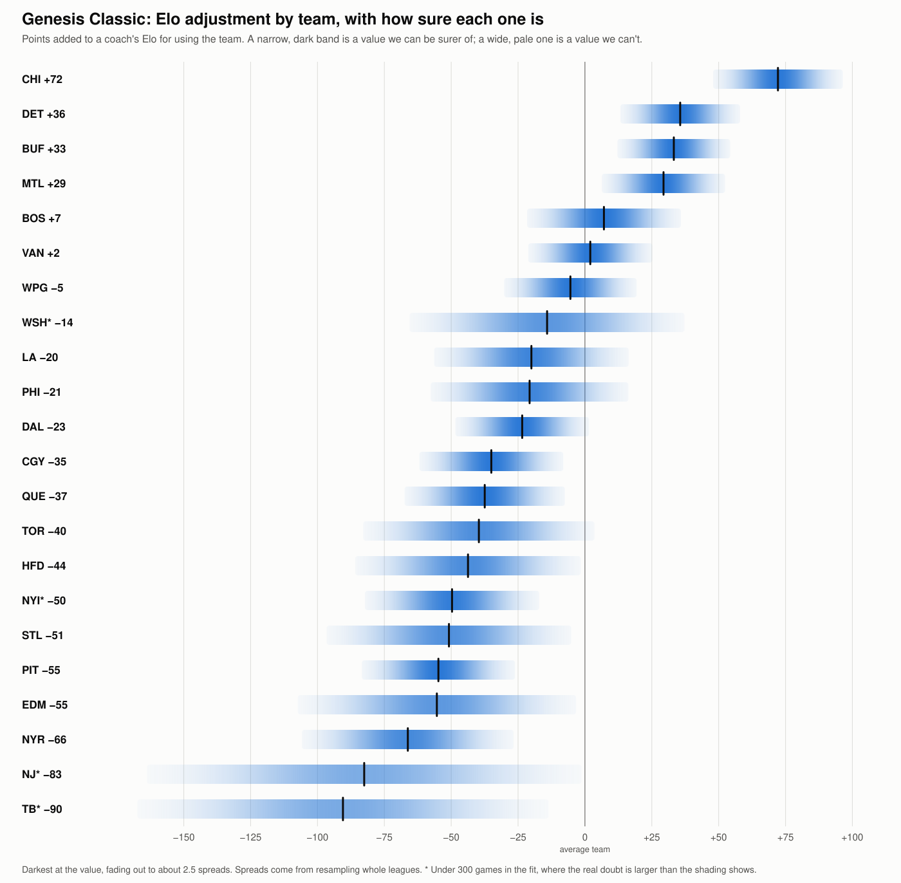

# Genesis Classic team guide

Every retail team in the Genesis Classic leagues (names starting `Classic_Spring`, `Classic_Summer` or `Classic_Fall`): 22,971 games in 97 leagues, through 2026-11-09. No coach is named. The method is in [COACH_RATING.md](COACH_RATING.md).

**Jump to a team:** [Chicago](#1-chicago-chi) · [Detroit](#2-detroit-det) · [Buffalo](#3-buffalo-buf) · [Montreal](#4-montreal-mtl) · [Boston](#5-boston-bos) · [Vancouver](#6-vancouver-van) · [Winnipeg](#7-winnipeg-wpg) · [Dallas](#8-dallas-dal) · [Hartford](#9-hartford-hfd) · [Calgary](#10-calgary-cgy) · [Toronto](#11-toronto-tor) · [New Jersey](#12-new-jersey-nj) · [NY Islanders](#13-ny-islanders-nyi) · [Philadelphia](#14-philadelphia-phi) · [Los Angeles](#15-los-angeles-la) · [Quebec](#16-quebec-que) · [Edmonton](#17-edmonton-edm) · [Washington](#18-washington-wsh) · [Tampa Bay](#19-tampa-bay-tb) · [Pittsburgh](#20-pittsburgh-pit) · [St. Louis](#21-st-louis-stl) · [NY Rangers](#22-ny-rangers-nyr)

## How to read this guide

**The basics**

- **Points:** strength values are points of win chance above or below 50, against the average team as used in these leagues, with even coaches and no home edge. +5 means about a 55% chance.

- **± (spread):** about how far a value could be off by chance, from resampling whole leagues or, in the Record table, from the number of games. A value within one spread of zero can't be told from zero.

- **Results show what happened, not why.** Players choose or are given teams, and rarely used teams rest on few coaches.

- **± understates the uncertainty for rarely used teams.** Their values are pulled toward average, and ± is measured around the pulled value. A team with few games or few coaches is less certain than its ± suggests.

**Why the numbers for a team can disagree**

Two teams can have similar strengths but different Elo adjustments, or a team can have a good record and a poor strength. Usually that's not an error. Where the numbers agree, the method doesn't matter. Where they differ, the team is less certain. Use strength to judge how good a team is, and the Elo adjustment inside an Elo rating.

- **Each number uses a different yardstick for the coach.** Every team value is what's left after taking out who was coaching. Strength uses one fitted strength for each coach. The Elo adjustment uses each coach's Elo at the start of that league. A different yardstick leaves a different remainder, even with the same record.

- **Elo can run high or low for a while.** If a coach's Elo is well above how they then play, the team they're using looks worse than it is. If it's well below, the team looks better. A fitted strength reflects the coach's whole Classic career, so it's less affected by this.

- **Favorites tend to fall short of what Elo predicts.** A rating gap in Classic games is only worth about 0.7 of its face value at the start of a league. A team usually used by Elo favorites can therefore look a little worse on the Elo adjustment than on strength, and a team usually used by underdogs a little better. In simulated seasons this effect was usually small and varied a lot.

- **Rarely used teams rest on a few seasons.** One or two unusual seasons, or one coach, can move their numbers a lot, and more on the Elo adjustment than on strength.

- **Each number counts different results.** Strength counts how early wins were safe as well as who won. The Elo adjustment's fit counts only who won, and it leaves out games where a coach has under 30 earlier games.

- **Strength now and strength over all years cover different games.** A team can look better or worse lately because of who has used it recently, or because the leagues have changed, so a gap between the two doesn't prove the team itself changed. Rosters in these leagues stay the same.

- **A record alone doesn't say how good a team is.** Better coaches may have used it, or worse ones. A strong team can have a modest record if weaker coaches tend to use it, and a weak team can have a good record if stronger coaches do. That's what the Expected column is for.

- **Most differences between levels don't repeat well** when half the leagues are compared with the other half, so treat them as ideas to test. In simulated seasons where every team played the same at every level, gaps of up to about 8 points still appeared by chance. The overall team order is sturdier.

**The "All teams" table**

- **#:** the team's rank by strength now.

- **Team:** the team and its abbreviation. Click a name to go to its entry.

- **Overall:** from strength now. Good is +1.5 or better, Poor is −1.5 or worse, and Average is in between. Zero is the average team as used, and the strong teams are used most, so most teams fall below it.

- **Best for:** which level of player gets more from this team than from their other teams. High-level or Low-level means one does, Both alike means no gap of over 5 points, and Unclear means the measures disagree or there are too few games. A team can be Poor overall and still best for one level: that level just loses less with it.

- **Confidence:** how sure the Best for call is. Likely: all three measures of level agree on direction, and the gap is at least 1.5 spreads in two. Leaning: the same, at 1 spread. Weak: they agree on direction, the gap is at least 3 points each way, and the team is good for only that level. "Few games" means at least two values rest on under 150 appearances. A dash means no call to rate.

- **Strength now:** how much the team adds, in points, with recent games counting more. A game's weight halves every 1.5 years, so a game from 3 years ago counts a quarter as much as one played today. It's the better guide to how a team has done lately.

- **Strength, all years:** the same, with every game counting equally. It rests on more games, so it's steadier.

- **Elo adjustment:** points to add to a coach's Elo for using this team, against the average team in use. It's fitted on the league Elo: every game in order, from a 1500 start, with the expected score counting +7 for home and each team's own adjustment. A game moves a rating by up to 20 points (K 20), and more when a win is by two or more goals, the more so the longer the winner held a safe lead (the coasting bonus). Rarely used teams are pulled toward zero, to keep a few games from swinging them, by an amount tested on later years. A team's entry says how many of its games the fit uses, as games where a coach had under 30 earlier games are left out, and what the same fit gives with one fixed strength per coach instead of Elo. A * marks under 300 games in that fit, so treat it as rough. Tested on later years, using these inside the running Elo predicts clearly better than leaving them out.

- **Record:** all wins and losses with this team, plus ties when there are any.

- **Win %:** wins as a share of wins and losses, without ties or any adjustment for who was coaching.

- **Expected:** the win % that the team's coaches, home ice and the other team predict if this team were the average team in use. A record above expected is what the team itself added.

**The "By level of player" table** (all years; each value says how much better that level does with this team than with its other teams, after taking out who was using it)

- **High level** and **Low level:** the value for each level. A * marks under 150 appearances.

- **High minus low:** the gap between the two. Positive means the team does more for high-level players.

- **By coach (row):** level is each coach's career strength. High and low are the top and bottom groups, with about a third of the appearances each.

- **By league strength (row):** level is the strength of the league's coaches, cut the same way.

- **Top league against others (row):** high is each season's top league, the one with the most As, and low is the same season's other leagues.

**The "Record" table** (one row for each kind of game: all games, regular season, playoffs, home, away, three eras, each coach level, and top league or other leagues)

- **Record**, **Win %** and **Expected:** as in the "All teams" table.

- **Against expected:** win % minus expected, in points, with its spread. Positive means the team did better than its coaches and opponents predict.

**The "Per game" table** (averages over the team's games)

- **Stat** and **Value:** what's measured, explained below, and the team's figure. Percentages are over all its games, not an average of each game's.

- **Rank:** its place among the teams in this guide. 1st is best: the fewest for goals against, shots against and penalty minutes, and the most for checks.

- **Goals for** and **Goals against:** goals scored and allowed.

- **Shots for** and **Shots against:** shots on goal taken and allowed.

- **Shooting %:** goals for as a share of shots for.

- **Save %:** the share of shots against that didn't score.

- **Power play %:** power play goals as a share of power plays.

- **Penalty kill %:** the share of the other team's power plays that didn't score.

- **One-timer goals** and **Breakaway goals:** goals of each kind, as the game counts them.

- **Checks:** checks thrown, as the game counts them.

- **Penalty minutes:** the team's penalty minutes.

- **Faceoffs won %:** the team's share of faceoffs.

- **Attack zone time, seconds:** time spent in the attacking zone.

- **Pass completion %:** completed passes as a share of passes tried, as the game counts them. The game only credits a pass caught by the intended receiver.

**The "Ratings" table** (from the ROM; the number in parentheses is the rank among all 26 NHL teams, with 1st the highest, so the heaviest for Weight)

- **Overall**, **Weight**, **Speed**, **Agility**, **Shot Power**, **Shot Accuracy** and **Checking:** the mean roster rating of the team's top 12 skaters by overall. Hot and cold values change them a little in play.

- **Goalie Agility:** the roster Agility of the team's higher-rated goalie. On the Genesis it sets the goalie's reach.

- **Hidden bonus (line under the table):** what the ROM adds to some of the team's ratings at home and takes away on the road.

**The "Leading skaters" table** (the team's top 6 by points; all figures are per team game, whether or not the skater played in it)

- **Player** and **Pos:** the skater, as a forward (F) or defenceman (D).

- **Goals**, **Assists**, **Points** and **Checks:** the skater's figures per team game.

- **Overall**, **Weight**, **Speed**, **Shot Power** and **Shot Acc:** the skater's roster ratings from the ROM.

**The "Goalies" table** (the team's two goalies who faced the most shots)

- **Goalie:** the goalie.

- **Shots faced:** all shots the goalie faced in these games.

- **Save %:** the share of those shots the goalie stopped.

- **Agility** and **Puck Control:** the goalie's roster ratings from the ROM.

## All teams

Each band is darkest at the team's value and fades out to show how far it could be off. The two guides share one scale.

| # | Team | Overall | Best for | Confidence | Strength now | Strength, all years | Elo adjustment | Record | Win % | Expected |
| --- | --- | --- | --- | --- | --- | --- | --- | --- | --- | --- |
| 1 | [Chicago (CHI)](#1-chicago-chi) | Good | Both alike | — | +7.8 | +9.0 | +72 | 2,144-1,847-5 | 53.7% | 43.9% |
| 2 | [Detroit (DET)](#2-detroit-det) | Good | Both alike | — | +6.0 | +6.9 | +36 | 2,254-1,880-7 | 54.5% | 47.2% |
| 3 | [Buffalo (BUF)](#3-buffalo-buf) | Good | Both alike | — | +4.1 | +4.2 | +33 | 2,059-1,949-2 | 51.4% | 46.9% |
| 4 | [Montreal (MTL)](#4-montreal-mtl) | Good | Both alike | — | +2.4 | +2.9 | +29 | 2,040-1,852-6 | 52.4% | 48.4% |
| 5 | [Boston (BOS)](#5-boston-bos) | Average | High-level | Likely | +1.4 | +1.0 | +7 | 1,974-1,857-2 | 51.5% | 50.7% |
| 6 | [Vancouver (VAN)](#6-vancouver-van) | Average | High-level | Leaning | −0.6 | −0.8 | +2 | 1,862-2,056-4 | 47.5% | 47.8% |
| 7 | [Winnipeg (WPG)](#7-winnipeg-wpg) | Average | Both alike | — | −1.1 | +0.1 | −5 | 1,826-1,749-1 | 51.1% | 50.9% |
| 8 | [Dallas (DAL)](#8-dallas-dal) | Average | Both alike | — | −1.2 | −1.3 | −23 | 1,407-1,285-4 | 52.3% | 53.7% |
| 9 | [Hartford (HFD)](#9-hartford-hfd) | Average | Unclear | — | −1.5 | −6.2 | −44 | 262-190 | 58.0% | 66.0% |
| 10 | [Calgary (CGY)](#10-calgary-cgy) | Poor | Both alike | — | −2.7 | −5.2 | −35 | 1,411-1,647-1 | 46.1% | 51.6% |
| 11 | [Toronto (TOR)](#11-toronto-tor) | Poor | Both alike | — | −3.3 | −2.8 | −40 | 703-887-2 | 44.2% | 46.9% |
| 12 | [New Jersey (NJ)](#12-new-jersey-nj) | Poor | Both alike | — | −3.6 | −5.1 | −83* | 144-165-1 | 46.6% | 52.7% |
| 13 | [NY Islanders (NYI)](#13-ny-islanders-nyi) | Poor | Unclear | Few games | −4.0 | −9.3 | −50* | 95-115 | 45.2% | 56.0% |
| 14 | [Philadelphia (PHI)](#14-philadelphia-phi) | Poor | High-level | Leaning | −4.0 | −4.9 | −21 | 511-537-5 | 48.8% | 54.4% |
| 15 | [Los Angeles (LA)](#15-los-angeles-la) | Poor | Unclear | — | −4.8 | −2.6 | −20 | 1,146-1,256 | 47.7% | 50.7% |
| 16 | [Quebec (QUE)](#16-quebec-que) | Poor | Unclear | — | −4.9 | −4.8 | −37 | 1,039-1,023-2 | 50.4% | 55.3% |
| 17 | [Edmonton (EDM)](#17-edmonton-edm) | Poor | Low-level | Leaning | −4.9 | −6.7 | −55 | 314-337 | 48.2% | 56.0% |
| 18 | [Washington (WSH)](#18-washington-wsh) | Poor | Unclear | Few games | −5.2 | −7.0 | −14* | 160-197 | 44.8% | 54.0% |
| 19 | [Tampa Bay (TB)](#19-tampa-bay-tb) | Poor | Unclear | Few games | −5.8 | −11.4 | −90* | 98-108 | 47.6% | 61.9% |
| 20 | [Pittsburgh (PIT)](#20-pittsburgh-pit) | Poor | Both alike | — | −6.9 | −10.0 | −55 | 458-686-5 | 40.0% | 50.6% |
| 21 | [St. Louis (STL)](#21-st-louis-stl) | Poor | Unclear | — | −7.8 | −7.3 | −51 | 486-531-1 | 47.8% | 55.0% |
| 22 | [NY Rangers (NYR)](#22-ny-rangers-nyr) | Poor | Both alike | — | −10.2 | −10.8 | −66 | 553-774 | 41.7% | 53.4% |

Too few games for a full entry: Anaheim (ANH) 1-19.

## 1. Chicago (CHI)

**Overall: Good. Best for: Both alike.** Strength +7.8 ± 1.1 now (1st of 22), +9.0 ± 1.0 over all years (1st).

**Elo adjustment:** +72 ± 10 points (1st of 22), from 2,886 of 3,996 games. Against an even coach on the average team, on neutral ice, that's a 60% win chance. With one fixed strength per coach instead of Elo, it's +67.

Used in 91 of 97 leagues (24 of them a season's top league), by 71 coaches, 3,996 games, most recently 2026-11-09.

**By level of player**

| | High level | Low level | High minus low |
| --- | --- | --- | --- |
| By coach | +9.0 ± 1.9 | +8.7 ± 2.0 | +0.2 ± 2.7 |
| By league strength | +7.8 ± 1.7 | +9.6 ± 2.0 | −1.8 ± 2.6 |
| Top league against others | +8.3 ± 1.9 | +9.0 ± 1.3 | −0.7 ± 2.3 |

**Record**

| | Record | Win % | Expected | Against expected |
| --- | --- | --- | --- | --- |
| All games | 2,144-1,847-5 | 53.7% | 43.9% | +9.8 ± 0.8 |
| Regular season | 1,857-1,605-5 | 53.6% | 44.0% | +9.7 ± 0.8 |
| Playoffs | 287-242 | 54.3% | 43.6% | +10.6 ± 2.2 |
| Home | 1,123-875-3 | 56.2% | 45.3% | +10.9 ± 1.1 |
| Away | 1,021-972-2 | 51.2% | 42.5% | +8.7 ± 1.1 |
| 2013-2019 | 560-490-1 | 53.3% | 43.6% | +9.7 ± 1.5 |
| 2020-2022 | 599-542-2 | 52.5% | 44.7% | +7.8 ± 1.5 |
| 2023-2026 | 985-815-2 | 54.7% | 43.6% | +11.1 ± 1.2 |
| High coach | 462-307 | 60.1% | 51.3% | +8.8 ± 1.8 |
| Mid coach | 783-669-1 | 53.9% | 43.8% | +10.2 ± 1.3 |
| Low coach | 899-871-4 | 50.8% | 40.8% | +10.0 ± 1.2 |
| Top league | 512-526 | 49.3% | 40.2% | +9.1 ± 1.6 |
| Other leagues | 1,632-1,321-5 | 55.3% | 45.2% | +10.0 ± 0.9 |

**Per game**

| Stat | Value | Rank | | Stat | Value | Rank |
| --- | --- | --- | --- | --- | --- | --- |
| Goals for | 3.72 | 15th | | One-timer goals | 1.26 | 14th |
| Goals against | 3.42 | 2nd | | Breakaway goals | 0.29 | 11th |
| Shots for | 11.9 | 10th | | Checks | 27.9 | 5th |
| Shots against | 12.1 | 15th | | Penalty minutes | 3.3 | 14th |
| Shooting % | 31.3 | 13th | | Faceoffs won % | 49.3 | 20th |
| Save % | 71.8 | 2nd | | Attack zone time, seconds | 319 | 11th |
| Power play % | 38.1 | 14th | | Pass completion % | 61.3 | 17th |
| Penalty kill % | 64.2 | 3rd | |  | |  |

**Ratings**

| Overall | Weight | Speed | Agility | Shot Power | Shot Accuracy | Checking | Goalie Agility |
| --- | --- | --- | --- | --- | --- | --- | --- |
| 70.8 (6th) | 7.3 (14th) | 3.4 (12th) | 3.8 (8th) | 3.4 (7th) | 2.8 (15th) | 3.5 (1st) | 6.0 (1st) |

Hidden bonus: +2 at home, −1 away.

**Leading skaters** (per team game)

| Player | Pos | Goals | Assists | Points | Checks | Overall | Weight | Speed | Shot Power | Shot Acc |
| --- | --- | --- | --- | --- | --- | --- | --- | --- | --- | --- |
| Jeremy Roenick | F | 2.04 | 0.57 | 2.61 | 7.06 | 89 | 4 | 5 | 5 | 5 |
| Steve Larmer | F | 0.70 | 0.78 | 1.48 | 3.48 | 86 | 7 | 4 | 4 | 4 |
| Joe Murphy | F | 0.35 | 0.49 | 0.84 | 1.90 | 71 | 7 | 4 | 4 | 3 |
| Chris Chelios | D | 0.17 | 0.63 | 0.81 | 5.96 | 84 | 7 | 4 | 5 | 1 |
| Steve Smith | D | 0.07 | 0.55 | 0.62 | 6.18 | 72 | 11 | 4 | 4 | 1 |
| Christan Ruuttu | F | 0.23 | 0.31 | 0.53 | 1.32 | 72 | 8 | 4 | 3 | 2 |

**Goalies**

| Goalie | Shots faced | Save % | Agility | Puck Control |
| --- | --- | --- | --- | --- |
| Ed Belfour | 47,986 | 72.0 | 6 | 5 |
| Jim Waite | 349 | 75.1 | 3 | 2 |

## 2. Detroit (DET)

**Overall: Good. Best for: Both alike.** Strength +6.0 ± 1.3 now (2nd of 22), +6.9 ± 1.1 over all years (2nd).

**Elo adjustment:** +36 ± 9 points (2nd of 22), from 2,854 of 4,141 games. Against an even coach on the average team, on neutral ice, that's a 55% win chance. With one fixed strength per coach instead of Elo, it's +50.

Used in 93 of 97 leagues (25 of them a season's top league), by 75 coaches, 4,141 games, most recently 2026-11-06.

**By level of player**

| | High level | Low level | High minus low |
| --- | --- | --- | --- |
| By coach | +7.5 ± 1.7 | +6.5 ± 2.2 | +1.0 ± 2.7 |
| By league strength | +6.1 ± 1.8 | +8.6 ± 2.3 | −2.5 ± 2.9 |
| Top league against others | +7.2 ± 1.9 | +6.4 ± 1.2 | +0.8 ± 2.2 |

**Record**

| | Record | Win % | Expected | Against expected |
| --- | --- | --- | --- | --- |
| All games | 2,254-1,880-7 | 54.5% | 47.2% | +7.3 ± 0.8 |
| Regular season | 1,871-1,566-7 | 54.4% | 47.1% | +7.3 ± 0.9 |
| Playoffs | 383-314 | 54.9% | 47.6% | +7.3 ± 1.9 |
| Home | 1,148-923-5 | 55.4% | 48.7% | +6.7 ± 1.1 |
| Away | 1,106-957-2 | 53.6% | 45.7% | +7.9 ± 1.1 |
| 2013-2019 | 666-452-2 | 59.6% | 54.6% | +5.0 ± 1.5 |
| 2020-2022 | 699-532-1 | 56.8% | 47.4% | +9.4 ± 1.4 |
| 2023-2026 | 889-896-4 | 49.8% | 42.5% | +7.3 ± 1.2 |
| High coach | 840-495-2 | 62.9% | 55.8% | +7.1 ± 1.4 |
| Mid coach | 645-567 | 53.2% | 46.4% | +6.9 ± 1.4 |
| Low coach | 769-818-5 | 48.5% | 40.6% | +7.8 ± 1.3 |
| Top league | 513-525-2 | 49.4% | 41.3% | +8.1 ± 1.6 |
| Other leagues | 1,741-1,355-5 | 56.2% | 49.2% | +7.1 ± 0.9 |

**Per game**

| Stat | Value | Rank | | Stat | Value | Rank |
| --- | --- | --- | --- | --- | --- | --- |
| Goals for | 4.23 | 2nd | | One-timer goals | 1.40 | 5th |
| Goals against | 3.84 | 10th | | Breakaway goals | 0.33 | 3rd |
| Shots for | 12.8 | 1st | | Checks | 23.6 | 19th |
| Shots against | 12.1 | 11th | | Penalty minutes | 3.1 | 9th |
| Shooting % | 33.1 | 6th | | Faceoffs won % | 49.6 | 17th |
| Save % | 68.2 | 10th | | Attack zone time, seconds | 328 | 2nd |
| Power play % | 42.0 | 2nd | | Pass completion % | 61.1 | 19th |
| Penalty kill % | 60.8 | 12th | |  | |  |

**Ratings**

| Overall | Weight | Speed | Agility | Shot Power | Shot Accuracy | Checking | Goalie Agility |
| --- | --- | --- | --- | --- | --- | --- | --- |
| 71.3 (4th) | 7.0 (21st) | 3.6 (9th) | 4.2 (3rd) | 3.7 (2nd) | 2.9 (11th) | 2.6 (18th) | 4.0 (5th) |

Hidden bonus: none.

**Leading skaters** (per team game)

| Player | Pos | Goals | Assists | Points | Checks | Overall | Weight | Speed | Shot Power | Shot Acc |
| --- | --- | --- | --- | --- | --- | --- | --- | --- | --- | --- |
| Steve Yzerman | F | 1.65 | 0.92 | 2.57 | 3.95 | 95 | 6 | 5 | 4 | 5 |
| Dino Ciccarelli | F | 1.38 | 0.76 | 2.13 | 4.62 | 80 | 5 | 4 | 5 | 5 |
| Sergei Fedorov | F | 0.76 | 0.78 | 1.54 | 3.09 | 84 | 7 | 4 | 4 | 4 |
| Nicklas Lidstrom | D | 0.09 | 0.68 | 0.77 | 4.74 | 66 | 5 | 3 | 4 | 1 |
| Paul Coffey | D | 0.16 | 0.58 | 0.74 | 4.05 | 83 | 9 | 5 | 4 | 1 |
| Dallas Drake | F | 0.11 | 0.14 | 0.26 | 0.76 | 66 | 4 | 4 | 3 | 3 |

**Goalies**

| Goalie | Shots faced | Save % | Agility | Puck Control |
| --- | --- | --- | --- | --- |
| Tim Cheveldae | 49,572 | 68.3 | 4 | 4 |
| Vincent Riendeau | 199 | 60.8 | 3 | 2 |

## 3. Buffalo (BUF)

**Overall: Good. Best for: Both alike.** Strength +4.1 ± 1.1 now (3rd of 22), +4.2 ± 0.9 over all years (3rd).

**Elo adjustment:** +33 ± 8 points (3rd of 22), from 2,925 of 4,010 games. Against an even coach on the average team, on neutral ice, that's a 55% win chance. With one fixed strength per coach instead of Elo, it's +28.

Used in 92 of 97 leagues (25 of them a season's top league), by 69 coaches, 4,010 games, most recently 2026-11-09.

**By level of player**

| | High level | Low level | High minus low |
| --- | --- | --- | --- |
| By coach | +3.7 ± 1.9 | +3.7 ± 1.9 | 0.0 ± 2.9 |
| By league strength | +3.1 ± 1.7 | +6.2 ± 1.8 | −3.0 ± 2.5 |
| Top league against others | +4.1 ± 1.8 | +4.1 ± 1.2 | +0.1 ± 2.1 |

**Record**

| | Record | Win % | Expected | Against expected |
| --- | --- | --- | --- | --- |
| All games | 2,059-1,949-2 | 51.4% | 46.9% | +4.5 ± 0.8 |
| Regular season | 1,817-1,686-2 | 51.9% | 46.9% | +4.9 ± 0.8 |
| Playoffs | 242-263 | 47.9% | 46.8% | +1.1 ± 2.2 |
| Home | 1,078-927-2 | 53.8% | 48.4% | +5.4 ± 1.1 |
| Away | 981-1,022 | 49.0% | 45.5% | +3.5 ± 1.1 |
| 2013-2019 | 604-521 | 53.7% | 49.5% | +4.2 ± 1.5 |
| 2020-2022 | 568-568-1 | 50.0% | 45.4% | +4.6 ± 1.5 |
| 2023-2026 | 887-860-1 | 50.8% | 46.3% | +4.5 ± 1.2 |
| High coach | 617-456 | 57.5% | 55.0% | +2.5 ± 1.5 |
| Mid coach | 744-680-1 | 52.2% | 47.2% | +5.1 ± 1.3 |
| Low coach | 698-813-1 | 46.2% | 41.0% | +5.2 ± 1.3 |
| Top league | 493-551 | 47.2% | 42.9% | +4.4 ± 1.5 |
| Other leagues | 1,566-1,398-2 | 52.8% | 48.3% | +4.5 ± 0.9 |

**Per game**

| Stat | Value | Rank | | Stat | Value | Rank |
| --- | --- | --- | --- | --- | --- | --- |
| Goals for | 3.79 | 10th | | One-timer goals | 1.22 | 18th |
| Goals against | 3.65 | 3rd | | Breakaway goals | 0.33 | 5th |
| Shots for | 12.1 | 8th | | Checks | 25.0 | 14th |
| Shots against | 11.9 | 7th | | Penalty minutes | 3.3 | 16th |
| Shooting % | 31.4 | 12th | | Faceoffs won % | 49.8 | 16th |
| Save % | 69.4 | 4th | | Attack zone time, seconds | 326 | 4th |
| Power play % | 37.6 | 17th | | Pass completion % | 60.4 | 22nd |
| Penalty kill % | 61.2 | 9th | |  | |  |

**Ratings**

| Overall | Weight | Speed | Agility | Shot Power | Shot Accuracy | Checking | Goalie Agility |
| --- | --- | --- | --- | --- | --- | --- | --- |
| 67.2 (14th) | 6.8 (24th) | 3.8 (4th) | 3.8 (6th) | 2.9 (19th) | 2.7 (18th) | 2.9 (6th) | 5.0 (3rd) |

Hidden bonus: +2 at home, −1 away.

**Leading skaters** (per team game)

| Player | Pos | Goals | Assists | Points | Checks | Overall | Weight | Speed | Shot Power | Shot Acc |
| --- | --- | --- | --- | --- | --- | --- | --- | --- | --- | --- |
| Alexnder Mogilny | F | 1.96 | 0.57 | 2.53 | 4.40 | 96 | 7 | 6 | 4 | 5 |
| Pat LaFontaine | F | 1.00 | 0.87 | 1.87 | 4.70 | 91 | 5 | 4 | 3 | 4 |
| Dale Hawerchuk | F | 0.54 | 0.79 | 1.34 | 2.95 | 74 | 6 | 4 | 3 | 1 |
| Petr Svoboda | D | 0.10 | 0.67 | 0.77 | 5.32 | 65 | 5 | 4 | 3 | 0 |
| Richard Smehlik | D | 0.03 | 0.41 | 0.44 | 3.98 | 60 | 10 | 3 | 3 | 1 |
| Grant Ledyard | D | 0.01 | 0.15 | 0.16 | 1.41 | 46 | 9 | 3 | 1 | 0 |

**Goalies**

| Goalie | Shots faced | Save % | Agility | Puck Control |
| --- | --- | --- | --- | --- |
| Grant Fuhr | 47,443 | 69.6 | 5 | 5 |
| Dominik Hasek | 252 | 67.9 | 3 | 2 |

## 4. Montreal (MTL)

**Overall: Good. Best for: Both alike.** Strength +2.4 ± 1.2 now (4th of 22), +2.9 ± 0.9 over all years (4th).

**Elo adjustment:** +29 ± 9 points (4th of 22), from 2,777 of 3,898 games. Against an even coach on the average team, on neutral ice, that's a 54% win chance. With one fixed strength per coach instead of Elo, it's +27.

Used in 87 of 97 leagues (22 of them a season's top league), by 69 coaches, 3,898 games, most recently 2026-11-09.

**By level of player**

| | High level | Low level | High minus low |
| --- | --- | --- | --- |
| By coach | +4.4 ± 1.5 | +1.2 ± 1.3 | +3.2 ± 2.0 |
| By league strength | +2.7 ± 1.7 | +2.7 ± 1.6 | 0.0 ± 2.5 |
| Top league against others | +2.8 ± 2.0 | +2.8 ± 1.1 | 0.0 ± 2.3 |

**Record**

| | Record | Win % | Expected | Against expected |
| --- | --- | --- | --- | --- |
| All games | 2,040-1,852-6 | 52.4% | 48.4% | +4.0 ± 0.8 |
| Regular season | 1,748-1,566-6 | 52.7% | 49.1% | +3.7 ± 0.9 |
| Playoffs | 292-286 | 50.5% | 44.6% | +5.9 ± 2.1 |
| Home | 1,050-900-1 | 53.8% | 49.8% | +4.1 ± 1.1 |
| Away | 990-952-5 | 51.0% | 47.0% | +4.0 ± 1.1 |
| 2013-2019 | 547-457-3 | 54.5% | 49.3% | +5.2 ± 1.6 |
| 2020-2022 | 600-506-1 | 54.2% | 49.0% | +5.2 ± 1.5 |
| 2023-2026 | 893-889-2 | 50.1% | 47.6% | +2.6 ± 1.2 |
| High coach | 677-434-1 | 60.9% | 56.5% | +4.4 ± 1.5 |
| Mid coach | 609-593-2 | 50.7% | 45.9% | +4.8 ± 1.4 |
| Low coach | 754-825-3 | 47.8% | 44.6% | +3.1 ± 1.3 |
| Top league | 502-473-1 | 51.5% | 47.6% | +3.8 ± 1.6 |
| Other leagues | 1,538-1,379-5 | 52.7% | 48.7% | +4.1 ± 0.9 |

**Per game**

| Stat | Value | Rank | | Stat | Value | Rank |
| --- | --- | --- | --- | --- | --- | --- |
| Goals for | 3.41 | 21st | | One-timer goals | 1.23 | 16th |
| Goals against | 3.32 | 1st | | Breakaway goals | 0.21 | 20th |
| Shots for | 11.6 | 14th | | Checks | 24.9 | 16th |
| Shots against | 12.0 | 8th | | Penalty minutes | 3.3 | 15th |
| Shooting % | 29.4 | 21st | | Faceoffs won % | 50.3 | 6th |
| Save % | 72.2 | 1st | | Attack zone time, seconds | 325 | 6th |
| Power play % | 36.9 | 19th | | Pass completion % | 61.4 | 15th |
| Penalty kill % | 65.9 | 1st | |  | |  |

**Ratings**

| Overall | Weight | Speed | Agility | Shot Power | Shot Accuracy | Checking | Goalie Agility |
| --- | --- | --- | --- | --- | --- | --- | --- |
| 68.2 (9th) | 7.0 (22nd) | 3.8 (3rd) | 3.8 (10th) | 3.0 (17th) | 3.0 (7th) | 2.8 (14th) | 6.0 (2nd) |

Hidden bonus: +2 at home, −1 away.

**Leading skaters** (per team game)

| Player | Pos | Goals | Assists | Points | Checks | Overall | Weight | Speed | Shot Power | Shot Acc |
| --- | --- | --- | --- | --- | --- | --- | --- | --- | --- | --- |
| Denis Savard | F | 0.89 | 0.75 | 1.64 | 4.27 | 75 | 5 | 4 | 3 | 3 |
| Stephan Lebeau | F | 0.93 | 0.56 | 1.49 | 3.88 | 74 | 5 | 4 | 3 | 5 |
| Vincent Damphousse | F | 0.53 | 0.51 | 1.05 | 2.19 | 74 | 6 | 4 | 3 | 3 |
| Kirk Muller | F | 0.61 | 0.31 | 0.92 | 2.12 | 80 | 9 | 4 | 4 | 4 |
| Matt Schneider | D | 0.08 | 0.38 | 0.46 | 3.26 | 66 | 7 | 4 | 3 | 2 |
| Eric Desjardins | D | 0.06 | 0.32 | 0.38 | 3.73 | 68 | 9 | 3 | 3 | 2 |

**Goalies**

| Goalie | Shots faced | Save % | Agility | Puck Control |
| --- | --- | --- | --- | --- |
| Patrick Roy | 46,347 | 72.4 | 6 | 6 |
| Andre Racicot | 110 | 60.9 | 2 | 3 |

## 5. Boston (BOS)

**Overall: Average. Best for: High-level (likely).** Strength +1.4 ± 1.8 now (5th of 22), +1.0 ± 1.2 over all years (5th).

**Elo adjustment:** +7 ± 12 points (5th of 22), from 2,828 of 3,833 games. Against an even coach on the average team, on neutral ice, that's a 51% win chance. With one fixed strength per coach instead of Elo, it's +5.

Used in 88 of 97 leagues (23 of them a season's top league), by 66 coaches, 3,833 games, most recently 2026-11-09.

**By level of player**

| | High level | Low level | High minus low |
| --- | --- | --- | --- |
| By coach | +3.5 ± 1.8 | −2.7 ± 2.6 | +6.3 ± 3.1 |
| By league strength | +2.1 ± 2.0 | −3.0 ± 2.0 | +5.2 ± 2.6 |
| Top league against others | +3.2 ± 2.3 | −0.1 ± 1.3 | +3.2 ± 2.5 |

**Record**

| | Record | Win % | Expected | Against expected |
| --- | --- | --- | --- | --- |
| All games | 1,974-1,857-2 | 51.5% | 50.7% | +0.8 ± 0.8 |
| Regular season | 1,674-1,569-2 | 51.6% | 51.1% | +0.5 ± 0.9 |
| Playoffs | 300-288 | 51.0% | 48.6% | +2.5 ± 2.1 |
| Home | 1,040-883-2 | 54.1% | 52.1% | +2.0 ± 1.1 |
| Away | 934-974 | 49.0% | 49.3% | −0.4 ± 1.1 |
| 2013-2019 | 591-491 | 54.6% | 51.8% | +2.8 ± 1.5 |
| 2020-2022 | 487-543-1 | 47.3% | 48.3% | −1.1 ± 1.6 |
| 2023-2026 | 896-823-1 | 52.1% | 51.5% | +0.6 ± 1.2 |
| High coach | 762-532 | 58.9% | 57.6% | +1.3 ± 1.4 |
| Mid coach | 778-748-1 | 51.0% | 49.4% | +1.6 ± 1.3 |
| Low coach | 434-577-1 | 42.9% | 43.8% | −0.9 ± 1.6 |
| Top league | 459-483 | 48.7% | 46.0% | +2.7 ± 1.6 |
| Other leagues | 1,515-1,374-2 | 52.4% | 52.3% | +0.2 ± 0.9 |

**Per game**

| Stat | Value | Rank | | Stat | Value | Rank |
| --- | --- | --- | --- | --- | --- | --- |
| Goals for | 3.77 | 11th | | One-timer goals | 1.31 | 10th |
| Goals against | 3.65 | 5th | | Breakaway goals | 0.26 | 15th |
| Shots for | 12.2 | 7th | | Checks | 29.0 | 2nd |
| Shots against | 11.6 | 4th | | Penalty minutes | 3.2 | 13th |
| Shooting % | 31.0 | 16th | | Faceoffs won % | 49.2 | 21st |
| Save % | 68.6 | 8th | | Attack zone time, seconds | 324 | 8th |
| Power play % | 40.0 | 7th | | Pass completion % | 62.1 | 9th |
| Penalty kill % | 61.7 | 7th | |  | |  |

**Ratings**

| Overall | Weight | Speed | Agility | Shot Power | Shot Accuracy | Checking | Goalie Agility |
| --- | --- | --- | --- | --- | --- | --- | --- |
| 73.7 (1st) | 7.1 (16th) | 3.8 (1st) | 4.2 (2nd) | 3.7 (1st) | 2.9 (10th) | 3.3 (3rd) | 3.0 (16th) |

Hidden bonus: +2 at home, −1 away.

**Leading skaters** (per team game)

| Player | Pos | Goals | Assists | Points | Checks | Overall | Weight | Speed | Shot Power | Shot Acc |
| --- | --- | --- | --- | --- | --- | --- | --- | --- | --- | --- |
| Adam Oates | F | 1.03 | 0.89 | 1.92 | 3.88 | 93 | 7 | 4 | 3 | 4 |
| Joe Juneau | F | 0.97 | 0.74 | 1.71 | 3.91 | 72 | 5 | 4 | 4 | 3 |
| Cam Neely | F | 0.79 | 0.47 | 1.27 | 2.84 | 86 | 10 | 4 | 4 | 5 |
| Ray Bourque | D | 0.34 | 0.52 | 0.86 | 8.58 | 99 | 10 | 4 | 5 | 5 |
| Don Sweeney | D | 0.19 | 0.61 | 0.80 | 6.26 | 71 | 4 | 4 | 4 | 1 |
| Ted Donato | F | 0.26 | 0.28 | 0.54 | 1.64 | 65 | 4 | 4 | 3 | 3 |

**Goalies**

| Goalie | Shots faced | Save % | Agility | Puck Control |
| --- | --- | --- | --- | --- |
| Andy Moog | 40,954 | 68.8 | 4 | 4 |
| John Blue | 3,262 | 68.4 | 3 | 3 |

## 6. Vancouver (VAN)

**Overall: Average. Best for: High-level (leaning).** Strength −0.6 ± 1.2 now (6th of 22), −0.8 ± 1.2 over all years (7th).

**Elo adjustment:** +2 ± 9 points (6th of 22), from 2,850 of 3,922 games. Against an even coach on the average team, on neutral ice, that's a 50% win chance. With one fixed strength per coach instead of Elo, it's −5.

Used in 89 of 97 leagues (23 of them a season's top league), by 69 coaches, 3,922 games, most recently 2026-11-09.

**By level of player**

| | High level | Low level | High minus low |
| --- | --- | --- | --- |
| By coach | +1.2 ± 1.8 | −2.5 ± 2.1 | +3.7 ± 2.7 |
| By league strength | +0.8 ± 1.9 | −2.3 ± 1.8 | +3.1 ± 2.5 |
| Top league against others | −0.4 ± 2.0 | −1.0 ± 1.4 | +0.6 ± 2.4 |

**Record**

| | Record | Win % | Expected | Against expected |
| --- | --- | --- | --- | --- |
| All games | 1,862-2,056-4 | 47.5% | 47.8% | −0.3 ± 0.8 |
| Regular season | 1,593-1,796-4 | 47.0% | 47.9% | −0.9 ± 0.9 |
| Playoffs | 269-260 | 50.9% | 47.2% | +3.7 ± 2.2 |
| Home | 961-997-2 | 49.1% | 49.3% | −0.3 ± 1.1 |
| Away | 901-1,059-2 | 46.0% | 46.3% | −0.4 ± 1.1 |
| 2013-2019 | 419-552-2 | 43.2% | 45.3% | −2.1 ± 1.6 |
| 2020-2022 | 514-638-1 | 44.6% | 45.0% | −0.4 ± 1.5 |
| 2023-2026 | 929-866-1 | 51.8% | 51.0% | +0.7 ± 1.2 |
| High coach | 626-470-1 | 57.1% | 56.5% | +0.6 ± 1.5 |
| Mid coach | 575-640-1 | 47.3% | 47.8% | −0.4 ± 1.4 |
| Low coach | 661-946-2 | 41.1% | 42.0% | −0.9 ± 1.2 |
| Top league | 474-507-1 | 48.3% | 48.3% | 0.0 ± 1.6 |
| Other leagues | 1,388-1,549-3 | 47.3% | 47.7% | −0.4 ± 0.9 |

**Per game**

| Stat | Value | Rank | | Stat | Value | Rank |
| --- | --- | --- | --- | --- | --- | --- |
| Goals for | 3.74 | 13th | | One-timer goals | 1.09 | 20th |
| Goals against | 3.90 | 14th | | Breakaway goals | 0.36 | 2nd |
| Shots for | 12.3 | 5th | | Checks | 24.9 | 15th |
| Shots against | 12.1 | 14th | | Penalty minutes | 3.1 | 5th |
| Shooting % | 30.4 | 20th | | Faceoffs won % | 50.6 | 5th |
| Save % | 67.8 | 12th | | Attack zone time, seconds | 322 | 10th |
| Power play % | 37.8 | 16th | | Pass completion % | 61.1 | 20th |
| Penalty kill % | 59.3 | 16th | |  | |  |

**Ratings**

| Overall | Weight | Speed | Agility | Shot Power | Shot Accuracy | Checking | Goalie Agility |
| --- | --- | --- | --- | --- | --- | --- | --- |
| 67.8 (12th) | 7.2 (15th) | 3.6 (10th) | 3.6 (13th) | 2.9 (20th) | 3.5 (1st) | 2.5 (20th) | 4.0 (14th) |

Hidden bonus: +1 at home, −1 away.

**Leading skaters** (per team game)

| Player | Pos | Goals | Assists | Points | Checks | Overall | Weight | Speed | Shot Power | Shot Acc |
| --- | --- | --- | --- | --- | --- | --- | --- | --- | --- | --- |
| Pavel Bure | F | 1.81 | 0.62 | 2.44 | 5.47 | 90 | 5 | 6 | 4 | 4 |
| Cliff Ronning | F | 0.76 | 0.79 | 1.56 | 3.85 | 76 | 5 | 5 | 2 | 3 |
| Geoff Courtnall | F | 0.62 | 0.57 | 1.19 | 2.15 | 73 | 7 | 5 | 3 | 3 |
| Doug Lidster | D | 0.06 | 0.63 | 0.69 | 5.63 | 60 | 9 | 3 | 3 | 1 |
| Jyrki Lumme | D | 0.07 | 0.60 | 0.67 | 4.73 | 64 | 7 | 3 | 2 | 1 |
| Trevor Linden | F | 0.32 | 0.25 | 0.57 | 1.04 | 78 | 9 | 4 | 4 | 4 |

**Goalies**

| Goalie | Shots faced | Save % | Agility | Puck Control |
| --- | --- | --- | --- | --- |
| Kirk McLean | 47,113 | 67.9 | 4 | 4 |
| Kay Whitmore | 139 | 61.9 | 2 | 2 |

## 7. Winnipeg (WPG)

**Overall: Average. Best for: Both alike.** Strength −1.1 ± 1.3 now (7th of 22), +0.1 ± 0.9 over all years (6th).

**Elo adjustment:** −5 ± 10 points (7th of 22), from 2,722 of 3,576 games. Against an even coach on the average team, on neutral ice, that's a 49% win chance. With one fixed strength per coach instead of Elo, it's 0.

Used in 83 of 97 leagues (25 of them a season's top league), by 60 coaches, 3,576 games, most recently 2026-11-08.

**By level of player**

| | High level | Low level | High minus low |
| --- | --- | --- | --- |
| By coach | +1.2 ± 1.4 | +1.6 ± 2.1 | −0.4 ± 2.5 |
| By league strength | +0.1 ± 1.4 | +2.2 ± 2.0 | −2.2 ± 2.4 |
| Top league against others | +0.3 ± 1.6 | −0.1 ± 1.1 | +0.4 ± 1.9 |

**Record**

| | Record | Win % | Expected | Against expected |
| --- | --- | --- | --- | --- |
| All games | 1,826-1,749-1 | 51.1% | 50.9% | +0.1 ± 0.8 |
| Regular season | 1,611-1,492-1 | 51.9% | 51.1% | +0.8 ± 0.9 |
| Playoffs | 215-257 | 45.6% | 49.9% | −4.4 ± 2.3 |
| Home | 931-848 | 52.3% | 52.4% | 0.0 ± 1.2 |
| Away | 895-901-1 | 49.8% | 49.5% | +0.3 ± 1.2 |
| 2013-2019 | 560-441-1 | 55.9% | 54.4% | +1.5 ± 1.6 |
| 2020-2022 | 538-502 | 51.7% | 51.8% | −0.1 ± 1.6 |
| 2023-2026 | 728-806 | 47.5% | 48.1% | −0.6 ± 1.3 |
| High coach | 731-562-1 | 56.5% | 56.3% | +0.2 ± 1.4 |
| Mid coach | 652-680 | 48.9% | 50.1% | −1.2 ± 1.4 |
| Low coach | 443-507 | 46.6% | 44.7% | +1.9 ± 1.6 |
| Top league | 529-532-1 | 49.9% | 49.7% | +0.1 ± 1.5 |
| Other leagues | 1,297-1,217 | 51.6% | 51.5% | +0.1 ± 1.0 |

**Per game**

| Stat | Value | Rank | | Stat | Value | Rank |
| --- | --- | --- | --- | --- | --- | --- |
| Goals for | 4.01 | 4th | | One-timer goals | 1.33 | 9th |
| Goals against | 3.91 | 15th | | Breakaway goals | 0.31 | 6th |
| Shots for | 12.4 | 4th | | Checks | 23.0 | 21st |
| Shots against | 12.1 | 12th | | Penalty minutes | 3.1 | 8th |
| Shooting % | 32.4 | 10th | | Faceoffs won % | 50.9 | 2nd |
| Save % | 67.5 | 13th | | Attack zone time, seconds | 325 | 5th |
| Power play % | 41.8 | 3rd | | Pass completion % | 61.3 | 18th |
| Penalty kill % | 59.8 | 14th | |  | |  |

**Ratings**

| Overall | Weight | Speed | Agility | Shot Power | Shot Accuracy | Checking | Goalie Agility |
| --- | --- | --- | --- | --- | --- | --- | --- |
| 67.9 (11th) | 7.0 (23rd) | 3.3 (16th) | 3.8 (7th) | 3.2 (15th) | 3.1 (5th) | 2.9 (10th) | 4.0 (15th) |

Hidden bonus: +1 at home, −1 away.

**Leading skaters** (per team game)

| Player | Pos | Goals | Assists | Points | Checks | Overall | Weight | Speed | Shot Power | Shot Acc |
| --- | --- | --- | --- | --- | --- | --- | --- | --- | --- | --- |
| Teemu Selanne | F | 1.86 | 0.66 | 2.53 | 4.93 | 90 | 6 | 6 | 4 | 5 |
| Evgeny Davydov | F | 0.79 | 0.72 | 1.51 | 2.90 | 64 | 6 | 4 | 4 | 4 |
| Alexei Zhamnov | F | 0.54 | 0.67 | 1.20 | 2.60 | 78 | 7 | 3 | 3 | 4 |
| Phil Housley | D | 0.41 | 0.69 | 1.10 | 4.74 | 84 | 6 | 5 | 3 | 2 |
| Teppo Numminen | D | 0.08 | 0.61 | 0.70 | 4.39 | 68 | 7 | 3 | 3 | 2 |
| Luciano Borsato | F | 0.17 | 0.22 | 0.39 | 1.31 | 61 | 4 | 3 | 2 | 4 |

**Goalies**

| Goalie | Shots faced | Save % | Agility | Puck Control |
| --- | --- | --- | --- | --- |
| Bob Essensa | 42,772 | 67.7 | 4 | 4 |
| Jim Hrivnak | 181 | 60.2 | 2 | 2 |

## 8. Dallas (DAL)

**Overall: Average. Best for: Both alike.** Strength −1.2 ± 1.4 now (8th of 22), −1.3 ± 1.3 over all years (8th).

**Elo adjustment:** −23 ± 10 points (11th of 22), from 2,125 of 2,696 games. Against an even coach on the average team, on neutral ice, that's a 47% win chance. With one fixed strength per coach instead of Elo, it's −10.

Used in 61 of 97 leagues (19 of them a season's top league), by 46 coaches, 2,696 games, most recently 2026-11-09.

**By level of player**

| | High level | Low level | High minus low |
| --- | --- | --- | --- |
| By coach | +0.8 ± 2.0 | −1.6 ± 3.2 | +2.4 ± 4.0 |
| By league strength | 0.0 ± 1.8 | −2.8 ± 3.0 | +2.8 ± 3.6 |
| Top league against others | +0.4 ± 1.8 | −2.2 ± 1.6 | +2.6 ± 2.3 |

**Record**

| | Record | Win % | Expected | Against expected |
| --- | --- | --- | --- | --- |
| All games | 1,407-1,285-4 | 52.3% | 53.7% | −1.4 ± 1.0 |
| Regular season | 1,204-1,102-4 | 52.2% | 53.8% | −1.6 ± 1.0 |
| Playoffs | 203-183 | 52.6% | 52.8% | −0.2 ± 2.5 |
| Home | 706-648-2 | 52.1% | 55.0% | −2.9 ± 1.4 |
| Away | 701-637-2 | 52.4% | 52.3% | +0.1 ± 1.4 |
| 2013-2019 | 446-388-1 | 53.5% | 52.7% | +0.8 ± 1.7 |
| 2020-2022 | 387-390-1 | 49.8% | 53.5% | −3.7 ± 1.8 |
| 2023-2026 | 574-507-2 | 53.1% | 54.5% | −1.4 ± 1.5 |
| High coach | 722-465-2 | 60.8% | 60.9% | −0.1 ± 1.5 |
| Mid coach | 413-401-1 | 50.7% | 54.6% | −3.9 ± 1.8 |
| Low coach | 272-419-1 | 39.4% | 40.1% | −0.8 ± 1.9 |
| Top league | 492-403-2 | 55.0% | 55.4% | −0.4 ± 1.7 |
| Other leagues | 915-882-2 | 50.9% | 52.8% | −1.9 ± 1.2 |

**Per game**

| Stat | Value | Rank | | Stat | Value | Rank |
| --- | --- | --- | --- | --- | --- | --- |
| Goals for | 3.90 | 6th | | One-timer goals | 1.05 | 22nd |
| Goals against | 3.76 | 7th | | Breakaway goals | 0.38 | 1st |
| Shots for | 11.8 | 12th | | Checks | 24.5 | 18th |
| Shots against | 12.0 | 10th | | Penalty minutes | 3.1 | 3rd |
| Shooting % | 33.1 | 8th | | Faceoffs won % | 50.1 | 12th |
| Save % | 68.7 | 6th | | Attack zone time, seconds | 318 | 14th |
| Power play % | 39.6 | 8th | | Pass completion % | 60.8 | 21st |
| Penalty kill % | 61.8 | 6th | |  | |  |

**Ratings**

| Overall | Weight | Speed | Agility | Shot Power | Shot Accuracy | Checking | Goalie Agility |
| --- | --- | --- | --- | --- | --- | --- | --- |
| 64.7 (16th) | 7.0 (20th) | 3.8 (5th) | 3.8 (9th) | 3.3 (9th) | 2.6 (19th) | 2.7 (15th) | 4.0 (4th) |

Hidden bonus: none.

**Leading skaters** (per team game)

| Player | Pos | Goals | Assists | Points | Checks | Overall | Weight | Speed | Shot Power | Shot Acc |
| --- | --- | --- | --- | --- | --- | --- | --- | --- | --- | --- |
| Mike Modano | F | 1.67 | 0.66 | 2.33 | 4.50 | 82 | 7 | 5 | 5 | 2 |
| Russ Courtnall | F | 1.24 | 0.69 | 1.93 | 3.65 | 73 | 6 | 6 | 4 | 3 |
| Neal Broten | F | 0.55 | 0.75 | 1.30 | 4.26 | 69 | 4 | 4 | 3 | 2 |
| Tommy Sjodin | D | 0.08 | 0.68 | 0.76 | 4.05 | 57 | 6 | 3 | 4 | 1 |
| Mark Tinordi | D | 0.05 | 0.40 | 0.45 | 3.69 | 65 | 9 | 3 | 4 | 3 |
| Dave Gagner | F | 0.23 | 0.19 | 0.42 | 0.95 | 75 | 6 | 4 | 3 | 4 |

**Goalies**

| Goalie | Shots faced | Save % | Agility | Puck Control |
| --- | --- | --- | --- | --- |
| Jon Casey | 32,197 | 69.0 | 4 | 3 |
| Darcy Wakaluk | 97 | 44.3 | 2 | 3 |

## 9. Hartford (HFD)

**Overall: Average. Best for: Unclear.** Strength −1.5 ± 3.5 now (9th of 22), −6.2 ± 4.3 over all years (15th).

**Elo adjustment:** −44 ± 17 points (15th of 22), from 417 of 452 games. Against an even coach on the average team, on neutral ice, that's a 44% win chance. With one fixed strength per coach instead of Elo, it's −41.

Used in 10 of 97 leagues (4 of them a season's top league), by 9 coaches, 452 games, most recently 2026-05-22.

**By level of player**

| | High level | Low level | High minus low |
| --- | --- | --- | --- |
| By coach | −10.9 ± 4.6 | too few | too few |
| By league strength | −10.7 ± 5.9 | −2.4 ± 2.0* | −8.3 ± 6.1 |
| Top league against others | −10.5 ± 5.8 | −1.8 ± 4.0 | −8.7 ± 6.8 |

**Record**

| | Record | Win % | Expected | Against expected |
| --- | --- | --- | --- | --- |
| All games | 262-190 | 58.0% | 66.0% | −8.1 ± 2.4 |
| Regular season | 210-160 | 56.8% | 66.9% | −10.2 ± 2.6 |
| Playoffs | 52-30 | 63.4% | 62.0% | +1.4 ± 5.5 |
| Home | 129-94 | 57.8% | 67.9% | −10.0 ± 3.3 |
| Away | 133-96 | 58.1% | 64.2% | −6.1 ± 3.3 |
| 2013-2019 | 90-69 | 56.6% | 68.9% | −12.3 ± 4.0 |
| 2020-2022 | 64-40 | 61.5% | 71.4% | −9.8 ± 4.9 |
| 2023-2026 | 108-81 | 57.1% | 60.6% | −3.5 ± 3.6 |
| High coach | 137-104 | 56.8% | 71.2% | −14.4 ± 3.2 |
| Mid coach | 125-86 | 59.2% | 60.1% | −0.8 ± 3.4 |
| Top league | 98-82 | 54.4% | 68.8% | −14.4 ± 3.7 |
| Other leagues | 164-108 | 60.3% | 64.2% | −3.9 ± 3.0 |

**Per game**

| Stat | Value | Rank | | Stat | Value | Rank |
| --- | --- | --- | --- | --- | --- | --- |
| Goals for | 4.28 | 1st | | One-timer goals | 1.51 | 3rd |
| Goals against | 3.70 | 6th | | Breakaway goals | 0.29 | 10th |
| Shots for | 12.2 | 6th | | Checks | 26.4 | 9th |
| Shots against | 11.1 | 1st | | Penalty minutes | 3.3 | 18th |
| Shooting % | 35.1 | 1st | | Faceoffs won % | 50.3 | 9th |
| Save % | 66.6 | 18th | | Attack zone time, seconds | 329 | 1st |
| Power play % | 41.6 | 4th | | Pass completion % | 64.9 | 1st |
| Penalty kill % | 64.6 | 2nd | |  | |  |

**Ratings**

| Overall | Weight | Speed | Agility | Shot Power | Shot Accuracy | Checking | Goalie Agility |
| --- | --- | --- | --- | --- | --- | --- | --- |
| 64.0 (19th) | 7.4 (11th) | 3.3 (14th) | 3.5 (15th) | 3.2 (13th) | 2.8 (16th) | 2.8 (13th) | 4.0 (7th) |

Hidden bonus: none.

**Leading skaters** (per team game)

| Player | Pos | Goals | Assists | Points | Checks | Overall | Weight | Speed | Shot Power | Shot Acc |
| --- | --- | --- | --- | --- | --- | --- | --- | --- | --- | --- |
| Geoff Sanderson | F | 1.43 | 1.04 | 2.48 | 4.31 | 73 | 6 | 4 | 4 | 4 |
| Pat Verbeek | F | 1.59 | 0.81 | 2.39 | 4.20 | 74 | 7 | 4 | 4 | 4 |
| Terry Yake | F | 0.59 | 0.65 | 1.24 | 2.36 | 66 | 6 | 3 | 3 | 4 |
| Zarley Zalapski | D | 0.18 | 0.71 | 0.89 | 7.27 | 80 | 10 | 4 | 4 | 2 |
| Eric Weinrich | D | 0.05 | 0.44 | 0.49 | 3.60 | 64 | 10 | 4 | 3 | 2 |
| Andrew Cassels | F | 0.16 | 0.30 | 0.46 | 0.65 | 65 | 7 | 3 | 2 | 4 |

**Goalies**

| Goalie | Shots faced | Save % | Agility | Puck Control |
| --- | --- | --- | --- | --- |
| Sean Burke | 4,954 | 66.8 | 4 | 4 |
| Mario Gosselin | 30 | 53.3 | 2 | 2 |

## 10. Calgary (CGY)

**Overall: Poor. Best for: Both alike.** Strength −2.7 ± 1.5 now (10th of 22), −5.2 ± 1.3 over all years (14th).

**Elo adjustment:** −35 ± 11 points (12th of 22), from 2,212 of 3,059 games. Against an even coach on the average team, on neutral ice, that's a 45% win chance. With one fixed strength per coach instead of Elo, it's −42.

Used in 76 of 97 leagues (22 of them a season's top league), by 65 coaches, 3,059 games, most recently 2026-11-09.

**By level of player**

| | High level | Low level | High minus low |
| --- | --- | --- | --- |
| By coach | −6.9 ± 1.6 | −5.0 ± 2.7 | −1.9 ± 3.2 |
| By league strength | −4.8 ± 1.7 | −4.1 ± 2.3 | −0.7 ± 2.9 |
| Top league against others | −5.5 ± 1.9 | −4.9 ± 1.8 | −0.6 ± 2.6 |

**Record**

| | Record | Win % | Expected | Against expected |
| --- | --- | --- | --- | --- |
| All games | 1,411-1,647-1 | 46.1% | 51.6% | −5.4 ± 0.9 |
| Regular season | 1,259-1,462-1 | 46.3% | 51.4% | −5.1 ± 1.0 |
| Playoffs | 152-185 | 45.1% | 53.1% | −8.0 ± 2.7 |
| Home | 703-822 | 46.1% | 52.9% | −6.8 ± 1.3 |
| Away | 708-825-1 | 46.2% | 50.3% | −4.1 ± 1.3 |
| 2013-2019 | 356-530 | 40.2% | 48.7% | −8.5 ± 1.7 |
| 2020-2022 | 395-447 | 46.9% | 49.9% | −3.0 ± 1.7 |
| 2023-2026 | 660-670-1 | 49.6% | 54.6% | −5.0 ± 1.4 |
| High coach | 587-534 | 52.4% | 60.9% | −8.5 ± 1.5 |
| Mid coach | 398-456 | 46.6% | 47.9% | −1.3 ± 1.7 |
| Low coach | 426-657-1 | 39.3% | 44.8% | −5.5 ± 1.5 |
| Top league | 383-465 | 45.2% | 51.3% | −6.1 ± 1.7 |
| Other leagues | 1,028-1,182-1 | 46.5% | 51.7% | −5.2 ± 1.1 |

**Per game**

| Stat | Value | Rank | | Stat | Value | Rank |
| --- | --- | --- | --- | --- | --- | --- |
| Goals for | 3.84 | 8th | | One-timer goals | 1.23 | 17th |
| Goals against | 4.11 | 18th | | Breakaway goals | 0.28 | 12th |
| Shots for | 12.5 | 3rd | | Checks | 27.7 | 6th |
| Shots against | 11.6 | 3rd | | Penalty minutes | 3.4 | 21st |
| Shooting % | 30.7 | 18th | | Faceoffs won % | 50.2 | 11th |
| Save % | 64.6 | 20th | | Attack zone time, seconds | 328 | 3rd |
| Power play % | 38.7 | 11th | | Pass completion % | 61.4 | 16th |
| Penalty kill % | 57.9 | 20th | |  | |  |

**Ratings**

| Overall | Weight | Speed | Agility | Shot Power | Shot Accuracy | Checking | Goalie Agility |
| --- | --- | --- | --- | --- | --- | --- | --- |
| 71.8 (2nd) | 7.6 (9th) | 3.7 (7th) | 4.1 (4th) | 3.5 (4th) | 3.0 (6th) | 3.2 (5th) | 3.0 (17th) |

Hidden bonus: none.

**Leading skaters** (per team game)

| Player | Pos | Goals | Assists | Points | Checks | Overall | Weight | Speed | Shot Power | Shot Acc |
| --- | --- | --- | --- | --- | --- | --- | --- | --- | --- | --- |
| Theoren Fleury | F | 1.33 | 0.76 | 2.09 | 7.51 | 86 | 3 | 5 | 4 | 3 |
| Gary Roberts | F | 1.02 | 0.62 | 1.64 | 3.73 | 85 | 7 | 4 | 4 | 5 |
| Robert Reichel | F | 0.55 | 0.42 | 0.97 | 2.10 | 73 | 6 | 4 | 4 | 4 |
| Gary Suter | D | 0.20 | 0.63 | 0.82 | 5.82 | 81 | 7 | 4 | 4 | 2 |
| Sergei Makarov | F | 0.35 | 0.44 | 0.79 | 1.50 | 73 | 6 | 4 | 2 | 4 |
| Al MacInnis | D | 0.17 | 0.57 | 0.74 | 4.83 | 73 | 8 | 4 | 6 | 1 |

**Goalies**

| Goalie | Shots faced | Save % | Agility | Puck Control |
| --- | --- | --- | --- | --- |
| Mike Vernon | 34,984 | 64.8 | 3 | 4 |
| Jeff Reese | 273 | 63.4 | 2 | 2 |

## 11. Toronto (TOR)

**Overall: Poor. Best for: Both alike.** Strength −3.3 ± 1.7 now (11th of 22), −2.8 ± 1.5 over all years (10th).

**Elo adjustment:** −40 ± 17 points (14th of 22), from 1,128 of 1,592 games. Against an even coach on the average team, on neutral ice, that's a 44% win chance. With one fixed strength per coach instead of Elo, it's −24.

Used in 38 of 97 leagues (12 of them a season's top league), by 35 coaches, 1,592 games, most recently 2026-11-08.

**By level of player**

| | High level | Low level | High minus low |
| --- | --- | --- | --- |
| By coach | −3.8 ± 2.1 | −7.2 ± 2.4 | +3.4 ± 3.3 |
| By league strength | −4.6 ± 2.3 | −0.1 ± 3.3 | −4.5 ± 3.9 |
| Top league against others | −3.8 ± 2.3 | −2.1 ± 1.8 | −1.7 ± 2.9 |

**Record**

| | Record | Win % | Expected | Against expected |
| --- | --- | --- | --- | --- |
| All games | 703-887-2 | 44.2% | 46.9% | −2.7 ± 1.3 |
| Regular season | 634-789-2 | 44.6% | 46.8% | −2.2 ± 1.3 |
| Playoffs | 69-98 | 41.3% | 48.0% | −6.7 ± 3.9 |
| Home | 378-419 | 47.4% | 48.4% | −1.0 ± 1.8 |
| Away | 325-468-2 | 41.0% | 45.4% | −4.4 ± 1.8 |
| 2013-2019 | 293-456-1 | 39.1% | 42.6% | −3.5 ± 1.8 |
| 2020-2022 | 202-235-1 | 46.2% | 47.3% | −1.1 ± 2.4 |
| 2023-2026 | 208-196 | 51.5% | 54.4% | −2.9 ± 2.5 |
| High coach | 291-256-1 | 53.2% | 58.3% | −5.1 ± 2.1 |
| Mid coach | 290-236-1 | 55.1% | 51.8% | +3.3 ± 2.2 |
| Low coach | 122-395 | 23.6% | 29.8% | −6.2 ± 2.2 |
| Top league | 239-270-1 | 47.0% | 50.8% | −3.8 ± 2.2 |
| Other leagues | 464-617-1 | 42.9% | 45.1% | −2.2 ± 1.5 |

**Per game**

| Stat | Value | Rank | | Stat | Value | Rank |
| --- | --- | --- | --- | --- | --- | --- |
| Goals for | 3.49 | 20th | | One-timer goals | 1.23 | 15th |
| Goals against | 4.01 | 17th | | Breakaway goals | 0.24 | 16th |
| Shots for | 11.3 | 19th | | Checks | 28.1 | 4th |
| Shots against | 12.3 | 19th | | Penalty minutes | 3.5 | 22nd |
| Shooting % | 30.9 | 17th | | Faceoffs won % | 49.8 | 14th |
| Save % | 67.4 | 14th | | Attack zone time, seconds | 317 | 15th |
| Power play % | 34.9 | 22nd | | Pass completion % | 62.4 | 7th |
| Penalty kill % | 58.5 | 17th | |  | |  |

**Ratings**

| Overall | Weight | Speed | Agility | Shot Power | Shot Accuracy | Checking | Goalie Agility |
| --- | --- | --- | --- | --- | --- | --- | --- |
| 67.6 (13th) | 7.7 (8th) | 3.2 (18th) | 3.4 (19th) | 3.3 (11th) | 3.0 (9th) | 3.5 (2nd) | 4.0 (13th) |

Hidden bonus: +1 at home, −1 away.

**Leading skaters** (per team game)

| Player | Pos | Goals | Assists | Points | Checks | Overall | Weight | Speed | Shot Power | Shot Acc |
| --- | --- | --- | --- | --- | --- | --- | --- | --- | --- | --- |
| Doug Gilmour | F | 1.66 | 0.67 | 2.33 | 7.91 | 89 | 4 | 4 | 4 | 4 |
| Nikolai Borshevsky | F | 0.73 | 0.86 | 1.59 | 3.22 | 71 | 6 | 4 | 3 | 4 |
| Dave Ellett | D | 0.13 | 0.56 | 0.69 | 6.38 | 72 | 9 | 4 | 5 | 1 |
| Wendel Clark | F | 0.35 | 0.24 | 0.58 | 1.30 | 69 | 8 | 3 | 5 | 3 |
| Jamie Macoun | D | 0.05 | 0.40 | 0.45 | 3.48 | 60 | 8 | 3 | 4 | 1 |
| Glenn Anderson | F | 0.20 | 0.25 | 0.44 | 0.91 | 71 | 7 | 4 | 3 | 3 |

**Goalies**

| Goalie | Shots faced | Save % | Agility | Puck Control |
| --- | --- | --- | --- | --- |
| Felix Potvin | 19,306 | 67.6 | 4 | 4 |
| Daren Puppa | 103 | 62.1 | 3 | 2 |

## 12. New Jersey (NJ)

**Overall: Poor. Best for: Both alike.** Strength −3.6 ± 1.8 now (12th of 22), −5.1 ± 2.0 over all years (13th).

**Elo adjustment:** −83* ± 32 points (21st of 22), from 260 of 310 games. Against an even coach on the average team, on neutral ice, that's a 38% win chance. With one fixed strength per coach instead of Elo, it's −30.

Used in 7 of 97 leagues (3 of them a season's top league), by 6 coaches, 310 games, most recently 2026-11-01.

**By level of player**

| | High level | Low level | High minus low |
| --- | --- | --- | --- |
| By coach | −5.3 ± 1.5 | −1.0 ± 3.3* | −4.2 ± 3.5 |
| By league strength | −4.6 ± 1.7 | −3.3 ± 3.3* | −1.3 ± 3.6 |
| Top league against others | −4.5 ± 1.7 | −4.7 ± 2.8 | +0.2 ± 3.3 |

**Record**

| | Record | Win % | Expected | Against expected |
| --- | --- | --- | --- | --- |
| All games | 144-165-1 | 46.6% | 52.7% | −6.1 ± 2.8 |
| Regular season | 122-157-1 | 43.7% | 50.4% | −6.6 ± 3.0 |
| Playoffs | 22-8 | 73.3% | 75.0% | −1.7 ± 9.1 |
| Home | 77-78-1 | 49.7% | 54.2% | −4.5 ± 4.0 |
| Away | 67-87 | 43.5% | 51.3% | −7.8 ± 4.0 |
| 2013-2019 | 68-30 | 69.4% | 75.2% | −5.8 ± 5.1 |
| 2020-2022 | 18-61-1 | 22.8% | 27.5% | −4.7 ± 5.6 |
| 2023-2026 | 58-74 | 43.9% | 51.2% | −7.2 ± 4.4 |
| High coach | 111-39 | 74.0% | 79.3% | −5.3 ± 4.1 |
| Mid coach | 14-26 | 35.0% | 43.5% | −8.5 ± 7.9 |
| Low coach | 19-100-1 | 16.0% | 22.4% | −6.5 ± 4.6 |
| Top league | 111-39 | 74.0% | 79.3% | −5.3 ± 4.1 |
| Other leagues | 33-126-1 | 20.8% | 27.7% | −7.0 ± 4.0 |

**Per game**

| Stat | Value | Rank | | Stat | Value | Rank |
| --- | --- | --- | --- | --- | --- | --- |
| Goals for | 3.75 | 12th | | One-timer goals | 1.38 | 7th |
| Goals against | 3.65 | 4th | | Breakaway goals | 0.24 | 18th |
| Shots for | 11.2 | 20th | | Checks | 30.2 | 1st |
| Shots against | 12.0 | 9th | | Penalty minutes | 3.3 | 17th |
| Shooting % | 33.5 | 5th | | Faceoffs won % | 50.7 | 4th |
| Save % | 69.6 | 3rd | | Attack zone time, seconds | 314 | 17th |
| Power play % | 39.0 | 10th | | Pass completion % | 64.7 | 2nd |
| Penalty kill % | 63.6 | 4th | |  | |  |

**Ratings**

| Overall | Weight | Speed | Agility | Shot Power | Shot Accuracy | Checking | Goalie Agility |
| --- | --- | --- | --- | --- | --- | --- | --- |
| 66.5 (15th) | 8.8 (1st) | 3.3 (15th) | 3.7 (11th) | 3.5 (5th) | 2.5 (22nd) | 2.9 (8th) | 4.0 (8th) |

Hidden bonus: +1 at home, −2 away.

**Leading skaters** (per team game)

| Player | Pos | Goals | Assists | Points | Checks | Overall | Weight | Speed | Shot Power | Shot Acc |
| --- | --- | --- | --- | --- | --- | --- | --- | --- | --- | --- |
| Stephane Richer | F | 1.39 | 0.68 | 2.07 | 4.12 | 72 | 9 | 4 | 5 | 3 |
| Alexnder Semak | F | 1.06 | 0.95 | 2.01 | 4.72 | 73 | 6 | 3 | 3 | 4 |
| Valeri Zelepukin | F | 0.73 | 0.79 | 1.52 | 2.54 | 68 | 6 | 4 | 3 | 3 |
| Scott Stevens | D | 0.13 | 0.59 | 0.72 | 8.85 | 76 | 11 | 4 | 4 | 2 |
| Claude Lemieux | F | 0.25 | 0.27 | 0.51 | 1.38 | 68 | 11 | 4 | 4 | 2 |
| Alexei Kasatonov | D | 0.04 | 0.38 | 0.42 | 3.95 | 62 | 11 | 3 | 4 | 1 |

**Goalies**

| Goalie | Shots faced | Save % | Agility | Puck Control |
| --- | --- | --- | --- | --- |
| Chris Terreri | 3,657 | 69.7 | 4 | 3 |
| Craig Billington | 38 | 63.2 | 3 | 1 |

## 13. NY Islanders (NYI)

**Overall: Poor. Best for: Unclear (few games).** Strength −4.0 ± 1.6 now (13th of 22), −9.3 ± 4.5 over all years (19th).

**Elo adjustment:** −50* ± 13 points (16th of 22), from 123 of 210 games. Against an even coach on the average team, on neutral ice, that's a 43% win chance. With one fixed strength per coach instead of Elo, it's −49.

Used in 5 of 97 leagues (2 of them a season's top league), by 6 coaches, 210 games, most recently 2026-05-09.

**By level of player**

| | High level | Low level | High minus low |
| --- | --- | --- | --- |
| By coach | −12.0 ± 6.3* | −0.8 ± 2.3* | −11.2 ± 7.1 |
| By league strength | −3.6 ± 3.2* | −3.6 ± 2.4* | 0.0 ± 4.2 |
| Top league against others | −3.3 ± 3.1* | −11.6 ± 5.7* | +8.3 ± 6.7 |

**Record**

| | Record | Win % | Expected | Against expected |
| --- | --- | --- | --- | --- |
| All games | 95-115 | 45.2% | 56.0% | −10.7 ± 3.5 |
| Regular season | 84-98 | 46.2% | 55.8% | −9.6 ± 3.7 |
| Playoffs | 11-17 | 39.3% | 57.3% | −18.0 ± 9.4 |
| Home | 47-56 | 45.6% | 56.3% | −10.6 ± 4.9 |
| Away | 48-59 | 44.9% | 55.7% | −10.9 ± 4.8 |
| 2013-2019 | 43-41 | 51.2% | 69.7% | −18.5 ± 5.5 |
| 2023-2026 | 52-74 | 41.3% | 46.9% | −5.6 ± 4.5 |
| High coach | 53-46 | 53.5% | 71.9% | −18.3 ± 5.0 |
| Mid coach | 36-35 | 50.7% | 54.1% | −3.4 ± 5.9 |
| Low coach | 6-34 | 15.0% | 20.1% | −5.1 ± 7.9 |
| Top league | 41-39 | 51.2% | 56.8% | −5.6 ± 5.6 |
| Other leagues | 54-76 | 41.5% | 55.5% | −13.9 ± 4.4 |

**Per game**

| Stat | Value | Rank | | Stat | Value | Rank |
| --- | --- | --- | --- | --- | --- | --- |
| Goals for | 3.96 | 5th | | One-timer goals | 1.29 | 13th |
| Goals against | 4.39 | 21st | | Breakaway goals | 0.24 | 17th |
| Shots for | 11.4 | 18th | | Checks | 23.1 | 20th |
| Shots against | 13.3 | 22nd | | Penalty minutes | 2.7 | 1st |
| Shooting % | 34.7 | 2nd | | Faceoffs won % | 53.3 | 1st |
| Save % | 66.9 | 16th | | Attack zone time, seconds | 318 | 13th |
| Power play % | 43.9 | 1st | | Pass completion % | 61.7 | 14th |
| Penalty kill % | 55.4 | 22nd | |  | |  |

**Ratings**

| Overall | Weight | Speed | Agility | Shot Power | Shot Accuracy | Checking | Goalie Agility |
| --- | --- | --- | --- | --- | --- | --- | --- |
| 64.6 (17th) | 7.5 (10th) | 3.2 (17th) | 3.4 (18th) | 3.2 (14th) | 2.8 (13th) | 2.4 (22nd) | 2.0 (25th) |

Hidden bonus: none.

**Leading skaters** (per team game)

| Player | Pos | Goals | Assists | Points | Checks | Overall | Weight | Speed | Shot Power | Shot Acc |
| --- | --- | --- | --- | --- | --- | --- | --- | --- | --- | --- |
| Benoit Hogue | F | 1.31 | 0.86 | 2.17 | 3.45 | 78 | 7 | 5 | 3 | 5 |
| Pierre Turgeon | F | 1.34 | 0.65 | 1.99 | 3.31 | 82 | 9 | 4 | 4 | 5 |
| Steve Thomas | F | 0.48 | 0.55 | 1.03 | 2.46 | 72 | 6 | 4 | 3 | 3 |
| Darius Kasparitis | D | 0.14 | 0.64 | 0.78 | 5.48 | 57 | 7 | 3 | 3 | 1 |
| Marty McInnis | F | 0.26 | 0.37 | 0.63 | 1.83 | 54 | 4 | 3 | 2 | 3 |
| Tom Kurvers | D | 0.04 | 0.33 | 0.37 | 2.03 | 59 | 8 | 3 | 4 | 1 |

**Goalies**

| Goalie | Shots faced | Save % | Agility | Puck Control |
| --- | --- | --- | --- | --- |
| Glenn Healy | 2,706 | 67.5 | 2 | 2 |
| Mark Fitzpatrik | 61 | 54.1 | 2 | 3 |

## 14. Philadelphia (PHI)

**Overall: Poor. Best for: High-level (leaning).** Strength −4.0 ± 1.5 now (14th of 22), −4.9 ± 1.6 over all years (12th).

**Elo adjustment:** −21 ± 15 points (10th of 22), from 719 of 1,053 games. Against an even coach on the average team, on neutral ice, that's a 47% win chance. With one fixed strength per coach instead of Elo, it's −34.

Used in 25 of 97 leagues (9 of them a season's top league), by 25 coaches, 1,053 games, most recently 2026-11-08.

**By level of player**

| | High level | Low level | High minus low |
| --- | --- | --- | --- |
| By coach | −3.5 ± 1.7 | −5.6 ± 2.2 | +2.0 ± 2.9 |
| By league strength | −3.1 ± 1.8 | −6.7 ± 3.0 | +3.5 ± 3.4 |
| Top league against others | −2.8 ± 1.8 | −5.9 ± 2.2 | +3.1 ± 2.7 |

**Record**

| | Record | Win % | Expected | Against expected |
| --- | --- | --- | --- | --- |
| All games | 511-537-5 | 48.8% | 54.4% | −5.6 ± 1.5 |
| Regular season | 448-460-5 | 49.3% | 53.8% | −4.5 ± 1.7 |
| Playoffs | 63-77 | 45.0% | 57.8% | −12.8 ± 4.2 |
| Home | 282-242-2 | 53.8% | 55.7% | −1.9 ± 2.2 |
| Away | 229-295-3 | 43.7% | 53.0% | −9.3 ± 2.2 |
| 2013-2019 | 126-199 | 38.8% | 42.1% | −3.3 ± 2.8 |
| 2020-2022 | 152-131-1 | 53.7% | 62.0% | −8.2 ± 3.0 |
| 2023-2026 | 233-207-4 | 53.0% | 58.5% | −5.6 ± 2.4 |
| High coach | 313-197 | 61.4% | 67.0% | −5.7 ± 2.2 |
| Mid coach | 103-117 | 46.8% | 55.2% | −8.4 ± 3.4 |
| Low coach | 95-223-5 | 29.9% | 33.4% | −3.5 ± 2.8 |
| Top league | 231-173 | 57.2% | 62.9% | −5.7 ± 2.5 |
| Other leagues | 280-364-5 | 43.5% | 49.0% | −5.5 ± 2.0 |

**Per game**

| Stat | Value | Rank | | Stat | Value | Rank |
| --- | --- | --- | --- | --- | --- | --- |
| Goals for | 3.66 | 18th | | One-timer goals | 1.31 | 12th |
| Goals against | 3.84 | 11th | | Breakaway goals | 0.26 | 14th |
| Shots for | 11.8 | 13th | | Checks | 24.8 | 17th |
| Shots against | 12.5 | 20th | | Penalty minutes | 3.2 | 12th |
| Shooting % | 31.1 | 15th | | Faceoffs won % | 49.4 | 18th |
| Save % | 69.3 | 5th | | Attack zone time, seconds | 324 | 9th |
| Power play % | 38.1 | 13th | | Pass completion % | 61.8 | 13th |
| Penalty kill % | 60.9 | 10th | |  | |  |

**Ratings**

| Overall | Weight | Speed | Agility | Shot Power | Shot Accuracy | Checking | Goalie Agility |
| --- | --- | --- | --- | --- | --- | --- | --- |
| 64.6 (18th) | 7.1 (17th) | 3.1 (21st) | 3.6 (12th) | 3.0 (18th) | 3.0 (8th) | 2.7 (16th) | 4.0 (9th) |

Hidden bonus: +2 at home, −2 away.

**Leading skaters** (per team game)

| Player | Pos | Goals | Assists | Points | Checks | Overall | Weight | Speed | Shot Power | Shot Acc |
| --- | --- | --- | --- | --- | --- | --- | --- | --- | --- | --- |
| Mark Recchi | F | 1.60 | 0.65 | 2.26 | 4.88 | 83 | 6 | 4 | 4 | 5 |
| Pelle Eklund | F | 0.85 | 0.82 | 1.67 | 4.26 | 75 | 5 | 4 | 3 | 3 |
| Kevin Dineen | F | 0.41 | 0.46 | 0.88 | 1.91 | 68 | 7 | 5 | 2 | 3 |
| Eric Lindros | F | 0.40 | 0.28 | 0.69 | 1.89 | 84 | 12 | 3 | 4 | 6 |
| Dimitri Yushkevich | D | 0.06 | 0.61 | 0.67 | 4.23 | 59 | 7 | 3 | 3 | 1 |
| Greg Hawgood | D | 0.05 | 0.41 | 0.47 | 2.98 | 58 | 7 | 3 | 3 | 2 |

**Goalies**

| Goalie | Shots faced | Save % | Agility | Puck Control |
| --- | --- | --- | --- | --- |
| Tommy Soderstrom | 12,730 | 69.7 | 4 | 4 |
| Dominic Roussel | 316 | 63.0 | 3 | 3 |

## 15. Los Angeles (LA)

**Overall: Poor. Best for: Unclear.** Strength −4.8 ± 1.5 now (15th of 22), −2.6 ± 1.5 over all years (9th).

**Elo adjustment:** −20 ± 15 points (9th of 22), from 1,730 of 2,402 games. Against an even coach on the average team, on neutral ice, that's a 47% win chance. With one fixed strength per coach instead of Elo, it's −23.

Used in 57 of 97 leagues (22 of them a season's top league), by 51 coaches, 2,402 games, most recently 2026-11-09.

**By level of player**

| | High level | Low level | High minus low |
| --- | --- | --- | --- |
| By coach | +0.5 ± 1.6 | −3.1 ± 3.3 | +3.6 ± 3.6 |
| By league strength | −1.3 ± 1.9 | −7.0 ± 2.3 | +5.7 ± 2.9 |
| Top league against others | −1.5 ± 1.9 | −3.1 ± 2.1 | +1.5 ± 2.7 |

**Record**

| | Record | Win % | Expected | Against expected |
| --- | --- | --- | --- | --- |
| All games | 1,146-1,256 | 47.7% | 50.7% | −3.0 ± 1.0 |
| Regular season | 986-1,087 | 47.6% | 51.2% | −3.6 ± 1.1 |
| Playoffs | 160-169 | 48.6% | 48.0% | +0.6 ± 2.8 |
| Home | 586-611 | 49.0% | 52.3% | −3.3 ± 1.4 |
| Away | 560-645 | 46.5% | 49.2% | −2.7 ± 1.4 |
| 2013-2019 | 405-360 | 52.9% | 54.2% | −1.3 ± 1.8 |
| 2020-2022 | 294-370 | 44.3% | 49.1% | −4.8 ± 1.9 |
| 2023-2026 | 447-526 | 45.9% | 49.1% | −3.2 ± 1.6 |
| High coach | 546-383 | 58.8% | 60.3% | −1.6 ± 1.6 |
| Mid coach | 452-578 | 43.9% | 47.8% | −4.0 ± 1.6 |
| Low coach | 148-295 | 33.4% | 37.3% | −3.9 ± 2.4 |
| Top league | 464-525 | 46.9% | 48.8% | −1.9 ± 1.6 |
| Other leagues | 682-731 | 48.3% | 52.1% | −3.8 ± 1.3 |

**Per game**

| Stat | Value | Rank | | Stat | Value | Rank |
| --- | --- | --- | --- | --- | --- | --- |
| Goals for | 4.03 | 3rd | | One-timer goals | 1.59 | 1st |
| Goals against | 4.20 | 20th | | Breakaway goals | 0.29 | 9th |
| Shots for | 11.8 | 11th | | Checks | 26.8 | 8th |
| Shots against | 11.7 | 5th | | Penalty minutes | 3.1 | 4th |
| Shooting % | 34.2 | 3rd | | Faceoffs won % | 50.3 | 7th |
| Save % | 64.0 | 21st | | Attack zone time, seconds | 324 | 7th |
| Power play % | 41.0 | 5th | | Pass completion % | 62.1 | 10th |
| Penalty kill % | 58.3 | 18th | |  | |  |

**Ratings**

| Overall | Weight | Speed | Agility | Shot Power | Shot Accuracy | Checking | Goalie Agility |
| --- | --- | --- | --- | --- | --- | --- | --- |
| 71.1 (5th) | 7.7 (7th) | 3.8 (2nd) | 3.9 (5th) | 3.2 (12th) | 3.2 (3rd) | 2.5 (19th) | 3.0 (19th) |

Hidden bonus: +1 at home, −1 away.

**Leading skaters** (per team game)

| Player | Pos | Goals | Assists | Points | Checks | Overall | Weight | Speed | Shot Power | Shot Acc |
| --- | --- | --- | --- | --- | --- | --- | --- | --- | --- | --- |
| Wayne Gretzky | F | 0.87 | 1.20 | 2.07 | 5.83 | 87 | 4 | 4 | 2 | 2 |
| Tomas Sandstrom | F | 1.40 | 0.52 | 1.92 | 3.29 | 80 | 9 | 4 | 5 | 5 |
| Luc Robitaille | F | 0.98 | 0.62 | 1.60 | 2.99 | 85 | 7 | 4 | 4 | 6 |
| Alexei Zhitnik | D | 0.15 | 0.65 | 0.80 | 5.24 | 66 | 5 | 4 | 3 | 2 |
| Rob Blake | D | 0.10 | 0.68 | 0.78 | 6.09 | 72 | 11 | 4 | 4 | 1 |
| Tony Granato | F | 0.40 | 0.34 | 0.74 | 1.49 | 75 | 6 | 5 | 3 | 4 |

**Goalies**

| Goalie | Shots faced | Save % | Agility | Puck Control |
| --- | --- | --- | --- | --- |
| Kelly Hrudey | 26,738 | 64.3 | 3 | 4 |
| Robb Stauber | 628 | 62.6 | 2 | 3 |

## 16. Quebec (QUE)

**Overall: Poor. Best for: Unclear.** Strength −4.9 ± 2.1 now (16th of 22), −4.8 ± 1.5 over all years (11th).

**Elo adjustment:** −37 ± 12 points (13th of 22), from 1,476 of 2,064 games. Against an even coach on the average team, on neutral ice, that's a 45% win chance. With one fixed strength per coach instead of Elo, it's −33.

Used in 48 of 97 leagues (10 of them a season's top league), by 41 coaches, 2,064 games, most recently 2026-11-07.

**By level of player**

| | High level | Low level | High minus low |
| --- | --- | --- | --- |
| By coach | −4.4 ± 2.1 | −8.6 ± 3.9 | +4.2 ± 4.2 |
| By league strength | −1.9 ± 2.7 | −8.0 ± 2.5 | +6.1 ± 3.6 |
| Top league against others | −2.7 ± 2.6 | −5.4 ± 1.9 | +2.7 ± 3.2 |

**Record**

| | Record | Win % | Expected | Against expected |
| --- | --- | --- | --- | --- |
| All games | 1,039-1,023-2 | 50.4% | 55.3% | −4.9 ± 1.1 |
| Regular season | 906-871-2 | 51.0% | 55.3% | −4.3 ± 1.2 |
| Playoffs | 133-152 | 46.7% | 55.3% | −8.6 ± 3.0 |
| Home | 536-494-1 | 52.0% | 56.8% | −4.7 ± 1.6 |
| Away | 503-529-1 | 48.7% | 53.8% | −5.1 ± 1.6 |
| 2013-2019 | 334-359-1 | 48.2% | 51.6% | −3.4 ± 1.9 |
| 2020-2022 | 339-274-1 | 55.3% | 59.9% | −4.6 ± 2.0 |
| 2023-2026 | 366-390 | 48.4% | 54.9% | −6.5 ± 1.8 |
| High coach | 474-305-1 | 60.8% | 66.7% | −5.9 ± 1.8 |
| Mid coach | 352-337-1 | 51.1% | 53.5% | −2.4 ± 1.9 |
| Low coach | 213-381 | 35.9% | 42.4% | −6.5 ± 2.1 |
| Top league | 270-196-1 | 57.9% | 61.4% | −3.5 ± 2.3 |
| Other leagues | 769-827-1 | 48.2% | 53.5% | −5.3 ± 1.3 |

**Per game**

| Stat | Value | Rank | | Stat | Value | Rank |
| --- | --- | --- | --- | --- | --- | --- |
| Goals for | 3.83 | 9th | | One-timer goals | 1.39 | 6th |
| Goals against | 3.88 | 13th | | Breakaway goals | 0.27 | 13th |
| Shots for | 11.6 | 15th | | Checks | 22.9 | 22nd |
| Shots against | 12.1 | 16th | | Penalty minutes | 3.1 | 2nd |
| Shooting % | 33.0 | 9th | | Faceoffs won % | 49.8 | 13th |
| Save % | 68.0 | 11th | | Attack zone time, seconds | 314 | 18th |
| Power play % | 40.6 | 6th | | Pass completion % | 62.0 | 11th |
| Penalty kill % | 59.9 | 13th | |  | |  |

**Ratings**

| Overall | Weight | Speed | Agility | Shot Power | Shot Accuracy | Checking | Goalie Agility |
| --- | --- | --- | --- | --- | --- | --- | --- |
| 68.1 (10th) | 6.8 (25th) | 3.7 (8th) | 3.5 (17th) | 3.5 (6th) | 3.3 (2nd) | 2.3 (24th) | 4.0 (11th) |

Hidden bonus: none.

**Leading skaters** (per team game)

| Player | Pos | Goals | Assists | Points | Checks | Overall | Weight | Speed | Shot Power | Shot Acc |
| --- | --- | --- | --- | --- | --- | --- | --- | --- | --- | --- |
| Joe Sakic | F | 1.42 | 0.80 | 2.22 | 3.94 | 83 | 6 | 4 | 4 | 5 |
| Mats Sundin | F | 1.18 | 0.80 | 1.98 | 3.18 | 79 | 7 | 4 | 4 | 5 |
| Andrei Kovalenko | F | 0.59 | 0.66 | 1.25 | 4.06 | 69 | 3 | 4 | 3 | 4 |
| Steve Duchesne | D | 0.12 | 0.50 | 0.62 | 3.69 | 72 | 8 | 4 | 4 | 2 |
| Alexei Gusarov | D | 0.06 | 0.36 | 0.42 | 2.49 | 61 | 6 | 3 | 3 | 3 |
| Valeri Kamensky | F | 0.20 | 0.16 | 0.36 | 0.62 | 73 | 8 | 4 | 5 | 3 |

**Goalies**

| Goalie | Shots faced | Save % | Agility | Puck Control |
| --- | --- | --- | --- | --- |
| Ron Hextall | 24,854 | 68.2 | 4 | 4 |
| Stephane Fiset | 123 | 65.0 | 3 | 2 |

## 17. Edmonton (EDM)

**Overall: Poor. Best for: Low-level (leaning).** Strength −4.9 ± 2.7 now (17th of 22), −6.7 ± 2.6 over all years (16th).

**Elo adjustment:** −55 ± 21 points (19th of 22), from 473 of 651 games. Against an even coach on the average team, on neutral ice, that's a 42% win chance. With one fixed strength per coach instead of Elo, it's −49.

Used in 16 of 97 leagues (6 of them a season's top league), by 18 coaches, 651 games, most recently 2026-05-16.

**By level of player**

| | High level | Low level | High minus low |
| --- | --- | --- | --- |
| By coach | −8.1 ± 2.1 | +0.6 ± 4.9 | −8.7 ± 5.4 |
| By league strength | −9.1 ± 2.3 | −5.6 ± 3.6 | −3.6 ± 3.9 |
| Top league against others | −9.1 ± 2.2 | −4.1 ± 3.5 | −5.0 ± 3.9 |

**Record**

| | Record | Win % | Expected | Against expected |
| --- | --- | --- | --- | --- |
| All games | 314-337 | 48.2% | 56.0% | −7.8 ± 2.0 |
| Regular season | 288-297 | 49.2% | 56.2% | −6.9 ± 2.1 |
| Playoffs | 26-40 | 39.4% | 54.8% | −15.4 ± 6.2 |
| Home | 156-171 | 47.7% | 57.4% | −9.7 ± 2.8 |
| Away | 158-166 | 48.8% | 54.6% | −5.8 ± 2.8 |
| 2013-2019 | 136-167 | 44.9% | 53.1% | −8.2 ± 2.9 |
| 2020-2022 | 66-61 | 52.0% | 55.9% | −4.0 ± 4.4 |
| 2023-2026 | 112-109 | 50.7% | 60.1% | −9.5 ± 3.4 |
| High coach | 194-182 | 51.6% | 61.8% | −10.2 ± 2.6 |
| Mid coach | 40-49 | 44.9% | 58.9% | −14.0 ± 5.3 |
| Low coach | 80-106 | 43.0% | 42.9% | +0.1 ± 3.7 |
| Top league | 123-141 | 46.6% | 58.3% | −11.7 ± 3.1 |
| Other leagues | 191-196 | 49.4% | 54.5% | −5.1 ± 2.5 |

**Per game**

| Stat | Value | Rank | | Stat | Value | Rank |
| --- | --- | --- | --- | --- | --- | --- |
| Goals for | 3.70 | 17th | | One-timer goals | 1.16 | 19th |
| Goals against | 3.86 | 12th | | Breakaway goals | 0.33 | 4th |
| Shots for | 11.5 | 16th | | Checks | 26.2 | 10th |
| Shots against | 12.2 | 17th | | Penalty minutes | 3.2 | 11th |
| Shooting % | 32.1 | 11th | | Faceoffs won % | 49.8 | 15th |
| Save % | 68.2 | 9th | | Attack zone time, seconds | 313 | 19th |
| Power play % | 38.0 | 15th | | Pass completion % | 63.0 | 5th |
| Penalty kill % | 60.9 | 11th | |  | |  |

**Ratings**

| Overall | Weight | Speed | Agility | Shot Power | Shot Accuracy | Checking | Goalie Agility |
| --- | --- | --- | --- | --- | --- | --- | --- |
| 63.8 (20th) | 7.7 (6th) | 3.4 (13th) | 3.5 (14th) | 3.1 (16th) | 2.5 (21st) | 2.9 (7th) | 4.0 (6th) |

Hidden bonus: +1 at home, −2 away.

**Leading skaters** (per team game)

| Player | Pos | Goals | Assists | Points | Checks | Overall | Weight | Speed | Shot Power | Shot Acc |
| --- | --- | --- | --- | --- | --- | --- | --- | --- | --- | --- |
| Petr Klima | F | 1.89 | 0.64 | 2.52 | 4.38 | 76 | 7 | 5 | 4 | 5 |
| Craig Simpson | F | 0.66 | 0.53 | 1.19 | 2.49 | 69 | 8 | 3 | 4 | 5 |
| Kevin Todd | F | 0.47 | 0.66 | 1.13 | 3.45 | 61 | 5 | 4 | 3 | 2 |
| Dave Manson | D | 0.18 | 0.59 | 0.76 | 6.38 | 74 | 9 | 4 | 5 | 1 |
| Igor Kravchuk | D | 0.09 | 0.56 | 0.65 | 5.03 | 66 | 9 | 3 | 3 | 2 |
| Shayne Corson | F | 0.17 | 0.21 | 0.38 | 1.02 | 71 | 9 | 4 | 3 | 2 |

**Goalies**

| Goalie | Shots faced | Save % | Agility | Puck Control |
| --- | --- | --- | --- | --- |
| Bill Ranford | 7,836 | 68.5 | 4 | 4 |
| Ron Tugnutt | 43 | 51.2 | 2 | 1 |

## 18. Washington (WSH)

**Overall: Poor. Best for: Unclear (few games).** Strength −5.2 ± 1.4 now (18th of 22), −7.0 ± 2.4 over all years (17th).

**Elo adjustment:** −14* ± 21 points (8th of 22), from 228 of 357 games. Against an even coach on the average team, on neutral ice, that's a 48% win chance. With one fixed strength per coach instead of Elo, it's −49.

Used in 8 of 97 leagues (2 of them a season's top league), by 9 coaches, 357 games, most recently 2025-05-23.

**By level of player**

| | High level | Low level | High minus low |
| --- | --- | --- | --- |
| By coach | −8.1 ± 2.8* | −2.4 ± 1.7* | −5.7 ± 3.5 |
| By league strength | −8.0 ± 3.4* | −5.4 ± 2.1* | −2.5 ± 4.0 |
| Top league against others | −7.9 ± 3.4* | −4.8 ± 2.3 | −3.1 ± 4.3 |

**Record**

| | Record | Win % | Expected | Against expected |
| --- | --- | --- | --- | --- |
| All games | 160-197 | 44.8% | 54.0% | −9.2 ± 2.6 |
| Regular season | 134-170 | 44.1% | 52.3% | −8.2 ± 2.9 |
| Playoffs | 26-27 | 49.1% | 63.6% | −14.5 ± 6.9 |
| Home | 76-101 | 42.9% | 55.3% | −12.4 ± 3.8 |
| Away | 84-96 | 46.7% | 52.6% | −6.0 ± 3.7 |
| 2013-2019 | 79-91 | 46.5% | 54.5% | −8.1 ± 3.8 |
| 2020-2022 | 32-20 | 61.5% | 82.2% | −20.7 ± 6.9 |
| 2023-2026 | 49-86 | 36.3% | 42.4% | −6.1 ± 4.3 |
| High coach | 97-50 | 66.0% | 78.7% | −12.7 ± 4.1 |
| Mid coach | 48-49 | 49.5% | 54.9% | −5.4 ± 5.1 |
| Low coach | 15-98 | 13.3% | 21.0% | −7.7 ± 4.7 |
| Top league | 61-34 | 64.2% | 79.3% | −15.0 ± 5.1 |
| Other leagues | 99-163 | 37.8% | 44.8% | −7.0 ± 3.1 |

**Per game**

| Stat | Value | Rank | | Stat | Value | Rank |
| --- | --- | --- | --- | --- | --- | --- |
| Goals for | 3.71 | 16th | | One-timer goals | 1.09 | 21st |
| Goals against | 4.00 | 16th | | Breakaway goals | 0.30 | 7th |
| Shots for | 12.7 | 2nd | | Checks | 28.2 | 3rd |
| Shots against | 11.9 | 6th | | Penalty minutes | 3.2 | 10th |
| Shooting % | 29.2 | 22nd | | Faceoffs won % | 50.3 | 8th |
| Save % | 66.5 | 19th | | Attack zone time, seconds | 313 | 20th |
| Power play % | 36.5 | 20th | | Pass completion % | 63.7 | 3rd |
| Penalty kill % | 61.3 | 8th | |  | |  |

**Ratings**

| Overall | Weight | Speed | Agility | Shot Power | Shot Accuracy | Checking | Goalie Agility |
| --- | --- | --- | --- | --- | --- | --- | --- |
| 68.7 (8th) | 8.1 (4th) | 3.5 (11th) | 3.4 (20th) | 3.6 (3rd) | 3.2 (4th) | 2.8 (12th) | 3.0 (23rd) |

Hidden bonus: +1 at home, −1 away.

**Leading skaters** (per team game)

| Player | Pos | Goals | Assists | Points | Checks | Overall | Weight | Speed | Shot Power | Shot Acc |
| --- | --- | --- | --- | --- | --- | --- | --- | --- | --- | --- |
| Peter Bondra | F | 1.29 | 0.81 | 2.10 | 4.64 | 78 | 6 | 6 | 3 | 4 |
| Dimitri Khristich | F | 1.15 | 0.66 | 1.81 | 4.43 | 75 | 7 | 3 | 4 | 6 |
| Mike Ridley | F | 0.45 | 0.43 | 0.88 | 2.22 | 73 | 9 | 4 | 3 | 4 |
| Al Iafrate | D | 0.16 | 0.46 | 0.62 | 6.11 | 78 | 11 | 4 | 6 | 2 |
| Bob Carpenter | F | 0.24 | 0.24 | 0.48 | 1.11 | 62 | 7 | 4 | 3 | 2 |
| Sylvain Cote | D | 0.07 | 0.38 | 0.46 | 2.92 | 61 | 6 | 3 | 3 | 2 |

**Goalies**

| Goalie | Shots faced | Save % | Agility | Puck Control |
| --- | --- | --- | --- | --- |
| Don Beaupre | 3,925 | 66.0 | 3 | 3 |
| Rick Tabaracci | 232 | 76.3 | 2 | 2 |

## 19. Tampa Bay (TB)

**Overall: Poor. Best for: Unclear (few games).** Strength −5.8 ± 2.3 now (19th of 22), −11.4 ± 3.4 over all years (22nd).

**Elo adjustment:** −90* ± 31 points (22nd of 22), from 166 of 206 games. Against an even coach on the average team, on neutral ice, that's a 37% win chance. With one fixed strength per coach instead of Elo, it's −59.

Used in 5 of 97 leagues (1 of them a season's top league), by 5 coaches, 206 games, most recently 2025-05-18.

**By level of player**

| | High level | Low level | High minus low |
| --- | --- | --- | --- |
| By coach | −14.0 ± 3.4* | −0.1 ± 1.8* | −13.8 ± 3.7 |
| By league strength | −11.7 ± 5.8* | −5.3 ± 3.1* | −6.4 ± 6.7 |
| Top league against others | −11.4 ± 5.8* | −9.0 ± 3.0 | −2.4 ± 6.5 |

**Record**

| | Record | Win % | Expected | Against expected |
| --- | --- | --- | --- | --- |
| All games | 98-108 | 47.6% | 61.9% | −14.3 ± 3.5 |
| Regular season | 86-92 | 48.3% | 62.5% | −14.1 ± 3.7 |
| Playoffs | 12-16 | 42.9% | 58.1% | −15.2 ± 9.4 |
| Home | 48-54 | 47.1% | 62.9% | −15.9 ± 5.0 |
| Away | 50-54 | 48.1% | 60.8% | −12.7 ± 4.9 |
| 2013-2019 | 7-13 | 35.0% | 54.2% | −19.2 ± 11.2 |
| 2020-2022 | 30-29 | 50.8% | 62.6% | −11.7 ± 6.5 |
| 2023-2026 | 61-66 | 48.0% | 62.7% | −14.7 ± 4.4 |
| High coach | 44-56 | 44.0% | 64.7% | −20.7 ± 5.0 |
| Mid coach | 30-32 | 48.4% | 62.0% | −13.6 ± 6.4 |
| Low coach | 24-20 | 54.5% | 55.2% | −0.7 ± 7.5 |
| Top league | 22-21 | 51.2% | 78.2% | −27.0 ± 7.6 |
| Other leagues | 76-87 | 46.6% | 57.6% | −10.9 ± 3.9 |

**Per game**

| Stat | Value | Rank | | Stat | Value | Rank |
| --- | --- | --- | --- | --- | --- | --- |
| Goals for | 3.73 | 14th | | One-timer goals | 1.42 | 4th |
| Goals against | 3.82 | 9th | | Breakaway goals | 0.15 | 22nd |
| Shots for | 11.9 | 9th | | Checks | 25.8 | 11th |
| Shots against | 11.5 | 2nd | | Penalty minutes | 3.3 | 19th |
| Shooting % | 31.2 | 14th | | Faceoffs won % | 48.5 | 22nd |
| Save % | 66.8 | 17th | | Attack zone time, seconds | 310 | 21st |
| Power play % | 37.1 | 18th | | Pass completion % | 61.9 | 12th |
| Penalty kill % | 58.1 | 19th | |  | |  |

**Ratings**

| Overall | Weight | Speed | Agility | Shot Power | Shot Accuracy | Checking | Goalie Agility |
| --- | --- | --- | --- | --- | --- | --- | --- |
| 54.5 (22nd) | 7.1 (19th) | 2.9 (22nd) | 2.7 (25th) | 2.3 (25th) | 2.8 (17th) | 2.3 (26th) | 3.0 (22nd) |

Hidden bonus: none.

**Leading skaters** (per team game)

| Player | Pos | Goals | Assists | Points | Checks | Overall | Weight | Speed | Shot Power | Shot Acc |
| --- | --- | --- | --- | --- | --- | --- | --- | --- | --- | --- |
| Brian Bradley | F | 1.98 | 0.68 | 2.66 | 7.85 | 71 | 4 | 3 | 4 | 5 |
| Mikael Andersson | F | 0.58 | 1.00 | 1.58 | 3.02 | 52 | 6 | 4 | 2 | 2 |
| Chris Kontos | F | 0.79 | 0.53 | 1.32 | 2.61 | 68 | 8 | 3 | 3 | 5 |
| Roman Hamrlik | D | 0.06 | 0.63 | 0.69 | 4.70 | 48 | 7 | 2 | 3 | 1 |
| Bob Beers | D | 0.03 | 0.54 | 0.58 | 4.12 | 51 | 9 | 3 | 2 | 2 |
| Steve Kasper | F | 0.17 | 0.28 | 0.46 | 1.52 | 55 | 5 | 3 | 2 | 3 |

**Goalies**

| Goalie | Shots faced | Save % | Agility | Puck Control |
| --- | --- | --- | --- | --- |
| Wendell Young | 2,363 | 66.8 | 3 | 3 |

## 20. Pittsburgh (PIT)

**Overall: Poor. Best for: Both alike.** Strength −6.9 ± 2.7 now (20th of 22), −10.0 ± 2.4 over all years (20th).

**Elo adjustment:** −55 ± 11 points (18th of 22), from 440 of 1,149 games. Against an even coach on the average team, on neutral ice, that's a 42% win chance. With one fixed strength per coach instead of Elo, it's −74.

Used in 28 of 97 leagues (4 of them a season's top league), by 31 coaches, 1,149 games, most recently 2026-11-07.

**By level of player**

| | High level | Low level | High minus low |
| --- | --- | --- | --- |
| By coach | −5.3 ± 3.6 | −9.9 ± 3.7 | +4.6 ± 5.0 |
| By league strength | −9.1 ± 4.1 | −11.1 ± 3.1 | +2.1 ± 5.1 |
| Top league against others | −9.1 ± 4.2 | −9.6 ± 2.8 | +0.5 ± 5.1 |

**Record**

| | Record | Win % | Expected | Against expected |
| --- | --- | --- | --- | --- |
| All games | 458-686-5 | 40.0% | 50.6% | −10.6 ± 1.5 |
| Regular season | 397-631-5 | 38.6% | 49.7% | −11.1 ± 1.6 |
| Playoffs | 61-55 | 52.6% | 58.8% | −6.2 ± 4.6 |
| Home | 232-337-2 | 40.8% | 52.0% | −11.2 ± 2.1 |
| Away | 226-349-3 | 39.3% | 49.3% | −10.0 ± 2.1 |
| 2013-2019 | 202-331-1 | 37.9% | 48.7% | −10.9 ± 2.2 |
| 2020-2022 | 82-99 | 45.3% | 54.9% | −9.6 ± 3.7 |
| 2023-2026 | 174-256-4 | 40.5% | 51.2% | −10.7 ± 2.4 |
| High coach | 167-127 | 56.8% | 64.6% | −7.8 ± 2.9 |
| Mid coach | 211-267-1 | 44.1% | 56.8% | −12.7 ± 2.3 |
| Low coach | 80-292-4 | 21.5% | 31.6% | −10.1 ± 2.6 |
| Top league | 89-93-1 | 48.9% | 60.8% | −11.9 ± 3.7 |
| Other leagues | 369-593-4 | 38.4% | 48.7% | −10.3 ± 1.6 |

**Per game**

| Stat | Value | Rank | | Stat | Value | Rank |
| --- | --- | --- | --- | --- | --- | --- |
| Goals for | 3.33 | 22nd | | One-timer goals | 1.31 | 11th |
| Goals against | 4.14 | 19th | | Breakaway goals | 0.22 | 19th |
| Shots for | 10.9 | 22nd | | Checks | 25.1 | 13th |
| Shots against | 12.7 | 21st | | Penalty minutes | 3.1 | 6th |
| Shooting % | 30.5 | 19th | | Faceoffs won % | 49.3 | 19th |
| Save % | 67.3 | 15th | | Attack zone time, seconds | 309 | 22nd |
| Power play % | 36.5 | 21st | | Pass completion % | 63.4 | 4th |
| Penalty kill % | 59.5 | 15th | |  | |  |

**Ratings**

| Overall | Weight | Speed | Agility | Shot Power | Shot Accuracy | Checking | Goalie Agility |
| --- | --- | --- | --- | --- | --- | --- | --- |
| 68.8 (7th) | 8.5 (2nd) | 3.2 (19th) | 3.5 (16th) | 3.3 (10th) | 2.8 (14th) | 3.2 (4th) | 4.0 (10th) |

Hidden bonus: +2 at home, −1 away.

**Leading skaters** (per team game)

| Player | Pos | Goals | Assists | Points | Checks | Overall | Weight | Speed | Shot Power | Shot Acc |
| --- | --- | --- | --- | --- | --- | --- | --- | --- | --- | --- |
| Mario Lemieux | F | 1.65 | 0.59 | 2.23 | 4.31 | 100 | 10 | 4 | 4 | 6 |
| Jaromir Jagr | F | 0.59 | 0.70 | 1.30 | 3.29 | 80 | 10 | 4 | 3 | 3 |
| Joe Mullen | F | 0.43 | 0.52 | 0.95 | 1.74 | 73 | 6 | 3 | 3 | 5 |
| Ulf Samuelsson | D | 0.12 | 0.55 | 0.66 | 7.05 | 68 | 8 | 4 | 3 | 0 |
| Larry Murphy | D | 0.12 | 0.52 | 0.64 | 5.19 | 74 | 10 | 3 | 4 | 2 |
| Kevin Stevens | F | 0.15 | 0.20 | 0.35 | 0.95 | 77 | 11 | 4 | 3 | 4 |

**Goalies**

| Goalie | Shots faced | Save % | Agility | Puck Control |
| --- | --- | --- | --- | --- |
| Tom Barrasso | 14,364 | 67.7 | 4 | 4 |
| Ken Wregget | 133 | 54.9 | 2 | 2 |

## 21. St. Louis (STL)

**Overall: Poor. Best for: Unclear.** Strength −7.8 ± 3.2 now (21st of 22), −7.3 ± 2.0 over all years (18th).

**Elo adjustment:** −51 ± 18 points (17th of 22), from 806 of 1,018 games. Against an even coach on the average team, on neutral ice, that's a 43% win chance. With one fixed strength per coach instead of Elo, it's −47.

Used in 23 of 97 leagues (7 of them a season's top league), by 20 coaches, 1,018 games, most recently 2026-11-08.

**By level of player**

| | High level | Low level | High minus low |
| --- | --- | --- | --- |
| By coach | −2.0 ± 2.3 | −8.9 ± 3.4 | +6.9 ± 4.0 |
| By league strength | −5.5 ± 2.2 | −8.0 ± 3.2 | +2.5 ± 3.7 |
| Top league against others | −4.7 ± 2.6 | −8.2 ± 2.9 | +3.5 ± 4.0 |

**Record**

| | Record | Win % | Expected | Against expected |
| --- | --- | --- | --- | --- |
| All games | 486-531-1 | 47.8% | 55.0% | −7.2 ± 1.6 |
| Regular season | 414-466-1 | 47.0% | 54.8% | −7.8 ± 1.7 |
| Playoffs | 72-65 | 52.6% | 56.3% | −3.7 ± 4.3 |
| Home | 250-257-1 | 49.3% | 57.0% | −7.7 ± 2.2 |
| Away | 236-274 | 46.3% | 53.1% | −6.8 ± 2.2 |
| 2013-2019 | 129-107-1 | 54.7% | 59.0% | −4.3 ± 3.3 |
| 2020-2022 | 187-192 | 49.3% | 54.3% | −4.9 ± 2.6 |
| 2023-2026 | 170-232 | 42.3% | 53.4% | −11.1 ± 2.5 |
| High coach | 260-174 | 59.9% | 63.8% | −3.9 ± 2.4 |
| Mid coach | 81-141 | 36.5% | 46.7% | −10.2 ± 3.4 |
| Low coach | 145-216-1 | 40.2% | 49.6% | −9.5 ± 2.6 |
| Top league | 193-148 | 56.6% | 62.5% | −5.9 ± 2.7 |
| Other leagues | 293-383-1 | 43.3% | 51.3% | −7.9 ± 1.9 |

**Per game**

| Stat | Value | Rank | | Stat | Value | Rank |
| --- | --- | --- | --- | --- | --- | --- |
| Goals for | 3.62 | 19th | | One-timer goals | 1.58 | 2nd |
| Goals against | 3.78 | 8th | | Breakaway goals | 0.18 | 21st |
| Shots for | 11.0 | 21st | | Checks | 25.4 | 12th |
| Shots against | 12.1 | 13th | | Penalty minutes | 3.1 | 7th |
| Shooting % | 33.1 | 7th | | Faceoffs won % | 50.8 | 3rd |
| Save % | 68.7 | 7th | | Attack zone time, seconds | 317 | 16th |
| Power play % | 38.7 | 12th | | Pass completion % | 62.6 | 6th |
| Penalty kill % | 62.4 | 5th | |  | |  |

**Ratings**

| Overall | Weight | Speed | Agility | Shot Power | Shot Accuracy | Checking | Goalie Agility |
| --- | --- | --- | --- | --- | --- | --- | --- |
| 63.8 (21st) | 7.1 (18th) | 3.2 (20th) | 3.2 (21st) | 2.8 (22nd) | 2.9 (12th) | 2.7 (17th) | 4.0 (12th) |

Hidden bonus: +2 at home, −1 away.

**Leading skaters** (per team game)

| Player | Pos | Goals | Assists | Points | Checks | Overall | Weight | Speed | Shot Power | Shot Acc |
| --- | --- | --- | --- | --- | --- | --- | --- | --- | --- | --- |
| Brett Hull | F | 1.76 | 0.62 | 2.38 | 4.58 | 81 | 9 | 4 | 6 | 3 |
| Nelson Emerson | F | 0.68 | 0.93 | 1.61 | 4.49 | 70 | 4 | 4 | 3 | 3 |
| Brendan Shanahan | F | 0.40 | 0.38 | 0.78 | 1.36 | 76 | 10 | 3 | 4 | 5 |
| Craig Janney | F | 0.29 | 0.38 | 0.67 | 1.34 | 75 | 7 | 3 | 3 | 4 |
| Jeff Brown | D | 0.14 | 0.53 | 0.67 | 4.76 | 71 | 9 | 3 | 5 | 3 |
| Bob Bassen | F | 0.24 | 0.26 | 0.50 | 1.77 | 57 | 4 | 4 | 2 | 3 |

**Goalies**

| Goalie | Shots faced | Save % | Agility | Puck Control |
| --- | --- | --- | --- | --- |
| Curtis Joseph | 12,234 | 68.7 | 4 | 4 |
| Guy Hebert | 33 | 60.6 | 2 | 2 |

## 22. NY Rangers (NYR)

**Overall: Poor. Best for: Both alike.** Strength −10.2 ± 2.6 now (22nd of 22), −10.8 ± 2.4 over all years (21st).

**Elo adjustment:** −66 ± 16 points (20th of 22), from 971 of 1,327 games. Against an even coach on the average team, on neutral ice, that's a 41% win chance. With one fixed strength per coach instead of Elo, it's −80.

Used in 32 of 97 leagues (14 of them a season's top league), by 32 coaches, 1,327 games, most recently 2026-11-08.

**By level of player**

| | High level | Low level | High minus low |
| --- | --- | --- | --- |
| By coach | −11.5 ± 3.7 | −7.3 ± 3.9 | −4.1 ± 4.9 |
| By league strength | −10.6 ± 3.5 | −5.7 ± 3.7 | −4.8 ± 4.7 |
| Top league against others | −10.3 ± 3.6 | −10.5 ± 2.8 | +0.2 ± 4.5 |

**Record**

| | Record | Win % | Expected | Against expected |
| --- | --- | --- | --- | --- |
| All games | 553-774 | 41.7% | 53.4% | −11.7 ± 1.4 |
| Regular season | 504-707 | 41.6% | 53.3% | −11.7 ± 1.4 |
| Playoffs | 49-67 | 42.2% | 53.7% | −11.5 ± 4.6 |
| Home | 285-378 | 43.0% | 54.5% | −11.5 ± 1.9 |
| Away | 268-396 | 40.4% | 52.3% | −11.9 ± 1.9 |
| 2013-2019 | 211-309 | 40.6% | 53.1% | −12.6 ± 2.2 |
| 2020-2022 | 86-159 | 35.1% | 46.8% | −11.7 ± 3.2 |
| 2023-2026 | 256-306 | 45.6% | 56.5% | −10.9 ± 2.1 |
| High coach | 257-324 | 44.2% | 57.7% | −13.5 ± 2.1 |
| Mid coach | 191-251 | 43.2% | 54.4% | −11.2 ± 2.4 |
| Low coach | 105-199 | 34.5% | 43.6% | −9.1 ± 2.9 |
| Top league | 261-334 | 43.9% | 56.1% | −12.2 ± 2.0 |
| Other leagues | 292-440 | 39.9% | 51.2% | −11.3 ± 1.8 |

**Per game**

| Stat | Value | Rank | | Stat | Value | Rank |
| --- | --- | --- | --- | --- | --- | --- |
| Goals for | 3.89 | 7th | | One-timer goals | 1.35 | 8th |
| Goals against | 4.48 | 22nd | | Breakaway goals | 0.30 | 8th |
| Shots for | 11.5 | 17th | | Checks | 27.5 | 7th |
| Shots against | 12.2 | 18th | | Penalty minutes | 3.4 | 20th |
| Shooting % | 33.7 | 4th | | Faceoffs won % | 50.3 | 10th |
| Save % | 63.3 | 22nd | | Attack zone time, seconds | 319 | 12th |
| Power play % | 39.6 | 9th | | Pass completion % | 62.4 | 8th |
| Penalty kill % | 55.7 | 21st | |  | |  |

**Ratings**

| Overall | Weight | Speed | Agility | Shot Power | Shot Accuracy | Checking | Goalie Agility |
| --- | --- | --- | --- | --- | --- | --- | --- |
| 71.6 (3rd) | 7.4 (12th) | 3.8 (6th) | 4.4 (1st) | 3.4 (8th) | 2.6 (20th) | 2.9 (9th) | 3.0 (20th) |

Hidden bonus: +1 at home, −1 away.

**Leading skaters** (per team game)

| Player | Pos | Goals | Assists | Points | Checks | Overall | Weight | Speed | Shot Power | Shot Acc |
| --- | --- | --- | --- | --- | --- | --- | --- | --- | --- | --- |
| Mike Gartner | F | 1.84 | 0.63 | 2.46 | 4.86 | 85 | 7 | 5 | 5 | 3 |
| Esa Tikkanen | F | 0.79 | 0.83 | 1.62 | 4.61 | 80 | 9 | 5 | 4 | 2 |
| Mark Messier | F | 0.44 | 0.50 | 0.94 | 2.53 | 85 | 10 | 4 | 3 | 3 |
| Brian Leetch | D | 0.16 | 0.66 | 0.82 | 4.64 | 76 | 6 | 3 | 4 | 1 |
| James Patrick | D | 0.13 | 0.64 | 0.77 | 6.27 | 71 | 9 | 4 | 4 | 1 |
| Darren Turcotte | F | 0.15 | 0.16 | 0.31 | 0.80 | 70 | 6 | 4 | 3 | 3 |

**Goalies**

| Goalie | Shots faced | Save % | Agility | Puck Control |
| --- | --- | --- | --- | --- |
| John Vanbiesbrk | 13,425 | 63.2 | 3 | 3 |
| Mike Richter | 2,459 | 65.7 | 3 | 3 |
