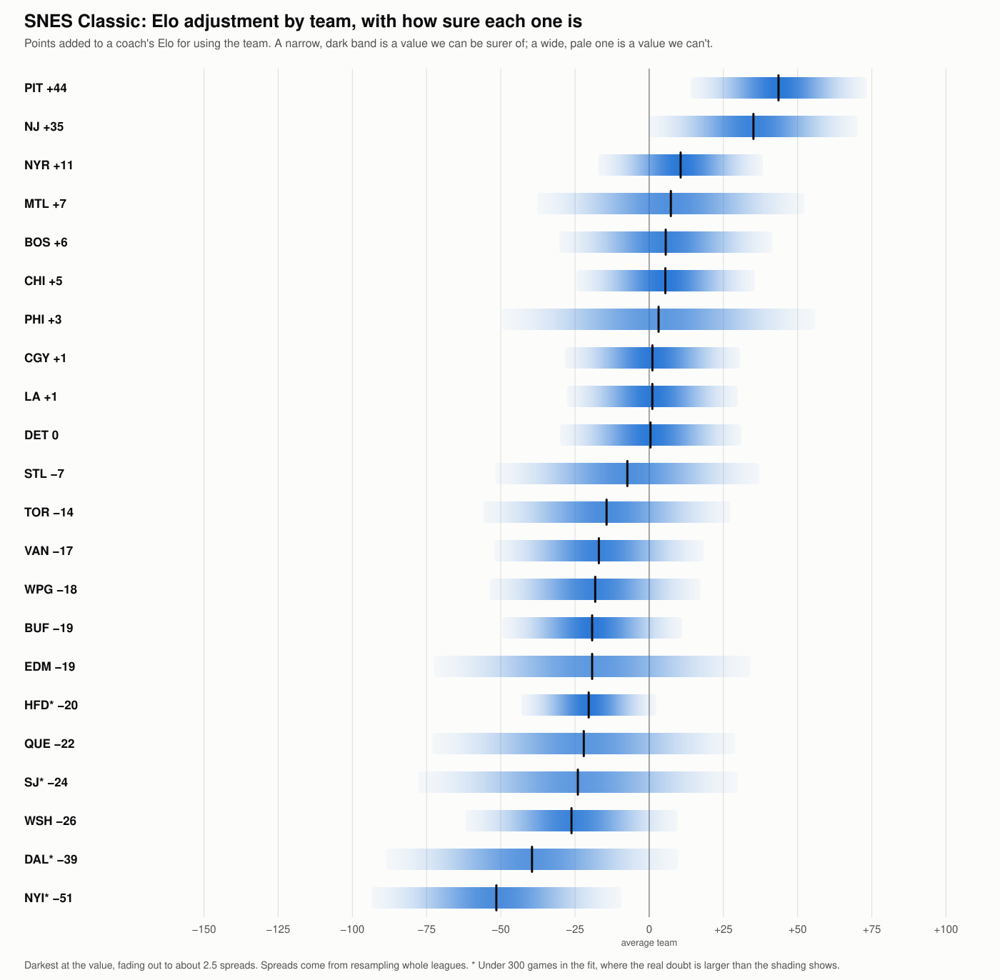

# SNES Classic team guide

Every retail team in the SNES Classic leagues (names starting `Classic_Spring`, `Classic_Summer` or `Classic_Fall`): 15,138 games in 63 leagues, through 2026-11-09. No coach is named. The method is in [COACH_RATING.md](COACH_RATING.md).

**Jump to a team:** [New Jersey](#1-new-jersey-nj) · [Pittsburgh](#2-pittsburgh-pit) · [NY Rangers](#3-ny-rangers-nyr) · [Vancouver](#4-vancouver-van) · [Chicago](#5-chicago-chi) · [Los Angeles](#6-los-angeles-la) · [Washington](#7-washington-wsh) · [Calgary](#8-calgary-cgy) · [Toronto](#9-toronto-tor) · [Boston](#10-boston-bos) · [Montreal](#11-montreal-mtl) · [Edmonton](#12-edmonton-edm) · [Winnipeg](#13-winnipeg-wpg) · [St. Louis](#14-st-louis-stl) · [Detroit](#15-detroit-det) · [Hartford](#16-hartford-hfd) · [Philadelphia](#17-philadelphia-phi) · [Quebec](#18-quebec-que) · [Buffalo](#19-buffalo-buf) · [San Jose](#20-san-jose-sj) · [NY Islanders](#21-ny-islanders-nyi) · [Dallas](#22-dallas-dal)

## How to read this guide

**The basics**

- **Points:** strength values are points of win chance above or below 50, against the average team as used in these leagues, with even coaches and no home edge. +5 means about a 55% chance.

- **± (spread):** about how far a value could be off by chance, from resampling whole leagues or, in the Record table, from the number of games. A value within one spread of zero can't be told from zero.

- **Results show what happened, not why.** Players choose or are given teams, and rarely used teams rest on few coaches.

- **± understates the uncertainty for rarely used teams.** Their values are pulled toward average, and ± is measured around the pulled value. A team with few games or few coaches is less certain than its ± suggests.

**Why the numbers for a team can disagree**

Two teams can have similar strengths but different Elo adjustments, or a team can have a good record and a poor strength. Usually that's not an error. Where the numbers agree, the method doesn't matter. Where they differ, the team is less certain. Use strength to judge how good a team is, and the Elo adjustment inside an Elo rating.

- **Each number uses a different yardstick for the coach.** Every team value is what's left after taking out who was coaching. Strength uses one fitted strength for each coach. The Elo adjustment uses each coach's Elo at the start of that league. A different yardstick leaves a different remainder, even with the same record.

- **Elo can run high or low for a while.** If a coach's Elo is well above how they then play, the team they're using looks worse than it is. If it's well below, the team looks better. A fitted strength reflects the coach's whole Classic career, so it's less affected by this.

- **Favorites tend to fall short of what Elo predicts.** A rating gap in Classic games is only worth about 0.7 of its face value at the start of a league. A team usually used by Elo favorites can therefore look a little worse on the Elo adjustment than on strength, and a team usually used by underdogs a little better. In simulated seasons this effect was usually small and varied a lot.

- **Rarely used teams rest on a few seasons.** One or two unusual seasons, or one coach, can move their numbers a lot, and more on the Elo adjustment than on strength.

- **Each number counts different results.** Strength counts how early wins were safe as well as who won. The Elo adjustment's fit counts only who won, and it leaves out games where a coach has under 30 earlier games.

- **Strength now and strength over all years cover different games.** A team can look better or worse lately because of who has used it recently, or because the leagues have changed, so a gap between the two doesn't prove the team itself changed. Rosters in these leagues stay the same.

- **A record alone doesn't say how good a team is.** Better coaches may have used it, or worse ones. A strong team can have a modest record if weaker coaches tend to use it, and a weak team can have a good record if stronger coaches do. That's what the Expected column is for.

- **Most differences between levels don't repeat well** when half the leagues are compared with the other half, so treat them as ideas to test. In simulated seasons where every team played the same at every level, gaps of up to about 8 points still appeared by chance. On the SNES, the team order itself depends more on the method than on the Genesis, so read small gaps as ties.

**The "All teams" table**

- **#:** the team's rank by strength now.

- **Team:** the team and its abbreviation. Click a name to go to its entry.

- **Overall:** from strength now. Good is +1.5 or better, Poor is −1.5 or worse, and Average is in between. Zero is the average team as used, and the strong teams are used most, so most teams fall below it.

- **Best for:** which level of player gets more from this team than from their other teams. High-level or Low-level means one does, Both alike means no gap of over 5 points, and Unclear means the measures disagree or there are too few games. A team can be Poor overall and still best for one level: that level just loses less with it.

- **Confidence:** how sure the Best for call is. Likely: all three measures of level agree on direction, and the gap is at least 1.5 spreads in two. Leaning: the same, at 1 spread. Weak: they agree on direction, the gap is at least 3 points each way, and the team is good for only that level. "Few games" means at least two values rest on under 150 appearances. A dash means no call to rate.

- **Strength now:** how much the team adds, in points, with recent games counting more. A game's weight halves every 3 years, so a game from 3 years ago counts half as much as one played today. It's the better guide to how a team has done lately.

- **Strength, all years:** the same, with every game counting equally. It rests on more games, so it's steadier.

- **Elo adjustment:** points to add to a coach's Elo for using this team, against the average team in use. It's fitted on the league Elo: every game in order, from a 1500 start, with the expected score counting +7 for home and each team's own adjustment. A game moves a rating by up to 20 points (K 20), and more when a win is by two or more goals, the more so the longer the winner held a safe lead (the coasting bonus). Rarely used teams are pulled toward zero, to keep a few games from swinging them, by an amount tested on later years. A team's entry says how many of its games the fit uses, as games where a coach had under 30 earlier games are left out, and what the same fit gives with one fixed strength per coach instead of Elo. A * marks under 300 games in that fit, so treat it as rough. Tested on later years, using these inside the running Elo predicts about the same as leaving them out, so they describe past results more than they improve ratings.

- **Record:** all wins and losses with this team, plus ties when there are any.

- **Win %:** wins as a share of wins and losses, without ties or any adjustment for who was coaching.

- **Expected:** the win % that the team's coaches, home ice and the other team predict if this team were the average team in use. A record above expected is what the team itself added.

**The "By level of player" table** (all years; each value says how much better that level does with this team than with its other teams, after taking out who was using it)

- **High level** and **Low level:** the value for each level. A * marks under 150 appearances.

- **High minus low:** the gap between the two. Positive means the team does more for high-level players.

- **By coach (row):** level is each coach's career strength. High and low are the top and bottom groups, with about a third of the appearances each.

- **By league strength (row):** level is the strength of the league's coaches, cut the same way.

- **Top league against others (row):** high is each season's top league, the one with the most As, and low is the same season's other leagues.

**The "Record" table** (one row for each kind of game: all games, regular season, playoffs, home, away, three eras, each coach level, and top league or other leagues)

- **Record**, **Win %** and **Expected:** as in the "All teams" table.

- **Against expected:** win % minus expected, in points, with its spread. Positive means the team did better than its coaches and opponents predict.

**The "Per game" table** (averages over the team's games)

- **Stat** and **Value:** what's measured, explained below, and the team's figure. Percentages are over all its games, not an average of each game's.

- **Rank:** its place among the teams in this guide. 1st is best: the fewest for goals against, shots against and penalty minutes, and the most for checks.

- **Goals for** and **Goals against:** goals scored and allowed.

- **Shots for** and **Shots against:** shots on goal taken and allowed.

- **Shooting %:** goals for as a share of shots for.

- **Save %:** the share of shots against that didn't score.

- **Power play %:** power play goals as a share of power plays.

- **Penalty kill %:** the share of the other team's power plays that didn't score.

- **One-timer goals** and **Breakaway goals:** goals of each kind, as the game counts them.

- **Checks:** checks thrown, as the game counts them.

- **Penalty minutes:** the team's penalty minutes.

- **Faceoffs won %:** the team's share of faceoffs.

- **Attack zone time, seconds:** time spent in the attacking zone.

- **Pass completion %:** completed passes as a share of passes tried, as the game counts them. The game only credits a pass caught by the intended receiver.

**The "Ratings" table** (from the ROM; the number in parentheses is the rank among all 26 NHL teams, with 1st the highest, so the heaviest for Weight)

- **Overall**, **Weight**, **Speed**, **Agility**, **Shot Power**, **Shot Accuracy** and **Checking:** the mean roster rating of the team's top 12 skaters by overall. The SNES hot / cold bug maxes about 46% of ratings each game, but never Weight, so ratings other than Weight count for less than they look.

- **Goalie Agility:** the roster Agility of the team's higher-rated goalie. On the SNES every goalie covers the same net, so it matters less than on the Genesis.

- **Hidden bonus (line under the table):** what the ROM adds to some of the team's ratings at home and takes away on the road.

**The "Leading skaters" table** (the team's top 6 by points; all figures are per team game, whether or not the skater played in it)

- **Player** and **Pos:** the skater, as a forward (F) or defenceman (D).

- **Goals**, **Assists** and **Points:** the skater's figures per team game.

- **Overall**, **Weight**, **Speed**, **Shot Power** and **Shot Acc:** the skater's roster ratings from the ROM.

**The "Goalies" table** (the team's two goalies who faced the most shots)

- **Goalie:** the goalie.

- **Shots faced:** all shots the goalie faced in these games.

- **Save %:** the share of those shots the goalie stopped.

- **Agility** and **Puck Control:** the goalie's roster ratings from the ROM.

## All teams

Each band is darkest at the team's value and fades out to show how far it could be off. The two guides share one scale.

| # | Team | Overall | Best for | Confidence | Strength now | Strength, all years | Elo adjustment | Record | Win % | Expected |
| --- | --- | --- | --- | --- | --- | --- | --- | --- | --- | --- |
| 1 | [New Jersey (NJ)](#1-new-jersey-nj) | Good | Low-level | Leaning | +4.6 | +4.0 | +35 | 444-289-4 | 60.6% | 56.0% |
| 2 | [Pittsburgh (PIT)](#2-pittsburgh-pit) | Good | Both alike | — | +3.7 | +4.1 | +44 | 1,314-1,202-17 | 52.2% | 46.7% |
| 3 | [NY Rangers (NYR)](#3-ny-rangers-nyr) | Good | Both alike | — | +2.1 | +2.3 | +11 | 1,357-1,180-17 | 53.5% | 50.4% |
| 4 | [Vancouver (VAN)](#4-vancouver-van) | Average | Both alike | — | +1.2 | +0.4 | −17 | 1,096-1,023-12 | 51.7% | 51.3% |
| 5 | [Chicago (CHI)](#5-chicago-chi) | Average | Both alike | — | +0.6 | +1.0 | +5 | 1,220-1,199-20 | 50.4% | 49.6% |
| 6 | [Los Angeles (LA)](#6-los-angeles-la) | Average | Both alike | — | +0.4 | +1.4 | +1 | 1,114-1,134-9 | 49.6% | 48.3% |
| 7 | [Washington (WSH)](#7-washington-wsh) | Average | Low-level | Likely | +0.3 | +0.2 | −26 | 598-527-11 | 53.2% | 53.0% |
| 8 | [Calgary (CGY)](#8-calgary-cgy) | Average | Both alike | — | +0.2 | −0.4 | +1 | 969-997-17 | 49.3% | 50.0% |
| 9 | [Toronto (TOR)](#9-toronto-tor) | Average | Unclear | — | −0.6 | −1.4 | −14 | 385-401-4 | 49.0% | 50.9% |
| 10 | [Boston (BOS)](#10-boston-bos) | Average | High-level | Likely | −0.6 | +1.5 | +6 | 1,149-1,355-24 | 45.9% | 43.6% |
| 11 | [Montreal (MTL)](#11-montreal-mtl) | Average | Low-level | Leaning | −0.7 | +0.3 | +7 | 778-919-15 | 45.8% | 45.3% |
| 12 | [Edmonton (EDM)](#12-edmonton-edm) | Average | Low-level | Leaning, few games | −1.1 | −2.0 | −19 | 292-211-6 | 58.1% | 61.5% |
| 13 | [Winnipeg (WPG)](#13-winnipeg-wpg) | Average | Both alike | — | −1.1 | −3.4 | −18 | 640-665-8 | 49.0% | 53.8% |
| 14 | [St. Louis (STL)](#14-st-louis-stl) | Average | Unclear | — | −1.2 | −0.2 | −7 | 296-252-5 | 54.0% | 53.6% |
| 15 | [Detroit (DET)](#15-detroit-det) | Average | Both alike | — | −1.5 | −1.5 | 0 | 973-1,345-15 | 42.0% | 42.3% |
| 16 | [Hartford (HFD)](#16-hartford-hfd) | Poor | Both alike | Few games | −2.2 | −2.3 | −20* | 129-98-1 | 56.8% | 61.8% |
| 17 | [Philadelphia (PHI)](#17-philadelphia-phi) | Poor | Low-level | Leaning | −2.2 | −1.2 | +3 | 309-332-2 | 48.2% | 50.8% |
| 18 | [Quebec (QUE)](#18-quebec-que) | Poor | High-level | Likely | −3.0 | −5.8 | −22 | 462-436-9 | 51.4% | 58.9% |
| 19 | [Buffalo (BUF)](#19-buffalo-buf) | Poor | Both alike | — | −3.1 | −3.9 | −19 | 1,046-1,065-10 | 49.5% | 54.0% |
| 20 | [San Jose (SJ)](#20-san-jose-sj) | Poor | Unclear | Few games | −3.9 | −8.2 | −24* | 96-55-2 | 63.6% | 73.7% |
| 21 | [NY Islanders (NYI)](#21-ny-islanders-nyi) | Poor | Unclear | Few games | −4.4 | −7.9 | −51* | 158-143-2 | 52.5% | 62.5% |
| 22 | [Dallas (DAL)](#22-dallas-dal) | Poor | Both alike | Few games | −6.1 | −4.5 | −39* | 88-99-1 | 47.1% | 53.6% |

Too few games for a full entry: Florida (FLA) 47-26-1; Tampa Bay (TB) 28-35-2; Anaheim (ANH) 24-22; Ottawa (OTW) 19-21.

## 1. New Jersey (NJ)

**Overall: Good. Best for: Low-level (leaning).** Strength +4.6 ± 2.2 now (1st of 22), +4.0 ± 2.1 over all years (2nd).

**Elo adjustment:** +35 ± 14 points (2nd of 22), from 600 of 737 games. Against an even coach on the average team, on neutral ice, that's a 55% win chance. With one fixed strength per coach instead of Elo, it's +32.

Used in 16 of 63 leagues (5 of them a season's top league), by 13 coaches, 737 games, most recently 2026-11-08.

**By level of player**

| | High level | Low level | High minus low |
| --- | --- | --- | --- |
| By coach | +2.7 ± 2.2 | +7.2 ± 3.4 | −4.5 ± 3.9 |
| By league strength | +2.6 ± 2.5 | +6.9 ± 3.1 | −4.3 ± 4.0 |
| Top league against others | −0.4 ± 2.4 | +6.6 ± 3.0 | −7.1 ± 3.7 |

**Record**

| | Record | Win % | Expected | Against expected |
| --- | --- | --- | --- | --- |
| All games | 444-289-4 | 60.6% | 56.0% | +4.6 ± 1.8 |
| Regular season | 371-235-4 | 61.2% | 56.9% | +4.3 ± 2.0 |
| Playoffs | 73-54 | 57.5% | 51.6% | +5.8 ± 4.4 |
| Home | 248-121-2 | 67.2% | 59.0% | +8.2 ± 2.6 |
| Away | 196-168-2 | 53.8% | 52.9% | +0.9 ± 2.6 |
| 2013-2019 | 133-85 | 61.0% | 56.0% | +5.0 ± 3.4 |
| 2020-2022 | 108-74 | 59.3% | 60.3% | −1.0 ± 3.7 |
| 2023-2026 | 203-130-4 | 61.0% | 53.6% | +7.4 ± 2.7 |
| High coach | 172-102-1 | 62.8% | 60.0% | +2.8 ± 3.0 |
| Mid coach | 118-66 | 64.1% | 61.2% | +2.9 ± 3.7 |
| Low coach | 154-121-3 | 56.0% | 48.5% | +7.5 ± 3.0 |
| Top league | 139-98-1 | 58.6% | 58.5% | +0.1 ± 3.2 |
| Other leagues | 242-165-3 | 59.5% | 53.0% | +6.5 ± 2.5 |

**Per game**

| Stat | Value | Rank | | Stat | Value | Rank |
| --- | --- | --- | --- | --- | --- | --- |
| Goals for | 4.55 | 5th | | One-timer goals | 1.36 | 6th |
| Goals against | 3.70 | 3rd | | Breakaway goals | 0.24 | 9th |
| Shots for | 11.7 | 11th | | Checks | 30.2 | 2nd |
| Shots against | 10.8 | 4th | | Penalty minutes | 2.6 | 13th |
| Shooting % | 38.7 | 6th | | Faceoffs won % | 50.6 | 7th |
| Save % | 65.7 | 2nd | | Attack zone time, seconds | 321 | 3rd |
| Power play % | 45.2 | 3rd | | Pass completion % | 54.2 | 20th |
| Penalty kill % | 63.8 | 2nd | |  | |  |

**Ratings**

| Overall | Weight | Speed | Agility | Shot Power | Shot Accuracy | Checking | Goalie Agility |
| --- | --- | --- | --- | --- | --- | --- | --- |
| 66.2 (15th) | 8.6 (1st) | 3.3 (15th) | 3.6 (11th) | 3.4 (7th) | 2.6 (20th) | 2.8 (11th) | 4.0 (8th) |

Hidden bonus: +1 at home, −2 away.

**Leading skaters** (per team game)

| Player | Pos | Goals | Assists | Points | Overall | Weight | Speed | Shot Power | Shot Acc |
| --- | --- | --- | --- | --- | --- | --- | --- | --- | --- |
| Stephane Richer | F | 1.43 | 0.83 | 2.26 | 72 | 9 | 4 | 5 | 3 |
| Claude Lemieux | F | 0.83 | 0.70 | 1.53 | 68 | 11 | 4 | 4 | 2 |
| Scott Stevens | D | 0.51 | 0.75 | 1.26 | 76 | 11 | 4 | 4 | 2 |
| Vachslav Fetisov | D | 0.28 | 0.70 | 0.97 | 61 | 11 | 2 | 4 | 1 |
| Alexnder Semak | F | 0.47 | 0.48 | 0.95 | 73 | 6 | 3 | 3 | 4 |
| Valeri Zelepukin | F | 0.46 | 0.44 | 0.91 | 68 | 6 | 4 | 3 | 3 |

**Goalies**

| Goalie | Shots faced | Save % | Agility | Puck Control |
| --- | --- | --- | --- | --- |
| Chris Terreri | 7,584 | 66.0 | 4 | 3 |
| Craig Billington | 351 | 63.0 | 3 | 1 |

## 2. Pittsburgh (PIT)

**Overall: Good. Best for: Both alike.** Strength +3.7 ± 1.4 now (2nd of 22), +4.1 ± 1.1 over all years (1st).

**Elo adjustment:** +44 ± 12 points (1st of 22), from 1,774 of 2,533 games. Against an even coach on the average team, on neutral ice, that's a 56% win chance. With one fixed strength per coach instead of Elo, it's +35.

Used in 60 of 63 leagues (19 of them a season's top league), by 51 coaches, 2,533 games, most recently 2026-11-05.

**By level of player**

| | High level | Low level | High minus low |
| --- | --- | --- | --- |
| By coach | +3.4 ± 2.8 | +1.9 ± 1.9 | +1.5 ± 3.1 |
| By league strength | +5.6 ± 1.8 | +3.9 ± 1.7 | +1.7 ± 2.4 |
| Top league against others | +4.9 ± 2.0 | +3.2 ± 1.3 | +1.8 ± 2.3 |

**Record**

| | Record | Win % | Expected | Against expected |
| --- | --- | --- | --- | --- |
| All games | 1,314-1,202-17 | 52.2% | 46.7% | +5.6 ± 1.0 |
| Regular season | 1,173-1,028-17 | 53.3% | 47.1% | +6.2 ± 1.1 |
| Playoffs | 141-174 | 44.8% | 43.4% | +1.3 ± 2.8 |
| Home | 692-566-9 | 55.0% | 49.6% | +5.4 ± 1.4 |
| Away | 622-636-8 | 49.4% | 43.7% | +5.7 ± 1.4 |
| 2013-2019 | 326-271-4 | 54.6% | 47.3% | +7.3 ± 2.0 |
| 2020-2022 | 532-480-7 | 52.6% | 47.7% | +4.9 ± 1.6 |
| 2023-2026 | 456-451-6 | 50.3% | 45.1% | +5.2 ± 1.7 |
| High coach | 213-188-5 | 53.1% | 47.9% | +5.2 ± 2.5 |
| Mid coach | 726-574-6 | 55.8% | 48.7% | +7.1 ± 1.4 |
| Low coach | 375-440-6 | 46.0% | 42.7% | +3.3 ± 1.8 |
| Top league | 409-417-6 | 49.5% | 42.3% | +7.2 ± 1.7 |
| Other leagues | 785-691-9 | 53.2% | 48.9% | +4.3 ± 1.3 |

**Per game**

| Stat | Value | Rank | | Stat | Value | Rank |
| --- | --- | --- | --- | --- | --- | --- |
| Goals for | 4.44 | 11th | | One-timer goals | 1.27 | 10th |
| Goals against | 4.25 | 9th | | Breakaway goals | 0.22 | 15th |
| Shots for | 12.6 | 1st | | Checks | 30.7 | 1st |
| Shots against | 11.2 | 8th | | Penalty minutes | 2.7 | 18th |
| Shooting % | 35.4 | 20th | | Faceoffs won % | 49.7 | 17th |
| Save % | 62.2 | 15th | | Attack zone time, seconds | 321 | 2nd |
| Power play % | 42.3 | 12th | | Pass completion % | 55.7 | 15th |
| Penalty kill % | 58.3 | 12th | |  | |  |

**Ratings**

| Overall | Weight | Speed | Agility | Shot Power | Shot Accuracy | Checking | Goalie Agility |
| --- | --- | --- | --- | --- | --- | --- | --- |
| 68.8 (7th) | 8.5 (2nd) | 3.2 (19th) | 3.5 (14th) | 3.3 (10th) | 2.8 (14th) | 3.2 (4th) | 4.0 (10th) |

Hidden bonus: +2 at home, −1 away.

**Leading skaters** (per team game)

| Player | Pos | Goals | Assists | Points | Overall | Weight | Speed | Shot Power | Shot Acc |
| --- | --- | --- | --- | --- | --- | --- | --- | --- | --- |
| Mario Lemieux | F | 2.03 | 0.78 | 2.81 | 100 | 10 | 4 | 4 | 6 |
| Jaromir Jagr | F | 0.87 | 0.84 | 1.71 | 80 | 10 | 4 | 3 | 3 |
| Kevin Stevens | F | 0.77 | 0.84 | 1.61 | 77 | 11 | 4 | 3 | 4 |
| Larry Murphy | D | 0.24 | 0.73 | 0.97 | 74 | 10 | 3 | 4 | 2 |
| Ulf Samuelsson | D | 0.22 | 0.69 | 0.92 | 68 | 8 | 4 | 3 | 0 |
| Ron Francis | F | 0.15 | 0.13 | 0.28 | 75 | 9 | 3 | 4 | 3 |

**Goalies**

| Goalie | Shots faced | Save % | Agility | Puck Control |
| --- | --- | --- | --- | --- |
| Tom Barrasso | 27,334 | 62.0 | 4 | 4 |
| Ken Wregget | 980 | 71.5 | 2 | 2 |

## 3. NY Rangers (NYR)

**Overall: Good. Best for: Both alike.** Strength +2.1 ± 1.2 now (3rd of 22), +2.3 ± 1.2 over all years (3rd).

**Elo adjustment:** +11 ± 11 points (3rd of 22), from 2,039 of 2,554 games. Against an even coach on the average team, on neutral ice, that's a 52% win chance. With one fixed strength per coach instead of Elo, it's +22.

Used in 56 of 63 leagues (18 of them a season's top league), by 37 coaches, 2,554 games, most recently 2026-11-08.

**By level of player**

| | High level | Low level | High minus low |
| --- | --- | --- | --- |
| By coach | +1.6 ± 1.8 | +1.1 ± 1.9 | +0.5 ± 2.7 |
| By league strength | +2.5 ± 1.8 | +0.7 ± 2.2 | +1.9 ± 2.8 |
| Top league against others | +2.2 ± 1.8 | +2.0 ± 1.8 | +0.2 ± 2.5 |

**Record**

| | Record | Win % | Expected | Against expected |
| --- | --- | --- | --- | --- |
| All games | 1,357-1,180-17 | 53.5% | 50.4% | +3.1 ± 1.0 |
| Regular season | 1,144-994-17 | 53.5% | 50.7% | +2.9 ± 1.1 |
| Playoffs | 213-186 | 53.4% | 49.2% | +4.2 ± 2.5 |
| Home | 709-563-6 | 55.7% | 53.2% | +2.5 ± 1.4 |
| Away | 648-617-11 | 51.2% | 47.6% | +3.6 ± 1.4 |
| 2013-2019 | 302-271-3 | 52.7% | 52.0% | +0.7 ± 2.1 |
| 2020-2022 | 656-471-7 | 58.2% | 52.6% | +5.6 ± 1.5 |
| 2023-2026 | 399-438-7 | 47.7% | 46.5% | +1.2 ± 1.7 |
| High coach | 543-340-4 | 61.5% | 60.4% | +1.1 ± 1.7 |
| Mid coach | 400-293-6 | 57.7% | 52.6% | +5.2 ± 1.9 |
| Low coach | 414-547-7 | 43.1% | 39.7% | +3.3 ± 1.6 |
| Top league | 456-391-5 | 53.8% | 51.2% | +2.6 ± 1.7 |
| Other leagues | 746-673-10 | 52.6% | 49.3% | +3.3 ± 1.3 |

**Per game**

| Stat | Value | Rank | | Stat | Value | Rank |
| --- | --- | --- | --- | --- | --- | --- |
| Goals for | 4.42 | 13th | | One-timer goals | 1.25 | 12th |
| Goals against | 4.20 | 8th | | Breakaway goals | 0.26 | 4th |
| Shots for | 12.3 | 4th | | Checks | 29.3 | 3rd |
| Shots against | 11.1 | 6th | | Penalty minutes | 2.8 | 21st |
| Shooting % | 36.0 | 19th | | Faceoffs won % | 49.4 | 20th |
| Save % | 62.2 | 14th | | Attack zone time, seconds | 323 | 1st |
| Power play % | 43.1 | 9th | | Pass completion % | 57.7 | 3rd |
| Penalty kill % | 58.2 | 13th | |  | |  |

**Ratings**

| Overall | Weight | Speed | Agility | Shot Power | Shot Accuracy | Checking | Goalie Agility |
| --- | --- | --- | --- | --- | --- | --- | --- |
| 71.6 (2nd) | 7.4 (13th) | 3.8 (7th) | 4.4 (1st) | 3.4 (8th) | 2.6 (21st) | 2.9 (8th) | 3.0 (20th) |

Hidden bonus: +1 at home, −1 away.

**Leading skaters** (per team game)

| Player | Pos | Goals | Assists | Points | Overall | Weight | Speed | Shot Power | Shot Acc |
| --- | --- | --- | --- | --- | --- | --- | --- | --- | --- |
| Mark Messier | F | 1.33 | 0.98 | 2.31 | 85 | 10 | 4 | 3 | 3 |
| Mike Gartner | F | 1.26 | 0.88 | 2.14 | 85 | 7 | 5 | 5 | 3 |
| Esa Tikkanen | F | 1.19 | 0.89 | 2.08 | 80 | 9 | 5 | 4 | 2 |
| James Patrick | D | 0.27 | 0.77 | 1.04 | 71 | 9 | 4 | 4 | 1 |
| Brian Leetch | D | 0.13 | 0.43 | 0.57 | 76 | 6 | 3 | 4 | 1 |
| Kevin Lowe | D | 0.07 | 0.32 | 0.38 | 62 | 8 | 3 | 3 | 1 |

**Goalies**

| Goalie | Shots faced | Save % | Agility | Puck Control |
| --- | --- | --- | --- | --- |
| Mike Richter | 28,356 | 62.4 | 3 | 3 |

## 4. Vancouver (VAN)

**Overall: Average. Best for: Both alike.** Strength +1.2 ± 1.2 now (4th of 22), +0.4 ± 1.2 over all years (7th).

**Elo adjustment:** −17 ± 14 points (13th of 22), from 1,706 of 2,131 games. Against an even coach on the average team, on neutral ice, that's a 48% win chance. With one fixed strength per coach instead of Elo, it's +1.

Used in 47 of 63 leagues (16 of them a season's top league), by 30 coaches, 2,131 games, most recently 2026-11-08.

**By level of player**

| | High level | Low level | High minus low |
| --- | --- | --- | --- |
| By coach | +1.9 ± 2.2 | −0.6 ± 2.0 | +2.5 ± 3.0 |
| By league strength | +1.2 ± 2.3 | −0.1 ± 2.0 | +1.2 ± 3.2 |
| Top league against others | +0.9 ± 2.1 | +0.3 ± 1.4 | +0.6 ± 2.6 |

**Record**

| | Record | Win % | Expected | Against expected |
| --- | --- | --- | --- | --- |
| All games | 1,096-1,023-12 | 51.7% | 51.3% | +0.5 ± 1.1 |
| Regular season | 919-858-12 | 51.7% | 51.6% | +0.1 ± 1.2 |
| Playoffs | 177-165 | 51.8% | 49.3% | +2.4 ± 2.7 |
| Home | 586-479-3 | 55.0% | 54.2% | +0.8 ± 1.5 |
| Away | 510-544-9 | 48.4% | 48.3% | +0.1 ± 1.5 |
| 2013-2019 | 219-229-3 | 48.9% | 51.3% | −2.4 ± 2.4 |
| 2020-2022 | 429-400-4 | 51.7% | 49.7% | +2.0 ± 1.7 |
| 2023-2026 | 448-394-5 | 53.2% | 52.8% | +0.4 ± 1.7 |
| High coach | 454-291-3 | 60.9% | 60.2% | +0.7 ± 1.8 |
| Mid coach | 298-266-4 | 52.8% | 52.2% | +0.6 ± 2.1 |
| Low coach | 344-466-5 | 42.5% | 42.3% | +0.1 ± 1.8 |
| Top league | 380-336-7 | 53.1% | 52.7% | +0.4 ± 1.9 |
| Other leagues | 604-581-4 | 51.0% | 50.3% | +0.7 ± 1.5 |

**Per game**

| Stat | Value | Rank | | Stat | Value | Rank |
| --- | --- | --- | --- | --- | --- | --- |
| Goals for | 4.61 | 3rd | | One-timer goals | 1.32 | 7th |
| Goals against | 4.45 | 16th | | Breakaway goals | 0.26 | 2nd |
| Shots for | 11.9 | 8th | | Checks | 26.6 | 12th |
| Shots against | 11.7 | 12th | | Penalty minutes | 2.7 | 20th |
| Shooting % | 38.7 | 7th | | Faceoffs won % | 50.2 | 10th |
| Save % | 62.1 | 17th | | Attack zone time, seconds | 310 | 15th |
| Power play % | 43.8 | 7th | | Pass completion % | 56.3 | 11th |
| Penalty kill % | 59.2 | 8th | |  | |  |

**Ratings**

| Overall | Weight | Speed | Agility | Shot Power | Shot Accuracy | Checking | Goalie Agility |
| --- | --- | --- | --- | --- | --- | --- | --- |
| 67.4 (13th) | 7.5 (11th) | 3.6 (10th) | 3.6 (12th) | 3.0 (18th) | 3.3 (2nd) | 2.7 (18th) | 4.0 (14th) |

Hidden bonus: +1 at home, −1 away.

**Leading skaters** (per team game)

| Player | Pos | Goals | Assists | Points | Overall | Weight | Speed | Shot Power | Shot Acc |
| --- | --- | --- | --- | --- | --- | --- | --- | --- | --- |
| Pavel Bure | F | 1.63 | 0.86 | 2.49 | 90 | 5 | 6 | 4 | 4 |
| Trevor Linden | F | 1.28 | 0.84 | 2.11 | 78 | 9 | 4 | 4 | 4 |
| Geoff Courtnall | F | 0.64 | 0.60 | 1.25 | 73 | 7 | 5 | 3 | 3 |
| Cliff Ronning | F | 0.46 | 0.39 | 0.84 | 76 | 5 | 5 | 2 | 3 |
| Jyrki Lumme | D | 0.15 | 0.63 | 0.78 | 64 | 7 | 3 | 2 | 1 |
| Doug Lidster | D | 0.15 | 0.59 | 0.75 | 60 | 9 | 3 | 3 | 1 |

**Goalies**

| Goalie | Shots faced | Save % | Agility | Puck Control |
| --- | --- | --- | --- | --- |
| Kirk McLean | 24,822 | 62.3 | 4 | 4 |
| Kay Whitmore | 125 | 59.2 | 2 | 2 |

## 5. Chicago (CHI)

**Overall: Average. Best for: Both alike.** Strength +0.6 ± 1.3 now (5th of 22), +1.0 ± 1.1 over all years (6th).

**Elo adjustment:** +5 ± 12 points (6th of 22), from 1,713 of 2,439 games. Against an even coach on the average team, on neutral ice, that's a 51% win chance. With one fixed strength per coach instead of Elo, it's +3.

Used in 58 of 63 leagues (18 of them a season's top league), by 52 coaches, 2,439 games, most recently 2026-11-09.

**By level of player**

| | High level | Low level | High minus low |
| --- | --- | --- | --- |
| By coach | +1.4 ± 1.9 | +0.5 ± 2.6 | +1.0 ± 3.3 |
| By league strength | +1.4 ± 1.8 | +1.0 ± 2.7 | +0.4 ± 3.4 |
| Top league against others | +1.5 ± 1.5 | −0.2 ± 1.8 | +1.7 ± 2.5 |

**Record**

| | Record | Win % | Expected | Against expected |
| --- | --- | --- | --- | --- |
| All games | 1,220-1,199-20 | 50.4% | 49.6% | +0.8 ± 1.0 |
| Regular season | 1,058-1,038-20 | 50.5% | 49.7% | +0.8 ± 1.1 |
| Playoffs | 162-161 | 50.2% | 49.3% | +0.9 ± 2.8 |
| Home | 647-565-8 | 53.4% | 52.6% | +0.8 ± 1.4 |
| Away | 573-634-12 | 47.5% | 46.6% | +0.9 ± 1.4 |
| 2013-2019 | 294-294-5 | 50.0% | 48.5% | +1.5 ± 2.1 |
| 2020-2022 | 513-470-6 | 52.2% | 51.2% | +1.0 ± 1.6 |
| 2023-2026 | 413-435-9 | 48.7% | 48.5% | +0.2 ± 1.7 |
| High coach | 423-288-8 | 59.5% | 59.3% | +0.2 ± 1.9 |
| Mid coach | 462-436-8 | 51.4% | 50.6% | +0.8 ± 1.7 |
| Low coach | 335-475-4 | 41.4% | 40.0% | +1.3 ± 1.8 |
| Top league | 367-392-11 | 48.4% | 47.2% | +1.1 ± 1.8 |
| Other leagues | 734-692-7 | 51.5% | 51.5% | 0.0 ± 1.3 |

**Per game**

| Stat | Value | Rank | | Stat | Value | Rank |
| --- | --- | --- | --- | --- | --- | --- |
| Goals for | 4.32 | 15th | | One-timer goals | 1.22 | 14th |
| Goals against | 4.32 | 11th | | Breakaway goals | 0.25 | 7th |
| Shots for | 11.6 | 13th | | Checks | 26.7 | 11th |
| Shots against | 12.1 | 17th | | Penalty minutes | 2.7 | 19th |
| Shooting % | 37.2 | 14th | | Faceoffs won % | 49.9 | 14th |
| Save % | 64.1 | 8th | | Attack zone time, seconds | 312 | 12th |
| Power play % | 40.8 | 17th | | Pass completion % | 55.7 | 16th |
| Penalty kill % | 59.1 | 9th | |  | |  |

**Ratings**

| Overall | Weight | Speed | Agility | Shot Power | Shot Accuracy | Checking | Goalie Agility |
| --- | --- | --- | --- | --- | --- | --- | --- |
| 70.8 (6th) | 7.3 (15th) | 3.4 (12th) | 3.8 (8th) | 3.4 (6th) | 2.8 (15th) | 3.5 (1st) | 6.0 (1st) |

Hidden bonus: +2 at home, −1 away.

**Leading skaters** (per team game)

| Player | Pos | Goals | Assists | Points | Overall | Weight | Speed | Shot Power | Shot Acc |
| --- | --- | --- | --- | --- | --- | --- | --- | --- | --- |
| Jeremy Roenick | F | 1.68 | 0.79 | 2.46 | 89 | 4 | 5 | 5 | 5 |
| Steve Larmer | F | 1.03 | 0.84 | 1.87 | 86 | 7 | 4 | 4 | 4 |
| Christan Ruuttu | F | 0.74 | 0.77 | 1.51 | 72 | 8 | 4 | 3 | 2 |
| Steve Smith | D | 0.29 | 0.78 | 1.07 | 72 | 11 | 4 | 4 | 1 |
| Chris Chelios | D | 0.31 | 0.69 | 1.00 | 84 | 7 | 4 | 5 | 1 |
| Joe Murphy | F | 0.11 | 0.09 | 0.19 | 71 | 7 | 4 | 4 | 3 |

**Goalies**

| Goalie | Shots faced | Save % | Agility | Puck Control |
| --- | --- | --- | --- | --- |
| Ed Belfour | 29,110 | 64.2 | 6 | 5 |
| Jim Waite | 200 | 64.5 | 3 | 2 |

## 6. Los Angeles (LA)

**Overall: Average. Best for: Both alike.** Strength +0.4 ± 1.1 now (6th of 22), +1.4 ± 1.2 over all years (5th).

**Elo adjustment:** +1 ± 12 points (9th of 22), from 1,794 of 2,257 games. Against an even coach on the average team, on neutral ice, that's a 50% win chance. With one fixed strength per coach instead of Elo, it's +6.

Used in 54 of 63 leagues (19 of them a season's top league), by 36 coaches, 2,257 games, most recently 2026-11-09.

**By level of player**

| | High level | Low level | High minus low |
| --- | --- | --- | --- |
| By coach | +1.4 ± 1.5 | +1.3 ± 2.1 | +0.1 ± 2.4 |
| By league strength | +0.3 ± 1.7 | +1.6 ± 1.8 | −1.3 ± 2.5 |
| Top league against others | +1.0 ± 1.7 | +1.9 ± 1.5 | −0.9 ± 2.2 |

**Record**

| | Record | Win % | Expected | Against expected |
| --- | --- | --- | --- | --- |
| All games | 1,114-1,134-9 | 49.6% | 48.3% | +1.3 ± 1.1 |
| Regular season | 977-984-9 | 49.8% | 48.5% | +1.4 ± 1.1 |
| Playoffs | 137-150 | 47.7% | 47.2% | +0.6 ± 3.0 |
| Home | 574-549-3 | 51.1% | 51.1% | 0.0 ± 1.5 |
| Away | 540-585-6 | 48.0% | 45.5% | +2.5 ± 1.5 |
| 2013-2019 | 197-264-1 | 42.7% | 40.7% | +2.0 ± 2.3 |
| 2020-2022 | 554-429-4 | 56.4% | 51.6% | +4.8 ± 1.6 |
| 2023-2026 | 363-441-4 | 45.1% | 48.6% | −3.5 ± 1.8 |
| High coach | 348-260-3 | 57.2% | 57.3% | 0.0 ± 2.0 |
| Mid coach | 512-463-5 | 52.5% | 51.0% | +1.5 ± 1.6 |
| Low coach | 254-411-1 | 38.2% | 36.1% | +2.1 ± 1.9 |
| Top league | 393-430-3 | 47.8% | 46.5% | +1.3 ± 1.7 |
| Other leagues | 651-610-5 | 51.6% | 50.2% | +1.4 ± 1.4 |

**Per game**

| Stat | Value | Rank | | Stat | Value | Rank |
| --- | --- | --- | --- | --- | --- | --- |
| Goals for | 4.45 | 10th | | One-timer goals | 1.40 | 2nd |
| Goals against | 4.48 | 17th | | Breakaway goals | 0.23 | 12th |
| Shots for | 12.2 | 6th | | Checks | 29.3 | 5th |
| Shots against | 11.7 | 11th | | Penalty minutes | 2.6 | 15th |
| Shooting % | 36.6 | 17th | | Faceoffs won % | 49.6 | 18th |
| Save % | 61.6 | 20th | | Attack zone time, seconds | 315 | 8th |
| Power play % | 43.7 | 8th | | Pass completion % | 55.9 | 14th |
| Penalty kill % | 55.5 | 22nd | |  | |  |

**Ratings**

| Overall | Weight | Speed | Agility | Shot Power | Shot Accuracy | Checking | Goalie Agility |
| --- | --- | --- | --- | --- | --- | --- | --- |
| 71.1 (5th) | 7.5 (9th) | 3.8 (2nd) | 3.9 (5th) | 3.2 (12th) | 3.2 (3rd) | 2.5 (20th) | 3.0 (19th) |

Hidden bonus: +1 at home, −1 away.

**Leading skaters** (per team game)

| Player | Pos | Goals | Assists | Points | Overall | Weight | Speed | Shot Power | Shot Acc |
| --- | --- | --- | --- | --- | --- | --- | --- | --- | --- |
| Tomas Sandstrom | F | 1.42 | 0.90 | 2.32 | 80 | 9 | 4 | 5 | 5 |
| Jimmy Carson | F | 1.10 | 0.81 | 1.91 | 76 | 9 | 4 | 4 | 5 |
| Luc Robitaille | F | 0.90 | 0.78 | 1.69 | 85 | 7 | 4 | 4 | 6 |
| Rob Blake | D | 0.30 | 0.81 | 1.11 | 72 | 11 | 4 | 4 | 1 |
| Marty McSorley | D | 0.16 | 0.58 | 0.74 | 61 | 12 | 3 | 3 | 2 |
| Wayne Gretzky | F | 0.36 | 0.31 | 0.67 | 87 | 4 | 4 | 2 | 2 |

**Goalies**

| Goalie | Shots faced | Save % | Agility | Puck Control |
| --- | --- | --- | --- | --- |
| Kelly Hrudey | 25,441 | 61.8 | 3 | 4 |
| Robb Stauber | 452 | 60.8 | 2 | 3 |

## 7. Washington (WSH)

**Overall: Average. Best for: Low-level (likely).** Strength +0.3 ± 1.5 now (7th of 22), +0.2 ± 1.4 over all years (9th).

**Elo adjustment:** −26 ± 14 points (20th of 22), from 998 of 1,136 games. Against an even coach on the average team, on neutral ice, that's a 46% win chance. With one fixed strength per coach instead of Elo, it's +3.

Used in 26 of 63 leagues (12 of them a season's top league), by 22 coaches, 1,136 games, most recently 2026-11-09.

**By level of player**

| | High level | Low level | High minus low |
| --- | --- | --- | --- |
| By coach | 0.0 ± 1.2 | +2.0 ± 2.8 | −2.1 ± 3.0 |
| By league strength | −2.4 ± 1.1 | +4.8 ± 2.8 | −7.2 ± 3.0 |
| Top league against others | −2.3 ± 1.1 | +4.3 ± 2.9 | −6.6 ± 3.2 |

**Record**

| | Record | Win % | Expected | Against expected |
| --- | --- | --- | --- | --- |
| All games | 598-527-11 | 53.2% | 53.0% | +0.2 ± 1.5 |
| Regular season | 495-434-11 | 53.3% | 52.9% | +0.4 ± 1.6 |
| Playoffs | 103-93 | 52.6% | 53.0% | −0.5 ± 3.6 |
| Home | 312-251-8 | 55.4% | 55.9% | −0.5 ± 2.1 |
| Away | 286-276-3 | 50.9% | 50.0% | +0.9 ± 2.1 |
| 2013-2019 | 199-156-4 | 56.1% | 53.1% | +2.9 ± 2.7 |
| 2020-2022 | 223-260-2 | 46.2% | 48.6% | −2.4 ± 2.3 |
| 2023-2026 | 176-111-5 | 61.3% | 60.1% | +1.3 ± 3.0 |
| High coach | 404-269-5 | 60.0% | 61.1% | −1.1 ± 1.9 |
| Mid coach | 66-79-3 | 45.5% | 41.7% | +3.8 ± 4.2 |
| Low coach | 128-179-3 | 41.7% | 40.5% | +1.2 ± 2.9 |
| Top league | 284-274-4 | 50.9% | 53.8% | −2.9 ± 2.1 |
| Other leagues | 170-161-4 | 51.4% | 47.2% | +4.1 ± 2.7 |

**Per game**

| Stat | Value | Rank | | Stat | Value | Rank |
| --- | --- | --- | --- | --- | --- | --- |
| Goals for | 4.60 | 4th | | One-timer goals | 1.19 | 16th |
| Goals against | 4.19 | 7th | | Breakaway goals | 0.22 | 14th |
| Shots for | 12.0 | 7th | | Checks | 29.3 | 4th |
| Shots against | 10.9 | 5th | | Penalty minutes | 2.5 | 3rd |
| Shooting % | 38.3 | 11th | | Faceoffs won % | 50.1 | 11th |
| Save % | 61.7 | 19th | | Attack zone time, seconds | 319 | 4th |
| Power play % | 41.0 | 16th | | Pass completion % | 57.6 | 5th |
| Penalty kill % | 62.7 | 3rd | |  | |  |

**Ratings**

| Overall | Weight | Speed | Agility | Shot Power | Shot Accuracy | Checking | Goalie Agility |
| --- | --- | --- | --- | --- | --- | --- | --- |
| 68.7 (8th) | 8.1 (4th) | 3.5 (11th) | 3.4 (20th) | 3.6 (3rd) | 3.2 (4th) | 2.8 (12th) | 3.0 (23rd) |

Hidden bonus: +1 at home, −1 away.

**Leading skaters** (per team game)

| Player | Pos | Goals | Assists | Points | Overall | Weight | Speed | Shot Power | Shot Acc |
| --- | --- | --- | --- | --- | --- | --- | --- | --- | --- |
| Mike Ridley | F | 1.18 | 1.01 | 2.19 | 73 | 9 | 4 | 3 | 4 |
| Peter Bondra | F | 1.16 | 0.88 | 2.04 | 78 | 6 | 6 | 3 | 4 |
| Dimitri Khristich | F | 1.00 | 0.77 | 1.77 | 75 | 7 | 3 | 4 | 6 |
| Al Iafrate | D | 0.50 | 0.75 | 1.26 | 78 | 11 | 4 | 6 | 2 |
| Kevin Hatcher | D | 0.31 | 0.77 | 1.08 | 72 | 12 | 3 | 5 | 2 |
| Kelly Miller | F | 0.27 | 0.21 | 0.49 | 67 | 8 | 4 | 3 | 3 |

**Goalies**

| Goalie | Shots faced | Save % | Agility | Puck Control |
| --- | --- | --- | --- | --- |
| Don Beaupre | 12,213 | 61.7 | 3 | 3 |
| Rick Tabaracci | 144 | 68.1 | 2 | 2 |

## 8. Calgary (CGY)

**Overall: Average. Best for: Both alike.** Strength +0.2 ± 1.7 now (8th of 22), −0.4 ± 1.4 over all years (11th).

**Elo adjustment:** +1 ± 12 points (8th of 22), from 1,484 of 1,983 games. Against an even coach on the average team, on neutral ice, that's a 50% win chance. With one fixed strength per coach instead of Elo, it's −9.

Used in 46 of 63 leagues (12 of them a season's top league), by 36 coaches, 1,983 games, most recently 2026-11-09.

**By level of player**

| | High level | Low level | High minus low |
| --- | --- | --- | --- |
| By coach | +0.6 ± 2.0 | +1.3 ± 2.8 | −0.7 ± 3.5 |
| By league strength | −1.5 ± 1.7 | −3.2 ± 2.5 | +1.7 ± 3.1 |
| Top league against others | −1.8 ± 1.8 | −0.8 ± 2.1 | −1.0 ± 3.0 |

**Record**

| | Record | Win % | Expected | Against expected |
| --- | --- | --- | --- | --- |
| All games | 969-997-17 | 49.3% | 50.0% | −0.7 ± 1.1 |
| Regular season | 843-837-17 | 50.2% | 50.3% | −0.2 ± 1.2 |
| Playoffs | 126-160 | 44.1% | 48.2% | −4.1 ± 3.0 |
| Home | 505-473-9 | 51.6% | 53.3% | −1.7 ± 1.6 |
| Away | 464-524-8 | 47.0% | 46.8% | +0.2 ± 1.6 |
| 2013-2019 | 204-293-2 | 41.0% | 40.7% | +0.3 ± 2.2 |
| 2020-2022 | 382-377-8 | 50.3% | 53.0% | −2.7 ± 1.8 |
| 2023-2026 | 383-327-7 | 53.9% | 53.4% | +0.6 ± 1.9 |
| High coach | 247-154-2 | 61.6% | 63.9% | −2.3 ± 2.5 |
| Mid coach | 393-447-8 | 46.8% | 48.6% | −1.8 ± 1.7 |
| Low coach | 329-396-7 | 45.4% | 44.0% | +1.3 ± 1.9 |
| Top league | 230-296-2 | 43.7% | 44.2% | −0.5 ± 2.2 |
| Other leagues | 648-583-15 | 52.6% | 53.8% | −1.1 ± 1.4 |

**Per game**

| Stat | Value | Rank | | Stat | Value | Rank |
| --- | --- | --- | --- | --- | --- | --- |
| Goals for | 4.48 | 9th | | One-timer goals | 1.25 | 11th |
| Goals against | 4.42 | 13th | | Breakaway goals | 0.25 | 5th |
| Shots for | 11.6 | 14th | | Checks | 25.8 | 15th |
| Shots against | 11.9 | 15th | | Penalty minutes | 2.7 | 17th |
| Shooting % | 38.6 | 8th | | Faceoffs won % | 50.8 | 6th |
| Save % | 62.9 | 10th | | Attack zone time, seconds | 314 | 9th |
| Power play % | 41.6 | 15th | | Pass completion % | 55.4 | 17th |
| Penalty kill % | 58.6 | 11th | |  | |  |

**Ratings**

| Overall | Weight | Speed | Agility | Shot Power | Shot Accuracy | Checking | Goalie Agility |
| --- | --- | --- | --- | --- | --- | --- | --- |
| 71.4 (3rd) | 7.5 (8th) | 3.8 (1st) | 4.0 (4th) | 3.5 (4th) | 3.0 (7th) | 3.0 (5th) | 3.0 (17th) |

Hidden bonus: none.

**Leading skaters** (per team game)

| Player | Pos | Goals | Assists | Points | Overall | Weight | Speed | Shot Power | Shot Acc |
| --- | --- | --- | --- | --- | --- | --- | --- | --- | --- |
| Gary Roberts | F | 1.29 | 0.86 | 2.15 | 85 | 7 | 4 | 4 | 5 |
| Joe Nieuwendyk | F | 1.02 | 0.70 | 1.72 | 74 | 8 | 4 | 4 | 4 |
| Theoren Fleury | F | 0.95 | 0.73 | 1.68 | 86 | 3 | 5 | 4 | 3 |
| Gary Suter | D | 0.34 | 0.72 | 1.06 | 81 | 7 | 4 | 4 | 2 |
| Al MacInnis | D | 0.34 | 0.70 | 1.04 | 73 | 8 | 4 | 6 | 1 |
| Joel Otto | F | 0.22 | 0.18 | 0.40 | 71 | 11 | 3 | 2 | 4 |

**Goalies**

| Goalie | Shots faced | Save % | Agility | Puck Control |
| --- | --- | --- | --- | --- |
| Mike Vernon | 22,568 | 63.2 | 3 | 4 |
| Jeff Reese | 857 | 61.4 | 2 | 2 |

## 9. Toronto (TOR)

**Overall: Average. Best for: Unclear.** Strength −0.6 ± 2.1 now (9th of 22), −1.4 ± 2.3 over all years (13th).

**Elo adjustment:** −14 ± 17 points (12th of 22), from 399 of 790 games. Against an even coach on the average team, on neutral ice, that's a 48% win chance. With one fixed strength per coach instead of Elo, it's −14.

Used in 19 of 63 leagues (7 of them a season's top league), by 19 coaches, 790 games, most recently 2026-11-09.

**By level of player**

| | High level | Low level | High minus low |
| --- | --- | --- | --- |
| By coach | −0.8 ± 3.0 | −3.4 ± 3.7 | +2.6 ± 5.0 |
| By league strength | −3.8 ± 2.6 | +2.6 ± 4.0 | −6.4 ± 4.8 |
| Top league against others | −5.2 ± 2.3 | +0.7 ± 3.2 | −6.0 ± 4.0 |

**Record**

| | Record | Win % | Expected | Against expected |
| --- | --- | --- | --- | --- |
| All games | 385-401-4 | 49.0% | 50.9% | −2.0 ± 1.8 |
| Regular season | 338-356-4 | 48.7% | 50.8% | −2.1 ± 1.9 |
| Playoffs | 47-45 | 51.1% | 52.2% | −1.1 ± 5.2 |
| Home | 203-191-3 | 51.5% | 53.6% | −2.1 ± 2.5 |
| Away | 182-210-1 | 46.4% | 48.2% | −1.8 ± 2.5 |
| 2013-2019 | 135-132-2 | 50.6% | 53.2% | −2.6 ± 3.1 |
| 2020-2022 | 160-194-1 | 45.2% | 45.6% | −0.4 ± 2.7 |
| 2023-2026 | 90-75-1 | 54.5% | 58.8% | −4.2 ± 3.9 |
| High coach | 186-136-1 | 57.8% | 58.8% | −1.1 ± 2.8 |
| Mid coach | 112-67-1 | 62.6% | 62.3% | +0.3 ± 3.7 |
| Low coach | 87-198-2 | 30.5% | 34.9% | −4.4 ± 3.0 |
| Top league | 128-171-2 | 42.8% | 47.7% | −4.9 ± 2.9 |
| Other leagues | 199-191-2 | 51.0% | 52.3% | −1.3 ± 2.5 |

**Per game**

| Stat | Value | Rank | | Stat | Value | Rank |
| --- | --- | --- | --- | --- | --- | --- |
| Goals for | 4.02 | 22nd | | One-timer goals | 1.16 | 18th |
| Goals against | 4.17 | 6th | | Breakaway goals | 0.21 | 17th |
| Shots for | 10.5 | 22nd | | Checks | 25.4 | 19th |
| Shots against | 11.9 | 14th | | Penalty minutes | 2.5 | 5th |
| Shooting % | 38.4 | 10th | | Faceoffs won % | 50.4 | 8th |
| Save % | 65.0 | 3rd | | Attack zone time, seconds | 307 | 18th |
| Power play % | 38.4 | 22nd | | Pass completion % | 54.0 | 21st |
| Penalty kill % | 61.1 | 5th | |  | |  |

**Ratings**

| Overall | Weight | Speed | Agility | Shot Power | Shot Accuracy | Checking | Goalie Agility |
| --- | --- | --- | --- | --- | --- | --- | --- |
| 67.6 (12th) | 7.7 (7th) | 3.2 (18th) | 3.4 (19th) | 3.3 (11th) | 3.0 (10th) | 3.5 (2nd) | 4.0 (13th) |

Hidden bonus: +1 at home, −1 away.

**Leading skaters** (per team game)

| Player | Pos | Goals | Assists | Points | Overall | Weight | Speed | Shot Power | Shot Acc |
| --- | --- | --- | --- | --- | --- | --- | --- | --- | --- |
| Doug Gilmour | F | 1.45 | 0.89 | 2.34 | 89 | 4 | 4 | 4 | 4 |
| Dave Andreychuk | F | 0.71 | 0.57 | 1.28 | 72 | 11 | 3 | 4 | 4 |
| Nikolai Borshevsky | F | 0.59 | 0.54 | 1.13 | 71 | 6 | 4 | 3 | 4 |
| Dave Ellett | D | 0.35 | 0.69 | 1.04 | 72 | 9 | 4 | 5 | 1 |
| Wendel Clark | F | 0.39 | 0.38 | 0.77 | 69 | 8 | 3 | 5 | 3 |
| Jamie Macoun | D | 0.19 | 0.49 | 0.68 | 60 | 8 | 3 | 4 | 1 |

**Goalies**

| Goalie | Shots faced | Save % | Agility | Puck Control |
| --- | --- | --- | --- | --- |
| Felix Potvin | 9,280 | 65.1 | 4 | 4 |
| Daren Puppa | 99 | 66.7 | 3 | 2 |

## 10. Boston (BOS)

**Overall: Average. Best for: High-level (likely).** Strength −0.6 ± 1.6 now (10th of 22), +1.5 ± 1.5 over all years (4th).

**Elo adjustment:** +6 ± 14 points (5th of 22), from 1,696 of 2,528 games. Against an even coach on the average team, on neutral ice, that's a 51% win chance. With one fixed strength per coach instead of Elo, it's +15.

Used in 61 of 63 leagues (19 of them a season's top league), by 48 coaches, 2,528 games, most recently 2026-11-08.

**By level of player**

| | High level | Low level | High minus low |
| --- | --- | --- | --- |
| By coach | +3.7 ± 1.6 | +1.0 ± 1.7 | +2.6 ± 2.3 |
| By league strength | +3.8 ± 1.7 | −1.8 ± 1.8 | +5.6 ± 2.4 |
| Top league against others | +4.4 ± 1.8 | −1.1 ± 2.1 | +5.5 ± 2.8 |

**Record**

| | Record | Win % | Expected | Against expected |
| --- | --- | --- | --- | --- |
| All games | 1,149-1,355-24 | 45.9% | 43.6% | +2.3 ± 1.0 |
| Regular season | 991-1,200-24 | 45.2% | 43.6% | +1.6 ± 1.1 |
| Playoffs | 158-155 | 50.5% | 43.6% | +6.9 ± 2.8 |
| Home | 613-642-11 | 48.8% | 46.8% | +2.0 ± 1.4 |
| Away | 536-713-13 | 42.9% | 40.4% | +2.5 ± 1.4 |
| 2013-2019 | 400-261-7 | 60.5% | 54.7% | +5.8 ± 1.9 |
| 2020-2022 | 386-581-12 | 39.9% | 40.5% | −0.6 ± 1.6 |
| 2023-2026 | 363-513-5 | 41.4% | 38.7% | +2.8 ± 1.7 |
| High coach | 417-294-9 | 58.6% | 54.3% | +4.4 ± 1.9 |
| Mid coach | 465-484-7 | 49.0% | 47.2% | +1.8 ± 1.6 |
| Low coach | 267-577-8 | 31.6% | 30.6% | +1.0 ± 1.7 |
| Top league | 457-413-9 | 52.5% | 47.2% | +5.4 ± 1.7 |
| Other leagues | 570-850-12 | 40.1% | 39.7% | +0.5 ± 1.3 |

**Per game**

| Stat | Value | Rank | | Stat | Value | Rank |
| --- | --- | --- | --- | --- | --- | --- |
| Goals for | 4.08 | 21st | | One-timer goals | 1.30 | 8th |
| Goals against | 4.38 | 12th | | Breakaway goals | 0.20 | 18th |
| Shots for | 11.9 | 10th | | Checks | 28.5 | 6th |
| Shots against | 11.6 | 10th | | Penalty minutes | 2.6 | 7th |
| Shooting % | 34.3 | 21st | | Faceoffs won % | 49.9 | 13th |
| Save % | 62.2 | 16th | | Attack zone time, seconds | 318 | 5th |
| Power play % | 39.4 | 18th | | Pass completion % | 54.8 | 19th |
| Penalty kill % | 57.9 | 14th | |  | |  |

**Ratings**

| Overall | Weight | Speed | Agility | Shot Power | Shot Accuracy | Checking | Goalie Agility |
| --- | --- | --- | --- | --- | --- | --- | --- |
| 73.3 (1st) | 6.9 (23rd) | 3.8 (4th) | 4.0 (3rd) | 3.6 (2nd) | 3.0 (6th) | 3.2 (3rd) | 3.0 (16th) |

Hidden bonus: +2 at home, −1 away.

**Leading skaters** (per team game)

| Player | Pos | Goals | Assists | Points | Overall | Weight | Speed | Shot Power | Shot Acc |
| --- | --- | --- | --- | --- | --- | --- | --- | --- | --- |
| Cam Neely | F | 1.36 | 0.75 | 2.11 | 86 | 10 | 4 | 4 | 5 |
| Adam Oates | F | 1.02 | 0.88 | 1.90 | 93 | 7 | 4 | 3 | 4 |
| Vladimir Ruzicka | F | 0.58 | 0.52 | 1.10 | 67 | 10 | 4 | 4 | 3 |
| Ray Bourque | D | 0.45 | 0.62 | 1.07 | 99 | 10 | 4 | 5 | 5 |
| Joe Juneau | F | 0.37 | 0.36 | 0.72 | 72 | 5 | 4 | 4 | 3 |
| Glen Wesley | D | 0.15 | 0.45 | 0.60 | 71 | 8 | 4 | 4 | 1 |

**Goalies**

| Goalie | Shots faced | Save % | Agility | Puck Control |
| --- | --- | --- | --- | --- |
| Andy Moog | 24,325 | 62.6 | 4 | 4 |
| John Blue | 4,790 | 60.7 | 3 | 3 |

## 11. Montreal (MTL)

**Overall: Average. Best for: Low-level (leaning).** Strength −0.7 ± 1.7 now (11th of 22), +0.3 ± 1.3 over all years (8th).

**Elo adjustment:** +7 ± 18 points (4th of 22), from 1,174 of 1,712 games. Against an even coach on the average team, on neutral ice, that's a 51% win chance. With one fixed strength per coach instead of Elo, it's 0.

Used in 41 of 63 leagues (14 of them a season's top league), by 36 coaches, 1,712 games, most recently 2026-11-08.

**By level of player**

| | High level | Low level | High minus low |
| --- | --- | --- | --- |
| By coach | −0.5 ± 2.2 | +0.6 ± 2.1 | −1.1 ± 3.2 |
| By league strength | −4.0 ± 1.6 | +3.0 ± 2.4 | −7.0 ± 2.8 |
| Top league against others | −1.4 ± 1.9 | +2.3 ± 1.8 | −3.8 ± 2.6 |

**Record**

| | Record | Win % | Expected | Against expected |
| --- | --- | --- | --- | --- |
| All games | 778-919-15 | 45.8% | 45.3% | +0.5 ± 1.2 |
| Regular season | 679-799-15 | 45.9% | 44.8% | +1.2 ± 1.3 |
| Playoffs | 99-120 | 45.2% | 49.2% | −4.0 ± 3.4 |
| Home | 425-423-10 | 50.1% | 48.1% | +2.1 ± 1.7 |
| Away | 353-496-5 | 41.6% | 42.6% | −1.0 ± 1.7 |
| 2013-2019 | 216-312-3 | 40.9% | 41.7% | −0.8 ± 2.2 |
| 2020-2022 | 294-304-6 | 49.2% | 46.8% | +2.3 ± 2.0 |
| 2023-2026 | 268-303-6 | 46.9% | 47.1% | −0.2 ± 2.1 |
| High coach | 238-173-5 | 57.9% | 60.2% | −2.3 ± 2.5 |
| Mid coach | 288-355-4 | 44.8% | 43.0% | +1.8 ± 2.0 |
| Low coach | 252-391-6 | 39.2% | 38.2% | +1.0 ± 2.0 |
| Top league | 259-327-9 | 44.2% | 45.3% | −1.1 ± 2.1 |
| Other leagues | 467-446-6 | 51.2% | 48.7% | +2.4 ± 1.7 |

**Per game**

| Stat | Value | Rank | | Stat | Value | Rank |
| --- | --- | --- | --- | --- | --- | --- |
| Goals for | 4.21 | 19th | | One-timer goals | 1.13 | 20th |
| Goals against | 4.59 | 21st | | Breakaway goals | 0.19 | 21st |
| Shots for | 11.4 | 15th | | Checks | 26.4 | 14th |
| Shots against | 12.1 | 18th | | Penalty minutes | 2.6 | 9th |
| Shooting % | 37.0 | 15th | | Faceoffs won % | 48.9 | 21st |
| Save % | 62.1 | 18th | | Attack zone time, seconds | 309 | 17th |
| Power play % | 39.1 | 19th | | Pass completion % | 57.6 | 6th |
| Penalty kill % | 56.0 | 21st | |  | |  |

**Ratings**

| Overall | Weight | Speed | Agility | Shot Power | Shot Accuracy | Checking | Goalie Agility |
| --- | --- | --- | --- | --- | --- | --- | --- |
| 68.2 (9th) | 7.0 (21st) | 3.8 (3rd) | 3.8 (10th) | 3.0 (17th) | 3.0 (8th) | 2.8 (14th) | 6.0 (2nd) |

Hidden bonus: +2 at home, −1 away.

**Leading skaters** (per team game)

| Player | Pos | Goals | Assists | Points | Overall | Weight | Speed | Shot Power | Shot Acc |
| --- | --- | --- | --- | --- | --- | --- | --- | --- | --- |
| Kirk Muller | F | 1.47 | 0.83 | 2.29 | 80 | 9 | 4 | 4 | 4 |
| Brian Bellows | F | 0.83 | 0.67 | 1.49 | 74 | 8 | 4 | 4 | 4 |
| Vincent Damphousse | F | 0.55 | 0.43 | 0.98 | 74 | 6 | 4 | 3 | 3 |
| Eric Desjardins | D | 0.24 | 0.72 | 0.96 | 68 | 9 | 3 | 3 | 2 |
| Matt Schneider | D | 0.20 | 0.68 | 0.88 | 66 | 7 | 4 | 3 | 2 |
| Stephan Lebeau | F | 0.44 | 0.31 | 0.75 | 74 | 5 | 4 | 3 | 5 |

**Goalies**

| Goalie | Shots faced | Save % | Agility | Puck Control |
| --- | --- | --- | --- | --- |
| Patrick Roy | 20,444 | 62.1 | 6 | 6 |
| Andre Racicot | 215 | 69.3 | 2 | 3 |

## 12. Edmonton (EDM)

**Overall: Average. Best for: Low-level (leaning, few games).** Strength −1.1 ± 2.2 now (12th of 22), −2.0 ± 2.1 over all years (15th).

**Elo adjustment:** −19 ± 21 points (16th of 22), from 428 of 509 games. Against an even coach on the average team, on neutral ice, that's a 47% win chance. With one fixed strength per coach instead of Elo, it's −19.

Used in 11 of 63 leagues (9 of them a season's top league), by 7 coaches, 509 games, most recently 2026-11-09.

**By level of player**

| | High level | Low level | High minus low |
| --- | --- | --- | --- |
| By coach | −1.4 ± 2.3 | +3.6 ± 1.9* | −5.0 ± 2.9 |
| By league strength | −1.6 ± 2.2 | +2.8 ± 2.3* | −4.4 ± 3.2 |
| Top league against others | −1.9 ± 2.1 | +3.0 ± 2.5* | −4.9 ± 3.3 |

**Record**

| | Record | Win % | Expected | Against expected |
| --- | --- | --- | --- | --- |
| All games | 292-211-6 | 58.1% | 61.5% | −3.4 ± 2.2 |
| Regular season | 241-173-6 | 58.2% | 61.9% | −3.7 ± 2.5 |
| Playoffs | 51-38 | 57.3% | 59.4% | −2.1 ± 5.3 |
| Home | 160-92-2 | 63.5% | 64.2% | −0.8 ± 3.1 |
| Away | 132-119-4 | 52.6% | 58.7% | −6.1 ± 3.2 |
| 2013-2019 | 139-54-3 | 72.0% | 76.1% | −4.0 ± 3.6 |
| 2020-2022 | 33-24 | 57.9% | 53.8% | +4.1 ± 6.6 |
| 2023-2026 | 120-133-3 | 47.4% | 52.1% | −4.7 ± 3.1 |
| High coach | 253-134-5 | 65.4% | 68.4% | −3.0 ± 2.5 |
| Mid coach | 10-29-1 | 25.6% | 43.1% | −17.4 ± 8.0 |
| Low coach | 29-48 | 37.7% | 36.0% | +1.6 ± 5.7 |
| Top league | 236-170-3 | 58.1% | 61.8% | −3.7 ± 2.5 |
| Other leagues | 26-20 | 56.5% | 51.2% | +5.4 ± 7.4 |

**Per game**

| Stat | Value | Rank | | Stat | Value | Rank |
| --- | --- | --- | --- | --- | --- | --- |
| Goals for | 4.36 | 14th | | One-timer goals | 1.38 | 3rd |
| Goals against | 3.68 | 2nd | | Breakaway goals | 0.19 | 22nd |
| Shots for | 10.9 | 21st | | Checks | 26.4 | 13th |
| Shots against | 10.4 | 1st | | Penalty minutes | 2.6 | 6th |
| Shooting % | 40.0 | 3rd | | Faceoffs won % | 49.6 | 19th |
| Save % | 64.7 | 5th | | Attack zone time, seconds | 316 | 7th |
| Power play % | 43.0 | 10th | | Pass completion % | 58.8 | 2nd |
| Penalty kill % | 61.7 | 4th | |  | |  |

**Ratings**

| Overall | Weight | Speed | Agility | Shot Power | Shot Accuracy | Checking | Goalie Agility |
| --- | --- | --- | --- | --- | --- | --- | --- |
| 63.8 (19th) | 7.7 (6th) | 3.4 (13th) | 3.5 (13th) | 3.1 (15th) | 2.5 (22nd) | 2.9 (7th) | 4.0 (6th) |

Hidden bonus: +1 at home, −2 away.

**Leading skaters** (per team game)

| Player | Pos | Goals | Assists | Points | Overall | Weight | Speed | Shot Power | Shot Acc |
| --- | --- | --- | --- | --- | --- | --- | --- | --- | --- |
| Petr Klima | F | 1.58 | 0.83 | 2.41 | 76 | 7 | 5 | 4 | 5 |
| Craig Simpson | F | 1.19 | 0.94 | 2.13 | 69 | 8 | 3 | 4 | 5 |
| Shayne Corson | F | 0.81 | 1.01 | 1.82 | 71 | 9 | 4 | 3 | 2 |
| Dave Manson | D | 0.37 | 0.81 | 1.19 | 74 | 9 | 4 | 5 | 1 |
| Igor Kravchuk | D | 0.27 | 0.79 | 1.06 | 66 | 9 | 3 | 3 | 2 |
| Doug Weight | F | 0.04 | 0.08 | 0.12 | 65 | 6 | 3 | 3 | 3 |

**Goalies**

| Goalie | Shots faced | Save % | Agility | Puck Control |
| --- | --- | --- | --- | --- |
| Bill Ranford | 5,304 | 64.7 | 4 | 4 |

## 13. Winnipeg (WPG)

**Overall: Average. Best for: Both alike.** Strength −1.1 ± 1.6 now (13th of 22), −3.4 ± 1.4 over all years (17th).

**Elo adjustment:** −18 ± 14 points (14th of 22), from 898 of 1,313 games. Against an even coach on the average team, on neutral ice, that's a 47% win chance. With one fixed strength per coach instead of Elo, it's −29.

Used in 30 of 63 leagues (12 of them a season's top league), by 24 coaches, 1,313 games, most recently 2026-11-09.

**By level of player**

| | High level | Low level | High minus low |
| --- | --- | --- | --- |
| By coach | −3.4 ± 2.1 | −2.0 ± 2.7 | −1.4 ± 3.7 |
| By league strength | +0.2 ± 1.5 | −2.5 ± 2.7 | +2.7 ± 3.2 |
| Top league against others | −2.6 ± 2.2 | −3.4 ± 2.0 | +0.9 ± 3.1 |

**Record**

| | Record | Win % | Expected | Against expected |
| --- | --- | --- | --- | --- |
| All games | 640-665-8 | 49.0% | 53.8% | −4.8 ± 1.4 |
| Regular season | 559-569-8 | 49.6% | 54.3% | −4.7 ± 1.5 |
| Playoffs | 81-96 | 45.8% | 50.9% | −5.2 ± 3.8 |
| Home | 338-309-6 | 52.2% | 56.9% | −4.7 ± 2.0 |
| Away | 302-356-2 | 45.9% | 50.8% | −4.9 ± 1.9 |
| 2013-2019 | 161-186-1 | 46.4% | 53.3% | −6.9 ± 2.7 |
| 2020-2022 | 263-293-3 | 47.3% | 54.3% | −7.0 ± 2.1 |
| 2023-2026 | 216-186-4 | 53.7% | 53.6% | +0.1 ± 2.5 |
| High coach | 300-269-2 | 52.7% | 58.9% | −6.2 ± 2.1 |
| Mid coach | 228-199-3 | 53.4% | 57.1% | −3.7 ± 2.4 |
| Low coach | 112-197-3 | 36.2% | 40.0% | −3.7 ± 2.8 |
| Top league | 282-268-3 | 51.3% | 54.8% | −3.5 ± 2.1 |
| Other leagues | 265-287-4 | 48.0% | 52.4% | −4.4 ± 2.1 |

**Per game**

| Stat | Value | Rank | | Stat | Value | Rank |
| --- | --- | --- | --- | --- | --- | --- |
| Goals for | 4.29 | 17th | | One-timer goals | 0.99 | 22nd |
| Goals against | 4.32 | 10th | | Breakaway goals | 0.21 | 16th |
| Shots for | 11.0 | 20th | | Checks | 23.3 | 22nd |
| Shots against | 12.1 | 19th | | Penalty minutes | 2.6 | 11th |
| Shooting % | 39.1 | 4th | | Faceoffs won % | 50.9 | 5th |
| Save % | 64.4 | 6th | | Attack zone time, seconds | 306 | 20th |
| Power play % | 41.7 | 14th | | Pass completion % | 57.0 | 8th |
| Penalty kill % | 57.3 | 18th | |  | |  |

**Ratings**

| Overall | Weight | Speed | Agility | Shot Power | Shot Accuracy | Checking | Goalie Agility |
| --- | --- | --- | --- | --- | --- | --- | --- |
| 67.9 (11th) | 7.0 (22nd) | 3.3 (16th) | 3.8 (7th) | 3.2 (14th) | 3.1 (5th) | 2.9 (9th) | 4.0 (15th) |

Hidden bonus: +1 at home, −1 away.

**Leading skaters** (per team game)

| Player | Pos | Goals | Assists | Points | Overall | Weight | Speed | Shot Power | Shot Acc |
| --- | --- | --- | --- | --- | --- | --- | --- | --- | --- |
| Teemu Selanne | F | 1.78 | 0.72 | 2.49 | 90 | 6 | 6 | 4 | 5 |
| Alexei Zhamnov | F | 0.85 | 0.78 | 1.64 | 78 | 7 | 3 | 3 | 4 |
| Thomas Steen | F | 0.64 | 0.69 | 1.33 | 73 | 8 | 3 | 3 | 4 |
| Phil Housley | D | 0.42 | 0.67 | 1.09 | 84 | 6 | 5 | 3 | 2 |
| Teppo Numminen | D | 0.19 | 0.53 | 0.72 | 68 | 7 | 3 | 3 | 2 |
| Evgeny Davydov | F | 0.20 | 0.18 | 0.38 | 64 | 6 | 4 | 4 | 4 |

**Goalies**

| Goalie | Shots faced | Save % | Agility | Puck Control |
| --- | --- | --- | --- | --- |
| Bob Essensa | 15,806 | 64.5 | 4 | 4 |
| Jim Hrivnak | 79 | 62.0 | 2 | 2 |

## 14. St. Louis (STL)

**Overall: Average. Best for: Unclear.** Strength −1.2 ± 2.2 now (14th of 22), −0.2 ± 2.2 over all years (10th).

**Elo adjustment:** −7 ± 18 points (11th of 22), from 453 of 553 games. Against an even coach on the average team, on neutral ice, that's a 49% win chance. With one fixed strength per coach instead of Elo, it's 0.

Used in 13 of 63 leagues (3 of them a season's top league), by 13 coaches, 553 games, most recently 2026-05-22.

**By level of player**

| | High level | Low level | High minus low |
| --- | --- | --- | --- |
| By coach | −0.3 ± 2.7 | +0.4 ± 3.1 | −0.7 ± 4.1 |
| By league strength | −1.1 ± 3.4 | +0.3 ± 3.2* | −1.3 ± 4.5 |
| Top league against others | −3.8 ± 2.5* | +1.8 ± 2.7 | −5.6 ± 3.4 |

**Record**

| | Record | Win % | Expected | Against expected |
| --- | --- | --- | --- | --- |
| All games | 296-252-5 | 54.0% | 53.6% | +0.5 ± 2.1 |
| Regular season | 256-206-5 | 55.4% | 54.1% | +1.3 ± 2.3 |
| Playoffs | 40-46 | 46.5% | 50.4% | −3.9 ± 5.4 |
| Home | 157-118-2 | 57.1% | 56.8% | +0.3 ± 3.0 |
| Away | 139-134-3 | 50.9% | 50.3% | +0.6 ± 3.0 |
| 2013-2019 | 142-113-3 | 55.7% | 52.9% | +2.7 ± 3.1 |
| 2020-2022 | 22-29 | 43.1% | 41.5% | +1.6 ± 7.0 |
| 2023-2026 | 132-110-2 | 54.5% | 56.7% | −2.2 ± 3.2 |
| High coach | 166-122-5 | 57.6% | 59.2% | −1.5 ± 2.9 |
| Mid coach | 33-12 | 73.3% | 69.1% | +4.3 ± 7.5 |
| Low coach | 97-118 | 45.1% | 42.8% | +2.3 ± 3.4 |
| Top league | 69-73-2 | 48.6% | 56.5% | −7.9 ± 4.2 |
| Other leagues | 125-111 | 53.0% | 48.8% | +4.2 ± 3.3 |

**Per game**

| Stat | Value | Rank | | Stat | Value | Rank |
| --- | --- | --- | --- | --- | --- | --- |
| Goals for | 4.31 | 16th | | One-timer goals | 1.46 | 1st |
| Goals against | 4.02 | 4th | | Breakaway goals | 0.20 | 20th |
| Shots for | 11.2 | 18th | | Checks | 27.6 | 7th |
| Shots against | 11.4 | 9th | | Penalty minutes | 2.5 | 4th |
| Shooting % | 38.6 | 9th | | Faceoffs won % | 49.7 | 15th |
| Save % | 64.7 | 4th | | Attack zone time, seconds | 316 | 6th |
| Power play % | 38.7 | 20th | | Pass completion % | 57.7 | 4th |
| Penalty kill % | 57.9 | 15th | |  | |  |

**Ratings**

| Overall | Weight | Speed | Agility | Shot Power | Shot Accuracy | Checking | Goalie Agility |
| --- | --- | --- | --- | --- | --- | --- | --- |
| 63.8 (20th) | 7.1 (17th) | 3.2 (20th) | 3.2 (21st) | 2.8 (22nd) | 2.9 (12th) | 2.7 (17th) | 4.0 (12th) |

Hidden bonus: +2 at home, −1 away.

**Leading skaters** (per team game)

| Player | Pos | Goals | Assists | Points | Overall | Weight | Speed | Shot Power | Shot Acc |
| --- | --- | --- | --- | --- | --- | --- | --- | --- | --- |
| Brett Hull | F | 1.93 | 0.80 | 2.73 | 81 | 9 | 4 | 6 | 3 |
| Brendan Shanahan | F | 1.00 | 1.05 | 2.05 | 76 | 10 | 3 | 4 | 5 |
| Craig Janney | F | 0.66 | 0.81 | 1.47 | 75 | 7 | 3 | 3 | 4 |
| Jeff Brown | D | 0.24 | 0.75 | 0.99 | 71 | 9 | 3 | 5 | 3 |
| Garth Butcher | D | 0.17 | 0.77 | 0.94 | 55 | 9 | 3 | 2 | 1 |
| Nelson Emerson | F | 0.20 | 0.18 | 0.38 | 70 | 4 | 4 | 3 | 3 |

**Goalies**

| Goalie | Shots faced | Save % | Agility | Puck Control |
| --- | --- | --- | --- | --- |
| Curtis Joseph | 6,292 | 64.9 | 4 | 4 |

## 15. Detroit (DET)

**Overall: Average. Best for: Both alike.** Strength −1.5 ± 1.6 now (15th of 22), −1.5 ± 1.5 over all years (14th).

**Elo adjustment:** 0 ± 12 points (10th of 22), from 1,701 of 2,333 games. Against an even coach on the average team, on neutral ice, that's a 50% win chance. With one fixed strength per coach instead of Elo, it's −8.

Used in 59 of 63 leagues (18 of them a season's top league), by 45 coaches, 2,333 games, most recently 2026-11-08.

**By level of player**

| | High level | Low level | High minus low |
| --- | --- | --- | --- |
| By coach | −1.1 ± 2.1 | −2.9 ± 2.8 | +1.8 ± 3.4 |
| By league strength | −1.4 ± 1.5 | −1.6 ± 2.7 | +0.3 ± 3.0 |
| Top league against others | −1.5 ± 1.4 | −0.8 ± 2.2 | −0.7 ± 2.6 |

**Record**

| | Record | Win % | Expected | Against expected |
| --- | --- | --- | --- | --- |
| All games | 973-1,345-15 | 42.0% | 42.3% | −0.3 ± 1.0 |
| Regular season | 882-1,260-15 | 41.2% | 41.5% | −0.3 ± 1.1 |
| Playoffs | 91-85 | 51.7% | 52.6% | −0.9 ± 3.8 |
| Home | 494-663-10 | 42.7% | 45.0% | −2.3 ± 1.5 |
| Away | 479-682-5 | 41.3% | 39.6% | +1.7 ± 1.5 |
| 2013-2019 | 205-347-3 | 37.1% | 39.9% | −2.7 ± 2.1 |
| 2020-2022 | 434-528-5 | 45.1% | 46.0% | −0.9 ± 1.6 |
| 2023-2026 | 334-470-7 | 41.5% | 39.6% | +2.0 ± 1.8 |
| High coach | 250-184-4 | 57.6% | 58.9% | −1.3 ± 2.4 |
| Mid coach | 374-536-6 | 41.1% | 39.8% | +1.3 ± 1.7 |
| Low coach | 349-625-5 | 35.8% | 37.3% | −1.5 ± 1.6 |
| Top league | 292-452-4 | 39.2% | 39.8% | −0.5 ± 1.8 |
| Other leagues | 618-766-9 | 44.7% | 44.5% | +0.2 ± 1.3 |

**Per game**

| Stat | Value | Rank | | Stat | Value | Rank |
| --- | --- | --- | --- | --- | --- | --- |
| Goals for | 4.12 | 20th | | One-timer goals | 1.21 | 15th |
| Goals against | 4.90 | 22nd | | Breakaway goals | 0.24 | 10th |
| Shots for | 11.2 | 16th | | Checks | 24.1 | 20th |
| Shots against | 13.0 | 22nd | | Penalty minutes | 2.6 | 16th |
| Shooting % | 36.7 | 16th | | Faceoffs won % | 49.7 | 16th |
| Save % | 62.4 | 13th | | Attack zone time, seconds | 306 | 19th |
| Power play % | 38.5 | 21st | | Pass completion % | 55.9 | 13th |
| Penalty kill % | 56.6 | 20th | |  | |  |

**Ratings**

| Overall | Weight | Speed | Agility | Shot Power | Shot Accuracy | Checking | Goalie Agility |
| --- | --- | --- | --- | --- | --- | --- | --- |
| 71.3 (4th) | 7.0 (20th) | 3.6 (9th) | 4.2 (2nd) | 3.7 (1st) | 2.9 (11th) | 2.6 (19th) | 4.0 (5th) |

Hidden bonus: none.

**Leading skaters** (per team game)

| Player | Pos | Goals | Assists | Points | Overall | Weight | Speed | Shot Power | Shot Acc |
| --- | --- | --- | --- | --- | --- | --- | --- | --- | --- |
| Steve Yzerman | F | 1.48 | 0.88 | 2.35 | 95 | 6 | 5 | 4 | 5 |
| Sergei Fedorov | F | 1.02 | 0.83 | 1.86 | 84 | 7 | 4 | 4 | 4 |
| Dino Ciccarelli | F | 0.86 | 0.73 | 1.59 | 80 | 5 | 4 | 5 | 5 |
| Paul Coffey | D | 0.37 | 0.70 | 1.06 | 83 | 9 | 5 | 4 | 1 |
| Steve Chiasson | D | 0.13 | 0.54 | 0.67 | 68 | 9 | 3 | 4 | 1 |
| Nicklas Lidstrom | D | 0.05 | 0.14 | 0.18 | 66 | 5 | 3 | 4 | 1 |

**Goalies**

| Goalie | Shots faced | Save % | Agility | Puck Control |
| --- | --- | --- | --- | --- |
| Tim Cheveldae | 29,653 | 62.4 | 4 | 4 |
| Vincent Riendeau | 682 | 65.7 | 3 | 2 |

## 16. Hartford (HFD)

**Overall: Poor. Best for: Both alike (few games).** Strength −2.2 ± 1.7 now (16th of 22), −2.3 ± 1.9 over all years (16th).

**Elo adjustment:** −20* ± 9 points (17th of 22), from 210 of 228 games. Against an even coach on the average team, on neutral ice, that's a 47% win chance. With one fixed strength per coach instead of Elo, it's −15.

Used in 5 of 63 leagues (3 of them a season's top league), by 5 coaches, 228 games, most recently 2025-06-04.

**By level of player**

| | High level | Low level | High minus low |
| --- | --- | --- | --- |
| By coach | −1.2 ± 2.1 | +0.7 ± 1.4* | −1.9 ± 2.6 |
| By league strength | −2.3 ± 1.7* | −1.1 ± 1.2* | −1.2 ± 2.1 |
| Top league against others | −0.3 ± 2.1 | −1.2 ± 1.2* | +0.9 ± 2.6 |

**Record**

| | Record | Win % | Expected | Against expected |
| --- | --- | --- | --- | --- |
| All games | 129-98-1 | 56.8% | 61.8% | −4.9 ± 3.3 |
| Regular season | 103-77-1 | 57.2% | 61.6% | −4.4 ± 3.7 |
| Playoffs | 26-21 | 55.3% | 62.5% | −7.2 ± 7.3 |
| Home | 70-43-1 | 61.9% | 64.8% | −2.8 ± 4.7 |
| Away | 59-55 | 51.8% | 58.8% | −7.1 ± 4.7 |
| 2013-2019 | 72-54-1 | 57.1% | 61.2% | −4.1 ± 4.5 |
| 2023-2026 | 57-44 | 56.4% | 62.5% | −6.0 ± 5.0 |
| High coach | 97-52-1 | 65.1% | 69.2% | −4.1 ± 4.1 |
| Mid coach | 12-22 | 35.3% | 44.7% | −9.4 ± 8.6 |
| Low coach | 20-24 | 45.5% | 49.8% | −4.4 ± 7.5 |
| Top league | 97-52-1 | 65.1% | 69.2% | −4.1 ± 4.1 |
| Other leagues | 20-24 | 45.5% | 49.8% | −4.4 ± 7.5 |

**Per game**

| Stat | Value | Rank | | Stat | Value | Rank |
| --- | --- | --- | --- | --- | --- | --- |
| Goals for | 4.87 | 1st | | One-timer goals | 1.23 | 13th |
| Goals against | 4.15 | 5th | | Breakaway goals | 0.26 | 3rd |
| Shots for | 11.2 | 17th | | Checks | 27.5 | 8th |
| Shots against | 10.7 | 3rd | | Penalty minutes | 2.6 | 10th |
| Shooting % | 43.4 | 1st | | Faceoffs won % | 52.4 | 2nd |
| Save % | 61.1 | 21st | | Attack zone time, seconds | 313 | 11th |
| Power play % | 44.4 | 6th | | Pass completion % | 56.4 | 9th |
| Penalty kill % | 58.7 | 10th | |  | |  |

**Ratings**

| Overall | Weight | Speed | Agility | Shot Power | Shot Accuracy | Checking | Goalie Agility |
| --- | --- | --- | --- | --- | --- | --- | --- |
| 62.6 (21st) | 7.4 (12th) | 3.3 (14th) | 3.4 (16th) | 3.1 (16th) | 2.6 (19th) | 2.8 (13th) | 4.0 (7th) |

Hidden bonus: none.

**Leading skaters** (per team game)

| Player | Pos | Goals | Assists | Points | Overall | Weight | Speed | Shot Power | Shot Acc |
| --- | --- | --- | --- | --- | --- | --- | --- | --- | --- |
| Pat Verbeek | F | 1.61 | 0.93 | 2.54 | 74 | 7 | 4 | 4 | 4 |
| Geoff Sanderson | F | 1.30 | 1.16 | 2.46 | 73 | 6 | 4 | 4 | 4 |
| Zarley Zalapski | D | 0.52 | 0.86 | 1.38 | 80 | 10 | 4 | 4 | 2 |
| Eric Weinrich | D | 0.36 | 0.85 | 1.21 | 64 | 10 | 4 | 3 | 2 |
| Patrick Poulin | F | 0.37 | 0.36 | 0.72 | 58 | 10 | 3 | 3 | 3 |
| Andrew Cassels | F | 0.31 | 0.26 | 0.57 | 65 | 7 | 3 | 2 | 4 |

**Goalies**

| Goalie | Shots faced | Save % | Agility | Puck Control |
| --- | --- | --- | --- | --- |
| Sean Burke | 2,330 | 61.7 | 4 | 4 |
| Mario Gosselin | 61 | 52.5 | 2 | 2 |

## 17. Philadelphia (PHI)

**Overall: Poor. Best for: Low-level (leaning).** Strength −2.2 ± 2.2 now (17th of 22), −1.2 ± 2.2 over all years (12th).

**Elo adjustment:** +3 ± 21 points (7th of 22), from 462 of 643 games. Against an even coach on the average team, on neutral ice, that's a 50% win chance. With one fixed strength per coach instead of Elo, it's −19.

Used in 15 of 63 leagues (6 of them a season's top league), by 14 coaches, 643 games, most recently 2025-11-20.

**By level of player**

| | High level | Low level | High minus low |
| --- | --- | --- | --- |
| By coach | −4.3 ± 2.2 | +2.8 ± 4.0 | −7.1 ± 4.5 |
| By league strength | −3.3 ± 2.0 | +1.8 ± 3.5 | −5.1 ± 4.2 |
| Top league against others | −3.3 ± 2.1 | +1.4 ± 3.4 | −4.7 ± 3.9 |

**Record**

| | Record | Win % | Expected | Against expected |
| --- | --- | --- | --- | --- |
| All games | 309-332-2 | 48.2% | 50.8% | −2.6 ± 2.0 |
| Regular season | 265-284-2 | 48.3% | 50.3% | −2.1 ± 2.1 |
| Playoffs | 44-48 | 47.8% | 53.7% | −5.9 ± 5.2 |
| Home | 165-155 | 51.6% | 53.6% | −2.0 ± 2.8 |
| Away | 144-177-2 | 44.9% | 48.1% | −3.2 ± 2.8 |
| 2013-2019 | 49-69-2 | 41.5% | 39.9% | +1.6 ± 4.6 |
| 2020-2022 | 94-92 | 50.5% | 52.4% | −1.9 ± 3.7 |
| 2023-2026 | 166-171 | 49.3% | 53.7% | −4.5 ± 2.7 |
| High coach | 104-110 | 48.6% | 57.8% | −9.2 ± 3.4 |
| Mid coach | 149-101-1 | 59.6% | 58.4% | +1.2 ± 3.2 |
| Low coach | 56-121-1 | 31.6% | 31.6% | 0.0 ± 3.8 |
| Top league | 125-133 | 48.4% | 55.5% | −7.0 ± 3.1 |
| Other leagues | 157-155-1 | 50.3% | 49.8% | +0.5 ± 2.8 |

**Per game**

| Stat | Value | Rank | | Stat | Value | Rank |
| --- | --- | --- | --- | --- | --- | --- |
| Goals for | 4.42 | 12th | | One-timer goals | 1.37 | 4th |
| Goals against | 4.51 | 19th | | Breakaway goals | 0.23 | 13th |
| Shots for | 12.3 | 5th | | Checks | 27.4 | 9th |
| Shots against | 12.0 | 16th | | Penalty minutes | 2.6 | 14th |
| Shooting % | 36.0 | 18th | | Faceoffs won % | 47.8 | 22nd |
| Save % | 62.5 | 12th | | Attack zone time, seconds | 310 | 13th |
| Power play % | 44.7 | 5th | | Pass completion % | 56.1 | 12th |
| Penalty kill % | 57.0 | 19th | |  | |  |

**Ratings**

| Overall | Weight | Speed | Agility | Shot Power | Shot Accuracy | Checking | Goalie Agility |
| --- | --- | --- | --- | --- | --- | --- | --- |
| 63.9 (18th) | 7.3 (16th) | 3.0 (21st) | 3.4 (18th) | 2.9 (20th) | 3.0 (9th) | 2.8 (15th) | 4.0 (9th) |

Hidden bonus: +2 at home, −2 away.

**Leading skaters** (per team game)

| Player | Pos | Goals | Assists | Points | Overall | Weight | Speed | Shot Power | Shot Acc |
| --- | --- | --- | --- | --- | --- | --- | --- | --- | --- |
| Eric Lindros | F | 1.92 | 0.79 | 2.71 | 84 | 12 | 3 | 4 | 6 |
| Mark Recchi | F | 1.04 | 0.89 | 1.93 | 83 | 6 | 4 | 4 | 5 |
| Rod BrindAmour | F | 0.69 | 0.65 | 1.34 | 75 | 9 | 3 | 4 | 4 |
| Dimitri Yushkevich | D | 0.18 | 0.73 | 0.91 | 59 | 7 | 3 | 3 | 1 |
| Pelle Eklund | F | 0.33 | 0.35 | 0.68 | 75 | 5 | 4 | 3 | 3 |
| Greg Hawgood | D | 0.06 | 0.35 | 0.41 | 58 | 7 | 3 | 3 | 2 |

**Goalies**

| Goalie | Shots faced | Save % | Agility | Puck Control |
| --- | --- | --- | --- | --- |
| Tommy Soderstrom | 7,679 | 62.6 | 4 | 4 |
| Dominic Roussel | 32 | 68.8 | 3 | 3 |

## 18. Quebec (QUE)

**Overall: Poor. Best for: High-level (likely).** Strength −3.0 ± 2.1 now (18th of 22), −5.8 ± 2.2 over all years (20th).

**Elo adjustment:** −22 ± 20 points (18th of 22), from 537 of 907 games. Against an even coach on the average team, on neutral ice, that's a 47% win chance. With one fixed strength per coach instead of Elo, it's −43.

Used in 21 of 63 leagues (9 of them a season's top league), by 16 coaches, 907 games, most recently 2026-11-09.

**By level of player**

| | High level | Low level | High minus low |
| --- | --- | --- | --- |
| By coach | −3.2 ± 2.3 | −7.6 ± 5.3* | +4.4 ± 5.8 |
| By league strength | −1.2 ± 2.3 | −14.2 ± 4.7* | +12.9 ± 5.5 |
| Top league against others | +0.8 ± 2.2 | −13.3 ± 2.6 | +14.1 ± 3.7 |

**Record**

| | Record | Win % | Expected | Against expected |
| --- | --- | --- | --- | --- |
| All games | 462-436-9 | 51.4% | 58.9% | −7.4 ± 1.7 |
| Regular season | 391-362-9 | 51.9% | 59.7% | −7.8 ± 1.8 |
| Playoffs | 71-74 | 49.0% | 54.5% | −5.6 ± 4.2 |
| Home | 231-220-5 | 51.2% | 61.4% | −10.2 ± 2.4 |
| Away | 231-216-4 | 51.7% | 56.3% | −4.6 ± 2.4 |
| 2013-2019 | 236-213-5 | 52.6% | 59.9% | −7.3 ± 2.4 |
| 2020-2022 | 102-126-3 | 44.7% | 59.4% | −14.7 ± 3.3 |
| 2023-2026 | 124-97-1 | 56.1% | 56.4% | −0.2 ± 3.4 |
| High coach | 368-244-6 | 60.1% | 65.1% | −5.0 ± 2.0 |
| Mid coach | 81-131-2 | 38.2% | 50.1% | −11.9 ± 3.4 |
| Low coach | 13-61-1 | 17.6% | 32.5% | −14.9 ± 5.8 |
| Top league | 230-181-4 | 56.0% | 56.3% | −0.4 ± 2.5 |
| Other leagues | 139-174-2 | 44.4% | 60.0% | −15.6 ± 2.8 |

**Per game**

| Stat | Value | Rank | | Stat | Value | Rank |
| --- | --- | --- | --- | --- | --- | --- |
| Goals for | 4.54 | 7th | | One-timer goals | 1.29 | 9th |
| Goals against | 4.43 | 14th | | Breakaway goals | 0.23 | 11th |
| Shots for | 11.9 | 9th | | Checks | 25.4 | 18th |
| Shots against | 11.9 | 13th | | Penalty minutes | 2.6 | 8th |
| Shooting % | 38.1 | 13th | | Faceoffs won % | 51.1 | 4th |
| Save % | 62.7 | 11th | | Attack zone time, seconds | 310 | 14th |
| Power play % | 46.1 | 2nd | | Pass completion % | 56.4 | 10th |
| Penalty kill % | 57.7 | 17th | |  | |  |

**Ratings**

| Overall | Weight | Speed | Agility | Shot Power | Shot Accuracy | Checking | Goalie Agility |
| --- | --- | --- | --- | --- | --- | --- | --- |
| 68.1 (10th) | 6.8 (25th) | 3.7 (8th) | 3.5 (15th) | 3.5 (5th) | 3.3 (1st) | 2.3 (24th) | 4.0 (11th) |

Hidden bonus: none.

**Leading skaters** (per team game)

| Player | Pos | Goals | Assists | Points | Overall | Weight | Speed | Shot Power | Shot Acc |
| --- | --- | --- | --- | --- | --- | --- | --- | --- | --- |
| Mats Sundin | F | 1.55 | 1.01 | 2.56 | 79 | 7 | 4 | 4 | 5 |
| Joe Sakic | F | 1.12 | 0.90 | 2.02 | 83 | 6 | 4 | 4 | 5 |
| Steve Duchesne | D | 0.31 | 0.80 | 1.11 | 72 | 8 | 4 | 4 | 2 |
| Owen Nolan | F | 0.65 | 0.42 | 1.07 | 71 | 8 | 4 | 4 | 4 |
| Curtis Leschyshyn | D | 0.19 | 0.59 | 0.78 | 62 | 9 | 4 | 2 | 3 |
| Valeri Kamensky | F | 0.37 | 0.29 | 0.66 | 73 | 8 | 4 | 5 | 3 |

**Goalies**

| Goalie | Shots faced | Save % | Agility | Puck Control |
| --- | --- | --- | --- | --- |
| Ron Hextall | 8,640 | 63.6 | 4 | 4 |
| Stephane Fiset | 2,054 | 59.3 | 3 | 2 |

## 19. Buffalo (BUF)

**Overall: Poor. Best for: Both alike.** Strength −3.1 ± 1.6 now (19th of 22), −3.9 ± 1.4 over all years (18th).

**Elo adjustment:** −19 ± 12 points (15th of 22), from 1,527 of 2,121 games. Against an even coach on the average team, on neutral ice, that's a 47% win chance. With one fixed strength per coach instead of Elo, it's −28.

Used in 49 of 63 leagues (16 of them a season's top league), by 39 coaches, 2,121 games, most recently 2026-11-09.

**By level of player**

| | High level | Low level | High minus low |
| --- | --- | --- | --- |
| By coach | −1.1 ± 2.0 | −5.1 ± 2.4 | +4.1 ± 3.0 |
| By league strength | −3.0 ± 2.1 | −5.1 ± 2.6 | +2.1 ± 3.4 |
| Top league against others | −2.8 ± 2.0 | −4.5 ± 2.0 | +1.7 ± 2.7 |

**Record**

| | Record | Win % | Expected | Against expected |
| --- | --- | --- | --- | --- |
| All games | 1,046-1,065-10 | 49.5% | 54.0% | −4.4 ± 1.1 |
| Regular season | 881-923-10 | 48.8% | 54.0% | −5.2 ± 1.2 |
| Playoffs | 165-142 | 53.7% | 53.6% | +0.1 ± 2.9 |
| Home | 557-496-4 | 52.9% | 57.0% | −4.1 ± 1.5 |
| Away | 489-569-6 | 46.2% | 51.0% | −4.8 ± 1.5 |
| 2013-2019 | 290-307-3 | 48.6% | 53.4% | −4.9 ± 2.0 |
| 2020-2022 | 411-468-6 | 46.8% | 51.2% | −4.4 ± 1.7 |
| 2023-2026 | 345-290-1 | 54.3% | 58.4% | −4.0 ± 2.0 |
| High coach | 535-358-1 | 59.9% | 62.3% | −2.4 ± 1.7 |
| Mid coach | 212-265-3 | 44.4% | 51.9% | −7.5 ± 2.3 |
| Low coach | 299-442-6 | 40.4% | 45.2% | −4.9 ± 1.8 |
| Top league | 367-350-1 | 51.2% | 55.2% | −4.1 ± 1.9 |
| Other leagues | 558-604-7 | 48.0% | 52.8% | −4.8 ± 1.5 |

**Per game**

| Stat | Value | Rank | | Stat | Value | Rank |
| --- | --- | --- | --- | --- | --- | --- |
| Goals for | 4.54 | 8th | | One-timer goals | 1.18 | 17th |
| Goals against | 4.55 | 20th | | Breakaway goals | 0.29 | 1st |
| Shots for | 11.7 | 12th | | Checks | 25.7 | 16th |
| Shots against | 12.3 | 20th | | Penalty minutes | 2.6 | 12th |
| Shooting % | 38.9 | 5th | | Faceoffs won % | 50.4 | 9th |
| Save % | 63.1 | 9th | | Attack zone time, seconds | 309 | 16th |
| Power play % | 41.8 | 13th | | Pass completion % | 55.3 | 18th |
| Penalty kill % | 57.8 | 16th | |  | |  |

**Ratings**

| Overall | Weight | Speed | Agility | Shot Power | Shot Accuracy | Checking | Goalie Agility |
| --- | --- | --- | --- | --- | --- | --- | --- |
| 67.2 (14th) | 6.8 (24th) | 3.8 (5th) | 3.8 (6th) | 2.9 (19th) | 2.7 (17th) | 2.9 (6th) | 5.0 (3rd) |

Hidden bonus: +2 at home, −1 away.

**Leading skaters** (per team game)

| Player | Pos | Goals | Assists | Points | Overall | Weight | Speed | Shot Power | Shot Acc |
| --- | --- | --- | --- | --- | --- | --- | --- | --- | --- |
| Alexnder Mogilny | F | 2.07 | 0.78 | 2.85 | 96 | 7 | 6 | 4 | 5 |
| Pat LaFontaine | F | 1.00 | 0.89 | 1.89 | 91 | 5 | 4 | 3 | 4 |
| Dale Hawerchuk | F | 0.71 | 0.86 | 1.57 | 74 | 6 | 4 | 3 | 1 |
| Petr Svoboda | D | 0.21 | 0.57 | 0.77 | 65 | 5 | 4 | 3 | 0 |
| Richard Smehlik | D | 0.16 | 0.57 | 0.73 | 60 | 10 | 3 | 3 | 1 |
| Doug Bodger | D | 0.10 | 0.43 | 0.53 | 53 | 10 | 3 | 2 | 1 |

**Goalies**

| Goalie | Shots faced | Save % | Agility | Puck Control |
| --- | --- | --- | --- | --- |
| Grant Fuhr | 25,327 | 63.4 | 5 | 5 |
| Dominik Hasek | 531 | 58.6 | 3 | 2 |

## 20. San Jose (SJ)

**Overall: Poor. Best for: Unclear (few games).** Strength −3.9 ± 2.0 now (20th of 22), −8.2 ± 3.9 over all years (22nd).

**Elo adjustment:** −24* ± 22 points (19th of 22), from 106 of 153 games. Against an even coach on the average team, on neutral ice, that's a 47% win chance. With one fixed strength per coach instead of Elo, it's −28.

Used in 4 of 63 leagues (0 of them a season's top league), by 3 coaches, 153 games, most recently 2026-05-26.

**By level of player**

| | High level | Low level | High minus low |
| --- | --- | --- | --- |
| By coach | −7.5 ± 4.2* | too few | too few |
| By league strength | too few | −3.4 ± 2.5* | too few |
| Top league against others | too few | −7.5 ± 3.8 | too few |

**Record**

| | Record | Win % | Expected | Against expected |
| --- | --- | --- | --- | --- |
| All games | 96-55-2 | 63.6% | 73.7% | −10.1 ± 4.1 |
| Regular season | 76-40-2 | 65.5% | 76.4% | −10.9 ± 4.6 |
| Playoffs | 20-15 | 57.1% | 64.7% | −7.6 ± 8.5 |
| Home | 54-20-2 | 73.0% | 76.0% | −3.0 ± 5.8 |
| Away | 42-35 | 54.5% | 71.5% | −17.0 ± 5.7 |
| 2013-2019 | 58-44-2 | 56.9% | 69.0% | −12.1 ± 5.0 |
| 2023-2026 | 38-11 | 77.6% | 83.6% | −6.0 ± 7.1 |
| High coach | 47-32-1 | 59.5% | 73.5% | −14.0 ± 5.6 |
| Mid coach | 49-23-1 | 68.1% | 73.9% | −5.9 ± 5.9 |
| Other leagues | 96-55-2 | 63.6% | 73.7% | −10.1 ± 4.1 |

**Per game**

| Stat | Value | Rank | | Stat | Value | Rank |
| --- | --- | --- | --- | --- | --- | --- |
| Goals for | 4.69 | 2nd | | One-timer goals | 1.15 | 19th |
| Goals against | 3.56 | 1st | | Breakaway goals | 0.25 | 6th |
| Shots for | 12.3 | 3rd | | Checks | 23.6 | 21st |
| Shots against | 10.6 | 2nd | | Penalty minutes | 2.2 | 1st |
| Shooting % | 38.1 | 12th | | Faceoffs won % | 53.9 | 1st |
| Save % | 66.4 | 1st | | Attack zone time, seconds | 304 | 21st |
| Power play % | 46.4 | 1st | | Pass completion % | 52.0 | 22nd |
| Penalty kill % | 65.8 | 1st | |  | |  |

**Ratings**

| Overall | Weight | Speed | Agility | Shot Power | Shot Accuracy | Checking | Goalie Agility |
| --- | --- | --- | --- | --- | --- | --- | --- |
| 54.1 (23rd) | 6.7 (26th) | 2.8 (23rd) | 2.8 (23rd) | 2.8 (21st) | 2.1 (25th) | 2.3 (25th) | 2.0 (26th) |

Hidden bonus: +1 at home, −2 away.

**Leading skaters** (per team game)

| Player | Pos | Goals | Assists | Points | Overall | Weight | Speed | Shot Power | Shot Acc |
| --- | --- | --- | --- | --- | --- | --- | --- | --- | --- |
| Pat Falloon | F | 1.73 | 0.91 | 2.63 | 61 | 7 | 4 | 3 | 2 |
| Johan Garpenlov | F | 0.89 | 0.66 | 1.55 | 55 | 6 | 3 | 2 | 3 |
| Doug Wilson | D | 0.42 | 0.78 | 1.20 | 65 | 7 | 3 | 6 | 1 |
| Sandis Ozolinsh | D | 0.28 | 0.67 | 0.95 | 59 | 7 | 3 | 3 | 2 |
| Perry Berezan | F | 0.59 | 0.34 | 0.93 | 53 | 7 | 4 | 2 | 2 |
| Kelly Kisio | F | 0.29 | 0.37 | 0.65 | 63 | 6 | 2 | 3 | 4 |

**Goalies**

| Goalie | Shots faced | Save % | Agility | Puck Control |
| --- | --- | --- | --- | --- |
| Arturs Irbe | 1,594 | 66.6 | 2 | 3 |
| Jeff Hackett | 9 | 55.6 | 2 | 2 |

## 21. NY Islanders (NYI)

**Overall: Poor. Best for: Unclear (few games).** Strength −4.4 ± 1.8 now (21st of 22), −7.9 ± 1.8 over all years (21st).

**Elo adjustment:** −51* ± 17 points (22nd of 22), from 274 of 303 games. Against an even coach on the average team, on neutral ice, that's a 43% win chance. With one fixed strength per coach instead of Elo, it's −40.

Used in 8 of 63 leagues (3 of them a season's top league), by 6 coaches, 303 games, most recently 2026-11-04.

**By level of player**

| | High level | Low level | High minus low |
| --- | --- | --- | --- |
| By coach | −6.8 ± 1.9 | too few | too few |
| By league strength | −7.7 ± 2.0 | −5.8 ± 3.0* | −1.9 ± 3.8 |
| Top league against others | −6.6 ± 2.0* | −4.3 ± 2.9* | −2.4 ± 3.4 |

**Record**

| | Record | Win % | Expected | Against expected |
| --- | --- | --- | --- | --- |
| All games | 158-143-2 | 52.5% | 62.5% | −10.0 ± 2.9 |
| Regular season | 129-124-2 | 51.0% | 62.3% | −11.3 ± 3.1 |
| Playoffs | 29-19 | 60.4% | 63.6% | −3.2 ± 7.2 |
| Home | 83-66-1 | 55.7% | 65.1% | −9.4 ± 4.1 |
| Away | 75-77-1 | 49.3% | 60.0% | −10.6 ± 4.1 |
| 2013-2019 | 27-61-1 | 30.7% | 37.0% | −6.3 ± 5.3 |
| 2023-2026 | 131-82-1 | 61.5% | 73.0% | −11.5 ± 3.4 |
| High coach | 123-91-1 | 57.5% | 68.9% | −11.4 ± 3.4 |
| Mid coach | 28-36-1 | 43.8% | 55.4% | −11.7 ± 6.2 |
| Low coach | 7-16 | 30.4% | 22.6% | +7.8 ± 10.4 |
| Top league | 65-51-1 | 56.0% | 69.1% | −13.0 ± 4.6 |
| Other leagues | 73-47 | 60.8% | 67.2% | −6.4 ± 4.6 |

**Per game**

| Stat | Value | Rank | | Stat | Value | Rank |
| --- | --- | --- | --- | --- | --- | --- |
| Goals for | 4.54 | 6th | | One-timer goals | 1.37 | 5th |
| Goals against | 4.44 | 15th | | Breakaway goals | 0.20 | 19th |
| Shots for | 11.1 | 19th | | Checks | 26.9 | 10th |
| Shots against | 11.2 | 7th | | Penalty minutes | 2.3 | 2nd |
| Shooting % | 41.0 | 2nd | | Faceoffs won % | 50.0 | 12th |
| Save % | 60.5 | 22nd | | Attack zone time, seconds | 313 | 10th |
| Power play % | 45.1 | 4th | | Pass completion % | 62.6 | 1st |
| Penalty kill % | 60.9 | 6th | |  | |  |

**Ratings**

| Overall | Weight | Speed | Agility | Shot Power | Shot Accuracy | Checking | Goalie Agility |
| --- | --- | --- | --- | --- | --- | --- | --- |
| 64.6 (17th) | 7.5 (10th) | 3.2 (17th) | 3.4 (17th) | 3.2 (13th) | 2.8 (13th) | 2.4 (22nd) | 2.0 (25th) |

Hidden bonus: none.

**Leading skaters** (per team game)

| Player | Pos | Goals | Assists | Points | Overall | Weight | Speed | Shot Power | Shot Acc |
| --- | --- | --- | --- | --- | --- | --- | --- | --- | --- |
| Pierre Turgeon | F | 1.72 | 1.00 | 2.72 | 82 | 9 | 4 | 4 | 5 |
| Benoit Hogue | F | 1.29 | 0.99 | 2.29 | 78 | 7 | 5 | 3 | 5 |
| Derek King | F | 0.58 | 0.62 | 1.20 | 64 | 9 | 2 | 4 | 5 |
| Vladimir Malakhov | D | 0.23 | 0.85 | 1.08 | 63 | 10 | 3 | 4 | 2 |
| Uwe Krupp | D | 0.12 | 0.36 | 0.48 | 53 | 14 | 2 | 3 | 2 |
| Steve Thomas | F | 0.16 | 0.24 | 0.40 | 72 | 6 | 4 | 3 | 3 |

**Goalies**

| Goalie | Shots faced | Save % | Agility | Puck Control |
| --- | --- | --- | --- | --- |
| Glenn Healy | 3,404 | 60.5 | 2 | 2 |

## 22. Dallas (DAL)

**Overall: Poor. Best for: Both alike (few games).** Strength −6.1 ± 3.1 now (22nd of 22), −4.5 ± 3.0 over all years (19th).

**Elo adjustment:** −39* ± 20 points (21st of 22), from 86 of 188 games. Against an even coach on the average team, on neutral ice, that's a 44% win chance. With one fixed strength per coach instead of Elo, it's −26.

Used in 5 of 63 leagues (1 of them a season's top league), by 6 coaches, 188 games, most recently 2026-11-08.

**By level of player**

| | High level | Low level | High minus low |
| --- | --- | --- | --- |
| By coach | −3.0 ± 1.3* | −7.3 ± 4.7* | +4.2 ± 5.0 |
| By league strength | −1.8 ± 1.3* | −6.8 ± 4.1* | +5.0 ± 4.3 |
| Top league against others | −2.4 ± 1.6* | −4.3 ± 3.2 | +1.9 ± 3.6 |

**Record**

| | Record | Win % | Expected | Against expected |
| --- | --- | --- | --- | --- |
| All games | 88-99-1 | 47.1% | 53.6% | −6.6 ± 3.7 |
| Regular season | 83-88-1 | 48.5% | 54.1% | −5.6 ± 3.8 |
| Playoffs | 5-11 | 31.2% | 48.5% | −17.2 ± 12.5 |
| Home | 46-45-1 | 50.5% | 56.8% | −6.2 ± 5.2 |
| Away | 42-54 | 43.8% | 50.7% | −6.9 ± 5.1 |
| 2013-2019 | 35-23 | 60.3% | 66.5% | −6.2 ± 6.6 |
| 2020-2022 | 24-20 | 54.5% | 61.3% | −6.7 ± 7.5 |
| 2023-2026 | 29-56-1 | 34.1% | 40.9% | −6.8 ± 5.4 |
| High coach | 20-10 | 66.7% | 74.6% | −8.0 ± 9.1 |
| Mid coach | 63-54-1 | 53.8% | 55.9% | −2.1 ± 4.6 |
| Low coach | 5-35 | 12.5% | 31.2% | −18.7 ± 7.9 |
| Top league | 20-10 | 66.7% | 74.6% | −8.0 ± 9.1 |
| Other leagues | 68-89-1 | 43.3% | 49.6% | −6.3 ± 4.0 |

**Per game**

| Stat | Value | Rank | | Stat | Value | Rank |
| --- | --- | --- | --- | --- | --- | --- |
| Goals for | 4.25 | 18th | | One-timer goals | 1.09 | 21st |
| Goals against | 4.48 | 18th | | Breakaway goals | 0.24 | 8th |
| Shots for | 12.4 | 2nd | | Checks | 25.7 | 17th |
| Shots against | 12.6 | 21st | | Penalty minutes | 2.9 | 22nd |
| Shooting % | 34.1 | 22nd | | Faceoffs won % | 51.5 | 3rd |
| Save % | 64.4 | 7th | | Attack zone time, seconds | 302 | 22nd |
| Power play % | 42.4 | 11th | | Pass completion % | 57.1 | 7th |
| Penalty kill % | 59.3 | 7th | |  | |  |

**Ratings**

| Overall | Weight | Speed | Agility | Shot Power | Shot Accuracy | Checking | Goalie Agility |
| --- | --- | --- | --- | --- | --- | --- | --- |
| 64.7 (16th) | 7.0 (19th) | 3.8 (6th) | 3.8 (9th) | 3.3 (9th) | 2.6 (18th) | 2.7 (16th) | 4.0 (4th) |

Hidden bonus: none.

**Leading skaters** (per team game)

| Player | Pos | Goals | Assists | Points | Overall | Weight | Speed | Shot Power | Shot Acc |
| --- | --- | --- | --- | --- | --- | --- | --- | --- | --- |
| Mike Modano | F | 1.97 | 0.79 | 2.76 | 82 | 7 | 5 | 5 | 2 |
| Russ Courtnall | F | 0.81 | 0.36 | 1.17 | 73 | 6 | 6 | 4 | 3 |
| Dave Gagner | F | 0.51 | 0.57 | 1.09 | 75 | 6 | 4 | 3 | 4 |
| Mark Tinordi | D | 0.13 | 0.87 | 1.00 | 65 | 9 | 3 | 4 | 3 |
| Tommy Sjodin | D | 0.15 | 0.51 | 0.66 | 57 | 6 | 3 | 4 | 1 |
| Ulf Dahlen | F | 0.33 | 0.29 | 0.62 | 70 | 8 | 4 | 3 | 4 |

**Goalies**

| Goalie | Shots faced | Save % | Agility | Puck Control |
| --- | --- | --- | --- | --- |
| Jon Casey | 2,364 | 64.4 | 4 | 3 |
