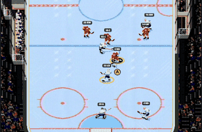
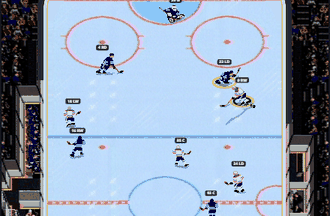
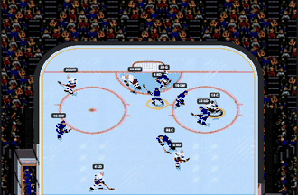
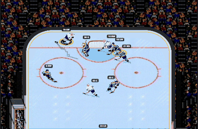
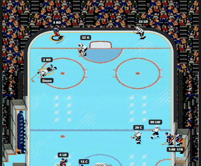
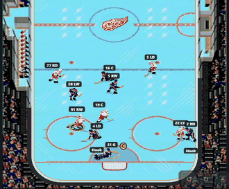
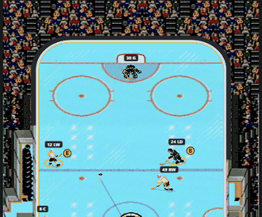
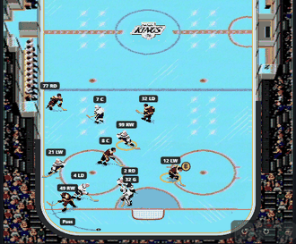

# What wins: the recorded people's games

The user's aim for the analyses (2026-11-14): the stats that show how people play and why someone won or lost. This
page collects the measures that separate winners from losers in the recorded games where a person played each side.
Each is an association, not a cause: a team ahead may sit back and a team behind may press, so some stats move with
the score rather than make it.

**How:** `analysis/what_wins.py [genesis|snes]` takes every finished game recorded from its start with a person on
both sides (the season summaries; the bot's games left out), each team stat as this team minus the other (the score
itself, goals inside lists and the mirrored "against" halves left out), and reports how often the winner's value was
higher, the mean winner-minus-loser difference, and the rank correlation with the goal difference. Then a small
logistic model on the strongest stats shows which carry weight with the others known.

## The leagues: 87,000 Genesis and 36,000 SNES games (2026-11-26)

`analysis/league_what_wins.py [wins|better|luck]` on the league result databases (every league game since 2013,
simulated games left out; aggregates only). The databases have no shot quality (no xG, no shot spots): shots, one-timers
and breakaways tried, passes, attacking-zone time, checks, faceoffs, penalties. Ratings: each person's rating before
the game (LEAGUE_RESULTS "Player ratings"), games between people with 30+ rated games.

**What the winner does** (winner higher, share of games / the logistic model's weight per standard deviation with the
ratings known):

| | Genesis | SNES |
|---|---|---|
| shot share | 73% / **+1.45** | 74% / **+1.64** |
| passes completed | 62% / +0.52 | 59% / +0.62 |
| breakaways tried | 59% / +0.33 | 59% / +0.32 |
| one-timers tried | 64% / +0.17 | 60% / 0.00 |
| attacking-zone time share | 60% / **-0.35** | 59% / **-0.46** |
| checks | 50% / -0.17 | 51% / -0.31 |
| pass completion % | 62% / -0.13 | 54% / -0.25 |
| faceoff share | 54% / +0.01 | 55% / +0.03 |
| penalty minutes, power plays | 48%, 52% / about 0 | 48%, 52% / about 0 |

- **Shots decide most.** The team with more shots wins 73-74% of games; outshot by 3-5 the team loses 27-29%, by 6-9
  14-16%, by 10+ 5-6%.
- **Passing, not possession.** Passes completed carry weight beyond the shots; time in the attacking zone, with the
  shots known, goes with *losing*: zone time that doesn't become shots. Completion rate counts less than volume.
- **Breakaways** count beyond their shots (a better chance each); one-timers tried add little once the shots are
  known (on the SNES nothing).
- **Hitting and faceoffs don't win games**: checks go slightly with losing when the rest is known; faceoffs and
  penalties are about even.
- The stats explain a game better than the ratings do (log loss 0.49 / 0.48 against 0.60 / 0.59), and both together
  best (0.455 / 0.443): how a game is played says more than who played it.

**How the better player wins** (by the pre-game rating gap):

| gap | wins | goal diff | shot share | shooting % for / against | passes completed % + | faceoffs |
|---|---|---|---|---|---|---|
| Genesis 0-50 | 53% | +0.23 | 50.9% | 32.2 / 31.3 | +0.4 | 50.1% |
| 100-200 | 69% | +1.31 | 54.8% | 34.3 / 29.3 | +2.3 | 51.1% |
| 300+ | 90% | +3.51 | 62.9% | 38.5 / 25.7 | +5.6 | 53.4% |
| SNES 0-50 | 53% | +0.20 | 50.5% | 38.7 / 37.8 | +0.2 | 49.9% |
| 100-200 | 68% | +1.34 | 54.0% | 40.3 / 34.8 | +0.9 | 51.2% |
| 300+ | 90% | +3.93 | 62.1% | 44.1 / 29.2 | +1.4 | 52.7% |

Split, the better player's goal difference comes **about 55% from more shots** (at the league's shooting %), **about
25% from scoring on more of his shots** and **about 20% from the other side scoring on fewer of theirs** (on the
Genesis the people play goal: that part is defence and goaltending; on the SNES the computer is in net, so it is
the shots he allows). Better finishing and fewer good chances against: shot quality, which the databases can't see
directly, makes up close to half the edge.

**Luck in one game:** the ratings' chances hold (the better player loses 47% at a gap under 50, 31% at 100-200, 10%
at 300+; as expected). The pre-game ratings explain 25-28% of a game's goal difference, the shot difference 42-45%,
both together 48-51%: half of a single game's margin is neither who played nor who shot more, but finishing, saves
and chance. Between the same two people in a league (10+ games), their win rate spreads 16-18 points around, of which
chance alone gives 14: most of a pair's ups and downs are chance.

## Where the margin comes from, with shot quality (the recorded games, 2026-11-26)

`analysis/recorded_what_wins.py [genesis|snes]`: the recorded games between two people (31 Genesis, 39 SNES), each
decided game's margin split for the winner into **more attempts** (the attempt difference at the games' mean xG per
attempt, 0.25), **better chances** (the rest of the xG difference), **finishing** (goals minus xG) and **keeping
them out** (the other's xG minus his goals). Attempts include blocked ones; xG and its goals don't: the split is
close, not exact.

| share of the winner's margin | Genesis (29 decided) | SNES (36 decided) |
|---|---|---|
| more attempts | 32% (favoured him in 72%) | 16% (56%) |
| better chances | **56%** (79%) | 27% (72%) |
| finishing | 3% (45%) | 27% (67%) |
| keeping them out | 9% (62%) | 30% (75%) |
| won with more xG | 93% of games | 75% |

(SNES after the model's takeover correction of 2026-11-26: XG_MODELS "Known gaps". Before it the SNES model was 15%
high in these games and the split read 18 / 31 / 17 / 34%.)

- **Genesis: the half of the edge the league data put in "finishing and defending" is chance quality.** Winners make
  better chances, not luckier ones: goals above xG are a coin flip (favoured the winner in 45% of games), and the
  side with more xG won 27 of 29.
- **SNES: more than half of it is finishing and keeping the puck out, and above all dekes.** By kind of shot
  (`analysis/finishing_by_move.py`; dekes by `scoring_moves.classify`: close in, the facing swung two steps in the
  last moments, from the goal line attacked): the winners' dekes went in 67 times on 52.3 xG (+14.7 ± 4.5), the
  losers' 27 times on 39.0 (-12.0 ± 4.1); dekes are 30% of the winners' attempts and about three fifths of their goals
  above xG. One-timers next (+6.5 and -9.0); the winners' slot shots +5.6 ± 1.8 (on 47); cross-crease and other
  close-in shots about even. Over both sides the model is right on dekes (94 goals, 91.3 xG): the gap is between the
  players, not in the model. On the Genesis no kind separates them (the winners' dekes -2.1, one-timers -4.7).
  Keeping them out on the SNES also takes the goalie. Over every shot at a computer goalie that a defending person
  could have taken over, goals fall by about a fifth (more from 70-100 units from the net). On the shots actually
  taken over mid-shot they went in at about a third of the model's own rate (14 goals on 37.5 xG; the rest 110 on
  119.4).
- **What goes with better chances** (xG per attempt across team-games, rank correlation): Genesis one-timers tried
  +0.46, attempts off a pass +0.39, entries that led to an attempt +0.39, rush attempts +0.38, passes completed +0.36;
  sustained pressure -0.15. SNES high-danger share +0.37, passes completed +0.21, one-timers +0.20; attempts off the
  other side's giveaways were the weaker ones (-0.38). The chances that win are made by the pass and on the rush,
  not by holding the zone (as the league data's zone time, above).
- Whether each part repeats for the same team across a series: 4 and 6 series of four or more games, too few to say.

## SNES dekes: what makes one go in (2026-11-26)

`analysis/snes_deke_study.py`: the 369 dekes people took in the recorded SNES games (115 goals, 31%), the state at the
release from the match file. The deke works when it pulls the goalie off the line from the puck to his net; the rest
is how you get there.

| at the release | dekes | scored |
|---|---|---|
| **goalie off the shot line** under 3 units / 3-6 / 6-10 / 10+ | 59 / 92 / 112 / 106 | **3% / 8% / 35% / 63%** |
| the puck out past the goalie to its side: within 5 / 5-15 / 15+ units | 38 / 110 / 210 | 8% / 18% / 40% |
| out from the goal line: 20-35 / 35-50 / 50-65 / 65-80 units | 89 / 147 / 89 / 38 | 52% / 34% / 16% / 11% |
| skating at the goal line (1.5+ a frame) / gliding / moving away | 146 / 69 / 30 | 40% / 25% / 10% |
| facing swing 2 steps / 3 / 4 | 264 / 92 / 13 | 33% / 28% / 8% |
| **a person took the goalie over mid-shot** / not | 73 / 296 | **7%** / 37% |

- **Do:** drive at the goal line from about 20-35 units out (7-12 ft), and swing just enough (two of the eight
  facings) to carry the puck out past the goalie to one side, so that he's off the line to the net when you let go.
- **Don't:** deke from 50+ units out, deke while drifting away from the net, or swing the stick all the way round (4
  steps): those go in one time in ten or less.
- **Against it:** a person who takes the goalie over during the deke stops all but 7% (the shooter's xG on those was
  20%, the model's own). Winners' dekes in the games between people: the goalie 10+ units off the line 32% of the time
  (losers' 24%), skating at the line 41% (30%), taken over mid-shot 17% (30%): winners get there more often and get taken over less.

Recorded examples (the viewer's own replay, `analysis/vision_free_clip.py`):

## Genesis one-timers: what makes one go in (2026-11-27)

`analysis/gen_one_timer_study.py`: the 220 one-timers people took in the recorded Genesis games (not blocked; 83
goals, 38%), each with its pass (4 had none matched: in the pass rows only as unknown) and the state at the release from the
match file; the winners and losers from games recorded from the start. Each figure has about ±5-8 points
of sampling error.

| at the release | one-timers | scored |
|---|---|---|
| out from the goal line: under 40 / 40-70 / 70-100 / 100-140 units | 35 / 68 / 69 / 42 | 14% / **53% / 51%** / 14% |
| across from the middle: under 50 / 50+ units | 178 / 42 | 41-47% / 12% |
| pass time (real): under 0.3 s / 0.3-0.5 / 0.5-0.8 | 111 / 68 / 33 | 41% / 37% / 24% |
| pass length: under 100 / 100-150 units | 159 / 48 | 40-43% / 23% |
| the goalie's slide needed (from where he was at the pass): under 40 / 40-70 / 70+ | 148 / 45 / 23 | 41-49% / 24% / 13% |
| the goalie sliding at the release: still / sliding / sliding fast | 93 / 118 / 9 | 48% / 31% / 11% |
| **the goalie off the shot line**: under 10 / 10+ units | 137 / 83 | 19-34% / **57%** |
| shot speed 20,000+ / 17,000-20,000 | 119 / 89 | 45% / 33% |
| a person in net / the computer | 45 / 175 | 53% / 34% |

- **The spot:** the slot from about 13 to 33 ft out (40-100 units), within about 17 ft (50 units) of the middle.
  Right on top of the crease (under 40 units) the one-timer goes in only 14% of the time. That's lower than the
  model's 30%.
- **The pass:** short and quick beats long and cross-ice. A pass that arrives within 0.3 s (real) and is under
  about 33 ft scores twice as often as a long cross-ice pass. The pass length, the pass time and the goalie's slide
  are largely one finding: a long pass gives the goalie time to slide over and get square. That goes against the
  usual hockey idea of "move the goalie side to side", and the reason is probably that the Genesis goalie gets
  across faster than the pass does.
- **The goalie:** what matters is that he's already off the line when the pass comes, not that he's moving. One-timers
  with him 10+ units off the shot line went in 57% of the time. With him still, they went in more often than with him
  sliding.
- **The shot:** hard ones (Shot Power) go in more.
- **People in net** let in more one-timers than the computer goalie (53% to 33%, on only 45 shots).
- **Winners against losers** (the decided games between people): winners took 135 one-timers to losers' 78. They
  scored on 44% to 28%, with xG of 44% to 38%. That is more one-timers, slightly better ones, and finishing at the
  expected rate where losers fell 10 points short.

Recorded examples (the viewer's own replay of the attacked half, `analysis/vision_free_clip.py ... top|bottom`):

## Genesis (31 games, 2026-11-14)

| team minus opponent | winner higher | winner - loser (mean +- SE) | rank corr. with goal diff |
|---|---|---|---|
| expected goals (xG for) | 90% | +2.39 +- 0.42 | +0.76 |
| one-timers tried | 82% | +2.77 +- 0.56 | +0.73 |
| shot attempts | 81% | +4.03 +- 1.05 | +0.52 |
| shots on goal | 81% | +3.81 +- 0.96 | +0.64 |
| shot attempts off the rush | 79% | +3.61 +- 0.89 | +0.60 |
| zone entries that led to an attempt | 77% | +2.97 +- 0.77 | +0.55 |
| passes completed by the person | 74% | +7.16 +- 2.67 | +0.58 |
| turnovers that led to a shot against | 26% | -2.16 +- 0.77 | -0.35 |
| checks that led to a shot | 69% | +1.06 +- 0.50 | +0.40 |
| giveaways | 31% | -1.61 +- 0.72 | -0.16 |
| odd-man rushes | 68% | +1.39 +- 0.76 | +0.39 |
| attacking-zone possession (time) | 56% | +21.6 +- 10.4 s | +0.35 |
| attacking-zone time | 58% | +17.5 +- 17.5 s | +0.10 |
| checks thrown | 42% | -1.29 +- 1.58 | -0.12 |
| big hits | 42% | -0.23 +- 0.55 | -0.21 |
| penalties | 47% | +0.00 +- 0.36 | -0.09 |

Logistic model (one-timers tried, xG, shots on goal, rush attempts): one-timers tried carries the most weight (+1.5 per
standard deviation), then xG (+1.3), with the others known.

**Read:** on the Genesis the winner makes more chances and better ones (xG), above all one-timers, and completes more
passes; he gives the puck away less, and above all less often in ways that lead straight to a shot against. Time in
the attacking zone and possession there barely separate winners from losers, and hitting doesn't win games: winners
threw slightly fewer checks.

## SNES (25 games, 2026-11-14)

| team minus opponent | winner higher | winner - loser (mean +- SE) | rank corr. with goal diff |
|---|---|---|---|
| zone entries | 80% | +2.24 +- 0.79 | +0.50 |
| shot attempts off the rush | 72% | +1.92 +- 0.81 | +0.56 |
| expected goals (xG for) | 72% | +1.37 +- 0.34 | +0.70 |
| shots on goal | 68% | +1.32 +- 0.85 | +0.44 |
| zone entries that led to an attempt | 70% | +1.76 +- 0.80 | +0.62 |
| passes tried | 68% | +4.60 +- 2.84 | +0.41 |
| breakaways tried | 66% | +0.64 +- 0.37 | +0.33 |
| high-danger attempts | 62% | +1.36 +- 0.68 | +0.48 |
| one-timers tried | 62% | +1.04 +- 0.71 | +0.31 |
| big hits | 36% | -0.72 +- 0.54 | -0.27 |
| checks thrown | 38% | -1.56 +- 2.42 | -0.39 |

**Read:** on the SNES the winner gets into the zone more and shoots off the rush; one-timers matter less than on the
Genesis. Hitting again goes with losing more than winning.

## Decisions: shoot or wait, check or hang back

Ratios from the same summaries (what_wins.py's "ratio" rows), winner against loser:

| | Genesis: winner higher | SNES: winner higher |
|---|---|---|
| xG per attempt (shot quality) | 81% (+0.10 a shot) | 72% (+0.06) |
| one-timers per attempt | 73% | - |
| passes completed by the person | 76% | 38% |
| zone entries that led to an attempt | 69% | 60% |
| checks that paid off (the puck, a shot or a goal) | 61% | 72% |
| giveaways per attempt | 18% (the winner lower in 82%) | 40% |

**Shoot or wait:** on the Genesis the winner takes better shots, not only more: more of them one-timers off a pass,
and more of his passes reach their man; and he gives the puck away far less for each attempt he makes. Waiting for the
better shot, usually through a pass, goes with winning. **Check or hang back:** winners don't throw more checks, but
more of theirs win the puck or lead to a shot: picking the moment beats hitting a lot.

## Caveats

- Small samples: 31 and 25 games, many of them the user's own, so the results lean toward how the user's games go.
- Score effects: the team ahead tends to sit back, so possession and attack time can understate the better team;
  the team behind takes more risks.
- The stats themselves come from the converter, checked against the game's own counts where the game keeps them
  (goals, shots, checks, faceoffs) and, since 2026-11-14, giveaways and takeaways against NOSE4Web's in-game count.
