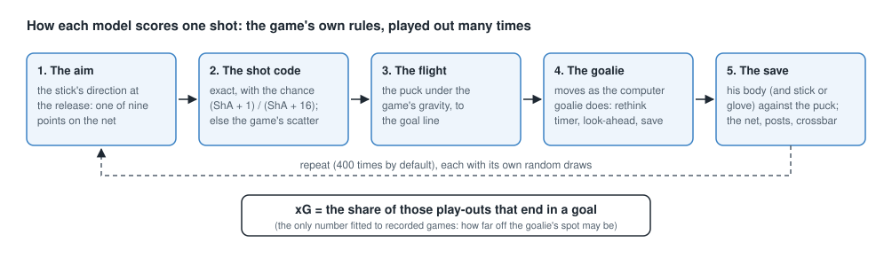
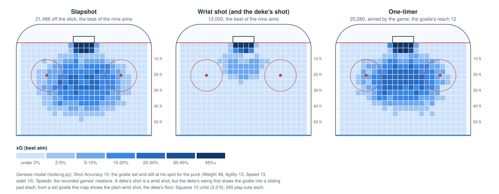
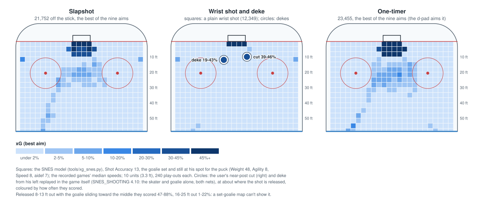
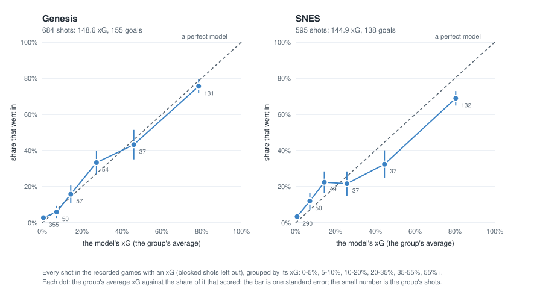

# The xG models: how to use them

*For anyone, or any coding assistant, who wants to put this project's expected-goals models into their own work. The
models themselves: `tools/xg.py` (Genesis) and `tools/xg_snes.py` (SNES). How they were built and checked:
[GENESIS_SHOOTING 4.9](GENESIS_SHOOTING.md#49-expected-goals-from-the-games-own-rules) and
[SNES_SHOOTING 4.7](SNES_SHOOTING.md#47-expected-goals-from-the-games-own-rules).*

## What they are

Neither model is fitted to where shots come from. Each **plays the shot out the way the game itself would**, many
times, and counts the goals:

1. the aim point chosen by the stick direction at the release (nine points: across the mouth × height);
2. the game's own shot code: exact with the perfect-shot chance (Shot Accuracy + 1) / (Shot Accuracy + 16) from close
   enough, otherwise the game's random scatter;
3. the puck's flight under the game's gravity;
4. the goalie moving as the game's computer goalie does from where he was at the release (his rethink timer, his
   look-ahead, going to where the puck will cross his goal line, starting a save move), with his own ratings;
5. the game's save geometry (Genesis: a body circle of 12-15 units, his stick blade if the ROM is given; SNES: a body
   box plus the stick / glove area of the sprite frame he shows) and the game's net (goal mouth, posts, crossbar).



xG is the share of those play-outs that end in a goal. The only number fitted to recorded games is how far the
emulated goalie's position may be off (4 units on the Genesis, 2 on the SNES: random spread, `GOALIE_SPREAD`).

Pure Python 3, standard library only. The SNES model, and the Genesis goalie's stick, read sprite and animation data
from the game ROM: bring your own copy (`NHL 94 (USA)` Genesis or SNES; none is in this repository and none should be
shared). Without a ROM the Genesis model runs without the stick.

## What you need for each shot

All in the game's own units, as its RAM holds them. Coordinates: the rink's centre is (0, 0), +Y up the screen; the
goal lines are at Y ±264 (the Genesis net's front at ±261, the SNES's at ±259); X across, ±128 at the boards.

| Input | Meaning | Units |
| --- | --- | --- |
| Puck spot | Where the puck is on the release frame (Genesis: height too) | game units |
| Puck speed | The puck's speed off the stick: the fastest over the first 10 frames | velocity words (4096 = 1 unit a frame) |
| Aim | The stick direction the shot code reads: 0 = Up, 1 Up-Right, ... 7 Up-Left (screen), 8 none | 0-8 |
| Shot Accuracy | The shooter's **working** rating | Genesis 0-30, SNES 0-15 |
| Goalie spot and velocity | At the release | units; velocity words |
| Goalie ratings | Working Weight, Agility, Speed, and the reaction value `aidef` (stored in the Defensive Awareness slot) | as in RAM |
| Goal line | The line of the net being shot at: +264 or -264 | units |
| SNES only: facing, sprite frame | The goalie's facing (0-7) and the sprite frame he shows | as in RAM |

"Working" ratings are what the game uses in play, not the roster's 0-6 steps: Genesis rating × 5 plus hot / cold and
bonuses (0-30); SNES 0-15 (and note the SNES bug that maxes "cold" ratings, SNES_MECHANICS 2). Read them from RAM, or
see the mechanics docs for how they are made.

The aim index is the stick's **screen** direction, whichever net is attacked: Up is always the high shot, Down along
the ice, Left and Right the screen's sides. One-timers and computer shooters on the Genesis are aimed by the game
itself: use `xg.auto_aim` (below).

### Where these are in RAM

**Genesis** (work RAM $FFxxxx; object records $80 bytes from $B04A, record k at $B04A + $80 × k; 0-5 Home, 6-11 Away,
14 the puck; a goalie's position byte +$35 is 0):

| Field | Offset |
| --- | --- |
| X, Y, Z (integer word of 16.16) | +$00, +$14, +$18 |
| X, Y velocity (words) | +$28, +$2A |
| Sprite frame / facing / animation | +$06 / +$55 / +$58 |
| Shoots left (bit 0; clear: drawn mirrored) | +$76 |
| Weight, Agility, Speed, aidef, Puck Control (goalie), Shot Accuracy | +$67, +$68, +$69, +$6B, +$6C, +$6D |
| The stick direction for a shot (aim) | $BEDC |

**SNES** (work RAM bank $7E; one word per object at base + 2 × object; the puck is object 14):

| Field | Base |
| --- | --- |
| X, Y | $0D55, $0DB7 |
| X, Y velocity | $0EC3, $0EE3 |
| Sprite frame / facing | $0D97 / $1163 |
| Weight, Agility, Speed, aidef, Puck Control (goalie), Shot Accuracy | $12C3, $12E3, $1303, $1343, $1363, $1383 |
| The stick direction for a shot (aim, low byte) | $0D03 |

Both tables come from the disassemblies (github.com/abdulahmad/NHL94Genesis, github.com/abdulahmad/NHL94SNES); the
project's CLAUDE.md lists more.

## Using them

### Genesis

```python
import random, sys
sys.path.insert(0, "tools")
import xg

# a wrist shot from the slot at the top net: puck (20, 200) on the ice at 12,000, aimed Right (2: the middle height),
# a Shot Accuracy 15 shooter; the goalie still at his set spot for that puck (on the ellipse 26 across and 18 out in
# front of his net, toward the puck), Weight 48, Agility 13, Speed 13, aidef 10
px, py, pz, speed, aim, sha = 20, 200, 0, 12000, 2, 15
gx, gy, gvx, gvy = 8, 243, 0, 0
weight, agility, spd, aidef, puck_control = 48, 13, 13, 10, 10
goal_line = 264

goalie = xg.Goalie(gx, gy, gvx, gvy, weight, agility, spd, aidef, puck_control=puck_control)
reach = xg.REACH[min(19, (agility + 2) >> 1)]   # 15 if a person controls the goalie, 12 against a one-timer
tx, tz = xg.AIM[aim]
rng = random.Random(1)
n = 400
goals = sum(xg.play_out((px, py, pz), (tx, goal_line, tz), max(1.0, speed / 68), sha, (sha + 1) / (sha + 16),
                        goalie, reach, 0, rng) == "goal" for _ in range(n))
print("xG", goals / n)
```

- **A goalie locked in an animation** (a save move or pad stack, pflags bit 5): `locked=<frames until the lock
  clears>` in `Goalie`, and his velocity over the frames ahead if you have them (he can't react, only slide).
- **With the goalie's stick** (recorded shots in this project have it): make `rom = xg.GenesisRom(open(ROM, "rb").read())`,
  give the goalie `rom=rom, frame=<his sprite frame>, facing=<his facing>, mirror=<drawn mirrored>`, and pass
  `stick=True` to `play_out`.
- **A one-timer or a computer shooter:** the game aims for him from where the goalie is heading:
  `aim = xg.auto_aim(px, py, gx + 8 * gvx / 4096, gy + 8 * gvy / 4096, goal_line)`.
- **A goalie in a pad stack** (animation $0250 or $02A2): reach 18, and the body test moves 6 to one side:
  `reach, shift = 18, xg.PAD_STACK["0250"]` (pass `shift` where the example passes 0).
- **During a delayed penalty** the shot is always exact: perfect chance 1.0.
- `play_out` returns 'goal', 'save', 'stick', 'post', 'over' or 'wide' for each play-out.

### SNES

```python
import random, sys
sys.path.insert(0, "tools")
import xg_snes as xs

data = xs.RomData(open("NHL94.sfc", "rb").read())   # your own copy of the ROM (a copier header is stripped)

px, py, speed, aim, sha = 20, 200, 11700, 2, 13
gx, gy = xs.set_spot(px, py, True)                  # his set spot for that puck (the top net); or where he really was
gvx, gvy = 0, 0
weight, agility, spd, aidef, puck_control = 48, 8, 8, 7, 10
facing = 4                                          # the top net's goalie faces down the screen
frame = data.anim(0xE0FE, facing)[0][0]             # his ready stance's frame (or the frame he shows)
goal_line = 264

goalie = xs.Goalie(data, gx, gy, gvx, gvy, facing, frame, weight, agility, spd, aidef, puck_control=puck_control)
tx, tz = xs.AIM[aim]
rng = random.Random(1)
n = 400
goals = sum(xs.play_out(px, py, tx, goal_line, tz, max(1.0, speed / 136), sha, (sha + 1) / (sha + 16), goalie, rng)
            == "goal" for _ in range(n))
print("xG", goals / n)
```

### From this project's recordings

If you record games with this project's helper, the converter already does all of this: `tools/export_match.py` gives
every shot in the match file its `xg` (`xg.add_expected_goals(match, stick_rom=...)`,
`xg_snes.add_expected_goals(match, rom)`), and the viewer and season pages add them up.

### Seeds and samples

The answer is a share of random play-outs: 400 gives about ±2.5 points at 50% (±1 at 10%). Seed the generator if you
need the same answer twice. Both modules keep the spread of the emulated goalie in `GOALIE_SPREAD`; set it to 0 when
your goalie state is exact (read from RAM on the release frame), since the spread stands for the error of reading a
recorded goalie.

## What they give

The models from every spot of the attacking zone, for each kind of shot at a goalie who is set and still at his spot
for the puck: slapshots, wrist shots and one-timers (the shot speeds are the recorded games' medians; the best of the
nine aims, except the Genesis one-timer, which the game aims itself). A goalie who is moving, out of position or in a
save move gives very different numbers: these are the floor that a set goalie allows.

**Wrist shots and dekes share a panel.** A plain wrist shot at a set goalie almost never scores on either system, and
in league play nearly every wrist shot that isn't at an empty or abandoned net is a deke: the swing first moves the
goalie (on the Genesis into a pad stack sliding the wrong way), then the wrist shot goes in. A map that holds the
goalie set can't show that, so the circles on the middle panels are the dekes **played in the game itself**, at about
where the shot leaves the stick, coloured by how often they scored on the same scale: the Genesis deke runs' best
set-ups ([SCORING_GENESIS_DEKES](SCORING_GENESIS_DEKES.md)) and the user's SNES dekes replayed
([SNES_SHOOTING 4.10](SNES_SHOOTING.md#410-dekes-in-recorded-games)). Both were played with the shooter alone with
the goalie; with every skater on the ice the Genesis deke's timing changes (SCORING_GENESIS_DEKES, the caveat). Given
the real moment of a deke (where the goalie is, his slide and save move), the models themselves do get dekes right
(below, "Against the game itself").



- **Genesis:** a set goalie lets in a slapshot at the best aim 10-20% of the time from a wide area in the middle,
  out to about 45 ft (the game itself, played: 13% over the middle of the ice, [SCORING_GENESIS](SCORING_GENESIS.md#slapshots-and-the-shooters-ratings)).
  A plain wrist shot needs the middle of the slot or the doorstep; the deke from about 15 ft out scores 83-85% swung
  to the shooter's left, 46-66% to his right, the floater 61-65%. A one-timer scores from a band out to about 40 ft
  and across to the faceoff dots, because his reach drops to its minimum against it ([GENESIS_GUIDE 7](GENESIS_GUIDE.md#7-one-timers)).
- **SNES:** a set SNES goalie stops nearly every plain wrist shot; the dekes go in from right on top of him: the
  near-post cut 39-46%, the deke from the left 19-43% (released 8-13 ft out with the goalie sliding toward the middle,
  47-88%; 16-25 ft out, 1-22%). Slapshots and one-timers (the d-pad aims them on the SNES) find the game's gaps: the
  doorstep, the slot's middle about 20 ft out, and a lane from the left point (the lane past his glove save,
  [SCORING_SNES](SCORING_SNES.md); the game itself: 3.8% for slapshots over the middle).



## How good they are

- **Recorded games** (person against person and against the computer): log loss 0.26 on Genesis shots and 0.38 on
  SNES shots, against 0.48 and 0.54 for giving every shot the same chance; expected goals close to goals (886
  Genesis shots and one-timers: 200.9 xG, 200 goals; 741 SNES ones: 185.8 xG, 174 goals).

  

  The recorded games in the game folder on 2026-10-31 (684 Genesis shots: 148.6 xG, 155 goals; 595 SNES: 144.9 xG,
  138 goals). The Genesis model follows the diagonal throughout. The SNES model is right up to about 30% and a little
  high above it: shots it gives 35-55% went in 32% of the time (37 shots), those above 55% 69% (132).
- **Against the game itself** (2026-10-29, `analysis/scoring_map/xg_calib.py`, the game's real outcome for 33,808
  Genesis and 9,617 SNES shots from the exact state): right on dekes, EA first shots, standing shots and (checked
  before, `ot_xg_check.py`) one-timers on both systems.

**Known gaps**, all documented in the two shooting docs:

- Genesis: a goalie **already in a save move** at the shot (often a pad stack) must be held in it: pass
  `locked=<frames left in his lock>` to `Goalie` (the game's pflags bit 5, +$62's low byte bit 5; this project's
  converter does it from the recording). Without it the model is far too low on those shots (the game 24%, the model
  15%). A little high when he is set (the game 7%, the model 10%).
- SNES: too low on close follow-ups in the 10 frames after the puck comes off the goalie (the game ignores him for
  those frames); rare in real games.
- SNES: too low on close dekes: on the user's replayed SNES dekes the game scored 30%, the model 20% (cuts 36%
  against 32%); the model's goalie moves toward the puck's side after the release where the game's barely moves
  (SNES_SHOOTING 4.7). The cause is known (the game's goalie
  only glides in a save move) and the fix is in the model behind a switch (`GLIDE_IN_SAVE`, off): right on the game's
  close-in shots, but far too weak from range: 24% high on the recorded shots and, on the game's own one-timers, 867
  expected goals against 527 scored (the old movement 481), all of it from 60 out and beyond. So the gliding goalie
  is right only close in; until a version is right at every range the switch stays off. The old movement is also a
  little low from 120 out on one-timers (43 against 67).
  The save choice, the save areas, the puck's flight and the goalie seeing the puck a step late
  (`STALE_PUCK`, off: 20.5 -> 16.6 goals against the game's 3.2 from 120-200 out) are ruled out as the main cause
  (SNES_SHOOTING 4.7). The main cause found: in the game the step a save starts still pushes the goalie toward the
  crossing (`SAVE_PUSH`, part of the gliding goalie). With it the gliding goalie is right on the dekes (31.4% against
  the game's 33.3%) and on one-timers from 60-120 out (28.0 against 26.8), still high from 120-200 (12.8 against 3.2)
  and on the recorded shots (160.9 against 138 goals; the old movement 144.9), so the switch stays off.
- Neither has skaters in the way (screens, deflections); blocked shots are left out of totals. A shot that bounces
  off a skater in front and in is still a goal at the shot's own xG (one Genesis one-timer at 0.00 was going over the
  bar until it hit a defender in the crease).
- A shot that hits a post on the very frame it leaves the stick is recorded after the bounce, and the bounce is
  played as the shot (one in the recordings, a post at 1.00).
- A person in net is moved as the computer would move him.
- Pass shots (a pass with nobody to take it, sent at the net) are played from the puck's recorded start, with the
  game's random lift (`xg.launched`, `launch` in both `play_out`s); deflections and scrambles get no xG.

So: good for comparing teams and players over several games and for judging most single shots; some very quick
follow-ups on the SNES are underrated.
